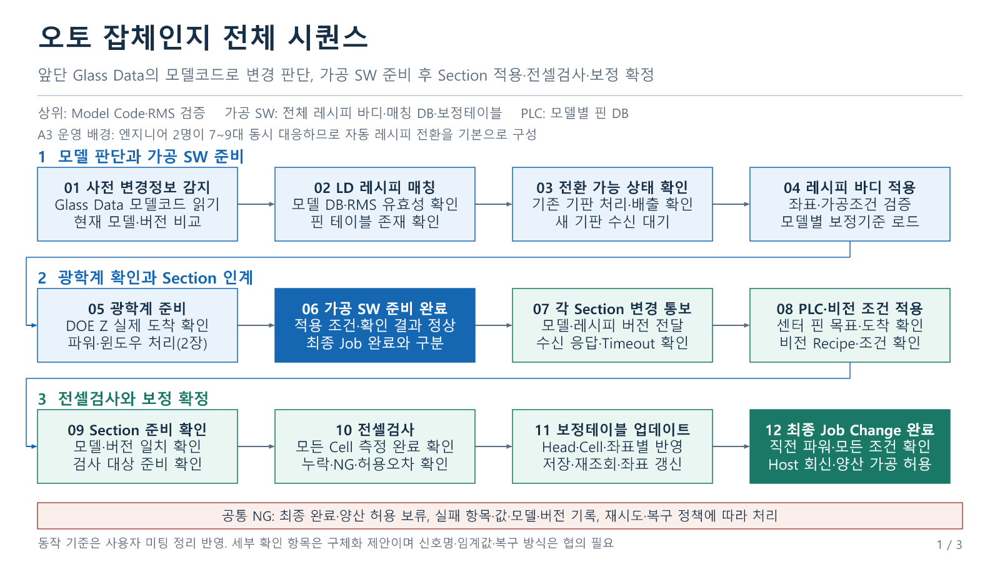
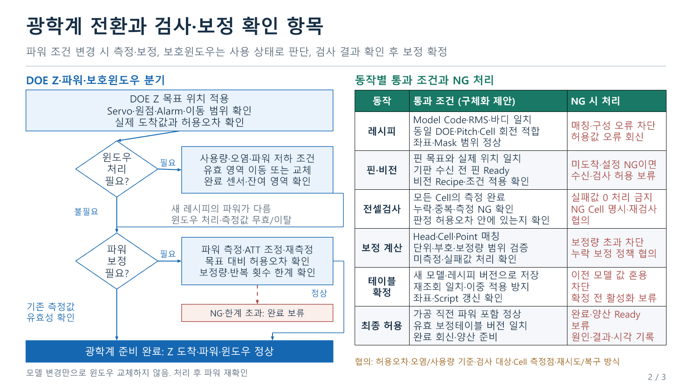
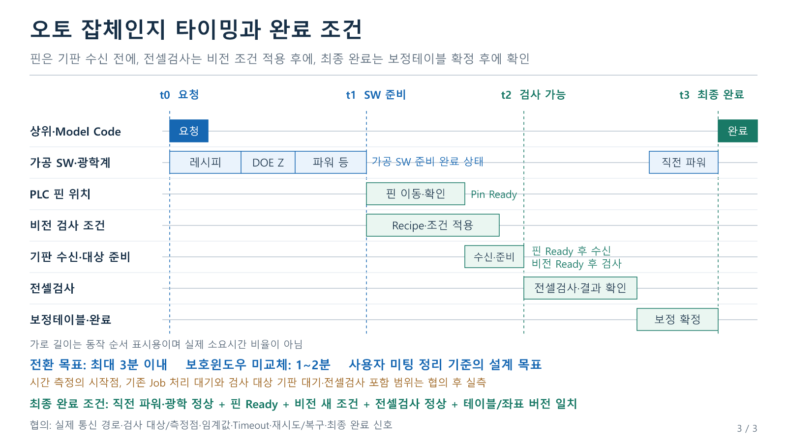

# A3 LD 오토 잡체인지 상세 시퀀스·체크 항목·타이밍

[편집 가능한 3장 PowerPoint](A3LD_오토잡체인지_상세플로우_체크항목_타이밍_3장_편집본.pptx)

작성·공유: 2026-10-12 (Asia/Seoul)

## 자료 구성

1. 전체 시퀀스: 사전 모델 감지부터 최종 완료까지 12개 동작
2. DOE Z·파워·보호윈도우 분기와 동작별 통과 조건·NG 처리
3. 기판 수신·비전 준비·전셀검사·보정 확정의 타이밍과 완료 조건

문구, 도형, 연결선, 타이밍 막대와 체크 표는 PowerPoint에서 직접 편집할 수 있습니다. 각 장의 발표자 노트에는 상세 체크 항목, 회의 근거, 운영 전제와 협의할 부분을 넣었습니다.

## 이번 적용 기준

사용자가 2026-10-12에 제공한 미팅 정리와 첨부 음성 `A3LD 제어미팅 261008_133709.m4a`를 기준으로 작성했습니다. 과거 오토 잡체인지 제안서의 내용은 사용하지 않았습니다.

- A3는 엔지니어 2명이 7~9대에 대응하는 운영 배경에 따라 자동 레시피 전환을 기본으로 구성합니다.
- 증착기 PPID와 LD 고유 레시피를 분리하고, 앞단 Glass Melsec Data의 Model Code로 변경 모델을 판단합니다.
- 상위는 모델 정보와 RMS 유효성 검증을 제공하고, 전체 레시피 바디는 가공 SW가 관리합니다.
- PLC는 모델별 핀 DB를 보유하고 기판 수신 전에 센터 핀 이동 완료를 확인합니다.
- DOE Z 위치 업데이트, 전셀검사, 보정테이블 업데이트를 전체 흐름에 포함합니다.
- 레시피 파워가 달라지면 파워 측정·보정 절차를 수행하고 가공 직전 조건을 확인합니다.
- 보호윈도우는 모델 변경만으로 교체하지 않습니다. 사용량·오염·파워 저하 조건으로 이동 또는 교체를 판단하며 처리 후 파워를 재확인합니다.
- 최대 3분 이내, 보호윈도우 미교체 시 1~2분은 사용자 미팅 정리에 따른 설계 목표입니다. 확정 실측값이나 장치 Timeout으로 사용하지 않습니다.

## 전체 흐름과 체크 포인트

| 단계 | 동작 | 확인할 내용 |
| --- | --- | --- |
| 01 | 사전 변경정보 감지 | 앞단 Model Code, 현재 모델·버전과의 차이, 중복·역순 요청 |
| 02 | LD 레시피 매칭 | 모델 DB·LD Recipe·RMS 결과, PLC 핀 테이블 존재 |
| 03 | 전환 가능 상태 | 기존 Job 기판 처리·배출, Busy 및 신규 기판 수신 대기 |
| 04 | 전체 레시피 바디 적용 | 좌표·가공조건·Mask·Pitch·Cell 회전, 해당 모델의 보정기준 |
| 05 | 광학계 준비 | DOE Z 도착, 파워 차이, 보호윈도우 상태와 필요한 보정 |
| 06 | 가공 SW 준비 완료 | 기본 조건 적용값과 확인 결과 정상, 내부 준비 상태 인계 |
| 07 | Section 변경 통보 | 모델·레시피 버전, 수신 응답과 통신 Timeout |
| 08 | PLC·비전 적용 | 기판 수신 전 핀 Ready, 비전 새 Recipe·파라미터 적용 |
| 09 | Section 준비 확인 | 같은 모델·버전인지 확인, 검사 대상 준비 |
| 10 | 전셀검사 | 모든 Cell의 지정 측정, 누락·중복·NG·허용오차 |
| 11 | 보정테이블 업데이트 | Head·Cell·Point 매칭, 단위·부호·보정량, 저장·재조회·좌표 갱신 |
| 12 | 최종 완료 | 가공 직전 파워, 모든 준비·검사 결과 및 테이블/좌표 버전 일치 |

가공 SW 준비 완료와 최종 Job Change 완료를 분리합니다. 비전의 새 조건으로 전셀검사를 수행할 수 있도록 Section 준비 확인 후 검사·보정 확정을 배치했습니다. 최종 완료와 양산 가공 허용은 모든 필수 확인이 정상인 이후로 두는 구체화 제안입니다.

## 주요 분기

- DOE Z: 명령 목표 외에 Servo·원점·Alarm·이동 범위·실제 도착·허용오차를 확인합니다.
- 파워: 새 파워가 다르거나 윈도우 처리·측정값 무효/이탈이면 측정·필요한 ATT 조정·재측정을 수행합니다. 허용오차, 보정량과 반복 횟수 한계를 확인합니다.
- 보호윈도우: 사용량·오염·파워 저하 조건이 있을 때 유효 영역 이동 또는 교체를 판단합니다. 잔여 영역과 동작 완료를 확인합니다.
- 전셀검사: 모든 Cell의 측정 여부를 확인하며 미측정·실패를 유효한 0 값으로 처리하지 않는 체크를 제안합니다.
- 보정테이블: 새 모델·레시피 버전으로 저장·재조회하고 좌표와 Script를 갱신합니다. 이전 모델의 값 혼용과 이중 보정을 확인합니다. 위치보정테이블과 파워보정 결과는 구분합니다.
- NG: 최종 완료와 양산 Ready를 보류하고 원인·값·모델·버전·시각을 기록합니다. 재시도·복구 범위는 정책으로 정의합니다.

## 추가 협의할 부분

- 실제 인터페이스 경로, 요청·ACK·준비·최종 완료 신호의 정의
- 전환 요청 시 기존 기판 처리와 대기·거절·재전송 정책
- 검사 대상이 검증용 기판인지 새 모델의 첫 기판인지, Cell별 측정점과 판정 기준
- 전셀검사와 모든 Hole/Pixel 전수 검사의 구분
- 보정테이블의 종류·저장 형식·계산법·적용 범위·버전 관리
- DOE Z 허용오차, 오염/사용량 기준, 파워 측정 유효기간, 보정량·재시도·Timeout·복구 방식
- 시간 측정의 시작점과 기존 Job 처리·검사 대상 기판 대기·전셀검사 포함 범위
- 하이브리드의 동일 DOE·Pitch 내 Cell 크기·회전 조건과 지원 범위

운영 원칙은 사용자 미팅 정리를 반영했습니다. 세부 체크 기준, NG 처리와 완료 시점은 실행 가능한 시나리오를 위한 제안이며 현재 프로그램에 구현되었다는 뜻은 아닙니다. 이 자료는 음성 기반 개발 시나리오이며 소스코드 변경 분석의 Git 기준점 갱신 자료가 아닙니다.

## 미리보기

### 1장 전체 시퀀스

### 2장 광학계 분기와 동작 체크

### 3장 타이밍과 완료 조건

