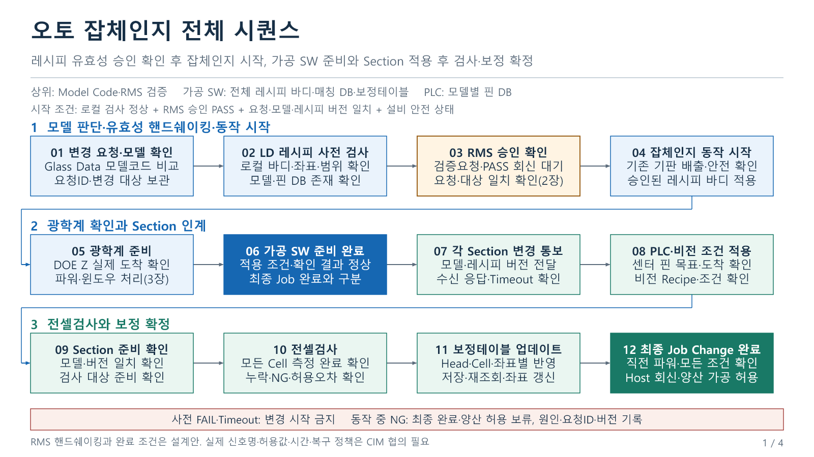
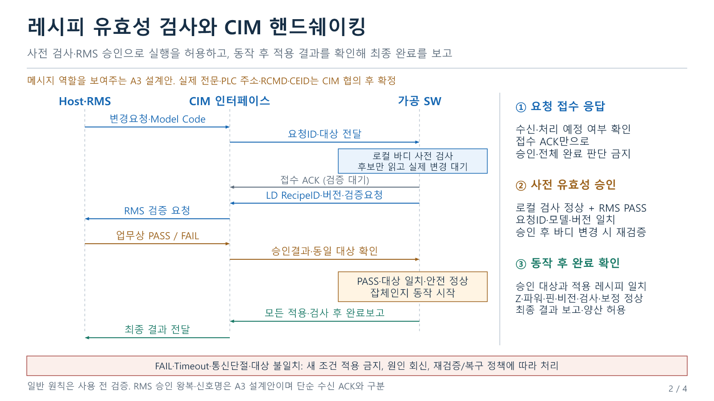
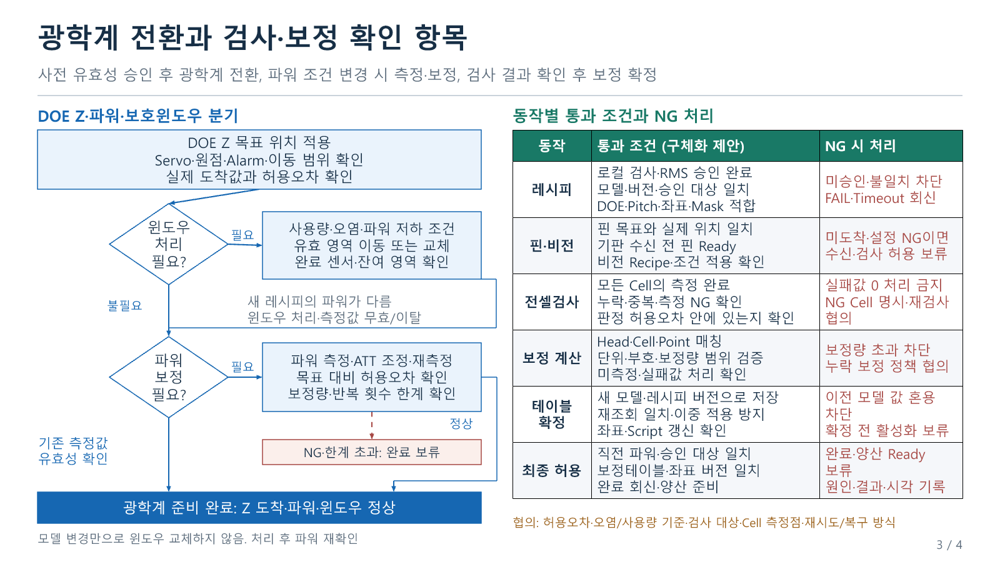
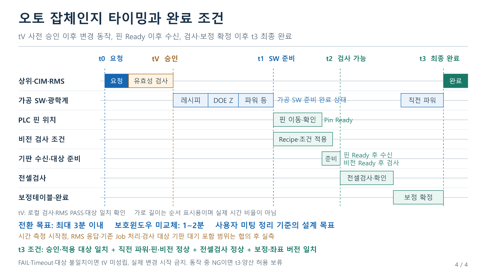

# A3 LD 오토 잡체인지 CIM 유효성 검사와 핸드쉐이킹

[편집 가능한 4장 PowerPoint](A3LD_오토잡체인지_CIM유효성검사_핸드쉐이킹_4장_편집본.pptx)

공유 시각: 2026-10-13 15:21:37 Asia/Seoul

레시피를 사용하기 전에 유효성을 확인하고, 확인된 대상에 대해서만 잡체인지 동작을 시작합니다. 동작 이후에는 실제 적용 조건과 준비 결과를 확인합니다. 이번 A3 설계안은 로컬 검사 정상과 RMS 승인 PASS를 잡체인지 시작 조건으로 두고, 요청 접수 응답과 최종 완료를 분리합니다.

## 일반 SECS GEM 원칙과 A3 적용 범위

장비가 수신한 레시피의 내용을 검증하고, 검증 실패 레시피를 사용하지 않는 원칙은 [PDF Solutions의 SECS/GEM Recipe Management 설명](https://www.pdf.com/secs-gem-series-recipe-management/)에 제시되어 있습니다. [SEMI E170 공개 초록](https://store-us.semi.org/products/e17000-semi-e170-specification-for-secured-foundation-of-recipe-management-system-sforms)은 실행 직전 장비와 RMS의 레시피 일치를 확인하는 선택적 Pre-Execution Check도 설명합니다.

따라서 모든 잡체인지 동작을 끝낸 뒤 처음 레시피 유효성을 검사하는 순서를 기본으로 삼지 않습니다. 다만 위 자료만으로 모든 설비가 같은 RMS 승인 왕복을 의무로 사용한다고 볼 수는 없습니다. 실제 A3 고객 CIM 전문, 신호명, 통신 주소와 E170 채택 여부는 별도 확인 대상입니다. PPT의 Host·RMS, CIM, 가공 SW 연결은 역할을 나타내는 설계안입니다.

## 응답과 승인과 완료의 구분

| 구분 | 확인하는 내용 | A3 동작 조건 |
| --- | --- | --- |
| 요청 접수 응답 | 요청을 받았는지, 처리 예정인지 | 이 응답만으로 변경 시작이나 최종 완료를 판단하지 않음 |
| 로컬 사전 검사 | 바디 형식·필수값·범위, 모델·레시피·핀 DB, 좌표·Mask·DOE·Pitch 적합성 | 후보를 읽어 검사하되 실제 활성 레시피와 장치 조건은 변경하지 않음 |
| RMS 업무상 승인 | PASS/FAIL 및 승인 대상의 RequestID·ModelCode·LD RecipeID·버전 일치 | 로컬 검사 정상과 같은 대상의 PASS, 전환 안전 상태를 모두 확인한 후 실행 |
| 동작 후 완료 확인 | 승인 대상과 실제 적용값, DOE Z·파워·핀·비전·전셀검사·보정 상태 | 모든 필수 결과 정상일 때 최종 결과 보고와 양산 허용 |

표준 응답 코드도 의미에 따라 구분해야 합니다. [ErgoTech의 HCACK 설명](https://ergotech.com/docs/api/com/ergotech/secs/HCACK.html)에서 HCACK=0은 해당 명령 수행 완료, HCACK=4는 나중에 수행하고 완료를 이벤트로 보고하는 의미입니다. HCACK=0을 단순 접수로 일괄 해석해서도 안 되며, 그 명령의 범위가 레시피 선택인지 전체 A3 잡체인지인지 먼저 정의해야 합니다.

[Hume의 SECS-II Message Types](https://www.hume.com/secs/msgs.html)에서 S7F27은 장비의 Process Program Verification 결과 보고, S7F28은 Host의 확인 응답입니다. 특히 S7F28은 헤더만 있는 메시지이므로 이를 별도의 RMS 업무상 PASS 결과나 장치 동작 허가로 무조건 매핑하지 않습니다.

## 전체 시퀀스

1. 상위 변경 요청과 앞단 Glass Data의 Model Code를 같은 변경 대상으로 묶습니다.
2. 로컬 LD 레시피를 매칭하고 후보 바디의 형식·필수값·범위 및 핀 DB를 검사합니다.
3. CIM을 통해 RMS 검증을 요청하고 PASS/FAIL 결과를 기다립니다.
4. 같은 요청과 모델·레시피 버전의 PASS인지 확인합니다. 기존 기판 처리·배출과 안전 조건까지 정상일 때 잡체인지 동작을 시작합니다.
5. 승인된 레시피를 적용하고 DOE Z 위치, 파워 조건, 필요한 보호윈도우 처리를 확인합니다.
6. 가공 SW 내부 준비가 정상일 때 각 Section에 동일 대상의 변경을 알립니다.
7. 새 기판 수신 전에 PLC 핀 Ready를 확인하고, 검사 전에 비전 새 조건 Ready를 확인합니다.
8. 검사 대상 준비 후 모든 Cell의 지정 검사점을 검사하고 누락·중복·NG·허용오차를 확인합니다.
9. 위치보정테이블을 확정하고 저장·재조회 및 좌표·Script 갱신을 확인합니다.
10. 승인 대상과 실제 적용 대상의 일치, 직전 파워와 모든 필수 결과가 정상인 최종 완료를 보고합니다.

FAIL, 응답시간 초과, 통신단절, 대상 불일치이면 새 조건 적용을 시작하지 않습니다. 승인 후 후보 바디 변경이나 승인 유효기간 만료 시에는 다시 검증합니다. 이미 동작 중 실패하면 안전 상태와 복구 정책에 따라 처리하고 최종 완료·양산 허용을 보류합니다.

## 타이밍과 유지하는 운영 기준

- t0: 변경 요청 수신
- tV: 로컬 검사·RMS PASS·동일 대상 확인
- t1: 승인된 조건의 가공 SW 내부 준비 완료
- t2: 핀·비전 및 검사 대상 준비 후 검사 가능
- t3: 검사·보정·실제 적용 결과 확인 후 최종 완료

승인 검사용 후보 로드와 실제 레시피 활성화를 구분합니다. 승인 대기 중 기존 Job의 기판은 기존 검증 조건으로 처리하는 정책을 협의하고, 새 모델의 조건 적용과 가공은 승인 없이 진행하지 않습니다. 상위가 이미 승인한 요청을 전달하는 구조라면 왕복 단계를 통합할 수 있지만 동일 대상에 대한 승인 증거를 확인해야 합니다.

전체 레시피 바디는 가공 SW가 관리하는 기존 운영 기준을 유지합니다. 매 잡체인지마다 상위가 바디 전체를 실시간 다운로드하는 구조를 새로 가정하지 않았습니다. RMS가 바디 비교를 요구한다면 조회·업로드·비교 방식은 별도로 정의해야 합니다.

DOE Z 업데이트, 파워 조건 변경 시 측정·보정, 전셀검사와 위치보정테이블 갱신을 유지합니다. 보호윈도우는 모델 변경만으로 교체하지 않고 사용량·오염·파워 저하에 따라 처리합니다. 핀 이동은 새 기판 수신 전에 완료합니다. 최대 3분, 윈도우 미교체 시 1~2분은 미팅의 설계 목표이며 RMS 응답·기존 기판·검사 대상 대기의 시간 포함 범위와 실측이 필요합니다.

## CIM 협의 항목

- 검증요청·PASS/FAIL·오류 사유·접수·최종 완료 전문과 통신 경로
- RequestID, ModelCode, LD RecipeID, 버전 또는 Checksum의 식별 방식
- 승인 유효기간, 바디 변경 시 승인 무효화, 중복·역순·진행 중 요청 처리
- 통신 응답, RMS 판정, 장치 동작과 전체 전환의 각각의 Timeout 및 복구 방식
- 완료보고의 수신 ACK가 양산 Ready의 필수 조건인지 여부
- 검사 대상 기판·Cell별 측정점·판정 기준, 보정테이블 종류·범위·저장 방식

이 자료는 2026-10-12 상세 시퀀스의 수정본입니다. 동작별 체크와 완료 조건은 설계안이며 SW에 이미 구현되었다는 뜻이 아닙니다. 소스코드 분석의 원본 Commit 기준점을 갱신하지 않습니다. 이전 PPT와 원본 SW 저장소는 변경하지 않았습니다.

## 장별 미리보기

### 1장 전체 시퀀스

### 2장 CIM 유효성 핸드쉐이킹

### 3장 광학계와 검사 보정 체크

### 4장 타이밍과 완료 조건

