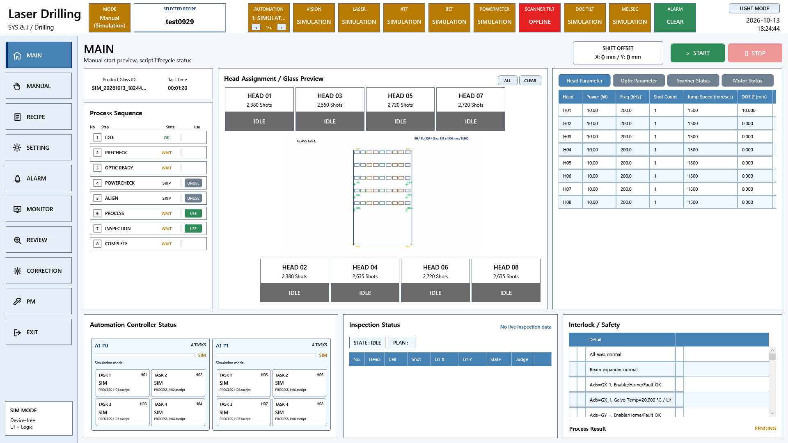

# A3 LD 자동 가공 요구기능 코드 대조

원본 Commit: [0c501c104dec1cebab87bd909de29b1b1395a8b4](https://github.com/kjuws10-rgb/A3_LD_Process_SW_IPS/commit/0c501c104dec1cebab87bd909de29b1b1395a8b4)

코드 구현 확인은 현장 검수 완료를 뜻하지 않습니다. 원본 진행 현황은 그대로 보존했고, 아래 판정은 현재 C# 구현을 기준으로 별도 작성했습니다. 화면은 최신 소스의 WPF 화면을 장치 전체 Simulation 모드로 화면 밖에서 렌더링한 것입니다. 실제 장비 측정값 또는 실제 동작 완료 증거가 아닙니다.

[전체 요약](README.md) · [편집본 엑셀](A3_LD_요구기능검증_코드분석작성본.xlsx) · [검색 가능한 상세 자료](항목별_상세근거.html)

## 관련 프로그램 화면



이 화면은 해당 기능군의 UI 연결을 보여줍니다. 개별 검수 조건의 통과 증거는 아래 소스·판정·후속 확인을 함께 보아야 합니다.

## 항목 001

Glass 정보

- 원본 검수 항목: 레시피.PPID정보 정상적으로 업데이트, 모니터링 되는지 확인
- 원본 진행 현황: 완료
- 현재 코드 판정: 부분 구현 또는 사양 차이

Recipe의 ONLINE_PPID_NAME 및 선택 레시피가 화면에 표시된다. Host 요청 수신 후 PPID를 자동 확정하는 CIM 시퀀스까지 확인된 것은 아니다.

### 코드 위치와 짧은 내용

[Drilling.UI/Menu/Menus/CMenuMain.cs L670–L734](https://github.com/kjuws10-rgb/A3_LD_Process_SW_IPS/blob/0c501c104dec1cebab87bd909de29b1b1395a8b4/Drilling.UI/Menu/Menus/CMenuMain.cs#L670-L734)

```csharp
    public override async Task<CScreenViewModel> Build(CancellationToken cancellationToken = default)
    {
        var snapshot = stationManager.GetStatus(cancellationToken);
        var previewParameters = await LoadPreviewParameters(snapshot, cancellationToken);
        var activeHeadNos = BuildEnabledHeadNumbers(previewParameters);
        NormalizeScannerStatusHeadSelection(activeHeadNos);
        var selectedHeadNos = BuildSelectedHeadSet(selectedPreviewHeadNosProvider(), activeHeadNos);
        var previewHeadLayout = await LoadPreviewHeadLayout(cancellationToken);
        var autoStepOptions = await LoadAutoStepOptions(cancellationToken);
        _autoStepOptions = autoStepOptions;
        var canToggleAutoStep = IsAutoStepOptionEditable(snapshot.ProcessStep);
        var inspectionStatus = BuildInspectionStatus(snapshot);
        var scriptTaskStatusItems = BuildScriptTaskStatusPlaceholders(snapshot, previewParameters);
        var automationControllerStatusItems = BuildAutomationControllerStatusPlaceholders(scriptTaskStatusItems);
```

[Drilling.UI/CRootView.cs L103–L197](https://github.com/kjuws10-rgb/A3_LD_Process_SW_IPS/blob/0c501c104dec1cebab87bd909de29b1b1395a8b4/Drilling.UI/CRootView.cs#L103-L197)

```csharp
    public CRootView(CManager manager, CStationManager stationManager, CInterfaceManager interfaceManager, CMotionManager motionManager, CAlarmManager alarmManager, CInterLockManager interLockManager, CManualScanFileBase manualScanFile, CRecipeManager recipeManager, CSettingManager settingManager, CProductManager productManager, CReviewManager reviewManager, CReviewSettingFileBase reviewSettingFile, CAutomationScriptFileBase automationScriptFile)
    {
        _manager = manager;
        _stationManager = stationManager;
        _interfaceManager = interfaceManager;
        _motionManager = motionManager;
        _alarmManager = alarmManager;
        _interLockManager = interLockManager;
        _recipeManager = recipeManager;
        _productManager = productManager;
        _reviewManager = reviewManager;
        _selectedRecipeId = NormalizeRecipeId(settingManager.GetValue(EN_SETTING_TAB.Option, SelectRecipeSettingKey, DefaultRecipeId));
        if (string.IsNullOrWhiteSpace(_selectedRecipeId))
        {
```

[Drilling.Common/Managers/CRecipeManager.cs L17–L25](https://github.com/kjuws10-rgb/A3_LD_Process_SW_IPS/blob/0c501c104dec1cebab87bd909de29b1b1395a8b4/Drilling.Common/Managers/CRecipeManager.cs#L17-L25)

```csharp
public sealed record ST_RECIPE_PARAMETER(string Name, string Value, string Unit, string Range, string DefaultValue, string Tab = "", string Group = "", string Key = "", string Description = "", bool Show = true, bool Use = true, int DisplayOrder = 0, EN_RECIPE_DATA_TYPE DataType = EN_RECIPE_DATA_TYPE.String, double ChangeLimit = 0.0, double Min = 0.0, double Max = 0.0, IReadOnlyDictionary<string, string>? Extra = null);
public sealed record ST_RECIPE_HISTORY(DateTimeOffset ChangedAt, string ItemName, string OldValue, string NewValue, string OperatorId, string RecipeName = "", string Action = "", string Tab = "", string Group = "");
public sealed record ST_RECIPE_DEFINITION(string Id, string Name, IReadOnlyList<ST_RECIPE_PARAMETER> Parameters, IReadOnlyList<ST_RECIPE_HISTORY> History);
public sealed record ST_RECIPE_FORM_ITEM(string Tab, string Group, string Name, string DisplayName, string CimName, EN_RECIPE_DATA_TYPE DataType, string Unit, bool Show, bool Use, string DefaultValue, double Scale, double ChangeLimit, double Min, double Max, string Description, int DisplayOrder, IReadOnlyDictionary<string, string>? Extra = null);
public sealed record ST_RECIPE_VALUE(string Tab, string Name, string Value, IReadOnlyList<string>? Extra = null);
public abstract class CRecipeFileBase
{
    public abstract Task<IReadOnlyList<ST_RECIPE_DEFINITION>> LoadAll(CancellationToken cancellationToken = default);
    public abstract Task<ST_RECIPE_DEFINITION?> Find(string recipeId, CancellationToken cancellationToken = default);
```

### 남은 검증

자동 단계별 정상·장치 미연결·NG·Stop 시 진행과 안전 복귀를 확인한다. 원본 검수 조건의 전 항목과 대조하고, 실제 장비 결과를 확보한 뒤 개발/검증 완료 여부를 갱신한다.

[관련 화면](screens/Main_simulation.png) · [전체 요약으로](README.md)

## 항목 002

Glass 정보

- 원본 검수 항목: Glass ID 정보 정상적으로 업데이트, 모니터링 되는지 확인
- 원본 진행 현황: 완료
- 현재 코드 판정: 부분 구현 또는 사양 차이

Product에 Glass ID와 Recipe ID를 함께 보관하고 모니터에 표시한다. PLC Glass Data를 수신하여 ID를 확정하는 전체 핸드셰이크는 별도 검증이 필요하다.

### 코드 위치와 짧은 내용

[Drilling.Common/Product/CProductManager.cs L41–L125](https://github.com/kjuws10-rgb/A3_LD_Process_SW_IPS/blob/0c501c104dec1cebab87bd909de29b1b1395a8b4/Drilling.Common/Product/CProductManager.cs#L41-L125)

```csharp
public sealed record ST_PRODUCT_ALIGN_DATA(EN_PRODUCT_PROCESS_STATE State, string Result, double? OffsetX, double? OffsetY, double? Rotation);
public sealed record ST_PRODUCT_DISTORTION_DATA(EN_PRODUCT_PROCESS_STATE State, string Result, double? MaxDa);
public sealed record ST_PRODUCT_REVIEW_RESULT(string ShotKey, int HeadNo, int CellNo, int BeamNo, double ErrorX, double ErrorY, string Judge);
public sealed record ST_PRODUCT_REVIEW_DATA(
    EN_PRODUCT_PROCESS_STATE State,
    DateTimeOffset? SavedAt,
    IReadOnlyList<ST_PRODUCT_REVIEW_RESULT> Results)
{
    public string InspectionMethod { get; init; } = "";

    public string RecipeId { get; init; } = "";

    public string Rule { get; init; } = "";

```

[Drilling.UI/Menu/Menus/CMenuMonitor.cs L699–L788](https://github.com/kjuws10-rgb/A3_LD_Process_SW_IPS/blob/0c501c104dec1cebab87bd909de29b1b1395a8b4/Drilling.UI/Menu/Menus/CMenuMonitor.cs#L699-L788)

```csharp
    public override async Task<CScreenViewModel> Build(CancellationToken cancellationToken = default)
    {
        var selectedTab = NormalizeMonitorTab(_selectedTabAccessor());
        _selectedLaserNumber = Math.Clamp(_selectedLaserNumber, 0, LaserHeadCount - 1);
        _selectedAttenuatorNumber = Math.Clamp(_selectedAttenuatorNumber, 0, LaserHeadCount - 1);
        _selectedBetNumber = Math.Clamp(_selectedBetNumber, 0, LaserHeadCount - 1);
        _enabledHeadDeviceNumbers = LoadEnabledHeadDeviceNumbers(cancellationToken);
        NormalizeHeadDeviceSelections();
        if (selectedTab == "POWER METER")
        {
            NormalizePowerMeterSelection();
        }

        if (selectedTab == "COORDINATE VIEWER")
```

### 남은 검증

자동 단계별 정상·장치 미연결·NG·Stop 시 진행과 안전 복귀를 확인한다. 원본 검수 조건의 전 항목과 대조하고, 실제 장비 결과를 확보한 뒤 개발/검증 완료 여부를 갱신한다.

[관련 화면](screens/Main_simulation.png) · [전체 요약으로](README.md)

## 항목 003

Glass 정보

- 원본 검수 항목: 드라이브 여유 용량이 부족하면 Warning 알람이 발생하는지 확인
- 원본 진행 현황: 미완료
- 현재 코드 판정: 현재 코드에서 미확인

파일 저장·로그 기능은 존재하지만 DiskSpace 조건별 Warning을 발생시키는 전용 분기는 확인되지 않았다. 잔여 용량 임계값과 저장 실패 처리를 별도로 검증해야 한다.

### 코드 위치와 짧은 내용

[Drilling.Common/Log/CLogManager.cs L13–L60](https://github.com/kjuws10-rgb/A3_LD_Process_SW_IPS/blob/0c501c104dec1cebab87bd909de29b1b1395a8b4/Drilling.Common/Log/CLogManager.cs#L13-L60)

```csharp
    private const int DefaultReadDays = 14;
    private const int DefaultRecipeReadRows = 10;
    private const int DefaultSettingReadRows = 20;
    private const int DefaultInterfaceReadRows = 100;
    private static readonly object FileLock = new();
    private readonly string _recipeLogRoot;
    private readonly string _settingLogRoot;
    private readonly string _interfaceLogRoot;
    private readonly string _stationLogRoot;
    private readonly string _productLogRoot;
    private readonly string _uiLogRoot;
    public CLogManager(string configRoot)
    {
        var root = Directory.GetParent(configRoot)?.FullName ?? configRoot;
```

[Drilling.File/ReviewResult/CReviewResultFile.cs L21–L103](https://github.com/kjuws10-rgb/A3_LD_Process_SW_IPS/blob/0c501c104dec1cebab87bd909de29b1b1395a8b4/Drilling.File/ReviewResult/CReviewResultFile.cs#L21-L103)

```csharp
    private static readonly IReadOnlyList<string> Headers =
    [
        "SAVED_AT",
        "GLASS_ID",
        "RECIPE_ID",
        "INSPECTION_METHOD",
        "RESULT_STATUS",
        "TOTAL_COUNT",
        "RULE",
        "RULE_SCOPE",
        "BEAM_NO",
        "REFERENCE_CELL_NO",
        "REFERENCE_SHOT",
        "ROUGH_REFERENCE",
```

미확인은 해당 이름·동작·호출 관계를 현행 자료와 대조해 확정하지 못했다는 뜻입니다. 링크는 가장 가까운 현재 기능이며, 존재하지 않는 함수를 있다고 추정한 근거가 아닙니다.

### 남은 검증

자동 단계별 정상·장치 미연결·NG·Stop 시 진행과 안전 복귀를 확인한다. 원본 검수 조건의 전 항목과 대조하고, 실제 장비 결과를 확보한 뒤 개발/검증 완료 여부를 갱신한다.

[관련 화면](screens/Main_simulation.png) · [전체 요약으로](README.md)

## 항목 004

Glass 정보

- 원본 검수 항목: 레시피.PPID정보가 빈값 또는 "RecipeNG"일 때 처리 방식 확인
- 원본 진행 현황: 완료 (항목별 최대/최소값 존재)
- 현재 코드 판정: 부분 구현 또는 사양 차이

레시피 선택과 저장에서 빈 이름·잘못된 파라미터를 막는다. PLC Recipe Change 요청에 NG 비트를 반환하는 동일한 경로는 확인되지 않았다.

### 코드 위치와 짧은 내용

[Drilling.UI/Menu/Menus/CMenuRecipe.cs L2988–L3033](https://github.com/kjuws10-rgb/A3_LD_Process_SW_IPS/blob/0c501c104dec1cebab87bd909de29b1b1395a8b4/Drilling.UI/Menu/Menus/CMenuRecipe.cs#L2988-L3033)

```csharp
    private static string ValidateRecipeParameters(IReadOnlyList<ST_RECIPE_PARAMETER> parameters)
    {
        foreach (var parameter in parameters)
        {
            var value = parameter.Value.Trim();
            if (parameter.Key.Equals("RECIPE_NAME", StringComparison.OrdinalIgnoreCase) && string.IsNullOrWhiteSpace(value))
            {
                return "Recipe save blocked. Recipe Name cannot be empty.";
            }

            var validationMessage = parameter.DataType switch
            {
                EN_RECIPE_DATA_TYPE.Int => ValidateIntParameter(parameter, value),
                EN_RECIPE_DATA_TYPE.Double => ValidateDoubleParameter(parameter, value),
```

[Drilling.UI/CRootView.cs L103–L197](https://github.com/kjuws10-rgb/A3_LD_Process_SW_IPS/blob/0c501c104dec1cebab87bd909de29b1b1395a8b4/Drilling.UI/CRootView.cs#L103-L197)

```csharp
    public CRootView(CManager manager, CStationManager stationManager, CInterfaceManager interfaceManager, CMotionManager motionManager, CAlarmManager alarmManager, CInterLockManager interLockManager, CManualScanFileBase manualScanFile, CRecipeManager recipeManager, CSettingManager settingManager, CProductManager productManager, CReviewManager reviewManager, CReviewSettingFileBase reviewSettingFile, CAutomationScriptFileBase automationScriptFile)
    {
        _manager = manager;
        _stationManager = stationManager;
        _interfaceManager = interfaceManager;
        _motionManager = motionManager;
        _alarmManager = alarmManager;
        _interLockManager = interLockManager;
        _recipeManager = recipeManager;
        _productManager = productManager;
        _reviewManager = reviewManager;
        _selectedRecipeId = NormalizeRecipeId(settingManager.GetValue(EN_SETTING_TAB.Option, SelectRecipeSettingKey, DefaultRecipeId));
        if (string.IsNullOrWhiteSpace(_selectedRecipeId))
        {
```

### 남은 검증

자동 단계별 정상·장치 미연결·NG·Stop 시 진행과 안전 복귀를 확인한다. 원본 검수 조건의 전 항목과 대조하고, 실제 장비 결과를 확보한 뒤 개발/검증 완료 여부를 갱신한다.

[관련 화면](screens/Main_simulation.png) · [전체 요약으로](README.md)

## 항목 005

알람 상태

- 원본 검수 항목: RecipeMode가 ONLINE이 아니면 CIM인터페이스 인터페이스 불가로 판정되는지 확인
- 원본 진행 현황: 미완료
- 현재 코드 판정: 현재 코드에서 미확인

현재 선택 레시피는 SELECT_RECIPE 설정과 로컬 CSV로 관리한다. 체크시트의 ONLINE RecipeMode 및 CIM Recipe Change 완료 응답 경로는 확인되지 않았다.

### 코드 위치와 짧은 내용

[Drilling.UI/CRootView.cs L103–L197](https://github.com/kjuws10-rgb/A3_LD_Process_SW_IPS/blob/0c501c104dec1cebab87bd909de29b1b1395a8b4/Drilling.UI/CRootView.cs#L103-L197)

```csharp
    public CRootView(CManager manager, CStationManager stationManager, CInterfaceManager interfaceManager, CMotionManager motionManager, CAlarmManager alarmManager, CInterLockManager interLockManager, CManualScanFileBase manualScanFile, CRecipeManager recipeManager, CSettingManager settingManager, CProductManager productManager, CReviewManager reviewManager, CReviewSettingFileBase reviewSettingFile, CAutomationScriptFileBase automationScriptFile)
    {
        _manager = manager;
        _stationManager = stationManager;
        _interfaceManager = interfaceManager;
        _motionManager = motionManager;
        _alarmManager = alarmManager;
        _interLockManager = interLockManager;
        _recipeManager = recipeManager;
        _productManager = productManager;
        _reviewManager = reviewManager;
        _selectedRecipeId = NormalizeRecipeId(settingManager.GetValue(EN_SETTING_TAB.Option, SelectRecipeSettingKey, DefaultRecipeId));
        if (string.IsNullOrWhiteSpace(_selectedRecipeId))
        {
```

[Drilling.Common/Managers/CRecipeManager.cs L17–L25](https://github.com/kjuws10-rgb/A3_LD_Process_SW_IPS/blob/0c501c104dec1cebab87bd909de29b1b1395a8b4/Drilling.Common/Managers/CRecipeManager.cs#L17-L25)

```csharp
public sealed record ST_RECIPE_PARAMETER(string Name, string Value, string Unit, string Range, string DefaultValue, string Tab = "", string Group = "", string Key = "", string Description = "", bool Show = true, bool Use = true, int DisplayOrder = 0, EN_RECIPE_DATA_TYPE DataType = EN_RECIPE_DATA_TYPE.String, double ChangeLimit = 0.0, double Min = 0.0, double Max = 0.0, IReadOnlyDictionary<string, string>? Extra = null);
public sealed record ST_RECIPE_HISTORY(DateTimeOffset ChangedAt, string ItemName, string OldValue, string NewValue, string OperatorId, string RecipeName = "", string Action = "", string Tab = "", string Group = "");
public sealed record ST_RECIPE_DEFINITION(string Id, string Name, IReadOnlyList<ST_RECIPE_PARAMETER> Parameters, IReadOnlyList<ST_RECIPE_HISTORY> History);
public sealed record ST_RECIPE_FORM_ITEM(string Tab, string Group, string Name, string DisplayName, string CimName, EN_RECIPE_DATA_TYPE DataType, string Unit, bool Show, bool Use, string DefaultValue, double Scale, double ChangeLimit, double Min, double Max, string Description, int DisplayOrder, IReadOnlyDictionary<string, string>? Extra = null);
public sealed record ST_RECIPE_VALUE(string Tab, string Name, string Value, IReadOnlyList<string>? Extra = null);
public abstract class CRecipeFileBase
{
    public abstract Task<IReadOnlyList<ST_RECIPE_DEFINITION>> LoadAll(CancellationToken cancellationToken = default);
    public abstract Task<ST_RECIPE_DEFINITION?> Find(string recipeId, CancellationToken cancellationToken = default);
```

[Drilling.Common/Station/CStationProcess.cs L220–L259](https://github.com/kjuws10-rgb/A3_LD_Process_SW_IPS/blob/0c501c104dec1cebab87bd909de29b1b1395a8b4/Drilling.Common/Station/CStationProcess.cs#L220-L259)

```csharp
                case EN_STATION_SEQUENCE.PreCheck:
                    RunPreCheckSequence();
                    break;
                case EN_STATION_SEQUENCE.OpticReady:
                    RunSequenceStep(EN_STATION_SEQUENCE.OpticReady, AutoStepOpticReady, RunOpticReadyStep, EN_STATION_SEQUENCE.PowerCheck);
                    break;
                case EN_STATION_SEQUENCE.PowerCheck:
                    RunOptionalSequenceStep(EN_STATION_SEQUENCE.PowerCheck, AutoStepPowerCheck, SettingAutoPowerCheckUse, RunPowerCheckStep, EN_STATION_SEQUENCE.Align);
                    break;
                case EN_STATION_SEQUENCE.Align:
                    RunOptionalSequenceStep(EN_STATION_SEQUENCE.Align, AutoStepAlign, SettingAutoAlignUse, RunAlignStep, EN_STATION_SEQUENCE.Process);
                    break;
                case EN_STATION_SEQUENCE.Process:
                    RunOptionalSequenceStep(EN_STATION_SEQUENCE.Process, AutoStepProcess, SettingAutoProcessUse, RunProcessStep, EN_STATION_SEQUENCE.Inspection);
```

미확인은 해당 이름·동작·호출 관계를 현행 자료와 대조해 확정하지 못했다는 뜻입니다. 링크는 가장 가까운 현재 기능이며, 존재하지 않는 함수를 있다고 추정한 근거가 아닙니다.

### 남은 검증

자동 단계별 정상·장치 미연결·NG·Stop 시 진행과 안전 복귀를 확인한다. 원본 검수 조건의 전 항목과 대조하고, 실제 장비 결과를 확보한 뒤 개발/검증 완료 여부를 갱신한다.

[관련 화면](screens/Main_simulation.png) · [전체 요약으로](README.md)

## 항목 006

알람 상태

- 원본 검수 항목: 매칭되는 로컬 Recipe가 없으면 Alarm이 발생하고 NAK 처리 되는지 확인
- 원본 진행 현황: 미완료
- 현재 코드 판정: 부분 구현 또는 사양 차이

Recipe 이름 및 CSV 구조 검사가 있다. 로컬 파일 이상 시 전용 CIM Alarm과 NAK를 함께 전송하는 규칙은 현재 호출 관계에서 확인되지 않았다.

### 코드 위치와 짧은 내용

[Drilling.UI/Menu/Menus/CMenuRecipe.cs L2988–L3033](https://github.com/kjuws10-rgb/A3_LD_Process_SW_IPS/blob/0c501c104dec1cebab87bd909de29b1b1395a8b4/Drilling.UI/Menu/Menus/CMenuRecipe.cs#L2988-L3033)

```csharp
    private static string ValidateRecipeParameters(IReadOnlyList<ST_RECIPE_PARAMETER> parameters)
    {
        foreach (var parameter in parameters)
        {
            var value = parameter.Value.Trim();
            if (parameter.Key.Equals("RECIPE_NAME", StringComparison.OrdinalIgnoreCase) && string.IsNullOrWhiteSpace(value))
            {
                return "Recipe save blocked. Recipe Name cannot be empty.";
            }

            var validationMessage = parameter.DataType switch
            {
                EN_RECIPE_DATA_TYPE.Int => ValidateIntParameter(parameter, value),
                EN_RECIPE_DATA_TYPE.Double => ValidateDoubleParameter(parameter, value),
```

[Drilling.File/JHMI/CJhmiRecipeFile.cs L95–L189](https://github.com/kjuws10-rgb/A3_LD_Process_SW_IPS/blob/0c501c104dec1cebab87bd909de29b1b1395a8b4/Drilling.File/JHMI/CJhmiRecipeFile.cs#L95-L189)

```csharp
    private void SaveCore(ST_RECIPE_DEFINITION recipe, CancellationToken cancellationToken)
    {
        cancellationToken.ThrowIfCancellationRequested();
        Directory.CreateDirectory(_recipeDirectory);
        var formItems = LoadFormItems();
        var recipePath = GetRecipePath(recipe.Id);
        var recipeExists = System.IO.File.Exists(recipePath);
        string SelectGroupKey(global::Drilling.Common.Managers.ST_RECIPE_VALUE item)
        {
            return CreateKey(item.Tab, item.Name);
        }

        string SelectKey(global::System.Linq.IGrouping<string, global::Drilling.Common.Managers.ST_RECIPE_VALUE> group)
        {
```

[Drilling.Common/Station/CStationProcess.cs L220–L259](https://github.com/kjuws10-rgb/A3_LD_Process_SW_IPS/blob/0c501c104dec1cebab87bd909de29b1b1395a8b4/Drilling.Common/Station/CStationProcess.cs#L220-L259)

```csharp
                case EN_STATION_SEQUENCE.PreCheck:
                    RunPreCheckSequence();
                    break;
                case EN_STATION_SEQUENCE.OpticReady:
                    RunSequenceStep(EN_STATION_SEQUENCE.OpticReady, AutoStepOpticReady, RunOpticReadyStep, EN_STATION_SEQUENCE.PowerCheck);
                    break;
                case EN_STATION_SEQUENCE.PowerCheck:
                    RunOptionalSequenceStep(EN_STATION_SEQUENCE.PowerCheck, AutoStepPowerCheck, SettingAutoPowerCheckUse, RunPowerCheckStep, EN_STATION_SEQUENCE.Align);
                    break;
                case EN_STATION_SEQUENCE.Align:
                    RunOptionalSequenceStep(EN_STATION_SEQUENCE.Align, AutoStepAlign, SettingAutoAlignUse, RunAlignStep, EN_STATION_SEQUENCE.Process);
                    break;
                case EN_STATION_SEQUENCE.Process:
                    RunOptionalSequenceStep(EN_STATION_SEQUENCE.Process, AutoStepProcess, SettingAutoProcessUse, RunProcessStep, EN_STATION_SEQUENCE.Inspection);
```

### 남은 검증

자동 단계별 정상·장치 미연결·NG·Stop 시 진행과 안전 복귀를 확인한다. 원본 검수 조건의 전 항목과 대조하고, 실제 장비 결과를 확보한 뒤 개발/검증 완료 여부를 갱신한다.

[관련 화면](screens/Main_simulation.png) · [전체 요약으로](README.md)

## 항목 007

알람 상태

- 원본 검수 항목: CIM인터페이스 REQUEST 신호가 1초 내 해제되지 않으면 경고 로그를 남기고 NAK을 강제 해제하는지 확인
- 원본 진행 현황: 미완료
- 현재 코드 판정: 현재 코드에서 미확인

자동 시퀀스 상태 전이는 구현되어 있다. 요구한 Request 비트 1초 유지·해제 및 NAK 응답 처리는 이 상태 전이와 동일하다고 볼 수 없다.

### 코드 위치와 짧은 내용

[Drilling.Common/Station/CStationProcess.cs L220–L259](https://github.com/kjuws10-rgb/A3_LD_Process_SW_IPS/blob/0c501c104dec1cebab87bd909de29b1b1395a8b4/Drilling.Common/Station/CStationProcess.cs#L220-L259)

```csharp
                case EN_STATION_SEQUENCE.PreCheck:
                    RunPreCheckSequence();
                    break;
                case EN_STATION_SEQUENCE.OpticReady:
                    RunSequenceStep(EN_STATION_SEQUENCE.OpticReady, AutoStepOpticReady, RunOpticReadyStep, EN_STATION_SEQUENCE.PowerCheck);
                    break;
                case EN_STATION_SEQUENCE.PowerCheck:
                    RunOptionalSequenceStep(EN_STATION_SEQUENCE.PowerCheck, AutoStepPowerCheck, SettingAutoPowerCheckUse, RunPowerCheckStep, EN_STATION_SEQUENCE.Align);
                    break;
                case EN_STATION_SEQUENCE.Align:
                    RunOptionalSequenceStep(EN_STATION_SEQUENCE.Align, AutoStepAlign, SettingAutoAlignUse, RunAlignStep, EN_STATION_SEQUENCE.Process);
                    break;
                case EN_STATION_SEQUENCE.Process:
                    RunOptionalSequenceStep(EN_STATION_SEQUENCE.Process, AutoStepProcess, SettingAutoProcessUse, RunProcessStep, EN_STATION_SEQUENCE.Inspection);
```

미확인은 해당 이름·동작·호출 관계를 현행 자료와 대조해 확정하지 못했다는 뜻입니다. 링크는 가장 가까운 현재 기능이며, 존재하지 않는 함수를 있다고 추정한 근거가 아닙니다.

### 남은 검증

자동 단계별 정상·장치 미연결·NG·Stop 시 진행과 안전 복귀를 확인한다. 원본 검수 조건의 전 항목과 대조하고, 실제 장비 결과를 확보한 뒤 개발/검증 완료 여부를 갱신한다.

[관련 화면](screens/Main_simulation.png) · [전체 요약으로](README.md)

## 항목 008

알람 상태

- 원본 검수 항목: ACK_END 단계에서 timeoutLimit 초과시 Alarm이 발생하는지 확인
- 원본 진행 현황: 미완료
- 현재 코드 판정: 현재 코드에서 미확인

광학 장치 및 축 상태 읽기에는 Timeout이 있다. CIM 레시피 ACK_END 대기 Timeout을 구현한 것으로 대체 판정할 수 없다.

### 코드 위치와 짧은 내용

[Drilling.Common/Station/CStationProcess.cs L220–L259](https://github.com/kjuws10-rgb/A3_LD_Process_SW_IPS/blob/0c501c104dec1cebab87bd909de29b1b1395a8b4/Drilling.Common/Station/CStationProcess.cs#L220-L259)

```csharp
                case EN_STATION_SEQUENCE.PreCheck:
                    RunPreCheckSequence();
                    break;
                case EN_STATION_SEQUENCE.OpticReady:
                    RunSequenceStep(EN_STATION_SEQUENCE.OpticReady, AutoStepOpticReady, RunOpticReadyStep, EN_STATION_SEQUENCE.PowerCheck);
                    break;
                case EN_STATION_SEQUENCE.PowerCheck:
                    RunOptionalSequenceStep(EN_STATION_SEQUENCE.PowerCheck, AutoStepPowerCheck, SettingAutoPowerCheckUse, RunPowerCheckStep, EN_STATION_SEQUENCE.Align);
                    break;
                case EN_STATION_SEQUENCE.Align:
                    RunOptionalSequenceStep(EN_STATION_SEQUENCE.Align, AutoStepAlign, SettingAutoAlignUse, RunAlignStep, EN_STATION_SEQUENCE.Process);
                    break;
                case EN_STATION_SEQUENCE.Process:
                    RunOptionalSequenceStep(EN_STATION_SEQUENCE.Process, AutoStepProcess, SettingAutoProcessUse, RunProcessStep, EN_STATION_SEQUENCE.Inspection);
```

[Drilling.Common/Station/CStationProcess.cs L996–L1025](https://github.com/kjuws10-rgb/A3_LD_Process_SW_IPS/blob/0c501c104dec1cebab87bd909de29b1b1395a8b4/Drilling.Common/Station/CStationProcess.cs#L996-L1025)

```csharp
    private TStatus WaitForOpticReady<TStatus>(string source, string targetName, Func<CancellationToken, TStatus> readStatus, Func<TStatus, bool> isReady, Func<TStatus, string> describe, CancellationToken cancellationToken)
    {
        var timeoutMs = ReadOpticReadyTimeout(cancellationToken);
        var deadline = DateTimeOffset.Now.AddMilliseconds(timeoutMs);
        TStatus lastStatus;
        while (true)
        {
            cancellationToken.ThrowIfCancellationRequested();
            lastStatus = readStatus(cancellationToken);
            if (isReady(lastStatus))
            {
                AddSequenceLog("INFO", source, $"{targetName} ready. {describe(lastStatus)}");
                return lastStatus;
            }
```

미확인은 해당 이름·동작·호출 관계를 현행 자료와 대조해 확정하지 못했다는 뜻입니다. 링크는 가장 가까운 현재 기능이며, 존재하지 않는 함수를 있다고 추정한 근거가 아닙니다.

### 남은 검증

자동 단계별 정상·장치 미연결·NG·Stop 시 진행과 안전 복귀를 확인한다. 원본 검수 조건의 전 항목과 대조하고, 실제 장비 결과를 확보한 뒤 개발/검증 완료 여부를 갱신한다.

[관련 화면](screens/Main_simulation.png) · [전체 요약으로](README.md)

## 항목 009

알람 상태

- 원본 검수 항목: BEX 인터락 상태 표시(위치 정보)
- 원본 진행 현황: 완료
- 현재 코드 판정: 부분 구현 또는 사양 차이

Recipe 또는 BET Table에서 목표를 읽고 MoveTable/MoveManual을 실행한 뒤 완료 조건을 기다린다. 기존 BEX 명칭·각 축 위치 기준과 현장 신호 매핑을 확인해야 한다.

### 코드 위치와 짧은 내용

[Drilling.Common/Station/CStationProcess.cs L876–L937](https://github.com/kjuws10-rgb/A3_LD_Process_SW_IPS/blob/0c501c104dec1cebab87bd909de29b1b1395a8b4/Drilling.Common/Station/CStationProcess.cs#L876-L937)

```csharp
    private void PrepareBET(ST_PROCESS_MODEL processModel, CancellationToken cancellationToken)
    {
        var devices = GetOpticDevices(EN_EQP_MODULE.Bet);
        if (devices.Count == 0)
        {
            AddSequenceLog("WARN", "BET", "BET interface is not registered. BET ready check skipped.");
            return;
        }

        var target = ReadBETTarget(processModel, cancellationToken);
        foreach (var device in devices)
        {
            global::Drilling.Common.Interface.ST_DEVICE_COMMAND_RESULT SelectValue(global::System.Threading.CancellationToken token)
            {
```

### 남은 검증

자동 단계별 정상·장치 미연결·NG·Stop 시 진행과 안전 복귀를 확인한다. 원본 검수 조건의 전 항목과 대조하고, 실제 장비 결과를 확보한 뒤 개발/검증 완료 여부를 갱신한다.

[관련 화면](screens/Main_simulation.png) · [전체 요약으로](README.md)

## 항목 010

알람 상태

- 원본 검수 항목: Attenuator 인터락 상태 표시(위치정보)
- 원본 진행 현황: 완료
- 현재 코드 판정: 코드 구현 확인

Head별 ATT 목표를 읽고 절대 이동 명령을 내린 다음 현재 위치·이동 상태를 확인한다. 장치 응답 실패와 제한 위치 시험은 실물 검증 항목이다.

### 코드 위치와 짧은 내용

[Drilling.Common/Station/CStationProcess.cs L935–L976](https://github.com/kjuws10-rgb/A3_LD_Process_SW_IPS/blob/0c501c104dec1cebab87bd909de29b1b1395a8b4/Drilling.Common/Station/CStationProcess.cs#L935-L976)

```csharp
    private void PrepareAttenuator(ST_PROCESS_MODEL processModel, CancellationToken cancellationToken)
    {
        var devices = GetOpticDevices(EN_EQP_MODULE.Attenuator);
        if (devices.Count == 0)
        {
            AddSequenceLog("WARN", "ATT", "Attenuator interface is not registered. Attenuator ready check skipped.");
            return;
        }

        foreach (var device in devices)
        {
            var headNo = Math.Clamp(device.Number + 1, 1, 8);
            var target = ReadDoubleAny(processModel.Parameters, 23.50, CreateHeadKeys(headNo, "ATTENUATOR_POSITION"));
            global::Drilling.Common.Interface.ST_DEVICE_COMMAND_RESULT SelectValue(global::System.Threading.CancellationToken token)
```

[Drilling.Common/Interface/CAttenuatorSoftwareLimit.cs L18–L87](https://github.com/kjuws10-rgb/A3_LD_Process_SW_IPS/blob/0c501c104dec1cebab87bd909de29b1b1395a8b4/Drilling.Common/Interface/CAttenuatorSoftwareLimit.cs#L18-L87)

```csharp
    private async Task<ST_DEVICE_COMMAND_RESULT> ExecuteAttenuatorMoveWithinLimits(
        int number, EN_ATTENUATOR_COMMAND command, double parameter, CancellationToken cancellationToken, bool suppressCommandLog)
    {
        var gate = _attenuatorMoveLocks.GetOrAdd(number, _ => new SemaphoreSlim(1, 1));
        await gate.WaitAsync(cancellationToken);
        try
        {
            var settings = _attenuatorLimitSettings?.Invoke();
            double ReadLimit(string key)
            {
                var text = settings?.FirstOrDefault(item => item.Key.Equals(key, StringComparison.OrdinalIgnoreCase))?.Value;
                return double.TryParse(text, NumberStyles.Float, CultureInfo.InvariantCulture, out var value) ? value : double.NaN;
            }

```

### 남은 검증

자동 단계별 정상·장치 미연결·NG·Stop 시 진행과 안전 복귀를 확인한다. 원본 검수 조건의 전 항목과 대조하고, 실제 장비 결과를 확보한 뒤 개발/검증 완료 여부를 갱신한다.

[관련 화면](screens/Main_simulation.png) · [전체 요약으로](README.md)

## 항목 011

알람 상태

- 원본 검수 항목: DOE Z축의 서보/홈/알람/가상축 상태를 종합해 이상 유무가 판정되는지 확인
- 원본 진행 현황: Scanner Z축의 상태 모니터링 가능
- 현재 코드 판정: 코드 구현 확인

사용 Head의 Scanner·DOE Z 축 상태를 읽어 Enable, Home, Fault 등의 준비 조건을 검사한다. 연결되지 않은 축과 잘못된 설정은 시작 차단으로 연결된다.

### 코드 위치와 짧은 내용

[Drilling.Common/Station/CStationProcess.cs L368–L482](https://github.com/kjuws10-rgb/A3_LD_Process_SW_IPS/blob/0c501c104dec1cebab87bd909de29b1b1395a8b4/Drilling.Common/Station/CStationProcess.cs#L368-L482)

```csharp
    private ST_INTERLOCK_SUMMARY AddStartAxisInterLock(ST_INTERLOCK_SUMMARY interLock, ST_PROCESS_MODEL processModel, CancellationToken cancellationToken, bool writeLog)
    {
        static bool IsError(global::Drilling.Common.InterLock.ST_INTERLOCK_ITEM item)
        {
            return item.Level == EN_INTERLOCK_LEVEL.Error;
        }

        static bool IsOk(global::Drilling.Common.InterLock.ST_INTERLOCK_ITEM item)
        {
            return item.Level == EN_INTERLOCK_LEVEL.Ok;
        }

        var targets = CreateStartAxisStatusTargets(processModel);
        var items = new List<ST_INTERLOCK_ITEM>(interLock.Items);
```

### 남은 검증

자동 단계별 정상·장치 미연결·NG·Stop 시 진행과 안전 복귀를 확인한다. 원본 검수 조건의 전 항목과 대조하고, 실제 장비 결과를 확보한 뒤 개발/검증 완료 여부를 갱신한다.

[관련 화면](screens/Main_simulation.png) · [전체 요약으로](README.md)

## 항목 012

알람 상태

- 원본 검수 항목: DOE Z CurPos가 레시피.OpticPPID의 ScanDOEZ ± 허용오차 범위를 벗어나면 이상으로 판정되는지 확인
- 원본 진행 현황: PPID에 허용오차 관련 항목 미존재
- 현재 코드 판정: 코드 구현 확인

현재 Z 위치를 Recipe의 DOE_Z_POSITION ± 허용 오차와 비교한다. 위치가 유한하지 않거나 범위를 벗어나면 POS NG로 시작을 막는다.

### 코드 위치와 짧은 내용

[Drilling.Common/Station/CStationProcess.cs L514–L540](https://github.com/kjuws10-rgb/A3_LD_Process_SW_IPS/blob/0c501c104dec1cebab87bd909de29b1b1395a8b4/Drilling.Common/Station/CStationProcess.cs#L514-L540)

```csharp
    private static ST_INTERLOCK_ITEM CreateDoeZPositionInterLockItem(string signal, string axisName, double currentPosition, double recipePosition, double tolerance)
    {
        if (!double.IsFinite(tolerance) || tolerance < 0.0)
        {
            return new ST_INTERLOCK_ITEM(signal, EN_INTERLOCK_LEVEL.Error, "TOLERANCE NG", $"DOE Z Tolerance 설정값이 음수이거나 유효하지 않습니다. Tolerance={FormatDouble(tolerance)} mm");
        }

        if (!double.IsFinite(currentPosition))
        {
            return new ST_INTERLOCK_ITEM(signal, EN_INTERLOCK_LEVEL.Error, "POS NG", $"Axis={axisName}, DOE Z 현재 위치를 읽을 수 없습니다. Recipe={FormatDouble(recipePosition)} mm, Tolerance=+-{FormatDouble(tolerance)} mm");
        }

        var lower = recipePosition - tolerance;
        var upper = recipePosition + tolerance;
```

### 남은 검증

자동 단계별 정상·장치 미연결·NG·Stop 시 진행과 안전 복귀를 확인한다. 원본 검수 조건의 전 항목과 대조하고, 실제 장비 결과를 확보한 뒤 개발/검증 완료 여부를 갱신한다.

[관련 화면](screens/Main_simulation.png) · [전체 요약으로](README.md)

## 항목 013

알람 상태

- 원본 검수 항목: 1000ms 주기로 레이저/파워미터/Atten 표시 갱신 메소드들이 일괄 호출되는지 확인
- 원본 진행 현황: 완료
- 현재 코드 판정: 부분 구현 또는 사양 차이

Scanner 상태 서비스는 1초 간격으로 캐시를 갱신한다. 레이저·ATT 등 다른 서비스의 갱신 주기는 별도이므로 전체 장치가 모두 1000 ms라고 단정하면 안 된다.

### 코드 위치와 짧은 내용

[Drilling.UI/Menu/Menus/CScannerStatusPollingService.cs L9–L56](https://github.com/kjuws10-rgb/A3_LD_Process_SW_IPS/blob/0c501c104dec1cebab87bd909de29b1b1395a8b4/Drilling.UI/Menu/Menus/CScannerStatusPollingService.cs#L9-L56)

```csharp
    private static readonly TimeSpan PollInterval = TimeSpan.FromSeconds(1);
    private readonly object _snapshotLock = new();
    private IReadOnlyList<ST_SCANNER_AXIS_STATUS_ITEM> _snapshot = [];
    private IReadOnlyList<ST_SCANNER_AXIS_SETTING> _axisDefinitions = [];
    private int _selectedHeadNo = 1;
    public void SelectHead(int headNo)
    {
        var normalizedHeadNo = NormalizeHeadNo(headNo);
        lock (_snapshotLock)
        {
            if (_selectedHeadNo == normalizedHeadNo)
            {
                return;
            }
```

[Drilling.UI/Menu/Menus/CMonitorStatusPollingService.cs L12–L61](https://github.com/kjuws10-rgb/A3_LD_Process_SW_IPS/blob/0c501c104dec1cebab87bd909de29b1b1395a8b4/Drilling.UI/Menu/Menus/CMonitorStatusPollingService.cs#L12-L61)

```csharp
    private static readonly TimeSpan LoopInterval = TimeSpan.FromMilliseconds(250);
    private static readonly TimeSpan ActiveInterval = TimeSpan.FromSeconds(0.5);
    private static readonly TimeSpan ActivePowerMeterMeasureInterval = TimeSpan.FromMilliseconds(500);
    private static readonly TimeSpan SlowSafetyInterval = TimeSpan.FromSeconds(5);
    private static readonly TimeSpan CommunicationInterval = TimeSpan.FromSeconds(1);
    private readonly object _contextLock = new();
    private readonly object _snapshotLock = new();
    private bool _isActive;
    private readonly SemaphoreSlim _motorPollLock = new(1, 1);
    private ST_MONITOR_POLLING_CONTEXT _context = ST_MONITOR_POLLING_CONTEXT.Default;
    private ST_MONITOR_STATUS_SNAPSHOT _snapshot = ST_MONITOR_STATUS_SNAPSHOT.Empty;
    private DateTimeOffset _lastCommunicationPoll = DateTimeOffset.MinValue;
    private long? _lastSuccessfulMotorPollTimestamp;
    private DateTimeOffset _lastLaserPoll = DateTimeOffset.MinValue;
```

### 남은 검증

자동 단계별 정상·장치 미연결·NG·Stop 시 진행과 안전 복귀를 확인한다. 원본 검수 조건의 전 항목과 대조하고, 실제 장비 결과를 확보한 뒤 개발/검증 완료 여부를 갱신한다.

[관련 화면](screens/Main_simulation.png) · [전체 요약으로](README.md)

## 항목 014

알람 상태

- 원본 검수 항목: 각 헤드의 Laser Power 값이 정상적으로 표기되는지 확인(표기 양식 포함)
- 원본 진행 현황: 완료 ('W'표기)
- 현재 코드 판정: 코드 구현 확인

레이저 출력 상태와 PowerMeter 측정 값은 별도 구조에 담긴다. 모니터는 출력 파워 및 단위를 표시하므로 레이저 자체값과 외부 측정값을 구분해 읽어야 한다.

### 코드 위치와 짧은 내용

[Drilling.UI/Menu/Menus/CMenuMonitor.cs L4869–L4903](https://github.com/kjuws10-rgb/A3_LD_Process_SW_IPS/blob/0c501c104dec1cebab87bd909de29b1b1395a8b4/Drilling.UI/Menu/Menus/CMenuMonitor.cs#L4869-L4903)

```csharp
    private int ReadLaserThgHourLimit()
    {
        var value = _settingManager.GetValue(EN_SETTING_TAB.Option, "LASER_THG_HOUR_LIMIT", "0");
        return int.TryParse(value, NumberStyles.Integer, CultureInfo.InvariantCulture, out var parsed) ? parsed : 0;
    }

    private static IReadOnlyList<ST_MONITOR_BET_TABLE_ROW> CreateBetTableRows(string tab, IReadOnlyList<ST_BET_TABLE_DATA> table, ST_DEVICE_STATUS snapshot)
    {
        if (tab != "BET")
        {
            return[];
        }

        int SelectIndex(global::Drilling.Common.Interface.ST_BET_TABLE_DATA row)
```

[Drilling.Common/Interface/Serial/CPowerMeter.cs L281–L299](https://github.com/kjuws10-rgb/A3_LD_Process_SW_IPS/blob/0c501c104dec1cebab87bd909de29b1b1395a8b4/Drilling.Common/Interface/Serial/CPowerMeter.cs#L281-L299)

```csharp
    private static ST_POWER_METER_STATUS ApplyPowerValue(ST_POWER_METER_STATUS current, double power)
    {
        var sampleCount = current.SampleCount + 1;
        var average = current.SampleCount <= 0 ? power : ((current.AveragePower * current.SampleCount) + power) / sampleCount;
        var min = current.SampleCount <= 0 ? power : Math.Min(current.MinPower, power);
        var max = current.SampleCount <= 0 ? power : Math.Max(current.MaxPower, power);
        return current with
        {
            MeasuredPower = power,
            AveragePower = average,
            MinPower = min,
            MaxPower = max,
            SampleCount = sampleCount,
            Unit = "W"
```

[Drilling.UI/Menu/Menus/CMenuMonitor.cs L699–L788](https://github.com/kjuws10-rgb/A3_LD_Process_SW_IPS/blob/0c501c104dec1cebab87bd909de29b1b1395a8b4/Drilling.UI/Menu/Menus/CMenuMonitor.cs#L699-L788)

```csharp
    public override async Task<CScreenViewModel> Build(CancellationToken cancellationToken = default)
    {
        var selectedTab = NormalizeMonitorTab(_selectedTabAccessor());
        _selectedLaserNumber = Math.Clamp(_selectedLaserNumber, 0, LaserHeadCount - 1);
        _selectedAttenuatorNumber = Math.Clamp(_selectedAttenuatorNumber, 0, LaserHeadCount - 1);
        _selectedBetNumber = Math.Clamp(_selectedBetNumber, 0, LaserHeadCount - 1);
        _enabledHeadDeviceNumbers = LoadEnabledHeadDeviceNumbers(cancellationToken);
        NormalizeHeadDeviceSelections();
        if (selectedTab == "POWER METER")
        {
            NormalizePowerMeterSelection();
        }

        if (selectedTab == "COORDINATE VIEWER")
```

### 남은 검증

자동 단계별 정상·장치 미연결·NG·Stop 시 진행과 안전 복귀를 확인한다. 원본 검수 조건의 전 항목과 대조하고, 실제 장비 결과를 확보한 뒤 개발/검증 완료 여부를 갱신한다.

[관련 화면](screens/Main_simulation.png) · [전체 요약으로](README.md)

## 항목 015

알람 상태

- 원본 검수 항목: Laser Diode On이 false이면 이상으로 판정되는지 확인
- 원본 진행 현황: 이상 판정은 하지 않음.
- 현재 코드 판정: 부분 구현 또는 사양 차이

레이저 Diode 및 온도·출력 읽기와 상태 표시가 있다. Diode OFF가 자동 가공 Fail로 전환되는 체크시트 전용 인터록 전체는 추가 확인이 필요하다.

### 코드 위치와 짧은 내용

[Drilling.UI/Menu/Menus/CMenuMonitor.cs L4869–L4903](https://github.com/kjuws10-rgb/A3_LD_Process_SW_IPS/blob/0c501c104dec1cebab87bd909de29b1b1395a8b4/Drilling.UI/Menu/Menus/CMenuMonitor.cs#L4869-L4903)

```csharp
    private int ReadLaserThgHourLimit()
    {
        var value = _settingManager.GetValue(EN_SETTING_TAB.Option, "LASER_THG_HOUR_LIMIT", "0");
        return int.TryParse(value, NumberStyles.Integer, CultureInfo.InvariantCulture, out var parsed) ? parsed : 0;
    }

    private static IReadOnlyList<ST_MONITOR_BET_TABLE_ROW> CreateBetTableRows(string tab, IReadOnlyList<ST_BET_TABLE_DATA> table, ST_DEVICE_STATUS snapshot)
    {
        if (tab != "BET")
        {
            return[];
        }

        int SelectIndex(global::Drilling.Common.Interface.ST_BET_TABLE_DATA row)
```

[Drilling.Common/InterLock/CInterLockManager.cs L34–L85](https://github.com/kjuws10-rgb/A3_LD_Process_SW_IPS/blob/0c501c104dec1cebab87bd909de29b1b1395a8b4/Drilling.Common/InterLock/CInterLockManager.cs#L34-L85)

```csharp
    private static readonly IReadOnlyList<ST_INTERLOCK_RULE> Rules = [Rule("Door", "DOOR_LOCK_SENSOR", true, "Closed", "Door is open", EN_INTERLOCK_LEVEL.Error, EN_INTERLOCK_TARGET.AutoRun | EN_INTERLOCK_TARGET.ManualMove | EN_INTERLOCK_TARGET.LaserOn), Rule("EMS", "EMS", true, "Normal", "Emergency stop is active", EN_INTERLOCK_LEVEL.Error, EN_INTERLOCK_TARGET.AutoRun | EN_INTERLOCK_TARGET.ManualMove | EN_INTERLOCK_TARGET.LaserOn), Rule("Key Switch", "KEY_SWITCH_AUTO", true, "AUTO", "Key switch is not AUTO", EN_INTERLOCK_LEVEL.Warn, EN_INTERLOCK_TARGET.AutoRun), Rule("Laser Shutter", "LASER_SHUTTER_CLOSED", true, "SAFE", "Laser shutter is not closed", EN_INTERLOCK_LEVEL.Warn, EN_INTERLOCK_TARGET.LaserOn), Rule("Leak Sensor", "LEAK_SENSOR", true, "OK", "Leak sensor is active", EN_INTERLOCK_LEVEL.Error, EN_INTERLOCK_TARGET.AutoRun | EN_INTERLOCK_TARGET.LaserOn), Rule("Smoke Temp", "SMOKE_TEMP", true, "OK", "Smoke or over temperature input is active", EN_INTERLOCK_LEVEL.Error, EN_INTERLOCK_TARGET.AutoRun | EN_INTERLOCK_TARGET.LaserOn), Rule("PM Lock", "PM_LOCK", true, "READY", "PM lock is active", EN_INTERLOCK_LEVEL.Error, EN_INTERLOCK_TARGET.AutoRun | EN_INTERLOCK_TARGET.ManualMove | EN_INTERLOCK_TARGET.LaserOn), Rule("Scanner Ready", "SCANNER_READY", true, "READY", "Scanner ready signal is off", EN_INTERLOCK_LEVEL.Warn, EN_INTERLOCK_TARGET.AutoRun), Rule("Vision Ready", "VISION_READY", true, "READY", "Vision ready signal is off", EN_INTERLOCK_LEVEL.Warn, EN_INTERLOCK_TARGET.AutoRun), Rule("Panel In Position", "PANEL_IN_POSITION", true, "OK", "Panel is not in position", EN_INTERLOCK_LEVEL.Warn, EN_INTERLOCK_TARGET.AutoRun), Rule("Vacuum Check", "VACUUM_CHECK", true, "OK", "Vacuum check is off", EN_INTERLOCK_LEVEL.Warn, EN_INTERLOCK_TARGET.AutoRun)];
    public ST_INTERLOCK_SUMMARY Evaluate(ST_DEVICE_STATUS status)
    {
        global::Drilling.Common.InterLock.CInterLockManager.ST_INTERLOCK_CHECK EvaluateInterlockRule(global::Drilling.Common.InterLock.ST_INTERLOCK_RULE rule)
        {
            return EvaluateRule(rule, status);
        }

        ST_INTERLOCK_CHECK[] checks = status.Io.Count == 0 ? [] : Rules.Select(EvaluateInterlockRule).ToArray();
        global::Drilling.Common.InterLock.ST_INTERLOCK_ITEM SelectInterlockItem(global::Drilling.Common.InterLock.CInterLockManager.ST_INTERLOCK_CHECK check)
        {
            return check.Item with
            {
                BlocksAutoRun = !check.IsOk && check.Rule.Targets.HasFlag(EN_INTERLOCK_TARGET.AutoRun)
```

### 남은 검증

자동 단계별 정상·장치 미연결·NG·Stop 시 진행과 안전 복귀를 확인한다. 원본 검수 조건의 전 항목과 대조하고, 실제 장비 결과를 확보한 뒤 개발/검증 완료 여부를 갱신한다.

[관련 화면](screens/Main_simulation.png) · [전체 요약으로](README.md)

## 항목 016

알람 상태

- 원본 검수 항목: Laser Frequency가 설정값이 아니면 이상으로 판정되는지 확인
- 원본 진행 현황: 이상 판정은 하지 않음.
- 현재 코드 판정: 부분 구현 또는 사양 차이

Head Recipe의 주파수가 Script 생성에 전달된다. 장치의 실시간 Frequency와 비교하여 불일치 즉시 Fail 처리하는 전용 비교 경로는 확인되지 않았다.

### 코드 위치와 짧은 내용

[Drilling.File/Script/CAutomation1ScriptFile.cs L252–L421](https://github.com/kjuws10-rgb/A3_LD_Process_SW_IPS/blob/0c501c104dec1cebab87bd909de29b1b1395a8b4/Drilling.File/Script/CAutomation1ScriptFile.cs#L252-L421)

```csharp
    private static IReadOnlyList<string> BuildHeadLines(ST_PROCESS_MODEL processModel, ST_HEAD_PROCESS_PLAN head, DateTimeOffset createdAt, bool bufferedRun)
    {
        var lines = new List<string>();
        var common = new Dictionary<string, string>(processModel.Parameters, StringComparer.OrdinalIgnoreCase);
        var simulatorMode = ReadBool(common, false, Automation1SimulatorUseKey);
        var xAxis = ReadText(common, "GX", CreateHeadKeys(head.HeadNo, "X_AXIS"));
        xAxis = ValidateAeroScriptAxisName("X_AXIS", xAxis);
        var yAxis = ReadText(common, "GY", CreateHeadKeys(head.HeadNo, "Y_AXIS"));
        yAxis = ValidateAeroScriptAxisName("Y_AXIS", yAxis);
        var laserAxis = ReadText(common, xAxis, CreateHeadKeys(head.HeadNo, "LASER_AXIS"));
        if (!simulatorMode)
        {
            laserAxis = ValidateAeroScriptAxisName("LASER_AXIS", laserAxis);
        }
```

[Drilling.UI/Menu/Menus/CMenuMonitor.cs L4869–L4903](https://github.com/kjuws10-rgb/A3_LD_Process_SW_IPS/blob/0c501c104dec1cebab87bd909de29b1b1395a8b4/Drilling.UI/Menu/Menus/CMenuMonitor.cs#L4869-L4903)

```csharp
    private int ReadLaserThgHourLimit()
    {
        var value = _settingManager.GetValue(EN_SETTING_TAB.Option, "LASER_THG_HOUR_LIMIT", "0");
        return int.TryParse(value, NumberStyles.Integer, CultureInfo.InvariantCulture, out var parsed) ? parsed : 0;
    }

    private static IReadOnlyList<ST_MONITOR_BET_TABLE_ROW> CreateBetTableRows(string tab, IReadOnlyList<ST_BET_TABLE_DATA> table, ST_DEVICE_STATUS snapshot)
    {
        if (tab != "BET")
        {
            return[];
        }

        int SelectIndex(global::Drilling.Common.Interface.ST_BET_TABLE_DATA row)
```

### 남은 검증

자동 단계별 정상·장치 미연결·NG·Stop 시 진행과 안전 복귀를 확인한다. 원본 검수 조건의 전 항목과 대조하고, 실제 장비 결과를 확보한 뒤 개발/검증 완료 여부를 갱신한다.

[관련 화면](screens/Main_simulation.png) · [전체 요약으로](README.md)

## 항목 017

Align 결과

- 원본 검수 항목: 4개 카메라의 비전 측정값을 좌우 반전 변환시켜야 하는지 확인(좌표계)
- 원본 진행 현황: 미완료
- 현재 코드 판정: 부분 구현 또는 사양 차이

Vision XY 교환과 X/Y 부호 반전은 좌표 변환기로 구현되어 있다. 카메라 네 대별 설정·일치 검증은 현재 공통 Flip 설정과 분리해서 확인해야 한다.

### 코드 위치와 짧은 내용

[Drilling.Common/Review/CReviewCoordinateTransformer.cs L17–L74](https://github.com/kjuws10-rgb/A3_LD_Process_SW_IPS/blob/0c501c104dec1cebab87bd909de29b1b1395a8b4/Drilling.Common/Review/CReviewCoordinateTransformer.cs#L17-L74)

```csharp
    public static ST_REVIEW_COORDINATE_OFFSET VisionErrorToStageOffset(
        double visionErrorX,
        double visionErrorY,
        EN_VISION_FLIP_TYPE flipType)
    {
        var transformedX = visionErrorX;
        var transformedY = visionErrorY;
        if (flipType.HasFlag(EN_VISION_FLIP_TYPE.XyFlip))
        {
            (transformedX, transformedY) = (transformedY, transformedX);
        }

        if (flipType.HasFlag(EN_VISION_FLIP_TYPE.XFlip))
        {
```

[Drilling.Common/Review/CReviewManager.cs L1358–L1396](https://github.com/kjuws10-rgb/A3_LD_Process_SW_IPS/blob/0c501c104dec1cebab87bd909de29b1b1395a8b4/Drilling.Common/Review/CReviewManager.cs#L1358-L1396)

```csharp
    private ST_REVIEW_COORDINATE_SETTINGS LoadReviewCoordinateSettings(
        ST_RECIPE_DEFINITION recipe)
    {
        var optionSettings = settingManager.LoadSection(EN_SETTING_TAB.Option);
        var visionFlipType = CReviewCoordinateTransformer.ParseVisionFlipType(
            ReadSettingText(optionSettings, "", "VisionXFlip"),
            ReadSettingText(optionSettings, "", "VisionYFlip"),
            ReadSettingText(optionSettings, "", "VisionXyFlip"));

        var headFields = Enumerable.Range(1, 8)
            .Select(headNo =>
            {
                var position = ReadHeadPositionX(optionSettings, headNo);
                const double fallbackWidthX = 110.0;
```

### 남은 검증

자동 단계별 정상·장치 미연결·NG·Stop 시 진행과 안전 복귀를 확인한다. 원본 검수 조건의 전 항목과 대조하고, 실제 장비 결과를 확보한 뒤 개발/검증 완료 여부를 갱신한다.

[관련 화면](screens/Main_simulation.png) · [전체 요약으로](README.md)

## 항목 018

Align 결과

- 원본 검수 항목: 각 Key의 위치값이 pixel→um로 변환되어 표시되는지 확인
- 원본 진행 현황: 미완료
- 현재 코드 판정: 부분 구현 또는 사양 차이

리뷰 결과의 오차 및 보정값은 mm를 기준으로 관리한다. 기존 Vision 픽셀값을 카메라별로 um까지 환산하여 표시하는 사양은 별도 교정 확인이 필요하다.

### 코드 위치와 짧은 내용

[Drilling.Common/Review/CReviewCoordinateTransformer.cs L17–L74](https://github.com/kjuws10-rgb/A3_LD_Process_SW_IPS/blob/0c501c104dec1cebab87bd909de29b1b1395a8b4/Drilling.Common/Review/CReviewCoordinateTransformer.cs#L17-L74)

```csharp
    public static ST_REVIEW_COORDINATE_OFFSET VisionErrorToStageOffset(
        double visionErrorX,
        double visionErrorY,
        EN_VISION_FLIP_TYPE flipType)
    {
        var transformedX = visionErrorX;
        var transformedY = visionErrorY;
        if (flipType.HasFlag(EN_VISION_FLIP_TYPE.XyFlip))
        {
            (transformedX, transformedY) = (transformedY, transformedX);
        }

        if (flipType.HasFlag(EN_VISION_FLIP_TYPE.XFlip))
        {
```

[Drilling.File/ReviewResult/CReviewResultFile.cs L21–L103](https://github.com/kjuws10-rgb/A3_LD_Process_SW_IPS/blob/0c501c104dec1cebab87bd909de29b1b1395a8b4/Drilling.File/ReviewResult/CReviewResultFile.cs#L21-L103)

```csharp
    private static readonly IReadOnlyList<string> Headers =
    [
        "SAVED_AT",
        "GLASS_ID",
        "RECIPE_ID",
        "INSPECTION_METHOD",
        "RESULT_STATUS",
        "TOTAL_COUNT",
        "RULE",
        "RULE_SCOPE",
        "BEAM_NO",
        "REFERENCE_CELL_NO",
        "REFERENCE_SHOT",
        "ROUGH_REFERENCE",
```

[Drilling.UI/Menu/Menus/CMenuCorrection.cs L907–L1005](https://github.com/kjuws10-rgb/A3_LD_Process_SW_IPS/blob/0c501c104dec1cebab87bd909de29b1b1395a8b4/Drilling.UI/Menu/Menus/CMenuCorrection.cs#L907-L1005)

```csharp
    private async Task CalculateReviewOffsets(bool replacePendingApply = false)
    {
        if (_loadedReviewResult is null)
        {
            await ReportReviewDataCommand("Calculate", "Load a Review Result CSV before calculating.", "WARN");
            return;
        }

        if (HasSelectedRecipeMismatch(_loadedReviewResult))
        {
            await ReportReviewDataCommand(
                "Calculate",
                "Review Result Recipe와 현재 Recipe가 다릅니다. 조회만 가능하며 계산하려면 같은 Recipe를 선택해 주세요.",
                "WARN");
```

### 남은 검증

자동 단계별 정상·장치 미연결·NG·Stop 시 진행과 안전 복귀를 확인한다. 원본 검수 조건의 전 항목과 대조하고, 실제 장비 결과를 확보한 뒤 개발/검증 완료 여부를 갱신한다.

[관련 화면](screens/Main_simulation.png) · [전체 요약으로](README.md)

## 항목 019

Align 결과

- 원본 검수 항목: AlignData가 NG를 반환하면 Align 보정 적용이 실패로 처리되는지 확인
- 원본 진행 현황: 미완료
- 현재 코드 판정: 부분 구현 또는 사양 차이

Auto Align 단계는 카메라 위치 이동 명령을 보내고 Product Align 상태를 기록한다. 실제 Align 영상 취득과 NG 응답 판정까지 구현된 완료 기능으로 보면 안 된다.

### 코드 위치와 짧은 내용

[Drilling.Common/Station/CStationProcess.cs L682–L734](https://github.com/kjuws10-rgb/A3_LD_Process_SW_IPS/blob/0c501c104dec1cebab87bd909de29b1b1395a8b4/Drilling.Common/Station/CStationProcess.cs#L682-L734)

```csharp
    private void RunAlignStep(ST_PROCESS_MODEL processModel, CancellationToken cancellationToken)
    {
        cancellationToken.ThrowIfCancellationRequested();
        var parameters = processModel.Parameters;
        var reviewCameraAlignKeyPosX = ReadDoubleAny(parameters, 0.0, "REVIEW_CAMERA_ALIGN_KEY_POS_X");
        var reviewCameraAlignKeyPosY = ReadDoubleAny(parameters, 0.0, "REVIEW_CAMERA_ALIGN_KEY_POS_Y");
        var stageYSpeed = ReadDoubleAny(parameters, 100.0, "STAGE_SPEED");
        try
        {
            UpdateProductAlignment(processModel, EN_PRODUCT_PROCESS_STATE.Running, "RUNNING", cancellationToken);
            SendProcessControlCommand("ALIGN_REVIEW_CAMERA_MOVE", [("CAMERA_X", FormatDouble(reviewCameraAlignKeyPosX)), ("STAGE_Y", FormatDouble(reviewCameraAlignKeyPosY)), ("SPEED_Y", FormatDouble(stageYSpeed))], cancellationToken);
            UpdateProductAlignment(processModel, EN_PRODUCT_PROCESS_STATE.Completed, "OK", cancellationToken);
        }
        catch (OperationCanceledException)
```

### 남은 검증

자동 단계별 정상·장치 미연결·NG·Stop 시 진행과 안전 복귀를 확인한다. 원본 검수 조건의 전 항목과 대조하고, 실제 장비 결과를 확보한 뒤 개발/검증 완료 여부를 갱신한다.

[관련 화면](screens/Main_simulation.png) · [전체 요약으로](README.md)

## 항목 020

Align 결과

- 원본 검수 항목: AlignData 편차가 큰 기판은 NG 처리되는지 확인
- 원본 진행 현황: 미완료
- 현재 코드 판정: 현재 코드에서 미확인

ALIGN_OFFSET 및 ROTATION을 Product에 기록하는 자료는 있다. 측정 오차 상한을 초과했을 때 자동 Fail시키는 전체 Align 판정 호출은 확인되지 않았다.

### 코드 위치와 짧은 내용

[Drilling.Common/Station/CStationProcess.cs L682–L734](https://github.com/kjuws10-rgb/A3_LD_Process_SW_IPS/blob/0c501c104dec1cebab87bd909de29b1b1395a8b4/Drilling.Common/Station/CStationProcess.cs#L682-L734)

```csharp
    private void RunAlignStep(ST_PROCESS_MODEL processModel, CancellationToken cancellationToken)
    {
        cancellationToken.ThrowIfCancellationRequested();
        var parameters = processModel.Parameters;
        var reviewCameraAlignKeyPosX = ReadDoubleAny(parameters, 0.0, "REVIEW_CAMERA_ALIGN_KEY_POS_X");
        var reviewCameraAlignKeyPosY = ReadDoubleAny(parameters, 0.0, "REVIEW_CAMERA_ALIGN_KEY_POS_Y");
        var stageYSpeed = ReadDoubleAny(parameters, 100.0, "STAGE_SPEED");
        try
        {
            UpdateProductAlignment(processModel, EN_PRODUCT_PROCESS_STATE.Running, "RUNNING", cancellationToken);
            SendProcessControlCommand("ALIGN_REVIEW_CAMERA_MOVE", [("CAMERA_X", FormatDouble(reviewCameraAlignKeyPosX)), ("STAGE_Y", FormatDouble(reviewCameraAlignKeyPosY)), ("SPEED_Y", FormatDouble(stageYSpeed))], cancellationToken);
            UpdateProductAlignment(processModel, EN_PRODUCT_PROCESS_STATE.Completed, "OK", cancellationToken);
        }
        catch (OperationCanceledException)
```

[Drilling.Common/Product/CProductManager.cs L41–L125](https://github.com/kjuws10-rgb/A3_LD_Process_SW_IPS/blob/0c501c104dec1cebab87bd909de29b1b1395a8b4/Drilling.Common/Product/CProductManager.cs#L41-L125)

```csharp
public sealed record ST_PRODUCT_ALIGN_DATA(EN_PRODUCT_PROCESS_STATE State, string Result, double? OffsetX, double? OffsetY, double? Rotation);
public sealed record ST_PRODUCT_DISTORTION_DATA(EN_PRODUCT_PROCESS_STATE State, string Result, double? MaxDa);
public sealed record ST_PRODUCT_REVIEW_RESULT(string ShotKey, int HeadNo, int CellNo, int BeamNo, double ErrorX, double ErrorY, string Judge);
public sealed record ST_PRODUCT_REVIEW_DATA(
    EN_PRODUCT_PROCESS_STATE State,
    DateTimeOffset? SavedAt,
    IReadOnlyList<ST_PRODUCT_REVIEW_RESULT> Results)
{
    public string InspectionMethod { get; init; } = "";

    public string RecipeId { get; init; } = "";

    public string Rule { get; init; } = "";

```

미확인은 해당 이름·동작·호출 관계를 현행 자료와 대조해 확정하지 못했다는 뜻입니다. 링크는 가장 가까운 현재 기능이며, 존재하지 않는 함수를 있다고 추정한 근거가 아닙니다.

### 남은 검증

자동 단계별 정상·장치 미연결·NG·Stop 시 진행과 안전 복귀를 확인한다. 원본 검수 조건의 전 항목과 대조하고, 실제 장비 결과를 확보한 뒤 개발/검증 완료 여부를 갱신한다.

[관련 화면](screens/Main_simulation.png) · [전체 요약으로](README.md)

## 항목 021

Interface 상태

- 원본 검수 항목: 각 seq.별로 Interface가 정상적으로 모니터링 되는지 확인
- 원본 진행 현황: 완료
- 현재 코드 판정: 부분 구현 또는 사양 차이

PRECHECK → OPTIC READY → POWERCHECK → ALIGN → PROCESS → INSPECTION → COMPLETE의 순서가 있다. Stage Scan 이동 호출이 주석 처리되어 있어 전체 장비 연동 완료는 아니다.

### 코드 위치와 짧은 내용

[Drilling.Common/Station/CStationProcess.cs L220–L259](https://github.com/kjuws10-rgb/A3_LD_Process_SW_IPS/blob/0c501c104dec1cebab87bd909de29b1b1395a8b4/Drilling.Common/Station/CStationProcess.cs#L220-L259)

```csharp
                case EN_STATION_SEQUENCE.PreCheck:
                    RunPreCheckSequence();
                    break;
                case EN_STATION_SEQUENCE.OpticReady:
                    RunSequenceStep(EN_STATION_SEQUENCE.OpticReady, AutoStepOpticReady, RunOpticReadyStep, EN_STATION_SEQUENCE.PowerCheck);
                    break;
                case EN_STATION_SEQUENCE.PowerCheck:
                    RunOptionalSequenceStep(EN_STATION_SEQUENCE.PowerCheck, AutoStepPowerCheck, SettingAutoPowerCheckUse, RunPowerCheckStep, EN_STATION_SEQUENCE.Align);
                    break;
                case EN_STATION_SEQUENCE.Align:
                    RunOptionalSequenceStep(EN_STATION_SEQUENCE.Align, AutoStepAlign, SettingAutoAlignUse, RunAlignStep, EN_STATION_SEQUENCE.Process);
                    break;
                case EN_STATION_SEQUENCE.Process:
                    RunOptionalSequenceStep(EN_STATION_SEQUENCE.Process, AutoStepProcess, SettingAutoProcessUse, RunProcessStep, EN_STATION_SEQUENCE.Inspection);
```

[Drilling.Common/Station/CStationProcess.cs L1059–L1070](https://github.com/kjuws10-rgb/A3_LD_Process_SW_IPS/blob/0c501c104dec1cebab87bd909de29b1b1395a8b4/Drilling.Common/Station/CStationProcess.cs#L1059-L1070)

```csharp
    private void RunProcessStep(ST_PROCESS_MODEL processModel, CancellationToken cancellationToken)
    {
        BuildAutomationScript(processModel, cancellationToken);
        UploadAutomationScript(processModel, cancellationToken);
        //test [원본 손상 문자]Ⱓ[원본 손상 문자][원본 손상 문자][원본 손상 문자][원본 손상 문자] [원본 손상 문자]ӽ[원본 손상 문자] [원본 손상 문자]ּ[원본 손상 문자]
        //MoveStageToScanStart(processModel, cancellationToken);
        RunScannerProcess(processModel, cancellationToken);
    }

    private void MoveStageToScanStart(ST_PROCESS_MODEL processModel, CancellationToken cancellationToken)
    {
        cancellationToken.ThrowIfCancellationRequested();
```

[Drilling.Common/Station/CStationProcess.cs L1068–L1091](https://github.com/kjuws10-rgb/A3_LD_Process_SW_IPS/blob/0c501c104dec1cebab87bd909de29b1b1395a8b4/Drilling.Common/Station/CStationProcess.cs#L1068-L1091)

```csharp
    private void MoveStageToScanStart(ST_PROCESS_MODEL processModel, CancellationToken cancellationToken)
    {
        cancellationToken.ThrowIfCancellationRequested();
        var parameters = processModel.Parameters;
        var startX = ReadDoubleAny(parameters, 0.0, "STAGE_START_POS_X");
        var startY = ReadDoubleAny(parameters, 0.0, "STAGE_START_POS_Y");
        var reviewCameraAlignKeyPosX = ReadDoubleAny(parameters, 0.0, "REVIEW_CAMERA_ALIGN_KEY_POS_X");
        var reviewCameraAlignKeyPosY = ReadDoubleAny(parameters, startY, "REVIEW_CAMERA_ALIGN_KEY_POS_Y");
        var reviewToHead1GapY = ReadDoubleAny(parameters, 0.0, "REVIEW_TO_HEAD1_GAP_Y");
        var headGapY = ReadDoubleAny(parameters, 0.0, "HeadGapY");
        var head1AlignKeyY = reviewCameraAlignKeyPosY + reviewToHead1GapY;
        var head2AlignKeyY = head1AlignKeyY + headGapY;
        var delayLengthY = Math.Abs(ReadDoubleAny(parameters, 0.0, "SCAN_START_DELAY_LENGTH_Y"));
        var stageScanDirectionY = ReadDirectionAny(parameters, -1.0, "STAGE_SCAN_DIRECTION_Y");
```

### 남은 검증

자동 단계별 정상·장치 미연결·NG·Stop 시 진행과 안전 복귀를 확인한다. 원본 검수 조건의 전 항목과 대조하고, 실제 장비 결과를 확보한 뒤 개발/검증 완료 여부를 갱신한다.

[관련 화면](screens/Main_simulation.png) · [전체 요약으로](README.md)

## 항목 022

Interface 상태

- 원본 검수 항목: 보호윈도우 교체 실패  판정 시 알람 발생과 함께 MEASURE_FLAG가 ON으로 전환되는지 확인
- 원본 진행 현황: 미완료
- 현재 코드 판정: 현재 코드에서 미확인

Window Y 위치를 읽는 모니터 항목은 존재한다. 보호 윈도우 실패 후 MEASURE_FLAG를 조작하는 자동 핸드셰이크 분기는 확인되지 않았다.

### 코드 위치와 짧은 내용

[Drilling.UI/Menu/Menus/CMotorStatusPollingService.cs L10–L74](https://github.com/kjuws10-rgb/A3_LD_Process_SW_IPS/blob/0c501c104dec1cebab87bd909de29b1b1395a8b4/Drilling.UI/Menu/Menus/CMotorStatusPollingService.cs#L10-L74)

```csharp
    private static readonly (string Name, string Key)[] Axes =
        [("Stage Y", "STAGE_Y"), ("Review X", "CAMERA_X"), ("Window Y", "WINDOW_Y")];
    private readonly object _snapshotLock = new();
    private IReadOnlyList<ST_MOTOR_STATUS_ITEM> _snapshot = CreateEmptySnapshot();

    public void Start() => base.Start(1000, "MotorStatusPolling");

    public IReadOnlyList<ST_MOTOR_STATUS_ITEM> GetSnapshot()
    {
        lock (_snapshotLock)
        {
            return _snapshot;
        }
    }
```

[Drilling.Common/Station/CStationProcess.cs L220–L259](https://github.com/kjuws10-rgb/A3_LD_Process_SW_IPS/blob/0c501c104dec1cebab87bd909de29b1b1395a8b4/Drilling.Common/Station/CStationProcess.cs#L220-L259)

```csharp
                case EN_STATION_SEQUENCE.PreCheck:
                    RunPreCheckSequence();
                    break;
                case EN_STATION_SEQUENCE.OpticReady:
                    RunSequenceStep(EN_STATION_SEQUENCE.OpticReady, AutoStepOpticReady, RunOpticReadyStep, EN_STATION_SEQUENCE.PowerCheck);
                    break;
                case EN_STATION_SEQUENCE.PowerCheck:
                    RunOptionalSequenceStep(EN_STATION_SEQUENCE.PowerCheck, AutoStepPowerCheck, SettingAutoPowerCheckUse, RunPowerCheckStep, EN_STATION_SEQUENCE.Align);
                    break;
                case EN_STATION_SEQUENCE.Align:
                    RunOptionalSequenceStep(EN_STATION_SEQUENCE.Align, AutoStepAlign, SettingAutoAlignUse, RunAlignStep, EN_STATION_SEQUENCE.Process);
                    break;
                case EN_STATION_SEQUENCE.Process:
                    RunOptionalSequenceStep(EN_STATION_SEQUENCE.Process, AutoStepProcess, SettingAutoProcessUse, RunProcessStep, EN_STATION_SEQUENCE.Inspection);
```

미확인은 해당 이름·동작·호출 관계를 현행 자료와 대조해 확정하지 못했다는 뜻입니다. 링크는 가장 가까운 현재 기능이며, 존재하지 않는 함수를 있다고 추정한 근거가 아닙니다.

### 남은 검증

자동 단계별 정상·장치 미연결·NG·Stop 시 진행과 안전 복귀를 확인한다. 원본 검수 조건의 전 항목과 대조하고, 실제 장비 결과를 확보한 뒤 개발/검증 완료 여부를 갱신한다.

[관련 화면](screens/Main_simulation.png) · [전체 요약으로](README.md)

## 항목 023

Interface 상태

- 원본 검수 항목: 보호윈도우 평탄도 측정 실패 판정 시 별도 알람 문구로 구분 처리되는지 확인
- 원본 진행 현황: 미완료
- 현재 코드 판정: 현재 코드에서 미확인

일반 Alarm 관리와 Product 오류 기록은 있다. Flatness 검사를 수행하고 다른 Alarm 코드로 분리하는 전용 검사 결과 흐름은 확인되지 않았다.

### 코드 위치와 짧은 내용

[Drilling.Common/Alarm/CAlarmManager.cs L23–L97](https://github.com/kjuws10-rgb/A3_LD_Process_SW_IPS/blob/0c501c104dec1cebab87bd909de29b1b1395a8b4/Drilling.Common/Alarm/CAlarmManager.cs#L23-L97)

```csharp
public sealed class CAlarmManager
{
    private static readonly IReadOnlyDictionary<string, ST_ALARM_RULE> InterLockAlarmRules = new Dictionary<string, ST_ALARM_RULE>(StringComparer.OrdinalIgnoreCase)
    {
        ["EMS"] = new(21001, EN_ALARM_LEVEL.Critical, "INTERLOCK", "COMMON", "Release EMS and check emergency circuit"),
        ["Door"] = new(21002, EN_ALARM_LEVEL.Warning, "INTERLOCK", "COMMON", "Close door and check door lock sensor"),
        ["Leak Sensor"] = new(26001, EN_ALARM_LEVEL.Critical, "INTERLOCK", "COMMON", "Check leak sensor and fluid line"),
        ["Smoke Temp"] = new(26002, EN_ALARM_LEVEL.Critical, "INTERLOCK", "COMMON", "Check smoke and temperature sensor"),
        ["PM Lock"] = new(27001, EN_ALARM_LEVEL.Critical, "INTERLOCK", "COMMON", "Release PM lock before operation")
    };
    private readonly Dictionary<int, DateTimeOffset> _activeSince = [];
    public void Reset()
    {
        _activeSince.Clear();
```

[Drilling.Common/Station/CStationProcess.cs L220–L259](https://github.com/kjuws10-rgb/A3_LD_Process_SW_IPS/blob/0c501c104dec1cebab87bd909de29b1b1395a8b4/Drilling.Common/Station/CStationProcess.cs#L220-L259)

```csharp
                case EN_STATION_SEQUENCE.PreCheck:
                    RunPreCheckSequence();
                    break;
                case EN_STATION_SEQUENCE.OpticReady:
                    RunSequenceStep(EN_STATION_SEQUENCE.OpticReady, AutoStepOpticReady, RunOpticReadyStep, EN_STATION_SEQUENCE.PowerCheck);
                    break;
                case EN_STATION_SEQUENCE.PowerCheck:
                    RunOptionalSequenceStep(EN_STATION_SEQUENCE.PowerCheck, AutoStepPowerCheck, SettingAutoPowerCheckUse, RunPowerCheckStep, EN_STATION_SEQUENCE.Align);
                    break;
                case EN_STATION_SEQUENCE.Align:
                    RunOptionalSequenceStep(EN_STATION_SEQUENCE.Align, AutoStepAlign, SettingAutoAlignUse, RunAlignStep, EN_STATION_SEQUENCE.Process);
                    break;
                case EN_STATION_SEQUENCE.Process:
                    RunOptionalSequenceStep(EN_STATION_SEQUENCE.Process, AutoStepProcess, SettingAutoProcessUse, RunProcessStep, EN_STATION_SEQUENCE.Inspection);
```

미확인은 해당 이름·동작·호출 관계를 현행 자료와 대조해 확정하지 못했다는 뜻입니다. 링크는 가장 가까운 현재 기능이며, 존재하지 않는 함수를 있다고 추정한 근거가 아닙니다.

### 남은 검증

자동 단계별 정상·장치 미연결·NG·Stop 시 진행과 안전 복귀를 확인한다. 원본 검수 조건의 전 항목과 대조하고, 실제 장비 결과를 확보한 뒤 개발/검증 완료 여부를 갱신한다.

[관련 화면](screens/Main_simulation.png) · [전체 요약으로](README.md)

## 항목 024

Interface 상태

- 원본 검수 항목: 현재 가공매수가 ProcessMaxCount-10 이상이면 "최대 가공매수에 근접" 경고가 발생하는지 확인
- 원본 진행 현황: 미완료
- 현재 코드 판정: 현재 코드에서 미확인

Product 이력과 가공 통계 구조는 존재한다. MAX_PROCESS_COUNT에서 10을 뺀 값과 누적 가공수를 비교하는 Warning 분기는 확인되지 않았다.

### 코드 위치와 짧은 내용

[Drilling.Common/Product/CProductManager.cs L41–L125](https://github.com/kjuws10-rgb/A3_LD_Process_SW_IPS/blob/0c501c104dec1cebab87bd909de29b1b1395a8b4/Drilling.Common/Product/CProductManager.cs#L41-L125)

```csharp
public sealed record ST_PRODUCT_ALIGN_DATA(EN_PRODUCT_PROCESS_STATE State, string Result, double? OffsetX, double? OffsetY, double? Rotation);
public sealed record ST_PRODUCT_DISTORTION_DATA(EN_PRODUCT_PROCESS_STATE State, string Result, double? MaxDa);
public sealed record ST_PRODUCT_REVIEW_RESULT(string ShotKey, int HeadNo, int CellNo, int BeamNo, double ErrorX, double ErrorY, string Judge);
public sealed record ST_PRODUCT_REVIEW_DATA(
    EN_PRODUCT_PROCESS_STATE State,
    DateTimeOffset? SavedAt,
    IReadOnlyList<ST_PRODUCT_REVIEW_RESULT> Results)
{
    public string InspectionMethod { get; init; } = "";

    public string RecipeId { get; init; } = "";

    public string Rule { get; init; } = "";

```

[Drilling.Common/Station/CStationProcess.cs L1634–L1664](https://github.com/kjuws10-rgb/A3_LD_Process_SW_IPS/blob/0c501c104dec1cebab87bd909de29b1b1395a8b4/Drilling.Common/Station/CStationProcess.cs#L1634-L1664)

```csharp
    private void CompleteProcess(CancellationToken cancellationToken)
    {
        var scriptStatus = GetCurrentScriptStatusForComplete();
        if (scriptStatus == EN_SCRIPT_STATUS.Completed)
        {
            _scriptCompletedAt = DateTimeOffset.Now;
            AddProcessLog("INFO", "A1_TASK", "Automation1 task completed.");
        }
        else
        {
            AddProcessLog("INFO", "A1_TASK", "Automation1 script was not executed. PROCESS step was skipped.");
        }

        var processExecuted = scriptStatus == EN_SCRIPT_STATUS.Completed;
```

미확인은 해당 이름·동작·호출 관계를 현행 자료와 대조해 확정하지 못했다는 뜻입니다. 링크는 가장 가까운 현재 기능이며, 존재하지 않는 함수를 있다고 추정한 근거가 아닙니다.

### 남은 검증

자동 단계별 정상·장치 미연결·NG·Stop 시 진행과 안전 복귀를 확인한다. 원본 검수 조건의 전 항목과 대조하고, 실제 장비 결과를 확보한 뒤 개발/검증 완료 여부를 갱신한다.

[관련 화면](screens/Main_simulation.png) · [전체 요약으로](README.md)

## 항목 025

인터락 상태

- 원본 검수 항목: A1 연결상태가 false이면 서버 연결 인터락이 발생하는지 확인
- 원본 진행 현황: 완료
- 현재 코드 판정: 코드 구현 확인

가공 전에 필요한 Automation 컨트롤러와 축 상태를 읽는다. Offline 또는 상태 읽기 실패는 시작 인터록 자료와 오류 메시지로 반영된다.

### 코드 위치와 짧은 내용

[Drilling.Common/Station/CStationProcess.cs L368–L482](https://github.com/kjuws10-rgb/A3_LD_Process_SW_IPS/blob/0c501c104dec1cebab87bd909de29b1b1395a8b4/Drilling.Common/Station/CStationProcess.cs#L368-L482)

```csharp
    private ST_INTERLOCK_SUMMARY AddStartAxisInterLock(ST_INTERLOCK_SUMMARY interLock, ST_PROCESS_MODEL processModel, CancellationToken cancellationToken, bool writeLog)
    {
        static bool IsError(global::Drilling.Common.InterLock.ST_INTERLOCK_ITEM item)
        {
            return item.Level == EN_INTERLOCK_LEVEL.Error;
        }

        static bool IsOk(global::Drilling.Common.InterLock.ST_INTERLOCK_ITEM item)
        {
            return item.Level == EN_INTERLOCK_LEVEL.Ok;
        }

        var targets = CreateStartAxisStatusTargets(processModel);
        var items = new List<ST_INTERLOCK_ITEM>(interLock.Items);
```

### 남은 검증

자동 단계별 정상·장치 미연결·NG·Stop 시 진행과 안전 복귀를 확인한다. 원본 검수 조건의 전 항목과 대조하고, 실제 장비 결과를 확보한 뒤 개발/검증 완료 여부를 갱신한다.

[관련 화면](screens/Main_simulation.png) · [전체 요약으로](README.md)

## 항목 026

인터락 상태

- 원본 검수 항목: Scanner Servo, HOME, Alarm, VirtureStatus 4종 상태를 종합해 인터락이 발생하는지 확인
- 원본 진행 현황: 완료
- 현재 코드 판정: 부분 구현 또는 사양 차이

설정에서 사용 중인 Head와 축 이름을 모아 상태를 검사한다. 기존 GX/GY 4축 고정 사양보다 설정 기반이므로 실제 축 매핑과 사용 수를 검증해야 한다.

### 코드 위치와 짧은 내용

[Drilling.Common/Station/CStationProcess.cs L368–L482](https://github.com/kjuws10-rgb/A3_LD_Process_SW_IPS/blob/0c501c104dec1cebab87bd909de29b1b1395a8b4/Drilling.Common/Station/CStationProcess.cs#L368-L482)

```csharp
    private ST_INTERLOCK_SUMMARY AddStartAxisInterLock(ST_INTERLOCK_SUMMARY interLock, ST_PROCESS_MODEL processModel, CancellationToken cancellationToken, bool writeLog)
    {
        static bool IsError(global::Drilling.Common.InterLock.ST_INTERLOCK_ITEM item)
        {
            return item.Level == EN_INTERLOCK_LEVEL.Error;
        }

        static bool IsOk(global::Drilling.Common.InterLock.ST_INTERLOCK_ITEM item)
        {
            return item.Level == EN_INTERLOCK_LEVEL.Ok;
        }

        var targets = CreateStartAxisStatusTargets(processModel);
        var items = new List<ST_INTERLOCK_ITEM>(interLock.Items);
```

[Drilling.UI/Menu/Menus/CScannerStatusPollingService.cs L9–L56](https://github.com/kjuws10-rgb/A3_LD_Process_SW_IPS/blob/0c501c104dec1cebab87bd909de29b1b1395a8b4/Drilling.UI/Menu/Menus/CScannerStatusPollingService.cs#L9-L56)

```csharp
    private static readonly TimeSpan PollInterval = TimeSpan.FromSeconds(1);
    private readonly object _snapshotLock = new();
    private IReadOnlyList<ST_SCANNER_AXIS_STATUS_ITEM> _snapshot = [];
    private IReadOnlyList<ST_SCANNER_AXIS_SETTING> _axisDefinitions = [];
    private int _selectedHeadNo = 1;
    public void SelectHead(int headNo)
    {
        var normalizedHeadNo = NormalizeHeadNo(headNo);
        lock (_snapshotLock)
        {
            if (_selectedHeadNo == normalizedHeadNo)
            {
                return;
            }
```

### 남은 검증

자동 단계별 정상·장치 미연결·NG·Stop 시 진행과 안전 복귀를 확인한다. 원본 검수 조건의 전 항목과 대조하고, 실제 장비 결과를 확보한 뒤 개발/검증 완료 여부를 갱신한다.

[관련 화면](screens/Main_simulation.png) · [전체 요약으로](README.md)

## 항목 027

인터락 상태

- 원본 검수 항목: Scanner Temp가 허용오차 이상이거나 0 이하이면 스캐너 온도 인터락이 발생하는지 확인
- 원본 진행 현황: 완료
- 현재 코드 판정: 코드 구현 확인

온도값이 0 이하·비유한 값이거나 온도 상한 설정이 부적절하면 TEMP NG가 된다. 시뮬레이션에서는 20도로 대체되므로 실측 온도 정상 판정 증거가 아니다.

### 코드 위치와 짧은 내용

[Drilling.Common/Station/CStationProcess.cs L489–L513](https://github.com/kjuws10-rgb/A3_LD_Process_SW_IPS/blob/0c501c104dec1cebab87bd909de29b1b1395a8b4/Drilling.Common/Station/CStationProcess.cs#L489-L513)

```csharp
    private static ST_INTERLOCK_ITEM CreateStartAxisTemperatureInterLockItem(string signal, string axisName, double galvoTemperature, double scannerTempLimit, bool isSimulation)
    {
        if (isSimulation)
        {
            galvoTemperature = 20.0;
        }

        if (!double.IsFinite(scannerTempLimit) || scannerTempLimit <= 0.0)
        {
            return new ST_INTERLOCK_ITEM(signal, EN_INTERLOCK_LEVEL.Error, "LIMIT NG", $"Scanner Temp Limit 설정값이 유효하지 않거나 0 °C 이하입니다. Limit={FormatDouble(scannerTempLimit)} °C");
        }

        if (!double.IsFinite(galvoTemperature))
        {
```

### 남은 검증

자동 단계별 정상·장치 미연결·NG·Stop 시 진행과 안전 복귀를 확인한다. 원본 검수 조건의 전 항목과 대조하고, 실제 장비 결과를 확보한 뒤 개발/검증 완료 여부를 갱신한다.

[관련 화면](screens/Main_simulation.png) · [전체 요약으로](README.md)

## 항목 028

인터락 상태

- 원본 검수 항목: DOE_Z가 레시피 값 대비 허용오차 범위를 벗어나면 인터락이 발생되는지 확인
- 원본 진행 현황: 완료
- 현재 코드 판정: 코드 구현 확인

시작 인터록에 DOE Z 공차 검사가 포함된다. Recipe 목표와 현재 위치를 비교한 뒤에 가공 허용 여부를 결정하므로 UI 표시값만 확인하는 구조가 아니다.

### 코드 위치와 짧은 내용

[Drilling.Common/Station/CStationProcess.cs L514–L540](https://github.com/kjuws10-rgb/A3_LD_Process_SW_IPS/blob/0c501c104dec1cebab87bd909de29b1b1395a8b4/Drilling.Common/Station/CStationProcess.cs#L514-L540)

```csharp
    private static ST_INTERLOCK_ITEM CreateDoeZPositionInterLockItem(string signal, string axisName, double currentPosition, double recipePosition, double tolerance)
    {
        if (!double.IsFinite(tolerance) || tolerance < 0.0)
        {
            return new ST_INTERLOCK_ITEM(signal, EN_INTERLOCK_LEVEL.Error, "TOLERANCE NG", $"DOE Z Tolerance 설정값이 음수이거나 유효하지 않습니다. Tolerance={FormatDouble(tolerance)} mm");
        }

        if (!double.IsFinite(currentPosition))
        {
            return new ST_INTERLOCK_ITEM(signal, EN_INTERLOCK_LEVEL.Error, "POS NG", $"Axis={axisName}, DOE Z 현재 위치를 읽을 수 없습니다. Recipe={FormatDouble(recipePosition)} mm, Tolerance=+-{FormatDouble(tolerance)} mm");
        }

        var lower = recipePosition - tolerance;
        var upper = recipePosition + tolerance;
```

[Drilling.Common/Station/CStationProcess.cs L368–L482](https://github.com/kjuws10-rgb/A3_LD_Process_SW_IPS/blob/0c501c104dec1cebab87bd909de29b1b1395a8b4/Drilling.Common/Station/CStationProcess.cs#L368-L482)

```csharp
    private ST_INTERLOCK_SUMMARY AddStartAxisInterLock(ST_INTERLOCK_SUMMARY interLock, ST_PROCESS_MODEL processModel, CancellationToken cancellationToken, bool writeLog)
    {
        static bool IsError(global::Drilling.Common.InterLock.ST_INTERLOCK_ITEM item)
        {
            return item.Level == EN_INTERLOCK_LEVEL.Error;
        }

        static bool IsOk(global::Drilling.Common.InterLock.ST_INTERLOCK_ITEM item)
        {
            return item.Level == EN_INTERLOCK_LEVEL.Ok;
        }

        var targets = CreateStartAxisStatusTargets(processModel);
        var items = new List<ST_INTERLOCK_ITEM>(interLock.Items);
```

### 남은 검증

자동 단계별 정상·장치 미연결·NG·Stop 시 진행과 안전 복귀를 확인한다. 원본 검수 조건의 전 항목과 대조하고, 실제 장비 결과를 확보한 뒤 개발/검증 완료 여부를 갱신한다.

[관련 화면](screens/Main_simulation.png) · [전체 요약으로](README.md)

## 항목 029

Sequence

- 원본 검수 항목: 진행중인 Seq.가 정상적으로 모니터링 되는지 확인
- 원본 진행 현황: 미완료
- 현재 코드 판정: 코드 구현 확인

Station Snapshot에 ProcessStep과 ScriptStatus가 들어간다. Main은 해당 스냅샷으로 현재 단계·진행 및 Head별 가공 자료를 표시한다.

### 코드 위치와 짧은 내용

[Drilling.Common/Station/CStationProcess.cs L220–L259](https://github.com/kjuws10-rgb/A3_LD_Process_SW_IPS/blob/0c501c104dec1cebab87bd909de29b1b1395a8b4/Drilling.Common/Station/CStationProcess.cs#L220-L259)

```csharp
                case EN_STATION_SEQUENCE.PreCheck:
                    RunPreCheckSequence();
                    break;
                case EN_STATION_SEQUENCE.OpticReady:
                    RunSequenceStep(EN_STATION_SEQUENCE.OpticReady, AutoStepOpticReady, RunOpticReadyStep, EN_STATION_SEQUENCE.PowerCheck);
                    break;
                case EN_STATION_SEQUENCE.PowerCheck:
                    RunOptionalSequenceStep(EN_STATION_SEQUENCE.PowerCheck, AutoStepPowerCheck, SettingAutoPowerCheckUse, RunPowerCheckStep, EN_STATION_SEQUENCE.Align);
                    break;
                case EN_STATION_SEQUENCE.Align:
                    RunOptionalSequenceStep(EN_STATION_SEQUENCE.Align, AutoStepAlign, SettingAutoAlignUse, RunAlignStep, EN_STATION_SEQUENCE.Process);
                    break;
                case EN_STATION_SEQUENCE.Process:
                    RunOptionalSequenceStep(EN_STATION_SEQUENCE.Process, AutoStepProcess, SettingAutoProcessUse, RunProcessStep, EN_STATION_SEQUENCE.Inspection);
```

[Drilling.UI/Menu/Menus/CMenuMain.cs L670–L734](https://github.com/kjuws10-rgb/A3_LD_Process_SW_IPS/blob/0c501c104dec1cebab87bd909de29b1b1395a8b4/Drilling.UI/Menu/Menus/CMenuMain.cs#L670-L734)

```csharp
    public override async Task<CScreenViewModel> Build(CancellationToken cancellationToken = default)
    {
        var snapshot = stationManager.GetStatus(cancellationToken);
        var previewParameters = await LoadPreviewParameters(snapshot, cancellationToken);
        var activeHeadNos = BuildEnabledHeadNumbers(previewParameters);
        NormalizeScannerStatusHeadSelection(activeHeadNos);
        var selectedHeadNos = BuildSelectedHeadSet(selectedPreviewHeadNosProvider(), activeHeadNos);
        var previewHeadLayout = await LoadPreviewHeadLayout(cancellationToken);
        var autoStepOptions = await LoadAutoStepOptions(cancellationToken);
        _autoStepOptions = autoStepOptions;
        var canToggleAutoStep = IsAutoStepOptionEditable(snapshot.ProcessStep);
        var inspectionStatus = BuildInspectionStatus(snapshot);
        var scriptTaskStatusItems = BuildScriptTaskStatusPlaceholders(snapshot, previewParameters);
        var automationControllerStatusItems = BuildAutomationControllerStatusPlaceholders(scriptTaskStatusItems);
```

### 남은 검증

자동 단계별 정상·장치 미연결·NG·Stop 시 진행과 안전 복귀를 확인한다. 원본 검수 조건의 전 항목과 대조하고, 실제 장비 결과를 확보한 뒤 개발/검증 완료 여부를 갱신한다.

[관련 화면](screens/Main_simulation.png) · [전체 요약으로](README.md)

## 항목 030

운영 환경

- 원본 검수 항목: Align 보정 가중치 사용 여부, 가중치값 표시 확인
- 원본 진행 현황: 미완료
- 현재 코드 판정: 부분 구현 또는 사양 차이

Product에 AlignOffsetX/Y와 Rotation 필드는 있다. Auto Align이 영상에서 가중치를 계산하여 실제 가공 좌표에 적용하는 완전한 경로는 확인되지 않았다.

### 코드 위치와 짧은 내용

[Drilling.Common/Station/CStationProcess.cs L682–L734](https://github.com/kjuws10-rgb/A3_LD_Process_SW_IPS/blob/0c501c104dec1cebab87bd909de29b1b1395a8b4/Drilling.Common/Station/CStationProcess.cs#L682-L734)

```csharp
    private void RunAlignStep(ST_PROCESS_MODEL processModel, CancellationToken cancellationToken)
    {
        cancellationToken.ThrowIfCancellationRequested();
        var parameters = processModel.Parameters;
        var reviewCameraAlignKeyPosX = ReadDoubleAny(parameters, 0.0, "REVIEW_CAMERA_ALIGN_KEY_POS_X");
        var reviewCameraAlignKeyPosY = ReadDoubleAny(parameters, 0.0, "REVIEW_CAMERA_ALIGN_KEY_POS_Y");
        var stageYSpeed = ReadDoubleAny(parameters, 100.0, "STAGE_SPEED");
        try
        {
            UpdateProductAlignment(processModel, EN_PRODUCT_PROCESS_STATE.Running, "RUNNING", cancellationToken);
            SendProcessControlCommand("ALIGN_REVIEW_CAMERA_MOVE", [("CAMERA_X", FormatDouble(reviewCameraAlignKeyPosX)), ("STAGE_Y", FormatDouble(reviewCameraAlignKeyPosY)), ("SPEED_Y", FormatDouble(stageYSpeed))], cancellationToken);
            UpdateProductAlignment(processModel, EN_PRODUCT_PROCESS_STATE.Completed, "OK", cancellationToken);
        }
        catch (OperationCanceledException)
```

[Drilling.Common/Product/CProductManager.cs L41–L125](https://github.com/kjuws10-rgb/A3_LD_Process_SW_IPS/blob/0c501c104dec1cebab87bd909de29b1b1395a8b4/Drilling.Common/Product/CProductManager.cs#L41-L125)

```csharp
public sealed record ST_PRODUCT_ALIGN_DATA(EN_PRODUCT_PROCESS_STATE State, string Result, double? OffsetX, double? OffsetY, double? Rotation);
public sealed record ST_PRODUCT_DISTORTION_DATA(EN_PRODUCT_PROCESS_STATE State, string Result, double? MaxDa);
public sealed record ST_PRODUCT_REVIEW_RESULT(string ShotKey, int HeadNo, int CellNo, int BeamNo, double ErrorX, double ErrorY, string Judge);
public sealed record ST_PRODUCT_REVIEW_DATA(
    EN_PRODUCT_PROCESS_STATE State,
    DateTimeOffset? SavedAt,
    IReadOnlyList<ST_PRODUCT_REVIEW_RESULT> Results)
{
    public string InspectionMethod { get; init; } = "";

    public string RecipeId { get; init; } = "";

    public string Rule { get; init; } = "";

```

### 남은 검증

자동 단계별 정상·장치 미연결·NG·Stop 시 진행과 안전 복귀를 확인한다. 원본 검수 조건의 전 항목과 대조하고, 실제 장비 결과를 확보한 뒤 개발/검증 완료 여부를 갱신한다.

[관련 화면](screens/Main_simulation.png) · [전체 요약으로](README.md)

## 항목 031

운영 환경

- 원본 검수 항목: 자동 보정 기능 동작 표시 확인
- 원본 진행 현황: 미완료
- 현재 코드 판정: 부분 구현 또는 사양 차이

Correction에서 결과를 읽고 보정량을 계산하여 Apply Preview를 만든 뒤 별도 Save로 파일을 저장한다. 이를 자동 가공 중 보정 실행으로 해석하면 안 된다.

### 코드 위치와 짧은 내용

[Drilling.UI/Menu/Menus/CMenuCorrection.cs L1007–L1154](https://github.com/kjuws10-rgb/A3_LD_Process_SW_IPS/blob/0c501c104dec1cebab87bd909de29b1b1395a8b4/Drilling.UI/Menu/Menus/CMenuCorrection.cs#L1007-L1154)

```csharp
    private async Task ApplyReviewOffsets()
    {
        if (_loadedReviewResult is null)
        {
            await ReportReviewDataCommand("Apply", "Load and calculate a Review Result before applying.", "WARN");
            return;
        }

        if (CalculatedOffsetRows.Count == 0)
        {
            await ReportReviewDataCommand("Apply", "Calculate the Review Offsets before applying.", "WARN");
            return;
        }

```

[Drilling.UI/Menu/Menus/CMenuCorrection.cs L1156–L1250](https://github.com/kjuws10-rgb/A3_LD_Process_SW_IPS/blob/0c501c104dec1cebab87bd909de29b1b1395a8b4/Drilling.UI/Menu/Menus/CMenuCorrection.cs#L1156-L1250)

```csharp
    private async Task SaveAppliedReviewOffsets()
    {
        if (_loadedReviewResult is null)
        {
            await ReportReviewDataCommand("Save", "Apply the calculated Review Offsets before saving.", "WARN");
            return;
        }

        if (HasSelectedRecipeMismatch(_loadedReviewResult))
        {
            await ReportReviewDataCommand(
                "Save",
                "Review Result Recipe와 현재 Recipe가 다릅니다. 보정값을 저장할 수 없습니다.",
                "WARN");
```

### 남은 검증

자동 단계별 정상·장치 미연결·NG·Stop 시 진행과 안전 복귀를 확인한다. 원본 검수 조건의 전 항목과 대조하고, 실제 장비 결과를 확보한 뒤 개발/검증 완료 여부를 갱신한다.

[관련 화면](screens/Main_simulation.png) · [전체 요약으로](README.md)

## 항목 032

운영 환경

- 원본 검수 항목: 자동 가공 파워 보정 동작 표시 확인
- 원본 진행 현황: 미완료 (Main에 Preview에 Head별로 Read- Power Measure - Process 등으로 표시)
- 현재 코드 판정: 부분 구현 또는 사양 차이

Monitor의 Target Tune은 ATT 이동과 평균 파워 측정을 반복한다. Auto 시퀀스의 RunPowerCheckStep은 현재 로그용 예약 단계로 Tune을 호출하지 않는다.

### 코드 위치와 짧은 내용

[Drilling.UI/Menu/Menus/CMenuMonitor.cs L3497–L3646](https://github.com/kjuws10-rgb/A3_LD_Process_SW_IPS/blob/0c501c104dec1cebab87bd909de29b1b1395a8b4/Drilling.UI/Menu/Menus/CMenuMonitor.cs#L3497-L3646)

```csharp
    private async Task<ST_DEVICE_COMMAND_RESULT> RunPowerMeterTuneSequence()
    {
        if (_powerMeterTuneCts is not null)
        {
            return new ST_DEVICE_COMMAND_RESULT(false, "PowerMeter target tune is already running.");
        }

        SavePowerMeterSettingValues();
        NormalizePowerMeterSelection();
        if (!_enabledHeadDeviceNumbers.Contains(_selectedAttenuatorNumber))
        {
            return new ST_DEVICE_COMMAND_RESULT(false, $"PowerMeter tune skipped. H{_selectedAttenuatorNumber + 1:00} is disabled by H{_selectedAttenuatorNumber + 1:00}_USE.");
        }

```

[Drilling.Common/Station/CStationProcess.cs L1622–L1636](https://github.com/kjuws10-rgb/A3_LD_Process_SW_IPS/blob/0c501c104dec1cebab87bd909de29b1b1395a8b4/Drilling.Common/Station/CStationProcess.cs#L1622-L1636)

```csharp
    private void RunReviewStep(ST_PROCESS_MODEL processModel, CancellationToken cancellationToken)
    {
        cancellationToken.ThrowIfCancellationRequested();
        AddProcessLog("INFO", "REVIEW", "Review step reserved. Stage PC Y move, Vision X move, and Vision measure will be connected later.");
    }

    private void RunPowerCheckStep(ST_PROCESS_MODEL processModel, CancellationToken cancellationToken)
    {
        var powerMeterStatus = _interfaceManager.GetPowerMeterStatus(cancellationToken);
        AddProcessLog("INFO", "POWER", $"Power check step reserved. Current power={powerMeterStatus.MeasuredPower.ToString("F4", CultureInfo.InvariantCulture)} {powerMeterStatus.Unit}");
    }

    private void CompleteProcess(CancellationToken cancellationToken)
    {
```

### 남은 검증

자동 단계별 정상·장치 미연결·NG·Stop 시 진행과 안전 복귀를 확인한다. 원본 검수 조건의 전 항목과 대조하고, 실제 장비 결과를 확보한 뒤 개발/검증 완료 여부를 갱신한다.

[관련 화면](screens/Main_simulation.png) · [전체 요약으로](README.md)

## 항목 033

운영 환경

- 원본 검수 항목: APC 보정 적용 표시 확인
- 원본 진행 현황: 미완료
- 현재 코드 판정: 현재 코드에서 미확인

Correction의 APC / ICR 탭은 OFF·WAIT·Not Loaded 값으로 만들어진 화면 자료이다. 외부 APC 파일을 받아 자동 보정했다고 볼 수 없다.

### 코드 위치와 짧은 내용

[Drilling.UI/Menu/Menus/CMenuCorrection.cs L1958–L1972](https://github.com/kjuws10-rgb/A3_LD_Process_SW_IPS/blob/0c501c104dec1cebab87bd909de29b1b1395a8b4/Drilling.UI/Menu/Menus/CMenuCorrection.cs#L1958-L1972)

```csharp
    private static (IReadOnlyList<ST_DISPLAY_ITEM> Summary, IReadOnlyList<ST_CORRECTION_SOURCE_ROW> Source, IReadOnlyList<ST_CORRECTION_VALUE_ROW> Candidate, IReadOnlyList<ST_CORRECTION_VALUE_ROW> Apply, IReadOnlyList<ST_DISPLAY_ITEM> Detail, IReadOnlyList<ST_CORRECTION_HISTORY_ROW> History) CreateApcIcrData()
    {
        return ([new("APC", "OFF", "WAIT"), new("ICR", "OFF", "WAIT"), new("Precision", "+/-13 um"), new("Source", "CIM Share")], [new("APC", "APC File", "Not Loaded", "WAIT", "CIM PC Share"), new("ICR", "ICR File", "Not Loaded", "WAIT", "CIM PC Share"), new("Setting", "OFFSET_PRECISION", "+/-13", "Ready", "EC_LD")], [new("APC_USE", "External", "0", "-", "WAIT"), new("ICR_USE", "External", "0", "-", "WAIT"), new("OFFSET_PRECISION", "Limit", "13", "um", "Ready")], [new("APC Apply", "Correction Table", "Standby", "-", "WAIT"), new("ICR Apply", "Correction Table", "Standby", "-", "WAIT"), new("Source Backup", "History", "Required", "-", "Ready")], [new("Target", "External precision compensation"), new("Input", "CIM/shared folder file"), new("Apply To", "Correction table / process model")], CreateCommonHistory());
    }

    private static (IReadOnlyList<ST_DISPLAY_ITEM> Summary, IReadOnlyList<ST_CORRECTION_SOURCE_ROW> Source, IReadOnlyList<ST_CORRECTION_VALUE_ROW> Candidate, IReadOnlyList<ST_CORRECTION_VALUE_ROW> Apply, IReadOnlyList<ST_DISPLAY_ITEM> Detail, IReadOnlyList<ST_CORRECTION_HISTORY_ROW> History) CreateZeroDefenseData()
    {
        return ([new("0-Line Point", "5"), new("Mode", "Review"), new("Judge", "Ready"), new("Apply", "Standby")], [new("Recipe", "ZERO_DEFENCE_REVIEW_POINT", "5", "Loaded", "JHMI_RCP"), new("Review", "0-Line Result", "5 point", "Ready", "Review Result"), new("Stage", "Line Move", "Stage PC", "Ready", "Melsec / Stage PC")], [new("Line Error X", "Average", "+0.008", "mm", "OK"), new("Line Error Y", "Average", "-0.006", "mm", "OK"), new("Max Deviation", "0-Line", "0.018", "mm", "OK")], [new("0-Line Offset X", "Recipe", "+0.008", "mm", "Ready"), new("0-Line Offset Y", "Recipe", "-0.006", "mm", "Ready"), new("Defense Result", "Interlock", "OK", "-", "Ready")], [new("Target", "0-line defense review"), new("Review Point", "Recipe ZERO_DEFENCE_REVIEW_POINT"), new("Apply To", "Recipe offset / process model")], CreateCommonHistory());
    }

    private static (IReadOnlyList<ST_DISPLAY_ITEM> Summary, IReadOnlyList<ST_CORRECTION_SOURCE_ROW> Source, IReadOnlyList<ST_CORRECTION_VALUE_ROW> Candidate, IReadOnlyList<ST_CORRECTION_VALUE_ROW> Apply, IReadOnlyList<ST_DISPLAY_ITEM> Detail, IReadOnlyList<ST_CORRECTION_HISTORY_ROW> History) CreateOutputHistoryData()
    {
        return ([new("Output", "Correction Table"), new("Recipe", "DRILL_A01"), new("Last Apply", "10:24:36"), new("State", "Modified", "WARN")], [new("Output", "Recipe", "DRILL_A01.csv", "Modified", "Config\\RECIPE"), new("Output", "Correction Table", "Current", "Ready", "Config\\Correction"), new("Log", "Correction History", "Today", "Ready", "Data\\Log")], [new("Review Offset", "Recipe", "+0.006 / -0.004", "mm", "Ready"), new("Align Offset", "Transform", "+0.010 / -0.005", "mm", "Ready"), new("Zero Defense", "Recipe", "+0.008 / -0.006", "mm", "Ready")], [new("Recipe Save", "DRILL_A01.csv", "Required", "-", "Pending"), new("Script Build", "Process Model", "Correction applied", "-", "Ready"), new("History Write", "Correction Log", "Required", "-", "Ready")], [new("Target", "Final correction output"), new("Apply Order", "Review / Align / Offset / APC-ICR / Zero"), new("History", "Before / After / User / Time")], [new("10:24:36", "ENG1", "ZERO DEFENSE", "Line Offset", "0.000 / 0.000", "+0.008 / -0.006", "Pending"), new("10:18:11", "ENG1", "OFFSET COMP", "CELL1_A1_RECIPE_OFFSET_X", "0.000", "+0.003", "Saved"), new("10:12:40", "ENG1", "ALIGN COMP", "Theta", "0.000", "+0.002", "Saved"), new("10:04:29", "ENG1", "REVIEW DATA", "Review Result", "-", "Loaded", "OK")]);
    }
```

미확인은 해당 이름·동작·호출 관계를 현행 자료와 대조해 확정하지 못했다는 뜻입니다. 링크는 가장 가까운 현재 기능이며, 존재하지 않는 함수를 있다고 추정한 근거가 아닙니다.

### 남은 검증

자동 단계별 정상·장치 미연결·NG·Stop 시 진행과 안전 복귀를 확인한다. 원본 검수 조건의 전 항목과 대조하고, 실제 장비 결과를 확보한 뒤 개발/검증 완료 여부를 갱신한다.

[관련 화면](screens/Main_simulation.png) · [전체 요약으로](README.md)

## 항목 034

구동부 상태

- 원본 검수 항목: 레이저 On 상태와 Task 카운트 종합 판정
- 원본 진행 현황: 완료 (Queue Count Log 기록 / Task 상태 모니터링)
- 현재 코드 판정: 부분 구현 또는 사양 차이

Head Script에는 Laser On/Off와 조사 지연이 포함되고 Task 상태·줄 정보를 읽는다. 실제 장치 출사량과 가공 개수의 완전한 일치 검증은 별도다.

### 코드 위치와 짧은 내용

[Drilling.File/Script/CAutomation1ScriptFile.cs L252–L421](https://github.com/kjuws10-rgb/A3_LD_Process_SW_IPS/blob/0c501c104dec1cebab87bd909de29b1b1395a8b4/Drilling.File/Script/CAutomation1ScriptFile.cs#L252-L421)

```csharp
    private static IReadOnlyList<string> BuildHeadLines(ST_PROCESS_MODEL processModel, ST_HEAD_PROCESS_PLAN head, DateTimeOffset createdAt, bool bufferedRun)
    {
        var lines = new List<string>();
        var common = new Dictionary<string, string>(processModel.Parameters, StringComparer.OrdinalIgnoreCase);
        var simulatorMode = ReadBool(common, false, Automation1SimulatorUseKey);
        var xAxis = ReadText(common, "GX", CreateHeadKeys(head.HeadNo, "X_AXIS"));
        xAxis = ValidateAeroScriptAxisName("X_AXIS", xAxis);
        var yAxis = ReadText(common, "GY", CreateHeadKeys(head.HeadNo, "Y_AXIS"));
        yAxis = ValidateAeroScriptAxisName("Y_AXIS", yAxis);
        var laserAxis = ReadText(common, xAxis, CreateHeadKeys(head.HeadNo, "LASER_AXIS"));
        if (!simulatorMode)
        {
            laserAxis = ValidateAeroScriptAxisName("LASER_AXIS", laserAxis);
        }
```

[Drilling.Common/Automation/CAutomationManager.cs L307–L328](https://github.com/kjuws10-rgb/A3_LD_Process_SW_IPS/blob/0c501c104dec1cebab87bd909de29b1b1395a8b4/Drilling.Common/Automation/CAutomationManager.cs#L307-L328)

```csharp
    public async Task<string> RunScriptIfIdle(string scriptFileName, int taskIndex = 1, int number = 0, CancellationToken cancellationToken = default)
    {
        ArgumentException.ThrowIfNullOrWhiteSpace(scriptFileName);
        ValidateTaskIndex(taskIndex);
        var controllerFileName = CreateControllerFileName(scriptFileName, cancellationToken);
        if (IsSimul(number)) return CreateSimulationTaskStatus(taskIndex, "Idle", controllerFileName);
        return await ExecuteRaw($"AUTOMATION1:SCRIPT|RUN_IF_IDLE|{taskIndex}|{controllerFileName}", number, cancellationToken);
    }

    public async Task<string> RunBufferedScript(string localScriptPath, string scriptFileName = "", int taskIndex = 1, int number = 0, int queueSize = 100, int linesPerCommand = 1000, int timeoutMs = 600000, CancellationToken cancellationToken = default)
    {
        return await RunBufferedScripts([new ST_BUFFERED_SCRIPT_RUN_ITEM(localScriptPath, scriptFileName, taskIndex)], number, queueSize, linesPerCommand, timeoutMs, cancellationToken);
    }

```

[Drilling.Common/Station/CStationProcess.cs L1634–L1664](https://github.com/kjuws10-rgb/A3_LD_Process_SW_IPS/blob/0c501c104dec1cebab87bd909de29b1b1395a8b4/Drilling.Common/Station/CStationProcess.cs#L1634-L1664)

```csharp
    private void CompleteProcess(CancellationToken cancellationToken)
    {
        var scriptStatus = GetCurrentScriptStatusForComplete();
        if (scriptStatus == EN_SCRIPT_STATUS.Completed)
        {
            _scriptCompletedAt = DateTimeOffset.Now;
            AddProcessLog("INFO", "A1_TASK", "Automation1 task completed.");
        }
        else
        {
            AddProcessLog("INFO", "A1_TASK", "Automation1 script was not executed. PROCESS step was skipped.");
        }

        var processExecuted = scriptStatus == EN_SCRIPT_STATUS.Completed;
```

### 남은 검증

자동 단계별 정상·장치 미연결·NG·Stop 시 진행과 안전 복귀를 확인한다. 원본 검수 조건의 전 항목과 대조하고, 실제 장비 결과를 확보한 뒤 개발/검증 완료 여부를 갱신한다.

[관련 화면](screens/Main_simulation.png) · [전체 요약으로](README.md)

## 항목 035

구동부 상태

- 원본 검수 항목: 레이저 크리스탈 사용시간 임계값 비교 표시
- 원본 진행 현황: 완료
- 현재 코드 판정: 부분 구현 또는 사양 차이

모니터에서 레이저 THG Hour와 상한에 따른 색상 표시를 제공한다. 프로그램이 모든 출사 시간을 직접 적산해 수명 계수를 저장하는 사양과는 다르다.

### 코드 위치와 짧은 내용

[Drilling.UI/Menu/Menus/CMenuMonitor.cs L4869–L4903](https://github.com/kjuws10-rgb/A3_LD_Process_SW_IPS/blob/0c501c104dec1cebab87bd909de29b1b1395a8b4/Drilling.UI/Menu/Menus/CMenuMonitor.cs#L4869-L4903)

```csharp
    private int ReadLaserThgHourLimit()
    {
        var value = _settingManager.GetValue(EN_SETTING_TAB.Option, "LASER_THG_HOUR_LIMIT", "0");
        return int.TryParse(value, NumberStyles.Integer, CultureInfo.InvariantCulture, out var parsed) ? parsed : 0;
    }

    private static IReadOnlyList<ST_MONITOR_BET_TABLE_ROW> CreateBetTableRows(string tab, IReadOnlyList<ST_BET_TABLE_DATA> table, ST_DEVICE_STATUS snapshot)
    {
        if (tab != "BET")
        {
            return[];
        }

        int SelectIndex(global::Drilling.Common.Interface.ST_BET_TABLE_DATA row)
```

### 남은 검증

자동 단계별 정상·장치 미연결·NG·Stop 시 진행과 안전 복귀를 확인한다. 원본 검수 조건의 전 항목과 대조하고, 실제 장비 결과를 확보한 뒤 개발/검증 완료 여부를 갱신한다.

[관련 화면](screens/Main_simulation.png) · [전체 요약으로](README.md)

## 항목 036

구동부 상태

- 원본 검수 항목: 보호윈도우 Y축 구동 위치 표시
- 원본 진행 현황: 완료
- 현재 코드 판정: 부분 구현 또는 사양 차이

Stage Y, Review X, Window Y를 MELSEC 캐시에서 읽어 화면 자료로 만든다. 보호 윈도우 이동·교체 완료 인터록까지 이 표시로 확인되는 것은 아니다.

### 코드 위치와 짧은 내용

[Drilling.UI/Menu/Menus/CMotorStatusPollingService.cs L10–L74](https://github.com/kjuws10-rgb/A3_LD_Process_SW_IPS/blob/0c501c104dec1cebab87bd909de29b1b1395a8b4/Drilling.UI/Menu/Menus/CMotorStatusPollingService.cs#L10-L74)

```csharp
    private static readonly (string Name, string Key)[] Axes =
        [("Stage Y", "STAGE_Y"), ("Review X", "CAMERA_X"), ("Window Y", "WINDOW_Y")];
    private readonly object _snapshotLock = new();
    private IReadOnlyList<ST_MOTOR_STATUS_ITEM> _snapshot = CreateEmptySnapshot();

    public void Start() => base.Start(1000, "MotorStatusPolling");

    public IReadOnlyList<ST_MOTOR_STATUS_ITEM> GetSnapshot()
    {
        lock (_snapshotLock)
        {
            return _snapshot;
        }
    }
```

### 남은 검증

자동 단계별 정상·장치 미연결·NG·Stop 시 진행과 안전 복귀를 확인한다. 원본 검수 조건의 전 항목과 대조하고, 실제 장비 결과를 확보한 뒤 개발/검증 완료 여부를 갱신한다.

[관련 화면](screens/Main_simulation.png) · [전체 요약으로](README.md)

## 항목 037

구동부 상태

- 원본 검수 항목: Review 구동축 모션완료 신호 감시 및 워치독 강제 초기화
- 원본 진행 현황: 완료 (Melsec Read) / 워치독 강제 초기화 미완료
- 현재 코드 판정: 부분 구현 또는 사양 차이

리뷰 순차 측정 루프는 있지만 MoveStageY와 MoveVisionX는 TODO이다. 실제 MotionDone을 기다리는 Watchdog까지 완료되었다고 판단할 수 없다.

### 코드 위치와 짧은 내용

[Drilling.Common/Review/CReviewManager.cs L1940–L1988](https://github.com/kjuws10-rgb/A3_LD_Process_SW_IPS/blob/0c501c104dec1cebab87bd909de29b1b1395a8b4/Drilling.Common/Review/CReviewManager.cs#L1940-L1988)

```csharp
    private Task MoveStageY(
        ST_REVIEW_PLAN_POINT point,
        CancellationToken cancellationToken)
    {
        cancellationToken.ThrowIfCancellationRequested();
        var command = FormatCommand(
            "REVIEW_STAGE_Y_MOVE",
            ("SHOT_KEY", point.ShotKey),
            ("POINT", point.PointNo.ToString(CultureInfo.InvariantCulture)),
            ("HEAD", point.HeadNo.ToString(CultureInfo.InvariantCulture)),
            ("CELL", point.CellNo.ToString(CultureInfo.InvariantCulture)),
            ("SHOT", point.ShotNo.ToString(CultureInfo.InvariantCulture)),
            ("BEAM", point.BeamNo.ToString(CultureInfo.InvariantCulture)),
            ("Y", FormatDouble(point.ReviewTargetY)));
```

[Drilling.Common/Review/CReviewManager.cs L563–L741](https://github.com/kjuws10-rgb/A3_LD_Process_SW_IPS/blob/0c501c104dec1cebab87bd909de29b1b1395a8b4/Drilling.Common/Review/CReviewManager.cs#L563-L741)

```csharp
    public async Task<ST_REVIEW_SEQUENCE_STATUS> Start(
        ST_REVIEW_PLAN plan,
        string? productId,
        ST_PRODUCT_REVIEW_DATA? checkpoint,
        bool resumeCheckpoint,
        Action<ST_REVIEW_PLAN>? progress = null,
        CancellationToken cancellationToken = default)
    {
        if (!await _sequenceLock.WaitAsync(0, cancellationToken))
        {
            return CreateStatus(
                CurrentPlan ?? plan,
                EN_REVIEW_SEQUENCE_STATE.Running,
                "Review sequence is already running.");
```

### 남은 검증

자동 단계별 정상·장치 미연결·NG·Stop 시 진행과 안전 복귀를 확인한다. 원본 검수 조건의 전 항목과 대조하고, 실제 장비 결과를 확보한 뒤 개발/검증 완료 여부를 갱신한다.

[관련 화면](screens/Main_simulation.png) · [전체 요약으로](README.md)

## 항목 038

자동 가공

- 원본 검수 항목: 0차방어 측정좌표 생성
- 원본 진행 현황: 미완료
- 현재 코드 판정: 부분 구현 또는 사양 차이

ZERO_DEFENCE_REVIEW_POINT 등 Recipe 값이 있으나 Correction ZERO DEFENSE 자료는 고정 샘플이다. 가공 중 0선방어 좌표 이동·측정 시퀀스는 추가 구현 확인이 필요하다.

### 코드 위치와 짧은 내용

[Drilling.UI/Menu/Menus/CMenuCorrection.cs L1958–L1972](https://github.com/kjuws10-rgb/A3_LD_Process_SW_IPS/blob/0c501c104dec1cebab87bd909de29b1b1395a8b4/Drilling.UI/Menu/Menus/CMenuCorrection.cs#L1958-L1972)

```csharp
    private static (IReadOnlyList<ST_DISPLAY_ITEM> Summary, IReadOnlyList<ST_CORRECTION_SOURCE_ROW> Source, IReadOnlyList<ST_CORRECTION_VALUE_ROW> Candidate, IReadOnlyList<ST_CORRECTION_VALUE_ROW> Apply, IReadOnlyList<ST_DISPLAY_ITEM> Detail, IReadOnlyList<ST_CORRECTION_HISTORY_ROW> History) CreateApcIcrData()
    {
        return ([new("APC", "OFF", "WAIT"), new("ICR", "OFF", "WAIT"), new("Precision", "+/-13 um"), new("Source", "CIM Share")], [new("APC", "APC File", "Not Loaded", "WAIT", "CIM PC Share"), new("ICR", "ICR File", "Not Loaded", "WAIT", "CIM PC Share"), new("Setting", "OFFSET_PRECISION", "+/-13", "Ready", "EC_LD")], [new("APC_USE", "External", "0", "-", "WAIT"), new("ICR_USE", "External", "0", "-", "WAIT"), new("OFFSET_PRECISION", "Limit", "13", "um", "Ready")], [new("APC Apply", "Correction Table", "Standby", "-", "WAIT"), new("ICR Apply", "Correction Table", "Standby", "-", "WAIT"), new("Source Backup", "History", "Required", "-", "Ready")], [new("Target", "External precision compensation"), new("Input", "CIM/shared folder file"), new("Apply To", "Correction table / process model")], CreateCommonHistory());
    }

    private static (IReadOnlyList<ST_DISPLAY_ITEM> Summary, IReadOnlyList<ST_CORRECTION_SOURCE_ROW> Source, IReadOnlyList<ST_CORRECTION_VALUE_ROW> Candidate, IReadOnlyList<ST_CORRECTION_VALUE_ROW> Apply, IReadOnlyList<ST_DISPLAY_ITEM> Detail, IReadOnlyList<ST_CORRECTION_HISTORY_ROW> History) CreateZeroDefenseData()
    {
        return ([new("0-Line Point", "5"), new("Mode", "Review"), new("Judge", "Ready"), new("Apply", "Standby")], [new("Recipe", "ZERO_DEFENCE_REVIEW_POINT", "5", "Loaded", "JHMI_RCP"), new("Review", "0-Line Result", "5 point", "Ready", "Review Result"), new("Stage", "Line Move", "Stage PC", "Ready", "Melsec / Stage PC")], [new("Line Error X", "Average", "+0.008", "mm", "OK"), new("Line Error Y", "Average", "-0.006", "mm", "OK"), new("Max Deviation", "0-Line", "0.018", "mm", "OK")], [new("0-Line Offset X", "Recipe", "+0.008", "mm", "Ready"), new("0-Line Offset Y", "Recipe", "-0.006", "mm", "Ready"), new("Defense Result", "Interlock", "OK", "-", "Ready")], [new("Target", "0-line defense review"), new("Review Point", "Recipe ZERO_DEFENCE_REVIEW_POINT"), new("Apply To", "Recipe offset / process model")], CreateCommonHistory());
    }

    private static (IReadOnlyList<ST_DISPLAY_ITEM> Summary, IReadOnlyList<ST_CORRECTION_SOURCE_ROW> Source, IReadOnlyList<ST_CORRECTION_VALUE_ROW> Candidate, IReadOnlyList<ST_CORRECTION_VALUE_ROW> Apply, IReadOnlyList<ST_DISPLAY_ITEM> Detail, IReadOnlyList<ST_CORRECTION_HISTORY_ROW> History) CreateOutputHistoryData()
    {
        return ([new("Output", "Correction Table"), new("Recipe", "DRILL_A01"), new("Last Apply", "10:24:36"), new("State", "Modified", "WARN")], [new("Output", "Recipe", "DRILL_A01.csv", "Modified", "Config\\RECIPE"), new("Output", "Correction Table", "Current", "Ready", "Config\\Correction"), new("Log", "Correction History", "Today", "Ready", "Data\\Log")], [new("Review Offset", "Recipe", "+0.006 / -0.004", "mm", "Ready"), new("Align Offset", "Transform", "+0.010 / -0.005", "mm", "Ready"), new("Zero Defense", "Recipe", "+0.008 / -0.006", "mm", "Ready")], [new("Recipe Save", "DRILL_A01.csv", "Required", "-", "Pending"), new("Script Build", "Process Model", "Correction applied", "-", "Ready"), new("History Write", "Correction Log", "Required", "-", "Ready")], [new("Target", "Final correction output"), new("Apply Order", "Review / Align / Offset / APC-ICR / Zero"), new("History", "Before / After / User / Time")], [new("10:24:36", "ENG1", "ZERO DEFENSE", "Line Offset", "0.000 / 0.000", "+0.008 / -0.006", "Pending"), new("10:18:11", "ENG1", "OFFSET COMP", "CELL1_A1_RECIPE_OFFSET_X", "0.000", "+0.003", "Saved"), new("10:12:40", "ENG1", "ALIGN COMP", "Theta", "0.000", "+0.002", "Saved"), new("10:04:29", "ENG1", "REVIEW DATA", "Review Result", "-", "Loaded", "OK")]);
    }
```

[Drilling.Common/Managers/CRecipeManager.cs L17–L25](https://github.com/kjuws10-rgb/A3_LD_Process_SW_IPS/blob/0c501c104dec1cebab87bd909de29b1b1395a8b4/Drilling.Common/Managers/CRecipeManager.cs#L17-L25)

```csharp
public sealed record ST_RECIPE_PARAMETER(string Name, string Value, string Unit, string Range, string DefaultValue, string Tab = "", string Group = "", string Key = "", string Description = "", bool Show = true, bool Use = true, int DisplayOrder = 0, EN_RECIPE_DATA_TYPE DataType = EN_RECIPE_DATA_TYPE.String, double ChangeLimit = 0.0, double Min = 0.0, double Max = 0.0, IReadOnlyDictionary<string, string>? Extra = null);
public sealed record ST_RECIPE_HISTORY(DateTimeOffset ChangedAt, string ItemName, string OldValue, string NewValue, string OperatorId, string RecipeName = "", string Action = "", string Tab = "", string Group = "");
public sealed record ST_RECIPE_DEFINITION(string Id, string Name, IReadOnlyList<ST_RECIPE_PARAMETER> Parameters, IReadOnlyList<ST_RECIPE_HISTORY> History);
public sealed record ST_RECIPE_FORM_ITEM(string Tab, string Group, string Name, string DisplayName, string CimName, EN_RECIPE_DATA_TYPE DataType, string Unit, bool Show, bool Use, string DefaultValue, double Scale, double ChangeLimit, double Min, double Max, string Description, int DisplayOrder, IReadOnlyDictionary<string, string>? Extra = null);
public sealed record ST_RECIPE_VALUE(string Tab, string Name, string Value, IReadOnlyList<string>? Extra = null);
public abstract class CRecipeFileBase
{
    public abstract Task<IReadOnlyList<ST_RECIPE_DEFINITION>> LoadAll(CancellationToken cancellationToken = default);
    public abstract Task<ST_RECIPE_DEFINITION?> Find(string recipeId, CancellationToken cancellationToken = default);
```

### 남은 검증

자동 단계별 정상·장치 미연결·NG·Stop 시 진행과 안전 복귀를 확인한다. 원본 검수 조건의 전 항목과 대조하고, 실제 장비 결과를 확보한 뒤 개발/검증 완료 여부를 갱신한다.

[관련 화면](screens/Main_simulation.png) · [전체 요약으로](README.md)

## 항목 039

자동 가공

- 원본 검수 항목: 측정포인트 개수별 0선방어 기준좌표 산출
- 원본 진행 현황: 미완료
- 현재 코드 판정: 코드 구현 확인

ST_REVIEW_PLAN.Points는 전체 좌표, ReviewPoints는 실제 선택 검사점이다. 검사 수와 보정 대상 전체 수를 같은 개수로 해석하지 않도록 분리한다.

### 코드 위치와 짧은 내용

[Drilling.Common/Review/CReviewManager.cs L143–L218](https://github.com/kjuws10-rgb/A3_LD_Process_SW_IPS/blob/0c501c104dec1cebab87bd909de29b1b1395a8b4/Drilling.Common/Review/CReviewManager.cs#L143-L218)

```csharp
public sealed record ST_REVIEW_PLAN(
    string RecipeId,
    int CellCount,
    double ToleranceX,
    double ToleranceY,
    EN_VISION_FLIP_TYPE VisionFlipType,
    DateTimeOffset CreatedAt,
    IReadOnlyList<ST_REVIEW_PLAN_POINT> Points)
{
    public IReadOnlyList<ST_REVIEW_PLAN_POINT> GetCellPoints(int cellNo)
    {
        if (Points is IReviewCellPointSource cellSource &&
            cellNo >= 1 &&
            cellNo <= cellSource.PatternCellCount)
```

[Drilling.Common/Review/CReviewRulePlanBuilder.cs L3–L64](https://github.com/kjuws10-rgb/A3_LD_Process_SW_IPS/blob/0c501c104dec1cebab87bd909de29b1b1395a8b4/Drilling.Common/Review/CReviewRulePlanBuilder.cs#L3-L64)

```csharp
public enum EN_REVIEW_CORRECTION_RULE { Simple, Rough, Fine, Edge }
public enum EN_REVIEW_CORRECTION_SCOPE { Head, HeadCell }
public enum EN_REVIEW_REFERENCE_LINE { First, Center, Last }

public sealed record ST_REVIEW_RULE_CONFIGURATION(
    EN_REVIEW_CORRECTION_RULE Rule,
    EN_REVIEW_CORRECTION_SCOPE Scope,
    int BeamNo,
    string ReferenceShotKey,
    EN_REVIEW_REFERENCE_LINE RoughReference,
    int FineLineCount);

public sealed record ST_REVIEW_RULE_TARGET(
    string ShotKey,
```

### 남은 검증

자동 단계별 정상·장치 미연결·NG·Stop 시 진행과 안전 복귀를 확인한다. 원본 검수 조건의 전 항목과 대조하고, 실제 장비 결과를 확보한 뒤 개발/검증 완료 여부를 갱신한다.

[관련 화면](screens/Main_simulation.png) · [전체 요약으로](README.md)

## 항목 040

자동 가공

- 원본 검수 항목: 헤드간 좌표간격 이상시 보정영역 재조정
- 원본 진행 현황: 미완료
- 현재 코드 판정: 부분 구현 또는 사양 차이

HeadGap·AK 위치·Field 폭으로 Head 및 좌표를 결정하고 Review Rule Scope로 보정 범위를 정한다. 0선방어 전용 Head 간격 판정은 별도다.

### 코드 위치와 짧은 내용

[Drilling.Common/Recipe/CShotCoordinatePlanBuilder.cs L12–L146](https://github.com/kjuws10-rgb/A3_LD_Process_SW_IPS/blob/0c501c104dec1cebab87bd909de29b1b1395a8b4/Drilling.Common/Recipe/CShotCoordinatePlanBuilder.cs#L12-L146)

```csharp
    public static ST_SHOT_COORDINATE_PLAN Build(IReadOnlyDictionary<string, string> parameters)
    {
        ArgumentNullException.ThrowIfNull(parameters);
        var headCount = Math.Clamp(ReadInt(parameters, 8, "HEAD_COUNT"), 1, 8);
        var cellCount = ReadInt(parameters, 0, "MAX_CELL_NUMBER");
        if (cellCount < CCellPatternCalculator.MinCellCount)
        {
            throw new InvalidOperationException($"MAX_CELL_NUMBER must be greater than or equal to {CCellPatternCalculator.MinCellCount}. Current value: {cellCount}");
        }

        var activeHeadNos = BuildActiveHeadNumbers(parameters, headCount);
        var activeHeadSet = activeHeadNos.ToHashSet();
        var assignmentHeadNos = Enumerable.Range(1, headCount).ToArray();
        var glassSizeX = ReadDouble(parameters, 0.0, "GLASS_SIZE_X");
```

[Drilling.Common/Review/CReviewRulePlanBuilder.cs L3–L64](https://github.com/kjuws10-rgb/A3_LD_Process_SW_IPS/blob/0c501c104dec1cebab87bd909de29b1b1395a8b4/Drilling.Common/Review/CReviewRulePlanBuilder.cs#L3-L64)

```csharp
public enum EN_REVIEW_CORRECTION_RULE { Simple, Rough, Fine, Edge }
public enum EN_REVIEW_CORRECTION_SCOPE { Head, HeadCell }
public enum EN_REVIEW_REFERENCE_LINE { First, Center, Last }

public sealed record ST_REVIEW_RULE_CONFIGURATION(
    EN_REVIEW_CORRECTION_RULE Rule,
    EN_REVIEW_CORRECTION_SCOPE Scope,
    int BeamNo,
    string ReferenceShotKey,
    EN_REVIEW_REFERENCE_LINE RoughReference,
    int FineLineCount);

public sealed record ST_REVIEW_RULE_TARGET(
    string ShotKey,
```

### 남은 검증

자동 단계별 정상·장치 미연결·NG·Stop 시 진행과 안전 복귀를 확인한다. 원본 검수 조건의 전 항목과 대조하고, 실제 장비 결과를 확보한 뒤 개발/검증 완료 여부를 갱신한다.

[관련 화면](screens/Main_simulation.png) · [전체 요약으로](README.md)

## 항목 041

자동 가공

- 원본 검수 항목: 0선방어 좌표생성 실패 케이스 로깅
- 원본 진행 현황: 미완료
- 현재 코드 판정: 현재 코드에서 미확인

일반 Review 실패 로그와 정지·Product 오류 기록은 있다. 가공 중 0선방어 전용 결과 및 Fail 알람 기록 경로는 확인되지 않았다.

### 코드 위치와 짧은 내용

[Drilling.Common/Review/CReviewManager.cs L563–L741](https://github.com/kjuws10-rgb/A3_LD_Process_SW_IPS/blob/0c501c104dec1cebab87bd909de29b1b1395a8b4/Drilling.Common/Review/CReviewManager.cs#L563-L741)

```csharp
    public async Task<ST_REVIEW_SEQUENCE_STATUS> Start(
        ST_REVIEW_PLAN plan,
        string? productId,
        ST_PRODUCT_REVIEW_DATA? checkpoint,
        bool resumeCheckpoint,
        Action<ST_REVIEW_PLAN>? progress = null,
        CancellationToken cancellationToken = default)
    {
        if (!await _sequenceLock.WaitAsync(0, cancellationToken))
        {
            return CreateStatus(
                CurrentPlan ?? plan,
                EN_REVIEW_SEQUENCE_STATE.Running,
                "Review sequence is already running.");
```

[Drilling.UI/Menu/Menus/CMenuCorrection.cs L1958–L1972](https://github.com/kjuws10-rgb/A3_LD_Process_SW_IPS/blob/0c501c104dec1cebab87bd909de29b1b1395a8b4/Drilling.UI/Menu/Menus/CMenuCorrection.cs#L1958-L1972)

```csharp
    private static (IReadOnlyList<ST_DISPLAY_ITEM> Summary, IReadOnlyList<ST_CORRECTION_SOURCE_ROW> Source, IReadOnlyList<ST_CORRECTION_VALUE_ROW> Candidate, IReadOnlyList<ST_CORRECTION_VALUE_ROW> Apply, IReadOnlyList<ST_DISPLAY_ITEM> Detail, IReadOnlyList<ST_CORRECTION_HISTORY_ROW> History) CreateApcIcrData()
    {
        return ([new("APC", "OFF", "WAIT"), new("ICR", "OFF", "WAIT"), new("Precision", "+/-13 um"), new("Source", "CIM Share")], [new("APC", "APC File", "Not Loaded", "WAIT", "CIM PC Share"), new("ICR", "ICR File", "Not Loaded", "WAIT", "CIM PC Share"), new("Setting", "OFFSET_PRECISION", "+/-13", "Ready", "EC_LD")], [new("APC_USE", "External", "0", "-", "WAIT"), new("ICR_USE", "External", "0", "-", "WAIT"), new("OFFSET_PRECISION", "Limit", "13", "um", "Ready")], [new("APC Apply", "Correction Table", "Standby", "-", "WAIT"), new("ICR Apply", "Correction Table", "Standby", "-", "WAIT"), new("Source Backup", "History", "Required", "-", "Ready")], [new("Target", "External precision compensation"), new("Input", "CIM/shared folder file"), new("Apply To", "Correction table / process model")], CreateCommonHistory());
    }

    private static (IReadOnlyList<ST_DISPLAY_ITEM> Summary, IReadOnlyList<ST_CORRECTION_SOURCE_ROW> Source, IReadOnlyList<ST_CORRECTION_VALUE_ROW> Candidate, IReadOnlyList<ST_CORRECTION_VALUE_ROW> Apply, IReadOnlyList<ST_DISPLAY_ITEM> Detail, IReadOnlyList<ST_CORRECTION_HISTORY_ROW> History) CreateZeroDefenseData()
    {
        return ([new("0-Line Point", "5"), new("Mode", "Review"), new("Judge", "Ready"), new("Apply", "Standby")], [new("Recipe", "ZERO_DEFENCE_REVIEW_POINT", "5", "Loaded", "JHMI_RCP"), new("Review", "0-Line Result", "5 point", "Ready", "Review Result"), new("Stage", "Line Move", "Stage PC", "Ready", "Melsec / Stage PC")], [new("Line Error X", "Average", "+0.008", "mm", "OK"), new("Line Error Y", "Average", "-0.006", "mm", "OK"), new("Max Deviation", "0-Line", "0.018", "mm", "OK")], [new("0-Line Offset X", "Recipe", "+0.008", "mm", "Ready"), new("0-Line Offset Y", "Recipe", "-0.006", "mm", "Ready"), new("Defense Result", "Interlock", "OK", "-", "Ready")], [new("Target", "0-line defense review"), new("Review Point", "Recipe ZERO_DEFENCE_REVIEW_POINT"), new("Apply To", "Recipe offset / process model")], CreateCommonHistory());
    }

    private static (IReadOnlyList<ST_DISPLAY_ITEM> Summary, IReadOnlyList<ST_CORRECTION_SOURCE_ROW> Source, IReadOnlyList<ST_CORRECTION_VALUE_ROW> Candidate, IReadOnlyList<ST_CORRECTION_VALUE_ROW> Apply, IReadOnlyList<ST_DISPLAY_ITEM> Detail, IReadOnlyList<ST_CORRECTION_HISTORY_ROW> History) CreateOutputHistoryData()
    {
        return ([new("Output", "Correction Table"), new("Recipe", "DRILL_A01"), new("Last Apply", "10:24:36"), new("State", "Modified", "WARN")], [new("Output", "Recipe", "DRILL_A01.csv", "Modified", "Config\\RECIPE"), new("Output", "Correction Table", "Current", "Ready", "Config\\Correction"), new("Log", "Correction History", "Today", "Ready", "Data\\Log")], [new("Review Offset", "Recipe", "+0.006 / -0.004", "mm", "Ready"), new("Align Offset", "Transform", "+0.010 / -0.005", "mm", "Ready"), new("Zero Defense", "Recipe", "+0.008 / -0.006", "mm", "Ready")], [new("Recipe Save", "DRILL_A01.csv", "Required", "-", "Pending"), new("Script Build", "Process Model", "Correction applied", "-", "Ready"), new("History Write", "Correction Log", "Required", "-", "Ready")], [new("Target", "Final correction output"), new("Apply Order", "Review / Align / Offset / APC-ICR / Zero"), new("History", "Before / After / User / Time")], [new("10:24:36", "ENG1", "ZERO DEFENSE", "Line Offset", "0.000 / 0.000", "+0.008 / -0.006", "Pending"), new("10:18:11", "ENG1", "OFFSET COMP", "CELL1_A1_RECIPE_OFFSET_X", "0.000", "+0.003", "Saved"), new("10:12:40", "ENG1", "ALIGN COMP", "Theta", "0.000", "+0.002", "Saved"), new("10:04:29", "ENG1", "REVIEW DATA", "Review Result", "-", "Loaded", "OK")]);
    }
```

미확인은 해당 이름·동작·호출 관계를 현행 자료와 대조해 확정하지 못했다는 뜻입니다. 링크는 가장 가까운 현재 기능이며, 존재하지 않는 함수를 있다고 추정한 근거가 아닙니다.

### 남은 검증

자동 단계별 정상·장치 미연결·NG·Stop 시 진행과 안전 복귀를 확인한다. 원본 검수 조건의 전 항목과 대조하고, 실제 장비 결과를 확보한 뒤 개발/검증 완료 여부를 갱신한다.

[관련 화면](screens/Main_simulation.png) · [전체 요약으로](README.md)

## 항목 042

자동 가공

- 원본 검수 항목: 보정불가 조건 헤드 제외처리
- 원본 진행 현황: 보정불가 조건 확인 필요 / 제외 처리 미완료
- 현재 코드 판정: 부분 구현 또는 사양 차이

Hxx_USE와 ATT·PowerMeter 등록 여부를 확인하고 사용할 수 없는 대상은 Tune을 시작하지 않는다. 자동 파워보정 단계의 전체 Head 순회는 아직 별도다.

### 코드 위치와 짧은 내용

[Drilling.UI/Menu/Menus/CMenuMonitor.cs L3497–L3646](https://github.com/kjuws10-rgb/A3_LD_Process_SW_IPS/blob/0c501c104dec1cebab87bd909de29b1b1395a8b4/Drilling.UI/Menu/Menus/CMenuMonitor.cs#L3497-L3646)

```csharp
    private async Task<ST_DEVICE_COMMAND_RESULT> RunPowerMeterTuneSequence()
    {
        if (_powerMeterTuneCts is not null)
        {
            return new ST_DEVICE_COMMAND_RESULT(false, "PowerMeter target tune is already running.");
        }

        SavePowerMeterSettingValues();
        NormalizePowerMeterSelection();
        if (!_enabledHeadDeviceNumbers.Contains(_selectedAttenuatorNumber))
        {
            return new ST_DEVICE_COMMAND_RESULT(false, $"PowerMeter tune skipped. H{_selectedAttenuatorNumber + 1:00} is disabled by H{_selectedAttenuatorNumber + 1:00}_USE.");
        }

```

[Drilling.Common/Station/CStationProcess.cs L1622–L1636](https://github.com/kjuws10-rgb/A3_LD_Process_SW_IPS/blob/0c501c104dec1cebab87bd909de29b1b1395a8b4/Drilling.Common/Station/CStationProcess.cs#L1622-L1636)

```csharp
    private void RunReviewStep(ST_PROCESS_MODEL processModel, CancellationToken cancellationToken)
    {
        cancellationToken.ThrowIfCancellationRequested();
        AddProcessLog("INFO", "REVIEW", "Review step reserved. Stage PC Y move, Vision X move, and Vision measure will be connected later.");
    }

    private void RunPowerCheckStep(ST_PROCESS_MODEL processModel, CancellationToken cancellationToken)
    {
        var powerMeterStatus = _interfaceManager.GetPowerMeterStatus(cancellationToken);
        AddProcessLog("INFO", "POWER", $"Power check step reserved. Current power={powerMeterStatus.MeasuredPower.ToString("F4", CultureInfo.InvariantCulture)} {powerMeterStatus.Unit}");
    }

    private void CompleteProcess(CancellationToken cancellationToken)
    {
```

### 남은 검증

자동 단계별 정상·장치 미연결·NG·Stop 시 진행과 안전 복귀를 확인한다. 원본 검수 조건의 전 항목과 대조하고, 실제 장비 결과를 확보한 뒤 개발/검증 완료 여부를 갱신한다.

[관련 화면](screens/Main_simulation.png) · [전체 요약으로](README.md)

## 항목 043

자동 가공

- 원본 검수 항목: Attenuator 구동범위 리미트 인터락 처리
- 원본 진행 현황: 완료 (ATT SW Limit Set 가능)
- 현재 코드 판정: 코드 구현 확인

이동 전 Setting의 ATTENUATOR_DEGREE_MIN/MAX_SW_LIMIT을 검사한다. 비유한 값·Min > Max·범위 초과면 차단하고 실제 송신될 소수점 3자리 목표도 재검사한다.

### 코드 위치와 짧은 내용

[Drilling.Common/Interface/CAttenuatorSoftwareLimit.cs L18–L87](https://github.com/kjuws10-rgb/A3_LD_Process_SW_IPS/blob/0c501c104dec1cebab87bd909de29b1b1395a8b4/Drilling.Common/Interface/CAttenuatorSoftwareLimit.cs#L18-L87)

```csharp
    private async Task<ST_DEVICE_COMMAND_RESULT> ExecuteAttenuatorMoveWithinLimits(
        int number, EN_ATTENUATOR_COMMAND command, double parameter, CancellationToken cancellationToken, bool suppressCommandLog)
    {
        var gate = _attenuatorMoveLocks.GetOrAdd(number, _ => new SemaphoreSlim(1, 1));
        await gate.WaitAsync(cancellationToken);
        try
        {
            var settings = _attenuatorLimitSettings?.Invoke();
            double ReadLimit(string key)
            {
                var text = settings?.FirstOrDefault(item => item.Key.Equals(key, StringComparison.OrdinalIgnoreCase))?.Value;
                return double.TryParse(text, NumberStyles.Float, CultureInfo.InvariantCulture, out var value) ? value : double.NaN;
            }

```

[Drilling.UI/Menu/Menus/CMenuMonitor.cs L2174–L2215](https://github.com/kjuws10-rgb/A3_LD_Process_SW_IPS/blob/0c501c104dec1cebab87bd909de29b1b1395a8b4/Drilling.UI/Menu/Menus/CMenuMonitor.cs#L2174-L2215)

```csharp
    private async Task<ST_DEVICE_COMMAND_RESULT> ExecuteAttenuatorOperation(string label)
    {
        var key = NormalizeMonitorOperation(label);
        if (key == "REFRESH")
        {
            var status = await Task.Run(() => _interfaceManager.RefreshAttenuatorStatus(_selectedAttenuatorNumber));
            return new ST_DEVICE_COMMAND_RESULT(true, $"H{_selectedAttenuatorNumber + 1:00} CONEX_AGP refreshed. Position {status.CurrentPosition.ToString("F3", CultureInfo.InvariantCulture)} DEG.");
        }

        if (key is "READSETTINGS" or "READCONFIG")
        {
            return await ReadAttenuatorSettings();
        }

```

### 남은 검증

자동 단계별 정상·장치 미연결·NG·Stop 시 진행과 안전 복귀를 확인한다. 원본 검수 조건의 전 항목과 대조하고, 실제 장비 결과를 확보한 뒤 개발/검증 완료 여부를 갱신한다.

[관련 화면](screens/Main_simulation.png) · [전체 요약으로](README.md)

## 항목 044

자동 가공

- 원본 검수 항목: Attenuator 과대 구동각(Limit 도달) 경고
- 원본 진행 현황: 완료 (ATT SW Limit Set 가능)
- 현재 코드 판정: 코드 구현 확인

ATT 명령 결과에 제한 메시지 접두사가 있으면 UI에서 경고 창을 보여준다. 단순 빨간색 표시와 실제 이동 거부를 구분할 수 있다.

### 코드 위치와 짧은 내용

[Drilling.UI/Menu/Menus/CMenuMonitor.cs L2213–L2220](https://github.com/kjuws10-rgb/A3_LD_Process_SW_IPS/blob/0c501c104dec1cebab87bd909de29b1b1395a8b4/Drilling.UI/Menu/Menus/CMenuMonitor.cs#L2213-L2220)

```csharp
    private static void ShowAttenuatorLimitMessage(ST_DEVICE_COMMAND_RESULT result)
    {
        if (!result.IsSuccess && result.Message.StartsWith(CInterfaceManager.AttenuatorSoftwareLimitMessagePrefix, StringComparison.Ordinal))
        {
            CRecipeConfirmDialog.ShowWarning("Attenuator SW Limit", result.Message);
        }
    }

```

[Drilling.Common/Interface/CAttenuatorSoftwareLimit.cs L18–L87](https://github.com/kjuws10-rgb/A3_LD_Process_SW_IPS/blob/0c501c104dec1cebab87bd909de29b1b1395a8b4/Drilling.Common/Interface/CAttenuatorSoftwareLimit.cs#L18-L87)

```csharp
    private async Task<ST_DEVICE_COMMAND_RESULT> ExecuteAttenuatorMoveWithinLimits(
        int number, EN_ATTENUATOR_COMMAND command, double parameter, CancellationToken cancellationToken, bool suppressCommandLog)
    {
        var gate = _attenuatorMoveLocks.GetOrAdd(number, _ => new SemaphoreSlim(1, 1));
        await gate.WaitAsync(cancellationToken);
        try
        {
            var settings = _attenuatorLimitSettings?.Invoke();
            double ReadLimit(string key)
            {
                var text = settings?.FirstOrDefault(item => item.Key.Equals(key, StringComparison.OrdinalIgnoreCase))?.Value;
                return double.TryParse(text, NumberStyles.Float, CultureInfo.InvariantCulture, out var value) ? value : double.NaN;
            }

```

### 남은 검증

자동 단계별 정상·장치 미연결·NG·Stop 시 진행과 안전 복귀를 확인한다. 원본 검수 조건의 전 항목과 대조하고, 실제 장비 결과를 확보한 뒤 개발/검증 완료 여부를 갱신한다.

[관련 화면](screens/Main_simulation.png) · [전체 요약으로](README.md)

## 항목 045

자동 가공

- 원본 검수 항목: 가공완료 후 자동파워보정 실행 조건 판단 로직 확인
- 원본 진행 현황: 미완료 / 실행 조건 확인 필요
- 현재 코드 판정: 현재 코드에서 미확인

자동 시퀀스에서 파워체크 단계는 가공 전 선택 단계이며 내용은 예약 로그다. 가공 후 조건에 따라 Target Tune을 실행하는 흐름은 확인되지 않았다.

### 코드 위치와 짧은 내용

[Drilling.Common/Station/CStationProcess.cs L220–L259](https://github.com/kjuws10-rgb/A3_LD_Process_SW_IPS/blob/0c501c104dec1cebab87bd909de29b1b1395a8b4/Drilling.Common/Station/CStationProcess.cs#L220-L259)

```csharp
                case EN_STATION_SEQUENCE.PreCheck:
                    RunPreCheckSequence();
                    break;
                case EN_STATION_SEQUENCE.OpticReady:
                    RunSequenceStep(EN_STATION_SEQUENCE.OpticReady, AutoStepOpticReady, RunOpticReadyStep, EN_STATION_SEQUENCE.PowerCheck);
                    break;
                case EN_STATION_SEQUENCE.PowerCheck:
                    RunOptionalSequenceStep(EN_STATION_SEQUENCE.PowerCheck, AutoStepPowerCheck, SettingAutoPowerCheckUse, RunPowerCheckStep, EN_STATION_SEQUENCE.Align);
                    break;
                case EN_STATION_SEQUENCE.Align:
                    RunOptionalSequenceStep(EN_STATION_SEQUENCE.Align, AutoStepAlign, SettingAutoAlignUse, RunAlignStep, EN_STATION_SEQUENCE.Process);
                    break;
                case EN_STATION_SEQUENCE.Process:
                    RunOptionalSequenceStep(EN_STATION_SEQUENCE.Process, AutoStepProcess, SettingAutoProcessUse, RunProcessStep, EN_STATION_SEQUENCE.Inspection);
```

[Drilling.Common/Station/CStationProcess.cs L1622–L1636](https://github.com/kjuws10-rgb/A3_LD_Process_SW_IPS/blob/0c501c104dec1cebab87bd909de29b1b1395a8b4/Drilling.Common/Station/CStationProcess.cs#L1622-L1636)

```csharp
    private void RunReviewStep(ST_PROCESS_MODEL processModel, CancellationToken cancellationToken)
    {
        cancellationToken.ThrowIfCancellationRequested();
        AddProcessLog("INFO", "REVIEW", "Review step reserved. Stage PC Y move, Vision X move, and Vision measure will be connected later.");
    }

    private void RunPowerCheckStep(ST_PROCESS_MODEL processModel, CancellationToken cancellationToken)
    {
        var powerMeterStatus = _interfaceManager.GetPowerMeterStatus(cancellationToken);
        AddProcessLog("INFO", "POWER", $"Power check step reserved. Current power={powerMeterStatus.MeasuredPower.ToString("F4", CultureInfo.InvariantCulture)} {powerMeterStatus.Unit}");
    }

    private void CompleteProcess(CancellationToken cancellationToken)
    {
```

[Drilling.UI/Menu/Menus/CMenuMonitor.cs L3497–L3646](https://github.com/kjuws10-rgb/A3_LD_Process_SW_IPS/blob/0c501c104dec1cebab87bd909de29b1b1395a8b4/Drilling.UI/Menu/Menus/CMenuMonitor.cs#L3497-L3646)

```csharp
    private async Task<ST_DEVICE_COMMAND_RESULT> RunPowerMeterTuneSequence()
    {
        if (_powerMeterTuneCts is not null)
        {
            return new ST_DEVICE_COMMAND_RESULT(false, "PowerMeter target tune is already running.");
        }

        SavePowerMeterSettingValues();
        NormalizePowerMeterSelection();
        if (!_enabledHeadDeviceNumbers.Contains(_selectedAttenuatorNumber))
        {
            return new ST_DEVICE_COMMAND_RESULT(false, $"PowerMeter tune skipped. H{_selectedAttenuatorNumber + 1:00} is disabled by H{_selectedAttenuatorNumber + 1:00}_USE.");
        }

```

미확인은 해당 이름·동작·호출 관계를 현행 자료와 대조해 확정하지 못했다는 뜻입니다. 링크는 가장 가까운 현재 기능이며, 존재하지 않는 함수를 있다고 추정한 근거가 아닙니다.

### 남은 검증

자동 단계별 정상·장치 미연결·NG·Stop 시 진행과 안전 복귀를 확인한다. 원본 검수 조건의 전 항목과 대조하고, 실제 장비 결과를 확보한 뒤 개발/검증 완료 여부를 갱신한다.

[관련 화면](screens/Main_simulation.png) · [전체 요약으로](README.md)

## 항목 046

운전 모드

- 원본 검수 항목: 가공 시작 전 A1 모니터링 상태 처리 확인
- 원본 진행 현황: 완료
- 현재 코드 판정: 코드 구현 확인

PRECHECK에서 일반 인터록과 Automation 축 준비 상태를 함께 검사한다. 실제 테스트는 Offline, Fault, Home 미완료 등 각각의 차단 조건으로 나누어야 한다.

### 코드 위치와 짧은 내용

[Drilling.Common/Station/CStationProcess.cs L368–L482](https://github.com/kjuws10-rgb/A3_LD_Process_SW_IPS/blob/0c501c104dec1cebab87bd909de29b1b1395a8b4/Drilling.Common/Station/CStationProcess.cs#L368-L482)

```csharp
    private ST_INTERLOCK_SUMMARY AddStartAxisInterLock(ST_INTERLOCK_SUMMARY interLock, ST_PROCESS_MODEL processModel, CancellationToken cancellationToken, bool writeLog)
    {
        static bool IsError(global::Drilling.Common.InterLock.ST_INTERLOCK_ITEM item)
        {
            return item.Level == EN_INTERLOCK_LEVEL.Error;
        }

        static bool IsOk(global::Drilling.Common.InterLock.ST_INTERLOCK_ITEM item)
        {
            return item.Level == EN_INTERLOCK_LEVEL.Ok;
        }

        var targets = CreateStartAxisStatusTargets(processModel);
        var items = new List<ST_INTERLOCK_ITEM>(interLock.Items);
```

[Drilling.Common/InterLock/CInterLockManager.cs L34–L85](https://github.com/kjuws10-rgb/A3_LD_Process_SW_IPS/blob/0c501c104dec1cebab87bd909de29b1b1395a8b4/Drilling.Common/InterLock/CInterLockManager.cs#L34-L85)

```csharp
    private static readonly IReadOnlyList<ST_INTERLOCK_RULE> Rules = [Rule("Door", "DOOR_LOCK_SENSOR", true, "Closed", "Door is open", EN_INTERLOCK_LEVEL.Error, EN_INTERLOCK_TARGET.AutoRun | EN_INTERLOCK_TARGET.ManualMove | EN_INTERLOCK_TARGET.LaserOn), Rule("EMS", "EMS", true, "Normal", "Emergency stop is active", EN_INTERLOCK_LEVEL.Error, EN_INTERLOCK_TARGET.AutoRun | EN_INTERLOCK_TARGET.ManualMove | EN_INTERLOCK_TARGET.LaserOn), Rule("Key Switch", "KEY_SWITCH_AUTO", true, "AUTO", "Key switch is not AUTO", EN_INTERLOCK_LEVEL.Warn, EN_INTERLOCK_TARGET.AutoRun), Rule("Laser Shutter", "LASER_SHUTTER_CLOSED", true, "SAFE", "Laser shutter is not closed", EN_INTERLOCK_LEVEL.Warn, EN_INTERLOCK_TARGET.LaserOn), Rule("Leak Sensor", "LEAK_SENSOR", true, "OK", "Leak sensor is active", EN_INTERLOCK_LEVEL.Error, EN_INTERLOCK_TARGET.AutoRun | EN_INTERLOCK_TARGET.LaserOn), Rule("Smoke Temp", "SMOKE_TEMP", true, "OK", "Smoke or over temperature input is active", EN_INTERLOCK_LEVEL.Error, EN_INTERLOCK_TARGET.AutoRun | EN_INTERLOCK_TARGET.LaserOn), Rule("PM Lock", "PM_LOCK", true, "READY", "PM lock is active", EN_INTERLOCK_LEVEL.Error, EN_INTERLOCK_TARGET.AutoRun | EN_INTERLOCK_TARGET.ManualMove | EN_INTERLOCK_TARGET.LaserOn), Rule("Scanner Ready", "SCANNER_READY", true, "READY", "Scanner ready signal is off", EN_INTERLOCK_LEVEL.Warn, EN_INTERLOCK_TARGET.AutoRun), Rule("Vision Ready", "VISION_READY", true, "READY", "Vision ready signal is off", EN_INTERLOCK_LEVEL.Warn, EN_INTERLOCK_TARGET.AutoRun), Rule("Panel In Position", "PANEL_IN_POSITION", true, "OK", "Panel is not in position", EN_INTERLOCK_LEVEL.Warn, EN_INTERLOCK_TARGET.AutoRun), Rule("Vacuum Check", "VACUUM_CHECK", true, "OK", "Vacuum check is off", EN_INTERLOCK_LEVEL.Warn, EN_INTERLOCK_TARGET.AutoRun)];
    public ST_INTERLOCK_SUMMARY Evaluate(ST_DEVICE_STATUS status)
    {
        global::Drilling.Common.InterLock.CInterLockManager.ST_INTERLOCK_CHECK EvaluateInterlockRule(global::Drilling.Common.InterLock.ST_INTERLOCK_RULE rule)
        {
            return EvaluateRule(rule, status);
        }

        ST_INTERLOCK_CHECK[] checks = status.Io.Count == 0 ? [] : Rules.Select(EvaluateInterlockRule).ToArray();
        global::Drilling.Common.InterLock.ST_INTERLOCK_ITEM SelectInterlockItem(global::Drilling.Common.InterLock.CInterLockManager.ST_INTERLOCK_CHECK check)
        {
            return check.Item with
            {
                BlocksAutoRun = !check.IsOk && check.Rule.Targets.HasFlag(EN_INTERLOCK_TARGET.AutoRun)
```

### 남은 검증

자동 단계별 정상·장치 미연결·NG·Stop 시 진행과 안전 복귀를 확인한다. 원본 검수 조건의 전 항목과 대조하고, 실제 장비 결과를 확보한 뒤 개발/검증 완료 여부를 갱신한다.

[관련 화면](screens/Main_simulation.png) · [전체 요약으로](README.md)

## 항목 047

운전 모드

- 원본 검수 항목: 진행중 시퀀스에 대한 Cycle Stop 확인절차
- 원본 진행 현황: 미완료
- 현재 코드 판정: 부분 구현 또는 사양 차이

Station Stop은 현재 작업 취소와 Task 정지 및 Laser Safe 복귀를 연결한다. 현재 Cell 완료 후 멈추는 별도의 Cycle Stop 사양은 동일 기능으로 확인되지 않았다.

### 코드 위치와 짧은 내용

[Drilling.Common/Station/CStationProcess.cs L1665–L1732](https://github.com/kjuws10-rgb/A3_LD_Process_SW_IPS/blob/0c501c104dec1cebab87bd909de29b1b1395a8b4/Drilling.Common/Station/CStationProcess.cs#L1665-L1732)

```csharp
    public ST_STATION_PROCESS_STATUS Stop(CancellationToken cancellationToken = default)
    {
        cancellationToken.ThrowIfCancellationRequested();
        lock (_sequenceLock)
        {
            _sequenceCancellation?.Cancel();
            _sequenceState = EN_STATION_SEQUENCE.Stop;
            _stationStatus = (_stationStatus with
            {
                ChangedAt = DateTimeOffset.Now
            }).WithSequenceState(EN_STATION_SEQUENCE.Stop);
        }

        base.Start(10, "StationProcess");
```

[Drilling.UI/CRootView.cs L103–L197](https://github.com/kjuws10-rgb/A3_LD_Process_SW_IPS/blob/0c501c104dec1cebab87bd909de29b1b1395a8b4/Drilling.UI/CRootView.cs#L103-L197)

```csharp
    public CRootView(CManager manager, CStationManager stationManager, CInterfaceManager interfaceManager, CMotionManager motionManager, CAlarmManager alarmManager, CInterLockManager interLockManager, CManualScanFileBase manualScanFile, CRecipeManager recipeManager, CSettingManager settingManager, CProductManager productManager, CReviewManager reviewManager, CReviewSettingFileBase reviewSettingFile, CAutomationScriptFileBase automationScriptFile)
    {
        _manager = manager;
        _stationManager = stationManager;
        _interfaceManager = interfaceManager;
        _motionManager = motionManager;
        _alarmManager = alarmManager;
        _interLockManager = interLockManager;
        _recipeManager = recipeManager;
        _productManager = productManager;
        _reviewManager = reviewManager;
        _selectedRecipeId = NormalizeRecipeId(settingManager.GetValue(EN_SETTING_TAB.Option, SelectRecipeSettingKey, DefaultRecipeId));
        if (string.IsNullOrWhiteSpace(_selectedRecipeId))
        {
```

### 남은 검증

자동 단계별 정상·장치 미연결·NG·Stop 시 진행과 안전 복귀를 확인한다. 원본 검수 조건의 전 항목과 대조하고, 실제 장비 결과를 확보한 뒤 개발/검증 완료 여부를 갱신한다.

[관련 화면](screens/Main_simulation.png) · [전체 요약으로](README.md)

## 항목 048

운전 모드

- 원본 검수 항목: Auto 정지시 리뷰 중단 및 상태 초기화
- 원본 진행 현황: 미완료
- 현재 코드 판정: 부분 구현 또는 사양 차이

가공 Stop은 Task를 정지시키고 모델 상태를 갱신한다. Review는 자신의 Stop 상태 및 체크포인트를 관리하므로 Auto Stop이 Review 전체를 초기화하는지 추가 확인해야 한다.

### 코드 위치와 짧은 내용

[Drilling.Common/Station/CStationProcess.cs L1665–L1732](https://github.com/kjuws10-rgb/A3_LD_Process_SW_IPS/blob/0c501c104dec1cebab87bd909de29b1b1395a8b4/Drilling.Common/Station/CStationProcess.cs#L1665-L1732)

```csharp
    public ST_STATION_PROCESS_STATUS Stop(CancellationToken cancellationToken = default)
    {
        cancellationToken.ThrowIfCancellationRequested();
        lock (_sequenceLock)
        {
            _sequenceCancellation?.Cancel();
            _sequenceState = EN_STATION_SEQUENCE.Stop;
            _stationStatus = (_stationStatus with
            {
                ChangedAt = DateTimeOffset.Now
            }).WithSequenceState(EN_STATION_SEQUENCE.Stop);
        }

        base.Start(10, "StationProcess");
```

[Drilling.Common/Review/CReviewManager.cs L742–L776](https://github.com/kjuws10-rgb/A3_LD_Process_SW_IPS/blob/0c501c104dec1cebab87bd909de29b1b1395a8b4/Drilling.Common/Review/CReviewManager.cs#L742-L776)

```csharp
    public void Stop()
    {
        Interlocked.Exchange(ref _stopRequested, 1);
        var plan = CurrentPlan;
        WriteReviewLog(
            "STOP_REQUEST",
            "Review stop requested.");
        if (SequenceState == EN_REVIEW_SEQUENCE_STATE.Running)
        {
            SequenceState = EN_REVIEW_SEQUENCE_STATE.Stopping;
        }
    }

    public Task<ST_PRODUCT_REVIEW_DATA?> FindIncompleteProductReview(
```

### 남은 검증

자동 단계별 정상·장치 미연결·NG·Stop 시 진행과 안전 복귀를 확인한다. 원본 검수 조건의 전 항목과 대조하고, 실제 장비 결과를 확보한 뒤 개발/검증 완료 여부를 갱신한다.

[관련 화면](screens/Main_simulation.png) · [전체 요약으로](README.md)

## 항목 049

Interface

- 원본 검수 항목: Review 인터페이스 신호 초기화 및 타임아웃 인터락 종료
- 원본 진행 현황: 미완료
- 현재 코드 판정: 부분 구현 또는 사양 차이

Vision 요청·응답과 통신 Timeout 처리 구조는 존재한다. Review 초기 PLC 인터페이스 비트의 요청·응답·Timeout은 이동 TODO와 함께 검증해야 한다.

### 코드 위치와 짧은 내용

[Drilling.Common/Interface/Vision/CVisionComm.cs L28–L125](https://github.com/kjuws10-rgb/A3_LD_Process_SW_IPS/blob/0c501c104dec1cebab87bd909de29b1b1395a8b4/Drilling.Common/Interface/Vision/CVisionComm.cs#L28-L125)

```csharp
    public override async Task Connect(CancellationToken cancellationToken = default)
    {
        await _lifecycleLock.WaitAsync(cancellationToken);
        try
        {
            if (_listener is not null &&
                _serverCancellation is not null &&
                !_serverCancellation.IsCancellationRequested)
            {
                LastError = "";
                SetState(EN_COMM_STATE.Online);
                return;
            }

```

[Drilling.Common/Review/CReviewManager.cs L1940–L1988](https://github.com/kjuws10-rgb/A3_LD_Process_SW_IPS/blob/0c501c104dec1cebab87bd909de29b1b1395a8b4/Drilling.Common/Review/CReviewManager.cs#L1940-L1988)

```csharp
    private Task MoveStageY(
        ST_REVIEW_PLAN_POINT point,
        CancellationToken cancellationToken)
    {
        cancellationToken.ThrowIfCancellationRequested();
        var command = FormatCommand(
            "REVIEW_STAGE_Y_MOVE",
            ("SHOT_KEY", point.ShotKey),
            ("POINT", point.PointNo.ToString(CultureInfo.InvariantCulture)),
            ("HEAD", point.HeadNo.ToString(CultureInfo.InvariantCulture)),
            ("CELL", point.CellNo.ToString(CultureInfo.InvariantCulture)),
            ("SHOT", point.ShotNo.ToString(CultureInfo.InvariantCulture)),
            ("BEAM", point.BeamNo.ToString(CultureInfo.InvariantCulture)),
            ("Y", FormatDouble(point.ReviewTargetY)));
```

### 남은 검증

자동 단계별 정상·장치 미연결·NG·Stop 시 진행과 안전 복귀를 확인한다. 원본 검수 조건의 전 항목과 대조하고, 실제 장비 결과를 확보한 뒤 개발/검증 완료 여부를 갱신한다.

[관련 화면](screens/Main_simulation.png) · [전체 요약으로](README.md)

## 항목 050

Interface

- 원본 검수 항목: CIM인터페이스 레시피 인터페이스 Able 비트값 계산
- 원본 진행 현황: 미완료
- 현재 코드 판정: 현재 코드에서 미확인

현재 AutoRun 허용 여부는 InterLockSummary에서 산출된다. 이것을 CIM Able 비트로 전송하는 정의·조건식은 확인되지 않았다.

### 코드 위치와 짧은 내용

[Drilling.Common/InterLock/CInterLockManager.cs L34–L85](https://github.com/kjuws10-rgb/A3_LD_Process_SW_IPS/blob/0c501c104dec1cebab87bd909de29b1b1395a8b4/Drilling.Common/InterLock/CInterLockManager.cs#L34-L85)

```csharp
    private static readonly IReadOnlyList<ST_INTERLOCK_RULE> Rules = [Rule("Door", "DOOR_LOCK_SENSOR", true, "Closed", "Door is open", EN_INTERLOCK_LEVEL.Error, EN_INTERLOCK_TARGET.AutoRun | EN_INTERLOCK_TARGET.ManualMove | EN_INTERLOCK_TARGET.LaserOn), Rule("EMS", "EMS", true, "Normal", "Emergency stop is active", EN_INTERLOCK_LEVEL.Error, EN_INTERLOCK_TARGET.AutoRun | EN_INTERLOCK_TARGET.ManualMove | EN_INTERLOCK_TARGET.LaserOn), Rule("Key Switch", "KEY_SWITCH_AUTO", true, "AUTO", "Key switch is not AUTO", EN_INTERLOCK_LEVEL.Warn, EN_INTERLOCK_TARGET.AutoRun), Rule("Laser Shutter", "LASER_SHUTTER_CLOSED", true, "SAFE", "Laser shutter is not closed", EN_INTERLOCK_LEVEL.Warn, EN_INTERLOCK_TARGET.LaserOn), Rule("Leak Sensor", "LEAK_SENSOR", true, "OK", "Leak sensor is active", EN_INTERLOCK_LEVEL.Error, EN_INTERLOCK_TARGET.AutoRun | EN_INTERLOCK_TARGET.LaserOn), Rule("Smoke Temp", "SMOKE_TEMP", true, "OK", "Smoke or over temperature input is active", EN_INTERLOCK_LEVEL.Error, EN_INTERLOCK_TARGET.AutoRun | EN_INTERLOCK_TARGET.LaserOn), Rule("PM Lock", "PM_LOCK", true, "READY", "PM lock is active", EN_INTERLOCK_LEVEL.Error, EN_INTERLOCK_TARGET.AutoRun | EN_INTERLOCK_TARGET.ManualMove | EN_INTERLOCK_TARGET.LaserOn), Rule("Scanner Ready", "SCANNER_READY", true, "READY", "Scanner ready signal is off", EN_INTERLOCK_LEVEL.Warn, EN_INTERLOCK_TARGET.AutoRun), Rule("Vision Ready", "VISION_READY", true, "READY", "Vision ready signal is off", EN_INTERLOCK_LEVEL.Warn, EN_INTERLOCK_TARGET.AutoRun), Rule("Panel In Position", "PANEL_IN_POSITION", true, "OK", "Panel is not in position", EN_INTERLOCK_LEVEL.Warn, EN_INTERLOCK_TARGET.AutoRun), Rule("Vacuum Check", "VACUUM_CHECK", true, "OK", "Vacuum check is off", EN_INTERLOCK_LEVEL.Warn, EN_INTERLOCK_TARGET.AutoRun)];
    public ST_INTERLOCK_SUMMARY Evaluate(ST_DEVICE_STATUS status)
    {
        global::Drilling.Common.InterLock.CInterLockManager.ST_INTERLOCK_CHECK EvaluateInterlockRule(global::Drilling.Common.InterLock.ST_INTERLOCK_RULE rule)
        {
            return EvaluateRule(rule, status);
        }

        ST_INTERLOCK_CHECK[] checks = status.Io.Count == 0 ? [] : Rules.Select(EvaluateInterlockRule).ToArray();
        global::Drilling.Common.InterLock.ST_INTERLOCK_ITEM SelectInterlockItem(global::Drilling.Common.InterLock.CInterLockManager.ST_INTERLOCK_CHECK check)
        {
            return check.Item with
            {
                BlocksAutoRun = !check.IsOk && check.Rule.Targets.HasFlag(EN_INTERLOCK_TARGET.AutoRun)
```

[Drilling.Common/Station/CStationProcess.cs L220–L259](https://github.com/kjuws10-rgb/A3_LD_Process_SW_IPS/blob/0c501c104dec1cebab87bd909de29b1b1395a8b4/Drilling.Common/Station/CStationProcess.cs#L220-L259)

```csharp
                case EN_STATION_SEQUENCE.PreCheck:
                    RunPreCheckSequence();
                    break;
                case EN_STATION_SEQUENCE.OpticReady:
                    RunSequenceStep(EN_STATION_SEQUENCE.OpticReady, AutoStepOpticReady, RunOpticReadyStep, EN_STATION_SEQUENCE.PowerCheck);
                    break;
                case EN_STATION_SEQUENCE.PowerCheck:
                    RunOptionalSequenceStep(EN_STATION_SEQUENCE.PowerCheck, AutoStepPowerCheck, SettingAutoPowerCheckUse, RunPowerCheckStep, EN_STATION_SEQUENCE.Align);
                    break;
                case EN_STATION_SEQUENCE.Align:
                    RunOptionalSequenceStep(EN_STATION_SEQUENCE.Align, AutoStepAlign, SettingAutoAlignUse, RunAlignStep, EN_STATION_SEQUENCE.Process);
                    break;
                case EN_STATION_SEQUENCE.Process:
                    RunOptionalSequenceStep(EN_STATION_SEQUENCE.Process, AutoStepProcess, SettingAutoProcessUse, RunProcessStep, EN_STATION_SEQUENCE.Inspection);
```

미확인은 해당 이름·동작·호출 관계를 현행 자료와 대조해 확정하지 못했다는 뜻입니다. 링크는 가장 가까운 현재 기능이며, 존재하지 않는 함수를 있다고 추정한 근거가 아닙니다.

### 남은 검증

자동 단계별 정상·장치 미연결·NG·Stop 시 진행과 안전 복귀를 확인한다. 원본 검수 조건의 전 항목과 대조하고, 실제 장비 결과를 확보한 뒤 개발/검증 완료 여부를 갱신한다.

[관련 화면](screens/Main_simulation.png) · [전체 요약으로](README.md)

## 항목 051

Interface

- 원본 검수 항목: Manual 모드 진입시 ECID 인터페이스 비활성화
- 원본 진행 현황: 미완료
- 현재 코드 판정: 부분 구현 또는 사양 차이

Root에서 AutoModeMenus를 제한하고 수동·설정 명령 실행 조건을 검사한다. ECID 전용 메뉴 잠금과 CIM 모드 동기화는 별도다.

### 코드 위치와 짧은 내용

[Drilling.UI/CRootView.cs L41–L54](https://github.com/kjuws10-rgb/A3_LD_Process_SW_IPS/blob/0c501c104dec1cebab87bd909de29b1b1395a8b4/Drilling.UI/CRootView.cs#L41-L54)

```csharp
    private static readonly IReadOnlySet<EN_MENU> AutoModeMenus = new HashSet<EN_MENU>
    {
        EN_MENU.Main,
        EN_MENU.Alarm,
        EN_MENU.Monitor,
        EN_MENU.Pm,
        EN_MENU.Exit
    };
    private static readonly IReadOnlyList<EN_EQP_MODULE> HeaderModules = [EN_EQP_MODULE.Automation1, EN_EQP_MODULE.Vision, EN_EQP_MODULE.TalonLaser, EN_EQP_MODULE.Attenuator, EN_EQP_MODULE.Bet, EN_EQP_MODULE.PowerMeter, EN_EQP_MODULE.Motion, EN_EQP_MODULE.PicoMotor, EN_EQP_MODULE.Melsec];
    private readonly CStationManager _stationManager;
    private readonly CManager _manager;
    private readonly CInterfaceManager _interfaceManager;
    private readonly CMotionManager _motionManager;
    private readonly CAlarmManager _alarmManager;
```

[Drilling.UI/Menu/Menus/CMenuMonitor.cs L1304–L1337](https://github.com/kjuws10-rgb/A3_LD_Process_SW_IPS/blob/0c501c104dec1cebab87bd909de29b1b1395a8b4/Drilling.UI/Menu/Menus/CMenuMonitor.cs#L1304-L1337)

```csharp
    private bool EnsureMonitorWriteCommandAllowed(string actionName)
    {
        if (_canExecuteMonitorWriteCommand())
        {
            return true;
        }

        var message = $"{actionName}은 Manual Mode에서만 사용할 수 있습니다.\nAuto Mode에서는 Monitor 화면의 조회와 Polling만 가능합니다.";
        _setStatusMessage(message.Replace(Environment.NewLine, " "));
        CRecipeConfirmDialog.ShowWarning("Monitor 제어 불가", message);
        return false;
    }

    private bool CanSelectHeadDevice(object? parameter)
```

### 남은 검증

자동 단계별 정상·장치 미연결·NG·Stop 시 진행과 안전 복귀를 확인한다. 원본 검수 조건의 전 항목과 대조하고, 실제 장비 결과를 확보한 뒤 개발/검증 완료 여부를 갱신한다.

[관련 화면](screens/Main_simulation.png) · [전체 요약으로](README.md)

## 항목 052

Interface

- 원본 검수 항목: CIM인터페이스 인터페이스 모드 전환 및 저장
- 원본 진행 현황: 미완료
- 현재 코드 판정: 현재 코드에서 미확인

SELECT_RECIPE 등 로컬 Setting 저장은 있다. CIM Control Mode 저장·복원용 전용 데이터 및 메시지 처리 경로는 확인되지 않았다.

### 코드 위치와 짧은 내용

[Drilling.UI/CRootView.cs L103–L197](https://github.com/kjuws10-rgb/A3_LD_Process_SW_IPS/blob/0c501c104dec1cebab87bd909de29b1b1395a8b4/Drilling.UI/CRootView.cs#L103-L197)

```csharp
    public CRootView(CManager manager, CStationManager stationManager, CInterfaceManager interfaceManager, CMotionManager motionManager, CAlarmManager alarmManager, CInterLockManager interLockManager, CManualScanFileBase manualScanFile, CRecipeManager recipeManager, CSettingManager settingManager, CProductManager productManager, CReviewManager reviewManager, CReviewSettingFileBase reviewSettingFile, CAutomationScriptFileBase automationScriptFile)
    {
        _manager = manager;
        _stationManager = stationManager;
        _interfaceManager = interfaceManager;
        _motionManager = motionManager;
        _alarmManager = alarmManager;
        _interLockManager = interLockManager;
        _recipeManager = recipeManager;
        _productManager = productManager;
        _reviewManager = reviewManager;
        _selectedRecipeId = NormalizeRecipeId(settingManager.GetValue(EN_SETTING_TAB.Option, SelectRecipeSettingKey, DefaultRecipeId));
        if (string.IsNullOrWhiteSpace(_selectedRecipeId))
        {
```

[Drilling.File/JHMI/CSettingFile.cs L12–L76](https://github.com/kjuws10-rgb/A3_LD_Process_SW_IPS/blob/0c501c104dec1cebab87bd909de29b1b1395a8b4/Drilling.File/JHMI/CSettingFile.cs#L12-L76)

```csharp
public sealed class CSettingFile(string configRoot) : CSettingFileBase
{
    private static readonly IReadOnlyList<string> FormHeaders = ["TAB", "GROUP", "NAME", "DISPLAY NAME", "DATA TYPE", "UNIT", "SHOW", "USE", "VALUE", "MIN", "MAX", "DESCRIPTION"];
    private static readonly IReadOnlyList<string> ValueHeaders = ["TAB", "NAME", "VALUE"];
    private readonly string _settingDirectory = Path.Combine(configRoot, "Setting");
    private readonly CLogManager _logManager = new(configRoot);
    public override IReadOnlyList<ST_SYSTEM_PARAMETER> Load(EN_SETTING_TAB section, CancellationToken cancellationToken = default)
    {
        cancellationToken.ThrowIfCancellationRequested();
        var values = LoadSettingValues();
        bool ShouldIncludeItem(global::Drilling.File.JHMI.CSettingFile.ST_SETTING_FORM_ITEM item)
        {
            return item.Use && item.Tab.Equals(ToTabText(section), StringComparison.OrdinalIgnoreCase);
        }
```

미확인은 해당 이름·동작·호출 관계를 현행 자료와 대조해 확정하지 못했다는 뜻입니다. 링크는 가장 가까운 현재 기능이며, 존재하지 않는 함수를 있다고 추정한 근거가 아닙니다.

### 남은 검증

자동 단계별 정상·장치 미연결·NG·Stop 시 진행과 안전 복귀를 확인한다. 원본 검수 조건의 전 항목과 대조하고, 실제 장비 결과를 확보한 뒤 개발/검증 완료 여부를 갱신한다.

[관련 화면](screens/Main_simulation.png) · [전체 요약으로](README.md)

## 항목 053

운영 환경

- 원본 검수 항목: 자공정 운영환경 설정값 일괄 로드
- 원본 진행 현황: 상위 Recipe / 로컬 Recipe 구분 X
- 현재 코드 판정: 부분 구현 또는 사양 차이

AUTO_PROCESS_USE 등 옵션을 SettingManager에서 읽어 자동 단계 실행 여부를 결정한다. Host Running Parameter를 수신하여 덮어쓰는 흐름은 확인되지 않았다.

### 코드 위치와 짧은 내용

[Drilling.Common/Station/CStationProcess.cs L220–L259](https://github.com/kjuws10-rgb/A3_LD_Process_SW_IPS/blob/0c501c104dec1cebab87bd909de29b1b1395a8b4/Drilling.Common/Station/CStationProcess.cs#L220-L259)

```csharp
                case EN_STATION_SEQUENCE.PreCheck:
                    RunPreCheckSequence();
                    break;
                case EN_STATION_SEQUENCE.OpticReady:
                    RunSequenceStep(EN_STATION_SEQUENCE.OpticReady, AutoStepOpticReady, RunOpticReadyStep, EN_STATION_SEQUENCE.PowerCheck);
                    break;
                case EN_STATION_SEQUENCE.PowerCheck:
                    RunOptionalSequenceStep(EN_STATION_SEQUENCE.PowerCheck, AutoStepPowerCheck, SettingAutoPowerCheckUse, RunPowerCheckStep, EN_STATION_SEQUENCE.Align);
                    break;
                case EN_STATION_SEQUENCE.Align:
                    RunOptionalSequenceStep(EN_STATION_SEQUENCE.Align, AutoStepAlign, SettingAutoAlignUse, RunAlignStep, EN_STATION_SEQUENCE.Process);
                    break;
                case EN_STATION_SEQUENCE.Process:
                    RunOptionalSequenceStep(EN_STATION_SEQUENCE.Process, AutoStepProcess, SettingAutoProcessUse, RunProcessStep, EN_STATION_SEQUENCE.Inspection);
```

[Drilling.File/JHMI/CSettingFile.cs L12–L76](https://github.com/kjuws10-rgb/A3_LD_Process_SW_IPS/blob/0c501c104dec1cebab87bd909de29b1b1395a8b4/Drilling.File/JHMI/CSettingFile.cs#L12-L76)

```csharp
public sealed class CSettingFile(string configRoot) : CSettingFileBase
{
    private static readonly IReadOnlyList<string> FormHeaders = ["TAB", "GROUP", "NAME", "DISPLAY NAME", "DATA TYPE", "UNIT", "SHOW", "USE", "VALUE", "MIN", "MAX", "DESCRIPTION"];
    private static readonly IReadOnlyList<string> ValueHeaders = ["TAB", "NAME", "VALUE"];
    private readonly string _settingDirectory = Path.Combine(configRoot, "Setting");
    private readonly CLogManager _logManager = new(configRoot);
    public override IReadOnlyList<ST_SYSTEM_PARAMETER> Load(EN_SETTING_TAB section, CancellationToken cancellationToken = default)
    {
        cancellationToken.ThrowIfCancellationRequested();
        var values = LoadSettingValues();
        bool ShouldIncludeItem(global::Drilling.File.JHMI.CSettingFile.ST_SETTING_FORM_ITEM item)
        {
            return item.Use && item.Tab.Equals(ToTabText(section), StringComparison.OrdinalIgnoreCase);
        }
```

### 남은 검증

자동 단계별 정상·장치 미연결·NG·Stop 시 진행과 안전 복귀를 확인한다. 원본 검수 조건의 전 항목과 대조하고, 실제 장비 결과를 확보한 뒤 개발/검증 완료 여부를 갱신한다.

[관련 화면](screens/Main_simulation.png) · [전체 요약으로](README.md)

## 항목 054

운영 환경

- 원본 검수 항목: 파워 자동보정 사용여부 설정 및 저장
- 원본 진행 현황: 완료
- 현재 코드 판정: 부분 구현 또는 사양 차이

AUTO_POWER_CHECK_USE 설정이 선택 단계를 켜거나 끈다. 실제 자동 파워보정은 예약 로그이므로 옵션 ON만으로 실측 보정 완료라고 볼 수 없다.

### 코드 위치와 짧은 내용

[Drilling.Common/Station/CStationProcess.cs L220–L259](https://github.com/kjuws10-rgb/A3_LD_Process_SW_IPS/blob/0c501c104dec1cebab87bd909de29b1b1395a8b4/Drilling.Common/Station/CStationProcess.cs#L220-L259)

```csharp
                case EN_STATION_SEQUENCE.PreCheck:
                    RunPreCheckSequence();
                    break;
                case EN_STATION_SEQUENCE.OpticReady:
                    RunSequenceStep(EN_STATION_SEQUENCE.OpticReady, AutoStepOpticReady, RunOpticReadyStep, EN_STATION_SEQUENCE.PowerCheck);
                    break;
                case EN_STATION_SEQUENCE.PowerCheck:
                    RunOptionalSequenceStep(EN_STATION_SEQUENCE.PowerCheck, AutoStepPowerCheck, SettingAutoPowerCheckUse, RunPowerCheckStep, EN_STATION_SEQUENCE.Align);
                    break;
                case EN_STATION_SEQUENCE.Align:
                    RunOptionalSequenceStep(EN_STATION_SEQUENCE.Align, AutoStepAlign, SettingAutoAlignUse, RunAlignStep, EN_STATION_SEQUENCE.Process);
                    break;
                case EN_STATION_SEQUENCE.Process:
                    RunOptionalSequenceStep(EN_STATION_SEQUENCE.Process, AutoStepProcess, SettingAutoProcessUse, RunProcessStep, EN_STATION_SEQUENCE.Inspection);
```

[Drilling.Common/Station/CStationProcess.cs L1622–L1636](https://github.com/kjuws10-rgb/A3_LD_Process_SW_IPS/blob/0c501c104dec1cebab87bd909de29b1b1395a8b4/Drilling.Common/Station/CStationProcess.cs#L1622-L1636)

```csharp
    private void RunReviewStep(ST_PROCESS_MODEL processModel, CancellationToken cancellationToken)
    {
        cancellationToken.ThrowIfCancellationRequested();
        AddProcessLog("INFO", "REVIEW", "Review step reserved. Stage PC Y move, Vision X move, and Vision measure will be connected later.");
    }

    private void RunPowerCheckStep(ST_PROCESS_MODEL processModel, CancellationToken cancellationToken)
    {
        var powerMeterStatus = _interfaceManager.GetPowerMeterStatus(cancellationToken);
        AddProcessLog("INFO", "POWER", $"Power check step reserved. Current power={powerMeterStatus.MeasuredPower.ToString("F4", CultureInfo.InvariantCulture)} {powerMeterStatus.Unit}");
    }

    private void CompleteProcess(CancellationToken cancellationToken)
    {
```

[Drilling.File/JHMI/CSettingFile.cs L12–L76](https://github.com/kjuws10-rgb/A3_LD_Process_SW_IPS/blob/0c501c104dec1cebab87bd909de29b1b1395a8b4/Drilling.File/JHMI/CSettingFile.cs#L12-L76)

```csharp
public sealed class CSettingFile(string configRoot) : CSettingFileBase
{
    private static readonly IReadOnlyList<string> FormHeaders = ["TAB", "GROUP", "NAME", "DISPLAY NAME", "DATA TYPE", "UNIT", "SHOW", "USE", "VALUE", "MIN", "MAX", "DESCRIPTION"];
    private static readonly IReadOnlyList<string> ValueHeaders = ["TAB", "NAME", "VALUE"];
    private readonly string _settingDirectory = Path.Combine(configRoot, "Setting");
    private readonly CLogManager _logManager = new(configRoot);
    public override IReadOnlyList<ST_SYSTEM_PARAMETER> Load(EN_SETTING_TAB section, CancellationToken cancellationToken = default)
    {
        cancellationToken.ThrowIfCancellationRequested();
        var values = LoadSettingValues();
        bool ShouldIncludeItem(global::Drilling.File.JHMI.CSettingFile.ST_SETTING_FORM_ITEM item)
        {
            return item.Use && item.Tab.Equals(ToTabText(section), StringComparison.OrdinalIgnoreCase);
        }
```

### 남은 검증

자동 단계별 정상·장치 미연결·NG·Stop 시 진행과 안전 복귀를 확인한다. 원본 검수 조건의 전 항목과 대조하고, 실제 장비 결과를 확보한 뒤 개발/검증 완료 여부를 갱신한다.

[관련 화면](screens/Main_simulation.png) · [전체 요약으로](README.md)

## 항목 055

운영 환경

- 원본 검수 항목: Align 보정/글라스변형 가중치 사용 동시설정
- 원본 진행 현황: 설명 요청
- 현재 코드 판정: 부분 구현 또는 사양 차이

Align·Distortion 결과를 Product 자료에 기록할 수 있다. Weight를 측정·계산해 자동 좌표 보정하는 부분은 이동 요청 이후 측정 연결을 확인해야 한다.

### 코드 위치와 짧은 내용

[Drilling.Common/Station/CStationProcess.cs L682–L734](https://github.com/kjuws10-rgb/A3_LD_Process_SW_IPS/blob/0c501c104dec1cebab87bd909de29b1b1395a8b4/Drilling.Common/Station/CStationProcess.cs#L682-L734)

```csharp
    private void RunAlignStep(ST_PROCESS_MODEL processModel, CancellationToken cancellationToken)
    {
        cancellationToken.ThrowIfCancellationRequested();
        var parameters = processModel.Parameters;
        var reviewCameraAlignKeyPosX = ReadDoubleAny(parameters, 0.0, "REVIEW_CAMERA_ALIGN_KEY_POS_X");
        var reviewCameraAlignKeyPosY = ReadDoubleAny(parameters, 0.0, "REVIEW_CAMERA_ALIGN_KEY_POS_Y");
        var stageYSpeed = ReadDoubleAny(parameters, 100.0, "STAGE_SPEED");
        try
        {
            UpdateProductAlignment(processModel, EN_PRODUCT_PROCESS_STATE.Running, "RUNNING", cancellationToken);
            SendProcessControlCommand("ALIGN_REVIEW_CAMERA_MOVE", [("CAMERA_X", FormatDouble(reviewCameraAlignKeyPosX)), ("STAGE_Y", FormatDouble(reviewCameraAlignKeyPosY)), ("SPEED_Y", FormatDouble(stageYSpeed))], cancellationToken);
            UpdateProductAlignment(processModel, EN_PRODUCT_PROCESS_STATE.Completed, "OK", cancellationToken);
        }
        catch (OperationCanceledException)
```

[Drilling.Common/Product/CProductManager.cs L41–L125](https://github.com/kjuws10-rgb/A3_LD_Process_SW_IPS/blob/0c501c104dec1cebab87bd909de29b1b1395a8b4/Drilling.Common/Product/CProductManager.cs#L41-L125)

```csharp
public sealed record ST_PRODUCT_ALIGN_DATA(EN_PRODUCT_PROCESS_STATE State, string Result, double? OffsetX, double? OffsetY, double? Rotation);
public sealed record ST_PRODUCT_DISTORTION_DATA(EN_PRODUCT_PROCESS_STATE State, string Result, double? MaxDa);
public sealed record ST_PRODUCT_REVIEW_RESULT(string ShotKey, int HeadNo, int CellNo, int BeamNo, double ErrorX, double ErrorY, string Judge);
public sealed record ST_PRODUCT_REVIEW_DATA(
    EN_PRODUCT_PROCESS_STATE State,
    DateTimeOffset? SavedAt,
    IReadOnlyList<ST_PRODUCT_REVIEW_RESULT> Results)
{
    public string InspectionMethod { get; init; } = "";

    public string RecipeId { get; init; } = "";

    public string Rule { get; init; } = "";

```

### 남은 검증

자동 단계별 정상·장치 미연결·NG·Stop 시 진행과 안전 복귀를 확인한다. 원본 검수 조건의 전 항목과 대조하고, 실제 장비 결과를 확보한 뒤 개발/검증 완료 여부를 갱신한다.

[관련 화면](screens/Main_simulation.png) · [전체 요약으로](README.md)

## 항목 056

운영 환경

- 원본 검수 항목: 자공정 운영환경 On/Off 설정 일괄저장
- 원본 진행 현황: 설명 요청
- 현재 코드 판정: 코드 구현 확인

가공·정렬·검사 등의 사용 옵션은 JHMI Setting 정의 및 CSV 값으로 관리된다. 설정 변경은 UI Save와 파일 검증을 통해 보존된다.

### 코드 위치와 짧은 내용

[Drilling.UI/Menu/Menus/CMenuSetting.cs L369–L443](https://github.com/kjuws10-rgb/A3_LD_Process_SW_IPS/blob/0c501c104dec1cebab87bd909de29b1b1395a8b4/Drilling.UI/Menu/Menus/CMenuSetting.cs#L369-L443)

```csharp
    private async Task Save()
    {
        var target = SelectedTab == "INTERFACE" ? "인터페이스 설정" : $"{SelectedTab} / {SelectedGroup} 설정";
        if (!CRecipeConfirmDialog.ShowConfirmation("설정 저장", $"{target}을 저장하시겠습니까?"))
        {
            return;
        }

        if (SelectedTab == "INTERFACE")
        {
            try
            {
                await _settingManager.SaveInterfaceList(ToInterfaceData(AllInterfaceRows));
            }
```

[Drilling.File/JHMI/CSettingFile.cs L12–L76](https://github.com/kjuws10-rgb/A3_LD_Process_SW_IPS/blob/0c501c104dec1cebab87bd909de29b1b1395a8b4/Drilling.File/JHMI/CSettingFile.cs#L12-L76)

```csharp
public sealed class CSettingFile(string configRoot) : CSettingFileBase
{
    private static readonly IReadOnlyList<string> FormHeaders = ["TAB", "GROUP", "NAME", "DISPLAY NAME", "DATA TYPE", "UNIT", "SHOW", "USE", "VALUE", "MIN", "MAX", "DESCRIPTION"];
    private static readonly IReadOnlyList<string> ValueHeaders = ["TAB", "NAME", "VALUE"];
    private readonly string _settingDirectory = Path.Combine(configRoot, "Setting");
    private readonly CLogManager _logManager = new(configRoot);
    public override IReadOnlyList<ST_SYSTEM_PARAMETER> Load(EN_SETTING_TAB section, CancellationToken cancellationToken = default)
    {
        cancellationToken.ThrowIfCancellationRequested();
        var values = LoadSettingValues();
        bool ShouldIncludeItem(global::Drilling.File.JHMI.CSettingFile.ST_SETTING_FORM_ITEM item)
        {
            return item.Use && item.Tab.Equals(ToTabText(section), StringComparison.OrdinalIgnoreCase);
        }
```

[Drilling.Common/Station/CStationProcess.cs L220–L259](https://github.com/kjuws10-rgb/A3_LD_Process_SW_IPS/blob/0c501c104dec1cebab87bd909de29b1b1395a8b4/Drilling.Common/Station/CStationProcess.cs#L220-L259)

```csharp
                case EN_STATION_SEQUENCE.PreCheck:
                    RunPreCheckSequence();
                    break;
                case EN_STATION_SEQUENCE.OpticReady:
                    RunSequenceStep(EN_STATION_SEQUENCE.OpticReady, AutoStepOpticReady, RunOpticReadyStep, EN_STATION_SEQUENCE.PowerCheck);
                    break;
                case EN_STATION_SEQUENCE.PowerCheck:
                    RunOptionalSequenceStep(EN_STATION_SEQUENCE.PowerCheck, AutoStepPowerCheck, SettingAutoPowerCheckUse, RunPowerCheckStep, EN_STATION_SEQUENCE.Align);
                    break;
                case EN_STATION_SEQUENCE.Align:
                    RunOptionalSequenceStep(EN_STATION_SEQUENCE.Align, AutoStepAlign, SettingAutoAlignUse, RunAlignStep, EN_STATION_SEQUENCE.Process);
                    break;
                case EN_STATION_SEQUENCE.Process:
                    RunOptionalSequenceStep(EN_STATION_SEQUENCE.Process, AutoStepProcess, SettingAutoProcessUse, RunProcessStep, EN_STATION_SEQUENCE.Inspection);
```

### 남은 검증

자동 단계별 정상·장치 미연결·NG·Stop 시 진행과 안전 복귀를 확인한다. 원본 검수 조건의 전 항목과 대조하고, 실제 장비 결과를 확보한 뒤 개발/검증 완료 여부를 갱신한다.

[관련 화면](screens/Main_simulation.png) · [전체 요약으로](README.md)
