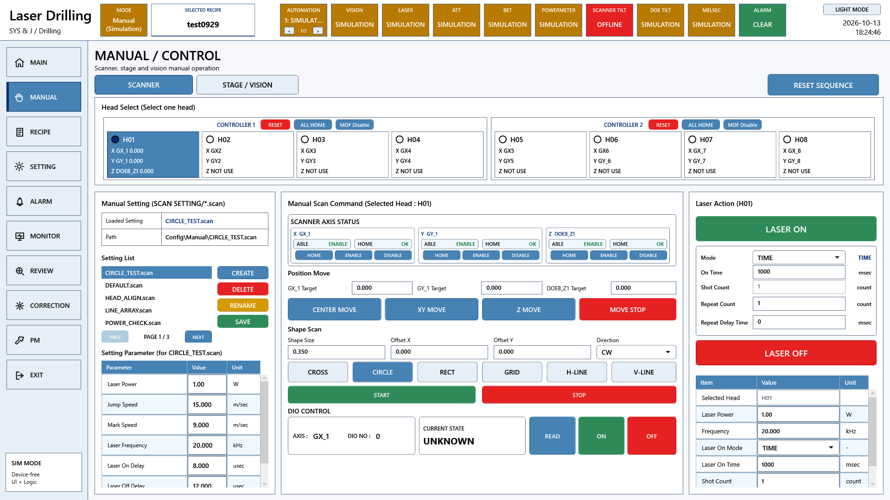

# A3 LD 수동 기능 요구기능 코드 대조

원본 Commit: [0c501c104dec1cebab87bd909de29b1b1395a8b4](https://github.com/kjuws10-rgb/A3_LD_Process_SW_IPS/commit/0c501c104dec1cebab87bd909de29b1b1395a8b4)

코드 구현 확인은 현장 검수 완료를 뜻하지 않습니다. 원본 진행 현황은 그대로 보존했고, 아래 판정은 현재 C# 구현을 기준으로 별도 작성했습니다. 화면은 최신 소스의 WPF 화면을 장치 전체 Simulation 모드로 화면 밖에서 렌더링한 것입니다. 실제 장비 측정값 또는 실제 동작 완료 증거가 아닙니다.

[전체 요약](README.md) · [편집본 엑셀](A3_LD_요구기능검증_코드분석작성본.xlsx) · [검색 가능한 상세 자료](항목별_상세근거.html)

## 관련 프로그램 화면



이 화면은 해당 기능군의 UI 연결을 보여줍니다. 개별 검수 조건의 통과 증거는 아래 소스·판정·후속 확인을 함께 보아야 합니다.

## 항목 057

서버 상태

- 원본 검수 항목: 미연결 서버 선택 시 경고 후 선택이 차단되는지 확인
- 원본 진행 현황: 완료
- 현재 코드 판정: 코드 구현 확인

Manual Scanner 명령 실행 전에 연결 상태를 확인하고 Offline이면 경고를 띄운다. 설정된 컨트롤러별 연결 번호도 함께 확인해야 한다.

### 코드 위치와 짧은 내용

[Drilling.UI/Menu/Menus/CMenuManual.cs L3216–L3315](https://github.com/kjuws10-rgb/A3_LD_Process_SW_IPS/blob/0c501c104dec1cebab87bd909de29b1b1395a8b4/Drilling.UI/Menu/Menus/CMenuManual.cs#L3216-L3315)

```csharp
    private async Task RunManualScript(string commandName, Action<CAutomation1ScriptBase, ST_MANUAL_SCAN_PARAM> buildScript, Action<CAutomation1ScriptBase, ST_MANUAL_SCAN_PARAM>? setupScript = null, string? scriptFileName = null, CancellationToken cancellationToken = default)
    {
        if (TryBlockManualAutomationCommand(commandName))
        {
            return;
        }

        CancelStatusPolling();
        _lastCommand = commandName;
        _lastResult = "Building";

        if (!_manager.automation.IsSimul() && !_manager.automation.IsConnect())
        {
            _lastResult = "ERROR: OFFLINE";
```

[Drilling.UI/Menu/Menus/CMenuManual.cs L1373–L1462](https://github.com/kjuws10-rgb/A3_LD_Process_SW_IPS/blob/0c501c104dec1cebab87bd909de29b1b1395a8b4/Drilling.UI/Menu/Menus/CMenuManual.cs#L1373-L1462)

```csharp
    private async Task ResetAutomationController(object? parameter, CancellationToken cancellationToken = default)
    {
        if (parameter is not ST_MANUAL_HEAD_GROUP group)
        {
            return;
        }

        var commandName = $"CONTROLLER_{group.AutomationNo + 1}_RESET";
        if (TryBlockManualAutomationCommand(commandName))
        {
            return;
        }

        if (!_manager.automation.IsSimul(group.AutomationNo) &&
```

### 남은 검증

레이저 OFF 및 장비 안전 모드에서 입력 경계·명령 응답·정지·재실행을 확인한다. 원본 검수 조건의 전 항목과 대조하고, 실제 장비 결과를 확보한 뒤 개발/검증 완료 여부를 갱신한다.

[관련 화면](screens/Manual_simulation.png) · [전체 요약으로](README.md)

## 항목 058

서버 상태

- 원본 검수 항목: 폼 로드시 전체 서버가 기본 선택 상태로 초기화되는지 확인
- 원본 진행 현황: 완료
- 현재 코드 판정: 부분 구현 또는 사양 차이

수동 화면은 H01~H08 설정의 Automation 번호를 바탕으로 그룹을 구성한다. 모든 서버를 기본 선택하는 이전 UI 방식과 동일하지는 않다.

### 코드 위치와 짧은 내용

[Drilling.UI/Menu/Menus/CMenuManual.cs L1101–L1165](https://github.com/kjuws10-rgb/A3_LD_Process_SW_IPS/blob/0c501c104dec1cebab87bd909de29b1b1395a8b4/Drilling.UI/Menu/Menus/CMenuManual.cs#L1101-L1165)

```csharp
    public override async Task<CScreenViewModel> Build(CancellationToken cancellationToken = default)
    {
        var settingNames = await _scanFile.List(cancellationToken);
        var orderedSettingNames = OrderSettingNames(settingNames);
        var formItems = await _scanFile.LoadForm(cancellationToken);
        var selectedSettingName = ResolveSelectedSettingName(orderedSettingNames, _selectedSettingNameProvider());
        var settings = await _scanFile.Load(selectedSettingName, cancellationToken);
        SyncSettingFilesPage(orderedSettingNames, selectedSettingName);
        var selectedHeadNoRaw = _selectedHeadNoProvider();
        var optionSettings = _manager.Setting().LoadSection(EN_SETTING_TAB.Option, cancellationToken);
        _manualScannerOptionSettings = optionSettings;
        var selectedHeadNo = NormalizeManualScannerHeadNo(optionSettings, Math.Clamp(selectedHeadNoRaw, 1, 8));
        var scannerAxes = ReadManualScannerAxesSnapshot(optionSettings, selectedHeadNo);
        var headCards = BuildHeadCards(selectedHeadNo, optionSettings, scannerAxes);
```

[Drilling.UI/Menu/Menus/CMenuManual.cs L3944–L3978](https://github.com/kjuws10-rgb/A3_LD_Process_SW_IPS/blob/0c501c104dec1cebab87bd909de29b1b1395a8b4/Drilling.UI/Menu/Menus/CMenuManual.cs#L3944-L3978)

```csharp
    private int ReadEnabledManualScannerHeadNo(CancellationToken cancellationToken)
    {
        var optionSettings = _manager.Setting().LoadSection(EN_SETTING_TAB.Option, cancellationToken);
        var enabledHeadNos = CScannerStatusPollingService.BuildEnabledHeadNumbers(optionSettings);
        if (enabledHeadNos.Count == 0)
        {
            throw new InvalidOperationException("No manual scanner head is enabled. Check Hxx_USE option settings.");
        }

        var selectedHeadNo = Math.Clamp(_selectedHeadNoProvider(), 1, 8);
        return enabledHeadNos.Contains(selectedHeadNo) ? selectedHeadNo : enabledHeadNos[0];
    }

    private static int ReadManualHeadAutomationNo(IReadOnlyList<ST_SYSTEM_PARAMETER> settings, int headNo)
```

### 남은 검증

레이저 OFF 및 장비 안전 모드에서 입력 경계·명령 응답·정지·재실행을 확인한다. 원본 검수 조건의 전 항목과 대조하고, 실제 장비 결과를 확보한 뒤 개발/검증 완료 여부를 갱신한다.

[관련 화면](screens/Manual_simulation.png) · [전체 요약으로](README.md)

## 항목 059

서버 상태

- 원본 검수 항목: 타이머로 서버/축 상태 그리드가 주기적으로 갱신되는지 확인
- 원본 진행 현황: 완료
- 현재 코드 판정: 코드 구현 확인

Scanner 상태 캐시에 Enable, Home, Position, AuxiliaryFeedback, Fault 등이 저장되고 Manual 표에 반영된다. 전체 실제 축 수는 설정 매핑에 따른다.

### 코드 위치와 짧은 내용

[Drilling.UI/Menu/Menus/CScannerStatusPollingService.cs L9–L56](https://github.com/kjuws10-rgb/A3_LD_Process_SW_IPS/blob/0c501c104dec1cebab87bd909de29b1b1395a8b4/Drilling.UI/Menu/Menus/CScannerStatusPollingService.cs#L9-L56)

```csharp
    private static readonly TimeSpan PollInterval = TimeSpan.FromSeconds(1);
    private readonly object _snapshotLock = new();
    private IReadOnlyList<ST_SCANNER_AXIS_STATUS_ITEM> _snapshot = [];
    private IReadOnlyList<ST_SCANNER_AXIS_SETTING> _axisDefinitions = [];
    private int _selectedHeadNo = 1;
    public void SelectHead(int headNo)
    {
        var normalizedHeadNo = NormalizeHeadNo(headNo);
        lock (_snapshotLock)
        {
            if (_selectedHeadNo == normalizedHeadNo)
            {
                return;
            }
```

[Drilling.UI/Menu/Menus/CMenuManual.cs L1101–L1165](https://github.com/kjuws10-rgb/A3_LD_Process_SW_IPS/blob/0c501c104dec1cebab87bd909de29b1b1395a8b4/Drilling.UI/Menu/Menus/CMenuManual.cs#L1101-L1165)

```csharp
    public override async Task<CScreenViewModel> Build(CancellationToken cancellationToken = default)
    {
        var settingNames = await _scanFile.List(cancellationToken);
        var orderedSettingNames = OrderSettingNames(settingNames);
        var formItems = await _scanFile.LoadForm(cancellationToken);
        var selectedSettingName = ResolveSelectedSettingName(orderedSettingNames, _selectedSettingNameProvider());
        var settings = await _scanFile.Load(selectedSettingName, cancellationToken);
        SyncSettingFilesPage(orderedSettingNames, selectedSettingName);
        var selectedHeadNoRaw = _selectedHeadNoProvider();
        var optionSettings = _manager.Setting().LoadSection(EN_SETTING_TAB.Option, cancellationToken);
        _manualScannerOptionSettings = optionSettings;
        var selectedHeadNo = NormalizeManualScannerHeadNo(optionSettings, Math.Clamp(selectedHeadNoRaw, 1, 8));
        var scannerAxes = ReadManualScannerAxesSnapshot(optionSettings, selectedHeadNo);
        var headCards = BuildHeadCards(selectedHeadNo, optionSettings, scannerAxes);
```

### 남은 검증

레이저 OFF 및 장비 안전 모드에서 입력 경계·명령 응답·정지·재실행을 확인한다. 원본 검수 조건의 전 항목과 대조하고, 실제 장비 결과를 확보한 뒤 개발/검증 완료 여부를 갱신한다.

[관련 화면](screens/Manual_simulation.png) · [전체 요약으로](README.md)

## 항목 060

서버 상태

- 원본 검수 항목: TCP 연결 상태를 조회해 서버 연결 여부를 반환하는지 확인
- 원본 진행 현황: 완료
- 현재 코드 판정: 코드 구현 확인

Automation 연결·시뮬레이션 여부 및 통신 상태를 화면에 표시한다. Automation1 SDK 연결과 구형 TCP 문자열 연결을 구분해야 한다.

### 코드 위치와 짧은 내용

[Drilling.Common/Automation/CAutomationManager.cs L173–L257](https://github.com/kjuws10-rgb/A3_LD_Process_SW_IPS/blob/0c501c104dec1cebab87bd909de29b1b1395a8b4/Drilling.Common/Automation/CAutomationManager.cs#L173-L257)

```csharp
    public Task<string> Move(string axisName, double targetPosition, double velocity = 100.0, int number = 0, CancellationToken cancellationToken = default)
    {
        return ExecuteAxis(axisName, $"MOVE_ABS:{Format(targetPosition)}:{Format(velocity)}", number, cancellationToken);
    }

    public Task<string> MoveRel(string axisName, double distance, double velocity = 100.0, int number = 0, CancellationToken cancellationToken = default)
    {
        return ExecuteAxis(axisName, $"MOVE_REL:{Format(distance)}:{Format(velocity)}", number, cancellationToken);
    }

    public Task<string> Stop(string axisName, int number = 0, CancellationToken cancellationToken = default)
    {
        return ExecuteAxis(axisName, "STOP", number, cancellationToken);
    }
```

[Drilling.UI/Menu/Menus/CMenuManual.cs L1101–L1165](https://github.com/kjuws10-rgb/A3_LD_Process_SW_IPS/blob/0c501c104dec1cebab87bd909de29b1b1395a8b4/Drilling.UI/Menu/Menus/CMenuManual.cs#L1101-L1165)

```csharp
    public override async Task<CScreenViewModel> Build(CancellationToken cancellationToken = default)
    {
        var settingNames = await _scanFile.List(cancellationToken);
        var orderedSettingNames = OrderSettingNames(settingNames);
        var formItems = await _scanFile.LoadForm(cancellationToken);
        var selectedSettingName = ResolveSelectedSettingName(orderedSettingNames, _selectedSettingNameProvider());
        var settings = await _scanFile.Load(selectedSettingName, cancellationToken);
        SyncSettingFilesPage(orderedSettingNames, selectedSettingName);
        var selectedHeadNoRaw = _selectedHeadNoProvider();
        var optionSettings = _manager.Setting().LoadSection(EN_SETTING_TAB.Option, cancellationToken);
        _manualScannerOptionSettings = optionSettings;
        var selectedHeadNo = NormalizeManualScannerHeadNo(optionSettings, Math.Clamp(selectedHeadNoRaw, 1, 8));
        var scannerAxes = ReadManualScannerAxesSnapshot(optionSettings, selectedHeadNo);
        var headCards = BuildHeadCards(selectedHeadNo, optionSettings, scannerAxes);
```

### 남은 검증

레이저 OFF 및 장비 안전 모드에서 입력 경계·명령 응답·정지·재실행을 확인한다. 원본 검수 조건의 전 항목과 대조하고, 실제 장비 결과를 확보한 뒤 개발/검증 완료 여부를 갱신한다.

[관련 화면](screens/Manual_simulation.png) · [전체 요약으로](README.md)

## 항목 061

구동부 상태

- 원본 검수 항목: GX/GY/DOE 축 위치·부하·서보/홈/알람 상태가 로컬 배열로 복사되는지 확인
- 원본 진행 현황: 완료 / 로컬 배열 의미 확인 필요
- 현재 코드 판정: 코드 구현 확인

폴링 서비스가 축별 Snapshot을 만들어 저장하고 UI가 읽는다. 이전 전역 배열 이름은 없어도 상태 자료를 분리해 전달하는 핵심 기능은 있다.

### 코드 위치와 짧은 내용

[Drilling.UI/Menu/Menus/CScannerStatusPollingService.cs L9–L56](https://github.com/kjuws10-rgb/A3_LD_Process_SW_IPS/blob/0c501c104dec1cebab87bd909de29b1b1395a8b4/Drilling.UI/Menu/Menus/CScannerStatusPollingService.cs#L9-L56)

```csharp
    private static readonly TimeSpan PollInterval = TimeSpan.FromSeconds(1);
    private readonly object _snapshotLock = new();
    private IReadOnlyList<ST_SCANNER_AXIS_STATUS_ITEM> _snapshot = [];
    private IReadOnlyList<ST_SCANNER_AXIS_SETTING> _axisDefinitions = [];
    private int _selectedHeadNo = 1;
    public void SelectHead(int headNo)
    {
        var normalizedHeadNo = NormalizeHeadNo(headNo);
        lock (_snapshotLock)
        {
            if (_selectedHeadNo == normalizedHeadNo)
            {
                return;
            }
```

[Drilling.Common/Automation/CScannerStatusLiveSnapshotStore.cs L3–L62](https://github.com/kjuws10-rgb/A3_LD_Process_SW_IPS/blob/0c501c104dec1cebab87bd909de29b1b1395a8b4/Drilling.Common/Automation/CScannerStatusLiveSnapshotStore.cs#L3-L62)

```csharp
public sealed record ST_SCANNER_AXIS_LIVE_STATUS(int HeadNo, int AutomationNo, int ControllerNo, int TaskNo, string Head, string Automation, string Axis, string AxisNo, string AxisPosition, string AxisCurrentFeedback, string AxisEnableStatus, string AxisHomeStatus, string AxisFault, string GalvoTemperature, string GalvoLaserOutputRaw, string PositionFbkAux, string TaskStatus, string ProcessorUsage, string Error, string Detail);

public static class CScannerStatusLiveSnapshotStore
{
    private static readonly object SnapshotLock = new();
    private static Guid _ownerId = Guid.Empty;
    private static IReadOnlyList<ST_SCANNER_AXIS_LIVE_STATUS> _snapshot = [];

    public static Guid Begin()
    {
        var ownerId = Guid.NewGuid();
        lock (SnapshotLock)
        {
            _ownerId = ownerId;
```

### 남은 검증

레이저 OFF 및 장비 안전 모드에서 입력 경계·명령 응답·정지·재실행을 확인한다. 원본 검수 조건의 전 항목과 대조하고, 실제 장비 결과를 확보한 뒤 개발/검증 완료 여부를 갱신한다.

[관련 화면](screens/Manual_simulation.png) · [전체 요약으로](README.md)

## 항목 062

구동부 상태

- 원본 검수 항목: 축별 현재위치/로드 값이 형식화되어 그리드에 표시되는지 확인
- 원본 진행 현황: 완료
- 현재 코드 판정: 부분 구현 또는 사양 차이

Scanner 축 위치와 보조 피드백은 전용 Format 함수로 문자열을 만든다. 요구한 소수점 자릿수·단위는 원본 체크시트와 화면을 대조해야 한다.

### 코드 위치와 짧은 내용

[Drilling.UI/Menu/Menus/CScannerStatusPollingService.cs L9–L56](https://github.com/kjuws10-rgb/A3_LD_Process_SW_IPS/blob/0c501c104dec1cebab87bd909de29b1b1395a8b4/Drilling.UI/Menu/Menus/CScannerStatusPollingService.cs#L9-L56)

```csharp
    private static readonly TimeSpan PollInterval = TimeSpan.FromSeconds(1);
    private readonly object _snapshotLock = new();
    private IReadOnlyList<ST_SCANNER_AXIS_STATUS_ITEM> _snapshot = [];
    private IReadOnlyList<ST_SCANNER_AXIS_SETTING> _axisDefinitions = [];
    private int _selectedHeadNo = 1;
    public void SelectHead(int headNo)
    {
        var normalizedHeadNo = NormalizeHeadNo(headNo);
        lock (_snapshotLock)
        {
            if (_selectedHeadNo == normalizedHeadNo)
            {
                return;
            }
```

[Drilling.UI/Menu/Menus/CMenuManual.cs L1101–L1165](https://github.com/kjuws10-rgb/A3_LD_Process_SW_IPS/blob/0c501c104dec1cebab87bd909de29b1b1395a8b4/Drilling.UI/Menu/Menus/CMenuManual.cs#L1101-L1165)

```csharp
    public override async Task<CScreenViewModel> Build(CancellationToken cancellationToken = default)
    {
        var settingNames = await _scanFile.List(cancellationToken);
        var orderedSettingNames = OrderSettingNames(settingNames);
        var formItems = await _scanFile.LoadForm(cancellationToken);
        var selectedSettingName = ResolveSelectedSettingName(orderedSettingNames, _selectedSettingNameProvider());
        var settings = await _scanFile.Load(selectedSettingName, cancellationToken);
        SyncSettingFilesPage(orderedSettingNames, selectedSettingName);
        var selectedHeadNoRaw = _selectedHeadNoProvider();
        var optionSettings = _manager.Setting().LoadSection(EN_SETTING_TAB.Option, cancellationToken);
        _manualScannerOptionSettings = optionSettings;
        var selectedHeadNo = NormalizeManualScannerHeadNo(optionSettings, Math.Clamp(selectedHeadNoRaw, 1, 8));
        var scannerAxes = ReadManualScannerAxesSnapshot(optionSettings, selectedHeadNo);
        var headCards = BuildHeadCards(selectedHeadNo, optionSettings, scannerAxes);
```

### 남은 검증

레이저 OFF 및 장비 안전 모드에서 입력 경계·명령 응답·정지·재실행을 확인한다. 원본 검수 조건의 전 항목과 대조하고, 실제 장비 결과를 확보한 뒤 개발/검증 완료 여부를 갱신한다.

[관련 화면](screens/Manual_simulation.png) · [전체 요약으로](README.md)

## 항목 063

구동부 상태

- 원본 검수 항목: 폼 로드시 각 축 초기 상태가 그리드에 반영되는지 확인
- 원본 진행 현황: 완료
- 현재 코드 판정: 코드 구현 확인

Manual Build에서 설정·Head·축 상태를 읽어 화면 자료를 구성한다. UI 초기값과 아직 읽지 못한 상태를 실제 정상 값으로 취급해서는 안 된다.

### 코드 위치와 짧은 내용

[Drilling.UI/Menu/Menus/CMenuManual.cs L1101–L1165](https://github.com/kjuws10-rgb/A3_LD_Process_SW_IPS/blob/0c501c104dec1cebab87bd909de29b1b1395a8b4/Drilling.UI/Menu/Menus/CMenuManual.cs#L1101-L1165)

```csharp
    public override async Task<CScreenViewModel> Build(CancellationToken cancellationToken = default)
    {
        var settingNames = await _scanFile.List(cancellationToken);
        var orderedSettingNames = OrderSettingNames(settingNames);
        var formItems = await _scanFile.LoadForm(cancellationToken);
        var selectedSettingName = ResolveSelectedSettingName(orderedSettingNames, _selectedSettingNameProvider());
        var settings = await _scanFile.Load(selectedSettingName, cancellationToken);
        SyncSettingFilesPage(orderedSettingNames, selectedSettingName);
        var selectedHeadNoRaw = _selectedHeadNoProvider();
        var optionSettings = _manager.Setting().LoadSection(EN_SETTING_TAB.Option, cancellationToken);
        _manualScannerOptionSettings = optionSettings;
        var selectedHeadNo = NormalizeManualScannerHeadNo(optionSettings, Math.Clamp(selectedHeadNoRaw, 1, 8));
        var scannerAxes = ReadManualScannerAxesSnapshot(optionSettings, selectedHeadNo);
        var headCards = BuildHeadCards(selectedHeadNo, optionSettings, scannerAxes);
```

[Drilling.UI/Menu/Menus/CScannerStatusPollingService.cs L9–L56](https://github.com/kjuws10-rgb/A3_LD_Process_SW_IPS/blob/0c501c104dec1cebab87bd909de29b1b1395a8b4/Drilling.UI/Menu/Menus/CScannerStatusPollingService.cs#L9-L56)

```csharp
    private static readonly TimeSpan PollInterval = TimeSpan.FromSeconds(1);
    private readonly object _snapshotLock = new();
    private IReadOnlyList<ST_SCANNER_AXIS_STATUS_ITEM> _snapshot = [];
    private IReadOnlyList<ST_SCANNER_AXIS_SETTING> _axisDefinitions = [];
    private int _selectedHeadNo = 1;
    public void SelectHead(int headNo)
    {
        var normalizedHeadNo = NormalizeHeadNo(headNo);
        lock (_snapshotLock)
        {
            if (_selectedHeadNo == normalizedHeadNo)
            {
                return;
            }
```

### 남은 검증

레이저 OFF 및 장비 안전 모드에서 입력 경계·명령 응답·정지·재실행을 확인한다. 원본 검수 조건의 전 항목과 대조하고, 실제 장비 결과를 확보한 뒤 개발/검증 완료 여부를 갱신한다.

[관련 화면](screens/Manual_simulation.png) · [전체 요약으로](README.md)

## 항목 064

구동부 상태

- 원본 검수 항목: 100ms 주기 타이머에서 상태 표시 메소드들이 순차 호출되는지 확인
- 원본 진행 현황: 완료
- 현재 코드 판정: 부분 구현 또는 사양 차이

CScannerStatusPollingService의 PollInterval은 1초다. 체크시트의 100 ms 표 갱신 요구와 현재 구현 값이 다르므로 통신 부하·주기 사양 합의가 필요하다.

### 코드 위치와 짧은 내용

[Drilling.UI/Menu/Menus/CScannerStatusPollingService.cs L9–L56](https://github.com/kjuws10-rgb/A3_LD_Process_SW_IPS/blob/0c501c104dec1cebab87bd909de29b1b1395a8b4/Drilling.UI/Menu/Menus/CScannerStatusPollingService.cs#L9-L56)

```csharp
    private static readonly TimeSpan PollInterval = TimeSpan.FromSeconds(1);
    private readonly object _snapshotLock = new();
    private IReadOnlyList<ST_SCANNER_AXIS_STATUS_ITEM> _snapshot = [];
    private IReadOnlyList<ST_SCANNER_AXIS_SETTING> _axisDefinitions = [];
    private int _selectedHeadNo = 1;
    public void SelectHead(int headNo)
    {
        var normalizedHeadNo = NormalizeHeadNo(headNo);
        lock (_snapshotLock)
        {
            if (_selectedHeadNo == normalizedHeadNo)
            {
                return;
            }
```

### 남은 검증

레이저 OFF 및 장비 안전 모드에서 입력 경계·명령 응답·정지·재실행을 확인한다. 원본 검수 조건의 전 항목과 대조하고, 실제 장비 결과를 확보한 뒤 개발/검증 완료 여부를 갱신한다.

[관련 화면](screens/Manual_simulation.png) · [전체 요약으로](README.md)

## 항목 065

구동부 제어

- 원본 검수 항목: 그리드 HOME 컬럼 클릭시 확인 후 축 원점복귀가 실행되는지 확인
- 원본 진행 현황: 완료
- 현재 코드 판정: 코드 구현 확인

축 Home 명령은 사용자 확인을 거쳐 Automation1에 실행된다. Servo 상태와 사용 Head를 확인하는 사전 조건도 있다.

### 코드 위치와 짧은 내용

[Drilling.UI/Menu/Menus/CMenuManual.cs L1342–L1355](https://github.com/kjuws10-rgb/A3_LD_Process_SW_IPS/blob/0c501c104dec1cebab87bd909de29b1b1395a8b4/Drilling.UI/Menu/Menus/CMenuManual.cs#L1342-L1355)

```csharp
    private async Task HomeScannerAxis(object? parameter)
    {
        await ExecuteScannerAxisCommand(parameter, "HOME");
    }

    private async Task EnableScannerAxis(object? parameter)
    {
        await ExecuteScannerAxisCommand(parameter, "ENABLE");
    }

    private async Task DisableScannerAxis(object? parameter)
    {
        await ExecuteScannerAxisCommand(parameter, "DISABLE");
    }
```

[Drilling.Common/Automation/CAutomationManager.cs L173–L257](https://github.com/kjuws10-rgb/A3_LD_Process_SW_IPS/blob/0c501c104dec1cebab87bd909de29b1b1395a8b4/Drilling.Common/Automation/CAutomationManager.cs#L173-L257)

```csharp
    public Task<string> Move(string axisName, double targetPosition, double velocity = 100.0, int number = 0, CancellationToken cancellationToken = default)
    {
        return ExecuteAxis(axisName, $"MOVE_ABS:{Format(targetPosition)}:{Format(velocity)}", number, cancellationToken);
    }

    public Task<string> MoveRel(string axisName, double distance, double velocity = 100.0, int number = 0, CancellationToken cancellationToken = default)
    {
        return ExecuteAxis(axisName, $"MOVE_REL:{Format(distance)}:{Format(velocity)}", number, cancellationToken);
    }

    public Task<string> Stop(string axisName, int number = 0, CancellationToken cancellationToken = default)
    {
        return ExecuteAxis(axisName, "STOP", number, cancellationToken);
    }
```

### 남은 검증

레이저 OFF 및 장비 안전 모드에서 입력 경계·명령 응답·정지·재실행을 확인한다. 원본 검수 조건의 전 항목과 대조하고, 실제 장비 결과를 확보한 뒤 개발/검증 완료 여부를 갱신한다.

[관련 화면](screens/Manual_simulation.png) · [전체 요약으로](README.md)

## 항목 066

구동부 제어

- 원본 검수 항목: 서버 전체 Galvo축에 대해 순차 원점복귀가 수행되는지 확인
- 원본 진행 현황: 완료
- 현재 코드 판정: 코드 구현 확인

컨트롤러별 설정 축을 모아 Home Task를 만들고 실행 완료를 확인한다. Scanner Z 포함 여부는 Head별 축 설정에 따른다.

### 코드 위치와 짧은 내용

[Drilling.UI/Menu/Menus/CMenuManual.cs L1832–L1916](https://github.com/kjuws10-rgb/A3_LD_Process_SW_IPS/blob/0c501c104dec1cebab87bd909de29b1b1395a8b4/Drilling.UI/Menu/Menus/CMenuManual.cs#L1832-L1916)

```csharp
    private async Task HomeAutomationControllerAxes(object? parameter, CancellationToken cancellationToken = default)
    {
        if (parameter is not ST_MANUAL_HEAD_GROUP group)
        {
            return;
        }

        var commandName = $"CONTROLLER_{group.AutomationNo + 1}_ALL_HOME";
        if (TryBlockManualAutomationCommand(commandName))
        {
            return;
        }

        if (!_manager.automation.IsSimul(group.AutomationNo) &&
```

### 남은 검증

레이저 OFF 및 장비 안전 모드에서 입력 경계·명령 응답·정지·재실행을 확인한다. 원본 검수 조건의 전 항목과 대조하고, 실제 장비 결과를 확보한 뒤 개발/검증 완료 여부를 갱신한다.

[관련 화면](screens/Manual_simulation.png) · [전체 요약으로](README.md)

## 항목 067

구동부 제어

- 원본 검수 항목: HOMEASYNC ASCII 명령이 축으로 전송되고 결과가 반환되는지 확인
- 원본 진행 현황: 완료 (홈 동작시 ASYNC API 사용)
- 현재 코드 판정: 코드 구현 확인

AutomationManager에 HomeAsync 호출이 존재하고 수동 Home 시퀀스에서 비동기 명령 및 완료 확인을 사용한다. 장비 HomeDone 신호로 최종 시험해야 한다.

### 코드 위치와 짧은 내용

[Drilling.Common/Automation/CAutomationManager.cs L173–L257](https://github.com/kjuws10-rgb/A3_LD_Process_SW_IPS/blob/0c501c104dec1cebab87bd909de29b1b1395a8b4/Drilling.Common/Automation/CAutomationManager.cs#L173-L257)

```csharp
    public Task<string> Move(string axisName, double targetPosition, double velocity = 100.0, int number = 0, CancellationToken cancellationToken = default)
    {
        return ExecuteAxis(axisName, $"MOVE_ABS:{Format(targetPosition)}:{Format(velocity)}", number, cancellationToken);
    }

    public Task<string> MoveRel(string axisName, double distance, double velocity = 100.0, int number = 0, CancellationToken cancellationToken = default)
    {
        return ExecuteAxis(axisName, $"MOVE_REL:{Format(distance)}:{Format(velocity)}", number, cancellationToken);
    }

    public Task<string> Stop(string axisName, int number = 0, CancellationToken cancellationToken = default)
    {
        return ExecuteAxis(axisName, "STOP", number, cancellationToken);
    }
```

[Drilling.UI/Menu/Menus/CMenuManual.cs L1832–L1916](https://github.com/kjuws10-rgb/A3_LD_Process_SW_IPS/blob/0c501c104dec1cebab87bd909de29b1b1395a8b4/Drilling.UI/Menu/Menus/CMenuManual.cs#L1832-L1916)

```csharp
    private async Task HomeAutomationControllerAxes(object? parameter, CancellationToken cancellationToken = default)
    {
        if (parameter is not ST_MANUAL_HEAD_GROUP group)
        {
            return;
        }

        var commandName = $"CONTROLLER_{group.AutomationNo + 1}_ALL_HOME";
        if (TryBlockManualAutomationCommand(commandName))
        {
            return;
        }

        if (!_manager.automation.IsSimul(group.AutomationNo) &&
```

### 남은 검증

레이저 OFF 및 장비 안전 모드에서 입력 경계·명령 응답·정지·재실행을 확인한다. 원본 검수 조건의 전 항목과 대조하고, 실제 장비 결과를 확보한 뒤 개발/검증 완료 여부를 갱신한다.

[관련 화면](screens/Manual_simulation.png) · [전체 요약으로](README.md)

## 항목 068

구동부 제어

- 원본 검수 항목: 지정 축의 Home 속도가 설정되는지 확인
- 원본 진행 현황: 미완료
- 현재 코드 판정: 부분 구현 또는 사양 차이

컨트롤러 Home Task는 설정 축과 스크립트 조건을 사용한다. 구형 A3200 HomeSpeed 변수와 현재 Automation1 축 파라미터가 동일한지는 별도다.

### 코드 위치와 짧은 내용

[Drilling.UI/Menu/Menus/CMenuManual.cs L1832–L1916](https://github.com/kjuws10-rgb/A3_LD_Process_SW_IPS/blob/0c501c104dec1cebab87bd909de29b1b1395a8b4/Drilling.UI/Menu/Menus/CMenuManual.cs#L1832-L1916)

```csharp
    private async Task HomeAutomationControllerAxes(object? parameter, CancellationToken cancellationToken = default)
    {
        if (parameter is not ST_MANUAL_HEAD_GROUP group)
        {
            return;
        }

        var commandName = $"CONTROLLER_{group.AutomationNo + 1}_ALL_HOME";
        if (TryBlockManualAutomationCommand(commandName))
        {
            return;
        }

        if (!_manager.automation.IsSimul(group.AutomationNo) &&
```

[Drilling.Common/Automation/CAutomationManager.cs L173–L257](https://github.com/kjuws10-rgb/A3_LD_Process_SW_IPS/blob/0c501c104dec1cebab87bd909de29b1b1395a8b4/Drilling.Common/Automation/CAutomationManager.cs#L173-L257)

```csharp
    public Task<string> Move(string axisName, double targetPosition, double velocity = 100.0, int number = 0, CancellationToken cancellationToken = default)
    {
        return ExecuteAxis(axisName, $"MOVE_ABS:{Format(targetPosition)}:{Format(velocity)}", number, cancellationToken);
    }

    public Task<string> MoveRel(string axisName, double distance, double velocity = 100.0, int number = 0, CancellationToken cancellationToken = default)
    {
        return ExecuteAxis(axisName, $"MOVE_REL:{Format(distance)}:{Format(velocity)}", number, cancellationToken);
    }

    public Task<string> Stop(string axisName, int number = 0, CancellationToken cancellationToken = default)
    {
        return ExecuteAxis(axisName, "STOP", number, cancellationToken);
    }
```

### 남은 검증

레이저 OFF 및 장비 안전 모드에서 입력 경계·명령 응답·정지·재실행을 확인한다. 원본 검수 조건의 전 항목과 대조하고, 실제 장비 결과를 확보한 뒤 개발/검증 완료 여부를 갱신한다.

[관련 화면](screens/Manual_simulation.png) · [전체 요약으로](README.md)

## 항목 069

구동부 제어

- 원본 검수 항목: (-) 버튼 클릭시 입력 거리/속도로 INC 이동이 수행되는지 확인
- 원본 진행 현황: 미완료
- 현재 코드 판정: 코드 구현 확인

AutomationManager는 MoveRel을 제공하고 수동 축 명령에서 상대 이동을 사용한다. Stage JOG는 PLC 제어권과 별개의 경로다.

### 코드 위치와 짧은 내용

[Drilling.Common/Automation/CAutomationManager.cs L173–L257](https://github.com/kjuws10-rgb/A3_LD_Process_SW_IPS/blob/0c501c104dec1cebab87bd909de29b1b1395a8b4/Drilling.Common/Automation/CAutomationManager.cs#L173-L257)

```csharp
    public Task<string> Move(string axisName, double targetPosition, double velocity = 100.0, int number = 0, CancellationToken cancellationToken = default)
    {
        return ExecuteAxis(axisName, $"MOVE_ABS:{Format(targetPosition)}:{Format(velocity)}", number, cancellationToken);
    }

    public Task<string> MoveRel(string axisName, double distance, double velocity = 100.0, int number = 0, CancellationToken cancellationToken = default)
    {
        return ExecuteAxis(axisName, $"MOVE_REL:{Format(distance)}:{Format(velocity)}", number, cancellationToken);
    }

    public Task<string> Stop(string axisName, int number = 0, CancellationToken cancellationToken = default)
    {
        return ExecuteAxis(axisName, "STOP", number, cancellationToken);
    }
```

[Drilling.UI/Menu/Menus/CMenuManual.cs L1972–L2043](https://github.com/kjuws10-rgb/A3_LD_Process_SW_IPS/blob/0c501c104dec1cebab87bd909de29b1b1395a8b4/Drilling.UI/Menu/Menus/CMenuManual.cs#L1972-L2043)

```csharp
    private async Task ExecuteScannerAxisCommand(object? parameter, string commandName, CancellationToken cancellationToken = default)
    {
        if (parameter is not ST_MANUAL_SCANNER_AXIS axis)
        {
            return;
        }

        if (!IsConfiguredScannerAxisName(axis.AxisReference))
        {
            _lastCommand = $"SCANNER_{axis.Head}_{axis.AxisRole}_{commandName}";
            _lastResult = "NOT CONFIGURED";
            _setStatusMessage($"{axis.Head} {axis.AxisRole} axis name is not configured.");
            RefreshCommandStateRows();
            _refreshShellStatus();
```

### 남은 검증

레이저 OFF 및 장비 안전 모드에서 입력 경계·명령 응답·정지·재실행을 확인한다. 원본 검수 조건의 전 항목과 대조하고, 실제 장비 결과를 확보한 뒤 개발/검증 완료 여부를 갱신한다.

[관련 화면](screens/Manual_simulation.png) · [전체 요약으로](README.md)

## 항목 070

구동부 제어

- 원본 검수 항목: 지정 거리만큼 상대(INC) 이동 명령이 전송되는지 확인
- 원본 진행 현황: 미완료
- 현재 코드 판정: 코드 구현 확인

Scanner MoveRel은 현재 축에 상대 거리를 적용한다. PLC Stage 상대 이동은 캐시 현재 위치를 더한 절대 목표 WriteDouble로 구성되므로 같은 명령이 아니다.

### 코드 위치와 짧은 내용

[Drilling.Common/Automation/CAutomationManager.cs L173–L257](https://github.com/kjuws10-rgb/A3_LD_Process_SW_IPS/blob/0c501c104dec1cebab87bd909de29b1b1395a8b4/Drilling.Common/Automation/CAutomationManager.cs#L173-L257)

```csharp
    public Task<string> Move(string axisName, double targetPosition, double velocity = 100.0, int number = 0, CancellationToken cancellationToken = default)
    {
        return ExecuteAxis(axisName, $"MOVE_ABS:{Format(targetPosition)}:{Format(velocity)}", number, cancellationToken);
    }

    public Task<string> MoveRel(string axisName, double distance, double velocity = 100.0, int number = 0, CancellationToken cancellationToken = default)
    {
        return ExecuteAxis(axisName, $"MOVE_REL:{Format(distance)}:{Format(velocity)}", number, cancellationToken);
    }

    public Task<string> Stop(string axisName, int number = 0, CancellationToken cancellationToken = default)
    {
        return ExecuteAxis(axisName, "STOP", number, cancellationToken);
    }
```

[Drilling.UI/Menu/Menus/CMenuManual.cs L1248–L1335](https://github.com/kjuws10-rgb/A3_LD_Process_SW_IPS/blob/0c501c104dec1cebab87bd909de29b1b1395a8b4/Drilling.UI/Menu/Menus/CMenuManual.cs#L1248-L1335)

```csharp
    private async Task ExecuteMotionMove(string moveMode, string confirmationTitle)
    {
        var axis = SelectedStageAxis;
        if (!double.TryParse(axis.TargetPosition, NumberStyles.Float, CultureInfo.InvariantCulture, out var targetPosition))
        {
            var message = $"{axis.DisplayName} position is not a valid number: {axis.TargetPosition}";
            _setStatusMessage(message);
            ShowManualWarning(message);
            return;
        }

        if (!double.TryParse(axis.TargetSpeed, NumberStyles.Float, CultureInfo.InvariantCulture, out var targetSpeed) || targetSpeed < 0.0)
        {
            var message = $"{axis.DisplayName} speed is not a valid positive number: {axis.TargetSpeed}";
```

### 남은 검증

레이저 OFF 및 장비 안전 모드에서 입력 경계·명령 응답·정지·재실행을 확인한다. 원본 검수 조건의 전 항목과 대조하고, 실제 장비 결과를 확보한 뒤 개발/검증 완료 여부를 갱신한다.

[관련 화면](screens/Manual_simulation.png) · [전체 요약으로](README.md)

## 항목 071

구동부 제어

- 원본 검수 항목: 지정 절대위치로 이동 명령이 전송되는지 확인
- 원본 진행 현황: 완료
- 현재 코드 판정: 코드 구현 확인

Scanner 목표 좌표를 Script에 넣고 Jump와 이동 완료 대기를 생성한다. 실제 축 이름과 GX/GY 방향은 설정값을 따라 검증해야 한다.

### 코드 위치와 짧은 내용

[Drilling.UI/Menu/Menus/CMenuManual.cs L2633–L2665](https://github.com/kjuws10-rgb/A3_LD_Process_SW_IPS/blob/0c501c104dec1cebab87bd909de29b1b1395a8b4/Drilling.UI/Menu/Menus/CMenuManual.cs#L2633-L2665)

```csharp
    private async Task PositionMove()
    {
        ST_MANUAL_SCRIPT_AXES axes;
        try
        {
            var headNo = ReadEnabledManualScannerHeadNo(CancellationToken.None);
            axes = ReadManualScriptAxes(headNo, CancellationToken.None);
        }
        catch (Exception exception)when (exception is InvalidDataException or InvalidOperationException or IOException or TimeoutException or KeyNotFoundException)
        {
            _lastCommand = "POSITION_MOVE";
            _lastResult = $"ERROR: {exception.Message}";
            _setStatusMessage($"POSITION_MOVE failed. {exception.Message}");
            RefreshCommandStateRows();
```

[Drilling.UI/Menu/Menus/CMenuManual.cs L3216–L3315](https://github.com/kjuws10-rgb/A3_LD_Process_SW_IPS/blob/0c501c104dec1cebab87bd909de29b1b1395a8b4/Drilling.UI/Menu/Menus/CMenuManual.cs#L3216-L3315)

```csharp
    private async Task RunManualScript(string commandName, Action<CAutomation1ScriptBase, ST_MANUAL_SCAN_PARAM> buildScript, Action<CAutomation1ScriptBase, ST_MANUAL_SCAN_PARAM>? setupScript = null, string? scriptFileName = null, CancellationToken cancellationToken = default)
    {
        if (TryBlockManualAutomationCommand(commandName))
        {
            return;
        }

        CancelStatusPolling();
        _lastCommand = commandName;
        _lastResult = "Building";

        if (!_manager.automation.IsSimul() && !_manager.automation.IsConnect())
        {
            _lastResult = "ERROR: OFFLINE";
```

### 남은 검증

레이저 OFF 및 장비 안전 모드에서 입력 경계·명령 응답·정지·재실행을 확인한다. 원본 검수 조건의 전 항목과 대조하고, 실제 장비 결과를 확보한 뒤 개발/검증 완료 여부를 갱신한다.

[관련 화면](screens/Manual_simulation.png) · [전체 요약으로](README.md)

## 항목 072

구동부 제어

- 원본 검수 항목: 축 정지 명령이 전송되는지 확인
- 원본 진행 현황: 완료
- 현재 코드 판정: 부분 구현 또는 사양 차이

Scanner는 Task Stop API를 호출한다. 수동 StageStop은 현재 안내 메시지 중심으로 PLC 정지 핸드셰이크와 같다고 볼 수 없다.

### 코드 위치와 짧은 내용

[Drilling.UI/Menu/Menus/CMenuManual.cs L3462–L3526](https://github.com/kjuws10-rgb/A3_LD_Process_SW_IPS/blob/0c501c104dec1cebab87bd909de29b1b1395a8b4/Drilling.UI/Menu/Menus/CMenuManual.cs#L3462-L3526)

```csharp
    private async Task StopManualTask(string commandName, CancellationToken cancellationToken = default)
    {
        if (TryBlockManualAutomationCommand(commandName))
        {
            return;
        }

        CancelStatusPolling();
        _lastCommand = commandName;
        _lastResult = "Stopping";

        if (!_manager.automation.IsSimul() && !_manager.automation.IsConnect())
        {
            _lastResult = "ERROR: OFFLINE";
```

[Drilling.UI/Menu/Menus/CMenuManual.cs L1248–L1335](https://github.com/kjuws10-rgb/A3_LD_Process_SW_IPS/blob/0c501c104dec1cebab87bd909de29b1b1395a8b4/Drilling.UI/Menu/Menus/CMenuManual.cs#L1248-L1335)

```csharp
    private async Task ExecuteMotionMove(string moveMode, string confirmationTitle)
    {
        var axis = SelectedStageAxis;
        if (!double.TryParse(axis.TargetPosition, NumberStyles.Float, CultureInfo.InvariantCulture, out var targetPosition))
        {
            var message = $"{axis.DisplayName} position is not a valid number: {axis.TargetPosition}";
            _setStatusMessage(message);
            ShowManualWarning(message);
            return;
        }

        if (!double.TryParse(axis.TargetSpeed, NumberStyles.Float, CultureInfo.InvariantCulture, out var targetSpeed) || targetSpeed < 0.0)
        {
            var message = $"{axis.DisplayName} speed is not a valid positive number: {axis.TargetSpeed}";
```

### 남은 검증

레이저 OFF 및 장비 안전 모드에서 입력 경계·명령 응답·정지·재실행을 확인한다. 원본 검수 조건의 전 항목과 대조하고, 실제 장비 결과를 확보한 뒤 개발/검증 완료 여부를 갱신한다.

[관련 화면](screens/Manual_simulation.png) · [전체 요약으로](README.md)

## 항목 073

구동부 제어

- 원본 검수 항목: Alarm 컬럼 클릭시 Galvo축은 ResetGalvo, 기타축은 FaultClear가 호출되는지 확인
- 원본 진행 현황: 미완료
- 현재 코드 판정: 부분 구현 또는 사양 차이

ResetAlarm/FaultAck API와 컨트롤러 Reset 시퀀스는 있다. Galvo축 FaultClear 후 Encoder 재설정 등 구형 방식의 분기와 정확한 일치 검증이 필요하다.

### 코드 위치와 짧은 내용

[Drilling.Common/Automation/CAutomationManager.cs L173–L257](https://github.com/kjuws10-rgb/A3_LD_Process_SW_IPS/blob/0c501c104dec1cebab87bd909de29b1b1395a8b4/Drilling.Common/Automation/CAutomationManager.cs#L173-L257)

```csharp
    public Task<string> Move(string axisName, double targetPosition, double velocity = 100.0, int number = 0, CancellationToken cancellationToken = default)
    {
        return ExecuteAxis(axisName, $"MOVE_ABS:{Format(targetPosition)}:{Format(velocity)}", number, cancellationToken);
    }

    public Task<string> MoveRel(string axisName, double distance, double velocity = 100.0, int number = 0, CancellationToken cancellationToken = default)
    {
        return ExecuteAxis(axisName, $"MOVE_REL:{Format(distance)}:{Format(velocity)}", number, cancellationToken);
    }

    public Task<string> Stop(string axisName, int number = 0, CancellationToken cancellationToken = default)
    {
        return ExecuteAxis(axisName, "STOP", number, cancellationToken);
    }
```

[Drilling.UI/Menu/Menus/CMenuManual.cs L1373–L1462](https://github.com/kjuws10-rgb/A3_LD_Process_SW_IPS/blob/0c501c104dec1cebab87bd909de29b1b1395a8b4/Drilling.UI/Menu/Menus/CMenuManual.cs#L1373-L1462)

```csharp
    private async Task ResetAutomationController(object? parameter, CancellationToken cancellationToken = default)
    {
        if (parameter is not ST_MANUAL_HEAD_GROUP group)
        {
            return;
        }

        var commandName = $"CONTROLLER_{group.AutomationNo + 1}_RESET";
        if (TryBlockManualAutomationCommand(commandName))
        {
            return;
        }

        if (!_manager.automation.IsSimul(group.AutomationNo) &&
```

### 남은 검증

레이저 OFF 및 장비 안전 모드에서 입력 경계·명령 응답·정지·재실행을 확인한다. 원본 검수 조건의 전 항목과 대조하고, 실제 장비 결과를 확보한 뒤 개발/검증 완료 여부를 갱신한다.

[관련 화면](screens/Manual_simulation.png) · [전체 요약으로](README.md)

## 항목 074

구동부 제어

- 원본 검수 항목: SetFaultClear와 SetInitGalvoEncoderScaleFactor가 순차 호출되는지 확인
- 원본 진행 현황: 미완료
- 현재 코드 판정: 부분 구현 또는 사양 차이

GalvoEncoderScaleFactorSet 해제는 MOF Disable 기능에서 제공한다. FaultClear가 항상 Encoder Scale 해제를 동반한다고 판정할 근거는 없다.

### 코드 위치와 짧은 내용

[Drilling.UI/Menu/Menus/CMenuManual.Mof.cs L13–L93](https://github.com/kjuws10-rgb/A3_LD_Process_SW_IPS/blob/0c501c104dec1cebab87bd909de29b1b1395a8b4/Drilling.UI/Menu/Menus/CMenuManual.Mof.cs#L13-L93)

```csharp
    private async Task DisableControllerMof(object? parameter)
    {
        if (parameter is not ST_MANUAL_HEAD_GROUP group || _mofDisableBusy) return;
        var commandName = $"CONTROLLER_{group.AutomationNo + 1}_MOF_DISABLE";
        if (TryBlockManualAutomationCommand(commandName)) return;
        _mofDisableBusy = true;
        try
        {
            var simulation = _manager.automation.IsSimul(group.AutomationNo);
            if (!simulation && !_manager.automation.IsConnect(group.AutomationNo))
                throw new InvalidOperationException($"{group.Title} Automation 장비가 연결되어 있지 않습니다.");

            var settings = _manager.Setting().LoadSection(EN_SETTING_TAB.Option);
            IReadOnlyList<string> axes = simulation
```

[Drilling.Common/Automation/CAutomationManager.cs L173–L257](https://github.com/kjuws10-rgb/A3_LD_Process_SW_IPS/blob/0c501c104dec1cebab87bd909de29b1b1395a8b4/Drilling.Common/Automation/CAutomationManager.cs#L173-L257)

```csharp
    public Task<string> Move(string axisName, double targetPosition, double velocity = 100.0, int number = 0, CancellationToken cancellationToken = default)
    {
        return ExecuteAxis(axisName, $"MOVE_ABS:{Format(targetPosition)}:{Format(velocity)}", number, cancellationToken);
    }

    public Task<string> MoveRel(string axisName, double distance, double velocity = 100.0, int number = 0, CancellationToken cancellationToken = default)
    {
        return ExecuteAxis(axisName, $"MOVE_REL:{Format(distance)}:{Format(velocity)}", number, cancellationToken);
    }

    public Task<string> Stop(string axisName, int number = 0, CancellationToken cancellationToken = default)
    {
        return ExecuteAxis(axisName, "STOP", number, cancellationToken);
    }
```

### 남은 검증

레이저 OFF 및 장비 안전 모드에서 입력 경계·명령 응답·정지·재실행을 확인한다. 원본 검수 조건의 전 항목과 대조하고, 실제 장비 결과를 확보한 뒤 개발/검증 완료 여부를 갱신한다.

[관련 화면](screens/Manual_simulation.png) · [전체 요약으로](README.md)

## 항목 075

구동부 제어

- 원본 검수 항목: FAULTACK 명령으로 축 알람이 해제되는지 확인
- 원본 진행 현황: 미완료 (FAULTACK 명령 의미)
- 현재 코드 판정: 코드 구현 확인

AutomationManager.ResetAlarm이 축 Fault 확인·해제 명령 경로를 제공한다. 실제 Fault가 해소되어야 정상 상태가 되는지 장치 시험이 필요하다.

### 코드 위치와 짧은 내용

[Drilling.Common/Automation/CAutomationManager.cs L173–L257](https://github.com/kjuws10-rgb/A3_LD_Process_SW_IPS/blob/0c501c104dec1cebab87bd909de29b1b1395a8b4/Drilling.Common/Automation/CAutomationManager.cs#L173-L257)

```csharp
    public Task<string> Move(string axisName, double targetPosition, double velocity = 100.0, int number = 0, CancellationToken cancellationToken = default)
    {
        return ExecuteAxis(axisName, $"MOVE_ABS:{Format(targetPosition)}:{Format(velocity)}", number, cancellationToken);
    }

    public Task<string> MoveRel(string axisName, double distance, double velocity = 100.0, int number = 0, CancellationToken cancellationToken = default)
    {
        return ExecuteAxis(axisName, $"MOVE_REL:{Format(distance)}:{Format(velocity)}", number, cancellationToken);
    }

    public Task<string> Stop(string axisName, int number = 0, CancellationToken cancellationToken = default)
    {
        return ExecuteAxis(axisName, "STOP", number, cancellationToken);
    }
```

[Drilling.UI/Menu/Menus/CMenuManual.cs L1373–L1462](https://github.com/kjuws10-rgb/A3_LD_Process_SW_IPS/blob/0c501c104dec1cebab87bd909de29b1b1395a8b4/Drilling.UI/Menu/Menus/CMenuManual.cs#L1373-L1462)

```csharp
    private async Task ResetAutomationController(object? parameter, CancellationToken cancellationToken = default)
    {
        if (parameter is not ST_MANUAL_HEAD_GROUP group)
        {
            return;
        }

        var commandName = $"CONTROLLER_{group.AutomationNo + 1}_RESET";
        if (TryBlockManualAutomationCommand(commandName))
        {
            return;
        }

        if (!_manager.automation.IsSimul(group.AutomationNo) &&
```

### 남은 검증

레이저 OFF 및 장비 안전 모드에서 입력 경계·명령 응답·정지·재실행을 확인한다. 원본 검수 조건의 전 항목과 대조하고, 실제 장비 결과를 확보한 뒤 개발/검증 완료 여부를 갱신한다.

[관련 화면](screens/Manual_simulation.png) · [전체 요약으로](README.md)

## 항목 076

구동부 제어

- 원본 검수 항목: 서버 전체축의 Fault가 일괄 해제되는지 확인
- 원본 진행 현황: 완료
- 현재 코드 판정: 부분 구현 또는 사양 차이

Controller Reset 후 Enable·Home 등의 복구 단계를 구성한다. 모든 축 FaultClear를 단순 일괄 호출하는 이전 구현과는 구분된다.

### 코드 위치와 짧은 내용

[Drilling.UI/Menu/Menus/CMenuManual.cs L1373–L1462](https://github.com/kjuws10-rgb/A3_LD_Process_SW_IPS/blob/0c501c104dec1cebab87bd909de29b1b1395a8b4/Drilling.UI/Menu/Menus/CMenuManual.cs#L1373-L1462)

```csharp
    private async Task ResetAutomationController(object? parameter, CancellationToken cancellationToken = default)
    {
        if (parameter is not ST_MANUAL_HEAD_GROUP group)
        {
            return;
        }

        var commandName = $"CONTROLLER_{group.AutomationNo + 1}_RESET";
        if (TryBlockManualAutomationCommand(commandName))
        {
            return;
        }

        if (!_manager.automation.IsSimul(group.AutomationNo) &&
```

### 남은 검증

레이저 OFF 및 장비 안전 모드에서 입력 경계·명령 응답·정지·재실행을 확인한다. 원본 검수 조건의 전 항목과 대조하고, 실제 장비 결과를 확보한 뒤 개발/검증 완료 여부를 갱신한다.

[관련 화면](screens/Manual_simulation.png) · [전체 요약으로](README.md)

## 항목 077

Task 상태

- 원본 검수 항목: 서버 연결 및 전체 Task IDLE 여부가 점검되는지 확인
- 원본 진행 현황: 완료
- 현재 코드 판정: 부분 구현 또는 사양 차이

MOF Disable은 Task 1이 Idle 또는 ProgramComplete인지 검사한다. 모든 Task가 Idle인지 일괄 확인하는 요구 전체는 이 검사만으로 충족되지 않는다.

### 코드 위치와 짧은 내용

[Drilling.UI/Menu/Menus/CMenuManual.Mof.cs L13–L93](https://github.com/kjuws10-rgb/A3_LD_Process_SW_IPS/blob/0c501c104dec1cebab87bd909de29b1b1395a8b4/Drilling.UI/Menu/Menus/CMenuManual.Mof.cs#L13-L93)

```csharp
    private async Task DisableControllerMof(object? parameter)
    {
        if (parameter is not ST_MANUAL_HEAD_GROUP group || _mofDisableBusy) return;
        var commandName = $"CONTROLLER_{group.AutomationNo + 1}_MOF_DISABLE";
        if (TryBlockManualAutomationCommand(commandName)) return;
        _mofDisableBusy = true;
        try
        {
            var simulation = _manager.automation.IsSimul(group.AutomationNo);
            if (!simulation && !_manager.automation.IsConnect(group.AutomationNo))
                throw new InvalidOperationException($"{group.Title} Automation 장비가 연결되어 있지 않습니다.");

            var settings = _manager.Setting().LoadSection(EN_SETTING_TAB.Option);
            IReadOnlyList<string> axes = simulation
```

[Drilling.Common/Automation/CAutomationManager.cs L307–L328](https://github.com/kjuws10-rgb/A3_LD_Process_SW_IPS/blob/0c501c104dec1cebab87bd909de29b1b1395a8b4/Drilling.Common/Automation/CAutomationManager.cs#L307-L328)

```csharp
    public async Task<string> RunScriptIfIdle(string scriptFileName, int taskIndex = 1, int number = 0, CancellationToken cancellationToken = default)
    {
        ArgumentException.ThrowIfNullOrWhiteSpace(scriptFileName);
        ValidateTaskIndex(taskIndex);
        var controllerFileName = CreateControllerFileName(scriptFileName, cancellationToken);
        if (IsSimul(number)) return CreateSimulationTaskStatus(taskIndex, "Idle", controllerFileName);
        return await ExecuteRaw($"AUTOMATION1:SCRIPT|RUN_IF_IDLE|{taskIndex}|{controllerFileName}", number, cancellationToken);
    }

    public async Task<string> RunBufferedScript(string localScriptPath, string scriptFileName = "", int taskIndex = 1, int number = 0, int queueSize = 100, int linesPerCommand = 1000, int timeoutMs = 600000, CancellationToken cancellationToken = default)
    {
        return await RunBufferedScripts([new ST_BUFFERED_SCRIPT_RUN_ITEM(localScriptPath, scriptFileName, taskIndex)], number, queueSize, linesPerCommand, timeoutMs, cancellationToken);
    }

```

### 남은 검증

레이저 OFF 및 장비 안전 모드에서 입력 경계·명령 응답·정지·재실행을 확인한다. 원본 검수 조건의 전 항목과 대조하고, 실제 장비 결과를 확보한 뒤 개발/검증 완료 여부를 갱신한다.

[관련 화면](screens/Manual_simulation.png) · [전체 요약으로](README.md)

## 항목 078

Task 상태

- 원본 검수 항목: Task가 IDLE이 아닌 서버의 에러 메시지가 누적되는지 확인
- 원본 진행 현황: 미완료
- 현재 코드 판정: 코드 구현 확인

RunScriptIfIdle 및 MOF 작업에서 Task 상태가 실행 가능하지 않으면 오류 이유를 보여준다. Busy 상태에서 새 명령이 실행되지 않는지도 현장 시험해야 한다.

### 코드 위치와 짧은 내용

[Drilling.UI/Menu/Menus/CMenuManual.Mof.cs L13–L93](https://github.com/kjuws10-rgb/A3_LD_Process_SW_IPS/blob/0c501c104dec1cebab87bd909de29b1b1395a8b4/Drilling.UI/Menu/Menus/CMenuManual.Mof.cs#L13-L93)

```csharp
    private async Task DisableControllerMof(object? parameter)
    {
        if (parameter is not ST_MANUAL_HEAD_GROUP group || _mofDisableBusy) return;
        var commandName = $"CONTROLLER_{group.AutomationNo + 1}_MOF_DISABLE";
        if (TryBlockManualAutomationCommand(commandName)) return;
        _mofDisableBusy = true;
        try
        {
            var simulation = _manager.automation.IsSimul(group.AutomationNo);
            if (!simulation && !_manager.automation.IsConnect(group.AutomationNo))
                throw new InvalidOperationException($"{group.Title} Automation 장비가 연결되어 있지 않습니다.");

            var settings = _manager.Setting().LoadSection(EN_SETTING_TAB.Option);
            IReadOnlyList<string> axes = simulation
```

[Drilling.Common/Automation/CAutomationManager.cs L307–L328](https://github.com/kjuws10-rgb/A3_LD_Process_SW_IPS/blob/0c501c104dec1cebab87bd909de29b1b1395a8b4/Drilling.Common/Automation/CAutomationManager.cs#L307-L328)

```csharp
    public async Task<string> RunScriptIfIdle(string scriptFileName, int taskIndex = 1, int number = 0, CancellationToken cancellationToken = default)
    {
        ArgumentException.ThrowIfNullOrWhiteSpace(scriptFileName);
        ValidateTaskIndex(taskIndex);
        var controllerFileName = CreateControllerFileName(scriptFileName, cancellationToken);
        if (IsSimul(number)) return CreateSimulationTaskStatus(taskIndex, "Idle", controllerFileName);
        return await ExecuteRaw($"AUTOMATION1:SCRIPT|RUN_IF_IDLE|{taskIndex}|{controllerFileName}", number, cancellationToken);
    }

    public async Task<string> RunBufferedScript(string localScriptPath, string scriptFileName = "", int taskIndex = 1, int number = 0, int queueSize = 100, int linesPerCommand = 1000, int timeoutMs = 600000, CancellationToken cancellationToken = default)
    {
        return await RunBufferedScripts([new ST_BUFFERED_SCRIPT_RUN_ITEM(localScriptPath, scriptFileName, taskIndex)], number, queueSize, linesPerCommand, timeoutMs, cancellationToken);
    }

```

### 남은 검증

레이저 OFF 및 장비 안전 모드에서 입력 경계·명령 응답·정지·재실행을 확인한다. 원본 검수 조건의 전 항목과 대조하고, 실제 장비 결과를 확보한 뒤 개발/검증 완료 여부를 갱신한다.

[관련 화면](screens/Manual_simulation.png) · [전체 요약으로](README.md)

## 항목 079

Task 상태

- 원본 검수 항목: MOF 가공중 Head별 Task 상태에 따라 라벨 색상이 변경되는지 확인
- 원본 진행 현황: 완료
- 현재 코드 판정: 부분 구현 또는 사양 차이

Task 상태·줄 정보 및 UI 색상 자료는 있다. 구형 MOF 실행 중 특정 Task 색상 변경 사양은 현재 상태 표시와 대조해야 한다.

### 코드 위치와 짧은 내용

[Drilling.Common/Automation/CAutomationManager.cs L307–L328](https://github.com/kjuws10-rgb/A3_LD_Process_SW_IPS/blob/0c501c104dec1cebab87bd909de29b1b1395a8b4/Drilling.Common/Automation/CAutomationManager.cs#L307-L328)

```csharp
    public async Task<string> RunScriptIfIdle(string scriptFileName, int taskIndex = 1, int number = 0, CancellationToken cancellationToken = default)
    {
        ArgumentException.ThrowIfNullOrWhiteSpace(scriptFileName);
        ValidateTaskIndex(taskIndex);
        var controllerFileName = CreateControllerFileName(scriptFileName, cancellationToken);
        if (IsSimul(number)) return CreateSimulationTaskStatus(taskIndex, "Idle", controllerFileName);
        return await ExecuteRaw($"AUTOMATION1:SCRIPT|RUN_IF_IDLE|{taskIndex}|{controllerFileName}", number, cancellationToken);
    }

    public async Task<string> RunBufferedScript(string localScriptPath, string scriptFileName = "", int taskIndex = 1, int number = 0, int queueSize = 100, int linesPerCommand = 1000, int timeoutMs = 600000, CancellationToken cancellationToken = default)
    {
        return await RunBufferedScripts([new ST_BUFFERED_SCRIPT_RUN_ITEM(localScriptPath, scriptFileName, taskIndex)], number, queueSize, linesPerCommand, timeoutMs, cancellationToken);
    }

```

[Drilling.UI/Menu/Menus/CMenuManual.cs L1101–L1165](https://github.com/kjuws10-rgb/A3_LD_Process_SW_IPS/blob/0c501c104dec1cebab87bd909de29b1b1395a8b4/Drilling.UI/Menu/Menus/CMenuManual.cs#L1101-L1165)

```csharp
    public override async Task<CScreenViewModel> Build(CancellationToken cancellationToken = default)
    {
        var settingNames = await _scanFile.List(cancellationToken);
        var orderedSettingNames = OrderSettingNames(settingNames);
        var formItems = await _scanFile.LoadForm(cancellationToken);
        var selectedSettingName = ResolveSelectedSettingName(orderedSettingNames, _selectedSettingNameProvider());
        var settings = await _scanFile.Load(selectedSettingName, cancellationToken);
        SyncSettingFilesPage(orderedSettingNames, selectedSettingName);
        var selectedHeadNoRaw = _selectedHeadNoProvider();
        var optionSettings = _manager.Setting().LoadSection(EN_SETTING_TAB.Option, cancellationToken);
        _manualScannerOptionSettings = optionSettings;
        var selectedHeadNo = NormalizeManualScannerHeadNo(optionSettings, Math.Clamp(selectedHeadNoRaw, 1, 8));
        var scannerAxes = ReadManualScannerAxesSnapshot(optionSettings, selectedHeadNo);
        var headCards = BuildHeadCards(selectedHeadNo, optionSettings, scannerAxes);
```

### 남은 검증

레이저 OFF 및 장비 안전 모드에서 입력 경계·명령 응답·정지·재실행을 확인한다. 원본 검수 조건의 전 항목과 대조하고, 실제 장비 결과를 확보한 뒤 개발/검증 완료 여부를 갱신한다.

[관련 화면](screens/Manual_simulation.png) · [전체 요약으로](README.md)

## 항목 080

Task 상태

- 원본 검수 항목: Task Stop 버튼 클릭시 전체 Task에 대해 정지 명령이 순차 실행되는지 확인
- 원본 진행 현황: 완료
- 현재 코드 판정: 코드 구현 확인

StopTask와 수동 StopManualTask가 있어 실행 중 Task 정지를 요청하고 상태를 갱신한다. 여러 컨트롤러의 모든 Task 정지 범위는 설정과 실행 집합을 확인해야 한다.

### 코드 위치와 짧은 내용

[Drilling.UI/Menu/Menus/CMenuManual.cs L3462–L3526](https://github.com/kjuws10-rgb/A3_LD_Process_SW_IPS/blob/0c501c104dec1cebab87bd909de29b1b1395a8b4/Drilling.UI/Menu/Menus/CMenuManual.cs#L3462-L3526)

```csharp
    private async Task StopManualTask(string commandName, CancellationToken cancellationToken = default)
    {
        if (TryBlockManualAutomationCommand(commandName))
        {
            return;
        }

        CancelStatusPolling();
        _lastCommand = commandName;
        _lastResult = "Stopping";

        if (!_manager.automation.IsSimul() && !_manager.automation.IsConnect())
        {
            _lastResult = "ERROR: OFFLINE";
```

[Drilling.Common/Automation/CAutomationManager.cs L307–L328](https://github.com/kjuws10-rgb/A3_LD_Process_SW_IPS/blob/0c501c104dec1cebab87bd909de29b1b1395a8b4/Drilling.Common/Automation/CAutomationManager.cs#L307-L328)

```csharp
    public async Task<string> RunScriptIfIdle(string scriptFileName, int taskIndex = 1, int number = 0, CancellationToken cancellationToken = default)
    {
        ArgumentException.ThrowIfNullOrWhiteSpace(scriptFileName);
        ValidateTaskIndex(taskIndex);
        var controllerFileName = CreateControllerFileName(scriptFileName, cancellationToken);
        if (IsSimul(number)) return CreateSimulationTaskStatus(taskIndex, "Idle", controllerFileName);
        return await ExecuteRaw($"AUTOMATION1:SCRIPT|RUN_IF_IDLE|{taskIndex}|{controllerFileName}", number, cancellationToken);
    }

    public async Task<string> RunBufferedScript(string localScriptPath, string scriptFileName = "", int taskIndex = 1, int number = 0, int queueSize = 100, int linesPerCommand = 1000, int timeoutMs = 600000, CancellationToken cancellationToken = default)
    {
        return await RunBufferedScripts([new ST_BUFFERED_SCRIPT_RUN_ITEM(localScriptPath, scriptFileName, taskIndex)], number, queueSize, linesPerCommand, timeoutMs, cancellationToken);
    }

```

[Drilling.Common/Station/CStationProcess.cs L1665–L1732](https://github.com/kjuws10-rgb/A3_LD_Process_SW_IPS/blob/0c501c104dec1cebab87bd909de29b1b1395a8b4/Drilling.Common/Station/CStationProcess.cs#L1665-L1732)

```csharp
    public ST_STATION_PROCESS_STATUS Stop(CancellationToken cancellationToken = default)
    {
        cancellationToken.ThrowIfCancellationRequested();
        lock (_sequenceLock)
        {
            _sequenceCancellation?.Cancel();
            _sequenceState = EN_STATION_SEQUENCE.Stop;
            _stationStatus = (_stationStatus with
            {
                ChangedAt = DateTimeOffset.Now
            }).WithSequenceState(EN_STATION_SEQUENCE.Stop);
        }

        base.Start(10, "StationProcess");
```

### 남은 검증

레이저 OFF 및 장비 안전 모드에서 입력 경계·명령 응답·정지·재실행을 확인한다. 원본 검수 조건의 전 항목과 대조하고, 실제 장비 결과를 확보한 뒤 개발/검증 완료 여부를 갱신한다.

[관련 화면](screens/Manual_simulation.png) · [전체 요약으로](README.md)

## 항목 081

Task 제어

- 원본 검수 항목: 리셋 진행 전 해당 서버 모니터링이 중지되는지 확인
- 원본 진행 현황: 완료
- 현재 코드 판정: 코드 구현 확인

수동 Reset 시퀀스는 상태 확인과 폴링 취소·복구를 포함한다. Reset 중 읽기 명령 충돌을 줄이는 경로이며 실제 재연결 시간은 별도 시험한다.

### 코드 위치와 짧은 내용

[Drilling.UI/Menu/Menus/CMenuManual.cs L1373–L1462](https://github.com/kjuws10-rgb/A3_LD_Process_SW_IPS/blob/0c501c104dec1cebab87bd909de29b1b1395a8b4/Drilling.UI/Menu/Menus/CMenuManual.cs#L1373-L1462)

```csharp
    private async Task ResetAutomationController(object? parameter, CancellationToken cancellationToken = default)
    {
        if (parameter is not ST_MANUAL_HEAD_GROUP group)
        {
            return;
        }

        var commandName = $"CONTROLLER_{group.AutomationNo + 1}_RESET";
        if (TryBlockManualAutomationCommand(commandName))
        {
            return;
        }

        if (!_manager.automation.IsSimul(group.AutomationNo) &&
```

### 남은 검증

레이저 OFF 및 장비 안전 모드에서 입력 경계·명령 응답·정지·재실행을 확인한다. 원본 검수 조건의 전 항목과 대조하고, 실제 장비 결과를 확보한 뒤 개발/검증 완료 여부를 갱신한다.

[관련 화면](screens/Manual_simulation.png) · [전체 요약으로](README.md)

## 항목 082

Task 제어

- 원본 검수 항목: A3200 서버에 리셋 명령이 전송되는지 확인
- 원본 진행 현황: 완료
- 현재 코드 판정: 부분 구현 또는 사양 차이

현재 API는 Automation1 Controller Reset을 사용한다. 이전 A3200Reset 호출명과 동일하지 않으며 드라이버가 바뀐 구현으로 기록해야 한다.

### 코드 위치와 짧은 내용

[Drilling.UI/Menu/Menus/CMenuManual.cs L1373–L1462](https://github.com/kjuws10-rgb/A3_LD_Process_SW_IPS/blob/0c501c104dec1cebab87bd909de29b1b1395a8b4/Drilling.UI/Menu/Menus/CMenuManual.cs#L1373-L1462)

```csharp
    private async Task ResetAutomationController(object? parameter, CancellationToken cancellationToken = default)
    {
        if (parameter is not ST_MANUAL_HEAD_GROUP group)
        {
            return;
        }

        var commandName = $"CONTROLLER_{group.AutomationNo + 1}_RESET";
        if (TryBlockManualAutomationCommand(commandName))
        {
            return;
        }

        if (!_manager.automation.IsSimul(group.AutomationNo) &&
```

[Drilling.Common/Automation/CAutomationManager.cs L173–L257](https://github.com/kjuws10-rgb/A3_LD_Process_SW_IPS/blob/0c501c104dec1cebab87bd909de29b1b1395a8b4/Drilling.Common/Automation/CAutomationManager.cs#L173-L257)

```csharp
    public Task<string> Move(string axisName, double targetPosition, double velocity = 100.0, int number = 0, CancellationToken cancellationToken = default)
    {
        return ExecuteAxis(axisName, $"MOVE_ABS:{Format(targetPosition)}:{Format(velocity)}", number, cancellationToken);
    }

    public Task<string> MoveRel(string axisName, double distance, double velocity = 100.0, int number = 0, CancellationToken cancellationToken = default)
    {
        return ExecuteAxis(axisName, $"MOVE_REL:{Format(distance)}:{Format(velocity)}", number, cancellationToken);
    }

    public Task<string> Stop(string axisName, int number = 0, CancellationToken cancellationToken = default)
    {
        return ExecuteAxis(axisName, "STOP", number, cancellationToken);
    }
```

### 남은 검증

레이저 OFF 및 장비 안전 모드에서 입력 경계·명령 응답·정지·재실행을 확인한다. 원본 검수 조건의 전 항목과 대조하고, 실제 장비 결과를 확보한 뒤 개발/검증 완료 여부를 갱신한다.

[관련 화면](screens/Manual_simulation.png) · [전체 요약으로](README.md)

## 항목 083

Task 제어

- 원본 검수 항목: VERSION/LASTERROR 응답으로 리셋 완료가 판별되는지 확인
- 원본 진행 현황: 완료
- 현재 코드 판정: 현재 코드에서 미확인

현재 Reset 완료 확인은 Automation1 응답·상태·Enable/Home 복구 절차다. VERSION/LASTERROR 문자열 반복 질의 방식은 확인되지 않았다.

### 코드 위치와 짧은 내용

[Drilling.UI/Menu/Menus/CMenuManual.cs L1373–L1462](https://github.com/kjuws10-rgb/A3_LD_Process_SW_IPS/blob/0c501c104dec1cebab87bd909de29b1b1395a8b4/Drilling.UI/Menu/Menus/CMenuManual.cs#L1373-L1462)

```csharp
    private async Task ResetAutomationController(object? parameter, CancellationToken cancellationToken = default)
    {
        if (parameter is not ST_MANUAL_HEAD_GROUP group)
        {
            return;
        }

        var commandName = $"CONTROLLER_{group.AutomationNo + 1}_RESET";
        if (TryBlockManualAutomationCommand(commandName))
        {
            return;
        }

        if (!_manager.automation.IsSimul(group.AutomationNo) &&
```

[Drilling.Common/Automation/CAutomationManager.cs L173–L257](https://github.com/kjuws10-rgb/A3_LD_Process_SW_IPS/blob/0c501c104dec1cebab87bd909de29b1b1395a8b4/Drilling.Common/Automation/CAutomationManager.cs#L173-L257)

```csharp
    public Task<string> Move(string axisName, double targetPosition, double velocity = 100.0, int number = 0, CancellationToken cancellationToken = default)
    {
        return ExecuteAxis(axisName, $"MOVE_ABS:{Format(targetPosition)}:{Format(velocity)}", number, cancellationToken);
    }

    public Task<string> MoveRel(string axisName, double distance, double velocity = 100.0, int number = 0, CancellationToken cancellationToken = default)
    {
        return ExecuteAxis(axisName, $"MOVE_REL:{Format(distance)}:{Format(velocity)}", number, cancellationToken);
    }

    public Task<string> Stop(string axisName, int number = 0, CancellationToken cancellationToken = default)
    {
        return ExecuteAxis(axisName, "STOP", number, cancellationToken);
    }
```

미확인은 해당 이름·동작·호출 관계를 현행 자료와 대조해 확정하지 못했다는 뜻입니다. 링크는 가장 가까운 현재 기능이며, 존재하지 않는 함수를 있다고 추정한 근거가 아닙니다.

### 남은 검증

레이저 OFF 및 장비 안전 모드에서 입력 경계·명령 응답·정지·재실행을 확인한다. 원본 검수 조건의 전 항목과 대조하고, 실제 장비 결과를 확보한 뒤 개발/검증 완료 여부를 갱신한다.

[관련 화면](screens/Manual_simulation.png) · [전체 요약으로](README.md)

## 항목 084

Task 제어

- 원본 검수 항목: TCP 연결이 재시도되는지 확인
- 원본 진행 현황: 완료
- 현재 코드 판정: 부분 구현 또는 사양 차이

인터페이스에 연결·오류·Timeout 관리가 있다. Reset 실패 후 체크시트에서 정한 횟수로 TCP 재시도하는 전체 규칙은 별도 검증이 필요하다.

### 코드 위치와 짧은 내용

[Drilling.UI/Menu/Menus/CMenuManual.cs L1373–L1462](https://github.com/kjuws10-rgb/A3_LD_Process_SW_IPS/blob/0c501c104dec1cebab87bd909de29b1b1395a8b4/Drilling.UI/Menu/Menus/CMenuManual.cs#L1373-L1462)

```csharp
    private async Task ResetAutomationController(object? parameter, CancellationToken cancellationToken = default)
    {
        if (parameter is not ST_MANUAL_HEAD_GROUP group)
        {
            return;
        }

        var commandName = $"CONTROLLER_{group.AutomationNo + 1}_RESET";
        if (TryBlockManualAutomationCommand(commandName))
        {
            return;
        }

        if (!_manager.automation.IsSimul(group.AutomationNo) &&
```

[Drilling.Common/Interface/CInterfaceManager.cs L51–L140](https://github.com/kjuws10-rgb/A3_LD_Process_SW_IPS/blob/0c501c104dec1cebab87bd909de29b1b1395a8b4/Drilling.Common/Interface/CInterfaceManager.cs#L51-L140)

```csharp
public sealed record ST_INTERFACE_HISTORY(DateTimeOffset OccurredAt, EN_EQP_MODULE Module, string NickName, string Action, string BeforeState, string AfterState, string Detail);
public sealed record ST_DEVICE_COMM_STATUS(EN_EQP_MODULE Module, EN_COMM_STATE ConnectionState);
public sealed record ST_INTERFACE_CONNECT_OPTION(string Endpoint, string LocalAddress, string RemoteAddress, int Port, int TimeoutMs, int RetryCount, string SerialPort, int BaudRate, string Parity, int DataBits, string StopBits, string Handshake, int MaxClientCount = 8);
public sealed record ST_INTERFACE_COMM_STATUS(EN_EQP_MODULE Module, string NickName, EN_INTERFACE_TYPE InterfaceType, int Number, bool AutoConnection, EN_COMM_STATE ConnectionState, bool IsSimulation, string Endpoint, string LastSent, string LastReceived, string LastError, DateTimeOffset? LastChangedAt)
{
    public string InstanceKey
    {
        get
        {
            return $"{Module}[{Number}]";
        }
    }
}

```

### 남은 검증

레이저 OFF 및 장비 안전 모드에서 입력 경계·명령 응답·정지·재실행을 확인한다. 원본 검수 조건의 전 항목과 대조하고, 실제 장비 결과를 확보한 뒤 개발/검증 완료 여부를 갱신한다.

[관련 화면](screens/Manual_simulation.png) · [전체 요약으로](README.md)

## 항목 085

MOF 설정

- 원본 검수 항목: 선택 서버 전체 Head GX축에 DisableMOF가 호출되는지 확인
- 원본 진행 현황: 완료
- 현재 코드 판정: 부분 구현 또는 사양 차이

현재 MOF Disable은 Controller 축 목록을 다시 읽고 선택 축의 Encoder Scale을 0으로 설정한다. Z축 제외와 Task 1 대기 확인은 있으나 Fault 없는 축만 허용하는 조건은 명확하지 않다.

### 코드 위치와 짧은 내용

[Drilling.UI/Menu/Menus/CMenuManual.Mof.cs L13–L93](https://github.com/kjuws10-rgb/A3_LD_Process_SW_IPS/blob/0c501c104dec1cebab87bd909de29b1b1395a8b4/Drilling.UI/Menu/Menus/CMenuManual.Mof.cs#L13-L93)

```csharp
    private async Task DisableControllerMof(object? parameter)
    {
        if (parameter is not ST_MANUAL_HEAD_GROUP group || _mofDisableBusy) return;
        var commandName = $"CONTROLLER_{group.AutomationNo + 1}_MOF_DISABLE";
        if (TryBlockManualAutomationCommand(commandName)) return;
        _mofDisableBusy = true;
        try
        {
            var simulation = _manager.automation.IsSimul(group.AutomationNo);
            if (!simulation && !_manager.automation.IsConnect(group.AutomationNo))
                throw new InvalidOperationException($"{group.Title} Automation 장비가 연결되어 있지 않습니다.");

            var settings = _manager.Setting().LoadSection(EN_SETTING_TAB.Option);
            IReadOnlyList<string> axes = simulation
```

### 남은 검증

레이저 OFF 및 장비 안전 모드에서 입력 경계·명령 응답·정지·재실행을 확인한다. 원본 검수 조건의 전 항목과 대조하고, 실제 장비 결과를 확보한 뒤 개발/검증 완료 여부를 갱신한다.

[관련 화면](screens/Manual_simulation.png) · [전체 요약으로](README.md)

## 항목 086

MOF 설정

- 원본 검수 항목: 알람 없는 축에 대해서만 DisableMOF가 호출되고 로그가 남는지 확인
- 원본 진행 현황: 완료
- 현재 코드 판정: 부분 구현 또는 사양 차이

MOF Disable에서 축 목록·이름·Task 상태를 검증한다. 각 선택축 Alarm 유무를 검사하는 구형 사양은 현재 코드와 추가 대조해야 한다.

### 코드 위치와 짧은 내용

[Drilling.UI/Menu/Menus/CMenuManual.Mof.cs L13–L93](https://github.com/kjuws10-rgb/A3_LD_Process_SW_IPS/blob/0c501c104dec1cebab87bd909de29b1b1395a8b4/Drilling.UI/Menu/Menus/CMenuManual.Mof.cs#L13-L93)

```csharp
    private async Task DisableControllerMof(object? parameter)
    {
        if (parameter is not ST_MANUAL_HEAD_GROUP group || _mofDisableBusy) return;
        var commandName = $"CONTROLLER_{group.AutomationNo + 1}_MOF_DISABLE";
        if (TryBlockManualAutomationCommand(commandName)) return;
        _mofDisableBusy = true;
        try
        {
            var simulation = _manager.automation.IsSimul(group.AutomationNo);
            if (!simulation && !_manager.automation.IsConnect(group.AutomationNo))
                throw new InvalidOperationException($"{group.Title} Automation 장비가 연결되어 있지 않습니다.");

            var settings = _manager.Setting().LoadSection(EN_SETTING_TAB.Option);
            IReadOnlyList<string> axes = simulation
```

### 남은 검증

레이저 OFF 및 장비 안전 모드에서 입력 경계·명령 응답·정지·재실행을 확인한다. 원본 검수 조건의 전 항목과 대조하고, 실제 장비 결과를 확보한 뒤 개발/검증 완료 여부를 갱신한다.

[관련 화면](screens/Manual_simulation.png) · [전체 요약으로](README.md)

## 항목 087

MOF 설정

- 원본 검수 항목: DisableMOF 체크박스 선택시 선택 GX/GY축에 DisableMOF가 호출되는지 확인
- 원본 진행 현황: 완료
- 현재 코드 판정: 코드 구현 확인

CMofDisableDialog에서 축을 선택하고 실행 전에 현재 컨트롤러 축 목록에 남아 있는지 다시 확인한다. DOE Z축은 FilterMofAxes에서 제외한다.

### 코드 위치와 짧은 내용

[Drilling.UI/Menu/Menus/CMenuManual.Mof.cs L13–L93](https://github.com/kjuws10-rgb/A3_LD_Process_SW_IPS/blob/0c501c104dec1cebab87bd909de29b1b1395a8b4/Drilling.UI/Menu/Menus/CMenuManual.Mof.cs#L13-L93)

```csharp
    private async Task DisableControllerMof(object? parameter)
    {
        if (parameter is not ST_MANUAL_HEAD_GROUP group || _mofDisableBusy) return;
        var commandName = $"CONTROLLER_{group.AutomationNo + 1}_MOF_DISABLE";
        if (TryBlockManualAutomationCommand(commandName)) return;
        _mofDisableBusy = true;
        try
        {
            var simulation = _manager.automation.IsSimul(group.AutomationNo);
            if (!simulation && !_manager.automation.IsConnect(group.AutomationNo))
                throw new InvalidOperationException($"{group.Title} Automation 장비가 연결되어 있지 않습니다.");

            var settings = _manager.Setting().LoadSection(EN_SETTING_TAB.Option);
            IReadOnlyList<string> axes = simulation
```

[Drilling.UI/Popup/CMofDisableDialog.xaml.cs L6–L55](https://github.com/kjuws10-rgb/A3_LD_Process_SW_IPS/blob/0c501c104dec1cebab87bd909de29b1b1395a8b4/Drilling.UI/Popup/CMofDisableDialog.xaml.cs#L6-L55)

```csharp
public partial class CMofDisableDialog : Window
{
    private readonly IReadOnlyList<CMofAxisSelection> _axes;
    public IReadOnlyList<string> SelectedAxes => _axes.Where(axis => axis.IsSelected).Select(axis => axis.Name).ToArray();

    public CMofDisableDialog(string controllerTitle, IReadOnlyList<string> axes)
    {
        InitializeComponent();
        ControllerTitle.Text = $"{controllerTitle} · MOF Disable";
        _axes = axes.Select(axis => new CMofAxisSelection(axis)).ToArray();
        AxisItems.ItemsSource = _axes;
    }

    private void SelectAll(object sender, RoutedEventArgs e)
```

### 남은 검증

레이저 OFF 및 장비 안전 모드에서 입력 경계·명령 응답·정지·재실행을 확인한다. 원본 검수 조건의 전 항목과 대조하고, 실제 장비 결과를 확보한 뒤 개발/검증 완료 여부를 갱신한다.

[관련 화면](screens/Manual_simulation.png) · [전체 요약으로](README.md)

## 항목 088

MOF 설정

- 원본 검수 항목: 지정 축의 MOF 기능이 해제되는지 확인
- 원본 진행 현황: 완료
- 현재 코드 판정: 코드 구현 확인

선택 축마다 GalvoEncoderScaleFactorSet(axis, 0)을 작성해 Task 1에 업로드하고 완료를 기다린다. 30초 Timeout과 실패 경고도 있다.

### 코드 위치와 짧은 내용

[Drilling.UI/Menu/Menus/CMenuManual.Mof.cs L13–L93](https://github.com/kjuws10-rgb/A3_LD_Process_SW_IPS/blob/0c501c104dec1cebab87bd909de29b1b1395a8b4/Drilling.UI/Menu/Menus/CMenuManual.Mof.cs#L13-L93)

```csharp
    private async Task DisableControllerMof(object? parameter)
    {
        if (parameter is not ST_MANUAL_HEAD_GROUP group || _mofDisableBusy) return;
        var commandName = $"CONTROLLER_{group.AutomationNo + 1}_MOF_DISABLE";
        if (TryBlockManualAutomationCommand(commandName)) return;
        _mofDisableBusy = true;
        try
        {
            var simulation = _manager.automation.IsSimul(group.AutomationNo);
            if (!simulation && !_manager.automation.IsConnect(group.AutomationNo))
                throw new InvalidOperationException($"{group.Title} Automation 장비가 연결되어 있지 않습니다.");

            var settings = _manager.Setting().LoadSection(EN_SETTING_TAB.Option);
            IReadOnlyList<string> axes = simulation
```

### 남은 검증

레이저 OFF 및 장비 안전 모드에서 입력 경계·명령 응답·정지·재실행을 확인한다. 원본 검수 조건의 전 항목과 대조하고, 실제 장비 결과를 확보한 뒤 개발/검증 완료 여부를 갱신한다.

[관련 화면](screens/Manual_simulation.png) · [전체 요약으로](README.md)

## 항목 089

형상 선택

- 원본 검수 항목: 십자가 형상 선택시 Shape가 Cross로 설정되는지 확인
- 원본 진행 현황: 완료
- 현재 코드 판정: 코드 구현 확인

Manual 형상 선택 값에 따라 Cross 경로를 생성한다. 저장된 스캔 파라미터와 선택 Head축에 대해 실행용 Script를 만든다.

### 코드 위치와 짧은 내용

[Drilling.UI/Menu/Menus/CMenuManual.cs L2747–L2777](https://github.com/kjuws10-rgb/A3_LD_Process_SW_IPS/blob/0c501c104dec1cebab87bd909de29b1b1395a8b4/Drilling.UI/Menu/Menus/CMenuManual.cs#L2747-L2777)

```csharp
    private async Task ShapeStart()
    {
        if (double.TryParse(ShapeSize, NumberStyles.Float, CultureInfo.InvariantCulture, out var shapeSize) && shapeSize == 0.0)
        {
            CRecipeConfirmDialog.ShowWarning(
                "형상 스캔 경고",
                "Shape Size가 0이면 형상 스캔을 시작할 수 없습니다.\nShape Size를 변경한 후 다시 시도해 주세요.");
            return;
        }

        if (!CRecipeConfirmDialog.ShowConfirmation("형상 레이저 가공", $"{ShapeName} 형상으로 레이저 가공을 시작하시겠습니까?"))
        {
            return;
        }
```

[Drilling.UI/Menu/Menus/CMenuManual.cs L3670–L3744](https://github.com/kjuws10-rgb/A3_LD_Process_SW_IPS/blob/0c501c104dec1cebab87bd909de29b1b1395a8b4/Drilling.UI/Menu/Menus/CMenuManual.cs#L3670-L3744)

```csharp
    private void AppendShape(CAutomation1ScriptBase script, ST_MANUAL_SCAN_PARAM settings)
    {
        var shapeName = NormalizeShapeName(settings.ShapeName);
        var cx = settings.OffsetX;
        var cy = settings.OffsetY;
        var half = Math.Abs(settings.ShapeSize) / 2.0;
        switch (shapeName.ToUpperInvariant())
        {
            case "CROSS":
                DrawLine(script, cx - half, cy, cx + half, cy);
                DrawLine(script, cx, cy - half, cx, cy + half);
                break;
            case "RECT":
                DrawRect(script, cx, cy, half, settings.Direction);
```

### 남은 검증

레이저 OFF 및 장비 안전 모드에서 입력 경계·명령 응답·정지·재실행을 확인한다. 원본 검수 조건의 전 항목과 대조하고, 실제 장비 결과를 확보한 뒤 개발/검증 완료 여부를 갱신한다.

[관련 화면](screens/Manual_simulation.png) · [전체 요약으로](README.md)

## 항목 090

형상 선택

- 원본 검수 항목: 사각형 형상 선택시 Shape가 Rectangle로 설정되는지 확인
- 원본 진행 현황: 완료
- 현재 코드 판정: 코드 구현 확인

Rectangle 경로 생성 및 Script 업로드·실행 공통 경로가 있다. Size·속도·출사 조건이 실제 형상과 맞는지 레이저 OFF 시험부터 확인해야 한다.

### 코드 위치와 짧은 내용

[Drilling.UI/Menu/Menus/CMenuManual.cs L2747–L2777](https://github.com/kjuws10-rgb/A3_LD_Process_SW_IPS/blob/0c501c104dec1cebab87bd909de29b1b1395a8b4/Drilling.UI/Menu/Menus/CMenuManual.cs#L2747-L2777)

```csharp
    private async Task ShapeStart()
    {
        if (double.TryParse(ShapeSize, NumberStyles.Float, CultureInfo.InvariantCulture, out var shapeSize) && shapeSize == 0.0)
        {
            CRecipeConfirmDialog.ShowWarning(
                "형상 스캔 경고",
                "Shape Size가 0이면 형상 스캔을 시작할 수 없습니다.\nShape Size를 변경한 후 다시 시도해 주세요.");
            return;
        }

        if (!CRecipeConfirmDialog.ShowConfirmation("형상 레이저 가공", $"{ShapeName} 형상으로 레이저 가공을 시작하시겠습니까?"))
        {
            return;
        }
```

[Drilling.UI/Menu/Menus/CMenuManual.cs L3670–L3744](https://github.com/kjuws10-rgb/A3_LD_Process_SW_IPS/blob/0c501c104dec1cebab87bd909de29b1b1395a8b4/Drilling.UI/Menu/Menus/CMenuManual.cs#L3670-L3744)

```csharp
    private void AppendShape(CAutomation1ScriptBase script, ST_MANUAL_SCAN_PARAM settings)
    {
        var shapeName = NormalizeShapeName(settings.ShapeName);
        var cx = settings.OffsetX;
        var cy = settings.OffsetY;
        var half = Math.Abs(settings.ShapeSize) / 2.0;
        switch (shapeName.ToUpperInvariant())
        {
            case "CROSS":
                DrawLine(script, cx - half, cy, cx + half, cy);
                DrawLine(script, cx, cy - half, cx, cy + half);
                break;
            case "RECT":
                DrawRect(script, cx, cy, half, settings.Direction);
```

### 남은 검증

레이저 OFF 및 장비 안전 모드에서 입력 경계·명령 응답·정지·재실행을 확인한다. 원본 검수 조건의 전 항목과 대조하고, 실제 장비 결과를 확보한 뒤 개발/검증 완료 여부를 갱신한다.

[관련 화면](screens/Manual_simulation.png) · [전체 요약으로](README.md)

## 항목 091

형상 선택

- 원본 검수 항목: 원형 형상 선택시 Shape가 Circle로 설정되는지 확인
- 원본 진행 현황: 완료
- 현재 코드 판정: 코드 구현 확인

Circle 형상 파라미터를 읽어 원 경로 Script를 만든다. 미리보기와 실제 생성 좌표·회전 방향은 별도로 비교 검증한다.

### 코드 위치와 짧은 내용

[Drilling.UI/Menu/Menus/CMenuManual.cs L2747–L2777](https://github.com/kjuws10-rgb/A3_LD_Process_SW_IPS/blob/0c501c104dec1cebab87bd909de29b1b1395a8b4/Drilling.UI/Menu/Menus/CMenuManual.cs#L2747-L2777)

```csharp
    private async Task ShapeStart()
    {
        if (double.TryParse(ShapeSize, NumberStyles.Float, CultureInfo.InvariantCulture, out var shapeSize) && shapeSize == 0.0)
        {
            CRecipeConfirmDialog.ShowWarning(
                "형상 스캔 경고",
                "Shape Size가 0이면 형상 스캔을 시작할 수 없습니다.\nShape Size를 변경한 후 다시 시도해 주세요.");
            return;
        }

        if (!CRecipeConfirmDialog.ShowConfirmation("형상 레이저 가공", $"{ShapeName} 형상으로 레이저 가공을 시작하시겠습니까?"))
        {
            return;
        }
```

[Drilling.UI/Menu/Menus/CMenuManual.cs L3670–L3744](https://github.com/kjuws10-rgb/A3_LD_Process_SW_IPS/blob/0c501c104dec1cebab87bd909de29b1b1395a8b4/Drilling.UI/Menu/Menus/CMenuManual.cs#L3670-L3744)

```csharp
    private void AppendShape(CAutomation1ScriptBase script, ST_MANUAL_SCAN_PARAM settings)
    {
        var shapeName = NormalizeShapeName(settings.ShapeName);
        var cx = settings.OffsetX;
        var cy = settings.OffsetY;
        var half = Math.Abs(settings.ShapeSize) / 2.0;
        switch (shapeName.ToUpperInvariant())
        {
            case "CROSS":
                DrawLine(script, cx - half, cy, cx + half, cy);
                DrawLine(script, cx, cy - half, cx, cy + half);
                break;
            case "RECT":
                DrawRect(script, cx, cy, half, settings.Direction);
```

### 남은 검증

레이저 OFF 및 장비 안전 모드에서 입력 경계·명령 응답·정지·재실행을 확인한다. 원본 검수 조건의 전 항목과 대조하고, 실제 장비 결과를 확보한 뒤 개발/검증 완료 여부를 갱신한다.

[관련 화면](screens/Manual_simulation.png) · [전체 요약으로](README.md)

## 항목 092

형상 선택

- 원본 검수 항목: LaserOn 모드 선택시 Shape가 LaserOn으로 설정되는지 확인
- 원본 진행 현황: 완료
- 현재 코드 판정: 코드 구현 확인

ShapeStart가 사용자 확인 후 형상·레이저 설정 Script를 구성하고 실행한다. Laser Safe 조건이 현장 IO와 연결되는지는 별도다.

### 코드 위치와 짧은 내용

[Drilling.UI/Menu/Menus/CMenuManual.cs L2747–L2777](https://github.com/kjuws10-rgb/A3_LD_Process_SW_IPS/blob/0c501c104dec1cebab87bd909de29b1b1395a8b4/Drilling.UI/Menu/Menus/CMenuManual.cs#L2747-L2777)

```csharp
    private async Task ShapeStart()
    {
        if (double.TryParse(ShapeSize, NumberStyles.Float, CultureInfo.InvariantCulture, out var shapeSize) && shapeSize == 0.0)
        {
            CRecipeConfirmDialog.ShowWarning(
                "형상 스캔 경고",
                "Shape Size가 0이면 형상 스캔을 시작할 수 없습니다.\nShape Size를 변경한 후 다시 시도해 주세요.");
            return;
        }

        if (!CRecipeConfirmDialog.ShowConfirmation("형상 레이저 가공", $"{ShapeName} 형상으로 레이저 가공을 시작하시겠습니까?"))
        {
            return;
        }
```

[Drilling.UI/Menu/Menus/CMenuManual.cs L3216–L3315](https://github.com/kjuws10-rgb/A3_LD_Process_SW_IPS/blob/0c501c104dec1cebab87bd909de29b1b1395a8b4/Drilling.UI/Menu/Menus/CMenuManual.cs#L3216-L3315)

```csharp
    private async Task RunManualScript(string commandName, Action<CAutomation1ScriptBase, ST_MANUAL_SCAN_PARAM> buildScript, Action<CAutomation1ScriptBase, ST_MANUAL_SCAN_PARAM>? setupScript = null, string? scriptFileName = null, CancellationToken cancellationToken = default)
    {
        if (TryBlockManualAutomationCommand(commandName))
        {
            return;
        }

        CancelStatusPolling();
        _lastCommand = commandName;
        _lastResult = "Building";

        if (!_manager.automation.IsSimul() && !_manager.automation.IsConnect())
        {
            _lastResult = "ERROR: OFFLINE";
```

### 남은 검증

레이저 OFF 및 장비 안전 모드에서 입력 경계·명령 응답·정지·재실행을 확인한다. 원본 검수 조건의 전 항목과 대조하고, 실제 장비 결과를 확보한 뒤 개발/검증 완료 여부를 갱신한다.

[관련 화면](screens/Manual_simulation.png) · [전체 요약으로](README.md)

## 항목 093

조건 입력

- 원본 검수 항목: LaserOnTime/RepeatCnt/RepeatDelayTime 입력값이 파싱되는지 확인
- 원본 진행 현황: 완료
- 현재 코드 판정: 코드 구현 확인

RepeatCount는 1 이상 정수, RepeatDelay는 0 이상 유한 숫자로 검사한다. OnTime도 전용 읽기 함수로 Script 지연값에 전달된다.

### 코드 위치와 짧은 내용

[Drilling.UI/Menu/Menus/CMenuManual.cs L2793–L2830](https://github.com/kjuws10-rgb/A3_LD_Process_SW_IPS/blob/0c501c104dec1cebab87bd909de29b1b1395a8b4/Drilling.UI/Menu/Menus/CMenuManual.cs#L2793-L2830)

```csharp
    private void AppendLaserOnScript(CAutomation1ScriptBase script, ST_MANUAL_SCAN_PARAM settings)
    {
        if (!int.TryParse(LaserRepeatCount?.Trim(), NumberStyles.Integer, CultureInfo.InvariantCulture, out var repeatCount) || repeatCount < 1)
        {
            throw new InvalidDataException("Repeat Count는 1 이상의 정수로 입력해 주세요.");
        }

        var repeatDelayMsec = ReadRequiredDouble(LaserRepeatDelayTimeMsec, "Repeat Delay Time");
        if (!double.IsFinite(repeatDelayMsec) || repeatDelayMsec < 0.0)
        {
            throw new InvalidDataException("Repeat Delay Time은 0 이상의 유한한 숫자로 입력해 주세요. (msec)");
        }

        var laserActionSettings = ReadLaserActionSettings(settings);
```

[Drilling.UI/Menu/Menus/CMenuManual.cs L3868–L3874](https://github.com/kjuws10-rgb/A3_LD_Process_SW_IPS/blob/0c501c104dec1cebab87bd909de29b1b1395a8b4/Drilling.UI/Menu/Menus/CMenuManual.cs#L3868-L3874)

```csharp
    private ST_MANUAL_SCAN_PARAM ReadManualParamFromScreen()
    {
        return new ST_MANUAL_SCAN_PARAM(ReadRequiredDouble(ShapeSize, "Shape Size"), ReadRequiredDouble(ShapeOffsetX, "Offset X"), ReadRequiredDouble(ShapeOffsetY, "Offset Y"), string.IsNullOrWhiteSpace(ShapeDirection) ? "CW" : ShapeDirection.Trim(), ShapeName, ReadManualDouble("LaserPower"), ReadManualDouble("JumpSpeed"), ReadManualDouble("MarkSpeed"), 0.0, ReadManualDouble("LaserFrequency"), ReadManualDouble("LaserOnDelay"), ReadManualDouble("LaserOffDelay"), 10.0, 48000, ReadGridLineCount(GridRowLines, "Grid Row Lines"), ReadGridLineCount(GridColLines, "Grid Col Lines"));
    }

    private void Apply(IReadOnlyList<ST_DISPLAY_ITEM> manualSettings, IReadOnlyList<ST_DISPLAY_ITEM> selectedHeadItems, IReadOnlyList<ST_DISPLAY_ITEM> positionMoveItems, IReadOnlyList<ST_DISPLAY_ITEM> shapeScanItems, IReadOnlyList<ST_DISPLAY_ITEM> commandStateItems, string selectedHead, string loadedSettingName, string loadedSettingPath, IReadOnlyList<ST_MANUAL_HEAD_CARD> headCards, IReadOnlyList<ST_MANUAL_SETTING_FILE> settingFiles, IReadOnlyList<ST_MANUAL_PARAMETER> settingParameters, IReadOnlyList<ST_MANUAL_COMMAND_STATE> commandStateRows, IReadOnlyList<ST_MANUAL_SCANNER_AXIS> scannerAxes)
    {
```

### 남은 검증

레이저 OFF 및 장비 안전 모드에서 입력 경계·명령 응답·정지·재실행을 확인한다. 원본 검수 조건의 전 항목과 대조하고, 실제 장비 결과를 확보한 뒤 개발/검증 완료 여부를 갱신한다.

[관련 화면](screens/Manual_simulation.png) · [전체 요약으로](README.md)

## 항목 094

조건 입력

- 원본 검수 항목: 가공 시작 전 동일한 입력 유효성 검사가 재수행되는지 확인
- 원본 진행 현황: 미완료
- 현재 코드 판정: 코드 구현 확인

RunManualScript는 파일값만 믿지 않고 화면 입력을 ReadManualParamFromScreen으로 다시 읽는다. 숫자·Head·축 설정 오류를 실행 전에 처리한다.

### 코드 위치와 짧은 내용

[Drilling.UI/Menu/Menus/CMenuManual.cs L3216–L3315](https://github.com/kjuws10-rgb/A3_LD_Process_SW_IPS/blob/0c501c104dec1cebab87bd909de29b1b1395a8b4/Drilling.UI/Menu/Menus/CMenuManual.cs#L3216-L3315)

```csharp
    private async Task RunManualScript(string commandName, Action<CAutomation1ScriptBase, ST_MANUAL_SCAN_PARAM> buildScript, Action<CAutomation1ScriptBase, ST_MANUAL_SCAN_PARAM>? setupScript = null, string? scriptFileName = null, CancellationToken cancellationToken = default)
    {
        if (TryBlockManualAutomationCommand(commandName))
        {
            return;
        }

        CancelStatusPolling();
        _lastCommand = commandName;
        _lastResult = "Building";

        if (!_manager.automation.IsSimul() && !_manager.automation.IsConnect())
        {
            _lastResult = "ERROR: OFFLINE";
```

[Drilling.UI/Menu/Menus/CMenuManual.cs L3868–L3874](https://github.com/kjuws10-rgb/A3_LD_Process_SW_IPS/blob/0c501c104dec1cebab87bd909de29b1b1395a8b4/Drilling.UI/Menu/Menus/CMenuManual.cs#L3868-L3874)

```csharp
    private ST_MANUAL_SCAN_PARAM ReadManualParamFromScreen()
    {
        return new ST_MANUAL_SCAN_PARAM(ReadRequiredDouble(ShapeSize, "Shape Size"), ReadRequiredDouble(ShapeOffsetX, "Offset X"), ReadRequiredDouble(ShapeOffsetY, "Offset Y"), string.IsNullOrWhiteSpace(ShapeDirection) ? "CW" : ShapeDirection.Trim(), ShapeName, ReadManualDouble("LaserPower"), ReadManualDouble("JumpSpeed"), ReadManualDouble("MarkSpeed"), 0.0, ReadManualDouble("LaserFrequency"), ReadManualDouble("LaserOnDelay"), ReadManualDouble("LaserOffDelay"), 10.0, 48000, ReadGridLineCount(GridRowLines, "Grid Row Lines"), ReadGridLineCount(GridColLines, "Grid Col Lines"));
    }

    private void Apply(IReadOnlyList<ST_DISPLAY_ITEM> manualSettings, IReadOnlyList<ST_DISPLAY_ITEM> selectedHeadItems, IReadOnlyList<ST_DISPLAY_ITEM> positionMoveItems, IReadOnlyList<ST_DISPLAY_ITEM> shapeScanItems, IReadOnlyList<ST_DISPLAY_ITEM> commandStateItems, string selectedHead, string loadedSettingName, string loadedSettingPath, IReadOnlyList<ST_MANUAL_HEAD_CARD> headCards, IReadOnlyList<ST_MANUAL_SETTING_FILE> settingFiles, IReadOnlyList<ST_MANUAL_PARAMETER> settingParameters, IReadOnlyList<ST_MANUAL_COMMAND_STATE> commandStateRows, IReadOnlyList<ST_MANUAL_SCANNER_AXIS> scannerAxes)
    {
```

### 남은 검증

레이저 OFF 및 장비 안전 모드에서 입력 경계·명령 응답·정지·재실행을 확인한다. 원본 검수 조건의 전 항목과 대조하고, 실제 장비 결과를 확보한 뒤 개발/검증 완료 여부를 갱신한다.

[관련 화면](screens/Manual_simulation.png) · [전체 요약으로](README.md)

## 항목 095

조건 입력

- 원본 검수 항목: XShift/YShift(mm)가 미리보기 좌표로 비율 변환되는지 확인
- 원본 진행 현황: 미완료
- 현재 코드 판정: 부분 구현 또는 사양 차이

메인 ShiftOffset은 가공 자료 재준비 및 Preview에 전달된다. 구형 Manual XShift/YShift 변수와 모든 형상 미리보기가 같은 적용 범위를 갖는지는 따로 봐야 한다.

### 코드 위치와 짧은 내용

[Drilling.UI/CRootView.cs L383–L472](https://github.com/kjuws10-rgb/A3_LD_Process_SW_IPS/blob/0c501c104dec1cebab87bd909de29b1b1395a8b4/Drilling.UI/CRootView.cs#L383-L472)

```csharp
    public string ShiftOffsetX
    {
        get
        {
            return _shiftOffsetX;
        }

        set
        {
            SetProperty(ref _shiftOffsetX, NormalizeShiftOffsetText(value));
        }
    }

    public string ShiftOffsetY
```

[Drilling.Common/Recipe/CShotCoordinatePlanBuilder.cs L12–L146](https://github.com/kjuws10-rgb/A3_LD_Process_SW_IPS/blob/0c501c104dec1cebab87bd909de29b1b1395a8b4/Drilling.Common/Recipe/CShotCoordinatePlanBuilder.cs#L12-L146)

```csharp
    public static ST_SHOT_COORDINATE_PLAN Build(IReadOnlyDictionary<string, string> parameters)
    {
        ArgumentNullException.ThrowIfNull(parameters);
        var headCount = Math.Clamp(ReadInt(parameters, 8, "HEAD_COUNT"), 1, 8);
        var cellCount = ReadInt(parameters, 0, "MAX_CELL_NUMBER");
        if (cellCount < CCellPatternCalculator.MinCellCount)
        {
            throw new InvalidOperationException($"MAX_CELL_NUMBER must be greater than or equal to {CCellPatternCalculator.MinCellCount}. Current value: {cellCount}");
        }

        var activeHeadNos = BuildActiveHeadNumbers(parameters, headCount);
        var activeHeadSet = activeHeadNos.ToHashSet();
        var assignmentHeadNos = Enumerable.Range(1, headCount).ToArray();
        var glassSizeX = ReadDouble(parameters, 0.0, "GLASS_SIZE_X");
```

[Drilling.UI/Menu/Menus/CMenuManual.cs L1101–L1165](https://github.com/kjuws10-rgb/A3_LD_Process_SW_IPS/blob/0c501c104dec1cebab87bd909de29b1b1395a8b4/Drilling.UI/Menu/Menus/CMenuManual.cs#L1101-L1165)

```csharp
    public override async Task<CScreenViewModel> Build(CancellationToken cancellationToken = default)
    {
        var settingNames = await _scanFile.List(cancellationToken);
        var orderedSettingNames = OrderSettingNames(settingNames);
        var formItems = await _scanFile.LoadForm(cancellationToken);
        var selectedSettingName = ResolveSelectedSettingName(orderedSettingNames, _selectedSettingNameProvider());
        var settings = await _scanFile.Load(selectedSettingName, cancellationToken);
        SyncSettingFilesPage(orderedSettingNames, selectedSettingName);
        var selectedHeadNoRaw = _selectedHeadNoProvider();
        var optionSettings = _manager.Setting().LoadSection(EN_SETTING_TAB.Option, cancellationToken);
        _manualScannerOptionSettings = optionSettings;
        var selectedHeadNo = NormalizeManualScannerHeadNo(optionSettings, Math.Clamp(selectedHeadNoRaw, 1, 8));
        var scannerAxes = ReadManualScannerAxesSnapshot(optionSettings, selectedHeadNo);
        var headCards = BuildHeadCards(selectedHeadNo, optionSettings, scannerAxes);
```

### 남은 검증

레이저 OFF 및 장비 안전 모드에서 입력 경계·명령 응답·정지·재실행을 확인한다. 원본 검수 조건의 전 항목과 대조하고, 실제 장비 결과를 확보한 뒤 개발/검증 완료 여부를 갱신한다.

[관련 화면](screens/Manual_simulation.png) · [전체 요약으로](README.md)

## 항목 096

조건 입력

- 원본 검수 항목: 입력 XShift/YShift에 Head별 기본 오프셋이 더해져 PGM 생성에 전달되는지 확인
- 원본 진행 현황: 완료
- 현재 코드 판정: 부분 구현 또는 사양 차이

가공 좌표 Builder는 HeadDefaultOffset·Shift·ReviewOffset을 분리해 합산한다. 수동 형상 Script에서 동일한 전체 Offset이 적용되는지는 별도 검증해야 한다.

### 코드 위치와 짧은 내용

[Drilling.Common/Recipe/CShotCoordinatePlanBuilder.cs L12–L146](https://github.com/kjuws10-rgb/A3_LD_Process_SW_IPS/blob/0c501c104dec1cebab87bd909de29b1b1395a8b4/Drilling.Common/Recipe/CShotCoordinatePlanBuilder.cs#L12-L146)

```csharp
    public static ST_SHOT_COORDINATE_PLAN Build(IReadOnlyDictionary<string, string> parameters)
    {
        ArgumentNullException.ThrowIfNull(parameters);
        var headCount = Math.Clamp(ReadInt(parameters, 8, "HEAD_COUNT"), 1, 8);
        var cellCount = ReadInt(parameters, 0, "MAX_CELL_NUMBER");
        if (cellCount < CCellPatternCalculator.MinCellCount)
        {
            throw new InvalidOperationException($"MAX_CELL_NUMBER must be greater than or equal to {CCellPatternCalculator.MinCellCount}. Current value: {cellCount}");
        }

        var activeHeadNos = BuildActiveHeadNumbers(parameters, headCount);
        var activeHeadSet = activeHeadNos.ToHashSet();
        var assignmentHeadNos = Enumerable.Range(1, headCount).ToArray();
        var glassSizeX = ReadDouble(parameters, 0.0, "GLASS_SIZE_X");
```

[Drilling.UI/Menu/Menus/CMenuManual.cs L3216–L3315](https://github.com/kjuws10-rgb/A3_LD_Process_SW_IPS/blob/0c501c104dec1cebab87bd909de29b1b1395a8b4/Drilling.UI/Menu/Menus/CMenuManual.cs#L3216-L3315)

```csharp
    private async Task RunManualScript(string commandName, Action<CAutomation1ScriptBase, ST_MANUAL_SCAN_PARAM> buildScript, Action<CAutomation1ScriptBase, ST_MANUAL_SCAN_PARAM>? setupScript = null, string? scriptFileName = null, CancellationToken cancellationToken = default)
    {
        if (TryBlockManualAutomationCommand(commandName))
        {
            return;
        }

        CancelStatusPolling();
        _lastCommand = commandName;
        _lastResult = "Building";

        if (!_manager.automation.IsSimul() && !_manager.automation.IsConnect())
        {
            _lastResult = "ERROR: OFFLINE";
```

### 남은 검증

레이저 OFF 및 장비 안전 모드에서 입력 경계·명령 응답·정지·재실행을 확인한다. 원본 검수 조건의 전 항목과 대조하고, 실제 장비 결과를 확보한 뒤 개발/검증 완료 여부를 갱신한다.

[관련 화면](screens/Manual_simulation.png) · [전체 요약으로](README.md)

## 항목 097

Head 선택

- 원본 검수 항목: Head 번호가 최대치를 초과하면 무시되는지 확인
- 원본 진행 현황: 완료 (최대 8개 제한)
- 현재 코드 판정: 코드 구현 확인

Root와 Manual은 최대 8개 Head 설정 및 사용 여부를 읽는다. 사용하지 않는 Head의 명령 차단 및 컨트롤러 매핑을 확인할 수 있다.

### 코드 위치와 짧은 내용

[Drilling.UI/Menu/Menus/CMenuManual.cs L3944–L3978](https://github.com/kjuws10-rgb/A3_LD_Process_SW_IPS/blob/0c501c104dec1cebab87bd909de29b1b1395a8b4/Drilling.UI/Menu/Menus/CMenuManual.cs#L3944-L3978)

```csharp
    private int ReadEnabledManualScannerHeadNo(CancellationToken cancellationToken)
    {
        var optionSettings = _manager.Setting().LoadSection(EN_SETTING_TAB.Option, cancellationToken);
        var enabledHeadNos = CScannerStatusPollingService.BuildEnabledHeadNumbers(optionSettings);
        if (enabledHeadNos.Count == 0)
        {
            throw new InvalidOperationException("No manual scanner head is enabled. Check Hxx_USE option settings.");
        }

        var selectedHeadNo = Math.Clamp(_selectedHeadNoProvider(), 1, 8);
        return enabledHeadNos.Contains(selectedHeadNo) ? selectedHeadNo : enabledHeadNos[0];
    }

    private static int ReadManualHeadAutomationNo(IReadOnlyList<ST_SYSTEM_PARAMETER> settings, int headNo)
```

[Drilling.UI/Menu/Menus/CMenuManual.cs L1101–L1165](https://github.com/kjuws10-rgb/A3_LD_Process_SW_IPS/blob/0c501c104dec1cebab87bd909de29b1b1395a8b4/Drilling.UI/Menu/Menus/CMenuManual.cs#L1101-L1165)

```csharp
    public override async Task<CScreenViewModel> Build(CancellationToken cancellationToken = default)
    {
        var settingNames = await _scanFile.List(cancellationToken);
        var orderedSettingNames = OrderSettingNames(settingNames);
        var formItems = await _scanFile.LoadForm(cancellationToken);
        var selectedSettingName = ResolveSelectedSettingName(orderedSettingNames, _selectedSettingNameProvider());
        var settings = await _scanFile.Load(selectedSettingName, cancellationToken);
        SyncSettingFilesPage(orderedSettingNames, selectedSettingName);
        var selectedHeadNoRaw = _selectedHeadNoProvider();
        var optionSettings = _manager.Setting().LoadSection(EN_SETTING_TAB.Option, cancellationToken);
        _manualScannerOptionSettings = optionSettings;
        var selectedHeadNo = NormalizeManualScannerHeadNo(optionSettings, Math.Clamp(selectedHeadNoRaw, 1, 8));
        var scannerAxes = ReadManualScannerAxesSnapshot(optionSettings, selectedHeadNo);
        var headCards = BuildHeadCards(selectedHeadNo, optionSettings, scannerAxes);
```

### 남은 검증

레이저 OFF 및 장비 안전 모드에서 입력 경계·명령 응답·정지·재실행을 확인한다. 원본 검수 조건의 전 항목과 대조하고, 실제 장비 결과를 확보한 뒤 개발/검증 완료 여부를 갱신한다.

[관련 화면](screens/Manual_simulation.png) · [전체 요약으로](README.md)

## 항목 098

Head 선택

- 원본 검수 항목: A면/B면 버튼 클릭시 홀수/짝수 Head가 일괄 선택되는지 확인
- 원본 진행 현황: 설명 요청 (현재 : 헤드별로 사용여부 설정 가능)
- 현재 코드 판정: 부분 구현 또는 사양 차이

현재 Head별 선택 및 컨트롤러 그룹이 있다. 구형 A/B 홀수·짝수 전용 일괄 체크 버튼까지 동일하게 제공하는 것은 확인되지 않았다.

### 코드 위치와 짧은 내용

[Drilling.UI/Menu/Menus/CMenuManual.cs L3944–L3978](https://github.com/kjuws10-rgb/A3_LD_Process_SW_IPS/blob/0c501c104dec1cebab87bd909de29b1b1395a8b4/Drilling.UI/Menu/Menus/CMenuManual.cs#L3944-L3978)

```csharp
    private int ReadEnabledManualScannerHeadNo(CancellationToken cancellationToken)
    {
        var optionSettings = _manager.Setting().LoadSection(EN_SETTING_TAB.Option, cancellationToken);
        var enabledHeadNos = CScannerStatusPollingService.BuildEnabledHeadNumbers(optionSettings);
        if (enabledHeadNos.Count == 0)
        {
            throw new InvalidOperationException("No manual scanner head is enabled. Check Hxx_USE option settings.");
        }

        var selectedHeadNo = Math.Clamp(_selectedHeadNoProvider(), 1, 8);
        return enabledHeadNos.Contains(selectedHeadNo) ? selectedHeadNo : enabledHeadNos[0];
    }

    private static int ReadManualHeadAutomationNo(IReadOnlyList<ST_SYSTEM_PARAMETER> settings, int headNo)
```

[Drilling.UI/Menu/Menus/CMenuManual.cs L1101–L1165](https://github.com/kjuws10-rgb/A3_LD_Process_SW_IPS/blob/0c501c104dec1cebab87bd909de29b1b1395a8b4/Drilling.UI/Menu/Menus/CMenuManual.cs#L1101-L1165)

```csharp
    public override async Task<CScreenViewModel> Build(CancellationToken cancellationToken = default)
    {
        var settingNames = await _scanFile.List(cancellationToken);
        var orderedSettingNames = OrderSettingNames(settingNames);
        var formItems = await _scanFile.LoadForm(cancellationToken);
        var selectedSettingName = ResolveSelectedSettingName(orderedSettingNames, _selectedSettingNameProvider());
        var settings = await _scanFile.Load(selectedSettingName, cancellationToken);
        SyncSettingFilesPage(orderedSettingNames, selectedSettingName);
        var selectedHeadNoRaw = _selectedHeadNoProvider();
        var optionSettings = _manager.Setting().LoadSection(EN_SETTING_TAB.Option, cancellationToken);
        _manualScannerOptionSettings = optionSettings;
        var selectedHeadNo = NormalizeManualScannerHeadNo(optionSettings, Math.Clamp(selectedHeadNoRaw, 1, 8));
        var scannerAxes = ReadManualScannerAxesSnapshot(optionSettings, selectedHeadNo);
        var headCards = BuildHeadCards(selectedHeadNo, optionSettings, scannerAxes);
```

### 남은 검증

레이저 OFF 및 장비 안전 모드에서 입력 경계·명령 응답·정지·재실행을 확인한다. 원본 검수 조건의 전 항목과 대조하고, 실제 장비 결과를 확보한 뒤 개발/검증 완료 여부를 갱신한다.

[관련 화면](screens/Manual_simulation.png) · [전체 요약으로](README.md)

## 항목 099

Head 선택

- 원본 검수 항목: 전체 Head 선택 해제 버튼으로 선택이 초기화되는지 확인
- 원본 진행 현황: 설명 요청 (현재 : 헤드별로 사용여부 설정 가능)
- 현재 코드 판정: 부분 구현 또는 사양 차이

Root에서 Preview Head 집합을 토글한다. 수동 Head 전체 해제 및 기존 bHead 배열 초기화 규칙은 현재 선택 구조와 다르다.

### 코드 위치와 짧은 내용

[Drilling.UI/CRootView.cs L1826–L1875](https://github.com/kjuws10-rgb/A3_LD_Process_SW_IPS/blob/0c501c104dec1cebab87bd909de29b1b1395a8b4/Drilling.UI/CRootView.cs#L1826-L1875)

```csharp
    private async Task TogglePreviewHead(object? parameter)
    {
        if (parameter is string action)
        {
            if (action.Equals("ALL", StringComparison.OrdinalIgnoreCase))
            {
                _selectedPreviewHeadNos.Clear();
                foreach (var head in CurrentScreen.MainOperating?.HeadPreviews ?? [])
                {
                    if (head.IsEnabled)
                    {
                        _selectedPreviewHeadNos.Add(head.HeadNo);
                    }
                }
```

[Drilling.UI/Menu/Menus/CMenuManual.cs L3944–L3978](https://github.com/kjuws10-rgb/A3_LD_Process_SW_IPS/blob/0c501c104dec1cebab87bd909de29b1b1395a8b4/Drilling.UI/Menu/Menus/CMenuManual.cs#L3944-L3978)

```csharp
    private int ReadEnabledManualScannerHeadNo(CancellationToken cancellationToken)
    {
        var optionSettings = _manager.Setting().LoadSection(EN_SETTING_TAB.Option, cancellationToken);
        var enabledHeadNos = CScannerStatusPollingService.BuildEnabledHeadNumbers(optionSettings);
        if (enabledHeadNos.Count == 0)
        {
            throw new InvalidOperationException("No manual scanner head is enabled. Check Hxx_USE option settings.");
        }

        var selectedHeadNo = Math.Clamp(_selectedHeadNoProvider(), 1, 8);
        return enabledHeadNos.Contains(selectedHeadNo) ? selectedHeadNo : enabledHeadNos[0];
    }

    private static int ReadManualHeadAutomationNo(IReadOnlyList<ST_SYSTEM_PARAMETER> settings, int headNo)
```

### 남은 검증

레이저 OFF 및 장비 안전 모드에서 입력 경계·명령 응답·정지·재실행을 확인한다. 원본 검수 조건의 전 항목과 대조하고, 실제 장비 결과를 확보한 뒤 개발/검증 완료 여부를 갱신한다.

[관련 화면](screens/Manual_simulation.png) · [전체 요약으로](README.md)

## 항목 100

Head 선택

- 원본 검수 항목: 전체 Head 선택 해제 버튼(2)으로 bHead가 모두 false로 설정되는지 확인
- 원본 진행 현황: 설명 요청 (현재 : 헤드별로 사용여부 설정 가능)
- 현재 코드 판정: 부분 구현 또는 사양 차이

현재 선택은 Head 번호·사용 설정·Preview 집합으로 관리한다. 기존 bHead[]를 전부 false로 만드는 함수와 같은 자료구조는 아니다.

### 코드 위치와 짧은 내용

[Drilling.UI/CRootView.cs L1826–L1875](https://github.com/kjuws10-rgb/A3_LD_Process_SW_IPS/blob/0c501c104dec1cebab87bd909de29b1b1395a8b4/Drilling.UI/CRootView.cs#L1826-L1875)

```csharp
    private async Task TogglePreviewHead(object? parameter)
    {
        if (parameter is string action)
        {
            if (action.Equals("ALL", StringComparison.OrdinalIgnoreCase))
            {
                _selectedPreviewHeadNos.Clear();
                foreach (var head in CurrentScreen.MainOperating?.HeadPreviews ?? [])
                {
                    if (head.IsEnabled)
                    {
                        _selectedPreviewHeadNos.Add(head.HeadNo);
                    }
                }
```

[Drilling.UI/Menu/Menus/CMenuManual.cs L3944–L3978](https://github.com/kjuws10-rgb/A3_LD_Process_SW_IPS/blob/0c501c104dec1cebab87bd909de29b1b1395a8b4/Drilling.UI/Menu/Menus/CMenuManual.cs#L3944-L3978)

```csharp
    private int ReadEnabledManualScannerHeadNo(CancellationToken cancellationToken)
    {
        var optionSettings = _manager.Setting().LoadSection(EN_SETTING_TAB.Option, cancellationToken);
        var enabledHeadNos = CScannerStatusPollingService.BuildEnabledHeadNumbers(optionSettings);
        if (enabledHeadNos.Count == 0)
        {
            throw new InvalidOperationException("No manual scanner head is enabled. Check Hxx_USE option settings.");
        }

        var selectedHeadNo = Math.Clamp(_selectedHeadNoProvider(), 1, 8);
        return enabledHeadNos.Contains(selectedHeadNo) ? selectedHeadNo : enabledHeadNos[0];
    }

    private static int ReadManualHeadAutomationNo(IReadOnlyList<ST_SYSTEM_PARAMETER> settings, int headNo)
```

### 남은 검증

레이저 OFF 및 장비 안전 모드에서 입력 경계·명령 응답·정지·재실행을 확인한다. 원본 검수 조건의 전 항목과 대조하고, 실제 장비 결과를 확보한 뒤 개발/검증 완료 여부를 갱신한다.

[관련 화면](screens/Manual_simulation.png) · [전체 요약으로](README.md)

## 항목 101

레이저 세팅

- 원본 검수 항목: LaserOn 모드 선택시 Shape가 LaserOn으로 지정되는지 확인
- 원본 진행 현황: 완료
- 현재 코드 판정: 코드 구현 확인

선택 형상과 스캔 설정을 읽어 실제 Laser On/Off 포함 Script를 만들고 Task 실행을 요청한다. 화면 버튼만 존재하는 샘플 구현과는 구분된다.

### 코드 위치와 짧은 내용

[Drilling.UI/Menu/Menus/CMenuManual.cs L2747–L2777](https://github.com/kjuws10-rgb/A3_LD_Process_SW_IPS/blob/0c501c104dec1cebab87bd909de29b1b1395a8b4/Drilling.UI/Menu/Menus/CMenuManual.cs#L2747-L2777)

```csharp
    private async Task ShapeStart()
    {
        if (double.TryParse(ShapeSize, NumberStyles.Float, CultureInfo.InvariantCulture, out var shapeSize) && shapeSize == 0.0)
        {
            CRecipeConfirmDialog.ShowWarning(
                "형상 스캔 경고",
                "Shape Size가 0이면 형상 스캔을 시작할 수 없습니다.\nShape Size를 변경한 후 다시 시도해 주세요.");
            return;
        }

        if (!CRecipeConfirmDialog.ShowConfirmation("형상 레이저 가공", $"{ShapeName} 형상으로 레이저 가공을 시작하시겠습니까?"))
        {
            return;
        }
```

[Drilling.UI/Menu/Menus/CMenuManual.cs L3216–L3315](https://github.com/kjuws10-rgb/A3_LD_Process_SW_IPS/blob/0c501c104dec1cebab87bd909de29b1b1395a8b4/Drilling.UI/Menu/Menus/CMenuManual.cs#L3216-L3315)

```csharp
    private async Task RunManualScript(string commandName, Action<CAutomation1ScriptBase, ST_MANUAL_SCAN_PARAM> buildScript, Action<CAutomation1ScriptBase, ST_MANUAL_SCAN_PARAM>? setupScript = null, string? scriptFileName = null, CancellationToken cancellationToken = default)
    {
        if (TryBlockManualAutomationCommand(commandName))
        {
            return;
        }

        CancelStatusPolling();
        _lastCommand = commandName;
        _lastResult = "Building";

        if (!_manager.automation.IsSimul() && !_manager.automation.IsConnect())
        {
            _lastResult = "ERROR: OFFLINE";
```

### 남은 검증

레이저 OFF 및 장비 안전 모드에서 입력 경계·명령 응답·정지·재실행을 확인한다. 원본 검수 조건의 전 항목과 대조하고, 실제 장비 결과를 확보한 뒤 개발/검증 완료 여부를 갱신한다.

[관련 화면](screens/Manual_simulation.png) · [전체 요약으로](README.md)

## 항목 102

레이저 세팅

- 원본 검수 항목: Head별 레이저 On 조건을 반영한 PGM이 생성되는지 확인
- 원본 진행 현황: 완료
- 현재 코드 판정: 부분 구현 또는 사양 차이

Manual Script는 Head별 GX/GY 축 이름 및 DeviceNo를 지정한 .ascript로 생성된다. PGM/A3200 형식 요구는 현행 Automation1 Script 형식으로 검수해야 한다.

### 코드 위치와 짧은 내용

[Drilling.UI/Menu/Menus/CMenuManual.cs L3216–L3315](https://github.com/kjuws10-rgb/A3_LD_Process_SW_IPS/blob/0c501c104dec1cebab87bd909de29b1b1395a8b4/Drilling.UI/Menu/Menus/CMenuManual.cs#L3216-L3315)

```csharp
    private async Task RunManualScript(string commandName, Action<CAutomation1ScriptBase, ST_MANUAL_SCAN_PARAM> buildScript, Action<CAutomation1ScriptBase, ST_MANUAL_SCAN_PARAM>? setupScript = null, string? scriptFileName = null, CancellationToken cancellationToken = default)
    {
        if (TryBlockManualAutomationCommand(commandName))
        {
            return;
        }

        CancelStatusPolling();
        _lastCommand = commandName;
        _lastResult = "Building";

        if (!_manager.automation.IsSimul() && !_manager.automation.IsConnect())
        {
            _lastResult = "ERROR: OFFLINE";
```

[Drilling.UI/Menu/Menus/CMenuManual.cs L3944–L3978](https://github.com/kjuws10-rgb/A3_LD_Process_SW_IPS/blob/0c501c104dec1cebab87bd909de29b1b1395a8b4/Drilling.UI/Menu/Menus/CMenuManual.cs#L3944-L3978)

```csharp
    private int ReadEnabledManualScannerHeadNo(CancellationToken cancellationToken)
    {
        var optionSettings = _manager.Setting().LoadSection(EN_SETTING_TAB.Option, cancellationToken);
        var enabledHeadNos = CScannerStatusPollingService.BuildEnabledHeadNumbers(optionSettings);
        if (enabledHeadNos.Count == 0)
        {
            throw new InvalidOperationException("No manual scanner head is enabled. Check Hxx_USE option settings.");
        }

        var selectedHeadNo = Math.Clamp(_selectedHeadNoProvider(), 1, 8);
        return enabledHeadNos.Contains(selectedHeadNo) ? selectedHeadNo : enabledHeadNos[0];
    }

    private static int ReadManualHeadAutomationNo(IReadOnlyList<ST_SYSTEM_PARAMETER> settings, int headNo)
```

### 남은 검증

레이저 OFF 및 장비 안전 모드에서 입력 경계·명령 응답·정지·재실행을 확인한다. 원본 검수 조건의 전 항목과 대조하고, 실제 장비 결과를 확보한 뒤 개발/검증 완료 여부를 갱신한다.

[관련 화면](screens/Manual_simulation.png) · [전체 요약으로](README.md)

## 항목 103

레이저 세팅

- 원본 검수 항목: 지정 축에 레이저 강제 On 명령이 전송되는지 확인
- 원본 진행 현황: 완료
- 현재 코드 판정: 부분 구현 또는 사양 차이

현재 LaserOn은 OnTime 및 Repeat 조건에 따라 조사하고 마지막에 Off한다. 무기한 강제 ON 유지라는 의미로 해석하면 실제 구현과 다르다.

### 코드 위치와 짧은 내용

[Drilling.UI/Menu/Menus/CMenuManual.cs L2793–L2830](https://github.com/kjuws10-rgb/A3_LD_Process_SW_IPS/blob/0c501c104dec1cebab87bd909de29b1b1395a8b4/Drilling.UI/Menu/Menus/CMenuManual.cs#L2793-L2830)

```csharp
    private void AppendLaserOnScript(CAutomation1ScriptBase script, ST_MANUAL_SCAN_PARAM settings)
    {
        if (!int.TryParse(LaserRepeatCount?.Trim(), NumberStyles.Integer, CultureInfo.InvariantCulture, out var repeatCount) || repeatCount < 1)
        {
            throw new InvalidDataException("Repeat Count는 1 이상의 정수로 입력해 주세요.");
        }

        var repeatDelayMsec = ReadRequiredDouble(LaserRepeatDelayTimeMsec, "Repeat Delay Time");
        if (!double.IsFinite(repeatDelayMsec) || repeatDelayMsec < 0.0)
        {
            throw new InvalidDataException("Repeat Delay Time은 0 이상의 유한한 숫자로 입력해 주세요. (msec)");
        }

        var laserActionSettings = ReadLaserActionSettings(settings);
```

### 남은 검증

레이저 OFF 및 장비 안전 모드에서 입력 경계·명령 응답·정지·재실행을 확인한다. 원본 검수 조건의 전 항목과 대조하고, 실제 장비 결과를 확보한 뒤 개발/검증 완료 여부를 갱신한다.

[관련 화면](screens/Manual_simulation.png) · [전체 요약으로](README.md)

## 항목 104

레이저 세팅

- 원본 검수 항목: 지정 축에 레이저 강제 Off 명령이 전송되는지 확인
- 원본 진행 현황: 완료
- 현재 코드 판정: 코드 구현 확인

LaserOff 버튼은 Off Script를 생성·업로드·실행한다. 긴급 안전 차단과 UI Off 명령은 목적·응답 시간을 분리해 검증해야 한다.

### 코드 위치와 짧은 내용

[Drilling.UI/Menu/Menus/CMenuManual.cs L2828–L2845](https://github.com/kjuws10-rgb/A3_LD_Process_SW_IPS/blob/0c501c104dec1cebab87bd909de29b1b1395a8b4/Drilling.UI/Menu/Menus/CMenuManual.cs#L2828-L2845)

```csharp
    private async Task LaserOff()
    {
        void AppendLaserOffScript(global::Drilling.Common.Station.CAutomation1ScriptBase script, global::Drilling.Common.Managers.ST_MANUAL_SCAN_PARAM arg1)
        {
            script.LaserOff();
        }

        await RunManualScript("LASER_OFF", AppendLaserOffScript, ApplyManualLaserOffScriptSetup);
        if (!_lastResult.StartsWith("ERROR", StringComparison.OrdinalIgnoreCase))
        {
            _laserState = "OFF";
            _centerState = "OFF";
        }
    }
```

[Drilling.UI/Menu/Menus/CMenuManual.cs L3462–L3526](https://github.com/kjuws10-rgb/A3_LD_Process_SW_IPS/blob/0c501c104dec1cebab87bd909de29b1b1395a8b4/Drilling.UI/Menu/Menus/CMenuManual.cs#L3462-L3526)

```csharp
    private async Task StopManualTask(string commandName, CancellationToken cancellationToken = default)
    {
        if (TryBlockManualAutomationCommand(commandName))
        {
            return;
        }

        CancelStatusPolling();
        _lastCommand = commandName;
        _lastResult = "Stopping";

        if (!_manager.automation.IsSimul() && !_manager.automation.IsConnect())
        {
            _lastResult = "ERROR: OFFLINE";
```

### 남은 검증

레이저 OFF 및 장비 안전 모드에서 입력 경계·명령 응답·정지·재실행을 확인한다. 원본 검수 조건의 전 항목과 대조하고, 실제 장비 결과를 확보한 뒤 개발/검증 완료 여부를 갱신한다.

[관련 화면](screens/Manual_simulation.png) · [전체 요약으로](README.md)

## 항목 105

위치 관리

- 원본 검수 항목: 확인 팝업 후 TEG별 파라미터가 ini 파일에 저장되는지 확인
- 원본 진행 현황: 설명 요청
- 현재 코드 판정: 현재 코드에서 미확인

현재 ManualScanFile은 .scan CSV 파라미터를 저장한다. TEG1~10 위치와 Offset을 INI로 저장하는 전용 구조는 확인되지 않았다.

### 코드 위치와 짧은 내용

[Drilling.File/JHMI/CManualScanFile.cs L11–L95](https://github.com/kjuws10-rgb/A3_LD_Process_SW_IPS/blob/0c501c104dec1cebab87bd909de29b1b1395a8b4/Drilling.File/JHMI/CManualScanFile.cs#L11-L95)

```csharp
public sealed class CManualScanFile(string configRoot) : CManualScanFileBase
{
    private const string DefaultSettingName = "CIRCLE_TEST.scan";
    private static readonly IReadOnlyList<string> ValueHeaders = ["NAME", "VALUE"];
    private readonly string _manualDirectory = Path.Combine(configRoot, "Manual");
    public override Task<IReadOnlyList<string>> List(CancellationToken cancellationToken = default)
    {
        cancellationToken.ThrowIfCancellationRequested();
        if (!Directory.Exists(_manualDirectory))
        {
            return Task.FromResult<IReadOnlyList<string>>([]);
        }

        bool ShouldIncludeItem(string? name)
```

[Drilling.UI/Menu/Menus/CMenuManual.cs L2573–L2596](https://github.com/kjuws10-rgb/A3_LD_Process_SW_IPS/blob/0c501c104dec1cebab87bd909de29b1b1395a8b4/Drilling.UI/Menu/Menus/CMenuManual.cs#L2573-L2596)

```csharp
    private async Task<bool> TrySaveSetting(string settingName, ST_MANUAL_SCAN_PARAM settings)
    {
        try
        {
            await _scanFile.Save(settingName, settings);
            return true;
        }
        catch (InvalidDataException exception)
        {
            _setStatusMessage(exception.Message);
            ShowManualWarning(exception.Message);
            return false;
        }
        catch (IOException exception)
```

미확인은 해당 이름·동작·호출 관계를 현행 자료와 대조해 확정하지 못했다는 뜻입니다. 링크는 가장 가까운 현재 기능이며, 존재하지 않는 함수를 있다고 추정한 근거가 아닙니다.

### 남은 검증

레이저 OFF 및 장비 안전 모드에서 입력 경계·명령 응답·정지·재실행을 확인한다. 원본 검수 조건의 전 항목과 대조하고, 실제 장비 결과를 확보한 뒤 개발/검증 완료 여부를 갱신한다.

[관련 화면](screens/Manual_simulation.png) · [전체 요약으로](README.md)

## 항목 106

위치 관리

- 원본 검수 항목: 저장 중 예외 발생시 로깅되는지 확인
- 원본 진행 현황: 설명 요청
- 현재 코드 판정: 코드 구현 확인

TrySaveSetting은 저장 오류를 잡아 경고·상태 메시지로 보고한다. 다만 TEG INI 저장 실패 처리가 아니라 현행 Manual CSV 저장 경로다.

### 코드 위치와 짧은 내용

[Drilling.UI/Menu/Menus/CMenuManual.cs L2573–L2596](https://github.com/kjuws10-rgb/A3_LD_Process_SW_IPS/blob/0c501c104dec1cebab87bd909de29b1b1395a8b4/Drilling.UI/Menu/Menus/CMenuManual.cs#L2573-L2596)

```csharp
    private async Task<bool> TrySaveSetting(string settingName, ST_MANUAL_SCAN_PARAM settings)
    {
        try
        {
            await _scanFile.Save(settingName, settings);
            return true;
        }
        catch (InvalidDataException exception)
        {
            _setStatusMessage(exception.Message);
            ShowManualWarning(exception.Message);
            return false;
        }
        catch (IOException exception)
```

[Drilling.File/JHMI/CManualScanFile.cs L11–L95](https://github.com/kjuws10-rgb/A3_LD_Process_SW_IPS/blob/0c501c104dec1cebab87bd909de29b1b1395a8b4/Drilling.File/JHMI/CManualScanFile.cs#L11-L95)

```csharp
public sealed class CManualScanFile(string configRoot) : CManualScanFileBase
{
    private const string DefaultSettingName = "CIRCLE_TEST.scan";
    private static readonly IReadOnlyList<string> ValueHeaders = ["NAME", "VALUE"];
    private readonly string _manualDirectory = Path.Combine(configRoot, "Manual");
    public override Task<IReadOnlyList<string>> List(CancellationToken cancellationToken = default)
    {
        cancellationToken.ThrowIfCancellationRequested();
        if (!Directory.Exists(_manualDirectory))
        {
            return Task.FromResult<IReadOnlyList<string>>([]);
        }

        bool ShouldIncludeItem(string? name)
```

### 남은 검증

레이저 OFF 및 장비 안전 모드에서 입력 경계·명령 응답·정지·재실행을 확인한다. 원본 검수 조건의 전 항목과 대조하고, 실제 장비 결과를 확보한 뒤 개발/검증 완료 여부를 갱신한다.

[관련 화면](screens/Manual_simulation.png) · [전체 요약으로](README.md)

## 항목 107

위치 관리

- 원본 검수 항목: TEG#1~10의 좌표/오프셋/Head 값이 ini에서 읽혀 그리드에 채워지는지 확인
- 원본 진행 현황: 설명 요청
- 현재 코드 판정: 현재 코드에서 미확인

Manual 설정 파일 목록과 스캔 파라미터 로드는 있다. 별도 TEG 번호 1~10 위치 테이블을 불러오는 전용 함수는 확인되지 않았다.

### 코드 위치와 짧은 내용

[Drilling.File/JHMI/CManualScanFile.cs L11–L95](https://github.com/kjuws10-rgb/A3_LD_Process_SW_IPS/blob/0c501c104dec1cebab87bd909de29b1b1395a8b4/Drilling.File/JHMI/CManualScanFile.cs#L11-L95)

```csharp
public sealed class CManualScanFile(string configRoot) : CManualScanFileBase
{
    private const string DefaultSettingName = "CIRCLE_TEST.scan";
    private static readonly IReadOnlyList<string> ValueHeaders = ["NAME", "VALUE"];
    private readonly string _manualDirectory = Path.Combine(configRoot, "Manual");
    public override Task<IReadOnlyList<string>> List(CancellationToken cancellationToken = default)
    {
        cancellationToken.ThrowIfCancellationRequested();
        if (!Directory.Exists(_manualDirectory))
        {
            return Task.FromResult<IReadOnlyList<string>>([]);
        }

        bool ShouldIncludeItem(string? name)
```

[Drilling.UI/Menu/Menus/CMenuManual.cs L1101–L1165](https://github.com/kjuws10-rgb/A3_LD_Process_SW_IPS/blob/0c501c104dec1cebab87bd909de29b1b1395a8b4/Drilling.UI/Menu/Menus/CMenuManual.cs#L1101-L1165)

```csharp
    public override async Task<CScreenViewModel> Build(CancellationToken cancellationToken = default)
    {
        var settingNames = await _scanFile.List(cancellationToken);
        var orderedSettingNames = OrderSettingNames(settingNames);
        var formItems = await _scanFile.LoadForm(cancellationToken);
        var selectedSettingName = ResolveSelectedSettingName(orderedSettingNames, _selectedSettingNameProvider());
        var settings = await _scanFile.Load(selectedSettingName, cancellationToken);
        SyncSettingFilesPage(orderedSettingNames, selectedSettingName);
        var selectedHeadNoRaw = _selectedHeadNoProvider();
        var optionSettings = _manager.Setting().LoadSection(EN_SETTING_TAB.Option, cancellationToken);
        _manualScannerOptionSettings = optionSettings;
        var selectedHeadNo = NormalizeManualScannerHeadNo(optionSettings, Math.Clamp(selectedHeadNoRaw, 1, 8));
        var scannerAxes = ReadManualScannerAxesSnapshot(optionSettings, selectedHeadNo);
        var headCards = BuildHeadCards(selectedHeadNo, optionSettings, scannerAxes);
```

미확인은 해당 이름·동작·호출 관계를 현행 자료와 대조해 확정하지 못했다는 뜻입니다. 링크는 가장 가까운 현재 기능이며, 존재하지 않는 함수를 있다고 추정한 근거가 아닙니다.

### 남은 검증

레이저 OFF 및 장비 안전 모드에서 입력 경계·명령 응답·정지·재실행을 확인한다. 원본 검수 조건의 전 항목과 대조하고, 실제 장비 결과를 확보한 뒤 개발/검증 완료 여부를 갱신한다.

[관련 화면](screens/Manual_simulation.png) · [전체 요약으로](README.md)

## 항목 108

위치 관리

- 원본 검수 항목: 값 파싱 실패시 예외가 로깅되고 계속 진행되는지 확인
- 원본 진행 현황: 설명 요청
- 현재 코드 판정: 부분 구현 또는 사양 차이

CSV 읽기·파라미터 검증은 있으나 잘못된 TEG 값을 건너뛰고 계속하는 기존 요구는 동일 경로로 확인되지 않았다. 무효 데이터 기본값 처리는 파일별로 확인해야 한다.

### 코드 위치와 짧은 내용

[Drilling.File/JHMI/CManualScanFile.cs L11–L95](https://github.com/kjuws10-rgb/A3_LD_Process_SW_IPS/blob/0c501c104dec1cebab87bd909de29b1b1395a8b4/Drilling.File/JHMI/CManualScanFile.cs#L11-L95)

```csharp
public sealed class CManualScanFile(string configRoot) : CManualScanFileBase
{
    private const string DefaultSettingName = "CIRCLE_TEST.scan";
    private static readonly IReadOnlyList<string> ValueHeaders = ["NAME", "VALUE"];
    private readonly string _manualDirectory = Path.Combine(configRoot, "Manual");
    public override Task<IReadOnlyList<string>> List(CancellationToken cancellationToken = default)
    {
        cancellationToken.ThrowIfCancellationRequested();
        if (!Directory.Exists(_manualDirectory))
        {
            return Task.FromResult<IReadOnlyList<string>>([]);
        }

        bool ShouldIncludeItem(string? name)
```

[Drilling.UI/Menu/Menus/CMenuManual.cs L3868–L3874](https://github.com/kjuws10-rgb/A3_LD_Process_SW_IPS/blob/0c501c104dec1cebab87bd909de29b1b1395a8b4/Drilling.UI/Menu/Menus/CMenuManual.cs#L3868-L3874)

```csharp
    private ST_MANUAL_SCAN_PARAM ReadManualParamFromScreen()
    {
        return new ST_MANUAL_SCAN_PARAM(ReadRequiredDouble(ShapeSize, "Shape Size"), ReadRequiredDouble(ShapeOffsetX, "Offset X"), ReadRequiredDouble(ShapeOffsetY, "Offset Y"), string.IsNullOrWhiteSpace(ShapeDirection) ? "CW" : ShapeDirection.Trim(), ShapeName, ReadManualDouble("LaserPower"), ReadManualDouble("JumpSpeed"), ReadManualDouble("MarkSpeed"), 0.0, ReadManualDouble("LaserFrequency"), ReadManualDouble("LaserOnDelay"), ReadManualDouble("LaserOffDelay"), 10.0, 48000, ReadGridLineCount(GridRowLines, "Grid Row Lines"), ReadGridLineCount(GridColLines, "Grid Col Lines"));
    }

    private void Apply(IReadOnlyList<ST_DISPLAY_ITEM> manualSettings, IReadOnlyList<ST_DISPLAY_ITEM> selectedHeadItems, IReadOnlyList<ST_DISPLAY_ITEM> positionMoveItems, IReadOnlyList<ST_DISPLAY_ITEM> shapeScanItems, IReadOnlyList<ST_DISPLAY_ITEM> commandStateItems, string selectedHead, string loadedSettingName, string loadedSettingPath, IReadOnlyList<ST_MANUAL_HEAD_CARD> headCards, IReadOnlyList<ST_MANUAL_SETTING_FILE> settingFiles, IReadOnlyList<ST_MANUAL_PARAMETER> settingParameters, IReadOnlyList<ST_MANUAL_COMMAND_STATE> commandStateRows, IReadOnlyList<ST_MANUAL_SCANNER_AXIS> scannerAxes)
    {
```

### 남은 검증

레이저 OFF 및 장비 안전 모드에서 입력 경계·명령 응답·정지·재실행을 확인한다. 원본 검수 조건의 전 항목과 대조하고, 실제 장비 결과를 확보한 뒤 개발/검증 완료 여부를 갱신한다.

[관련 화면](screens/Manual_simulation.png) · [전체 요약으로](README.md)

## 항목 109

Offset 적용

- 원본 검수 항목: 선택 라디오버튼으로 TEG 번호를 판별하고 기존 Offset을 읽는지 확인
- 원본 진행 현황: 설명 요청
- 현재 코드 판정: 현재 코드에서 미확인

가공·Review Offset 자료는 존재하지만 TEG 번호 선택으로 별도 기준 위치 Offset을 가져오는 기능은 확인되지 않았다.

### 코드 위치와 짧은 내용

[Drilling.UI/Menu/Menus/CMenuManual.cs L1101–L1165](https://github.com/kjuws10-rgb/A3_LD_Process_SW_IPS/blob/0c501c104dec1cebab87bd909de29b1b1395a8b4/Drilling.UI/Menu/Menus/CMenuManual.cs#L1101-L1165)

```csharp
    public override async Task<CScreenViewModel> Build(CancellationToken cancellationToken = default)
    {
        var settingNames = await _scanFile.List(cancellationToken);
        var orderedSettingNames = OrderSettingNames(settingNames);
        var formItems = await _scanFile.LoadForm(cancellationToken);
        var selectedSettingName = ResolveSelectedSettingName(orderedSettingNames, _selectedSettingNameProvider());
        var settings = await _scanFile.Load(selectedSettingName, cancellationToken);
        SyncSettingFilesPage(orderedSettingNames, selectedSettingName);
        var selectedHeadNoRaw = _selectedHeadNoProvider();
        var optionSettings = _manager.Setting().LoadSection(EN_SETTING_TAB.Option, cancellationToken);
        _manualScannerOptionSettings = optionSettings;
        var selectedHeadNo = NormalizeManualScannerHeadNo(optionSettings, Math.Clamp(selectedHeadNoRaw, 1, 8));
        var scannerAxes = ReadManualScannerAxesSnapshot(optionSettings, selectedHeadNo);
        var headCards = BuildHeadCards(selectedHeadNo, optionSettings, scannerAxes);
```

[Drilling.Common/Recipe/CShotCoordinatePlanBuilder.cs L12–L146](https://github.com/kjuws10-rgb/A3_LD_Process_SW_IPS/blob/0c501c104dec1cebab87bd909de29b1b1395a8b4/Drilling.Common/Recipe/CShotCoordinatePlanBuilder.cs#L12-L146)

```csharp
    public static ST_SHOT_COORDINATE_PLAN Build(IReadOnlyDictionary<string, string> parameters)
    {
        ArgumentNullException.ThrowIfNull(parameters);
        var headCount = Math.Clamp(ReadInt(parameters, 8, "HEAD_COUNT"), 1, 8);
        var cellCount = ReadInt(parameters, 0, "MAX_CELL_NUMBER");
        if (cellCount < CCellPatternCalculator.MinCellCount)
        {
            throw new InvalidOperationException($"MAX_CELL_NUMBER must be greater than or equal to {CCellPatternCalculator.MinCellCount}. Current value: {cellCount}");
        }

        var activeHeadNos = BuildActiveHeadNumbers(parameters, headCount);
        var activeHeadSet = activeHeadNos.ToHashSet();
        var assignmentHeadNos = Enumerable.Range(1, headCount).ToArray();
        var glassSizeX = ReadDouble(parameters, 0.0, "GLASS_SIZE_X");
```

미확인은 해당 이름·동작·호출 관계를 현행 자료와 대조해 확정하지 못했다는 뜻입니다. 링크는 가장 가까운 현재 기능이며, 존재하지 않는 함수를 있다고 추정한 근거가 아닙니다.

### 남은 검증

레이저 OFF 및 장비 안전 모드에서 입력 경계·명령 응답·정지·재실행을 확인한다. 원본 검수 조건의 전 항목과 대조하고, 실제 장비 결과를 확보한 뒤 개발/검증 완료 여부를 갱신한다.

[관련 화면](screens/Manual_simulation.png) · [전체 요약으로](README.md)

## 항목 110

Offset 적용

- 원본 검수 항목: 측정값을 mm 단위로 환산해 보정 오프셋을 계산하는지 확인
- 원본 진행 현황: 설명 요청
- 현재 코드 판정: 부분 구현 또는 사양 차이

Review 측정 오차를 mm 기준으로 보관하고 Scanner 보정으로 변환한다. TEG 측정 전용 보정 저장·호출은 같은 기능으로 판정할 수 없다.

### 코드 위치와 짧은 내용

[Drilling.Common/Review/CReviewCoordinateTransformer.cs L17–L74](https://github.com/kjuws10-rgb/A3_LD_Process_SW_IPS/blob/0c501c104dec1cebab87bd909de29b1b1395a8b4/Drilling.Common/Review/CReviewCoordinateTransformer.cs#L17-L74)

```csharp
    public static ST_REVIEW_COORDINATE_OFFSET VisionErrorToStageOffset(
        double visionErrorX,
        double visionErrorY,
        EN_VISION_FLIP_TYPE flipType)
    {
        var transformedX = visionErrorX;
        var transformedY = visionErrorY;
        if (flipType.HasFlag(EN_VISION_FLIP_TYPE.XyFlip))
        {
            (transformedX, transformedY) = (transformedY, transformedX);
        }

        if (flipType.HasFlag(EN_VISION_FLIP_TYPE.XFlip))
        {
```

[Drilling.UI/Menu/Menus/CMenuCorrection.cs L907–L1005](https://github.com/kjuws10-rgb/A3_LD_Process_SW_IPS/blob/0c501c104dec1cebab87bd909de29b1b1395a8b4/Drilling.UI/Menu/Menus/CMenuCorrection.cs#L907-L1005)

```csharp
    private async Task CalculateReviewOffsets(bool replacePendingApply = false)
    {
        if (_loadedReviewResult is null)
        {
            await ReportReviewDataCommand("Calculate", "Load a Review Result CSV before calculating.", "WARN");
            return;
        }

        if (HasSelectedRecipeMismatch(_loadedReviewResult))
        {
            await ReportReviewDataCommand(
                "Calculate",
                "Review Result Recipe와 현재 Recipe가 다릅니다. 조회만 가능하며 계산하려면 같은 Recipe를 선택해 주세요.",
                "WARN");
```

### 남은 검증

레이저 OFF 및 장비 안전 모드에서 입력 경계·명령 응답·정지·재실행을 확인한다. 원본 검수 조건의 전 항목과 대조하고, 실제 장비 결과를 확보한 뒤 개발/검증 완료 여부를 갱신한다.

[관련 화면](screens/Manual_simulation.png) · [전체 요약으로](README.md)

## 항목 111

Offset 적용

- 원본 검수 항목: Melsec 통신으로 측정결과 6개 값이 배열로 반환되는지 확인
- 원본 진행 현황: 설명 요청
- 현재 코드 판정: 현재 코드에서 미확인

MELSEC Map 기반 읽기·쓰기 API는 존재한다. TEG 결과 6개를 전용 주소에 기록하는 송신 순서와 완료 비트는 확인되지 않았다.

### 코드 위치와 짧은 내용

[Drilling.Common/Interface/Melsec/CMelsec.cs L67–L131](https://github.com/kjuws10-rgb/A3_LD_Process_SW_IPS/blob/0c501c104dec1cebab87bd909de29b1b1395a8b4/Drilling.Common/Interface/Melsec/CMelsec.cs#L67-L131)

```csharp
public sealed record ST_MELSEC_WRITE_STATUS(
    int RequestNo,
    string WriteId,
    string ReadbackId,
    string ExpectedValue,
    string ActualValue,
    EN_MELSEC_WRITE_RESULT Result,
    int CurrentRetryCount,
    int RetryCount,
    int TimeoutMs,
    long WriteBeforeReadCycle,
    long MinimumReadCycle,
    long ConfirmReadCycle,
    string ErrorMessage);
```

[Drilling.UI/Menu/Menus/CMenuManual.cs L1101–L1165](https://github.com/kjuws10-rgb/A3_LD_Process_SW_IPS/blob/0c501c104dec1cebab87bd909de29b1b1395a8b4/Drilling.UI/Menu/Menus/CMenuManual.cs#L1101-L1165)

```csharp
    public override async Task<CScreenViewModel> Build(CancellationToken cancellationToken = default)
    {
        var settingNames = await _scanFile.List(cancellationToken);
        var orderedSettingNames = OrderSettingNames(settingNames);
        var formItems = await _scanFile.LoadForm(cancellationToken);
        var selectedSettingName = ResolveSelectedSettingName(orderedSettingNames, _selectedSettingNameProvider());
        var settings = await _scanFile.Load(selectedSettingName, cancellationToken);
        SyncSettingFilesPage(orderedSettingNames, selectedSettingName);
        var selectedHeadNoRaw = _selectedHeadNoProvider();
        var optionSettings = _manager.Setting().LoadSection(EN_SETTING_TAB.Option, cancellationToken);
        _manualScannerOptionSettings = optionSettings;
        var selectedHeadNo = NormalizeManualScannerHeadNo(optionSettings, Math.Clamp(selectedHeadNoRaw, 1, 8));
        var scannerAxes = ReadManualScannerAxesSnapshot(optionSettings, selectedHeadNo);
        var headCards = BuildHeadCards(selectedHeadNo, optionSettings, scannerAxes);
```

미확인은 해당 이름·동작·호출 관계를 현행 자료와 대조해 확정하지 못했다는 뜻입니다. 링크는 가장 가까운 현재 기능이며, 존재하지 않는 함수를 있다고 추정한 근거가 아닙니다.

### 남은 검증

레이저 OFF 및 장비 안전 모드에서 입력 경계·명령 응답·정지·재실행을 확인한다. 원본 검수 조건의 전 항목과 대조하고, 실제 장비 결과를 확보한 뒤 개발/검증 완료 여부를 갱신한다.

[관련 화면](screens/Manual_simulation.png) · [전체 요약으로](README.md)

## 항목 112

Offset 적용

- 원본 검수 항목: Vision PC 미연결시 에러 메시지 표시 후 측정이 중단되는지 확인
- 원본 진행 현황: 설명 요청
- 현재 코드 판정: 부분 구현 또는 사양 차이

수동 Vision Protocol 화면 및 Review에서 연결·응답 오류를 처리한다. TEG 화면 진입 차단이라는 전용 조건은 현재 TEG 기능 부재와 함께 확인해야 한다.

### 코드 위치와 짧은 내용

[Drilling.UI/Menu/Menus/CMenuManual.cs L2200–L2246](https://github.com/kjuws10-rgb/A3_LD_Process_SW_IPS/blob/0c501c104dec1cebab87bd909de29b1b1395a8b4/Drilling.UI/Menu/Menus/CMenuManual.cs#L2200-L2246)

```csharp
    private string BuildVisionProtocolFunction(bool validate)
    {
        var command = SelectedVisionProtocolCommand.CommandText;
        if (!VisionProtocolUsesMarkRows)
        {
            return command;
        }

        if (command == "MARK_FIND_SINGLE")
        {
            if (VisionProtocolMarkRows.Count != 1)
            {
                return validate
                    ? throw new FormatException("Mark Find Single은 Mark 입력 행이 1개여야 합니다.")
```

[Drilling.Common/Interface/Vision/CVisionComm.cs L28–L125](https://github.com/kjuws10-rgb/A3_LD_Process_SW_IPS/blob/0c501c104dec1cebab87bd909de29b1b1395a8b4/Drilling.Common/Interface/Vision/CVisionComm.cs#L28-L125)

```csharp
    public override async Task Connect(CancellationToken cancellationToken = default)
    {
        await _lifecycleLock.WaitAsync(cancellationToken);
        try
        {
            if (_listener is not null &&
                _serverCancellation is not null &&
                !_serverCancellation.IsCancellationRequested)
            {
                LastError = "";
                SetState(EN_COMM_STATE.Online);
                return;
            }

```

### 남은 검증

레이저 OFF 및 장비 안전 모드에서 입력 경계·명령 응답·정지·재실행을 확인한다. 원본 검수 조건의 전 항목과 대조하고, 실제 장비 결과를 확보한 뒤 개발/검증 완료 여부를 갱신한다.

[관련 화면](screens/Manual_simulation.png) · [전체 요약으로](README.md)

## 항목 113

가공 실행

- 원본 검수 항목: 레이저 출사 중이면 경고 후 이동이 중단되는지 확인
- 원본 진행 현황: 설명 요청
- 현재 코드 판정: 현재 코드에서 미확인

일반 수동 명령의 Auto 실행 중 차단은 있다. TEG 이동 전 Laser On 상태를 검사하는 전용 분기는 확인되지 않았다.

### 코드 위치와 짧은 내용

[Drilling.UI/Menu/Menus/CMenuManual.cs L3433–L3460](https://github.com/kjuws10-rgb/A3_LD_Process_SW_IPS/blob/0c501c104dec1cebab87bd909de29b1b1395a8b4/Drilling.UI/Menu/Menus/CMenuManual.cs#L3433-L3460)

```csharp
    private bool TryBlockManualAutomationCommand(string commandName)
    {
        if (!IsAutoProcessRunning())
        {
            return false;
        }

        var message = "Auto process is running. Manual Automation1 command is blocked.";
        _lastCommand = commandName;
        _lastResult = message;
        RefreshCommandStateRows();
        _setStatusMessage(message);
        _refreshShellStatus();
        return true;
```

[Drilling.UI/Menu/Menus/CMenuManual.cs L1101–L1165](https://github.com/kjuws10-rgb/A3_LD_Process_SW_IPS/blob/0c501c104dec1cebab87bd909de29b1b1395a8b4/Drilling.UI/Menu/Menus/CMenuManual.cs#L1101-L1165)

```csharp
    public override async Task<CScreenViewModel> Build(CancellationToken cancellationToken = default)
    {
        var settingNames = await _scanFile.List(cancellationToken);
        var orderedSettingNames = OrderSettingNames(settingNames);
        var formItems = await _scanFile.LoadForm(cancellationToken);
        var selectedSettingName = ResolveSelectedSettingName(orderedSettingNames, _selectedSettingNameProvider());
        var settings = await _scanFile.Load(selectedSettingName, cancellationToken);
        SyncSettingFilesPage(orderedSettingNames, selectedSettingName);
        var selectedHeadNoRaw = _selectedHeadNoProvider();
        var optionSettings = _manager.Setting().LoadSection(EN_SETTING_TAB.Option, cancellationToken);
        _manualScannerOptionSettings = optionSettings;
        var selectedHeadNo = NormalizeManualScannerHeadNo(optionSettings, Math.Clamp(selectedHeadNoRaw, 1, 8));
        var scannerAxes = ReadManualScannerAxesSnapshot(optionSettings, selectedHeadNo);
        var headCards = BuildHeadCards(selectedHeadNo, optionSettings, scannerAxes);
```

미확인은 해당 이름·동작·호출 관계를 현행 자료와 대조해 확정하지 못했다는 뜻입니다. 링크는 가장 가까운 현재 기능이며, 존재하지 않는 함수를 있다고 추정한 근거가 아닙니다.

### 남은 검증

레이저 OFF 및 장비 안전 모드에서 입력 경계·명령 응답·정지·재실행을 확인한다. 원본 검수 조건의 전 항목과 대조하고, 실제 장비 결과를 확보한 뒤 개발/검증 완료 여부를 갱신한다.

[관련 화면](screens/Manual_simulation.png) · [전체 요약으로](README.md)

## 항목 114

가공 실행

- 원본 검수 항목: 그리드의 StageY/OffsetY를 합산해 목표 Y좌표를 계산하는지 확인
- 원본 진행 현황: 설명 요청
- 현재 코드 판정: 부분 구현 또는 사양 차이

Stage 수동 목표를 MELSEC WriteDouble로 전송한다. TEG Offset을 합산하고 MoveReq·도착 확인까지 묶는 전용 흐름은 확인되지 않았다.

### 코드 위치와 짧은 내용

[Drilling.UI/Menu/Menus/CMenuManual.cs L1248–L1335](https://github.com/kjuws10-rgb/A3_LD_Process_SW_IPS/blob/0c501c104dec1cebab87bd909de29b1b1395a8b4/Drilling.UI/Menu/Menus/CMenuManual.cs#L1248-L1335)

```csharp
    private async Task ExecuteMotionMove(string moveMode, string confirmationTitle)
    {
        var axis = SelectedStageAxis;
        if (!double.TryParse(axis.TargetPosition, NumberStyles.Float, CultureInfo.InvariantCulture, out var targetPosition))
        {
            var message = $"{axis.DisplayName} position is not a valid number: {axis.TargetPosition}";
            _setStatusMessage(message);
            ShowManualWarning(message);
            return;
        }

        if (!double.TryParse(axis.TargetSpeed, NumberStyles.Float, CultureInfo.InvariantCulture, out var targetSpeed) || targetSpeed < 0.0)
        {
            var message = $"{axis.DisplayName} speed is not a valid positive number: {axis.TargetSpeed}";
```

[Drilling.Common/Interface/Melsec/CMelsec.cs L67–L131](https://github.com/kjuws10-rgb/A3_LD_Process_SW_IPS/blob/0c501c104dec1cebab87bd909de29b1b1395a8b4/Drilling.Common/Interface/Melsec/CMelsec.cs#L67-L131)

```csharp
public sealed record ST_MELSEC_WRITE_STATUS(
    int RequestNo,
    string WriteId,
    string ReadbackId,
    string ExpectedValue,
    string ActualValue,
    EN_MELSEC_WRITE_RESULT Result,
    int CurrentRetryCount,
    int RetryCount,
    int TimeoutMs,
    long WriteBeforeReadCycle,
    long MinimumReadCycle,
    long ConfirmReadCycle,
    string ErrorMessage);
```

### 남은 검증

레이저 OFF 및 장비 안전 모드에서 입력 경계·명령 응답·정지·재실행을 확인한다. 원본 검수 조건의 전 항목과 대조하고, 실제 장비 결과를 확보한 뒤 개발/검증 완료 여부를 갱신한다.

[관련 화면](screens/Manual_simulation.png) · [전체 요약으로](README.md)

## 항목 115

가공 실행

- 원본 검수 항목: 목표 Y위치로 Stage가 이동하는지 확인
- 원본 진행 현황: 설명 요청
- 현재 코드 판정: 부분 구현 또는 사양 차이

수동 Stage 이동은 목표 위치 쓰기까지 확인된다. PLC 이동 요청 비트 및 MotionDone 대기·Timeout까지 완결된 이동으로 보면 안 된다.

### 코드 위치와 짧은 내용

[Drilling.UI/Menu/Menus/CMenuManual.cs L1248–L1335](https://github.com/kjuws10-rgb/A3_LD_Process_SW_IPS/blob/0c501c104dec1cebab87bd909de29b1b1395a8b4/Drilling.UI/Menu/Menus/CMenuManual.cs#L1248-L1335)

```csharp
    private async Task ExecuteMotionMove(string moveMode, string confirmationTitle)
    {
        var axis = SelectedStageAxis;
        if (!double.TryParse(axis.TargetPosition, NumberStyles.Float, CultureInfo.InvariantCulture, out var targetPosition))
        {
            var message = $"{axis.DisplayName} position is not a valid number: {axis.TargetPosition}";
            _setStatusMessage(message);
            ShowManualWarning(message);
            return;
        }

        if (!double.TryParse(axis.TargetSpeed, NumberStyles.Float, CultureInfo.InvariantCulture, out var targetSpeed) || targetSpeed < 0.0)
        {
            var message = $"{axis.DisplayName} speed is not a valid positive number: {axis.TargetSpeed}";
```

### 남은 검증

레이저 OFF 및 장비 안전 모드에서 입력 경계·명령 응답·정지·재실행을 확인한다. 원본 검수 조건의 전 항목과 대조하고, 실제 장비 결과를 확보한 뒤 개발/검증 완료 여부를 갱신한다.

[관련 화면](screens/Manual_simulation.png) · [전체 요약으로](README.md)

## 항목 116

가공 실행

- 원본 검수 항목: 그리드의 ScannerX/OffsetX를 합산해 목표 X좌표를 계산하는지 확인
- 원본 진행 현황: 설명 요청
- 현재 코드 판정: 부분 구현 또는 사양 차이

Scanner Target GX/GY 이동 Script가 있다. TEG 번호의 XOffset을 자동 합산하는 이전 위치 계산식은 확인되지 않았다.

### 코드 위치와 짧은 내용

[Drilling.UI/Menu/Menus/CMenuManual.cs L2633–L2665](https://github.com/kjuws10-rgb/A3_LD_Process_SW_IPS/blob/0c501c104dec1cebab87bd909de29b1b1395a8b4/Drilling.UI/Menu/Menus/CMenuManual.cs#L2633-L2665)

```csharp
    private async Task PositionMove()
    {
        ST_MANUAL_SCRIPT_AXES axes;
        try
        {
            var headNo = ReadEnabledManualScannerHeadNo(CancellationToken.None);
            axes = ReadManualScriptAxes(headNo, CancellationToken.None);
        }
        catch (Exception exception)when (exception is InvalidDataException or InvalidOperationException or IOException or TimeoutException or KeyNotFoundException)
        {
            _lastCommand = "POSITION_MOVE";
            _lastResult = $"ERROR: {exception.Message}";
            _setStatusMessage($"POSITION_MOVE failed. {exception.Message}");
            RefreshCommandStateRows();
```

[Drilling.UI/Menu/Menus/CMenuManual.cs L1101–L1165](https://github.com/kjuws10-rgb/A3_LD_Process_SW_IPS/blob/0c501c104dec1cebab87bd909de29b1b1395a8b4/Drilling.UI/Menu/Menus/CMenuManual.cs#L1101-L1165)

```csharp
    public override async Task<CScreenViewModel> Build(CancellationToken cancellationToken = default)
    {
        var settingNames = await _scanFile.List(cancellationToken);
        var orderedSettingNames = OrderSettingNames(settingNames);
        var formItems = await _scanFile.LoadForm(cancellationToken);
        var selectedSettingName = ResolveSelectedSettingName(orderedSettingNames, _selectedSettingNameProvider());
        var settings = await _scanFile.Load(selectedSettingName, cancellationToken);
        SyncSettingFilesPage(orderedSettingNames, selectedSettingName);
        var selectedHeadNoRaw = _selectedHeadNoProvider();
        var optionSettings = _manager.Setting().LoadSection(EN_SETTING_TAB.Option, cancellationToken);
        _manualScannerOptionSettings = optionSettings;
        var selectedHeadNo = NormalizeManualScannerHeadNo(optionSettings, Math.Clamp(selectedHeadNoRaw, 1, 8));
        var scannerAxes = ReadManualScannerAxesSnapshot(optionSettings, selectedHeadNo);
        var headCards = BuildHeadCards(selectedHeadNo, optionSettings, scannerAxes);
```

### 남은 검증

레이저 OFF 및 장비 안전 모드에서 입력 경계·명령 응답·정지·재실행을 확인한다. 원본 검수 조건의 전 항목과 대조하고, 실제 장비 결과를 확보한 뒤 개발/검증 완료 여부를 갱신한다.

[관련 화면](screens/Manual_simulation.png) · [전체 요약으로](README.md)

## 항목 117

유무 세팅

- 원본 검수 항목: 10개 TEG 체크박스 선택상태가 배열로 수집되는지 확인
- 원본 진행 현황: 설명 요청
- 현재 코드 판정: 현재 코드에서 미확인

현재 Manual은 형상·Head·Vision Protocol 설정을 제공한다. TEG1~10 체크 집합과 순차 가공 루프는 확인되지 않았다.

### 코드 위치와 짧은 내용

[Drilling.UI/Menu/Menus/CMenuManual.cs L1101–L1165](https://github.com/kjuws10-rgb/A3_LD_Process_SW_IPS/blob/0c501c104dec1cebab87bd909de29b1b1395a8b4/Drilling.UI/Menu/Menus/CMenuManual.cs#L1101-L1165)

```csharp
    public override async Task<CScreenViewModel> Build(CancellationToken cancellationToken = default)
    {
        var settingNames = await _scanFile.List(cancellationToken);
        var orderedSettingNames = OrderSettingNames(settingNames);
        var formItems = await _scanFile.LoadForm(cancellationToken);
        var selectedSettingName = ResolveSelectedSettingName(orderedSettingNames, _selectedSettingNameProvider());
        var settings = await _scanFile.Load(selectedSettingName, cancellationToken);
        SyncSettingFilesPage(orderedSettingNames, selectedSettingName);
        var selectedHeadNoRaw = _selectedHeadNoProvider();
        var optionSettings = _manager.Setting().LoadSection(EN_SETTING_TAB.Option, cancellationToken);
        _manualScannerOptionSettings = optionSettings;
        var selectedHeadNo = NormalizeManualScannerHeadNo(optionSettings, Math.Clamp(selectedHeadNoRaw, 1, 8));
        var scannerAxes = ReadManualScannerAxesSnapshot(optionSettings, selectedHeadNo);
        var headCards = BuildHeadCards(selectedHeadNo, optionSettings, scannerAxes);
```

미확인은 해당 이름·동작·호출 관계를 현행 자료와 대조해 확정하지 못했다는 뜻입니다. 링크는 가장 가까운 현재 기능이며, 존재하지 않는 함수를 있다고 추정한 근거가 아닙니다.

### 남은 검증

레이저 OFF 및 장비 안전 모드에서 입력 경계·명령 응답·정지·재실행을 확인한다. 원본 검수 조건의 전 항목과 대조하고, 실제 장비 결과를 확보한 뒤 개발/검증 완료 여부를 갱신한다.

[관련 화면](screens/Manual_simulation.png) · [전체 요약으로](README.md)

## 항목 118

유무 세팅

- 원본 검수 항목: 1~4번 TEG 체크박스가 일괄 반전되는지 확인
- 원본 진행 현황: 설명 요청
- 현재 코드 판정: 현재 코드에서 미확인

Head 선택과 Preview 토글은 있지만 TEG1~4 전용 선택·해제는 별도 기능이다. 현재 화면 자료에는 동일 TEG 리스트가 확인되지 않았다.

### 코드 위치와 짧은 내용

[Drilling.UI/Menu/Menus/CMenuManual.cs L1101–L1165](https://github.com/kjuws10-rgb/A3_LD_Process_SW_IPS/blob/0c501c104dec1cebab87bd909de29b1b1395a8b4/Drilling.UI/Menu/Menus/CMenuManual.cs#L1101-L1165)

```csharp
    public override async Task<CScreenViewModel> Build(CancellationToken cancellationToken = default)
    {
        var settingNames = await _scanFile.List(cancellationToken);
        var orderedSettingNames = OrderSettingNames(settingNames);
        var formItems = await _scanFile.LoadForm(cancellationToken);
        var selectedSettingName = ResolveSelectedSettingName(orderedSettingNames, _selectedSettingNameProvider());
        var settings = await _scanFile.Load(selectedSettingName, cancellationToken);
        SyncSettingFilesPage(orderedSettingNames, selectedSettingName);
        var selectedHeadNoRaw = _selectedHeadNoProvider();
        var optionSettings = _manager.Setting().LoadSection(EN_SETTING_TAB.Option, cancellationToken);
        _manualScannerOptionSettings = optionSettings;
        var selectedHeadNo = NormalizeManualScannerHeadNo(optionSettings, Math.Clamp(selectedHeadNoRaw, 1, 8));
        var scannerAxes = ReadManualScannerAxesSnapshot(optionSettings, selectedHeadNo);
        var headCards = BuildHeadCards(selectedHeadNo, optionSettings, scannerAxes);
```

[Drilling.UI/CRootView.cs L1826–L1875](https://github.com/kjuws10-rgb/A3_LD_Process_SW_IPS/blob/0c501c104dec1cebab87bd909de29b1b1395a8b4/Drilling.UI/CRootView.cs#L1826-L1875)

```csharp
    private async Task TogglePreviewHead(object? parameter)
    {
        if (parameter is string action)
        {
            if (action.Equals("ALL", StringComparison.OrdinalIgnoreCase))
            {
                _selectedPreviewHeadNos.Clear();
                foreach (var head in CurrentScreen.MainOperating?.HeadPreviews ?? [])
                {
                    if (head.IsEnabled)
                    {
                        _selectedPreviewHeadNos.Add(head.HeadNo);
                    }
                }
```

미확인은 해당 이름·동작·호출 관계를 현행 자료와 대조해 확정하지 못했다는 뜻입니다. 링크는 가장 가까운 현재 기능이며, 존재하지 않는 함수를 있다고 추정한 근거가 아닙니다.

### 남은 검증

레이저 OFF 및 장비 안전 모드에서 입력 경계·명령 응답·정지·재실행을 확인한다. 원본 검수 조건의 전 항목과 대조하고, 실제 장비 결과를 확보한 뒤 개발/검증 완료 여부를 갱신한다.

[관련 화면](screens/Manual_simulation.png) · [전체 요약으로](README.md)

## 항목 119

유무 세팅

- 원본 검수 항목: 자동가공 완료 후 전체 체크박스가 초기화되는지 확인
- 원본 진행 현황: 설명 요청
- 현재 코드 판정: 현재 코드에서 미확인

Task 완료 후 수동 실행 상태를 갱신하는 공통 기능은 있다. TEG 체크박스를 전부 초기화하는 전용 처리와 같지는 않다.

### 코드 위치와 짧은 내용

[Drilling.UI/Menu/Menus/CMenuManual.cs L3216–L3315](https://github.com/kjuws10-rgb/A3_LD_Process_SW_IPS/blob/0c501c104dec1cebab87bd909de29b1b1395a8b4/Drilling.UI/Menu/Menus/CMenuManual.cs#L3216-L3315)

```csharp
    private async Task RunManualScript(string commandName, Action<CAutomation1ScriptBase, ST_MANUAL_SCAN_PARAM> buildScript, Action<CAutomation1ScriptBase, ST_MANUAL_SCAN_PARAM>? setupScript = null, string? scriptFileName = null, CancellationToken cancellationToken = default)
    {
        if (TryBlockManualAutomationCommand(commandName))
        {
            return;
        }

        CancelStatusPolling();
        _lastCommand = commandName;
        _lastResult = "Building";

        if (!_manager.automation.IsSimul() && !_manager.automation.IsConnect())
        {
            _lastResult = "ERROR: OFFLINE";
```

미확인은 해당 이름·동작·호출 관계를 현행 자료와 대조해 확정하지 못했다는 뜻입니다. 링크는 가장 가까운 현재 기능이며, 존재하지 않는 함수를 있다고 추정한 근거가 아닙니다.

### 남은 검증

레이저 OFF 및 장비 안전 모드에서 입력 경계·명령 응답·정지·재실행을 확인한다. 원본 검수 조건의 전 항목과 대조하고, 실제 장비 결과를 확보한 뒤 개발/검증 완료 여부를 갱신한다.

[관련 화면](screens/Manual_simulation.png) · [전체 요약으로](README.md)

## 항목 120

유무 세팅

- 원본 검수 항목: 체크된 TEG만 자동가공 대상이 되고 완료항목은 스킵되는지 확인
- 원본 진행 현황: 설명 요청
- 현재 코드 판정: 현재 코드에서 미확인

Review는 완료된 측정 점을 건너뛰는 체크포인트 기능이 있다. 이를 TEG 가공 완료 대상 제외 구현으로 대체할 수 없다.

### 코드 위치와 짧은 내용

[Drilling.Common/Review/CReviewManager.cs L563–L741](https://github.com/kjuws10-rgb/A3_LD_Process_SW_IPS/blob/0c501c104dec1cebab87bd909de29b1b1395a8b4/Drilling.Common/Review/CReviewManager.cs#L563-L741)

```csharp
    public async Task<ST_REVIEW_SEQUENCE_STATUS> Start(
        ST_REVIEW_PLAN plan,
        string? productId,
        ST_PRODUCT_REVIEW_DATA? checkpoint,
        bool resumeCheckpoint,
        Action<ST_REVIEW_PLAN>? progress = null,
        CancellationToken cancellationToken = default)
    {
        if (!await _sequenceLock.WaitAsync(0, cancellationToken))
        {
            return CreateStatus(
                CurrentPlan ?? plan,
                EN_REVIEW_SEQUENCE_STATE.Running,
                "Review sequence is already running.");
```

[Drilling.UI/Menu/Menus/CMenuManual.cs L1101–L1165](https://github.com/kjuws10-rgb/A3_LD_Process_SW_IPS/blob/0c501c104dec1cebab87bd909de29b1b1395a8b4/Drilling.UI/Menu/Menus/CMenuManual.cs#L1101-L1165)

```csharp
    public override async Task<CScreenViewModel> Build(CancellationToken cancellationToken = default)
    {
        var settingNames = await _scanFile.List(cancellationToken);
        var orderedSettingNames = OrderSettingNames(settingNames);
        var formItems = await _scanFile.LoadForm(cancellationToken);
        var selectedSettingName = ResolveSelectedSettingName(orderedSettingNames, _selectedSettingNameProvider());
        var settings = await _scanFile.Load(selectedSettingName, cancellationToken);
        SyncSettingFilesPage(orderedSettingNames, selectedSettingName);
        var selectedHeadNoRaw = _selectedHeadNoProvider();
        var optionSettings = _manager.Setting().LoadSection(EN_SETTING_TAB.Option, cancellationToken);
        _manualScannerOptionSettings = optionSettings;
        var selectedHeadNo = NormalizeManualScannerHeadNo(optionSettings, Math.Clamp(selectedHeadNoRaw, 1, 8));
        var scannerAxes = ReadManualScannerAxesSnapshot(optionSettings, selectedHeadNo);
        var headCards = BuildHeadCards(selectedHeadNo, optionSettings, scannerAxes);
```

미확인은 해당 이름·동작·호출 관계를 현행 자료와 대조해 확정하지 못했다는 뜻입니다. 링크는 가장 가까운 현재 기능이며, 존재하지 않는 함수를 있다고 추정한 근거가 아닙니다.

### 남은 검증

레이저 OFF 및 장비 안전 모드에서 입력 경계·명령 응답·정지·재실행을 확인한다. 원본 검수 조건의 전 항목과 대조하고, 실제 장비 결과를 확보한 뒤 개발/검증 완료 여부를 갱신한다.

[관련 화면](screens/Manual_simulation.png) · [전체 요약으로](README.md)
