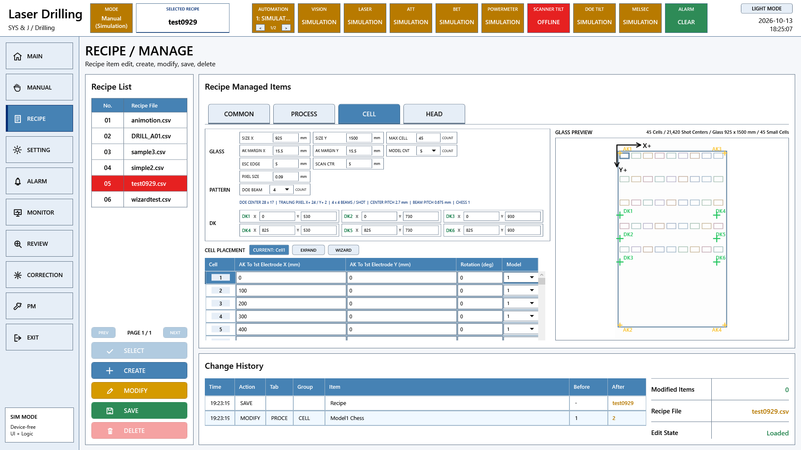

# A3 LD 레시피와 좌표 요구기능 코드 대조

원본 Commit: [0c501c104dec1cebab87bd909de29b1b1395a8b4](https://github.com/kjuws10-rgb/A3_LD_Process_SW_IPS/commit/0c501c104dec1cebab87bd909de29b1b1395a8b4)

코드 구현 확인은 현장 검수 완료를 뜻하지 않습니다. 원본 진행 현황은 그대로 보존했고, 아래 판정은 현재 C# 구현을 기준으로 별도 작성했습니다. 화면은 최신 소스의 WPF 화면을 장치 전체 Simulation 모드로 화면 밖에서 렌더링한 것입니다. 실제 장비 측정값 또는 실제 동작 완료 증거가 아닙니다.

[전체 요약](README.md) · [편집본 엑셀](A3_LD_요구기능검증_코드분석작성본.xlsx) · [검색 가능한 상세 자료](항목별_상세근거.html)

## 관련 프로그램 화면



이 화면은 해당 기능군의 UI 연결을 보여줍니다. 개별 검수 조건의 통과 증거는 아래 소스·판정·후속 확인을 함께 보아야 합니다.

## 항목 121

분기빔 측정

- 원본 검수 항목: 현재 위치가 좌상단 기준위치 텍스트박스에 채워지는지 확인
- 원본 진행 현황: 완료
- 현재 코드 판정: 부분 구현 또는 사양 차이

Review는 분기 Beam 수와 선택 Beam 번호로 중심점에서 측정점까지 Offset을 계산한다. 실측 빔 위치를 읽는 절차와 설계 Offset 계산을 구분해야 한다.

### 코드 위치와 짧은 내용

[Drilling.Common/Review/CReviewManager.cs L1862–L1904](https://github.com/kjuws10-rgb/A3_LD_Process_SW_IPS/blob/0c501c104dec1cebab87bd909de29b1b1395a8b4/Drilling.Common/Review/CReviewManager.cs#L1862-L1904)

```csharp
    private static ST_REVIEW_COORDINATE_OFFSET CalculateBeamOffset(
        int beamNo,
        int splitBeamCount,
        double doePitch)
    {
        ValidateBeamNo(beamNo, splitBeamCount);
        if (!double.IsFinite(doePitch) || doePitch <= 0.0)
        {
            throw new InvalidOperationException(
                $"DOE pitch must be a finite value greater than 0. Current value: {doePitch}");
        }

        var normalizedBeamNo = beamNo - 1;
        var column = normalizedBeamNo % splitBeamCount;
```

[Drilling.Common/Review/CReviewManager.cs L1358–L1396](https://github.com/kjuws10-rgb/A3_LD_Process_SW_IPS/blob/0c501c104dec1cebab87bd909de29b1b1395a8b4/Drilling.Common/Review/CReviewManager.cs#L1358-L1396)

```csharp
    private ST_REVIEW_COORDINATE_SETTINGS LoadReviewCoordinateSettings(
        ST_RECIPE_DEFINITION recipe)
    {
        var optionSettings = settingManager.LoadSection(EN_SETTING_TAB.Option);
        var visionFlipType = CReviewCoordinateTransformer.ParseVisionFlipType(
            ReadSettingText(optionSettings, "", "VisionXFlip"),
            ReadSettingText(optionSettings, "", "VisionYFlip"),
            ReadSettingText(optionSettings, "", "VisionXyFlip"));

        var headFields = Enumerable.Range(1, 8)
            .Select(headNo =>
            {
                var position = ReadHeadPositionX(optionSettings, headNo);
                const double fallbackWidthX = 110.0;
```

### 남은 검증

Recipe 저장·재로드 결과와 설계/Scanner/Review 좌표를 같은 Cell/Shot 기준으로 비교한다. 원본 검수 조건의 전 항목과 대조하고, 실제 장비 결과를 확보한 뒤 개발/검증 완료 여부를 갱신한다.

[관련 화면](screens/Recipe_CELL_simulation.png) · [전체 요약으로](README.md)

## 항목 122

분기빔 측정

- 원본 검수 항목: 입력 기준위치로 측정좌표 재계산이 호출되는지 확인
- 원본 진행 현황: 완료
- 현재 코드 판정: 코드 구현 확인

CreatePlan은 Recipe·Head 설정으로 Shot 자료와 Beam 대상 좌표를 만든다. 설정이 바뀌면 Plan을 다시 만들어야 하며 기존 결과는 자동 변환되지 않는다.

### 코드 위치와 짧은 내용

[Drilling.Common/Review/CReviewManager.cs L441–L522](https://github.com/kjuws10-rgb/A3_LD_Process_SW_IPS/blob/0c501c104dec1cebab87bd909de29b1b1395a8b4/Drilling.Common/Review/CReviewManager.cs#L441-L522)

```csharp
    public ST_REVIEW_PLAN CreatePlan(
        ST_RECIPE_DEFINITION recipe,
        IReadOnlyCollection<string> selectedShotKeys)
    {
        return CreatePlan(recipe, selectedShotKeys, 1);
    }

    public ST_REVIEW_PLAN CreatePlan(
        ST_RECIPE_DEFINITION recipe,
        IReadOnlyCollection<string> selectedShotKeys,
        int selectedBeamNo)
    {
        ValidateBeamNo(
            selectedBeamNo,
```

[Drilling.Common/Review/CReviewManager.cs L1906–L1938](https://github.com/kjuws10-rgb/A3_LD_Process_SW_IPS/blob/0c501c104dec1cebab87bd909de29b1b1395a8b4/Drilling.Common/Review/CReviewManager.cs#L1906-L1938)

```csharp
    private static ST_REVIEW_COORDINATE_OFFSET CalculateReviewTarget(
        double shotFromAlignKeyX,
        double shotFromAlignKeyY,
        double reviewCameraAlignKeyPosX,
        double reviewCameraAlignKeyPosY,
        double beamOffsetLocalX,
        double beamOffsetLocalY,
        double cellRotationDegrees,
        double stageScanDirectionY)
    {
        var beamOffset = RotateLocalOffset(
            beamOffsetLocalX,
            beamOffsetLocalY,
            cellRotationDegrees);
```

### 남은 검증

Recipe 저장·재로드 결과와 설계/Scanner/Review 좌표를 같은 Cell/Shot 기준으로 비교한다. 원본 검수 조건의 전 항목과 대조하고, 실제 장비 결과를 확보한 뒤 개발/검증 완료 여부를 갱신한다.

[관련 화면](screens/Recipe_CELL_simulation.png) · [전체 요약으로](README.md)

## 항목 123

분기빔 측정

- 원본 검수 항목: 기준위치와 Pitch로 분기빔 측정 포인트 좌표가 생성되는지 확인
- 원본 진행 현황: 완료
- 현재 코드 판정: 코드 구현 확인

Cell의 Pixel 수·PixelSize·Pitch·SplitBeam 조건으로 그룹 배치를 계산하고 회전·Cell 위치를 적용한다. 미가공 Masking 여부도 별도로 기록한다.

### 코드 위치와 짧은 내용

[Drilling.Common/Recipe/CCellPatternCalculator.cs L117–L241](https://github.com/kjuws10-rgb/A3_LD_Process_SW_IPS/blob/0c501c104dec1cebab87bd909de29b1b1395a8b4/Drilling.Common/Recipe/CCellPatternCalculator.cs#L117-L241)

```csharp
    public static ST_CELL_PATTERN_LAYOUT Calculate(ST_CELL_PATTERN_DEFINITION input) =>
        Calculate(input, includeShotCenters: true);

    public static ST_CELL_PATTERN_LAYOUT Calculate(
        ST_CELL_PATTERN_DEFINITION input,
        bool includeShotCenters)
    {
        if (input.CellNo <= 0)
        {
            return Invalid("Cell number must be greater than zero.");
        }

        if (!double.IsFinite(input.FirstTargetX) || !double.IsFinite(input.FirstTargetY) || !double.IsFinite(input.RotationDegrees) || !double.IsFinite(input.PixelSizeMillimeters) || !double.IsFinite(input.OriginX) || !double.IsFinite(input.OriginY))
        {
```

[Drilling.Common/Recipe/CShotCoordinatePlanBuilder.cs L145–L231](https://github.com/kjuws10-rgb/A3_LD_Process_SW_IPS/blob/0c501c104dec1cebab87bd909de29b1b1395a8b4/Drilling.Common/Recipe/CShotCoordinatePlanBuilder.cs#L145-L231)

```csharp
    private static IReadOnlyList<ST_DESIGN_SHOT_POINT> BuildDesignShots(IReadOnlyDictionary<string, string> parameters, int cellCount)
    {
        var akMarginX = ReadDouble(parameters, 0.0, "AK_MARGIN_X");
        var akMarginY = ReadDouble(parameters, 0.0, "AK_MARGIN_Y");
        var pixelSize = ReadDouble(parameters, 0.09, "PIXEL_SIZE");
        var splitBeamCount = ReadInt(parameters, 1, "SPLITED_BEAM_COUNT");
        var reviewOffsetX = ReadDouble(parameters, 0.0, "REVIEW_OFFSET_X");
        var reviewOffsetY = ReadDouble(parameters, 0.0, "REVIEW_OFFSET_Y");
        var modelTypeCount = CRecipeModelPixelCountReader.ReadModelTypeCount(parameters);
        var designShots = new List<ST_DESIGN_SHOT_POINT>();
        for (var cellNo = 1; cellNo <= cellCount; cellNo++)
        {
            var modelType = CRecipeModelPixelCountReader.ReadCellModelType(parameters, cellNo, modelTypeCount);
            var modelPattern = CRecipeModelPixelCountReader.ReadPatternForModel(parameters, modelType);
```

[Drilling.Common/Recipe/CRecipeShotMaskingPlan.cs L51–L138](https://github.com/kjuws10-rgb/A3_LD_Process_SW_IPS/blob/0c501c104dec1cebab87bd909de29b1b1395a8b4/Drilling.Common/Recipe/CRecipeShotMaskingPlan.cs#L51-L138)

```csharp
    public static CRecipeShotMaskingPlan Build(IReadOnlyDictionary<string, string> parameters)
    {
        ArgumentNullException.ThrowIfNull(parameters);
        var modelTypeCount = Math.Clamp(ReadInt(parameters, 1, "CELL_MODEL_TYPE_COUNT"), 1, MaximumCellModelTypeCount);
        var pixelSize = ReadDouble(parameters, 0.09, "PIXEL_SIZE");
        var splitBeamCount = ReadInt(parameters, 1, "SPLITED_BEAM_COUNT");
        var models = new Dictionary<int, ST_MODEL_MASKING_AREA>();
        var modelPatterns = new Dictionary<int, ST_MODEL_PATTERN_AREA>();
        for (var modelType = 1; modelType <= modelTypeCount; modelType++)
        {
            var modelPattern = CRecipeModelPixelCountReader.ReadPatternForModel(parameters, modelType);
            var groupPitchMillimeters = pixelSize * modelPattern.ProcessPitch;
            var beamPitchMillimeters = splitBeamCount <= 0 ? 0.0 : groupPitchMillimeters / splitBeamCount;
            modelPatterns[modelType] = new ST_MODEL_PATTERN_AREA(
```

### 남은 검증

Recipe 저장·재로드 결과와 설계/Scanner/Review 좌표를 같은 Cell/Shot 기준으로 비교한다. 원본 검수 조건의 전 항목과 대조하고, 실제 장비 결과를 확보한 뒤 개발/검증 완료 여부를 갱신한다.

[관련 화면](screens/Recipe_CELL_simulation.png) · [전체 요약으로](README.md)

## 항목 124

분기빔 측정

- 원본 검수 항목: 입력 좌상단 위치 기준으로 MOFBaseOffset이 설정되고 시작위치가 재계산되는지 확인
- 원본 진행 현황: 완료
- 현재 코드 판정: 부분 구현 또는 사양 차이

가공 좌표 Builder에서 Recipe·Head·Review·Shift Offset을 합산한다. Stage 시작 위치 이동 호출은 주석 처리되어 있으므로 실제 시작점 동기까지 완료된 것은 아니다.

### 코드 위치와 짧은 내용

[Drilling.Common/Recipe/CShotCoordinatePlanBuilder.cs L12–L146](https://github.com/kjuws10-rgb/A3_LD_Process_SW_IPS/blob/0c501c104dec1cebab87bd909de29b1b1395a8b4/Drilling.Common/Recipe/CShotCoordinatePlanBuilder.cs#L12-L146)

```csharp
    public static ST_SHOT_COORDINATE_PLAN Build(IReadOnlyDictionary<string, string> parameters)
    {
        ArgumentNullException.ThrowIfNull(parameters);
        var headCount = Math.Clamp(ReadInt(parameters, 8, "HEAD_COUNT"), 1, 8);
        var cellCount = ReadInt(parameters, 0, "MAX_CELL_NUMBER");
        if (cellCount < CCellPatternCalculator.MinCellCount)
        {
            throw new InvalidOperationException($"MAX_CELL_NUMBER must be greater than or equal to {CCellPatternCalculator.MinCellCount}. Current value: {cellCount}");
        }

        var activeHeadNos = BuildActiveHeadNumbers(parameters, headCount);
        var activeHeadSet = activeHeadNos.ToHashSet();
        var assignmentHeadNos = Enumerable.Range(1, headCount).ToArray();
        var glassSizeX = ReadDouble(parameters, 0.0, "GLASS_SIZE_X");
```

[Drilling.Common/Station/CStationProcess.cs L1068–L1091](https://github.com/kjuws10-rgb/A3_LD_Process_SW_IPS/blob/0c501c104dec1cebab87bd909de29b1b1395a8b4/Drilling.Common/Station/CStationProcess.cs#L1068-L1091)

```csharp
    private void MoveStageToScanStart(ST_PROCESS_MODEL processModel, CancellationToken cancellationToken)
    {
        cancellationToken.ThrowIfCancellationRequested();
        var parameters = processModel.Parameters;
        var startX = ReadDoubleAny(parameters, 0.0, "STAGE_START_POS_X");
        var startY = ReadDoubleAny(parameters, 0.0, "STAGE_START_POS_Y");
        var reviewCameraAlignKeyPosX = ReadDoubleAny(parameters, 0.0, "REVIEW_CAMERA_ALIGN_KEY_POS_X");
        var reviewCameraAlignKeyPosY = ReadDoubleAny(parameters, startY, "REVIEW_CAMERA_ALIGN_KEY_POS_Y");
        var reviewToHead1GapY = ReadDoubleAny(parameters, 0.0, "REVIEW_TO_HEAD1_GAP_Y");
        var headGapY = ReadDoubleAny(parameters, 0.0, "HeadGapY");
        var head1AlignKeyY = reviewCameraAlignKeyPosY + reviewToHead1GapY;
        var head2AlignKeyY = head1AlignKeyY + headGapY;
        var delayLengthY = Math.Abs(ReadDoubleAny(parameters, 0.0, "SCAN_START_DELAY_LENGTH_Y"));
        var stageScanDirectionY = ReadDirectionAny(parameters, -1.0, "STAGE_SCAN_DIRECTION_Y");
```

### 남은 검증

Recipe 저장·재로드 결과와 설계/Scanner/Review 좌표를 같은 Cell/Shot 기준으로 비교한다. 원본 검수 조건의 전 항목과 대조하고, 실제 장비 결과를 확보한 뒤 개발/검증 완료 여부를 갱신한다.

[관련 화면](screens/Recipe_CELL_simulation.png) · [전체 요약으로](README.md)

## 항목 125

분기빔 측정

- 원본 검수 항목: 입력 포인트수로 자동 이동/측정이 비동기 실행되는지 확인
- 원본 진행 현황: 설명 요청
- 현재 코드 판정: 코드 구현 확인

Review 화면 로딩 시 Recipe와 Review Setting을 읽어 Plan을 만든다. 전체 점은 Lazy 자료이며 화면에서 필요한 Cell만 캐시한다.

### 코드 위치와 짧은 내용

[Drilling.UI/Menu/Menus/CMenuReview.cs L509–L572](https://github.com/kjuws10-rgb/A3_LD_Process_SW_IPS/blob/0c501c104dec1cebab87bd909de29b1b1395a8b4/Drilling.UI/Menu/Menus/CMenuReview.cs#L509-L572)

```csharp
    public override async Task<CScreenViewModel> Build(CancellationToken cancellationToken = default)
    {
        cancellationToken.ThrowIfCancellationRequested();

        try
        {
            var recipe = await LoadSelectedRecipe(cancellationToken) ?? CreateFallbackRecipe();
            if (!ReferenceEquals(recipe, _lastRecipe))
            {
                _lastAllPlan = null;
                _lastAllPlanBeamNo = 0;
            }

            _lastRecipe = recipe;
```

[Drilling.Common/Review/CReviewManager.cs L441–L522](https://github.com/kjuws10-rgb/A3_LD_Process_SW_IPS/blob/0c501c104dec1cebab87bd909de29b1b1395a8b4/Drilling.Common/Review/CReviewManager.cs#L441-L522)

```csharp
    public ST_REVIEW_PLAN CreatePlan(
        ST_RECIPE_DEFINITION recipe,
        IReadOnlyCollection<string> selectedShotKeys)
    {
        return CreatePlan(recipe, selectedShotKeys, 1);
    }

    public ST_REVIEW_PLAN CreatePlan(
        ST_RECIPE_DEFINITION recipe,
        IReadOnlyCollection<string> selectedShotKeys,
        int selectedBeamNo)
    {
        ValidateBeamNo(
            selectedBeamNo,
```

[Drilling.Common/Review/CReviewManager.cs L143–L218](https://github.com/kjuws10-rgb/A3_LD_Process_SW_IPS/blob/0c501c104dec1cebab87bd909de29b1b1395a8b4/Drilling.Common/Review/CReviewManager.cs#L143-L218)

```csharp
public sealed record ST_REVIEW_PLAN(
    string RecipeId,
    int CellCount,
    double ToleranceX,
    double ToleranceY,
    EN_VISION_FLIP_TYPE VisionFlipType,
    DateTimeOffset CreatedAt,
    IReadOnlyList<ST_REVIEW_PLAN_POINT> Points)
{
    public IReadOnlyList<ST_REVIEW_PLAN_POINT> GetCellPoints(int cellNo)
    {
        if (Points is IReviewCellPointSource cellSource &&
            cellNo >= 1 &&
            cellNo <= cellSource.PatternCellCount)
```

### 남은 검증

Recipe 저장·재로드 결과와 설계/Scanner/Review 좌표를 같은 Cell/Shot 기준으로 비교한다. 원본 검수 조건의 전 항목과 대조하고, 실제 장비 결과를 확보한 뒤 개발/검증 완료 여부를 갱신한다.

[관련 화면](screens/Recipe_CELL_simulation.png) · [전체 요약으로](README.md)

## 항목 126

분기빔 측정

- 원본 검수 항목: 지정 포인트 개수만큼 순차 이동·측정이 자동 수행되는지 확인
- 원본 진행 현황: 설명 요청
- 현재 코드 판정: 부분 구현 또는 사양 차이

PTP 루프는 StageY → VisionX → Vision 측정 → 결과 갱신 순서를 갖는다. 앞의 두 이동 함수는 아직 실제 MELSEC 명령을 보내지 않는다.

### 코드 위치와 짧은 내용

[Drilling.Common/Review/CReviewManager.cs L563–L741](https://github.com/kjuws10-rgb/A3_LD_Process_SW_IPS/blob/0c501c104dec1cebab87bd909de29b1b1395a8b4/Drilling.Common/Review/CReviewManager.cs#L563-L741)

```csharp
    public async Task<ST_REVIEW_SEQUENCE_STATUS> Start(
        ST_REVIEW_PLAN plan,
        string? productId,
        ST_PRODUCT_REVIEW_DATA? checkpoint,
        bool resumeCheckpoint,
        Action<ST_REVIEW_PLAN>? progress = null,
        CancellationToken cancellationToken = default)
    {
        if (!await _sequenceLock.WaitAsync(0, cancellationToken))
        {
            return CreateStatus(
                CurrentPlan ?? plan,
                EN_REVIEW_SEQUENCE_STATE.Running,
                "Review sequence is already running.");
```

[Drilling.Common/Review/CReviewManager.cs L1940–L1988](https://github.com/kjuws10-rgb/A3_LD_Process_SW_IPS/blob/0c501c104dec1cebab87bd909de29b1b1395a8b4/Drilling.Common/Review/CReviewManager.cs#L1940-L1988)

```csharp
    private Task MoveStageY(
        ST_REVIEW_PLAN_POINT point,
        CancellationToken cancellationToken)
    {
        cancellationToken.ThrowIfCancellationRequested();
        var command = FormatCommand(
            "REVIEW_STAGE_Y_MOVE",
            ("SHOT_KEY", point.ShotKey),
            ("POINT", point.PointNo.ToString(CultureInfo.InvariantCulture)),
            ("HEAD", point.HeadNo.ToString(CultureInfo.InvariantCulture)),
            ("CELL", point.CellNo.ToString(CultureInfo.InvariantCulture)),
            ("SHOT", point.ShotNo.ToString(CultureInfo.InvariantCulture)),
            ("BEAM", point.BeamNo.ToString(CultureInfo.InvariantCulture)),
            ("Y", FormatDouble(point.ReviewTargetY)));
```

### 남은 검증

Recipe 저장·재로드 결과와 설계/Scanner/Review 좌표를 같은 Cell/Shot 기준으로 비교한다. 원본 검수 조건의 전 항목과 대조하고, 실제 장비 결과를 확보한 뒤 개발/검증 완료 여부를 갱신한다.

[관련 화면](screens/Recipe_CELL_simulation.png) · [전체 요약으로](README.md)

## 항목 127

분기빔 측정

- 원본 검수 항목: 클릭한 측정 포인트의 위치정보가 이동용 텍스트박스에 채워지는지 확인
- 원본 진행 현황: 설명 요청
- 현재 코드 판정: 부분 구현 또는 사양 차이

Review의 Cell·Shot·Beam 선택은 선택점 자료와 좌표 표시를 갱신한다. 구형 좌표 TextBox에 같은 값을 복사해 수동 이동하는 UI 사양과는 다르다.

### 코드 위치와 짧은 내용

[Drilling.UI/Menu/Menus/CMenuReview.cs L1290–L1332](https://github.com/kjuws10-rgb/A3_LD_Process_SW_IPS/blob/0c501c104dec1cebab87bd909de29b1b1395a8b4/Drilling.UI/Menu/Menus/CMenuReview.cs#L1290-L1332)

```csharp
    private void SelectRunShot(object? parameter)
    {
        if (IsReviewExecutionActive)
        {
            _statusReporter("Shot selection is locked while Review is running. Last Measurement follows the last completed Shot.");
            return;
        }

        var shotKey = CReviewManager.NormalizeShotKey(parameter?.ToString() ?? "");
        var displayPlan = _lastRecipe is not null && _lastAllPlan is not null
            ? ResolveReviewPlan(_lastRecipe, _lastAllPlan)
            : _reviewManager.CurrentPlan ?? _lastAllPlan;
        var runtimePoint = FindPointByShotKey(_reviewManager.CurrentPlan, shotKey);
        var point = runtimePoint is not null &&
```

[Drilling.UI/Menu/Menus/CMenuReview.cs L2606–L2644](https://github.com/kjuws10-rgb/A3_LD_Process_SW_IPS/blob/0c501c104dec1cebab87bd909de29b1b1395a8b4/Drilling.UI/Menu/Menus/CMenuReview.cs#L2606-L2644)

```csharp
    private IReadOnlyList<ST_DISPLAY_ITEM> BuildSelectedPointItems(ST_REVIEW_PLAN_POINT? selectedPoint)
    {
        if (selectedPoint is null)
        {
            return
            [
                new("Measured Shot", "-"),
                new("Selected Beam", $"Beam{_selectedRunBeamNo}"),
                new("Move Target", "Review X - / Stage Y -"),
                new("Error Amount", "X - / Y -", "WAIT"),
                new("Judge", "WAIT")
            ];
        }

```

### 남은 검증

Recipe 저장·재로드 결과와 설계/Scanner/Review 좌표를 같은 Cell/Shot 기준으로 비교한다. 원본 검수 조건의 전 항목과 대조하고, 실제 장비 결과를 확보한 뒤 개발/검증 완료 여부를 갱신한다.

[관련 화면](screens/Recipe_CELL_simulation.png) · [전체 요약으로](README.md)

## 항목 128

분기빔 측정

- 원본 검수 항목: 선택 포인트 좌표로 이동 명령이 호출되는지 확인
- 원본 진행 현황: 설명 요청
- 현재 코드 판정: 현재 코드에서 미확인

선택점의 좌표 확인은 가능하지만 이동 함수 자체는 TODO이다. 선택점 이동 버튼·PLC 도착 확인까지 실물 동작 기능으로 판정할 수 없다.

### 코드 위치와 짧은 내용

[Drilling.UI/Menu/Menus/CMenuReview.cs L1290–L1332](https://github.com/kjuws10-rgb/A3_LD_Process_SW_IPS/blob/0c501c104dec1cebab87bd909de29b1b1395a8b4/Drilling.UI/Menu/Menus/CMenuReview.cs#L1290-L1332)

```csharp
    private void SelectRunShot(object? parameter)
    {
        if (IsReviewExecutionActive)
        {
            _statusReporter("Shot selection is locked while Review is running. Last Measurement follows the last completed Shot.");
            return;
        }

        var shotKey = CReviewManager.NormalizeShotKey(parameter?.ToString() ?? "");
        var displayPlan = _lastRecipe is not null && _lastAllPlan is not null
            ? ResolveReviewPlan(_lastRecipe, _lastAllPlan)
            : _reviewManager.CurrentPlan ?? _lastAllPlan;
        var runtimePoint = FindPointByShotKey(_reviewManager.CurrentPlan, shotKey);
        var point = runtimePoint is not null &&
```

[Drilling.Common/Review/CReviewManager.cs L1940–L1988](https://github.com/kjuws10-rgb/A3_LD_Process_SW_IPS/blob/0c501c104dec1cebab87bd909de29b1b1395a8b4/Drilling.Common/Review/CReviewManager.cs#L1940-L1988)

```csharp
    private Task MoveStageY(
        ST_REVIEW_PLAN_POINT point,
        CancellationToken cancellationToken)
    {
        cancellationToken.ThrowIfCancellationRequested();
        var command = FormatCommand(
            "REVIEW_STAGE_Y_MOVE",
            ("SHOT_KEY", point.ShotKey),
            ("POINT", point.PointNo.ToString(CultureInfo.InvariantCulture)),
            ("HEAD", point.HeadNo.ToString(CultureInfo.InvariantCulture)),
            ("CELL", point.CellNo.ToString(CultureInfo.InvariantCulture)),
            ("SHOT", point.ShotNo.ToString(CultureInfo.InvariantCulture)),
            ("BEAM", point.BeamNo.ToString(CultureInfo.InvariantCulture)),
            ("Y", FormatDouble(point.ReviewTargetY)));
```

미확인은 해당 이름·동작·호출 관계를 현행 자료와 대조해 확정하지 못했다는 뜻입니다. 링크는 가장 가까운 현재 기능이며, 존재하지 않는 함수를 있다고 추정한 근거가 아닙니다.

### 남은 검증

Recipe 저장·재로드 결과와 설계/Scanner/Review 좌표를 같은 Cell/Shot 기준으로 비교한다. 원본 검수 조건의 전 항목과 대조하고, 실제 장비 결과를 확보한 뒤 개발/검증 완료 여부를 갱신한다.

[관련 화면](screens/Recipe_CELL_simulation.png) · [전체 요약으로](README.md)

## 항목 129

데이터 분석

- 원본 검수 항목: 측정 테이블 6x6 값이 X/Y 배열로 파싱되는지 확인
- 원본 진행 현황: 설명 요청
- 현재 코드 판정: 부분 구현 또는 사양 차이

현재 ResultMatrix는 Plan의 Cell/Shot 행·열 구조를 바탕으로 구성된다. 기존 6x6 고정 X/Y 측정 배열과 자료구조가 다르다.

### 코드 위치와 짧은 내용

[Drilling.UI/Menu/Menus/CMenuReview.cs L3320–L3392](https://github.com/kjuws10-rgb/A3_LD_Process_SW_IPS/blob/0c501c104dec1cebab87bd909de29b1b1395a8b4/Drilling.UI/Menu/Menus/CMenuReview.cs#L3320-L3392)

```csharp
    private static DataView BuildResultMatrix(ST_REVIEW_PLAN reviewPlan)
    {
        var measuredPoints = reviewPlan.ReviewPoints
            .Where(point => point.HeadNo > 0 &&
                            point.CellNo > 0 &&
                            point.Use &&
                            (point.State == EN_REVIEW_POINT_STATE.Ok ||
                             point.State == EN_REVIEW_POINT_STATE.Ng))
            .OrderBy(point => point.ReviewTargetY)
            .ThenBy(point => point.HeadNo)
            .ThenBy(point => point.ShotNo)
            .ToArray();

        if (measuredPoints.Length == 0)
```

[Drilling.Common/Review/CReviewManager.cs L143–L218](https://github.com/kjuws10-rgb/A3_LD_Process_SW_IPS/blob/0c501c104dec1cebab87bd909de29b1b1395a8b4/Drilling.Common/Review/CReviewManager.cs#L143-L218)

```csharp
public sealed record ST_REVIEW_PLAN(
    string RecipeId,
    int CellCount,
    double ToleranceX,
    double ToleranceY,
    EN_VISION_FLIP_TYPE VisionFlipType,
    DateTimeOffset CreatedAt,
    IReadOnlyList<ST_REVIEW_PLAN_POINT> Points)
{
    public IReadOnlyList<ST_REVIEW_PLAN_POINT> GetCellPoints(int cellNo)
    {
        if (Points is IReviewCellPointSource cellSource &&
            cellNo >= 1 &&
            cellNo <= cellSource.PatternCellCount)
```

### 남은 검증

Recipe 저장·재로드 결과와 설계/Scanner/Review 좌표를 같은 Cell/Shot 기준으로 비교한다. 원본 검수 조건의 전 항목과 대조하고, 실제 장비 결과를 확보한 뒤 개발/검증 완료 여부를 갱신한다.

[관련 화면](screens/Recipe_CELL_simulation.png) · [전체 요약으로](README.md)

## 항목 130

데이터 분석

- 원본 검수 항목: 평균값을 뺀 상대 좌표가 계산되는지 확인
- 원본 진행 현황: 설명 요청
- 현재 코드 판정: 부분 구현 또는 사양 차이

Review 오차는 측정 좌표에서 기준 좌표를 뺀 값이다. 전체 6x6 평균을 제거해 상대 오차로 바꾸는 별도 통계 알고리즘은 확인되지 않았다.

### 코드 위치와 짧은 내용

[Drilling.Common/Review/CReviewManager.cs L2500–L2527](https://github.com/kjuws10-rgb/A3_LD_Process_SW_IPS/blob/0c501c104dec1cebab87bd909de29b1b1395a8b4/Drilling.Common/Review/CReviewManager.cs#L2500-L2527)

```csharp
    private static ST_REVIEW_PLAN_POINT ApplyMeasurement(
        ST_REVIEW_PLAN plan,
        ST_REVIEW_PLAN_POINT point,
        ST_REVIEW_MEASURE_RESULT measurement)
    {
        var visionErrorX = measurement.X - point.ReviewTargetX;
        var visionErrorY = measurement.Y - point.ReviewTargetY;
        var errorX = visionErrorX;
        var errorY = visionErrorY;
        var judge = !string.IsNullOrWhiteSpace(measurement.Judge) &&
            !measurement.Judge.Equals("WAIT", StringComparison.OrdinalIgnoreCase)
            ? measurement.Judge.ToUpperInvariant()
            : Math.Abs(errorX) <= plan.ToleranceX && Math.Abs(errorY) <= plan.ToleranceY
                ? "OK"
```

[Drilling.UI/Menu/Menus/CMenuCorrection.cs L907–L1005](https://github.com/kjuws10-rgb/A3_LD_Process_SW_IPS/blob/0c501c104dec1cebab87bd909de29b1b1395a8b4/Drilling.UI/Menu/Menus/CMenuCorrection.cs#L907-L1005)

```csharp
    private async Task CalculateReviewOffsets(bool replacePendingApply = false)
    {
        if (_loadedReviewResult is null)
        {
            await ReportReviewDataCommand("Calculate", "Load a Review Result CSV before calculating.", "WARN");
            return;
        }

        if (HasSelectedRecipeMismatch(_loadedReviewResult))
        {
            await ReportReviewDataCommand(
                "Calculate",
                "Review Result Recipe와 현재 Recipe가 다릅니다. 조회만 가능하며 계산하려면 같은 Recipe를 선택해 주세요.",
                "WARN");
```

### 남은 검증

Recipe 저장·재로드 결과와 설계/Scanner/Review 좌표를 같은 Cell/Shot 기준으로 비교한다. 원본 검수 조건의 전 항목과 대조하고, 실제 장비 결과를 확보한 뒤 개발/검증 완료 여부를 갱신한다.

[관련 화면](screens/Recipe_CELL_simulation.png) · [전체 요약으로](README.md)

## 항목 131

데이터 분석

- 원본 검수 항목: Relative 모드 선택시 보정 데이터 기준으로 그래프가 갱신되는지 확인
- 원본 진행 현황: 설명 요청
- 현재 코드 판정: 부분 구현 또는 사양 차이

Review ResultMatrix 및 Correction Offset 표로 오차를 표시한다. 평균 제거 Relative Chart라는 전용 그래프는 현재 결과 표와 구분해야 한다.

### 코드 위치와 짧은 내용

[Drilling.UI/Menu/Menus/CMenuReview.cs L3320–L3392](https://github.com/kjuws10-rgb/A3_LD_Process_SW_IPS/blob/0c501c104dec1cebab87bd909de29b1b1395a8b4/Drilling.UI/Menu/Menus/CMenuReview.cs#L3320-L3392)

```csharp
    private static DataView BuildResultMatrix(ST_REVIEW_PLAN reviewPlan)
    {
        var measuredPoints = reviewPlan.ReviewPoints
            .Where(point => point.HeadNo > 0 &&
                            point.CellNo > 0 &&
                            point.Use &&
                            (point.State == EN_REVIEW_POINT_STATE.Ok ||
                             point.State == EN_REVIEW_POINT_STATE.Ng))
            .OrderBy(point => point.ReviewTargetY)
            .ThenBy(point => point.HeadNo)
            .ThenBy(point => point.ShotNo)
            .ToArray();

        if (measuredPoints.Length == 0)
```

[Drilling.UI/Menu/Menus/CMenuCorrection.cs L907–L1005](https://github.com/kjuws10-rgb/A3_LD_Process_SW_IPS/blob/0c501c104dec1cebab87bd909de29b1b1395a8b4/Drilling.UI/Menu/Menus/CMenuCorrection.cs#L907-L1005)

```csharp
    private async Task CalculateReviewOffsets(bool replacePendingApply = false)
    {
        if (_loadedReviewResult is null)
        {
            await ReportReviewDataCommand("Calculate", "Load a Review Result CSV before calculating.", "WARN");
            return;
        }

        if (HasSelectedRecipeMismatch(_loadedReviewResult))
        {
            await ReportReviewDataCommand(
                "Calculate",
                "Review Result Recipe와 현재 Recipe가 다릅니다. 조회만 가능하며 계산하려면 같은 Recipe를 선택해 주세요.",
                "WARN");
```

### 남은 검증

Recipe 저장·재로드 결과와 설계/Scanner/Review 좌표를 같은 Cell/Shot 기준으로 비교한다. 원본 검수 조건의 전 항목과 대조하고, 실제 장비 결과를 확보한 뒤 개발/검증 완료 여부를 갱신한다.

[관련 화면](screens/Recipe_CELL_simulation.png) · [전체 요약으로](README.md)

## 항목 132

데이터 분석

- 원본 검수 항목: 그래프 축 스케일 값이 지정 범위 내에서 증감되는지 확인
- 원본 진행 현황: 설명 요청
- 현재 코드 판정: 부분 구현 또는 사양 차이

Preview는 Cell·Glass 경계를 계산해 확대 표시한다. 상대 오차 Chart의 Min/Max 축 범위 자동 산출 요구는 별도다.

### 코드 위치와 짧은 내용

[Drilling.UI/Menu/Menus/CMenuRecipe.cs L1991–L2110](https://github.com/kjuws10-rgb/A3_LD_Process_SW_IPS/blob/0c501c104dec1cebab87bd909de29b1b1395a8b4/Drilling.UI/Menu/Menus/CMenuRecipe.cs#L1991-L2110)

```csharp
    private static ST_RECIPE_LAYOUT_PREVIEW BuildLayoutPreview(IReadOnlyList<ST_RECIPE_PARAMETER_EDITOR_ITEM> managedItems, IReadOnlyList<ST_RECIPE_CELL_VIEW_MODEL> cells, int selectedCellNo)
    {
        const double canvasWidth = 860.0;
        const double canvasHeight = 430.0;
        const double maxLeft = 44.0;
        const double maxTop = 50.0;
        const double maxWidth = 772.0;
        const double maxHeight = 340.0;
        var glassWidth = ReadManagedDouble(managedItems, "GLASS_SIZE_X", 500.0);
        var glassHeight = ReadManagedDouble(managedItems, "GLASS_SIZE_Y", 300.0);
        var akMarginX = ReadManagedDouble(managedItems, "AK_MARGIN_X", 55.0);
        var akMarginY = ReadManagedDouble(managedItems, "AK_MARGIN_Y", 45.0);
        var pixelSize = ReadManagedDouble(managedItems, "PIXEL_SIZE", 0.09);
        double? SelectValue(string key)
```

[Drilling.UI/Menu/Menus/CMenuReview.cs L3320–L3392](https://github.com/kjuws10-rgb/A3_LD_Process_SW_IPS/blob/0c501c104dec1cebab87bd909de29b1b1395a8b4/Drilling.UI/Menu/Menus/CMenuReview.cs#L3320-L3392)

```csharp
    private static DataView BuildResultMatrix(ST_REVIEW_PLAN reviewPlan)
    {
        var measuredPoints = reviewPlan.ReviewPoints
            .Where(point => point.HeadNo > 0 &&
                            point.CellNo > 0 &&
                            point.Use &&
                            (point.State == EN_REVIEW_POINT_STATE.Ok ||
                             point.State == EN_REVIEW_POINT_STATE.Ng))
            .OrderBy(point => point.ReviewTargetY)
            .ThenBy(point => point.HeadNo)
            .ThenBy(point => point.ShotNo)
            .ToArray();

        if (measuredPoints.Length == 0)
```

### 남은 검증

Recipe 저장·재로드 결과와 설계/Scanner/Review 좌표를 같은 Cell/Shot 기준으로 비교한다. 원본 검수 조건의 전 항목과 대조하고, 실제 장비 결과를 확보한 뒤 개발/검증 완료 여부를 갱신한다.

[관련 화면](screens/Recipe_CELL_simulation.png) · [전체 요약으로](README.md)

## 항목 133

리스트 관리

- 원본 검수 항목: 신규 레시피 생성 시 중복 명칭 검사 및 팝업/초기화/저장/로드 흐름이 정상 수행되는지 확인
- 원본 진행 현황: 완료
- 현재 코드 판정: 코드 구현 확인

중복·금지문자·빈 이름을 검사하고 현재 Recipe 파라미터를 복제해 새 CSV를 저장한다. 새 파일에서 REVIEW_RULE_FILE은 비워서 이전 설정을 무단 연결하지 않는다.

### 코드 위치와 짧은 내용

[Drilling.UI/Menu/Menus/CMenuRecipe.cs L1106–L1161](https://github.com/kjuws10-rgb/A3_LD_Process_SW_IPS/blob/0c501c104dec1cebab87bd909de29b1b1395a8b4/Drilling.UI/Menu/Menus/CMenuRecipe.cs#L1106-L1161)

```csharp
    private async Task Create()
    {
        if (AllManagedItems.Count == 0)
        {
            _setStatusMessage("Recipe create skipped. No source recipe is loaded.");
            return;
        }

        var recipes = await _recipeManager.LoadRecipes();
        string SelectValue(string value)
        {
            return ValidateRecipeId(NormalizeRecipeIdInput(value), recipes);
        }

```

[Drilling.UI/Menu/Menus/CMenuRecipe.cs L2929–L2986](https://github.com/kjuws10-rgb/A3_LD_Process_SW_IPS/blob/0c501c104dec1cebab87bd909de29b1b1395a8b4/Drilling.UI/Menu/Menus/CMenuRecipe.cs#L2929-L2986)

```csharp
    private static string ValidateRecipeId(string recipeId, IReadOnlyList<ST_RECIPE_DEFINITION> recipes, string currentRecipeId = "")
    {
        if (string.IsNullOrWhiteSpace(recipeId))
        {
            return "레시피 이름을 입력하세요.";
        }

        foreach (var character in recipeId)
        {
            if (Path.GetInvalidFileNameChars().Contains(character))
            {
                return $"레시피 이름에는 '{character}' 문자를 사용할 수 없습니다.";
            }
        }
```

[Drilling.File/JHMI/CJhmiRecipeFile.cs L95–L189](https://github.com/kjuws10-rgb/A3_LD_Process_SW_IPS/blob/0c501c104dec1cebab87bd909de29b1b1395a8b4/Drilling.File/JHMI/CJhmiRecipeFile.cs#L95-L189)

```csharp
    private void SaveCore(ST_RECIPE_DEFINITION recipe, CancellationToken cancellationToken)
    {
        cancellationToken.ThrowIfCancellationRequested();
        Directory.CreateDirectory(_recipeDirectory);
        var formItems = LoadFormItems();
        var recipePath = GetRecipePath(recipe.Id);
        var recipeExists = System.IO.File.Exists(recipePath);
        string SelectGroupKey(global::Drilling.Common.Managers.ST_RECIPE_VALUE item)
        {
            return CreateKey(item.Tab, item.Name);
        }

        string SelectKey(global::System.Linq.IGrouping<string, global::Drilling.Common.Managers.ST_RECIPE_VALUE> group)
        {
```

### 남은 검증

Recipe 저장·재로드 결과와 설계/Scanner/Review 좌표를 같은 Cell/Shot 기준으로 비교한다. 원본 검수 조건의 전 항목과 대조하고, 실제 장비 결과를 확보한 뒤 개발/검증 완료 여부를 갱신한다.

[관련 화면](screens/Recipe_CELL_simulation.png) · [전체 요약으로](README.md)

## 항목 134

리스트 관리

- 원본 검수 항목: 복사 모드(전체/Recipe만)에 따라 대상 파일이 올바르게 복사되는지 확인
- 원본 진행 현황: 신규 레시피 생성시 현재 레시피 값 복사 완료
- 현재 코드 판정: 부분 구현 또는 사양 차이

Create는 현재 편집 파라미터로 새 Recipe를 만든다. 전체 폴더 복사와 Recipe만 복사를 선택하는 구형 Full Copy 옵션은 확인되지 않았다.

### 코드 위치와 짧은 내용

[Drilling.UI/Menu/Menus/CMenuRecipe.cs L1106–L1161](https://github.com/kjuws10-rgb/A3_LD_Process_SW_IPS/blob/0c501c104dec1cebab87bd909de29b1b1395a8b4/Drilling.UI/Menu/Menus/CMenuRecipe.cs#L1106-L1161)

```csharp
    private async Task Create()
    {
        if (AllManagedItems.Count == 0)
        {
            _setStatusMessage("Recipe create skipped. No source recipe is loaded.");
            return;
        }

        var recipes = await _recipeManager.LoadRecipes();
        string SelectValue(string value)
        {
            return ValidateRecipeId(NormalizeRecipeIdInput(value), recipes);
        }

```

### 남은 검증

Recipe 저장·재로드 결과와 설계/Scanner/Review 좌표를 같은 Cell/Shot 기준으로 비교한다. 원본 검수 조건의 전 항목과 대조하고, 실제 장비 결과를 확보한 뒤 개발/검증 완료 여부를 갱신한다.

[관련 화면](screens/Recipe_CELL_simulation.png) · [전체 요약으로](README.md)

## 항목 135

리스트 관리

- 원본 검수 항목: 전체복사 모드에서 MOF오프셋 등 하위 폴더의 최신/기준 오프셋 파일까지 정상 복사되는지 확인
- 원본 진행 현황: 전체복사 모드 미완료
- 현재 코드 판정: 부분 구현 또는 사양 차이

Recipe 이름 변경 시 Review Setting 하위 자료의 Rename을 호출한다. MOF·APC·Offset 등 모든 부속 폴더를 새 Recipe로 복제하는 요구는 별도 검증해야 한다.

### 코드 위치와 짧은 내용

[Drilling.UI/Menu/Menus/CMenuRecipe.cs L1027–L1104](https://github.com/kjuws10-rgb/A3_LD_Process_SW_IPS/blob/0c501c104dec1cebab87bd909de29b1b1395a8b4/Drilling.UI/Menu/Menus/CMenuRecipe.cs#L1027-L1104)

```csharp
    private async Task Modify()
    {
        var oldRecipeId = GetRecipeIdFromParameter(SelectedRecipeFile);
        if (string.IsNullOrWhiteSpace(oldRecipeId))
        {
            _setStatusMessage("Recipe rename skipped. No recipe is selected.");
            return;
        }

        if (!CanEditViewRecipe())
        {
            _setStatusMessage("선택된 레시피만 수정 가능합니다.");
            return;
        }
```

[Drilling.File/Review/CReviewSettingFile.cs L7–L91](https://github.com/kjuws10-rgb/A3_LD_Process_SW_IPS/blob/0c501c104dec1cebab87bd909de29b1b1395a8b4/Drilling.File/Review/CReviewSettingFile.cs#L7-L91)

```csharp
public sealed class CReviewSettingFile(string configRoot) : CReviewSettingFileBase
{
    private const string Extension = ".review";
    private static readonly IReadOnlyList<string> Headers = ["NAME", "VALUE"];
    private readonly string _rootDirectory = Path.Combine(configRoot, "ReviewSetting");

    public override Task<IReadOnlyList<string>> List(
        string recipeId,
        CancellationToken cancellationToken = default)
    {
        cancellationToken.ThrowIfCancellationRequested();
        var directory = GetRecipeDirectory(recipeId);
        if (!Directory.Exists(directory))
        {
```

### 남은 검증

Recipe 저장·재로드 결과와 설계/Scanner/Review 좌표를 같은 Cell/Shot 기준으로 비교한다. 원본 검수 조건의 전 항목과 대조하고, 실제 장비 결과를 확보한 뒤 개발/검증 완료 여부를 갱신한다.

[관련 화면](screens/Recipe_CELL_simulation.png) · [전체 요약으로](README.md)

## 항목 136

리스트 관리

- 원본 검수 항목: 신규/복사 Recipe 저장 시 Stage 속도-0선 방어 측정개수 인터락 조건 위반 시 저장이 차단되는지 확인
- 원본 진행 현황: 미완료
- 현재 코드 판정: 부분 구현 또는 사양 차이

Recipe Save에서 숫자 범위와 Cell Model·Shot 패턴을 검사한다. STAGE_SPEED와 ZERO_DEFENCE_REVIEW_POINT의 조합 인터록은 전용 분기로 확인되지 않았다.

### 코드 위치와 짧은 내용

[Drilling.UI/Menu/Menus/CMenuRecipe.cs L2988–L3033](https://github.com/kjuws10-rgb/A3_LD_Process_SW_IPS/blob/0c501c104dec1cebab87bd909de29b1b1395a8b4/Drilling.UI/Menu/Menus/CMenuRecipe.cs#L2988-L3033)

```csharp
    private static string ValidateRecipeParameters(IReadOnlyList<ST_RECIPE_PARAMETER> parameters)
    {
        foreach (var parameter in parameters)
        {
            var value = parameter.Value.Trim();
            if (parameter.Key.Equals("RECIPE_NAME", StringComparison.OrdinalIgnoreCase) && string.IsNullOrWhiteSpace(value))
            {
                return "Recipe save blocked. Recipe Name cannot be empty.";
            }

            var validationMessage = parameter.DataType switch
            {
                EN_RECIPE_DATA_TYPE.Int => ValidateIntParameter(parameter, value),
                EN_RECIPE_DATA_TYPE.Double => ValidateDoubleParameter(parameter, value),
```

### 남은 검증

Recipe 저장·재로드 결과와 설계/Scanner/Review 좌표를 같은 Cell/Shot 기준으로 비교한다. 원본 검수 조건의 전 항목과 대조하고, 실제 장비 결과를 확보한 뒤 개발/검증 완료 여부를 갱신한다.

[관련 화면](screens/Recipe_CELL_simulation.png) · [전체 요약으로](README.md)

## 항목 137

공통 데이터

- 원본 검수 항목: Cell 상/하단 코너 라운드 반경 및 4개 코너 좌표 값이 저장되는지 확인
- 원본 진행 현황: 완료
- 현재 코드 판정: 코드 구현 확인

Model별 모서리 Round와 Mask Hole 파라미터를 CSV로 저장하고 Preview·Masking Plan에 반영한다. 경계에서 출사 제외되는지 좌표 목록으로 검증해야 한다.

### 코드 위치와 짧은 내용

[Drilling.Common/Recipe/CRecipeShotMaskingPlan.cs L51–L138](https://github.com/kjuws10-rgb/A3_LD_Process_SW_IPS/blob/0c501c104dec1cebab87bd909de29b1b1395a8b4/Drilling.Common/Recipe/CRecipeShotMaskingPlan.cs#L51-L138)

```csharp
    public static CRecipeShotMaskingPlan Build(IReadOnlyDictionary<string, string> parameters)
    {
        ArgumentNullException.ThrowIfNull(parameters);
        var modelTypeCount = Math.Clamp(ReadInt(parameters, 1, "CELL_MODEL_TYPE_COUNT"), 1, MaximumCellModelTypeCount);
        var pixelSize = ReadDouble(parameters, 0.09, "PIXEL_SIZE");
        var splitBeamCount = ReadInt(parameters, 1, "SPLITED_BEAM_COUNT");
        var models = new Dictionary<int, ST_MODEL_MASKING_AREA>();
        var modelPatterns = new Dictionary<int, ST_MODEL_PATTERN_AREA>();
        for (var modelType = 1; modelType <= modelTypeCount; modelType++)
        {
            var modelPattern = CRecipeModelPixelCountReader.ReadPatternForModel(parameters, modelType);
            var groupPitchMillimeters = pixelSize * modelPattern.ProcessPitch;
            var beamPitchMillimeters = splitBeamCount <= 0 ? 0.0 : groupPitchMillimeters / splitBeamCount;
            modelPatterns[modelType] = new ST_MODEL_PATTERN_AREA(
```

[Drilling.UI/Menu/Menus/CMenuRecipe.cs L1991–L2110](https://github.com/kjuws10-rgb/A3_LD_Process_SW_IPS/blob/0c501c104dec1cebab87bd909de29b1b1395a8b4/Drilling.UI/Menu/Menus/CMenuRecipe.cs#L1991-L2110)

```csharp
    private static ST_RECIPE_LAYOUT_PREVIEW BuildLayoutPreview(IReadOnlyList<ST_RECIPE_PARAMETER_EDITOR_ITEM> managedItems, IReadOnlyList<ST_RECIPE_CELL_VIEW_MODEL> cells, int selectedCellNo)
    {
        const double canvasWidth = 860.0;
        const double canvasHeight = 430.0;
        const double maxLeft = 44.0;
        const double maxTop = 50.0;
        const double maxWidth = 772.0;
        const double maxHeight = 340.0;
        var glassWidth = ReadManagedDouble(managedItems, "GLASS_SIZE_X", 500.0);
        var glassHeight = ReadManagedDouble(managedItems, "GLASS_SIZE_Y", 300.0);
        var akMarginX = ReadManagedDouble(managedItems, "AK_MARGIN_X", 55.0);
        var akMarginY = ReadManagedDouble(managedItems, "AK_MARGIN_Y", 45.0);
        var pixelSize = ReadManagedDouble(managedItems, "PIXEL_SIZE", 0.09);
        double? SelectValue(string key)
```

[Drilling.File/JHMI/CJhmiRecipeFile.cs L95–L189](https://github.com/kjuws10-rgb/A3_LD_Process_SW_IPS/blob/0c501c104dec1cebab87bd909de29b1b1395a8b4/Drilling.File/JHMI/CJhmiRecipeFile.cs#L95-L189)

```csharp
    private void SaveCore(ST_RECIPE_DEFINITION recipe, CancellationToken cancellationToken)
    {
        cancellationToken.ThrowIfCancellationRequested();
        Directory.CreateDirectory(_recipeDirectory);
        var formItems = LoadFormItems();
        var recipePath = GetRecipePath(recipe.Id);
        var recipeExists = System.IO.File.Exists(recipePath);
        string SelectGroupKey(global::Drilling.Common.Managers.ST_RECIPE_VALUE item)
        {
            return CreateKey(item.Tab, item.Name);
        }

        string SelectKey(global::System.Linq.IGrouping<string, global::Drilling.Common.Managers.ST_RECIPE_VALUE> group)
        {
```

### 남은 검증

Recipe 저장·재로드 결과와 설계/Scanner/Review 좌표를 같은 Cell/Shot 기준으로 비교한다. 원본 검수 조건의 전 항목과 대조하고, 실제 장비 결과를 확보한 뒤 개발/검증 완료 여부를 갱신한다.

[관련 화면](screens/Recipe_CELL_simulation.png) · [전체 요약으로](README.md)

## 항목 138

공통 데이터

- 원본 검수 항목: TEG 관련 Head번호 및 Align-to-TEG X/Y 좌표값이 RECIPE_TEG_DATA 섹션에 저장되는지 확인
- 원본 진행 현황: 미완료
- 현재 코드 판정: 현재 코드에서 미확인

현행 CSV에는 Cell·Head·Review 공통 자료가 있지만 이전 RECIPE_TEG_DATA/Head Align INI Section과 같은 전용 자료는 확인되지 않았다.

### 코드 위치와 짧은 내용

[Drilling.File/JHMI/CJhmiRecipeFile.cs L95–L189](https://github.com/kjuws10-rgb/A3_LD_Process_SW_IPS/blob/0c501c104dec1cebab87bd909de29b1b1395a8b4/Drilling.File/JHMI/CJhmiRecipeFile.cs#L95-L189)

```csharp
    private void SaveCore(ST_RECIPE_DEFINITION recipe, CancellationToken cancellationToken)
    {
        cancellationToken.ThrowIfCancellationRequested();
        Directory.CreateDirectory(_recipeDirectory);
        var formItems = LoadFormItems();
        var recipePath = GetRecipePath(recipe.Id);
        var recipeExists = System.IO.File.Exists(recipePath);
        string SelectGroupKey(global::Drilling.Common.Managers.ST_RECIPE_VALUE item)
        {
            return CreateKey(item.Tab, item.Name);
        }

        string SelectKey(global::System.Linq.IGrouping<string, global::Drilling.Common.Managers.ST_RECIPE_VALUE> group)
        {
```

[Drilling.Common/Managers/CRecipeManager.cs L17–L25](https://github.com/kjuws10-rgb/A3_LD_Process_SW_IPS/blob/0c501c104dec1cebab87bd909de29b1b1395a8b4/Drilling.Common/Managers/CRecipeManager.cs#L17-L25)

```csharp
public sealed record ST_RECIPE_PARAMETER(string Name, string Value, string Unit, string Range, string DefaultValue, string Tab = "", string Group = "", string Key = "", string Description = "", bool Show = true, bool Use = true, int DisplayOrder = 0, EN_RECIPE_DATA_TYPE DataType = EN_RECIPE_DATA_TYPE.String, double ChangeLimit = 0.0, double Min = 0.0, double Max = 0.0, IReadOnlyDictionary<string, string>? Extra = null);
public sealed record ST_RECIPE_HISTORY(DateTimeOffset ChangedAt, string ItemName, string OldValue, string NewValue, string OperatorId, string RecipeName = "", string Action = "", string Tab = "", string Group = "");
public sealed record ST_RECIPE_DEFINITION(string Id, string Name, IReadOnlyList<ST_RECIPE_PARAMETER> Parameters, IReadOnlyList<ST_RECIPE_HISTORY> History);
public sealed record ST_RECIPE_FORM_ITEM(string Tab, string Group, string Name, string DisplayName, string CimName, EN_RECIPE_DATA_TYPE DataType, string Unit, bool Show, bool Use, string DefaultValue, double Scale, double ChangeLimit, double Min, double Max, string Description, int DisplayOrder, IReadOnlyDictionary<string, string>? Extra = null);
public sealed record ST_RECIPE_VALUE(string Tab, string Name, string Value, IReadOnlyList<string>? Extra = null);
public abstract class CRecipeFileBase
{
    public abstract Task<IReadOnlyList<ST_RECIPE_DEFINITION>> LoadAll(CancellationToken cancellationToken = default);
    public abstract Task<ST_RECIPE_DEFINITION?> Find(string recipeId, CancellationToken cancellationToken = default);
```

미확인은 해당 이름·동작·호출 관계를 현행 자료와 대조해 확정하지 못했다는 뜻입니다. 링크는 가장 가까운 현재 기능이며, 존재하지 않는 함수를 있다고 추정한 근거가 아닙니다.

### 남은 검증

Recipe 저장·재로드 결과와 설계/Scanner/Review 좌표를 같은 Cell/Shot 기준으로 비교한다. 원본 검수 조건의 전 항목과 대조하고, 실제 장비 결과를 확보한 뒤 개발/검증 완료 여부를 갱신한다.

[관련 화면](screens/Recipe_CELL_simulation.png) · [전체 요약으로](README.md)

## 항목 139

공통 데이터

- 원본 검수 항목: TEG 데이터 로드 실패 시 예외처리로 0값으로 초기화되는지 확인
- 원본 진행 현황: 미완료
- 현재 코드 판정: 현재 코드에서 미확인

CSV 일반 기본값 처리와 입력 검증은 있다. TEG Head Align 값의 파싱 실패를 0으로 초기화하는 전용 규칙은 확인되지 않았다.

### 코드 위치와 짧은 내용

[Drilling.File/JHMI/CJhmiRecipeFile.cs L95–L189](https://github.com/kjuws10-rgb/A3_LD_Process_SW_IPS/blob/0c501c104dec1cebab87bd909de29b1b1395a8b4/Drilling.File/JHMI/CJhmiRecipeFile.cs#L95-L189)

```csharp
    private void SaveCore(ST_RECIPE_DEFINITION recipe, CancellationToken cancellationToken)
    {
        cancellationToken.ThrowIfCancellationRequested();
        Directory.CreateDirectory(_recipeDirectory);
        var formItems = LoadFormItems();
        var recipePath = GetRecipePath(recipe.Id);
        var recipeExists = System.IO.File.Exists(recipePath);
        string SelectGroupKey(global::Drilling.Common.Managers.ST_RECIPE_VALUE item)
        {
            return CreateKey(item.Tab, item.Name);
        }

        string SelectKey(global::System.Linq.IGrouping<string, global::Drilling.Common.Managers.ST_RECIPE_VALUE> group)
        {
```

미확인은 해당 이름·동작·호출 관계를 현행 자료와 대조해 확정하지 못했다는 뜻입니다. 링크는 가장 가까운 현재 기능이며, 존재하지 않는 함수를 있다고 추정한 근거가 아닙니다.

### 남은 검증

Recipe 저장·재로드 결과와 설계/Scanner/Review 좌표를 같은 Cell/Shot 기준으로 비교한다. 원본 검수 조건의 전 항목과 대조하고, 실제 장비 결과를 확보한 뒤 개발/검증 완료 여부를 갱신한다.

[관련 화면](screens/Recipe_CELL_simulation.png) · [전체 요약으로](README.md)

## 항목 140

공통 데이터

- 원본 검수 항목: Align Cam Base 좌표값이 Recipe별로 정확히 저장/로드되는지 확인
- 원본 진행 현황: 완료
- 현재 코드 판정: 부분 구현 또는 사양 차이

REVIEW_CAMERA_ALIGN_KEY_POS_X/Y 파라미터를 관리하고 Auto Align 이동 요청에 사용한다. 구형 AlignCamBase INI Section과 저장 형식이 다르다.

### 코드 위치와 짧은 내용

[Drilling.Common/Station/CStationProcess.cs L682–L734](https://github.com/kjuws10-rgb/A3_LD_Process_SW_IPS/blob/0c501c104dec1cebab87bd909de29b1b1395a8b4/Drilling.Common/Station/CStationProcess.cs#L682-L734)

```csharp
    private void RunAlignStep(ST_PROCESS_MODEL processModel, CancellationToken cancellationToken)
    {
        cancellationToken.ThrowIfCancellationRequested();
        var parameters = processModel.Parameters;
        var reviewCameraAlignKeyPosX = ReadDoubleAny(parameters, 0.0, "REVIEW_CAMERA_ALIGN_KEY_POS_X");
        var reviewCameraAlignKeyPosY = ReadDoubleAny(parameters, 0.0, "REVIEW_CAMERA_ALIGN_KEY_POS_Y");
        var stageYSpeed = ReadDoubleAny(parameters, 100.0, "STAGE_SPEED");
        try
        {
            UpdateProductAlignment(processModel, EN_PRODUCT_PROCESS_STATE.Running, "RUNNING", cancellationToken);
            SendProcessControlCommand("ALIGN_REVIEW_CAMERA_MOVE", [("CAMERA_X", FormatDouble(reviewCameraAlignKeyPosX)), ("STAGE_Y", FormatDouble(reviewCameraAlignKeyPosY)), ("SPEED_Y", FormatDouble(stageYSpeed))], cancellationToken);
            UpdateProductAlignment(processModel, EN_PRODUCT_PROCESS_STATE.Completed, "OK", cancellationToken);
        }
        catch (OperationCanceledException)
```

[Drilling.File/JHMI/CJhmiRecipeFile.cs L95–L189](https://github.com/kjuws10-rgb/A3_LD_Process_SW_IPS/blob/0c501c104dec1cebab87bd909de29b1b1395a8b4/Drilling.File/JHMI/CJhmiRecipeFile.cs#L95-L189)

```csharp
    private void SaveCore(ST_RECIPE_DEFINITION recipe, CancellationToken cancellationToken)
    {
        cancellationToken.ThrowIfCancellationRequested();
        Directory.CreateDirectory(_recipeDirectory);
        var formItems = LoadFormItems();
        var recipePath = GetRecipePath(recipe.Id);
        var recipeExists = System.IO.File.Exists(recipePath);
        string SelectGroupKey(global::Drilling.Common.Managers.ST_RECIPE_VALUE item)
        {
            return CreateKey(item.Tab, item.Name);
        }

        string SelectKey(global::System.Linq.IGrouping<string, global::Drilling.Common.Managers.ST_RECIPE_VALUE> group)
        {
```

### 남은 검증

Recipe 저장·재로드 결과와 설계/Scanner/Review 좌표를 같은 Cell/Shot 기준으로 비교한다. 원본 검수 조건의 전 항목과 대조하고, 실제 장비 결과를 확보한 뒤 개발/검증 완료 여부를 갱신한다.

[관련 화면](screens/Recipe_CELL_simulation.png) · [전체 요약으로](README.md)

## 항목 141

Cell 데이터

- 원본 검수 항목: 미설정 Shift 값(9999)이 0으로 치환되어 반영되는지 확인
- 원본 진행 현황: 내용 확인 필요
- 현재 코드 판정: 현재 코드에서 미확인

현행 Shift는 숫자 파라미터로 읽고 좌표 Builder에 전달한다. 9999라는 특수 초기값을 0으로 바꾸는 구형 규칙은 확인되지 않았다.

### 코드 위치와 짧은 내용

[Drilling.UI/CRootView.cs L383–L472](https://github.com/kjuws10-rgb/A3_LD_Process_SW_IPS/blob/0c501c104dec1cebab87bd909de29b1b1395a8b4/Drilling.UI/CRootView.cs#L383-L472)

```csharp
    public string ShiftOffsetX
    {
        get
        {
            return _shiftOffsetX;
        }

        set
        {
            SetProperty(ref _shiftOffsetX, NormalizeShiftOffsetText(value));
        }
    }

    public string ShiftOffsetY
```

[Drilling.Common/Recipe/CShotCoordinatePlanBuilder.cs L12–L146](https://github.com/kjuws10-rgb/A3_LD_Process_SW_IPS/blob/0c501c104dec1cebab87bd909de29b1b1395a8b4/Drilling.Common/Recipe/CShotCoordinatePlanBuilder.cs#L12-L146)

```csharp
    public static ST_SHOT_COORDINATE_PLAN Build(IReadOnlyDictionary<string, string> parameters)
    {
        ArgumentNullException.ThrowIfNull(parameters);
        var headCount = Math.Clamp(ReadInt(parameters, 8, "HEAD_COUNT"), 1, 8);
        var cellCount = ReadInt(parameters, 0, "MAX_CELL_NUMBER");
        if (cellCount < CCellPatternCalculator.MinCellCount)
        {
            throw new InvalidOperationException($"MAX_CELL_NUMBER must be greater than or equal to {CCellPatternCalculator.MinCellCount}. Current value: {cellCount}");
        }

        var activeHeadNos = BuildActiveHeadNumbers(parameters, headCount);
        var activeHeadSet = activeHeadNos.ToHashSet();
        var assignmentHeadNos = Enumerable.Range(1, headCount).ToArray();
        var glassSizeX = ReadDouble(parameters, 0.0, "GLASS_SIZE_X");
```

미확인은 해당 이름·동작·호출 관계를 현행 자료와 대조해 확정하지 못했다는 뜻입니다. 링크는 가장 가까운 현재 기능이며, 존재하지 않는 함수를 있다고 추정한 근거가 아닙니다.

### 남은 검증

Recipe 저장·재로드 결과와 설계/Scanner/Review 좌표를 같은 Cell/Shot 기준으로 비교한다. 원본 검수 조건의 전 항목과 대조하고, 실제 장비 결과를 확보한 뒤 개발/검증 완료 여부를 갱신한다.

[관련 화면](screens/Recipe_CELL_simulation.png) · [전체 요약으로](README.md)

## 항목 142

Cell 데이터

- 원본 검수 항목: 구버전 Cell Recipe 데이터가 레시피.Recipe 배열에 정상 매핑되는지 확인
- 원본 진행 현황: 내용 확인 필요
- 현재 코드 판정: 부분 구현 또는 사양 차이

현재 Cell 번호별 Key·ModelType·회전·배치에서 ST_HEAD_SHOT_POINT를 생성한다. 이전 고정 Recipe Cell 배열명은 현행 구조와 직접 대응하지 않는다.

### 코드 위치와 짧은 내용

[Drilling.Common/Managers/CRecipeManager.cs L17–L25](https://github.com/kjuws10-rgb/A3_LD_Process_SW_IPS/blob/0c501c104dec1cebab87bd909de29b1b1395a8b4/Drilling.Common/Managers/CRecipeManager.cs#L17-L25)

```csharp
public sealed record ST_RECIPE_PARAMETER(string Name, string Value, string Unit, string Range, string DefaultValue, string Tab = "", string Group = "", string Key = "", string Description = "", bool Show = true, bool Use = true, int DisplayOrder = 0, EN_RECIPE_DATA_TYPE DataType = EN_RECIPE_DATA_TYPE.String, double ChangeLimit = 0.0, double Min = 0.0, double Max = 0.0, IReadOnlyDictionary<string, string>? Extra = null);
public sealed record ST_RECIPE_HISTORY(DateTimeOffset ChangedAt, string ItemName, string OldValue, string NewValue, string OperatorId, string RecipeName = "", string Action = "", string Tab = "", string Group = "");
public sealed record ST_RECIPE_DEFINITION(string Id, string Name, IReadOnlyList<ST_RECIPE_PARAMETER> Parameters, IReadOnlyList<ST_RECIPE_HISTORY> History);
public sealed record ST_RECIPE_FORM_ITEM(string Tab, string Group, string Name, string DisplayName, string CimName, EN_RECIPE_DATA_TYPE DataType, string Unit, bool Show, bool Use, string DefaultValue, double Scale, double ChangeLimit, double Min, double Max, string Description, int DisplayOrder, IReadOnlyDictionary<string, string>? Extra = null);
public sealed record ST_RECIPE_VALUE(string Tab, string Name, string Value, IReadOnlyList<string>? Extra = null);
public abstract class CRecipeFileBase
{
    public abstract Task<IReadOnlyList<ST_RECIPE_DEFINITION>> LoadAll(CancellationToken cancellationToken = default);
    public abstract Task<ST_RECIPE_DEFINITION?> Find(string recipeId, CancellationToken cancellationToken = default);
```

[Drilling.Common/Recipe/CShotCoordinatePlanBuilder.cs L145–L231](https://github.com/kjuws10-rgb/A3_LD_Process_SW_IPS/blob/0c501c104dec1cebab87bd909de29b1b1395a8b4/Drilling.Common/Recipe/CShotCoordinatePlanBuilder.cs#L145-L231)

```csharp
    private static IReadOnlyList<ST_DESIGN_SHOT_POINT> BuildDesignShots(IReadOnlyDictionary<string, string> parameters, int cellCount)
    {
        var akMarginX = ReadDouble(parameters, 0.0, "AK_MARGIN_X");
        var akMarginY = ReadDouble(parameters, 0.0, "AK_MARGIN_Y");
        var pixelSize = ReadDouble(parameters, 0.09, "PIXEL_SIZE");
        var splitBeamCount = ReadInt(parameters, 1, "SPLITED_BEAM_COUNT");
        var reviewOffsetX = ReadDouble(parameters, 0.0, "REVIEW_OFFSET_X");
        var reviewOffsetY = ReadDouble(parameters, 0.0, "REVIEW_OFFSET_Y");
        var modelTypeCount = CRecipeModelPixelCountReader.ReadModelTypeCount(parameters);
        var designShots = new List<ST_DESIGN_SHOT_POINT>();
        for (var cellNo = 1; cellNo <= cellCount; cellNo++)
        {
            var modelType = CRecipeModelPixelCountReader.ReadCellModelType(parameters, cellNo, modelTypeCount);
            var modelPattern = CRecipeModelPixelCountReader.ReadPatternForModel(parameters, modelType);
```

### 남은 검증

Recipe 저장·재로드 결과와 설계/Scanner/Review 좌표를 같은 Cell/Shot 기준으로 비교한다. 원본 검수 조건의 전 항목과 대조하고, 실제 장비 결과를 확보한 뒤 개발/검증 완료 여부를 갱신한다.

[관련 화면](screens/Recipe_CELL_simulation.png) · [전체 요약으로](README.md)

## 항목 143

Cell 데이터

- 원본 검수 항목: Align 시작위치가 분할빔 개수/Pitch/PixelSize 기준으로 올바르게 보정되어 좌표가 계산되는지 확인
- 원본 진행 현황: 내용 확인 필요
- 현재 코드 판정: 코드 구현 확인

Cell AlignTo1stPixel, Model PixelCount, PixelSize, Pitch 및 분기 Beam 수를 읽어 설계 Shot 중심을 계산한다. Head 배정 전에 설계 좌표를 만든다.

### 코드 위치와 짧은 내용

[Drilling.Common/Recipe/CShotCoordinatePlanBuilder.cs L145–L231](https://github.com/kjuws10-rgb/A3_LD_Process_SW_IPS/blob/0c501c104dec1cebab87bd909de29b1b1395a8b4/Drilling.Common/Recipe/CShotCoordinatePlanBuilder.cs#L145-L231)

```csharp
    private static IReadOnlyList<ST_DESIGN_SHOT_POINT> BuildDesignShots(IReadOnlyDictionary<string, string> parameters, int cellCount)
    {
        var akMarginX = ReadDouble(parameters, 0.0, "AK_MARGIN_X");
        var akMarginY = ReadDouble(parameters, 0.0, "AK_MARGIN_Y");
        var pixelSize = ReadDouble(parameters, 0.09, "PIXEL_SIZE");
        var splitBeamCount = ReadInt(parameters, 1, "SPLITED_BEAM_COUNT");
        var reviewOffsetX = ReadDouble(parameters, 0.0, "REVIEW_OFFSET_X");
        var reviewOffsetY = ReadDouble(parameters, 0.0, "REVIEW_OFFSET_Y");
        var modelTypeCount = CRecipeModelPixelCountReader.ReadModelTypeCount(parameters);
        var designShots = new List<ST_DESIGN_SHOT_POINT>();
        for (var cellNo = 1; cellNo <= cellCount; cellNo++)
        {
            var modelType = CRecipeModelPixelCountReader.ReadCellModelType(parameters, cellNo, modelTypeCount);
            var modelPattern = CRecipeModelPixelCountReader.ReadPatternForModel(parameters, modelType);
```

[Drilling.Common/Recipe/CCellPatternCalculator.cs L117–L241](https://github.com/kjuws10-rgb/A3_LD_Process_SW_IPS/blob/0c501c104dec1cebab87bd909de29b1b1395a8b4/Drilling.Common/Recipe/CCellPatternCalculator.cs#L117-L241)

```csharp
    public static ST_CELL_PATTERN_LAYOUT Calculate(ST_CELL_PATTERN_DEFINITION input) =>
        Calculate(input, includeShotCenters: true);

    public static ST_CELL_PATTERN_LAYOUT Calculate(
        ST_CELL_PATTERN_DEFINITION input,
        bool includeShotCenters)
    {
        if (input.CellNo <= 0)
        {
            return Invalid("Cell number must be greater than zero.");
        }

        if (!double.IsFinite(input.FirstTargetX) || !double.IsFinite(input.FirstTargetY) || !double.IsFinite(input.RotationDegrees) || !double.IsFinite(input.PixelSizeMillimeters) || !double.IsFinite(input.OriginX) || !double.IsFinite(input.OriginY))
        {
```

### 남은 검증

Recipe 저장·재로드 결과와 설계/Scanner/Review 좌표를 같은 Cell/Shot 기준으로 비교한다. 원본 검수 조건의 전 항목과 대조하고, 실제 장비 결과를 확보한 뒤 개발/검증 완료 여부를 갱신한다.

[관련 화면](screens/Recipe_CELL_simulation.png) · [전체 요약으로](README.md)

## 항목 144

Cell 데이터

- 원본 검수 항목: Recipe 적용 시 Cell Align/회전각/Shift 데이터가 전체 가공 포인트 좌표 계산에 반영되는지 확인
- 원본 진행 현황: 내용 확인 필요
- 현재 코드 판정: 코드 구현 확인

Cell 설계 배치에 회전을 적용하고 Scanner 변환 단계에서 ShiftOffset을 반영한다. 설계 좌표와 최종 Scanner 좌표는 별도 필드로 유지된다.

### 코드 위치와 짧은 내용

[Drilling.Common/Recipe/CShotCoordinatePlanBuilder.cs L145–L231](https://github.com/kjuws10-rgb/A3_LD_Process_SW_IPS/blob/0c501c104dec1cebab87bd909de29b1b1395a8b4/Drilling.Common/Recipe/CShotCoordinatePlanBuilder.cs#L145-L231)

```csharp
    private static IReadOnlyList<ST_DESIGN_SHOT_POINT> BuildDesignShots(IReadOnlyDictionary<string, string> parameters, int cellCount)
    {
        var akMarginX = ReadDouble(parameters, 0.0, "AK_MARGIN_X");
        var akMarginY = ReadDouble(parameters, 0.0, "AK_MARGIN_Y");
        var pixelSize = ReadDouble(parameters, 0.09, "PIXEL_SIZE");
        var splitBeamCount = ReadInt(parameters, 1, "SPLITED_BEAM_COUNT");
        var reviewOffsetX = ReadDouble(parameters, 0.0, "REVIEW_OFFSET_X");
        var reviewOffsetY = ReadDouble(parameters, 0.0, "REVIEW_OFFSET_Y");
        var modelTypeCount = CRecipeModelPixelCountReader.ReadModelTypeCount(parameters);
        var designShots = new List<ST_DESIGN_SHOT_POINT>();
        for (var cellNo = 1; cellNo <= cellCount; cellNo++)
        {
            var modelType = CRecipeModelPixelCountReader.ReadCellModelType(parameters, cellNo, modelTypeCount);
            var modelPattern = CRecipeModelPixelCountReader.ReadPatternForModel(parameters, modelType);
```

[Drilling.Common/Recipe/CShotCoordinatePlanBuilder.cs L12–L146](https://github.com/kjuws10-rgb/A3_LD_Process_SW_IPS/blob/0c501c104dec1cebab87bd909de29b1b1395a8b4/Drilling.Common/Recipe/CShotCoordinatePlanBuilder.cs#L12-L146)

```csharp
    public static ST_SHOT_COORDINATE_PLAN Build(IReadOnlyDictionary<string, string> parameters)
    {
        ArgumentNullException.ThrowIfNull(parameters);
        var headCount = Math.Clamp(ReadInt(parameters, 8, "HEAD_COUNT"), 1, 8);
        var cellCount = ReadInt(parameters, 0, "MAX_CELL_NUMBER");
        if (cellCount < CCellPatternCalculator.MinCellCount)
        {
            throw new InvalidOperationException($"MAX_CELL_NUMBER must be greater than or equal to {CCellPatternCalculator.MinCellCount}. Current value: {cellCount}");
        }

        var activeHeadNos = BuildActiveHeadNumbers(parameters, headCount);
        var activeHeadSet = activeHeadNos.ToHashSet();
        var assignmentHeadNos = Enumerable.Range(1, headCount).ToArray();
        var glassSizeX = ReadDouble(parameters, 0.0, "GLASS_SIZE_X");
```

### 남은 검증

Recipe 저장·재로드 결과와 설계/Scanner/Review 좌표를 같은 Cell/Shot 기준으로 비교한다. 원본 검수 조건의 전 항목과 대조하고, 실제 장비 결과를 확보한 뒤 개발/검증 완료 여부를 갱신한다.

[관련 화면](screens/Recipe_CELL_simulation.png) · [전체 요약으로](README.md)

## 항목 145

Head 데이터

- 원본 검수 항목: Recipe 적용 시 Head별 Shot/Ramp/Jump/DOEZ 값이 실제 스캐너/Optic 데이터 구조에 반영되는지 확인
- 원본 진행 현황: 완료
- 현재 코드 판정: 코드 구현 확인

HeadProcessPlan에 Laser Power/Frequency/ShotCount, Ramp, JumpSpeed, ScannerZSpeed, DoeZPosition 등의 값을 담아 Script로 전달한다.

### 코드 위치와 짧은 내용

[Drilling.Common/Station/CStationProcess.cs L2051–L2115](https://github.com/kjuws10-rgb/A3_LD_Process_SW_IPS/blob/0c501c104dec1cebab87bd909de29b1b1395a8b4/Drilling.Common/Station/CStationProcess.cs#L2051-L2115)

```csharp
    private static ST_PROCESS_MODEL BuildProcessModel(string processId, string recipeId, string glassId, string lotId, IReadOnlyDictionary<string, string> sourceParameters)
    {
        var parameters = new Dictionary<string, string>(sourceParameters, StringComparer.OrdinalIgnoreCase);
        var coordinatePlan = CShotCoordinatePlanBuilder.Build(parameters);
        var shotMaskingPlan = CRecipeShotMaskingPlan.Build(parameters);
        var processShots = coordinatePlan.Shots
            .Where(shot => !shotMaskingPlan.EvaluateShot(shot).IsChessSkipped)
            .Select((shot, index) => shot with { SequenceNo = index + 1 })
            .ToArray();
        var defaultMarkSpeed = ReadDoubleAny(parameters, 900.0, "SCANNER_MARK_SPEED");
        var defaultJumpSpeed = ReadDoubleAny(parameters, 1500.0, "SCANNER_JUMP_SPEED");
        int SelectHeadNo(global::Drilling.Common.Recipe.ST_HEAD_SHOT_POINT shot)
        {
            return shot.HeadNo;
```

[Drilling.File/Script/CAutomation1ScriptFile.cs L252–L421](https://github.com/kjuws10-rgb/A3_LD_Process_SW_IPS/blob/0c501c104dec1cebab87bd909de29b1b1395a8b4/Drilling.File/Script/CAutomation1ScriptFile.cs#L252-L421)

```csharp
    private static IReadOnlyList<string> BuildHeadLines(ST_PROCESS_MODEL processModel, ST_HEAD_PROCESS_PLAN head, DateTimeOffset createdAt, bool bufferedRun)
    {
        var lines = new List<string>();
        var common = new Dictionary<string, string>(processModel.Parameters, StringComparer.OrdinalIgnoreCase);
        var simulatorMode = ReadBool(common, false, Automation1SimulatorUseKey);
        var xAxis = ReadText(common, "GX", CreateHeadKeys(head.HeadNo, "X_AXIS"));
        xAxis = ValidateAeroScriptAxisName("X_AXIS", xAxis);
        var yAxis = ReadText(common, "GY", CreateHeadKeys(head.HeadNo, "Y_AXIS"));
        yAxis = ValidateAeroScriptAxisName("Y_AXIS", yAxis);
        var laserAxis = ReadText(common, xAxis, CreateHeadKeys(head.HeadNo, "LASER_AXIS"));
        if (!simulatorMode)
        {
            laserAxis = ValidateAeroScriptAxisName("LASER_AXIS", laserAxis);
        }
```

### 남은 검증

Recipe 저장·재로드 결과와 설계/Scanner/Review 좌표를 같은 Cell/Shot 기준으로 비교한다. 원본 검수 조건의 전 항목과 대조하고, 실제 장비 결과를 확보한 뒤 개발/검증 완료 여부를 갱신한다.

[관련 화면](screens/Recipe_CELL_simulation.png) · [전체 요약으로](README.md)

## 항목 146

Head 데이터

- 원본 검수 항목: 온라인 모드에서도 Head 데이터(Shot/Ramp/Jump/DOEZ)가 동일하게 적용되는지 확인
- 원본 진행 현황: 미완료
- 현재 코드 판정: 현재 코드에서 미확인

Head별 Recipe 조건을 독립적으로 읽는다. ONLINE 모드에서 모든 Head의 파워·주파수 조건을 동일하게 강제하는 전용 검증은 확인되지 않았다.

### 코드 위치와 짧은 내용

[Drilling.Common/Station/CStationProcess.cs L2051–L2115](https://github.com/kjuws10-rgb/A3_LD_Process_SW_IPS/blob/0c501c104dec1cebab87bd909de29b1b1395a8b4/Drilling.Common/Station/CStationProcess.cs#L2051-L2115)

```csharp
    private static ST_PROCESS_MODEL BuildProcessModel(string processId, string recipeId, string glassId, string lotId, IReadOnlyDictionary<string, string> sourceParameters)
    {
        var parameters = new Dictionary<string, string>(sourceParameters, StringComparer.OrdinalIgnoreCase);
        var coordinatePlan = CShotCoordinatePlanBuilder.Build(parameters);
        var shotMaskingPlan = CRecipeShotMaskingPlan.Build(parameters);
        var processShots = coordinatePlan.Shots
            .Where(shot => !shotMaskingPlan.EvaluateShot(shot).IsChessSkipped)
            .Select((shot, index) => shot with { SequenceNo = index + 1 })
            .ToArray();
        var defaultMarkSpeed = ReadDoubleAny(parameters, 900.0, "SCANNER_MARK_SPEED");
        var defaultJumpSpeed = ReadDoubleAny(parameters, 1500.0, "SCANNER_JUMP_SPEED");
        int SelectHeadNo(global::Drilling.Common.Recipe.ST_HEAD_SHOT_POINT shot)
        {
            return shot.HeadNo;
```

[Drilling.UI/Menu/Menus/CMenuRecipe.cs L2988–L3033](https://github.com/kjuws10-rgb/A3_LD_Process_SW_IPS/blob/0c501c104dec1cebab87bd909de29b1b1395a8b4/Drilling.UI/Menu/Menus/CMenuRecipe.cs#L2988-L3033)

```csharp
    private static string ValidateRecipeParameters(IReadOnlyList<ST_RECIPE_PARAMETER> parameters)
    {
        foreach (var parameter in parameters)
        {
            var value = parameter.Value.Trim();
            if (parameter.Key.Equals("RECIPE_NAME", StringComparison.OrdinalIgnoreCase) && string.IsNullOrWhiteSpace(value))
            {
                return "Recipe save blocked. Recipe Name cannot be empty.";
            }

            var validationMessage = parameter.DataType switch
            {
                EN_RECIPE_DATA_TYPE.Int => ValidateIntParameter(parameter, value),
                EN_RECIPE_DATA_TYPE.Double => ValidateDoubleParameter(parameter, value),
```

미확인은 해당 이름·동작·호출 관계를 현행 자료와 대조해 확정하지 못했다는 뜻입니다. 링크는 가장 가까운 현재 기능이며, 존재하지 않는 함수를 있다고 추정한 근거가 아닙니다.

### 남은 검증

Recipe 저장·재로드 결과와 설계/Scanner/Review 좌표를 같은 Cell/Shot 기준으로 비교한다. 원본 검수 조건의 전 항목과 대조하고, 실제 장비 결과를 확보한 뒤 개발/검증 완료 여부를 갱신한다.

[관련 화면](screens/Recipe_CELL_simulation.png) · [전체 요약으로](README.md)

## 항목 147

Head 데이터

- 원본 검수 항목: 구버전 포맷의 MaintZ/DOEZ/Offset/Shot/Ramp/Jump Head 데이터가 정상 로드되는지 확인
- 원본 진행 현황: 내용 확인 필요
- 현재 코드 판정: 부분 구현 또는 사양 차이

ST_HEAD_PROCESS_PLAN과 설정 Key가 현행 Head 가공 자료다. 구형 RECIPE_HEAD_DATA 구조체의 멤버명과 배열을 그대로 사용하는 것은 아니다.

### 코드 위치와 짧은 내용

[Drilling.Common/Station/CStationProcess.cs L2051–L2115](https://github.com/kjuws10-rgb/A3_LD_Process_SW_IPS/blob/0c501c104dec1cebab87bd909de29b1b1395a8b4/Drilling.Common/Station/CStationProcess.cs#L2051-L2115)

```csharp
    private static ST_PROCESS_MODEL BuildProcessModel(string processId, string recipeId, string glassId, string lotId, IReadOnlyDictionary<string, string> sourceParameters)
    {
        var parameters = new Dictionary<string, string>(sourceParameters, StringComparer.OrdinalIgnoreCase);
        var coordinatePlan = CShotCoordinatePlanBuilder.Build(parameters);
        var shotMaskingPlan = CRecipeShotMaskingPlan.Build(parameters);
        var processShots = coordinatePlan.Shots
            .Where(shot => !shotMaskingPlan.EvaluateShot(shot).IsChessSkipped)
            .Select((shot, index) => shot with { SequenceNo = index + 1 })
            .ToArray();
        var defaultMarkSpeed = ReadDoubleAny(parameters, 900.0, "SCANNER_MARK_SPEED");
        var defaultJumpSpeed = ReadDoubleAny(parameters, 1500.0, "SCANNER_JUMP_SPEED");
        int SelectHeadNo(global::Drilling.Common.Recipe.ST_HEAD_SHOT_POINT shot)
        {
            return shot.HeadNo;
```

[Drilling.Common/Managers/CRecipeManager.cs L17–L25](https://github.com/kjuws10-rgb/A3_LD_Process_SW_IPS/blob/0c501c104dec1cebab87bd909de29b1b1395a8b4/Drilling.Common/Managers/CRecipeManager.cs#L17-L25)

```csharp
public sealed record ST_RECIPE_PARAMETER(string Name, string Value, string Unit, string Range, string DefaultValue, string Tab = "", string Group = "", string Key = "", string Description = "", bool Show = true, bool Use = true, int DisplayOrder = 0, EN_RECIPE_DATA_TYPE DataType = EN_RECIPE_DATA_TYPE.String, double ChangeLimit = 0.0, double Min = 0.0, double Max = 0.0, IReadOnlyDictionary<string, string>? Extra = null);
public sealed record ST_RECIPE_HISTORY(DateTimeOffset ChangedAt, string ItemName, string OldValue, string NewValue, string OperatorId, string RecipeName = "", string Action = "", string Tab = "", string Group = "");
public sealed record ST_RECIPE_DEFINITION(string Id, string Name, IReadOnlyList<ST_RECIPE_PARAMETER> Parameters, IReadOnlyList<ST_RECIPE_HISTORY> History);
public sealed record ST_RECIPE_FORM_ITEM(string Tab, string Group, string Name, string DisplayName, string CimName, EN_RECIPE_DATA_TYPE DataType, string Unit, bool Show, bool Use, string DefaultValue, double Scale, double ChangeLimit, double Min, double Max, string Description, int DisplayOrder, IReadOnlyDictionary<string, string>? Extra = null);
public sealed record ST_RECIPE_VALUE(string Tab, string Name, string Value, IReadOnlyList<string>? Extra = null);
public abstract class CRecipeFileBase
{
    public abstract Task<IReadOnlyList<ST_RECIPE_DEFINITION>> LoadAll(CancellationToken cancellationToken = default);
    public abstract Task<ST_RECIPE_DEFINITION?> Find(string recipeId, CancellationToken cancellationToken = default);
```

### 남은 검증

Recipe 저장·재로드 결과와 설계/Scanner/Review 좌표를 같은 Cell/Shot 기준으로 비교한다. 원본 검수 조건의 전 항목과 대조하고, 실제 장비 결과를 확보한 뒤 개발/검증 완료 여부를 갱신한다.

[관련 화면](screens/Recipe_CELL_simulation.png) · [전체 요약으로](README.md)

## 항목 148

Head 데이터

- 원본 검수 항목: Recipe 적용 시 Head DOE Z Position 값으로 실제 축 이동 명령이 호출되는지 확인
- 원본 진행 현황: Recipe 적용시 X, Run 진행시 이동 완료
- 현재 코드 판정: 코드 구현 확인

Recipe 조회·Preview는 목표값만 표시한다. 가공 Head Script가 ScannerZ축 MoveAbsolute와 완료 대기를 생성하므로 Recipe 선택 자체가 물리 이동을 뜻하지 않는다.

### 코드 위치와 짧은 내용

[Drilling.File/Script/CAutomation1ScriptFile.cs L252–L421](https://github.com/kjuws10-rgb/A3_LD_Process_SW_IPS/blob/0c501c104dec1cebab87bd909de29b1b1395a8b4/Drilling.File/Script/CAutomation1ScriptFile.cs#L252-L421)

```csharp
    private static IReadOnlyList<string> BuildHeadLines(ST_PROCESS_MODEL processModel, ST_HEAD_PROCESS_PLAN head, DateTimeOffset createdAt, bool bufferedRun)
    {
        var lines = new List<string>();
        var common = new Dictionary<string, string>(processModel.Parameters, StringComparer.OrdinalIgnoreCase);
        var simulatorMode = ReadBool(common, false, Automation1SimulatorUseKey);
        var xAxis = ReadText(common, "GX", CreateHeadKeys(head.HeadNo, "X_AXIS"));
        xAxis = ValidateAeroScriptAxisName("X_AXIS", xAxis);
        var yAxis = ReadText(common, "GY", CreateHeadKeys(head.HeadNo, "Y_AXIS"));
        yAxis = ValidateAeroScriptAxisName("Y_AXIS", yAxis);
        var laserAxis = ReadText(common, xAxis, CreateHeadKeys(head.HeadNo, "LASER_AXIS"));
        if (!simulatorMode)
        {
            laserAxis = ValidateAeroScriptAxisName("LASER_AXIS", laserAxis);
        }
```

[Drilling.UI/Menu/Menus/CMenuRecipe.cs L535–L626](https://github.com/kjuws10-rgb/A3_LD_Process_SW_IPS/blob/0c501c104dec1cebab87bd909de29b1b1395a8b4/Drilling.UI/Menu/Menus/CMenuRecipe.cs#L535-L626)

```csharp
    public override async Task<CScreenViewModel> Build(CancellationToken cancellationToken = default)
    {
        var recipes = await _recipeManager.LoadRecipes(cancellationToken);
        var optionSettings = _settingManager.LoadSection(EN_SETTING_TAB.Option, cancellationToken);
        var selectRecipe = GetSelectedRecipe(recipes, _selectRecipeIdProvider());
        var selectRecipeId = selectRecipe?.Id ?? NormalizeRecipeIdInput(_selectRecipeIdProvider());
        var viewRecipeId = NormalizeRecipeIdInput(_viewRecipeIdProvider());
        if (string.IsNullOrWhiteSpace(viewRecipeId))
        {
            viewRecipeId = selectRecipeId;
            _viewRecipeIdSetter(viewRecipeId);
        }

        var recipe = GetSelectedRecipe(recipes, viewRecipeId);
```

### 남은 검증

Recipe 저장·재로드 결과와 설계/Scanner/Review 좌표를 같은 Cell/Shot 기준으로 비교한다. 원본 검수 조건의 전 항목과 대조하고, 실제 장비 결과를 확보한 뒤 개발/검증 완료 여부를 갱신한다.

[관련 화면](screens/Recipe_CELL_simulation.png) · [전체 요약으로](README.md)

## 항목 149

Shift 반영

- 원본 검수 항목: 전체/선택 Cell 대상에 따라 X축편차 값이 지정값만큼 정확히 감소 적용되는지 확인
- 원본 진행 현황: 완료 (전체 기준 대상으로는 Shift 가능)
- 현재 코드 판정: 코드 구현 확인

Root의 ShiftOffset 변경은 가공 자료 준비 및 Preview 갱신에 연결된다. 입력단의 선택 대상과 최종 적용되는 Head를 함께 확인해야 한다.

### 코드 위치와 짧은 내용

[Drilling.UI/CRootView.cs L383–L472](https://github.com/kjuws10-rgb/A3_LD_Process_SW_IPS/blob/0c501c104dec1cebab87bd909de29b1b1395a8b4/Drilling.UI/CRootView.cs#L383-L472)

```csharp
    public string ShiftOffsetX
    {
        get
        {
            return _shiftOffsetX;
        }

        set
        {
            SetProperty(ref _shiftOffsetX, NormalizeShiftOffsetText(value));
        }
    }

    public string ShiftOffsetY
```

[Drilling.Common/Recipe/CShotCoordinatePlanBuilder.cs L12–L146](https://github.com/kjuws10-rgb/A3_LD_Process_SW_IPS/blob/0c501c104dec1cebab87bd909de29b1b1395a8b4/Drilling.Common/Recipe/CShotCoordinatePlanBuilder.cs#L12-L146)

```csharp
    public static ST_SHOT_COORDINATE_PLAN Build(IReadOnlyDictionary<string, string> parameters)
    {
        ArgumentNullException.ThrowIfNull(parameters);
        var headCount = Math.Clamp(ReadInt(parameters, 8, "HEAD_COUNT"), 1, 8);
        var cellCount = ReadInt(parameters, 0, "MAX_CELL_NUMBER");
        if (cellCount < CCellPatternCalculator.MinCellCount)
        {
            throw new InvalidOperationException($"MAX_CELL_NUMBER must be greater than or equal to {CCellPatternCalculator.MinCellCount}. Current value: {cellCount}");
        }

        var activeHeadNos = BuildActiveHeadNumbers(parameters, headCount);
        var activeHeadSet = activeHeadNos.ToHashSet();
        var assignmentHeadNos = Enumerable.Range(1, headCount).ToArray();
        var glassSizeX = ReadDouble(parameters, 0.0, "GLASS_SIZE_X");
```

### 남은 검증

Recipe 저장·재로드 결과와 설계/Scanner/Review 좌표를 같은 Cell/Shot 기준으로 비교한다. 원본 검수 조건의 전 항목과 대조하고, 실제 장비 결과를 확보한 뒤 개발/검증 완료 여부를 갱신한다.

[관련 화면](screens/Recipe_CELL_simulation.png) · [전체 요약으로](README.md)

## 항목 150

Shift 반영

- 원본 검수 항목: 전체/선택 Cell 대상에 따라 X축편차 값이 지정값만큼 정확히 증가 적용되는지 확인
- 원본 진행 현황: 완료 (전체 기준 대상으로는 Shift 가능)
- 현재 코드 판정: 코드 구현 확인

ShiftOffsetX를 Scanner 축 변환에 통과시켜 최종 GX/GY에 더한다. XY Swap ON이면 화면 X Shift가 다른 Scanner 축으로 나타날 수 있다.

### 코드 위치와 짧은 내용

[Drilling.Common/Recipe/CShotCoordinatePlanBuilder.cs L12–L146](https://github.com/kjuws10-rgb/A3_LD_Process_SW_IPS/blob/0c501c104dec1cebab87bd909de29b1b1395a8b4/Drilling.Common/Recipe/CShotCoordinatePlanBuilder.cs#L12-L146)

```csharp
    public static ST_SHOT_COORDINATE_PLAN Build(IReadOnlyDictionary<string, string> parameters)
    {
        ArgumentNullException.ThrowIfNull(parameters);
        var headCount = Math.Clamp(ReadInt(parameters, 8, "HEAD_COUNT"), 1, 8);
        var cellCount = ReadInt(parameters, 0, "MAX_CELL_NUMBER");
        if (cellCount < CCellPatternCalculator.MinCellCount)
        {
            throw new InvalidOperationException($"MAX_CELL_NUMBER must be greater than or equal to {CCellPatternCalculator.MinCellCount}. Current value: {cellCount}");
        }

        var activeHeadNos = BuildActiveHeadNumbers(parameters, headCount);
        var activeHeadSet = activeHeadNos.ToHashSet();
        var assignmentHeadNos = Enumerable.Range(1, headCount).ToArray();
        var glassSizeX = ReadDouble(parameters, 0.0, "GLASS_SIZE_X");
```

[Drilling.Common/Recipe/CScannerAxisTransform.cs L5–L99](https://github.com/kjuws10-rgb/A3_LD_Process_SW_IPS/blob/0c501c104dec1cebab87bd909de29b1b1395a8b4/Drilling.Common/Recipe/CScannerAxisTransform.cs#L5-L99)

```csharp
public readonly record struct ST_SCANNER_AXIS_TRANSFORM(bool XyFlip, bool XFlip, bool YFlip)
{
    public (double X, double Y) Apply(double x, double y)
    {
        if (XyFlip)
        {
            (x, y) = (y, x);
        }

        if (XFlip)
        {
            x = -x;
        }

```

### 남은 검증

Recipe 저장·재로드 결과와 설계/Scanner/Review 좌표를 같은 Cell/Shot 기준으로 비교한다. 원본 검수 조건의 전 항목과 대조하고, 실제 장비 결과를 확보한 뒤 개발/검증 완료 여부를 갱신한다.

[관련 화면](screens/Recipe_CELL_simulation.png) · [전체 요약으로](README.md)

## 항목 151

Shift 반영

- 원본 검수 항목: 전체/선택 Cell 대상에 따라 Y축편차 값이 지정값만큼 정확히 감소 적용되는지 확인
- 원본 진행 현황: 완료 (전체 기준 대상으로는 Shift 가능)
- 현재 코드 판정: 코드 구현 확인

ShiftOffsetY는 StageWaitDistance 계산에 반영된다. 단순 ScannerY 덧셈만 하는 구조가 아니며 EncoderWaitPosition도 함께 달라진다.

### 코드 위치와 짧은 내용

[Drilling.Common/Recipe/CShotCoordinatePlanBuilder.cs L12–L146](https://github.com/kjuws10-rgb/A3_LD_Process_SW_IPS/blob/0c501c104dec1cebab87bd909de29b1b1395a8b4/Drilling.Common/Recipe/CShotCoordinatePlanBuilder.cs#L12-L146)

```csharp
    public static ST_SHOT_COORDINATE_PLAN Build(IReadOnlyDictionary<string, string> parameters)
    {
        ArgumentNullException.ThrowIfNull(parameters);
        var headCount = Math.Clamp(ReadInt(parameters, 8, "HEAD_COUNT"), 1, 8);
        var cellCount = ReadInt(parameters, 0, "MAX_CELL_NUMBER");
        if (cellCount < CCellPatternCalculator.MinCellCount)
        {
            throw new InvalidOperationException($"MAX_CELL_NUMBER must be greater than or equal to {CCellPatternCalculator.MinCellCount}. Current value: {cellCount}");
        }

        var activeHeadNos = BuildActiveHeadNumbers(parameters, headCount);
        var activeHeadSet = activeHeadNos.ToHashSet();
        var assignmentHeadNos = Enumerable.Range(1, headCount).ToArray();
        var glassSizeX = ReadDouble(parameters, 0.0, "GLASS_SIZE_X");
```

### 남은 검증

Recipe 저장·재로드 결과와 설계/Scanner/Review 좌표를 같은 Cell/Shot 기준으로 비교한다. 원본 검수 조건의 전 항목과 대조하고, 실제 장비 결과를 확보한 뒤 개발/검증 완료 여부를 갱신한다.

[관련 화면](screens/Recipe_CELL_simulation.png) · [전체 요약으로](README.md)

## 항목 152

Shift 반영

- 원본 검수 항목: Recipe 적용 시 Shift 반영값이 실제 가공 좌표 계산용 데이터(레시피.Recipe[].X축편차/Y)에 반영되는지 확인
- 원본 진행 현황: 완료
- 현재 코드 판정: 코드 구현 확인

ST_HEAD_SHOT_POINT에는 설계·Recipe·Head·Review·Shift 및 최종 Scanner Offset 값이 분리된다. Script 생성은 이미 계산된 GX/GY와 Encoder 목표를 사용한다.

### 코드 위치와 짧은 내용

[Drilling.Common/Recipe/CShotCoordinatePlanBuilder.cs L12–L146](https://github.com/kjuws10-rgb/A3_LD_Process_SW_IPS/blob/0c501c104dec1cebab87bd909de29b1b1395a8b4/Drilling.Common/Recipe/CShotCoordinatePlanBuilder.cs#L12-L146)

```csharp
    public static ST_SHOT_COORDINATE_PLAN Build(IReadOnlyDictionary<string, string> parameters)
    {
        ArgumentNullException.ThrowIfNull(parameters);
        var headCount = Math.Clamp(ReadInt(parameters, 8, "HEAD_COUNT"), 1, 8);
        var cellCount = ReadInt(parameters, 0, "MAX_CELL_NUMBER");
        if (cellCount < CCellPatternCalculator.MinCellCount)
        {
            throw new InvalidOperationException($"MAX_CELL_NUMBER must be greater than or equal to {CCellPatternCalculator.MinCellCount}. Current value: {cellCount}");
        }

        var activeHeadNos = BuildActiveHeadNumbers(parameters, headCount);
        var activeHeadSet = activeHeadNos.ToHashSet();
        var assignmentHeadNos = Enumerable.Range(1, headCount).ToArray();
        var glassSizeX = ReadDouble(parameters, 0.0, "GLASS_SIZE_X");
```

[Drilling.File/Script/CAutomation1ScriptFile.cs L252–L421](https://github.com/kjuws10-rgb/A3_LD_Process_SW_IPS/blob/0c501c104dec1cebab87bd909de29b1b1395a8b4/Drilling.File/Script/CAutomation1ScriptFile.cs#L252-L421)

```csharp
    private static IReadOnlyList<string> BuildHeadLines(ST_PROCESS_MODEL processModel, ST_HEAD_PROCESS_PLAN head, DateTimeOffset createdAt, bool bufferedRun)
    {
        var lines = new List<string>();
        var common = new Dictionary<string, string>(processModel.Parameters, StringComparer.OrdinalIgnoreCase);
        var simulatorMode = ReadBool(common, false, Automation1SimulatorUseKey);
        var xAxis = ReadText(common, "GX", CreateHeadKeys(head.HeadNo, "X_AXIS"));
        xAxis = ValidateAeroScriptAxisName("X_AXIS", xAxis);
        var yAxis = ReadText(common, "GY", CreateHeadKeys(head.HeadNo, "Y_AXIS"));
        yAxis = ValidateAeroScriptAxisName("Y_AXIS", yAxis);
        var laserAxis = ReadText(common, xAxis, CreateHeadKeys(head.HeadNo, "LASER_AXIS"));
        if (!simulatorMode)
        {
            laserAxis = ValidateAeroScriptAxisName("LASER_AXIS", laserAxis);
        }
```

### 남은 검증

Recipe 저장·재로드 결과와 설계/Scanner/Review 좌표를 같은 Cell/Shot 기준으로 비교한다. 원본 검수 조건의 전 항목과 대조하고, 실제 장비 결과를 확보한 뒤 개발/검증 완료 여부를 갱신한다.

[관련 화면](screens/Recipe_CELL_simulation.png) · [전체 요약으로](README.md)

## 항목 153

PPID 매칭

- 원본 검수 항목: 매칭된 Recipe명이 로컬 Recipe 목록에 존재하지 않을 경우 경고 알람 후 행 추가가 중단되는지 확인
- 원본 진행 현황: 미완료
- 현재 코드 판정: 현재 코드에서 미확인

로컬 Recipe CSV 목록과 선택 검증은 있다. 상위 PPID와 로컬 Recipe를 매핑하는 Match Table 행을 검사해 Warning을 표시하는 전용 편집기는 확인되지 않았다.

### 코드 위치와 짧은 내용

[Drilling.UI/Menu/Menus/CMenuRecipe.cs L535–L626](https://github.com/kjuws10-rgb/A3_LD_Process_SW_IPS/blob/0c501c104dec1cebab87bd909de29b1b1395a8b4/Drilling.UI/Menu/Menus/CMenuRecipe.cs#L535-L626)

```csharp
    public override async Task<CScreenViewModel> Build(CancellationToken cancellationToken = default)
    {
        var recipes = await _recipeManager.LoadRecipes(cancellationToken);
        var optionSettings = _settingManager.LoadSection(EN_SETTING_TAB.Option, cancellationToken);
        var selectRecipe = GetSelectedRecipe(recipes, _selectRecipeIdProvider());
        var selectRecipeId = selectRecipe?.Id ?? NormalizeRecipeIdInput(_selectRecipeIdProvider());
        var viewRecipeId = NormalizeRecipeIdInput(_viewRecipeIdProvider());
        if (string.IsNullOrWhiteSpace(viewRecipeId))
        {
            viewRecipeId = selectRecipeId;
            _viewRecipeIdSetter(viewRecipeId);
        }

        var recipe = GetSelectedRecipe(recipes, viewRecipeId);
```

[Drilling.File/JHMI/CJhmiRecipeFile.cs L95–L189](https://github.com/kjuws10-rgb/A3_LD_Process_SW_IPS/blob/0c501c104dec1cebab87bd909de29b1b1395a8b4/Drilling.File/JHMI/CJhmiRecipeFile.cs#L95-L189)

```csharp
    private void SaveCore(ST_RECIPE_DEFINITION recipe, CancellationToken cancellationToken)
    {
        cancellationToken.ThrowIfCancellationRequested();
        Directory.CreateDirectory(_recipeDirectory);
        var formItems = LoadFormItems();
        var recipePath = GetRecipePath(recipe.Id);
        var recipeExists = System.IO.File.Exists(recipePath);
        string SelectGroupKey(global::Drilling.Common.Managers.ST_RECIPE_VALUE item)
        {
            return CreateKey(item.Tab, item.Name);
        }

        string SelectKey(global::System.Linq.IGrouping<string, global::Drilling.Common.Managers.ST_RECIPE_VALUE> group)
        {
```

미확인은 해당 이름·동작·호출 관계를 현행 자료와 대조해 확정하지 못했다는 뜻입니다. 링크는 가장 가까운 현재 기능이며, 존재하지 않는 함수를 있다고 추정한 근거가 아닙니다.

### 남은 검증

Recipe 저장·재로드 결과와 설계/Scanner/Review 좌표를 같은 Cell/Shot 기준으로 비교한다. 원본 검수 조건의 전 항목과 대조하고, 실제 장비 결과를 확보한 뒤 개발/검증 완료 여부를 갱신한다.

[관련 화면](screens/Recipe_CELL_simulation.png) · [전체 요약으로](README.md)

## 항목 154

PPID 매칭

- 원본 검수 항목: 폴더명과 동일한 ini 파일이 존재하는 Recipe만 로컬 Recipe 목록에 포함되는지 확인
- 원본 진행 현황: 미완료
- 현재 코드 판정: 부분 구현 또는 사양 차이

CJhmiRecipeFile은 Config/RECIPE의 CSV를 읽어 목록을 만든다. 폴더 안 INI 레시피를 수집하는 이전 LocalRecipeList 방식과 다르다.

### 코드 위치와 짧은 내용

[Drilling.File/JHMI/CJhmiRecipeFile.cs L95–L189](https://github.com/kjuws10-rgb/A3_LD_Process_SW_IPS/blob/0c501c104dec1cebab87bd909de29b1b1395a8b4/Drilling.File/JHMI/CJhmiRecipeFile.cs#L95-L189)

```csharp
    private void SaveCore(ST_RECIPE_DEFINITION recipe, CancellationToken cancellationToken)
    {
        cancellationToken.ThrowIfCancellationRequested();
        Directory.CreateDirectory(_recipeDirectory);
        var formItems = LoadFormItems();
        var recipePath = GetRecipePath(recipe.Id);
        var recipeExists = System.IO.File.Exists(recipePath);
        string SelectGroupKey(global::Drilling.Common.Managers.ST_RECIPE_VALUE item)
        {
            return CreateKey(item.Tab, item.Name);
        }

        string SelectKey(global::System.Linq.IGrouping<string, global::Drilling.Common.Managers.ST_RECIPE_VALUE> group)
        {
```

### 남은 검증

Recipe 저장·재로드 결과와 설계/Scanner/Review 좌표를 같은 Cell/Shot 기준으로 비교한다. 원본 검수 조건의 전 항목과 대조하고, 실제 장비 결과를 확보한 뒤 개발/검증 완료 여부를 갱신한다.

[관련 화면](screens/Recipe_CELL_simulation.png) · [전체 요약으로](README.md)

## 항목 155

PPID 매칭

- 원본 검수 항목: SubPPID에 매칭되는 Recipe가 없을 때 실패 처리가 정상 반환되는지 확인
- 원본 진행 현황: 미완료
- 현재 코드 판정: 현재 코드에서 미확인

ONLINE_PPID_NAME 필드는 있지만 SubPPID를 키로 로컬 Recipe를 검색하고 Fail을 반환하는 전용 매칭 로직은 확인되지 않았다.

### 코드 위치와 짧은 내용

[Drilling.Common/Managers/CRecipeManager.cs L17–L25](https://github.com/kjuws10-rgb/A3_LD_Process_SW_IPS/blob/0c501c104dec1cebab87bd909de29b1b1395a8b4/Drilling.Common/Managers/CRecipeManager.cs#L17-L25)

```csharp
public sealed record ST_RECIPE_PARAMETER(string Name, string Value, string Unit, string Range, string DefaultValue, string Tab = "", string Group = "", string Key = "", string Description = "", bool Show = true, bool Use = true, int DisplayOrder = 0, EN_RECIPE_DATA_TYPE DataType = EN_RECIPE_DATA_TYPE.String, double ChangeLimit = 0.0, double Min = 0.0, double Max = 0.0, IReadOnlyDictionary<string, string>? Extra = null);
public sealed record ST_RECIPE_HISTORY(DateTimeOffset ChangedAt, string ItemName, string OldValue, string NewValue, string OperatorId, string RecipeName = "", string Action = "", string Tab = "", string Group = "");
public sealed record ST_RECIPE_DEFINITION(string Id, string Name, IReadOnlyList<ST_RECIPE_PARAMETER> Parameters, IReadOnlyList<ST_RECIPE_HISTORY> History);
public sealed record ST_RECIPE_FORM_ITEM(string Tab, string Group, string Name, string DisplayName, string CimName, EN_RECIPE_DATA_TYPE DataType, string Unit, bool Show, bool Use, string DefaultValue, double Scale, double ChangeLimit, double Min, double Max, string Description, int DisplayOrder, IReadOnlyDictionary<string, string>? Extra = null);
public sealed record ST_RECIPE_VALUE(string Tab, string Name, string Value, IReadOnlyList<string>? Extra = null);
public abstract class CRecipeFileBase
{
    public abstract Task<IReadOnlyList<ST_RECIPE_DEFINITION>> LoadAll(CancellationToken cancellationToken = default);
    public abstract Task<ST_RECIPE_DEFINITION?> Find(string recipeId, CancellationToken cancellationToken = default);
```

[Drilling.Common/Station/CStationProcess.cs L220–L259](https://github.com/kjuws10-rgb/A3_LD_Process_SW_IPS/blob/0c501c104dec1cebab87bd909de29b1b1395a8b4/Drilling.Common/Station/CStationProcess.cs#L220-L259)

```csharp
                case EN_STATION_SEQUENCE.PreCheck:
                    RunPreCheckSequence();
                    break;
                case EN_STATION_SEQUENCE.OpticReady:
                    RunSequenceStep(EN_STATION_SEQUENCE.OpticReady, AutoStepOpticReady, RunOpticReadyStep, EN_STATION_SEQUENCE.PowerCheck);
                    break;
                case EN_STATION_SEQUENCE.PowerCheck:
                    RunOptionalSequenceStep(EN_STATION_SEQUENCE.PowerCheck, AutoStepPowerCheck, SettingAutoPowerCheckUse, RunPowerCheckStep, EN_STATION_SEQUENCE.Align);
                    break;
                case EN_STATION_SEQUENCE.Align:
                    RunOptionalSequenceStep(EN_STATION_SEQUENCE.Align, AutoStepAlign, SettingAutoAlignUse, RunAlignStep, EN_STATION_SEQUENCE.Process);
                    break;
                case EN_STATION_SEQUENCE.Process:
                    RunOptionalSequenceStep(EN_STATION_SEQUENCE.Process, AutoStepProcess, SettingAutoProcessUse, RunProcessStep, EN_STATION_SEQUENCE.Inspection);
```

미확인은 해당 이름·동작·호출 관계를 현행 자료와 대조해 확정하지 못했다는 뜻입니다. 링크는 가장 가까운 현재 기능이며, 존재하지 않는 함수를 있다고 추정한 근거가 아닙니다.

### 남은 검증

Recipe 저장·재로드 결과와 설계/Scanner/Review 좌표를 같은 Cell/Shot 기준으로 비교한다. 원본 검수 조건의 전 항목과 대조하고, 실제 장비 결과를 확보한 뒤 개발/검증 완료 여부를 갱신한다.

[관련 화면](screens/Recipe_CELL_simulation.png) · [전체 요약으로](README.md)

## 항목 156

PPID 매칭

- 원본 검수 항목: APC 매칭 시 실제 Recipe에 매핑된 입력 Recipe 목록에 지정 문자열이 포함되는지 정확히 판정하는지 확인
- 원본 진행 현황: 미완료
- 현재 코드 판정: 현재 코드에서 미확인

APC / ICR 탭은 Not Loaded 고정값을 보여준다. Recipe와 APC 파일 이름을 실제 매칭해 적용하는 읽기·검증 경로는 확인되지 않았다.

### 코드 위치와 짧은 내용

[Drilling.UI/Menu/Menus/CMenuCorrection.cs L1958–L1972](https://github.com/kjuws10-rgb/A3_LD_Process_SW_IPS/blob/0c501c104dec1cebab87bd909de29b1b1395a8b4/Drilling.UI/Menu/Menus/CMenuCorrection.cs#L1958-L1972)

```csharp
    private static (IReadOnlyList<ST_DISPLAY_ITEM> Summary, IReadOnlyList<ST_CORRECTION_SOURCE_ROW> Source, IReadOnlyList<ST_CORRECTION_VALUE_ROW> Candidate, IReadOnlyList<ST_CORRECTION_VALUE_ROW> Apply, IReadOnlyList<ST_DISPLAY_ITEM> Detail, IReadOnlyList<ST_CORRECTION_HISTORY_ROW> History) CreateApcIcrData()
    {
        return ([new("APC", "OFF", "WAIT"), new("ICR", "OFF", "WAIT"), new("Precision", "+/-13 um"), new("Source", "CIM Share")], [new("APC", "APC File", "Not Loaded", "WAIT", "CIM PC Share"), new("ICR", "ICR File", "Not Loaded", "WAIT", "CIM PC Share"), new("Setting", "OFFSET_PRECISION", "+/-13", "Ready", "EC_LD")], [new("APC_USE", "External", "0", "-", "WAIT"), new("ICR_USE", "External", "0", "-", "WAIT"), new("OFFSET_PRECISION", "Limit", "13", "um", "Ready")], [new("APC Apply", "Correction Table", "Standby", "-", "WAIT"), new("ICR Apply", "Correction Table", "Standby", "-", "WAIT"), new("Source Backup", "History", "Required", "-", "Ready")], [new("Target", "External precision compensation"), new("Input", "CIM/shared folder file"), new("Apply To", "Correction table / process model")], CreateCommonHistory());
    }

    private static (IReadOnlyList<ST_DISPLAY_ITEM> Summary, IReadOnlyList<ST_CORRECTION_SOURCE_ROW> Source, IReadOnlyList<ST_CORRECTION_VALUE_ROW> Candidate, IReadOnlyList<ST_CORRECTION_VALUE_ROW> Apply, IReadOnlyList<ST_DISPLAY_ITEM> Detail, IReadOnlyList<ST_CORRECTION_HISTORY_ROW> History) CreateZeroDefenseData()
    {
        return ([new("0-Line Point", "5"), new("Mode", "Review"), new("Judge", "Ready"), new("Apply", "Standby")], [new("Recipe", "ZERO_DEFENCE_REVIEW_POINT", "5", "Loaded", "JHMI_RCP"), new("Review", "0-Line Result", "5 point", "Ready", "Review Result"), new("Stage", "Line Move", "Stage PC", "Ready", "Melsec / Stage PC")], [new("Line Error X", "Average", "+0.008", "mm", "OK"), new("Line Error Y", "Average", "-0.006", "mm", "OK"), new("Max Deviation", "0-Line", "0.018", "mm", "OK")], [new("0-Line Offset X", "Recipe", "+0.008", "mm", "Ready"), new("0-Line Offset Y", "Recipe", "-0.006", "mm", "Ready"), new("Defense Result", "Interlock", "OK", "-", "Ready")], [new("Target", "0-line defense review"), new("Review Point", "Recipe ZERO_DEFENCE_REVIEW_POINT"), new("Apply To", "Recipe offset / process model")], CreateCommonHistory());
    }

    private static (IReadOnlyList<ST_DISPLAY_ITEM> Summary, IReadOnlyList<ST_CORRECTION_SOURCE_ROW> Source, IReadOnlyList<ST_CORRECTION_VALUE_ROW> Candidate, IReadOnlyList<ST_CORRECTION_VALUE_ROW> Apply, IReadOnlyList<ST_DISPLAY_ITEM> Detail, IReadOnlyList<ST_CORRECTION_HISTORY_ROW> History) CreateOutputHistoryData()
    {
        return ([new("Output", "Correction Table"), new("Recipe", "DRILL_A01"), new("Last Apply", "10:24:36"), new("State", "Modified", "WARN")], [new("Output", "Recipe", "DRILL_A01.csv", "Modified", "Config\\RECIPE"), new("Output", "Correction Table", "Current", "Ready", "Config\\Correction"), new("Log", "Correction History", "Today", "Ready", "Data\\Log")], [new("Review Offset", "Recipe", "+0.006 / -0.004", "mm", "Ready"), new("Align Offset", "Transform", "+0.010 / -0.005", "mm", "Ready"), new("Zero Defense", "Recipe", "+0.008 / -0.006", "mm", "Ready")], [new("Recipe Save", "DRILL_A01.csv", "Required", "-", "Pending"), new("Script Build", "Process Model", "Correction applied", "-", "Ready"), new("History Write", "Correction Log", "Required", "-", "Ready")], [new("Target", "Final correction output"), new("Apply Order", "Review / Align / Offset / APC-ICR / Zero"), new("History", "Before / After / User / Time")], [new("10:24:36", "ENG1", "ZERO DEFENSE", "Line Offset", "0.000 / 0.000", "+0.008 / -0.006", "Pending"), new("10:18:11", "ENG1", "OFFSET COMP", "CELL1_A1_RECIPE_OFFSET_X", "0.000", "+0.003", "Saved"), new("10:12:40", "ENG1", "ALIGN COMP", "Theta", "0.000", "+0.002", "Saved"), new("10:04:29", "ENG1", "REVIEW DATA", "Review Result", "-", "Loaded", "OK")]);
    }
```

미확인은 해당 이름·동작·호출 관계를 현행 자료와 대조해 확정하지 못했다는 뜻입니다. 링크는 가장 가까운 현재 기능이며, 존재하지 않는 함수를 있다고 추정한 근거가 아닙니다.

### 남은 검증

Recipe 저장·재로드 결과와 설계/Scanner/Review 좌표를 같은 Cell/Shot 기준으로 비교한다. 원본 검수 조건의 전 항목과 대조하고, 실제 장비 결과를 확보한 뒤 개발/검증 완료 여부를 갱신한다.

[관련 화면](screens/Recipe_CELL_simulation.png) · [전체 요약으로](README.md)

## 항목 157

모니터링

- 원본 검수 항목: 레시피 목록에서 다른 레시피를 선택하면 Cell/Head 데이터 그리드가 즉시 갱신되는지 확인
- 원본 진행 현황: 완료
- 현재 코드 판정: 코드 구현 확인

CMenuRecipe.Select는 선택 ID를 갱신하고 SELECT_RECIPE 설정에 기록하며 현재 화면을 다시 만든다. 실제 가공 자료 준비는 Root/Station 경로와 구분한다.

### 코드 위치와 짧은 내용

[Drilling.UI/Menu/Menus/CMenuRecipe.cs L689–L718](https://github.com/kjuws10-rgb/A3_LD_Process_SW_IPS/blob/0c501c104dec1cebab87bd909de29b1b1395a8b4/Drilling.UI/Menu/Menus/CMenuRecipe.cs#L689-L718)

```csharp
    private async Task Select()
    {
        var recipeId = GetRecipeIdFromParameter(SelectedRecipeFile);
        if (string.IsNullOrWhiteSpace(recipeId))
        {
            _setStatusMessage("Recipe select skipped. No recipe is in view.");
            return;
        }

        if (!CanSelectViewRecipe())
        {
            _setStatusMessage($"Recipe {recipeId}.csv is already selected.");
            return;
        }
```

[Drilling.UI/CRootView.cs L103–L197](https://github.com/kjuws10-rgb/A3_LD_Process_SW_IPS/blob/0c501c104dec1cebab87bd909de29b1b1395a8b4/Drilling.UI/CRootView.cs#L103-L197)

```csharp
    public CRootView(CManager manager, CStationManager stationManager, CInterfaceManager interfaceManager, CMotionManager motionManager, CAlarmManager alarmManager, CInterLockManager interLockManager, CManualScanFileBase manualScanFile, CRecipeManager recipeManager, CSettingManager settingManager, CProductManager productManager, CReviewManager reviewManager, CReviewSettingFileBase reviewSettingFile, CAutomationScriptFileBase automationScriptFile)
    {
        _manager = manager;
        _stationManager = stationManager;
        _interfaceManager = interfaceManager;
        _motionManager = motionManager;
        _alarmManager = alarmManager;
        _interLockManager = interLockManager;
        _recipeManager = recipeManager;
        _productManager = productManager;
        _reviewManager = reviewManager;
        _selectedRecipeId = NormalizeRecipeId(settingManager.GetValue(EN_SETTING_TAB.Option, SelectRecipeSettingKey, DefaultRecipeId));
        if (string.IsNullOrWhiteSpace(_selectedRecipeId))
        {
```

### 남은 검증

Recipe 저장·재로드 결과와 설계/Scanner/Review 좌표를 같은 Cell/Shot 기준으로 비교한다. 원본 검수 조건의 전 항목과 대조하고, 실제 장비 결과를 확보한 뒤 개발/검증 완료 여부를 갱신한다.

[관련 화면](screens/Recipe_CELL_simulation.png) · [전체 요약으로](README.md)

## 항목 158

모니터링

- 원본 검수 항목: Cell 개수(MaxCellNum)에 맞춰 grid 열이 생성되고 사용하지 않는 Cell 열이 회색 비활성화 되는지 확인
- 원본 진행 현황: 내용 확인 필요
- 현재 코드 판정: 부분 구현 또는 사양 차이

MAX_CELL_NUMBER로 현재 Cell 목록과 Preview 범위를 구성한다. 고정 전체 행 중 초과 행을 회색 비활성화하는 구형 Grid 방식과 동일하지 않다.

### 코드 위치와 짧은 내용

[Drilling.UI/Menu/Menus/CMenuRecipe.cs L1720–L1747](https://github.com/kjuws10-rgb/A3_LD_Process_SW_IPS/blob/0c501c104dec1cebab87bd909de29b1b1395a8b4/Drilling.UI/Menu/Menus/CMenuRecipe.cs#L1720-L1747)

```csharp
    private static IReadOnlyList<ST_RECIPE_CELL_VIEW_MODEL> BuildCells(IReadOnlyList<ST_RECIPE_PARAMETER_EDITOR_ITEM> managedItems, int cellCount)
    {
        var akMarginX = ReadManagedDouble(managedItems, "AK_MARGIN_X", 55.0);
        var akMarginY = ReadManagedDouble(managedItems, "AK_MARGIN_Y", 45.0);
        var pixelSize = ReadManagedDouble(managedItems, "PIXEL_SIZE", 0.09);
        var splitBeamCount = ReadManagedInt(managedItems, "SPLITED_BEAM_COUNT", 1);
        var cellModelTypeCount = GetCellModelTypeCount(managedItems);
        var itemsByCellNo = managedItems.Select(item => new { Item = item, CellNo = TryGetCellNo(item.Key) }).Where(item => item.CellNo > 0).GroupBy(item => item.CellNo).ToDictionary(group => group.Key, group => (IReadOnlyList<ST_RECIPE_PARAMETER_EDITOR_ITEM>)group.Select(item => item.Item).ToArray());
        int SelectSortKey(global::Drilling.UI.Menu.Menus.ST_RECIPE_PARAMETER_EDITOR_ITEM item)
        {
            return GetCellItemGroupOrder(item.SourceGroup);
        }

        global::Drilling.UI.Menu.Menus.ST_RECIPE_CELL_VIEW_MODEL BuildRecipe(int cellNo)
```

[Drilling.UI/Menu/Menus/CMenuRecipe.cs L1991–L2110](https://github.com/kjuws10-rgb/A3_LD_Process_SW_IPS/blob/0c501c104dec1cebab87bd909de29b1b1395a8b4/Drilling.UI/Menu/Menus/CMenuRecipe.cs#L1991-L2110)

```csharp
    private static ST_RECIPE_LAYOUT_PREVIEW BuildLayoutPreview(IReadOnlyList<ST_RECIPE_PARAMETER_EDITOR_ITEM> managedItems, IReadOnlyList<ST_RECIPE_CELL_VIEW_MODEL> cells, int selectedCellNo)
    {
        const double canvasWidth = 860.0;
        const double canvasHeight = 430.0;
        const double maxLeft = 44.0;
        const double maxTop = 50.0;
        const double maxWidth = 772.0;
        const double maxHeight = 340.0;
        var glassWidth = ReadManagedDouble(managedItems, "GLASS_SIZE_X", 500.0);
        var glassHeight = ReadManagedDouble(managedItems, "GLASS_SIZE_Y", 300.0);
        var akMarginX = ReadManagedDouble(managedItems, "AK_MARGIN_X", 55.0);
        var akMarginY = ReadManagedDouble(managedItems, "AK_MARGIN_Y", 45.0);
        var pixelSize = ReadManagedDouble(managedItems, "PIXEL_SIZE", 0.09);
        double? SelectValue(string key)
```

### 남은 검증

Recipe 저장·재로드 결과와 설계/Scanner/Review 좌표를 같은 Cell/Shot 기준으로 비교한다. 원본 검수 조건의 전 항목과 대조하고, 실제 장비 결과를 확보한 뒤 개발/검증 완료 여부를 갱신한다.

[관련 화면](screens/Recipe_CELL_simulation.png) · [전체 요약으로](README.md)

## 항목 159

모니터링

- 원본 검수 항목: 선택된 레시피의 Cell 배치가 표시되는지 확인
- 원본 진행 현황: 완료
- 현재 코드 판정: 코드 구현 확인

Cell 배치·Model 패턴·Masking 정보를 계산해 Glass Preview와 선택 Cell 상세 Shot 지도를 만든다. 실제 Scanner 동작 검증 화면은 아니다.

### 코드 위치와 짧은 내용

[Drilling.UI/Menu/Menus/CMenuRecipe.cs L1991–L2110](https://github.com/kjuws10-rgb/A3_LD_Process_SW_IPS/blob/0c501c104dec1cebab87bd909de29b1b1395a8b4/Drilling.UI/Menu/Menus/CMenuRecipe.cs#L1991-L2110)

```csharp
    private static ST_RECIPE_LAYOUT_PREVIEW BuildLayoutPreview(IReadOnlyList<ST_RECIPE_PARAMETER_EDITOR_ITEM> managedItems, IReadOnlyList<ST_RECIPE_CELL_VIEW_MODEL> cells, int selectedCellNo)
    {
        const double canvasWidth = 860.0;
        const double canvasHeight = 430.0;
        const double maxLeft = 44.0;
        const double maxTop = 50.0;
        const double maxWidth = 772.0;
        const double maxHeight = 340.0;
        var glassWidth = ReadManagedDouble(managedItems, "GLASS_SIZE_X", 500.0);
        var glassHeight = ReadManagedDouble(managedItems, "GLASS_SIZE_Y", 300.0);
        var akMarginX = ReadManagedDouble(managedItems, "AK_MARGIN_X", 55.0);
        var akMarginY = ReadManagedDouble(managedItems, "AK_MARGIN_Y", 45.0);
        var pixelSize = ReadManagedDouble(managedItems, "PIXEL_SIZE", 0.09);
        double? SelectValue(string key)
```

[Drilling.UI/Menu/Menus/CMenuRecipe.cs L535–L626](https://github.com/kjuws10-rgb/A3_LD_Process_SW_IPS/blob/0c501c104dec1cebab87bd909de29b1b1395a8b4/Drilling.UI/Menu/Menus/CMenuRecipe.cs#L535-L626)

```csharp
    public override async Task<CScreenViewModel> Build(CancellationToken cancellationToken = default)
    {
        var recipes = await _recipeManager.LoadRecipes(cancellationToken);
        var optionSettings = _settingManager.LoadSection(EN_SETTING_TAB.Option, cancellationToken);
        var selectRecipe = GetSelectedRecipe(recipes, _selectRecipeIdProvider());
        var selectRecipeId = selectRecipe?.Id ?? NormalizeRecipeIdInput(_selectRecipeIdProvider());
        var viewRecipeId = NormalizeRecipeIdInput(_viewRecipeIdProvider());
        if (string.IsNullOrWhiteSpace(viewRecipeId))
        {
            viewRecipeId = selectRecipeId;
            _viewRecipeIdSetter(viewRecipeId);
        }

        var recipe = GetSelectedRecipe(recipes, viewRecipeId);
```

### 남은 검증

Recipe 저장·재로드 결과와 설계/Scanner/Review 좌표를 같은 Cell/Shot 기준으로 비교한다. 원본 검수 조건의 전 항목과 대조하고, 실제 장비 결과를 확보한 뒤 개발/검증 완료 여부를 갱신한다.

[관련 화면](screens/Recipe_CELL_simulation.png) · [전체 요약으로](README.md)

## 항목 160

모니터링

- 원본 검수 항목: 레시피 ini에서 Cell 개수 및 Cell별 Align 좌표 데이터 로드
- 원본 진행 현황: 완료
- 현재 코드 판정: 부분 구현 또는 사양 차이

Cell Count·AlignTo1stPixel·ModelType 등의 CSV Key를 읽어 Cell 목록을 구성한다. INI 파일을 불러오는 사양과 저장 형식이 바뀌었다.

### 코드 위치와 짧은 내용

[Drilling.UI/Menu/Menus/CMenuRecipe.cs L1720–L1747](https://github.com/kjuws10-rgb/A3_LD_Process_SW_IPS/blob/0c501c104dec1cebab87bd909de29b1b1395a8b4/Drilling.UI/Menu/Menus/CMenuRecipe.cs#L1720-L1747)

```csharp
    private static IReadOnlyList<ST_RECIPE_CELL_VIEW_MODEL> BuildCells(IReadOnlyList<ST_RECIPE_PARAMETER_EDITOR_ITEM> managedItems, int cellCount)
    {
        var akMarginX = ReadManagedDouble(managedItems, "AK_MARGIN_X", 55.0);
        var akMarginY = ReadManagedDouble(managedItems, "AK_MARGIN_Y", 45.0);
        var pixelSize = ReadManagedDouble(managedItems, "PIXEL_SIZE", 0.09);
        var splitBeamCount = ReadManagedInt(managedItems, "SPLITED_BEAM_COUNT", 1);
        var cellModelTypeCount = GetCellModelTypeCount(managedItems);
        var itemsByCellNo = managedItems.Select(item => new { Item = item, CellNo = TryGetCellNo(item.Key) }).Where(item => item.CellNo > 0).GroupBy(item => item.CellNo).ToDictionary(group => group.Key, group => (IReadOnlyList<ST_RECIPE_PARAMETER_EDITOR_ITEM>)group.Select(item => item.Item).ToArray());
        int SelectSortKey(global::Drilling.UI.Menu.Menus.ST_RECIPE_PARAMETER_EDITOR_ITEM item)
        {
            return GetCellItemGroupOrder(item.SourceGroup);
        }

        global::Drilling.UI.Menu.Menus.ST_RECIPE_CELL_VIEW_MODEL BuildRecipe(int cellNo)
```

[Drilling.File/JHMI/CJhmiRecipeFile.cs L95–L189](https://github.com/kjuws10-rgb/A3_LD_Process_SW_IPS/blob/0c501c104dec1cebab87bd909de29b1b1395a8b4/Drilling.File/JHMI/CJhmiRecipeFile.cs#L95-L189)

```csharp
    private void SaveCore(ST_RECIPE_DEFINITION recipe, CancellationToken cancellationToken)
    {
        cancellationToken.ThrowIfCancellationRequested();
        Directory.CreateDirectory(_recipeDirectory);
        var formItems = LoadFormItems();
        var recipePath = GetRecipePath(recipe.Id);
        var recipeExists = System.IO.File.Exists(recipePath);
        string SelectGroupKey(global::Drilling.Common.Managers.ST_RECIPE_VALUE item)
        {
            return CreateKey(item.Tab, item.Name);
        }

        string SelectKey(global::System.Linq.IGrouping<string, global::Drilling.Common.Managers.ST_RECIPE_VALUE> group)
        {
```

### 남은 검증

Recipe 저장·재로드 결과와 설계/Scanner/Review 좌표를 같은 Cell/Shot 기준으로 비교한다. 원본 검수 조건의 전 항목과 대조하고, 실제 장비 결과를 확보한 뒤 개발/검증 완료 여부를 갱신한다.

[관련 화면](screens/Recipe_CELL_simulation.png) · [전체 요약으로](README.md)

## 항목 161

기준 위치

- 원본 검수 항목: UI 입력값을 Align Key 기준 좌표로 저장
- 원본 진행 현황: 완료
- 현재 코드 판정: 코드 구현 확인

Recipe 관리항목을 ST_RECIPE_PARAMETER로 변환하여 타입·범위를 검사하고 Save한다. CSV 저장 후 다시 읽어 검증하는 파일 경로가 있다.

### 코드 위치와 짧은 내용

[Drilling.UI/Menu/Menus/CMenuRecipe.cs L2988–L3033](https://github.com/kjuws10-rgb/A3_LD_Process_SW_IPS/blob/0c501c104dec1cebab87bd909de29b1b1395a8b4/Drilling.UI/Menu/Menus/CMenuRecipe.cs#L2988-L3033)

```csharp
    private static string ValidateRecipeParameters(IReadOnlyList<ST_RECIPE_PARAMETER> parameters)
    {
        foreach (var parameter in parameters)
        {
            var value = parameter.Value.Trim();
            if (parameter.Key.Equals("RECIPE_NAME", StringComparison.OrdinalIgnoreCase) && string.IsNullOrWhiteSpace(value))
            {
                return "Recipe save blocked. Recipe Name cannot be empty.";
            }

            var validationMessage = parameter.DataType switch
            {
                EN_RECIPE_DATA_TYPE.Int => ValidateIntParameter(parameter, value),
                EN_RECIPE_DATA_TYPE.Double => ValidateDoubleParameter(parameter, value),
```

[Drilling.File/JHMI/CJhmiRecipeFile.cs L95–L189](https://github.com/kjuws10-rgb/A3_LD_Process_SW_IPS/blob/0c501c104dec1cebab87bd909de29b1b1395a8b4/Drilling.File/JHMI/CJhmiRecipeFile.cs#L95-L189)

```csharp
    private void SaveCore(ST_RECIPE_DEFINITION recipe, CancellationToken cancellationToken)
    {
        cancellationToken.ThrowIfCancellationRequested();
        Directory.CreateDirectory(_recipeDirectory);
        var formItems = LoadFormItems();
        var recipePath = GetRecipePath(recipe.Id);
        var recipeExists = System.IO.File.Exists(recipePath);
        string SelectGroupKey(global::Drilling.Common.Managers.ST_RECIPE_VALUE item)
        {
            return CreateKey(item.Tab, item.Name);
        }

        string SelectKey(global::System.Linq.IGrouping<string, global::Drilling.Common.Managers.ST_RECIPE_VALUE> group)
        {
```

### 남은 검증

Recipe 저장·재로드 결과와 설계/Scanner/Review 좌표를 같은 Cell/Shot 기준으로 비교한다. 원본 검수 조건의 전 항목과 대조하고, 실제 장비 결과를 확보한 뒤 개발/검증 완료 여부를 갱신한다.

[관련 화면](screens/Recipe_CELL_simulation.png) · [전체 요약으로](README.md)

## 항목 162

기준 위치

- 원본 검수 항목: 레시피별 Align Key 기준 좌표 값을 불러와 UI 표시
- 원본 진행 현황: 완료
- 현재 코드 판정: 코드 구현 확인

CSV의 Recipe 값을 JHMI 정의와 결합하여 UI 편집항목에 넣고 Preview를 생성한다. 기본값과 사용자 입력값의 차이를 History로 확인할 수 있다.

### 코드 위치와 짧은 내용

[Drilling.File/JHMI/CJhmiRecipeFile.cs L95–L189](https://github.com/kjuws10-rgb/A3_LD_Process_SW_IPS/blob/0c501c104dec1cebab87bd909de29b1b1395a8b4/Drilling.File/JHMI/CJhmiRecipeFile.cs#L95-L189)

```csharp
    private void SaveCore(ST_RECIPE_DEFINITION recipe, CancellationToken cancellationToken)
    {
        cancellationToken.ThrowIfCancellationRequested();
        Directory.CreateDirectory(_recipeDirectory);
        var formItems = LoadFormItems();
        var recipePath = GetRecipePath(recipe.Id);
        var recipeExists = System.IO.File.Exists(recipePath);
        string SelectGroupKey(global::Drilling.Common.Managers.ST_RECIPE_VALUE item)
        {
            return CreateKey(item.Tab, item.Name);
        }

        string SelectKey(global::System.Linq.IGrouping<string, global::Drilling.Common.Managers.ST_RECIPE_VALUE> group)
        {
```

[Drilling.UI/Menu/Menus/CMenuRecipe.cs L1720–L1747](https://github.com/kjuws10-rgb/A3_LD_Process_SW_IPS/blob/0c501c104dec1cebab87bd909de29b1b1395a8b4/Drilling.UI/Menu/Menus/CMenuRecipe.cs#L1720-L1747)

```csharp
    private static IReadOnlyList<ST_RECIPE_CELL_VIEW_MODEL> BuildCells(IReadOnlyList<ST_RECIPE_PARAMETER_EDITOR_ITEM> managedItems, int cellCount)
    {
        var akMarginX = ReadManagedDouble(managedItems, "AK_MARGIN_X", 55.0);
        var akMarginY = ReadManagedDouble(managedItems, "AK_MARGIN_Y", 45.0);
        var pixelSize = ReadManagedDouble(managedItems, "PIXEL_SIZE", 0.09);
        var splitBeamCount = ReadManagedInt(managedItems, "SPLITED_BEAM_COUNT", 1);
        var cellModelTypeCount = GetCellModelTypeCount(managedItems);
        var itemsByCellNo = managedItems.Select(item => new { Item = item, CellNo = TryGetCellNo(item.Key) }).Where(item => item.CellNo > 0).GroupBy(item => item.CellNo).ToDictionary(group => group.Key, group => (IReadOnlyList<ST_RECIPE_PARAMETER_EDITOR_ITEM>)group.Select(item => item.Item).ToArray());
        int SelectSortKey(global::Drilling.UI.Menu.Menus.ST_RECIPE_PARAMETER_EDITOR_ITEM item)
        {
            return GetCellItemGroupOrder(item.SourceGroup);
        }

        global::Drilling.UI.Menu.Menus.ST_RECIPE_CELL_VIEW_MODEL BuildRecipe(int cellNo)
```

### 남은 검증

Recipe 저장·재로드 결과와 설계/Scanner/Review 좌표를 같은 Cell/Shot 기준으로 비교한다. 원본 검수 조건의 전 항목과 대조하고, 실제 장비 결과를 확보한 뒤 개발/검증 완료 여부를 갱신한다.

[관련 화면](screens/Recipe_CELL_simulation.png) · [전체 요약으로](README.md)

## 항목 163

기준 위치

- 원본 검수 항목: Align Cam Base 좌표값을 모델별 ini 파일에 저장
- 원본 진행 현황: 내용 확인 필요
- 현재 코드 판정: 부분 구현 또는 사양 차이

현재 Review 카메라 기준 위치는 Recipe의 공통 Align Key 항목으로 관리된다. Model별 AlignCamBase INI Section이 같은 형태로 구현되지는 않았다.

### 코드 위치와 짧은 내용

[Drilling.Common/Station/CStationProcess.cs L682–L734](https://github.com/kjuws10-rgb/A3_LD_Process_SW_IPS/blob/0c501c104dec1cebab87bd909de29b1b1395a8b4/Drilling.Common/Station/CStationProcess.cs#L682-L734)

```csharp
    private void RunAlignStep(ST_PROCESS_MODEL processModel, CancellationToken cancellationToken)
    {
        cancellationToken.ThrowIfCancellationRequested();
        var parameters = processModel.Parameters;
        var reviewCameraAlignKeyPosX = ReadDoubleAny(parameters, 0.0, "REVIEW_CAMERA_ALIGN_KEY_POS_X");
        var reviewCameraAlignKeyPosY = ReadDoubleAny(parameters, 0.0, "REVIEW_CAMERA_ALIGN_KEY_POS_Y");
        var stageYSpeed = ReadDoubleAny(parameters, 100.0, "STAGE_SPEED");
        try
        {
            UpdateProductAlignment(processModel, EN_PRODUCT_PROCESS_STATE.Running, "RUNNING", cancellationToken);
            SendProcessControlCommand("ALIGN_REVIEW_CAMERA_MOVE", [("CAMERA_X", FormatDouble(reviewCameraAlignKeyPosX)), ("STAGE_Y", FormatDouble(reviewCameraAlignKeyPosY)), ("SPEED_Y", FormatDouble(stageYSpeed))], cancellationToken);
            UpdateProductAlignment(processModel, EN_PRODUCT_PROCESS_STATE.Completed, "OK", cancellationToken);
        }
        catch (OperationCanceledException)
```

[Drilling.Common/Review/CReviewManager.cs L1358–L1396](https://github.com/kjuws10-rgb/A3_LD_Process_SW_IPS/blob/0c501c104dec1cebab87bd909de29b1b1395a8b4/Drilling.Common/Review/CReviewManager.cs#L1358-L1396)

```csharp
    private ST_REVIEW_COORDINATE_SETTINGS LoadReviewCoordinateSettings(
        ST_RECIPE_DEFINITION recipe)
    {
        var optionSettings = settingManager.LoadSection(EN_SETTING_TAB.Option);
        var visionFlipType = CReviewCoordinateTransformer.ParseVisionFlipType(
            ReadSettingText(optionSettings, "", "VisionXFlip"),
            ReadSettingText(optionSettings, "", "VisionYFlip"),
            ReadSettingText(optionSettings, "", "VisionXyFlip"));

        var headFields = Enumerable.Range(1, 8)
            .Select(headNo =>
            {
                var position = ReadHeadPositionX(optionSettings, headNo);
                const double fallbackWidthX = 110.0;
```

[Drilling.File/JHMI/CJhmiRecipeFile.cs L95–L189](https://github.com/kjuws10-rgb/A3_LD_Process_SW_IPS/blob/0c501c104dec1cebab87bd909de29b1b1395a8b4/Drilling.File/JHMI/CJhmiRecipeFile.cs#L95-L189)

```csharp
    private void SaveCore(ST_RECIPE_DEFINITION recipe, CancellationToken cancellationToken)
    {
        cancellationToken.ThrowIfCancellationRequested();
        Directory.CreateDirectory(_recipeDirectory);
        var formItems = LoadFormItems();
        var recipePath = GetRecipePath(recipe.Id);
        var recipeExists = System.IO.File.Exists(recipePath);
        string SelectGroupKey(global::Drilling.Common.Managers.ST_RECIPE_VALUE item)
        {
            return CreateKey(item.Tab, item.Name);
        }

        string SelectKey(global::System.Linq.IGrouping<string, global::Drilling.Common.Managers.ST_RECIPE_VALUE> group)
        {
```

### 남은 검증

Recipe 저장·재로드 결과와 설계/Scanner/Review 좌표를 같은 Cell/Shot 기준으로 비교한다. 원본 검수 조건의 전 항목과 대조하고, 실제 장비 결과를 확보한 뒤 개발/검증 완료 여부를 갱신한다.

[관련 화면](screens/Recipe_CELL_simulation.png) · [전체 요약으로](README.md)

## 항목 164

기준 위치

- 원본 검수 항목: AlignCamBaseData 읽기 실패 시 모든 AlignCamBase 값이 0.0으로 초기화되는지 확인
- 원본 진행 현황: 내용 확인 필요
- 현재 코드 판정: 부분 구현 또는 사양 차이

CSV 로더는 정의값·기본값으로 자료를 구성한다. Model AlignCamBase 값 실패 시 무조건 0 처리하는 이전 사양은 전용 경로가 확인되지 않았다.

### 코드 위치와 짧은 내용

[Drilling.File/JHMI/CJhmiRecipeFile.cs L95–L189](https://github.com/kjuws10-rgb/A3_LD_Process_SW_IPS/blob/0c501c104dec1cebab87bd909de29b1b1395a8b4/Drilling.File/JHMI/CJhmiRecipeFile.cs#L95-L189)

```csharp
    private void SaveCore(ST_RECIPE_DEFINITION recipe, CancellationToken cancellationToken)
    {
        cancellationToken.ThrowIfCancellationRequested();
        Directory.CreateDirectory(_recipeDirectory);
        var formItems = LoadFormItems();
        var recipePath = GetRecipePath(recipe.Id);
        var recipeExists = System.IO.File.Exists(recipePath);
        string SelectGroupKey(global::Drilling.Common.Managers.ST_RECIPE_VALUE item)
        {
            return CreateKey(item.Tab, item.Name);
        }

        string SelectKey(global::System.Linq.IGrouping<string, global::Drilling.Common.Managers.ST_RECIPE_VALUE> group)
        {
```

[Drilling.Common/Review/CReviewManager.cs L1358–L1396](https://github.com/kjuws10-rgb/A3_LD_Process_SW_IPS/blob/0c501c104dec1cebab87bd909de29b1b1395a8b4/Drilling.Common/Review/CReviewManager.cs#L1358-L1396)

```csharp
    private ST_REVIEW_COORDINATE_SETTINGS LoadReviewCoordinateSettings(
        ST_RECIPE_DEFINITION recipe)
    {
        var optionSettings = settingManager.LoadSection(EN_SETTING_TAB.Option);
        var visionFlipType = CReviewCoordinateTransformer.ParseVisionFlipType(
            ReadSettingText(optionSettings, "", "VisionXFlip"),
            ReadSettingText(optionSettings, "", "VisionYFlip"),
            ReadSettingText(optionSettings, "", "VisionXyFlip"));

        var headFields = Enumerable.Range(1, 8)
            .Select(headNo =>
            {
                var position = ReadHeadPositionX(optionSettings, headNo);
                const double fallbackWidthX = 110.0;
```

### 남은 검증

Recipe 저장·재로드 결과와 설계/Scanner/Review 좌표를 같은 Cell/Shot 기준으로 비교한다. 원본 검수 조건의 전 항목과 대조하고, 실제 장비 결과를 확보한 뒤 개발/검증 완료 여부를 갱신한다.

[관련 화면](screens/Recipe_CELL_simulation.png) · [전체 요약으로](README.md)

## 항목 165

테이블 모니터링

- 원본 검수 항목: 측정 배열 재생성 및 보정/측정 Table 갱신
- 원본 진행 현황: 완료
- 현재 코드 판정: 코드 구현 확인

Review 결과에 ErrorX/Y, Judge, Head, Cell, ShotKey를 담고 ResultMatrix를 갱신한다. 통신 측정 결과와 시뮬레이션 임의 결과를 구분해야 한다.

### 코드 위치와 짧은 내용

[Drilling.Common/Review/CReviewManager.cs L2500–L2527](https://github.com/kjuws10-rgb/A3_LD_Process_SW_IPS/blob/0c501c104dec1cebab87bd909de29b1b1395a8b4/Drilling.Common/Review/CReviewManager.cs#L2500-L2527)

```csharp
    private static ST_REVIEW_PLAN_POINT ApplyMeasurement(
        ST_REVIEW_PLAN plan,
        ST_REVIEW_PLAN_POINT point,
        ST_REVIEW_MEASURE_RESULT measurement)
    {
        var visionErrorX = measurement.X - point.ReviewTargetX;
        var visionErrorY = measurement.Y - point.ReviewTargetY;
        var errorX = visionErrorX;
        var errorY = visionErrorY;
        var judge = !string.IsNullOrWhiteSpace(measurement.Judge) &&
            !measurement.Judge.Equals("WAIT", StringComparison.OrdinalIgnoreCase)
            ? measurement.Judge.ToUpperInvariant()
            : Math.Abs(errorX) <= plan.ToleranceX && Math.Abs(errorY) <= plan.ToleranceY
                ? "OK"
```

[Drilling.UI/Menu/Menus/CMenuReview.cs L3320–L3392](https://github.com/kjuws10-rgb/A3_LD_Process_SW_IPS/blob/0c501c104dec1cebab87bd909de29b1b1395a8b4/Drilling.UI/Menu/Menus/CMenuReview.cs#L3320-L3392)

```csharp
    private static DataView BuildResultMatrix(ST_REVIEW_PLAN reviewPlan)
    {
        var measuredPoints = reviewPlan.ReviewPoints
            .Where(point => point.HeadNo > 0 &&
                            point.CellNo > 0 &&
                            point.Use &&
                            (point.State == EN_REVIEW_POINT_STATE.Ok ||
                             point.State == EN_REVIEW_POINT_STATE.Ng))
            .OrderBy(point => point.ReviewTargetY)
            .ThenBy(point => point.HeadNo)
            .ThenBy(point => point.ShotNo)
            .ToArray();

        if (measuredPoints.Length == 0)
```

[Drilling.File/ReviewResult/CReviewResultFile.cs L21–L103](https://github.com/kjuws10-rgb/A3_LD_Process_SW_IPS/blob/0c501c104dec1cebab87bd909de29b1b1395a8b4/Drilling.File/ReviewResult/CReviewResultFile.cs#L21-L103)

```csharp
    private static readonly IReadOnlyList<string> Headers =
    [
        "SAVED_AT",
        "GLASS_ID",
        "RECIPE_ID",
        "INSPECTION_METHOD",
        "RESULT_STATUS",
        "TOTAL_COUNT",
        "RULE",
        "RULE_SCOPE",
        "BEAM_NO",
        "REFERENCE_CELL_NO",
        "REFERENCE_SHOT",
        "ROUGH_REFERENCE",
```

### 남은 검증

Recipe 저장·재로드 결과와 설계/Scanner/Review 좌표를 같은 Cell/Shot 기준으로 비교한다. 원본 검수 조건의 전 항목과 대조하고, 실제 장비 결과를 확보한 뒤 개발/검증 완료 여부를 갱신한다.

[관련 화면](screens/Recipe_CELL_simulation.png) · [전체 요약으로](README.md)
