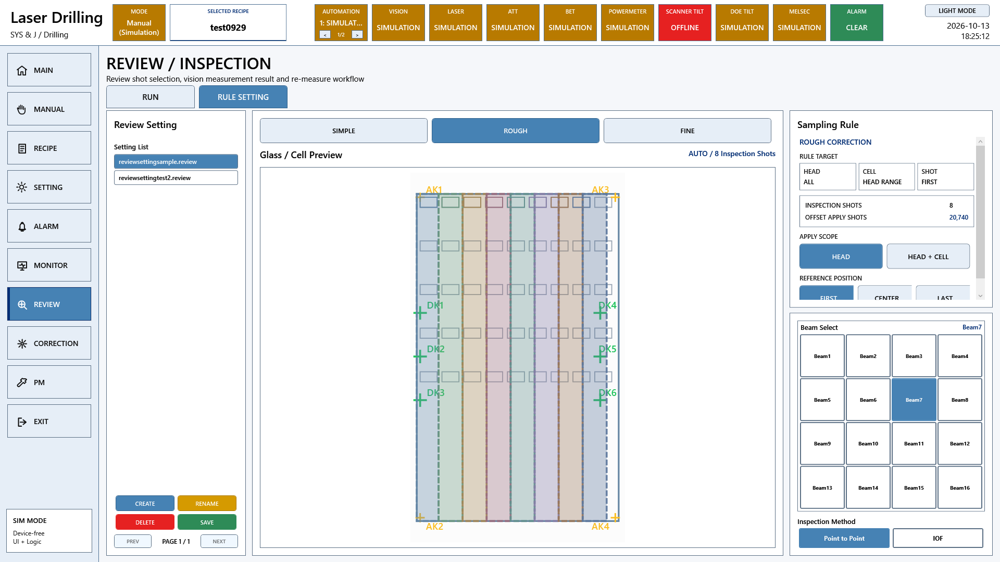

# A3 LD 리뷰와 보정 요구기능 코드 대조

원본 Commit: [0c501c104dec1cebab87bd909de29b1b1395a8b4](https://github.com/kjuws10-rgb/A3_LD_Process_SW_IPS/commit/0c501c104dec1cebab87bd909de29b1b1395a8b4)

코드 구현 확인은 현장 검수 완료를 뜻하지 않습니다. 원본 진행 현황은 그대로 보존했고, 아래 판정은 현재 C# 구현을 기준으로 별도 작성했습니다. 화면은 최신 소스의 WPF 화면을 장치 전체 Simulation 모드로 화면 밖에서 렌더링한 것입니다. 실제 장비 측정값 또는 실제 동작 완료 증거가 아닙니다.

[전체 요약](README.md) · [편집본 엑셀](A3_LD_요구기능검증_코드분석작성본.xlsx) · [검색 가능한 상세 자료](항목별_상세근거.html)

## 관련 프로그램 화면



이 화면은 해당 기능군의 UI 연결을 보여줍니다. 개별 검수 조건의 통과 증거는 아래 소스·판정·후속 확인을 함께 보아야 합니다.

## 항목 166

테이블 모니터링

- 원본 검수 항목: 지정 Head/Cell의 MOF Offset 데이터 파일 로드
- 원본 진행 현황: 내용 확인 필요
- 현재 코드 판정: 부분 구현 또는 사양 차이

현행 ReviewOffset 파일은 CELLID/SHOTID/REVIEWOFFSETX/Y를 저장한다. Head별·Cell별 MOF 파일을 별도 저장하는 구형 형식과 다르다.

### 코드 위치와 짧은 내용

[Drilling.File/ReviewOffset/CReviewOffsetFile.cs L29–L95](https://github.com/kjuws10-rgb/A3_LD_Process_SW_IPS/blob/0c501c104dec1cebab87bd909de29b1b1395a8b4/Drilling.File/ReviewOffset/CReviewOffsetFile.cs#L29-L95)

```csharp
    public override Task<ST_REVIEW_OFFSET_FILE_DATA> LoadLatest(
        string recipeId,
        CancellationToken cancellationToken = default)
    {
        cancellationToken.ThrowIfCancellationRequested();

        var normalizedRecipeId = NormalizeRecipeId(recipeId);
        if (string.IsNullOrWhiteSpace(normalizedRecipeId))
        {
            return Task.FromResult(ST_REVIEW_OFFSET_FILE_DATA.Empty(""));
        }

        var directory = GetRecipeOffsetDirectory(normalizedRecipeId);
        if (!Directory.Exists(directory))
```

[Drilling.UI/Menu/Menus/CMenuCorrection.cs L1156–L1250](https://github.com/kjuws10-rgb/A3_LD_Process_SW_IPS/blob/0c501c104dec1cebab87bd909de29b1b1395a8b4/Drilling.UI/Menu/Menus/CMenuCorrection.cs#L1156-L1250)

```csharp
    private async Task SaveAppliedReviewOffsets()
    {
        if (_loadedReviewResult is null)
        {
            await ReportReviewDataCommand("Save", "Apply the calculated Review Offsets before saving.", "WARN");
            return;
        }

        if (HasSelectedRecipeMismatch(_loadedReviewResult))
        {
            await ReportReviewDataCommand(
                "Save",
                "Review Result Recipe와 현재 Recipe가 다릅니다. 보정값을 저장할 수 없습니다.",
                "WARN");
```

### 남은 검증

선택 Beam/Rule·단일/라인 측정·NG·통신 끊김·재개·보정 파일 재로드를 확인한다. 원본 검수 조건의 전 항목과 대조하고, 실제 장비 결과를 확보한 뒤 개발/검증 완료 여부를 갱신한다.

[관련 화면](screens/Review_SAMPLE_simulation.png) · [전체 요약으로](README.md)

## 항목 167

테이블 모니터링

- 원본 검수 항목: Cell 보정 모드 선택 시 전체 Head/Cell의 MOF Offset 데이터가 누락 없이 모두 로드되는지 확인
- 원본 진행 현황: 내용 확인 필요
- 현재 코드 판정: 부분 구현 또는 사양 차이

LoadLatest는 Recipe별 reviewoffset 폴더의 최신 CSV를 읽는다. 모든 Cell MOF 폴더를 순회 로드하는 이전 구현과 동일하지 않다.

### 코드 위치와 짧은 내용

[Drilling.File/ReviewOffset/CReviewOffsetFile.cs L29–L95](https://github.com/kjuws10-rgb/A3_LD_Process_SW_IPS/blob/0c501c104dec1cebab87bd909de29b1b1395a8b4/Drilling.File/ReviewOffset/CReviewOffsetFile.cs#L29-L95)

```csharp
    public override Task<ST_REVIEW_OFFSET_FILE_DATA> LoadLatest(
        string recipeId,
        CancellationToken cancellationToken = default)
    {
        cancellationToken.ThrowIfCancellationRequested();

        var normalizedRecipeId = NormalizeRecipeId(recipeId);
        if (string.IsNullOrWhiteSpace(normalizedRecipeId))
        {
            return Task.FromResult(ST_REVIEW_OFFSET_FILE_DATA.Empty(""));
        }

        var directory = GetRecipeOffsetDirectory(normalizedRecipeId);
        if (!Directory.Exists(directory))
```

[Drilling.UI/Menu/Menus/CMenuCorrection.cs L802–L884](https://github.com/kjuws10-rgb/A3_LD_Process_SW_IPS/blob/0c501c104dec1cebab87bd909de29b1b1395a8b4/Drilling.UI/Menu/Menus/CMenuCorrection.cs#L802-L884)

```csharp
    private async Task LoadReviewResult()
    {
        var dialog = new OpenFileDialog
        {
            Title = "Load Review Result",
            Filter = "Review Result CSV (*.csv)|*.csv|All Files (*.*)|*.*",
            CheckFileExists = true,
            Multiselect = false,
            InitialDirectory = Directory.Exists(_reviewResultFile.RootPath) ? _reviewResultFile.RootPath : AppContext.BaseDirectory
        };
        if (dialog.ShowDialog() != true)
        {
            _statusReporter("Review Result load canceled.");
            return;
```

### 남은 검증

선택 Beam/Rule·단일/라인 측정·NG·통신 끊김·재개·보정 파일 재로드를 확인한다. 원본 검수 조건의 전 항목과 대조하고, 실제 장비 결과를 확보한 뒤 개발/검증 완료 여부를 갱신한다.

[관련 화면](screens/Review_SAMPLE_simulation.png) · [전체 요약으로](README.md)

## 항목 168

테이블 모니터링

- 원본 검수 항목: 보정 Table 표시값을 보간 데이터 기준으로 갱신
- 원본 진행 현황: 내용 확인 필요
- 현재 코드 판정: 코드 구현 확인

Simple·Rough는 기준 결과를 Head 또는 Head+Cell 범위로 확장하고 Fine은 측정점 사이를 보간한다. 실제 측정하지 않은 점은 보정 계산으로 채운 값이다.

### 코드 위치와 짧은 내용

[Drilling.Common/Review/CReviewManager.cs L1613–L1689](https://github.com/kjuws10-rgb/A3_LD_Process_SW_IPS/blob/0c501c104dec1cebab87bd909de29b1b1395a8b4/Drilling.Common/Review/CReviewManager.cs#L1613-L1689)

```csharp
    public static IReadOnlyList<ST_REVIEW_PLAN_POINT> ProjectCorrectionRows(
        ST_REVIEW_PLAN plan,
        IReadOnlyList<ST_REVIEW_PLAN_POINT> measuredResults)
    {
        if (plan.CorrectionPlan is not { SourcePoints.Count: > 0 } projection)
        {
            return measuredResults;
        }

        var measuredPoints = measuredResults
            .Where(point => point.Use &&
                point.State is EN_REVIEW_POINT_STATE.Ok or EN_REVIEW_POINT_STATE.Ng)
            .ToArray();
        if (measuredPoints.Length == 0)
```

[Drilling.Common/Review/CReviewRulePlanBuilder.cs L3–L64](https://github.com/kjuws10-rgb/A3_LD_Process_SW_IPS/blob/0c501c104dec1cebab87bd909de29b1b1395a8b4/Drilling.Common/Review/CReviewRulePlanBuilder.cs#L3-L64)

```csharp
public enum EN_REVIEW_CORRECTION_RULE { Simple, Rough, Fine, Edge }
public enum EN_REVIEW_CORRECTION_SCOPE { Head, HeadCell }
public enum EN_REVIEW_REFERENCE_LINE { First, Center, Last }

public sealed record ST_REVIEW_RULE_CONFIGURATION(
    EN_REVIEW_CORRECTION_RULE Rule,
    EN_REVIEW_CORRECTION_SCOPE Scope,
    int BeamNo,
    string ReferenceShotKey,
    EN_REVIEW_REFERENCE_LINE RoughReference,
    int FineLineCount);

public sealed record ST_REVIEW_RULE_TARGET(
    string ShotKey,
```

### 남은 검증

선택 Beam/Rule·단일/라인 측정·NG·통신 끊김·재개·보정 파일 재로드를 확인한다. 원본 검수 조건의 전 항목과 대조하고, 실제 장비 결과를 확보한 뒤 개발/검증 완료 여부를 갱신한다.

[관련 화면](screens/Review_SAMPLE_simulation.png) · [전체 요약으로](README.md)

## 항목 169

세팅

- 원본 검수 항목: Head 측정모드로 전환하고 Head 번호 관련 컨트롤을 활성화하는 이벤트 핸들러
- 원본 진행 현황: 측정 포인트 선택시 매핑된 Head 표시 완료
- 현재 코드 판정: 부분 구현 또는 사양 차이

Review에서 Rule Scope를 Head 또는 Head+Cell로 설정한다. 구형 Manual/SemiAuto 전용 HeadMode UI와 똑같은 동작이라고 볼 수 없다.

### 코드 위치와 짧은 내용

[Drilling.Common/Review/CReviewRulePlanBuilder.cs L3–L64](https://github.com/kjuws10-rgb/A3_LD_Process_SW_IPS/blob/0c501c104dec1cebab87bd909de29b1b1395a8b4/Drilling.Common/Review/CReviewRulePlanBuilder.cs#L3-L64)

```csharp
public enum EN_REVIEW_CORRECTION_RULE { Simple, Rough, Fine, Edge }
public enum EN_REVIEW_CORRECTION_SCOPE { Head, HeadCell }
public enum EN_REVIEW_REFERENCE_LINE { First, Center, Last }

public sealed record ST_REVIEW_RULE_CONFIGURATION(
    EN_REVIEW_CORRECTION_RULE Rule,
    EN_REVIEW_CORRECTION_SCOPE Scope,
    int BeamNo,
    string ReferenceShotKey,
    EN_REVIEW_REFERENCE_LINE RoughReference,
    int FineLineCount);

public sealed record ST_REVIEW_RULE_TARGET(
    string ShotKey,
```

[Drilling.UI/Menu/Menus/CMenuReview.cs L786–L837](https://github.com/kjuws10-rgb/A3_LD_Process_SW_IPS/blob/0c501c104dec1cebab87bd909de29b1b1395a8b4/Drilling.UI/Menu/Menus/CMenuReview.cs#L786-L837)

```csharp
    private void SelectSampleRuleUi(object? parameter)
    {
        var rule = parameter?.ToString()?.Trim().ToUpperInvariant();
        if (rule is not ("SIMPLE" or "ROUGH" or "FINE") || rule == _selectedSampleRuleUi) return;
        _selectedSampleRuleUi = rule;
        _lastCorrectionRulePlan = null;
        if (rule != "SIMPLE")
        {
            _isSampleCellDetailVisible = false;
            _selectedSampleShotKeys.Clear();
        }
        else
        {
            _selectedSampleShotKeys.Clear();
```

### 남은 검증

선택 Beam/Rule·단일/라인 측정·NG·통신 끊김·재개·보정 파일 재로드를 확인한다. 원본 검수 조건의 전 항목과 대조하고, 실제 장비 결과를 확보한 뒤 개발/검증 완료 여부를 갱신한다.

[관련 화면](screens/Review_SAMPLE_simulation.png) · [전체 요약으로](README.md)

## 항목 170

세팅

- 원본 검수 항목: 분기빔 번호와 좌상단 좌표 기반으로 각 측정포인트의 리뷰좌표가 정확히 계산되는지 확인
- 원본 진행 현황: 완료
- 현재 코드 판정: 코드 구현 확인

BeamNo를 검증한 뒤 분기 Beam Offset을 계산하고 Cell 회전을 적용해 ReviewTargetX/Y를 만든다. DOE 중심 가공좌표와 Beam 검사좌표는 서로 다르다.

### 코드 위치와 짧은 내용

[Drilling.Common/Review/CReviewManager.cs L1862–L1904](https://github.com/kjuws10-rgb/A3_LD_Process_SW_IPS/blob/0c501c104dec1cebab87bd909de29b1b1395a8b4/Drilling.Common/Review/CReviewManager.cs#L1862-L1904)

```csharp
    private static ST_REVIEW_COORDINATE_OFFSET CalculateBeamOffset(
        int beamNo,
        int splitBeamCount,
        double doePitch)
    {
        ValidateBeamNo(beamNo, splitBeamCount);
        if (!double.IsFinite(doePitch) || doePitch <= 0.0)
        {
            throw new InvalidOperationException(
                $"DOE pitch must be a finite value greater than 0. Current value: {doePitch}");
        }

        var normalizedBeamNo = beamNo - 1;
        var column = normalizedBeamNo % splitBeamCount;
```

[Drilling.Common/Review/CReviewManager.cs L1906–L1938](https://github.com/kjuws10-rgb/A3_LD_Process_SW_IPS/blob/0c501c104dec1cebab87bd909de29b1b1395a8b4/Drilling.Common/Review/CReviewManager.cs#L1906-L1938)

```csharp
    private static ST_REVIEW_COORDINATE_OFFSET CalculateReviewTarget(
        double shotFromAlignKeyX,
        double shotFromAlignKeyY,
        double reviewCameraAlignKeyPosX,
        double reviewCameraAlignKeyPosY,
        double beamOffsetLocalX,
        double beamOffsetLocalY,
        double cellRotationDegrees,
        double stageScanDirectionY)
    {
        var beamOffset = RotateLocalOffset(
            beamOffsetLocalX,
            beamOffsetLocalY,
            cellRotationDegrees);
```

### 남은 검증

선택 Beam/Rule·단일/라인 측정·NG·통신 끊김·재개·보정 파일 재로드를 확인한다. 원본 검수 조건의 전 항목과 대조하고, 실제 장비 결과를 확보한 뒤 개발/검증 완료 여부를 갱신한다.

[관련 화면](screens/Review_SAMPLE_simulation.png) · [전체 요약으로](README.md)

## 항목 171

세팅

- 원본 검수 항목: 지정된 Head/Cell 및 X,Y 포인트 수에 따라 등간격 측정 배열이 생성되는지 확인
- 원본 진행 현황: 완료
- 현재 코드 판정: 코드 구현 확인

Cell/Model의 픽셀·Pitch·Beam 배치 조건으로 검사점이 생성된다. 각 Cell 회전·Masking 및 Head 배정도 반영되므로 무조건 전체가 같은 간격 배열인 것은 아니다.

### 코드 위치와 짧은 내용

[Drilling.Common/Review/CReviewManager.cs L441–L522](https://github.com/kjuws10-rgb/A3_LD_Process_SW_IPS/blob/0c501c104dec1cebab87bd909de29b1b1395a8b4/Drilling.Common/Review/CReviewManager.cs#L441-L522)

```csharp
    public ST_REVIEW_PLAN CreatePlan(
        ST_RECIPE_DEFINITION recipe,
        IReadOnlyCollection<string> selectedShotKeys)
    {
        return CreatePlan(recipe, selectedShotKeys, 1);
    }

    public ST_REVIEW_PLAN CreatePlan(
        ST_RECIPE_DEFINITION recipe,
        IReadOnlyCollection<string> selectedShotKeys,
        int selectedBeamNo)
    {
        ValidateBeamNo(
            selectedBeamNo,
```

[Drilling.Common/Recipe/CCellPatternCalculator.cs L117–L241](https://github.com/kjuws10-rgb/A3_LD_Process_SW_IPS/blob/0c501c104dec1cebab87bd909de29b1b1395a8b4/Drilling.Common/Recipe/CCellPatternCalculator.cs#L117-L241)

```csharp
    public static ST_CELL_PATTERN_LAYOUT Calculate(ST_CELL_PATTERN_DEFINITION input) =>
        Calculate(input, includeShotCenters: true);

    public static ST_CELL_PATTERN_LAYOUT Calculate(
        ST_CELL_PATTERN_DEFINITION input,
        bool includeShotCenters)
    {
        if (input.CellNo <= 0)
        {
            return Invalid("Cell number must be greater than zero.");
        }

        if (!double.IsFinite(input.FirstTargetX) || !double.IsFinite(input.FirstTargetY) || !double.IsFinite(input.RotationDegrees) || !double.IsFinite(input.PixelSizeMillimeters) || !double.IsFinite(input.OriginX) || !double.IsFinite(input.OriginY))
        {
```

[Drilling.Common/Recipe/CRecipeShotMaskingPlan.cs L51–L138](https://github.com/kjuws10-rgb/A3_LD_Process_SW_IPS/blob/0c501c104dec1cebab87bd909de29b1b1395a8b4/Drilling.Common/Recipe/CRecipeShotMaskingPlan.cs#L51-L138)

```csharp
    public static CRecipeShotMaskingPlan Build(IReadOnlyDictionary<string, string> parameters)
    {
        ArgumentNullException.ThrowIfNull(parameters);
        var modelTypeCount = Math.Clamp(ReadInt(parameters, 1, "CELL_MODEL_TYPE_COUNT"), 1, MaximumCellModelTypeCount);
        var pixelSize = ReadDouble(parameters, 0.09, "PIXEL_SIZE");
        var splitBeamCount = ReadInt(parameters, 1, "SPLITED_BEAM_COUNT");
        var models = new Dictionary<int, ST_MODEL_MASKING_AREA>();
        var modelPatterns = new Dictionary<int, ST_MODEL_PATTERN_AREA>();
        for (var modelType = 1; modelType <= modelTypeCount; modelType++)
        {
            var modelPattern = CRecipeModelPixelCountReader.ReadPatternForModel(parameters, modelType);
            var groupPitchMillimeters = pixelSize * modelPattern.ProcessPitch;
            var beamPitchMillimeters = splitBeamCount <= 0 ? 0.0 : groupPitchMillimeters / splitBeamCount;
            modelPatterns[modelType] = new ST_MODEL_PATTERN_AREA(
```

### 남은 검증

선택 Beam/Rule·단일/라인 측정·NG·통신 끊김·재개·보정 파일 재로드를 확인한다. 원본 검수 조건의 전 항목과 대조하고, 실제 장비 결과를 확보한 뒤 개발/검증 완료 여부를 갱신한다.

[관련 화면](screens/Review_SAMPLE_simulation.png) · [전체 요약으로](README.md)

## 항목 172

세팅

- 원본 검수 항목: 설정 실행 시 이전 측정데이터가 초기값(8888)으로 초기화되는지 확인
- 원본 진행 현황: Ready 상태 표시 완료
- 현재 코드 판정: 부분 구현 또는 사양 차이

현행 점 상태는 Ready/Current/Ok/Ng 등의 Enum으로 관리한다. 미측정 Error를 8888로 채우는 구형 Sentinel 값 방식과 다르다.

### 코드 위치와 짧은 내용

[Drilling.Common/Review/CReviewManager.cs L74–L153](https://github.com/kjuws10-rgb/A3_LD_Process_SW_IPS/blob/0c501c104dec1cebab87bd909de29b1b1395a8b4/Drilling.Common/Review/CReviewManager.cs#L74-L153)

```csharp
public sealed record ST_REVIEW_PLAN_POINT(
    int PointNo,
    string ShotKey,
    int HeadNo,
    int CellNo,
    int ShotNo,
    int PixelCountX,
    int PixelCountY,
    bool Use,
    double DesignX,
    double DesignY,
    double ReviewTargetX,
    double ReviewTargetY,
    double ErrorX,
```

[Drilling.Common/Review/CReviewManager.cs L563–L741](https://github.com/kjuws10-rgb/A3_LD_Process_SW_IPS/blob/0c501c104dec1cebab87bd909de29b1b1395a8b4/Drilling.Common/Review/CReviewManager.cs#L563-L741)

```csharp
    public async Task<ST_REVIEW_SEQUENCE_STATUS> Start(
        ST_REVIEW_PLAN plan,
        string? productId,
        ST_PRODUCT_REVIEW_DATA? checkpoint,
        bool resumeCheckpoint,
        Action<ST_REVIEW_PLAN>? progress = null,
        CancellationToken cancellationToken = default)
    {
        if (!await _sequenceLock.WaitAsync(0, cancellationToken))
        {
            return CreateStatus(
                CurrentPlan ?? plan,
                EN_REVIEW_SEQUENCE_STATE.Running,
                "Review sequence is already running.");
```

### 남은 검증

선택 Beam/Rule·단일/라인 측정·NG·통신 끊김·재개·보정 파일 재로드를 확인한다. 원본 검수 조건의 전 항목과 대조하고, 실제 장비 결과를 확보한 뒤 개발/검증 완료 여부를 갱신한다.

[관련 화면](screens/Review_SAMPLE_simulation.png) · [전체 요약으로](README.md)

## 항목 173

실행

- 원본 검수 항목: IOF 실행 전 구동축 제어권한(Stage/Review Control Mode) 보유 여부가 확인되는지 확인
- 원본 진행 현황: 미완료
- 현재 코드 판정: 현재 코드에서 미확인

IOF 검사 분기와 비전 준비 요청은 있지만 Stage·Camera 이동 함수가 TODO다. PLC IOF 제어권 획득·반환 및 도착 인터록은 현장 사양 확정이 필요하다.

### 코드 위치와 짧은 내용

[Drilling.Common/Review/CReviewManager.cs L2038–L2132](https://github.com/kjuws10-rgb/A3_LD_Process_SW_IPS/blob/0c501c104dec1cebab87bd909de29b1b1395a8b4/Drilling.Common/Review/CReviewManager.cs#L2038-L2132)

```csharp
    private async Task<ST_REVIEW_SEQUENCE_STATUS> RunIofSequence(
        ST_REVIEW_PLAN workingPlan,
        string? reviewProductId,
        Action<ST_REVIEW_PLAN>? progress,
        CancellationToken cancellationToken,
        IReadOnlyList<ST_REVIEW_PLAN_POINT>? runPoints = null)
    {
        var pendingPoints = runPoints ?? workingPlan.ReviewPoints
            .Where(point => point.State is not (EN_REVIEW_POINT_STATE.Ok or EN_REVIEW_POINT_STATE.Ng))
            .ToArray();
        var lines = CreateIofLines(pendingPoints);
        foreach (var line in lines)
        {
            cancellationToken.ThrowIfCancellationRequested();
```

[Drilling.Common/Review/CReviewManager.cs L1940–L1988](https://github.com/kjuws10-rgb/A3_LD_Process_SW_IPS/blob/0c501c104dec1cebab87bd909de29b1b1395a8b4/Drilling.Common/Review/CReviewManager.cs#L1940-L1988)

```csharp
    private Task MoveStageY(
        ST_REVIEW_PLAN_POINT point,
        CancellationToken cancellationToken)
    {
        cancellationToken.ThrowIfCancellationRequested();
        var command = FormatCommand(
            "REVIEW_STAGE_Y_MOVE",
            ("SHOT_KEY", point.ShotKey),
            ("POINT", point.PointNo.ToString(CultureInfo.InvariantCulture)),
            ("HEAD", point.HeadNo.ToString(CultureInfo.InvariantCulture)),
            ("CELL", point.CellNo.ToString(CultureInfo.InvariantCulture)),
            ("SHOT", point.ShotNo.ToString(CultureInfo.InvariantCulture)),
            ("BEAM", point.BeamNo.ToString(CultureInfo.InvariantCulture)),
            ("Y", FormatDouble(point.ReviewTargetY)));
```

미확인은 해당 이름·동작·호출 관계를 현행 자료와 대조해 확정하지 못했다는 뜻입니다. 링크는 가장 가까운 현재 기능이며, 존재하지 않는 함수를 있다고 추정한 근거가 아닙니다.

### 남은 검증

선택 Beam/Rule·단일/라인 측정·NG·통신 끊김·재개·보정 파일 재로드를 확인한다. 원본 검수 조건의 전 항목과 대조하고, 실제 장비 결과를 확보한 뒤 개발/검증 완료 여부를 갱신한다.

[관련 화면](screens/Review_SAMPLE_simulation.png) · [전체 요약으로](README.md)

## 항목 174

실행

- 원본 검수 항목: IOF는 X축 All 모드 세팅 조건에서만 실행 가능하도록 검사되는지 확인
- 원본 진행 현황: 미완료
- 현재 코드 판정: 부분 구현 또는 사양 차이

Review는 IOF/PTP InspectionMethod를 선택해 다른 실행 경로를 사용한다. X All 조건에서만 IOF 허용하는 구형 선택 규칙은 동일하게 확인되지 않았다.

### 코드 위치와 짧은 내용

[Drilling.UI/Menu/Menus/CMenuReview.cs L1377–L1407](https://github.com/kjuws10-rgb/A3_LD_Process_SW_IPS/blob/0c501c104dec1cebab87bd909de29b1b1395a8b4/Drilling.UI/Menu/Menus/CMenuReview.cs#L1377-L1407)

```csharp
    private void SelectInspectionMethod(object? parameter)
    {
        if (IsReviewExecutionActive)
        {
            _statusReporter("Inspection Method cannot be changed while Review is running.");
            return;
        }

        var inspectionMethod = NormalizeInspectionMethod(parameter?.ToString());
        if (_selectedInspectionMethod.Equals(inspectionMethod, StringComparison.OrdinalIgnoreCase))
        {
            return;
        }

```

[Drilling.Common/Review/CReviewManager.cs L2038–L2132](https://github.com/kjuws10-rgb/A3_LD_Process_SW_IPS/blob/0c501c104dec1cebab87bd909de29b1b1395a8b4/Drilling.Common/Review/CReviewManager.cs#L2038-L2132)

```csharp
    private async Task<ST_REVIEW_SEQUENCE_STATUS> RunIofSequence(
        ST_REVIEW_PLAN workingPlan,
        string? reviewProductId,
        Action<ST_REVIEW_PLAN>? progress,
        CancellationToken cancellationToken,
        IReadOnlyList<ST_REVIEW_PLAN_POINT>? runPoints = null)
    {
        var pendingPoints = runPoints ?? workingPlan.ReviewPoints
            .Where(point => point.State is not (EN_REVIEW_POINT_STATE.Ok or EN_REVIEW_POINT_STATE.Ng))
            .ToArray();
        var lines = CreateIofLines(pendingPoints);
        foreach (var line in lines)
        {
            cancellationToken.ThrowIfCancellationRequested();
```

### 남은 검증

선택 Beam/Rule·단일/라인 측정·NG·통신 끊김·재개·보정 파일 재로드를 확인한다. 원본 검수 조건의 전 항목과 대조하고, 실제 장비 결과를 확보한 뒤 개발/검증 완료 여부를 갱신한다.

[관련 화면](screens/Review_SAMPLE_simulation.png) · [전체 요약으로](README.md)

## 항목 175

실행

- 원본 검수 항목: Melsec/Vision 연동 IOF 라인스캔 측정 시퀀스가 정상 수행되는지 확인
- 원본 진행 현황: 미완료
- 현재 코드 판정: 부분 구현 또는 사양 차이

라인별로 FLYING_READY 및 MARK_FIND_LINE을 요청하고 응답을 파싱한다. 시작점·끝점 물리 이동은 TODO를 호출하므로 IOF 전체 완료는 아니다.

### 코드 위치와 짧은 내용

[Drilling.Common/Review/CReviewManager.cs L2038–L2132](https://github.com/kjuws10-rgb/A3_LD_Process_SW_IPS/blob/0c501c104dec1cebab87bd909de29b1b1395a8b4/Drilling.Common/Review/CReviewManager.cs#L2038-L2132)

```csharp
    private async Task<ST_REVIEW_SEQUENCE_STATUS> RunIofSequence(
        ST_REVIEW_PLAN workingPlan,
        string? reviewProductId,
        Action<ST_REVIEW_PLAN>? progress,
        CancellationToken cancellationToken,
        IReadOnlyList<ST_REVIEW_PLAN_POINT>? runPoints = null)
    {
        var pendingPoints = runPoints ?? workingPlan.ReviewPoints
            .Where(point => point.State is not (EN_REVIEW_POINT_STATE.Ok or EN_REVIEW_POINT_STATE.Ng))
            .ToArray();
        var lines = CreateIofLines(pendingPoints);
        foreach (var line in lines)
        {
            cancellationToken.ThrowIfCancellationRequested();
```

[Drilling.Common/Review/CReviewManager.cs L2146–L2199](https://github.com/kjuws10-rgb/A3_LD_Process_SW_IPS/blob/0c501c104dec1cebab87bd909de29b1b1395a8b4/Drilling.Common/Review/CReviewManager.cs#L2146-L2199)

```csharp
    private async Task<IReadOnlyList<ST_REVIEW_MEASURE_RESULT>> MeasureVisionLine(
        IReadOnlyList<ST_REVIEW_PLAN_POINT> line,
        CancellationToken cancellationToken)
    {
        if (line.Count == 0)
        {
            throw new InvalidOperationException("Vision IOF line is empty.");
        }

        await MoveIofLineStart(line[0], cancellationToken);
        cancellationToken.ThrowIfCancellationRequested();
        if (IsStopRequested)
        {
            return [];
```

[Drilling.Common/Review/CReviewManager.cs L1940–L1988](https://github.com/kjuws10-rgb/A3_LD_Process_SW_IPS/blob/0c501c104dec1cebab87bd909de29b1b1395a8b4/Drilling.Common/Review/CReviewManager.cs#L1940-L1988)

```csharp
    private Task MoveStageY(
        ST_REVIEW_PLAN_POINT point,
        CancellationToken cancellationToken)
    {
        cancellationToken.ThrowIfCancellationRequested();
        var command = FormatCommand(
            "REVIEW_STAGE_Y_MOVE",
            ("SHOT_KEY", point.ShotKey),
            ("POINT", point.PointNo.ToString(CultureInfo.InvariantCulture)),
            ("HEAD", point.HeadNo.ToString(CultureInfo.InvariantCulture)),
            ("CELL", point.CellNo.ToString(CultureInfo.InvariantCulture)),
            ("SHOT", point.ShotNo.ToString(CultureInfo.InvariantCulture)),
            ("BEAM", point.BeamNo.ToString(CultureInfo.InvariantCulture)),
            ("Y", FormatDouble(point.ReviewTargetY)));
```

### 남은 검증

선택 Beam/Rule·단일/라인 측정·NG·통신 끊김·재개·보정 파일 재로드를 확인한다. 원본 검수 조건의 전 항목과 대조하고, 실제 장비 결과를 확보한 뒤 개발/검증 완료 여부를 갱신한다.

[관련 화면](screens/Review_SAMPLE_simulation.png) · [전체 요약으로](README.md)

## 항목 176

실행

- 원본 검수 항목: IOF 측정 좌표군이 Melsec Address로 정확히 전송되는지 확인
- 원본 진행 현황: 미완료
- 현재 코드 판정: 현재 코드에서 미확인

MoveStageY/MoveVisionX 주석에 MELSEC 주소·Handshake 확정 후 연결한다고 명시되어 있다. 현재 명령 문자열은 작성되지만 실행되지 않는다.

### 코드 위치와 짧은 내용

[Drilling.Common/Review/CReviewManager.cs L1940–L1988](https://github.com/kjuws10-rgb/A3_LD_Process_SW_IPS/blob/0c501c104dec1cebab87bd909de29b1b1395a8b4/Drilling.Common/Review/CReviewManager.cs#L1940-L1988)

```csharp
    private Task MoveStageY(
        ST_REVIEW_PLAN_POINT point,
        CancellationToken cancellationToken)
    {
        cancellationToken.ThrowIfCancellationRequested();
        var command = FormatCommand(
            "REVIEW_STAGE_Y_MOVE",
            ("SHOT_KEY", point.ShotKey),
            ("POINT", point.PointNo.ToString(CultureInfo.InvariantCulture)),
            ("HEAD", point.HeadNo.ToString(CultureInfo.InvariantCulture)),
            ("CELL", point.CellNo.ToString(CultureInfo.InvariantCulture)),
            ("SHOT", point.ShotNo.ToString(CultureInfo.InvariantCulture)),
            ("BEAM", point.BeamNo.ToString(CultureInfo.InvariantCulture)),
            ("Y", FormatDouble(point.ReviewTargetY)));
```

미확인은 해당 이름·동작·호출 관계를 현행 자료와 대조해 확정하지 못했다는 뜻입니다. 링크는 가장 가까운 현재 기능이며, 존재하지 않는 함수를 있다고 추정한 근거가 아닙니다.

### 남은 검증

선택 Beam/Rule·단일/라인 측정·NG·통신 끊김·재개·보정 파일 재로드를 확인한다. 원본 검수 조건의 전 항목과 대조하고, 실제 장비 결과를 확보한 뒤 개발/검증 완료 여부를 갱신한다.

[관련 화면](screens/Review_SAMPLE_simulation.png) · [전체 요약으로](README.md)

## 항목 177

실행

- 원본 검수 항목: PtoP 실행 전 구동축 제어권한 보유 여부가 세팅 조건으로 확인되는지 확인
- 원본 진행 현황: 미완료
- 현재 코드 판정: 현재 코드에서 미확인

PTP 순차 루프는 있지만 실제 Stage·Camera 이동 및 제어권 인터록이 연결되지 않았다. Review 순서가 존재하는 것과 장비 도착 확인 완료는 다르다.

### 코드 위치와 짧은 내용

[Drilling.Common/Review/CReviewManager.cs L563–L741](https://github.com/kjuws10-rgb/A3_LD_Process_SW_IPS/blob/0c501c104dec1cebab87bd909de29b1b1395a8b4/Drilling.Common/Review/CReviewManager.cs#L563-L741)

```csharp
    public async Task<ST_REVIEW_SEQUENCE_STATUS> Start(
        ST_REVIEW_PLAN plan,
        string? productId,
        ST_PRODUCT_REVIEW_DATA? checkpoint,
        bool resumeCheckpoint,
        Action<ST_REVIEW_PLAN>? progress = null,
        CancellationToken cancellationToken = default)
    {
        if (!await _sequenceLock.WaitAsync(0, cancellationToken))
        {
            return CreateStatus(
                CurrentPlan ?? plan,
                EN_REVIEW_SEQUENCE_STATE.Running,
                "Review sequence is already running.");
```

[Drilling.Common/Review/CReviewManager.cs L1940–L1988](https://github.com/kjuws10-rgb/A3_LD_Process_SW_IPS/blob/0c501c104dec1cebab87bd909de29b1b1395a8b4/Drilling.Common/Review/CReviewManager.cs#L1940-L1988)

```csharp
    private Task MoveStageY(
        ST_REVIEW_PLAN_POINT point,
        CancellationToken cancellationToken)
    {
        cancellationToken.ThrowIfCancellationRequested();
        var command = FormatCommand(
            "REVIEW_STAGE_Y_MOVE",
            ("SHOT_KEY", point.ShotKey),
            ("POINT", point.PointNo.ToString(CultureInfo.InvariantCulture)),
            ("HEAD", point.HeadNo.ToString(CultureInfo.InvariantCulture)),
            ("CELL", point.CellNo.ToString(CultureInfo.InvariantCulture)),
            ("SHOT", point.ShotNo.ToString(CultureInfo.InvariantCulture)),
            ("BEAM", point.BeamNo.ToString(CultureInfo.InvariantCulture)),
            ("Y", FormatDouble(point.ReviewTargetY)));
```

미확인은 해당 이름·동작·호출 관계를 현행 자료와 대조해 확정하지 못했다는 뜻입니다. 링크는 가장 가까운 현재 기능이며, 존재하지 않는 함수를 있다고 추정한 근거가 아닙니다.

### 남은 검증

선택 Beam/Rule·단일/라인 측정·NG·통신 끊김·재개·보정 파일 재로드를 확인한다. 원본 검수 조건의 전 항목과 대조하고, 실제 장비 결과를 확보한 뒤 개발/검증 완료 여부를 갱신한다.

[관련 화면](screens/Review_SAMPLE_simulation.png) · [전체 요약으로](README.md)

## 항목 178

실행

- 원본 검수 항목: Point단위 이동측정 방식(PtoP)으로 각 포인트 측정이 정상 수행되는지 확인
- 원본 진행 현황: 완료
- 현재 코드 판정: 부분 구현 또는 사양 차이

PTP는 StageY 요청 → VisionX 요청 → 단일 Vision 측정 → 결과 저장 순서다. 현재 이동 함수는 완료 Task 또는 임시 지연을 반환한다.

### 코드 위치와 짧은 내용

[Drilling.Common/Review/CReviewManager.cs L563–L741](https://github.com/kjuws10-rgb/A3_LD_Process_SW_IPS/blob/0c501c104dec1cebab87bd909de29b1b1395a8b4/Drilling.Common/Review/CReviewManager.cs#L563-L741)

```csharp
    public async Task<ST_REVIEW_SEQUENCE_STATUS> Start(
        ST_REVIEW_PLAN plan,
        string? productId,
        ST_PRODUCT_REVIEW_DATA? checkpoint,
        bool resumeCheckpoint,
        Action<ST_REVIEW_PLAN>? progress = null,
        CancellationToken cancellationToken = default)
    {
        if (!await _sequenceLock.WaitAsync(0, cancellationToken))
        {
            return CreateStatus(
                CurrentPlan ?? plan,
                EN_REVIEW_SEQUENCE_STATE.Running,
                "Review sequence is already running.");
```

[Drilling.Common/Review/CReviewManager.cs L1940–L1988](https://github.com/kjuws10-rgb/A3_LD_Process_SW_IPS/blob/0c501c104dec1cebab87bd909de29b1b1395a8b4/Drilling.Common/Review/CReviewManager.cs#L1940-L1988)

```csharp
    private Task MoveStageY(
        ST_REVIEW_PLAN_POINT point,
        CancellationToken cancellationToken)
    {
        cancellationToken.ThrowIfCancellationRequested();
        var command = FormatCommand(
            "REVIEW_STAGE_Y_MOVE",
            ("SHOT_KEY", point.ShotKey),
            ("POINT", point.PointNo.ToString(CultureInfo.InvariantCulture)),
            ("HEAD", point.HeadNo.ToString(CultureInfo.InvariantCulture)),
            ("CELL", point.CellNo.ToString(CultureInfo.InvariantCulture)),
            ("SHOT", point.ShotNo.ToString(CultureInfo.InvariantCulture)),
            ("BEAM", point.BeamNo.ToString(CultureInfo.InvariantCulture)),
            ("Y", FormatDouble(point.ReviewTargetY)));
```

[Drilling.Common/Review/CReviewManager.cs L1989–L2036](https://github.com/kjuws10-rgb/A3_LD_Process_SW_IPS/blob/0c501c104dec1cebab87bd909de29b1b1395a8b4/Drilling.Common/Review/CReviewManager.cs#L1989-L2036)

```csharp
    private async Task<ST_REVIEW_MEASURE_RESULT> MeasureVision(
        ST_REVIEW_PLAN_POINT point,
        CancellationToken cancellationToken)
    {
        cancellationToken.ThrowIfCancellationRequested();
        var isSimulation = IsReviewSimulation();
        WriteReviewLog(
            "MEASURE_START",
            "Measurement started.");

        try
        {
            ST_REVIEW_MEASURE_RESULT measurement;
            if (isSimulation)
```

### 남은 검증

선택 Beam/Rule·단일/라인 측정·NG·통신 끊김·재개·보정 파일 재로드를 확인한다. 원본 검수 조건의 전 항목과 대조하고, 실제 장비 결과를 확보한 뒤 개발/검증 완료 여부를 갱신한다.

[관련 화면](screens/Review_SAMPLE_simulation.png) · [전체 요약으로](README.md)

## 항목 179

실행

- 원본 검수 항목: 전체 Cell PtoP 검사 시작 시 전체 포인트의 리뷰좌표가 재계산되는지 확인
- 원본 진행 현황: 완료
- 현재 코드 판정: 코드 구현 확인

Review 시작 시 선택 Recipe·Review Setting·대상 Plan 및 Product 조건을 다시 확인한다. 실행 중 탐색 제한과 재개할 체크포인트 자료도 함께 관리한다.

### 코드 위치와 짧은 내용

[Drilling.UI/Menu/Menus/CMenuReview.cs L2123–L2275](https://github.com/kjuws10-rgb/A3_LD_Process_SW_IPS/blob/0c501c104dec1cebab87bd909de29b1b1395a8b4/Drilling.UI/Menu/Menus/CMenuReview.cs#L2123-L2275)

```csharp
    private async Task StartReviewSequence()
    {
        if (IsSampleSelectTab)
        {
            _statusReporter("Rule Setting is for configuring review shots. Start Review from the Run tab.");
            return;
        }

        if (IsReviewExecutionActive)
        {
            _statusReporter("Review sequence is already running. Stop it before starting another review.");
            return;
        }

```

[Drilling.Common/Review/CReviewManager.cs L563–L741](https://github.com/kjuws10-rgb/A3_LD_Process_SW_IPS/blob/0c501c104dec1cebab87bd909de29b1b1395a8b4/Drilling.Common/Review/CReviewManager.cs#L563-L741)

```csharp
    public async Task<ST_REVIEW_SEQUENCE_STATUS> Start(
        ST_REVIEW_PLAN plan,
        string? productId,
        ST_PRODUCT_REVIEW_DATA? checkpoint,
        bool resumeCheckpoint,
        Action<ST_REVIEW_PLAN>? progress = null,
        CancellationToken cancellationToken = default)
    {
        if (!await _sequenceLock.WaitAsync(0, cancellationToken))
        {
            return CreateStatus(
                CurrentPlan ?? plan,
                EN_REVIEW_SEQUENCE_STATE.Running,
                "Review sequence is already running.");
```

### 남은 검증

선택 Beam/Rule·단일/라인 측정·NG·통신 끊김·재개·보정 파일 재로드를 확인한다. 원본 검수 조건의 전 항목과 대조하고, 실제 장비 결과를 확보한 뒤 개발/검증 완료 여부를 갱신한다.

[관련 화면](screens/Review_SAMPLE_simulation.png) · [전체 요약으로](README.md)

## 항목 180

실행

- 원본 검수 항목: 이전 측정 데이터 로드 실패 시 PtoP 검사가 중단되고 에러 안내되는지 확인
- 원본 진행 현황: 내용 확인 필요
- 현재 코드 판정: 코드 구현 확인

ReviewResult CSV는 필수 헤더와 동일 Recipe ID 조건을 검사한다. 잘못된 파일이면 예외로 로드를 중단하며 오류 메시지를 표시한다.

### 코드 위치와 짧은 내용

[Drilling.File/ReviewResult/CReviewResultFile.cs L21–L103](https://github.com/kjuws10-rgb/A3_LD_Process_SW_IPS/blob/0c501c104dec1cebab87bd909de29b1b1395a8b4/Drilling.File/ReviewResult/CReviewResultFile.cs#L21-L103)

```csharp
    private static readonly IReadOnlyList<string> Headers =
    [
        "SAVED_AT",
        "GLASS_ID",
        "RECIPE_ID",
        "INSPECTION_METHOD",
        "RESULT_STATUS",
        "TOTAL_COUNT",
        "RULE",
        "RULE_SCOPE",
        "BEAM_NO",
        "REFERENCE_CELL_NO",
        "REFERENCE_SHOT",
        "ROUGH_REFERENCE",
```

[Drilling.UI/Menu/Menus/CMenuCorrection.cs L802–L884](https://github.com/kjuws10-rgb/A3_LD_Process_SW_IPS/blob/0c501c104dec1cebab87bd909de29b1b1395a8b4/Drilling.UI/Menu/Menus/CMenuCorrection.cs#L802-L884)

```csharp
    private async Task LoadReviewResult()
    {
        var dialog = new OpenFileDialog
        {
            Title = "Load Review Result",
            Filter = "Review Result CSV (*.csv)|*.csv|All Files (*.*)|*.*",
            CheckFileExists = true,
            Multiselect = false,
            InitialDirectory = Directory.Exists(_reviewResultFile.RootPath) ? _reviewResultFile.RootPath : AppContext.BaseDirectory
        };
        if (dialog.ShowDialog() != true)
        {
            _statusReporter("Review Result load canceled.");
            return;
```

### 남은 검증

선택 Beam/Rule·단일/라인 측정·NG·통신 끊김·재개·보정 파일 재로드를 확인한다. 원본 검수 조건의 전 항목과 대조하고, 실제 장비 결과를 확보한 뒤 개발/검증 완료 여부를 갱신한다.

[관련 화면](screens/Review_SAMPLE_simulation.png) · [전체 요약으로](README.md)

## 항목 181

로직

- 원본 검수 항목: 보정 적용 전 측정값 Limit 초과 여부가 재검사되어 초과 시 보정이 차단되는지 확인
- 원본 진행 현황: 미완료
- 현재 코드 판정: 부분 구현 또는 사양 차이

Correction Apply는 Recipe 불일치·Flip 변경·현재 Offset 개수·ShotKey를 확인한다. 요구한 보정량 상한 Limit 초과 차단은 이 검사들과 별개이며 명확히 확인되지 않았다.

### 코드 위치와 짧은 내용

[Drilling.UI/Menu/Menus/CMenuCorrection.cs L1007–L1154](https://github.com/kjuws10-rgb/A3_LD_Process_SW_IPS/blob/0c501c104dec1cebab87bd909de29b1b1395a8b4/Drilling.UI/Menu/Menus/CMenuCorrection.cs#L1007-L1154)

```csharp
    private async Task ApplyReviewOffsets()
    {
        if (_loadedReviewResult is null)
        {
            await ReportReviewDataCommand("Apply", "Load and calculate a Review Result before applying.", "WARN");
            return;
        }

        if (CalculatedOffsetRows.Count == 0)
        {
            await ReportReviewDataCommand("Apply", "Calculate the Review Offsets before applying.", "WARN");
            return;
        }

```

[Drilling.UI/Menu/Menus/CMenuCorrection.cs L907–L1005](https://github.com/kjuws10-rgb/A3_LD_Process_SW_IPS/blob/0c501c104dec1cebab87bd909de29b1b1395a8b4/Drilling.UI/Menu/Menus/CMenuCorrection.cs#L907-L1005)

```csharp
    private async Task CalculateReviewOffsets(bool replacePendingApply = false)
    {
        if (_loadedReviewResult is null)
        {
            await ReportReviewDataCommand("Calculate", "Load a Review Result CSV before calculating.", "WARN");
            return;
        }

        if (HasSelectedRecipeMismatch(_loadedReviewResult))
        {
            await ReportReviewDataCommand(
                "Calculate",
                "Review Result Recipe와 현재 Recipe가 다릅니다. 조회만 가능하며 계산하려면 같은 Recipe를 선택해 주세요.",
                "WARN");
```

### 남은 검증

선택 Beam/Rule·단일/라인 측정·NG·통신 끊김·재개·보정 파일 재로드를 확인한다. 원본 검수 조건의 전 항목과 대조하고, 실제 장비 결과를 확보한 뒤 개발/검증 완료 여부를 갱신한다.

[관련 화면](screens/Review_SAMPLE_simulation.png) · [전체 요약으로](README.md)

## 항목 182

로직

- 원본 검수 항목: 측정 결과 기반으로 대상 Cell/Head의 선형보정 계산이 정상 수행되는지 확인
- 원본 진행 현황: 미완료
- 현재 코드 판정: 코드 구현 확인

측정점 좌표 구간에서 비율을 구해 ErrorX/Y를 선형으로 보간한다. 구간 밖 처리·동일좌표·Head/Cell 범위는 별도 시험할 필요가 있다.

### 코드 위치와 짧은 내용

[Drilling.Common/Review/CReviewManager.cs L1743–L1786](https://github.com/kjuws10-rgb/A3_LD_Process_SW_IPS/blob/0c501c104dec1cebab87bd909de29b1b1395a8b4/Drilling.Common/Review/CReviewManager.cs#L1743-L1786)

```csharp
    private static ST_REVIEW_PLAN_POINT InterpolateFineMeasurement(
        ST_REVIEW_PLAN_POINT point,
        IReadOnlyList<ST_REVIEW_PLAN_POINT> anchors)
    {
        if (anchors.Count == 1 || point.DesignY <= anchors[0].DesignY)
        {
            return CopyMeasurement(point, anchors[0]);
        }

        if (point.DesignY >= anchors[^1].DesignY)
        {
            return CopyMeasurement(point, anchors[^1]);
        }

```

### 남은 검증

선택 Beam/Rule·단일/라인 측정·NG·통신 끊김·재개·보정 파일 재로드를 확인한다. 원본 검수 조건의 전 항목과 대조하고, 실제 장비 결과를 확보한 뒤 개발/검증 완료 여부를 갱신한다.

[관련 화면](screens/Review_SAMPLE_simulation.png) · [전체 요약으로](README.md)

## 항목 183

로직

- 원본 검수 항목: 라인 내 결측 포인트가 양 끝 측정값 기준으로 선형 보간되는지 확인
- 원본 진행 현황: 미완료
- 현재 코드 판정: 코드 구현 확인

Fine 보정은 전체 SourcePoints에 측정 오차를 투영한다. 비측정점의 값은 실측 결과가 아니라 보간으로 생성된 보정값이다.

### 코드 위치와 짧은 내용

[Drilling.Common/Review/CReviewManager.cs L1743–L1786](https://github.com/kjuws10-rgb/A3_LD_Process_SW_IPS/blob/0c501c104dec1cebab87bd909de29b1b1395a8b4/Drilling.Common/Review/CReviewManager.cs#L1743-L1786)

```csharp
    private static ST_REVIEW_PLAN_POINT InterpolateFineMeasurement(
        ST_REVIEW_PLAN_POINT point,
        IReadOnlyList<ST_REVIEW_PLAN_POINT> anchors)
    {
        if (anchors.Count == 1 || point.DesignY <= anchors[0].DesignY)
        {
            return CopyMeasurement(point, anchors[0]);
        }

        if (point.DesignY >= anchors[^1].DesignY)
        {
            return CopyMeasurement(point, anchors[^1]);
        }

```

[Drilling.Common/Review/CReviewManager.cs L1613–L1689](https://github.com/kjuws10-rgb/A3_LD_Process_SW_IPS/blob/0c501c104dec1cebab87bd909de29b1b1395a8b4/Drilling.Common/Review/CReviewManager.cs#L1613-L1689)

```csharp
    public static IReadOnlyList<ST_REVIEW_PLAN_POINT> ProjectCorrectionRows(
        ST_REVIEW_PLAN plan,
        IReadOnlyList<ST_REVIEW_PLAN_POINT> measuredResults)
    {
        if (plan.CorrectionPlan is not { SourcePoints.Count: > 0 } projection)
        {
            return measuredResults;
        }

        var measuredPoints = measuredResults
            .Where(point => point.Use &&
                point.State is EN_REVIEW_POINT_STATE.Ok or EN_REVIEW_POINT_STATE.Ng)
            .ToArray();
        if (measuredPoints.Length == 0)
```

### 남은 검증

선택 Beam/Rule·단일/라인 측정·NG·통신 끊김·재개·보정 파일 재로드를 확인한다. 원본 검수 조건의 전 항목과 대조하고, 실제 장비 결과를 확보한 뒤 개발/검증 완료 여부를 갱신한다.

[관련 화면](screens/Review_SAMPLE_simulation.png) · [전체 요약으로](README.md)

## 항목 184

로직

- 원본 검수 항목: 라인 데이터가 2차 회귀식으로 스무딩되어 보정값이 산출되는지 확인
- 원본 진행 현황: 미완료
- 현재 코드 판정: 현재 코드에서 미확인

현행 ProjectCorrectionRows는 Simple·Rough·Fine·Edge 분기를 제공한다. Fine 구현은 선형 보간이며 2차 다항 회귀식을 푸는 별도 알고리즘은 확인되지 않았다.

### 코드 위치와 짧은 내용

[Drilling.Common/Review/CReviewManager.cs L1613–L1689](https://github.com/kjuws10-rgb/A3_LD_Process_SW_IPS/blob/0c501c104dec1cebab87bd909de29b1b1395a8b4/Drilling.Common/Review/CReviewManager.cs#L1613-L1689)

```csharp
    public static IReadOnlyList<ST_REVIEW_PLAN_POINT> ProjectCorrectionRows(
        ST_REVIEW_PLAN plan,
        IReadOnlyList<ST_REVIEW_PLAN_POINT> measuredResults)
    {
        if (plan.CorrectionPlan is not { SourcePoints.Count: > 0 } projection)
        {
            return measuredResults;
        }

        var measuredPoints = measuredResults
            .Where(point => point.Use &&
                point.State is EN_REVIEW_POINT_STATE.Ok or EN_REVIEW_POINT_STATE.Ng)
            .ToArray();
        if (measuredPoints.Length == 0)
```

[Drilling.Common/Review/CReviewManager.cs L1743–L1786](https://github.com/kjuws10-rgb/A3_LD_Process_SW_IPS/blob/0c501c104dec1cebab87bd909de29b1b1395a8b4/Drilling.Common/Review/CReviewManager.cs#L1743-L1786)

```csharp
    private static ST_REVIEW_PLAN_POINT InterpolateFineMeasurement(
        ST_REVIEW_PLAN_POINT point,
        IReadOnlyList<ST_REVIEW_PLAN_POINT> anchors)
    {
        if (anchors.Count == 1 || point.DesignY <= anchors[0].DesignY)
        {
            return CopyMeasurement(point, anchors[0]);
        }

        if (point.DesignY >= anchors[^1].DesignY)
        {
            return CopyMeasurement(point, anchors[^1]);
        }

```

미확인은 해당 이름·동작·호출 관계를 현행 자료와 대조해 확정하지 못했다는 뜻입니다. 링크는 가장 가까운 현재 기능이며, 존재하지 않는 함수를 있다고 추정한 근거가 아닙니다.

### 남은 검증

선택 Beam/Rule·단일/라인 측정·NG·통신 끊김·재개·보정 파일 재로드를 확인한다. 원본 검수 조건의 전 항목과 대조하고, 실제 장비 결과를 확보한 뒤 개발/검증 완료 여부를 갱신한다.

[관련 화면](screens/Review_SAMPLE_simulation.png) · [전체 요약으로](README.md)

## 항목 185

로직

- 원본 검수 항목: Head별 대표 1 Point 좌표가 마스킹/Teg 영역을 제외하고 산출되는지 확인
- 원본 진행 현황: 완료 / TEG 영역제외 미완료
- 현재 코드 판정: 부분 구현 또는 사양 차이

Rough Rule은 Head별 대표 검사점을 골라 동일 Head 보정 범위에 확장한다. TEG 기준점이라는 구형 조건과 동일한 것은 아니다.

### 코드 위치와 짧은 내용

[Drilling.Common/Review/CReviewRulePlanBuilder.cs L3–L64](https://github.com/kjuws10-rgb/A3_LD_Process_SW_IPS/blob/0c501c104dec1cebab87bd909de29b1b1395a8b4/Drilling.Common/Review/CReviewRulePlanBuilder.cs#L3-L64)

```csharp
public enum EN_REVIEW_CORRECTION_RULE { Simple, Rough, Fine, Edge }
public enum EN_REVIEW_CORRECTION_SCOPE { Head, HeadCell }
public enum EN_REVIEW_REFERENCE_LINE { First, Center, Last }

public sealed record ST_REVIEW_RULE_CONFIGURATION(
    EN_REVIEW_CORRECTION_RULE Rule,
    EN_REVIEW_CORRECTION_SCOPE Scope,
    int BeamNo,
    string ReferenceShotKey,
    EN_REVIEW_REFERENCE_LINE RoughReference,
    int FineLineCount);

public sealed record ST_REVIEW_RULE_TARGET(
    string ShotKey,
```

[Drilling.Common/Review/CReviewManager.cs L1613–L1689](https://github.com/kjuws10-rgb/A3_LD_Process_SW_IPS/blob/0c501c104dec1cebab87bd909de29b1b1395a8b4/Drilling.Common/Review/CReviewManager.cs#L1613-L1689)

```csharp
    public static IReadOnlyList<ST_REVIEW_PLAN_POINT> ProjectCorrectionRows(
        ST_REVIEW_PLAN plan,
        IReadOnlyList<ST_REVIEW_PLAN_POINT> measuredResults)
    {
        if (plan.CorrectionPlan is not { SourcePoints.Count: > 0 } projection)
        {
            return measuredResults;
        }

        var measuredPoints = measuredResults
            .Where(point => point.Use &&
                point.State is EN_REVIEW_POINT_STATE.Ok or EN_REVIEW_POINT_STATE.Ng)
            .ToArray();
        if (measuredPoints.Length == 0)
```

### 남은 검증

선택 Beam/Rule·단일/라인 측정·NG·통신 끊김·재개·보정 파일 재로드를 확인한다. 원본 검수 조건의 전 항목과 대조하고, 실제 장비 결과를 확보한 뒤 개발/검증 완료 여부를 갱신한다.

[관련 화면](screens/Review_SAMPLE_simulation.png) · [전체 요약으로](README.md)

## 항목 186

로직

- 원본 검수 항목: Cell-Head별 대표 1 Point 좌표가 마스킹/Teg 영역을 회피하여 산출되는지 확인
- 원본 진행 현황: 완료 / TEG 영역제외 미완료
- 현재 코드 판정: 부분 구현 또는 사양 차이

Rough의 HeadCell Scope는 Head+Cell별 기준점으로 보정 결과를 연결한다. 기존 TEG 번호·좌표를 기준으로 하는 매칭은 확인되지 않았다.

### 코드 위치와 짧은 내용

[Drilling.Common/Review/CReviewRulePlanBuilder.cs L3–L64](https://github.com/kjuws10-rgb/A3_LD_Process_SW_IPS/blob/0c501c104dec1cebab87bd909de29b1b1395a8b4/Drilling.Common/Review/CReviewRulePlanBuilder.cs#L3-L64)

```csharp
public enum EN_REVIEW_CORRECTION_RULE { Simple, Rough, Fine, Edge }
public enum EN_REVIEW_CORRECTION_SCOPE { Head, HeadCell }
public enum EN_REVIEW_REFERENCE_LINE { First, Center, Last }

public sealed record ST_REVIEW_RULE_CONFIGURATION(
    EN_REVIEW_CORRECTION_RULE Rule,
    EN_REVIEW_CORRECTION_SCOPE Scope,
    int BeamNo,
    string ReferenceShotKey,
    EN_REVIEW_REFERENCE_LINE RoughReference,
    int FineLineCount);

public sealed record ST_REVIEW_RULE_TARGET(
    string ShotKey,
```

[Drilling.Common/Review/CReviewManager.cs L1613–L1689](https://github.com/kjuws10-rgb/A3_LD_Process_SW_IPS/blob/0c501c104dec1cebab87bd909de29b1b1395a8b4/Drilling.Common/Review/CReviewManager.cs#L1613-L1689)

```csharp
    public static IReadOnlyList<ST_REVIEW_PLAN_POINT> ProjectCorrectionRows(
        ST_REVIEW_PLAN plan,
        IReadOnlyList<ST_REVIEW_PLAN_POINT> measuredResults)
    {
        if (plan.CorrectionPlan is not { SourcePoints.Count: > 0 } projection)
        {
            return measuredResults;
        }

        var measuredPoints = measuredResults
            .Where(point => point.Use &&
                point.State is EN_REVIEW_POINT_STATE.Ok or EN_REVIEW_POINT_STATE.Ng)
            .ToArray();
        if (measuredPoints.Length == 0)
```

### 남은 검증

선택 Beam/Rule·단일/라인 측정·NG·통신 끊김·재개·보정 파일 재로드를 확인한다. 원본 검수 조건의 전 항목과 대조하고, 실제 장비 결과를 확보한 뒤 개발/검증 완료 여부를 갱신한다.

[관련 화면](screens/Review_SAMPLE_simulation.png) · [전체 요약으로](README.md)

## 항목 187

로직

- 원본 검수 항목: Cell/Head별 1 Point로 순차 이동 후 반자동 측정이 정상 수행되는지 확인
- 원본 진행 현황: 미완료
- 현재 코드 판정: 부분 구현 또는 사양 차이

Simple Rule은 선택 ShotKey 하나를 검사 대상으로 만들 수 있다. 이를 독립된 구형 SemiAuto 운전 모드 전체로 판정해서는 안 된다.

### 코드 위치와 짧은 내용

[Drilling.Common/Review/CReviewRulePlanBuilder.cs L3–L64](https://github.com/kjuws10-rgb/A3_LD_Process_SW_IPS/blob/0c501c104dec1cebab87bd909de29b1b1395a8b4/Drilling.Common/Review/CReviewRulePlanBuilder.cs#L3-L64)

```csharp
public enum EN_REVIEW_CORRECTION_RULE { Simple, Rough, Fine, Edge }
public enum EN_REVIEW_CORRECTION_SCOPE { Head, HeadCell }
public enum EN_REVIEW_REFERENCE_LINE { First, Center, Last }

public sealed record ST_REVIEW_RULE_CONFIGURATION(
    EN_REVIEW_CORRECTION_RULE Rule,
    EN_REVIEW_CORRECTION_SCOPE Scope,
    int BeamNo,
    string ReferenceShotKey,
    EN_REVIEW_REFERENCE_LINE RoughReference,
    int FineLineCount);

public sealed record ST_REVIEW_RULE_TARGET(
    string ShotKey,
```

[Drilling.UI/Menu/Menus/CMenuReview.cs L786–L837](https://github.com/kjuws10-rgb/A3_LD_Process_SW_IPS/blob/0c501c104dec1cebab87bd909de29b1b1395a8b4/Drilling.UI/Menu/Menus/CMenuReview.cs#L786-L837)

```csharp
    private void SelectSampleRuleUi(object? parameter)
    {
        var rule = parameter?.ToString()?.Trim().ToUpperInvariant();
        if (rule is not ("SIMPLE" or "ROUGH" or "FINE") || rule == _selectedSampleRuleUi) return;
        _selectedSampleRuleUi = rule;
        _lastCorrectionRulePlan = null;
        if (rule != "SIMPLE")
        {
            _isSampleCellDetailVisible = false;
            _selectedSampleShotKeys.Clear();
        }
        else
        {
            _selectedSampleShotKeys.Clear();
```

### 남은 검증

선택 Beam/Rule·단일/라인 측정·NG·통신 끊김·재개·보정 파일 재로드를 확인한다. 원본 검수 조건의 전 항목과 대조하고, 실제 장비 결과를 확보한 뒤 개발/검증 완료 여부를 갱신한다.

[관련 화면](screens/Review_SAMPLE_simulation.png) · [전체 요약으로](README.md)

## 항목 188

로직

- 원본 검수 항목: Cell 별 1 Point 측정 시 해당 Point가 실제 CellHeadDataGroup 좌표와 매칭되는지 확인
- 원본 진행 현황: 완료
- 현재 코드 판정: 코드 구현 확인

Review Plan 점에는 ShotKey·CellNo·HeadNo·Beam 및 좌표가 연결된다. 결과 파일과 재개 키에도 이 식별정보를 사용해 서로 다른 점의 결과 혼동을 줄인다.

### 코드 위치와 짧은 내용

[Drilling.Common/Review/CReviewManager.cs L74–L153](https://github.com/kjuws10-rgb/A3_LD_Process_SW_IPS/blob/0c501c104dec1cebab87bd909de29b1b1395a8b4/Drilling.Common/Review/CReviewManager.cs#L74-L153)

```csharp
public sealed record ST_REVIEW_PLAN_POINT(
    int PointNo,
    string ShotKey,
    int HeadNo,
    int CellNo,
    int ShotNo,
    int PixelCountX,
    int PixelCountY,
    bool Use,
    double DesignX,
    double DesignY,
    double ReviewTargetX,
    double ReviewTargetY,
    double ErrorX,
```

[Drilling.Common/Review/CReviewManager.cs L1044–L1085](https://github.com/kjuws10-rgb/A3_LD_Process_SW_IPS/blob/0c501c104dec1cebab87bd909de29b1b1395a8b4/Drilling.Common/Review/CReviewManager.cs#L1044-L1085)

```csharp
    private static ST_REVIEW_PLAN RestoreCheckpoint(
        ST_REVIEW_PLAN plan,
        ST_PRODUCT_REVIEW_DATA checkpoint)
    {
        var measuredRows = new Dictionary<string, ST_PRODUCT_REVIEW_RESULT>(StringComparer.OrdinalIgnoreCase);
        foreach (var result in checkpoint.Results)
        {
            measuredRows[CreateCheckpointPointKey(result)] = result;
        }

        var points = new ST_REVIEW_PLAN_POINT[plan.Points.Count];
        for (var index = 0; index < plan.Points.Count; index++)
        {
            var point = plan.Points[index];
```

[Drilling.File/ReviewResult/CReviewResultFile.cs L21–L103](https://github.com/kjuws10-rgb/A3_LD_Process_SW_IPS/blob/0c501c104dec1cebab87bd909de29b1b1395a8b4/Drilling.File/ReviewResult/CReviewResultFile.cs#L21-L103)

```csharp
    private static readonly IReadOnlyList<string> Headers =
    [
        "SAVED_AT",
        "GLASS_ID",
        "RECIPE_ID",
        "INSPECTION_METHOD",
        "RESULT_STATUS",
        "TOTAL_COUNT",
        "RULE",
        "RULE_SCOPE",
        "BEAM_NO",
        "REFERENCE_CELL_NO",
        "REFERENCE_SHOT",
        "ROUGH_REFERENCE",
```

### 남은 검증

선택 Beam/Rule·단일/라인 측정·NG·통신 끊김·재개·보정 파일 재로드를 확인한다. 원본 검수 조건의 전 항목과 대조하고, 실제 장비 결과를 확보한 뒤 개발/검증 완료 여부를 갱신한다.

[관련 화면](screens/Review_SAMPLE_simulation.png) · [전체 요약으로](README.md)

## 항목 189

로직

- 원본 검수 항목: 시작(Start)/종료(End) 좌표 입력값 차이로 X/Y Offset 값이 자동 계산되는지 확인
- 원본 진행 현황: 미완료
- 현재 코드 판정: 부분 구현 또는 사양 차이

현행 Simple은 선택 기준점의 측정 오차를 Scope에 복사하는 규칙이다. 사용자가 입력한 Start/End 좌표 차이를 만드는 구형 UI와는 다르다.

### 코드 위치와 짧은 내용

[Drilling.Common/Review/CReviewManager.cs L2500–L2527](https://github.com/kjuws10-rgb/A3_LD_Process_SW_IPS/blob/0c501c104dec1cebab87bd909de29b1b1395a8b4/Drilling.Common/Review/CReviewManager.cs#L2500-L2527)

```csharp
    private static ST_REVIEW_PLAN_POINT ApplyMeasurement(
        ST_REVIEW_PLAN plan,
        ST_REVIEW_PLAN_POINT point,
        ST_REVIEW_MEASURE_RESULT measurement)
    {
        var visionErrorX = measurement.X - point.ReviewTargetX;
        var visionErrorY = measurement.Y - point.ReviewTargetY;
        var errorX = visionErrorX;
        var errorY = visionErrorY;
        var judge = !string.IsNullOrWhiteSpace(measurement.Judge) &&
            !measurement.Judge.Equals("WAIT", StringComparison.OrdinalIgnoreCase)
            ? measurement.Judge.ToUpperInvariant()
            : Math.Abs(errorX) <= plan.ToleranceX && Math.Abs(errorY) <= plan.ToleranceY
                ? "OK"
```

[Drilling.Common/Review/CReviewManager.cs L1613–L1689](https://github.com/kjuws10-rgb/A3_LD_Process_SW_IPS/blob/0c501c104dec1cebab87bd909de29b1b1395a8b4/Drilling.Common/Review/CReviewManager.cs#L1613-L1689)

```csharp
    public static IReadOnlyList<ST_REVIEW_PLAN_POINT> ProjectCorrectionRows(
        ST_REVIEW_PLAN plan,
        IReadOnlyList<ST_REVIEW_PLAN_POINT> measuredResults)
    {
        if (plan.CorrectionPlan is not { SourcePoints.Count: > 0 } projection)
        {
            return measuredResults;
        }

        var measuredPoints = measuredResults
            .Where(point => point.Use &&
                point.State is EN_REVIEW_POINT_STATE.Ok or EN_REVIEW_POINT_STATE.Ng)
            .ToArray();
        if (measuredPoints.Length == 0)
```

### 남은 검증

선택 Beam/Rule·단일/라인 측정·NG·통신 끊김·재개·보정 파일 재로드를 확인한다. 원본 검수 조건의 전 항목과 대조하고, 실제 장비 결과를 확보한 뒤 개발/검증 완료 여부를 갱신한다.

[관련 화면](screens/Review_SAMPLE_simulation.png) · [전체 요약으로](README.md)

## 항목 190

로직

- 원본 검수 항목: 시작 X 좌표(tbox_Simple_StartX) 텍스트 변경 시 Offset 재계산 로직이 호출되는지 확인
- 원본 진행 현황: 미완료
- 현재 코드 판정: 현재 코드에서 미확인

Recipe 편집 파라미터 변경 시 Preview를 다시 계산한다. Simple Start 좌표 TextChanged라는 구형 전용 이벤트는 현재 Sampling UI와 직접 대응하지 않는다.

### 코드 위치와 짧은 내용

[Drilling.UI/Menu/Menus/CMenuRecipe.cs L1276–L1336](https://github.com/kjuws10-rgb/A3_LD_Process_SW_IPS/blob/0c501c104dec1cebab87bd909de29b1b1395a8b4/Drilling.UI/Menu/Menus/CMenuRecipe.cs#L1276-L1336)

```csharp
    private void OnPreviewItemValueChanged(object? sender, EventArgs e)
    {
        if (_isBatchUpdatingCellPlacement)
        {
            return;
        }

        if (_isRevertingChessValue)
        {
            return;
        }

        if (IsHeadCategory)
        {
```

[Drilling.UI/Menu/Menus/CMenuReview.cs L786–L837](https://github.com/kjuws10-rgb/A3_LD_Process_SW_IPS/blob/0c501c104dec1cebab87bd909de29b1b1395a8b4/Drilling.UI/Menu/Menus/CMenuReview.cs#L786-L837)

```csharp
    private void SelectSampleRuleUi(object? parameter)
    {
        var rule = parameter?.ToString()?.Trim().ToUpperInvariant();
        if (rule is not ("SIMPLE" or "ROUGH" or "FINE") || rule == _selectedSampleRuleUi) return;
        _selectedSampleRuleUi = rule;
        _lastCorrectionRulePlan = null;
        if (rule != "SIMPLE")
        {
            _isSampleCellDetailVisible = false;
            _selectedSampleShotKeys.Clear();
        }
        else
        {
            _selectedSampleShotKeys.Clear();
```

미확인은 해당 이름·동작·호출 관계를 현행 자료와 대조해 확정하지 못했다는 뜻입니다. 링크는 가장 가까운 현재 기능이며, 존재하지 않는 함수를 있다고 추정한 근거가 아닙니다.

### 남은 검증

선택 Beam/Rule·단일/라인 측정·NG·통신 끊김·재개·보정 파일 재로드를 확인한다. 원본 검수 조건의 전 항목과 대조하고, 실제 장비 결과를 확보한 뒤 개발/검증 완료 여부를 갱신한다.

[관련 화면](screens/Review_SAMPLE_simulation.png) · [전체 요약으로](README.md)

## 항목 191

로직

- 원본 검수 항목: 시작/종료 좌표 입력란에 숫자, 소수점, '-' 이외의 문자 입력이 차단되는지 확인
- 원본 진행 현황: 미완료
- 현재 코드 판정: 부분 구현 또는 사양 차이

Recipe 타입·범위 검사와 Manual 숫자 읽기 검증은 있다. 모든 입력창에서 문자 입력 자체를 차단하는 사양은 개별 TextBox 이벤트를 추가 확인해야 한다.

### 코드 위치와 짧은 내용

[Drilling.UI/Menu/Menus/CMenuRecipe.cs L2988–L3033](https://github.com/kjuws10-rgb/A3_LD_Process_SW_IPS/blob/0c501c104dec1cebab87bd909de29b1b1395a8b4/Drilling.UI/Menu/Menus/CMenuRecipe.cs#L2988-L3033)

```csharp
    private static string ValidateRecipeParameters(IReadOnlyList<ST_RECIPE_PARAMETER> parameters)
    {
        foreach (var parameter in parameters)
        {
            var value = parameter.Value.Trim();
            if (parameter.Key.Equals("RECIPE_NAME", StringComparison.OrdinalIgnoreCase) && string.IsNullOrWhiteSpace(value))
            {
                return "Recipe save blocked. Recipe Name cannot be empty.";
            }

            var validationMessage = parameter.DataType switch
            {
                EN_RECIPE_DATA_TYPE.Int => ValidateIntParameter(parameter, value),
                EN_RECIPE_DATA_TYPE.Double => ValidateDoubleParameter(parameter, value),
```

[Drilling.UI/Menu/Menus/CMenuManual.cs L3868–L3874](https://github.com/kjuws10-rgb/A3_LD_Process_SW_IPS/blob/0c501c104dec1cebab87bd909de29b1b1395a8b4/Drilling.UI/Menu/Menus/CMenuManual.cs#L3868-L3874)

```csharp
    private ST_MANUAL_SCAN_PARAM ReadManualParamFromScreen()
    {
        return new ST_MANUAL_SCAN_PARAM(ReadRequiredDouble(ShapeSize, "Shape Size"), ReadRequiredDouble(ShapeOffsetX, "Offset X"), ReadRequiredDouble(ShapeOffsetY, "Offset Y"), string.IsNullOrWhiteSpace(ShapeDirection) ? "CW" : ShapeDirection.Trim(), ShapeName, ReadManualDouble("LaserPower"), ReadManualDouble("JumpSpeed"), ReadManualDouble("MarkSpeed"), 0.0, ReadManualDouble("LaserFrequency"), ReadManualDouble("LaserOnDelay"), ReadManualDouble("LaserOffDelay"), 10.0, 48000, ReadGridLineCount(GridRowLines, "Grid Row Lines"), ReadGridLineCount(GridColLines, "Grid Col Lines"));
    }

    private void Apply(IReadOnlyList<ST_DISPLAY_ITEM> manualSettings, IReadOnlyList<ST_DISPLAY_ITEM> selectedHeadItems, IReadOnlyList<ST_DISPLAY_ITEM> positionMoveItems, IReadOnlyList<ST_DISPLAY_ITEM> shapeScanItems, IReadOnlyList<ST_DISPLAY_ITEM> commandStateItems, string selectedHead, string loadedSettingName, string loadedSettingPath, IReadOnlyList<ST_MANUAL_HEAD_CARD> headCards, IReadOnlyList<ST_MANUAL_SETTING_FILE> settingFiles, IReadOnlyList<ST_MANUAL_PARAMETER> settingParameters, IReadOnlyList<ST_MANUAL_COMMAND_STATE> commandStateRows, IReadOnlyList<ST_MANUAL_SCANNER_AXIS> scannerAxes)
    {
```

### 남은 검증

선택 Beam/Rule·단일/라인 측정·NG·통신 끊김·재개·보정 파일 재로드를 확인한다. 원본 검수 조건의 전 항목과 대조하고, 실제 장비 결과를 확보한 뒤 개발/검증 완료 여부를 갱신한다.

[관련 화면](screens/Review_SAMPLE_simulation.png) · [전체 요약으로](README.md)

## 항목 192

로직

- 원본 검수 항목: 입력된 시작/종료 좌표를 기준으로 보정 방향/거리가 그래픽(픽처박스)으로 표시되는지 확인
- 원본 진행 현황: 미완료
- 현재 코드 판정: 부분 구현 또는 사양 차이

Recipe/Review 지도와 Head 축 방향 미리보기가 있다. 구형 Simple 방향 그림과 동일한 선택 조건을 제공하는지는 별도다.

### 코드 위치와 짧은 내용

[Drilling.UI/Menu/Menus/CMenuRecipe.cs L2270–L2369](https://github.com/kjuws10-rgb/A3_LD_Process_SW_IPS/blob/0c501c104dec1cebab87bd909de29b1b1395a8b4/Drilling.UI/Menu/Menus/CMenuRecipe.cs#L2270-L2369)

```csharp
    private static ST_RECIPE_HEAD_PREVIEW BuildHeadPreview(IReadOnlyList<ST_RECIPE_PARAMETER_EDITOR_ITEM> managedItems, IReadOnlyList<ST_SYSTEM_PARAMETER> settings, string selectedGroup)
    {
        const double maxWidth = 772.0;
        const double maxHeight = 340.0;
        const double paddingX = 44.0;
        const double paddingTop = 42.0;
        const double paddingBottom = 28.0;
        var glassWidth = ReadManagedDouble(managedItems, "GLASS_SIZE_X", 500.0);
        var glassHeight = ReadManagedDouble(managedItems, "GLASS_SIZE_Y", 300.0);
        var akMarginX = ReadManagedDouble(managedItems, "AK_MARGIN_X", 55.0);
        var akMarginY = ReadManagedDouble(managedItems, "AK_MARGIN_Y", 45.0);
        var headCount = Math.Clamp(ReadManagedInt(managedItems, "HEAD_COUNT", 8), 1, 8);
        var head1AkPositionX = ReadSettingDouble(settings, "H01_AK_POSITION_X", -5.0);
        var headGapX = ReadSettingDouble(settings, "HeadGapX", 200.0);
```

[Drilling.UI/Menu/Menus/CMenuReview.cs L1290–L1332](https://github.com/kjuws10-rgb/A3_LD_Process_SW_IPS/blob/0c501c104dec1cebab87bd909de29b1b1395a8b4/Drilling.UI/Menu/Menus/CMenuReview.cs#L1290-L1332)

```csharp
    private void SelectRunShot(object? parameter)
    {
        if (IsReviewExecutionActive)
        {
            _statusReporter("Shot selection is locked while Review is running. Last Measurement follows the last completed Shot.");
            return;
        }

        var shotKey = CReviewManager.NormalizeShotKey(parameter?.ToString() ?? "");
        var displayPlan = _lastRecipe is not null && _lastAllPlan is not null
            ? ResolveReviewPlan(_lastRecipe, _lastAllPlan)
            : _reviewManager.CurrentPlan ?? _lastAllPlan;
        var runtimePoint = FindPointByShotKey(_reviewManager.CurrentPlan, shotKey);
        var point = runtimePoint is not null &&
```

[Drilling.Common/Recipe/CScannerAxisTransform.cs L5–L99](https://github.com/kjuws10-rgb/A3_LD_Process_SW_IPS/blob/0c501c104dec1cebab87bd909de29b1b1395a8b4/Drilling.Common/Recipe/CScannerAxisTransform.cs#L5-L99)

```csharp
public readonly record struct ST_SCANNER_AXIS_TRANSFORM(bool XyFlip, bool XFlip, bool YFlip)
{
    public (double X, double Y) Apply(double x, double y)
    {
        if (XyFlip)
        {
            (x, y) = (y, x);
        }

        if (XFlip)
        {
            x = -x;
        }

```

### 남은 검증

선택 Beam/Rule·단일/라인 측정·NG·통신 끊김·재개·보정 파일 재로드를 확인한다. 원본 검수 조건의 전 항목과 대조하고, 실제 장비 결과를 확보한 뒤 개발/검증 완료 여부를 갱신한다.

[관련 화면](screens/Review_SAMPLE_simulation.png) · [전체 요약으로](README.md)

## 항목 193

표시

- 원본 검수 항목: Data Table의 모든 셀 스타일이 초기화되고 빈 값은 0으로 대체되는지 확인
- 원본 진행 현황: 미완료
- 현재 코드 판정: 부분 구현 또는 사양 차이

Review Build 실패 시 Plan·표 자료를 초기화하고 준비 상태를 표시한다. 모든 공백 측정값을 0으로 대체하면 미측정과 정상 0오차가 혼동되므로 현행 상태값을 함께 봐야 한다.

### 코드 위치와 짧은 내용

[Drilling.UI/Menu/Menus/CMenuReview.cs L509–L572](https://github.com/kjuws10-rgb/A3_LD_Process_SW_IPS/blob/0c501c104dec1cebab87bd909de29b1b1395a8b4/Drilling.UI/Menu/Menus/CMenuReview.cs#L509-L572)

```csharp
    public override async Task<CScreenViewModel> Build(CancellationToken cancellationToken = default)
    {
        cancellationToken.ThrowIfCancellationRequested();

        try
        {
            var recipe = await LoadSelectedRecipe(cancellationToken) ?? CreateFallbackRecipe();
            if (!ReferenceEquals(recipe, _lastRecipe))
            {
                _lastAllPlan = null;
                _lastAllPlanBeamNo = 0;
            }

            _lastRecipe = recipe;
```

[Drilling.UI/Menu/Menus/CMenuReview.cs L3320–L3392](https://github.com/kjuws10-rgb/A3_LD_Process_SW_IPS/blob/0c501c104dec1cebab87bd909de29b1b1395a8b4/Drilling.UI/Menu/Menus/CMenuReview.cs#L3320-L3392)

```csharp
    private static DataView BuildResultMatrix(ST_REVIEW_PLAN reviewPlan)
    {
        var measuredPoints = reviewPlan.ReviewPoints
            .Where(point => point.HeadNo > 0 &&
                            point.CellNo > 0 &&
                            point.Use &&
                            (point.State == EN_REVIEW_POINT_STATE.Ok ||
                             point.State == EN_REVIEW_POINT_STATE.Ng))
            .OrderBy(point => point.ReviewTargetY)
            .ThenBy(point => point.HeadNo)
            .ThenBy(point => point.ShotNo)
            .ToArray();

        if (measuredPoints.Length == 0)
```

### 남은 검증

선택 Beam/Rule·단일/라인 측정·NG·통신 끊김·재개·보정 파일 재로드를 확인한다. 원본 검수 조건의 전 항목과 대조하고, 실제 장비 결과를 확보한 뒤 개발/검증 완료 여부를 갱신한다.

[관련 화면](screens/Review_SAMPLE_simulation.png) · [전체 요약으로](README.md)

## 항목 194

표시

- 원본 검수 항목: Data Table 내 전체 값 중 최소값/최대값(checkMin/checkMax)이 정확히 계산되는지 확인
- 원본 진행 현황: 미완료
- 현재 코드 판정: 부분 구현 또는 사양 차이

Review 결과와 Correction 표에서 측정값·오차를 볼 수 있다. 기존 전용 Min/Max 계산 및 표현을 모두 같은 방식으로 제공하는지는 추가 확인이 필요하다.

### 코드 위치와 짧은 내용

[Drilling.UI/Menu/Menus/CMenuReview.cs L3320–L3392](https://github.com/kjuws10-rgb/A3_LD_Process_SW_IPS/blob/0c501c104dec1cebab87bd909de29b1b1395a8b4/Drilling.UI/Menu/Menus/CMenuReview.cs#L3320-L3392)

```csharp
    private static DataView BuildResultMatrix(ST_REVIEW_PLAN reviewPlan)
    {
        var measuredPoints = reviewPlan.ReviewPoints
            .Where(point => point.HeadNo > 0 &&
                            point.CellNo > 0 &&
                            point.Use &&
                            (point.State == EN_REVIEW_POINT_STATE.Ok ||
                             point.State == EN_REVIEW_POINT_STATE.Ng))
            .OrderBy(point => point.ReviewTargetY)
            .ThenBy(point => point.HeadNo)
            .ThenBy(point => point.ShotNo)
            .ToArray();

        if (measuredPoints.Length == 0)
```

[Drilling.UI/Menu/Menus/CMenuCorrection.cs L907–L1005](https://github.com/kjuws10-rgb/A3_LD_Process_SW_IPS/blob/0c501c104dec1cebab87bd909de29b1b1395a8b4/Drilling.UI/Menu/Menus/CMenuCorrection.cs#L907-L1005)

```csharp
    private async Task CalculateReviewOffsets(bool replacePendingApply = false)
    {
        if (_loadedReviewResult is null)
        {
            await ReportReviewDataCommand("Calculate", "Load a Review Result CSV before calculating.", "WARN");
            return;
        }

        if (HasSelectedRecipeMismatch(_loadedReviewResult))
        {
            await ReportReviewDataCommand(
                "Calculate",
                "Review Result Recipe와 현재 Recipe가 다릅니다. 조회만 가능하며 계산하려면 같은 Recipe를 선택해 주세요.",
                "WARN");
```

### 남은 검증

선택 Beam/Rule·단일/라인 측정·NG·통신 끊김·재개·보정 파일 재로드를 확인한다. 원본 검수 조건의 전 항목과 대조하고, 실제 장비 결과를 확보한 뒤 개발/검증 완료 여부를 갱신한다.

[관련 화면](screens/Review_SAMPLE_simulation.png) · [전체 요약으로](README.md)

## 항목 195

표시

- 원본 검수 항목: 세팅 조건(Head/Cell, Point 수)에 따라 검사 Data Table의 행/열 구조가 올바르게 생성되는지 확인
- 원본 진행 현황: 완료
- 현재 코드 판정: 코드 구현 확인

ResultMatrix는 Shot의 Row/Column을 기준으로 구성하고 Cell·Shot 선택으로 상세 값을 표시한다. 배열 인덱스와 화면 표 이름은 별도 매핑된다.

### 코드 위치와 짧은 내용

[Drilling.UI/Menu/Menus/CMenuReview.cs L3320–L3392](https://github.com/kjuws10-rgb/A3_LD_Process_SW_IPS/blob/0c501c104dec1cebab87bd909de29b1b1395a8b4/Drilling.UI/Menu/Menus/CMenuReview.cs#L3320-L3392)

```csharp
    private static DataView BuildResultMatrix(ST_REVIEW_PLAN reviewPlan)
    {
        var measuredPoints = reviewPlan.ReviewPoints
            .Where(point => point.HeadNo > 0 &&
                            point.CellNo > 0 &&
                            point.Use &&
                            (point.State == EN_REVIEW_POINT_STATE.Ok ||
                             point.State == EN_REVIEW_POINT_STATE.Ng))
            .OrderBy(point => point.ReviewTargetY)
            .ThenBy(point => point.HeadNo)
            .ThenBy(point => point.ShotNo)
            .ToArray();

        if (measuredPoints.Length == 0)
```

[Drilling.UI/Menu/Menus/CMenuReview.cs L2606–L2644](https://github.com/kjuws10-rgb/A3_LD_Process_SW_IPS/blob/0c501c104dec1cebab87bd909de29b1b1395a8b4/Drilling.UI/Menu/Menus/CMenuReview.cs#L2606-L2644)

```csharp
    private IReadOnlyList<ST_DISPLAY_ITEM> BuildSelectedPointItems(ST_REVIEW_PLAN_POINT? selectedPoint)
    {
        if (selectedPoint is null)
        {
            return
            [
                new("Measured Shot", "-"),
                new("Selected Beam", $"Beam{_selectedRunBeamNo}"),
                new("Move Target", "Review X - / Stage Y -"),
                new("Error Amount", "X - / Y -", "WAIT"),
                new("Judge", "WAIT")
            ];
        }

```

### 남은 검증

선택 Beam/Rule·단일/라인 측정·NG·통신 끊김·재개·보정 파일 재로드를 확인한다. 원본 검수 조건의 전 항목과 대조하고, 실제 장비 결과를 확보한 뒤 개발/검증 완료 여부를 갱신한다.

[관련 화면](screens/Review_SAMPLE_simulation.png) · [전체 요약으로](README.md)

## 항목 196

표시

- 원본 검수 항목: X Point 옵션(3/5/7/전체) 선택에 따라 Table의 X방향 크기가 올바르게 결정되는지 확인
- 원본 진행 현황: 미완료
- 현재 코드 판정: 부분 구현 또는 사양 차이

현재 FineLineCount와 Simple/Rough/Fine/Edge 선택은 존재한다. X3/5/7/All 고정 포인트 수 선택이라는 구형 검사 조건과 같지 않다.

### 코드 위치와 짧은 내용

[Drilling.Common/Review/CReviewRulePlanBuilder.cs L3–L64](https://github.com/kjuws10-rgb/A3_LD_Process_SW_IPS/blob/0c501c104dec1cebab87bd909de29b1b1395a8b4/Drilling.Common/Review/CReviewRulePlanBuilder.cs#L3-L64)

```csharp
public enum EN_REVIEW_CORRECTION_RULE { Simple, Rough, Fine, Edge }
public enum EN_REVIEW_CORRECTION_SCOPE { Head, HeadCell }
public enum EN_REVIEW_REFERENCE_LINE { First, Center, Last }

public sealed record ST_REVIEW_RULE_CONFIGURATION(
    EN_REVIEW_CORRECTION_RULE Rule,
    EN_REVIEW_CORRECTION_SCOPE Scope,
    int BeamNo,
    string ReferenceShotKey,
    EN_REVIEW_REFERENCE_LINE RoughReference,
    int FineLineCount);

public sealed record ST_REVIEW_RULE_TARGET(
    string ShotKey,
```

[Drilling.UI/Menu/Menus/CMenuReview.cs L786–L837](https://github.com/kjuws10-rgb/A3_LD_Process_SW_IPS/blob/0c501c104dec1cebab87bd909de29b1b1395a8b4/Drilling.UI/Menu/Menus/CMenuReview.cs#L786-L837)

```csharp
    private void SelectSampleRuleUi(object? parameter)
    {
        var rule = parameter?.ToString()?.Trim().ToUpperInvariant();
        if (rule is not ("SIMPLE" or "ROUGH" or "FINE") || rule == _selectedSampleRuleUi) return;
        _selectedSampleRuleUi = rule;
        _lastCorrectionRulePlan = null;
        if (rule != "SIMPLE")
        {
            _isSampleCellDetailVisible = false;
            _selectedSampleShotKeys.Clear();
        }
        else
        {
            _selectedSampleShotKeys.Clear();
```

### 남은 검증

선택 Beam/Rule·단일/라인 측정·NG·통신 끊김·재개·보정 파일 재로드를 확인한다. 원본 검수 조건의 전 항목과 대조하고, 실제 장비 결과를 확보한 뒤 개발/검증 완료 여부를 갱신한다.

[관련 화면](screens/Review_SAMPLE_simulation.png) · [전체 요약으로](README.md)

## 항목 197

허용오차

- 원본 검수 항목: 입력된 상/하한 값과 판정 방식(이상/이하/범위)에 따라 초과 Cell 번호 목록이 정확히 필터링되는지 확인
- 원본 진행 현황: 미완료
- 현재 코드 판정: 부분 구현 또는 사양 차이

정상 단일 응답은 Judge를 비워 ErrorX/Y와 Tolerance로 판정하고 측정 실패 응답은 NG로 처리한다. 판정 기능과 NG점의 보정 제외 기능은 다르며 후자의 정책은 추가 검증이 필요하다.

### 코드 위치와 짧은 내용

[Drilling.Common/Review/CReviewManager.cs L2500–L2527](https://github.com/kjuws10-rgb/A3_LD_Process_SW_IPS/blob/0c501c104dec1cebab87bd909de29b1b1395a8b4/Drilling.Common/Review/CReviewManager.cs#L2500-L2527)

```csharp
    private static ST_REVIEW_PLAN_POINT ApplyMeasurement(
        ST_REVIEW_PLAN plan,
        ST_REVIEW_PLAN_POINT point,
        ST_REVIEW_MEASURE_RESULT measurement)
    {
        var visionErrorX = measurement.X - point.ReviewTargetX;
        var visionErrorY = measurement.Y - point.ReviewTargetY;
        var errorX = visionErrorX;
        var errorY = visionErrorY;
        var judge = !string.IsNullOrWhiteSpace(measurement.Judge) &&
            !measurement.Judge.Equals("WAIT", StringComparison.OrdinalIgnoreCase)
            ? measurement.Judge.ToUpperInvariant()
            : Math.Abs(errorX) <= plan.ToleranceX && Math.Abs(errorY) <= plan.ToleranceY
                ? "OK"
```

[Drilling.Common/Review/CReviewManager.cs L2528–L2552](https://github.com/kjuws10-rgb/A3_LD_Process_SW_IPS/blob/0c501c104dec1cebab87bd909de29b1b1395a8b4/Drilling.Common/Review/CReviewManager.cs#L2528-L2552)

```csharp
    private static ST_REVIEW_MEASURE_RESULT ParseVisionResponse(
        string response,
        ST_REVIEW_PLAN_POINT point)
    {
        var values = SplitResponse(response);
        if (!TryReadInt(values, "RESULT", out var result) ||
            !TryReadDouble(values, "TARGET_X", out var targetX) ||
            !TryReadDouble(values, "TARGET_Y", out var targetY) ||
            !TryReadDouble(values, "HOLE_X", out var holeX) ||
            !TryReadDouble(values, "HOLE_Y", out var holeY))
        {
            throw new InvalidDataException(
                $"Vision Mark Find Single response is invalid. Shot={point.ShotKey}, Response={response}");
        }
```

[Drilling.UI/Menu/Menus/CMenuCorrection.cs L907–L1005](https://github.com/kjuws10-rgb/A3_LD_Process_SW_IPS/blob/0c501c104dec1cebab87bd909de29b1b1395a8b4/Drilling.UI/Menu/Menus/CMenuCorrection.cs#L907-L1005)

```csharp
    private async Task CalculateReviewOffsets(bool replacePendingApply = false)
    {
        if (_loadedReviewResult is null)
        {
            await ReportReviewDataCommand("Calculate", "Load a Review Result CSV before calculating.", "WARN");
            return;
        }

        if (HasSelectedRecipeMismatch(_loadedReviewResult))
        {
            await ReportReviewDataCommand(
                "Calculate",
                "Review Result Recipe와 현재 Recipe가 다릅니다. 조회만 가능하며 계산하려면 같은 Recipe를 선택해 주세요.",
                "WARN");
```

### 남은 검증

선택 Beam/Rule·단일/라인 측정·NG·통신 끊김·재개·보정 파일 재로드를 확인한다. 원본 검수 조건의 전 항목과 대조하고, 실제 장비 결과를 확보한 뒤 개발/검증 완료 여부를 갱신한다.

[관련 화면](screens/Review_SAMPLE_simulation.png) · [전체 요약으로](README.md)

## 항목 198

허용오차

- 원본 검수 항목: 측정 실패(7777) 데이터가 허용오차 초과 판정에서 제외 옵션에 따라 올바르게 제외되는지 확인
- 원본 진행 현황: Fail 표시 완료
- 현재 코드 판정: 부분 구현 또는 사양 차이

실패·NG 점을 상태와 Judge로 관리한다. 7777이라는 숫자를 검사해 통계·보정에서 제외하는 구형 규칙은 없다. NG는 보정 투영 입력에도 포함될 수 있다.

### 코드 위치와 짧은 내용

[Drilling.Common/Review/CReviewManager.cs L1613–L1689](https://github.com/kjuws10-rgb/A3_LD_Process_SW_IPS/blob/0c501c104dec1cebab87bd909de29b1b1395a8b4/Drilling.Common/Review/CReviewManager.cs#L1613-L1689)

```csharp
    public static IReadOnlyList<ST_REVIEW_PLAN_POINT> ProjectCorrectionRows(
        ST_REVIEW_PLAN plan,
        IReadOnlyList<ST_REVIEW_PLAN_POINT> measuredResults)
    {
        if (plan.CorrectionPlan is not { SourcePoints.Count: > 0 } projection)
        {
            return measuredResults;
        }

        var measuredPoints = measuredResults
            .Where(point => point.Use &&
                point.State is EN_REVIEW_POINT_STATE.Ok or EN_REVIEW_POINT_STATE.Ng)
            .ToArray();
        if (measuredPoints.Length == 0)
```

[Drilling.Common/Review/CReviewManager.cs L2500–L2527](https://github.com/kjuws10-rgb/A3_LD_Process_SW_IPS/blob/0c501c104dec1cebab87bd909de29b1b1395a8b4/Drilling.Common/Review/CReviewManager.cs#L2500-L2527)

```csharp
    private static ST_REVIEW_PLAN_POINT ApplyMeasurement(
        ST_REVIEW_PLAN plan,
        ST_REVIEW_PLAN_POINT point,
        ST_REVIEW_MEASURE_RESULT measurement)
    {
        var visionErrorX = measurement.X - point.ReviewTargetX;
        var visionErrorY = measurement.Y - point.ReviewTargetY;
        var errorX = visionErrorX;
        var errorY = visionErrorY;
        var judge = !string.IsNullOrWhiteSpace(measurement.Judge) &&
            !measurement.Judge.Equals("WAIT", StringComparison.OrdinalIgnoreCase)
            ? measurement.Judge.ToUpperInvariant()
            : Math.Abs(errorX) <= plan.ToleranceX && Math.Abs(errorY) <= plan.ToleranceY
                ? "OK"
```

### 남은 검증

선택 Beam/Rule·단일/라인 측정·NG·통신 끊김·재개·보정 파일 재로드를 확인한다. 원본 검수 조건의 전 항목과 대조하고, 실제 장비 결과를 확보한 뒤 개발/검증 완료 여부를 갱신한다.

[관련 화면](screens/Review_SAMPLE_simulation.png) · [전체 요약으로](README.md)

## 항목 199

허용오차

- 원본 검수 항목: 설정된 OffsetModifyLimit을 초과하는 포인트가 Cell별로 OverCountList에 정확히 집계되는지 확인
- 원본 진행 현황: 미완료
- 현재 코드 판정: 현재 코드에서 미확인

Head/Cell 식별과 NG 결과가 있지만 OffsetModifyLimitOverCountList라는 초과 대상 리스트 및 임계값 기반 관리 경로는 확인되지 않았다.

### 코드 위치와 짧은 내용

[Drilling.UI/Menu/Menus/CMenuCorrection.cs L907–L1005](https://github.com/kjuws10-rgb/A3_LD_Process_SW_IPS/blob/0c501c104dec1cebab87bd909de29b1b1395a8b4/Drilling.UI/Menu/Menus/CMenuCorrection.cs#L907-L1005)

```csharp
    private async Task CalculateReviewOffsets(bool replacePendingApply = false)
    {
        if (_loadedReviewResult is null)
        {
            await ReportReviewDataCommand("Calculate", "Load a Review Result CSV before calculating.", "WARN");
            return;
        }

        if (HasSelectedRecipeMismatch(_loadedReviewResult))
        {
            await ReportReviewDataCommand(
                "Calculate",
                "Review Result Recipe와 현재 Recipe가 다릅니다. 조회만 가능하며 계산하려면 같은 Recipe를 선택해 주세요.",
                "WARN");
```

[Drilling.Common/Review/CReviewManager.cs L1613–L1689](https://github.com/kjuws10-rgb/A3_LD_Process_SW_IPS/blob/0c501c104dec1cebab87bd909de29b1b1395a8b4/Drilling.Common/Review/CReviewManager.cs#L1613-L1689)

```csharp
    public static IReadOnlyList<ST_REVIEW_PLAN_POINT> ProjectCorrectionRows(
        ST_REVIEW_PLAN plan,
        IReadOnlyList<ST_REVIEW_PLAN_POINT> measuredResults)
    {
        if (plan.CorrectionPlan is not { SourcePoints.Count: > 0 } projection)
        {
            return measuredResults;
        }

        var measuredPoints = measuredResults
            .Where(point => point.Use &&
                point.State is EN_REVIEW_POINT_STATE.Ok or EN_REVIEW_POINT_STATE.Ng)
            .ToArray();
        if (measuredPoints.Length == 0)
```

미확인은 해당 이름·동작·호출 관계를 현행 자료와 대조해 확정하지 못했다는 뜻입니다. 링크는 가장 가까운 현재 기능이며, 존재하지 않는 함수를 있다고 추정한 근거가 아닙니다.

### 남은 검증

선택 Beam/Rule·단일/라인 측정·NG·통신 끊김·재개·보정 파일 재로드를 확인한다. 원본 검수 조건의 전 항목과 대조하고, 실제 장비 결과를 확보한 뒤 개발/검증 완료 여부를 갱신한다.

[관련 화면](screens/Review_SAMPLE_simulation.png) · [전체 요약으로](README.md)

## 항목 200

허용오차

- 원본 검수 항목: 측정 실패 Cell 목록 조회 시 실패 Cell 번호가 중복 없이 정렬되어 로그로 출력되는지 확인
- 원본 진행 현황: 미완료
- 현재 코드 판정: 부분 구현 또는 사양 차이

Review 결과는 ShotKey·Head·Cell 기준으로 저장하며 검사 대상의 중복을 제거한다. 실패 Cell을 정렬·중복 제거해 별도 적용 제외하는 기존 정책은 확인되지 않았다.

### 코드 위치와 짧은 내용

[Drilling.Common/Review/CReviewRulePlanBuilder.cs L3–L64](https://github.com/kjuws10-rgb/A3_LD_Process_SW_IPS/blob/0c501c104dec1cebab87bd909de29b1b1395a8b4/Drilling.Common/Review/CReviewRulePlanBuilder.cs#L3-L64)

```csharp
public enum EN_REVIEW_CORRECTION_RULE { Simple, Rough, Fine, Edge }
public enum EN_REVIEW_CORRECTION_SCOPE { Head, HeadCell }
public enum EN_REVIEW_REFERENCE_LINE { First, Center, Last }

public sealed record ST_REVIEW_RULE_CONFIGURATION(
    EN_REVIEW_CORRECTION_RULE Rule,
    EN_REVIEW_CORRECTION_SCOPE Scope,
    int BeamNo,
    string ReferenceShotKey,
    EN_REVIEW_REFERENCE_LINE RoughReference,
    int FineLineCount);

public sealed record ST_REVIEW_RULE_TARGET(
    string ShotKey,
```

[Drilling.File/ReviewResult/CReviewResultFile.cs L21–L103](https://github.com/kjuws10-rgb/A3_LD_Process_SW_IPS/blob/0c501c104dec1cebab87bd909de29b1b1395a8b4/Drilling.File/ReviewResult/CReviewResultFile.cs#L21-L103)

```csharp
    private static readonly IReadOnlyList<string> Headers =
    [
        "SAVED_AT",
        "GLASS_ID",
        "RECIPE_ID",
        "INSPECTION_METHOD",
        "RESULT_STATUS",
        "TOTAL_COUNT",
        "RULE",
        "RULE_SCOPE",
        "BEAM_NO",
        "REFERENCE_CELL_NO",
        "REFERENCE_SHOT",
        "ROUGH_REFERENCE",
```

### 남은 검증

선택 Beam/Rule·단일/라인 측정·NG·통신 끊김·재개·보정 파일 재로드를 확인한다. 원본 검수 조건의 전 항목과 대조하고, 실제 장비 결과를 확보한 뒤 개발/검증 완료 여부를 갱신한다.

[관련 화면](screens/Review_SAMPLE_simulation.png) · [전체 요약으로](README.md)

## 항목 201

이동

- 원본 검수 항목: 선택된 검사 포인트 좌표로 Stage/Review가 정상적으로 이동 실행되는지 확인
- 원본 진행 현황: 미완료
- 현재 코드 판정: 현재 코드에서 미확인

Cell·Shot·Beam 선택으로 측정점 좌표를 확인할 수 있다. 이 점으로 Stage와 Vision을 실제 이동시키는 하부 함수는 아직 연결되지 않았다.

### 코드 위치와 짧은 내용

[Drilling.UI/Menu/Menus/CMenuReview.cs L1290–L1332](https://github.com/kjuws10-rgb/A3_LD_Process_SW_IPS/blob/0c501c104dec1cebab87bd909de29b1b1395a8b4/Drilling.UI/Menu/Menus/CMenuReview.cs#L1290-L1332)

```csharp
    private void SelectRunShot(object? parameter)
    {
        if (IsReviewExecutionActive)
        {
            _statusReporter("Shot selection is locked while Review is running. Last Measurement follows the last completed Shot.");
            return;
        }

        var shotKey = CReviewManager.NormalizeShotKey(parameter?.ToString() ?? "");
        var displayPlan = _lastRecipe is not null && _lastAllPlan is not null
            ? ResolveReviewPlan(_lastRecipe, _lastAllPlan)
            : _reviewManager.CurrentPlan ?? _lastAllPlan;
        var runtimePoint = FindPointByShotKey(_reviewManager.CurrentPlan, shotKey);
        var point = runtimePoint is not null &&
```

[Drilling.Common/Review/CReviewManager.cs L1940–L1988](https://github.com/kjuws10-rgb/A3_LD_Process_SW_IPS/blob/0c501c104dec1cebab87bd909de29b1b1395a8b4/Drilling.Common/Review/CReviewManager.cs#L1940-L1988)

```csharp
    private Task MoveStageY(
        ST_REVIEW_PLAN_POINT point,
        CancellationToken cancellationToken)
    {
        cancellationToken.ThrowIfCancellationRequested();
        var command = FormatCommand(
            "REVIEW_STAGE_Y_MOVE",
            ("SHOT_KEY", point.ShotKey),
            ("POINT", point.PointNo.ToString(CultureInfo.InvariantCulture)),
            ("HEAD", point.HeadNo.ToString(CultureInfo.InvariantCulture)),
            ("CELL", point.CellNo.ToString(CultureInfo.InvariantCulture)),
            ("SHOT", point.ShotNo.ToString(CultureInfo.InvariantCulture)),
            ("BEAM", point.BeamNo.ToString(CultureInfo.InvariantCulture)),
            ("Y", FormatDouble(point.ReviewTargetY)));
```

미확인은 해당 이름·동작·호출 관계를 현행 자료와 대조해 확정하지 못했다는 뜻입니다. 링크는 가장 가까운 현재 기능이며, 존재하지 않는 함수를 있다고 추정한 근거가 아닙니다.

### 남은 검증

선택 Beam/Rule·단일/라인 측정·NG·통신 끊김·재개·보정 파일 재로드를 확인한다. 원본 검수 조건의 전 항목과 대조하고, 실제 장비 결과를 확보한 뒤 개발/검증 완료 여부를 갱신한다.

[관련 화면](screens/Review_SAMPLE_simulation.png) · [전체 요약으로](README.md)

## 항목 202

이동

- 원본 검수 항목: Global 좌표 기준 이동 버튼 클릭 시에도 선택된 포인트 좌표로 정상 이동되는지 확인
- 원본 진행 현황: 미완료
- 현재 코드 판정: 부분 구현 또는 사양 차이

Cell 회전·Beam Offset·Review 카메라 기준을 적용해 ReviewTarget을 계산한다. 계산 좌표를 PLC 축에 전달하는 실제 동작은 미연결이다.

### 코드 위치와 짧은 내용

[Drilling.Common/Review/CReviewManager.cs L1906–L1938](https://github.com/kjuws10-rgb/A3_LD_Process_SW_IPS/blob/0c501c104dec1cebab87bd909de29b1b1395a8b4/Drilling.Common/Review/CReviewManager.cs#L1906-L1938)

```csharp
    private static ST_REVIEW_COORDINATE_OFFSET CalculateReviewTarget(
        double shotFromAlignKeyX,
        double shotFromAlignKeyY,
        double reviewCameraAlignKeyPosX,
        double reviewCameraAlignKeyPosY,
        double beamOffsetLocalX,
        double beamOffsetLocalY,
        double cellRotationDegrees,
        double stageScanDirectionY)
    {
        var beamOffset = RotateLocalOffset(
            beamOffsetLocalX,
            beamOffsetLocalY,
            cellRotationDegrees);
```

[Drilling.Common/Review/CReviewManager.cs L1940–L1988](https://github.com/kjuws10-rgb/A3_LD_Process_SW_IPS/blob/0c501c104dec1cebab87bd909de29b1b1395a8b4/Drilling.Common/Review/CReviewManager.cs#L1940-L1988)

```csharp
    private Task MoveStageY(
        ST_REVIEW_PLAN_POINT point,
        CancellationToken cancellationToken)
    {
        cancellationToken.ThrowIfCancellationRequested();
        var command = FormatCommand(
            "REVIEW_STAGE_Y_MOVE",
            ("SHOT_KEY", point.ShotKey),
            ("POINT", point.PointNo.ToString(CultureInfo.InvariantCulture)),
            ("HEAD", point.HeadNo.ToString(CultureInfo.InvariantCulture)),
            ("CELL", point.CellNo.ToString(CultureInfo.InvariantCulture)),
            ("SHOT", point.ShotNo.ToString(CultureInfo.InvariantCulture)),
            ("BEAM", point.BeamNo.ToString(CultureInfo.InvariantCulture)),
            ("Y", FormatDouble(point.ReviewTargetY)));
```

### 남은 검증

선택 Beam/Rule·단일/라인 측정·NG·통신 끊김·재개·보정 파일 재로드를 확인한다. 원본 검수 조건의 전 항목과 대조하고, 실제 장비 결과를 확보한 뒤 개발/검증 완료 여부를 갱신한다.

[관련 화면](screens/Review_SAMPLE_simulation.png) · [전체 요약으로](README.md)

## 항목 203

이동

- 원본 검수 항목: 지정된 X/Y 좌표가 이동 허용 범위(REVIEW_MOVE_LIMIT 등)를 벗어나는 경우 이동이 제한되는지 확인
- 원본 진행 현황: 미완료
- 현재 코드 판정: 현재 코드에서 미확인

실제 MoveStageY/MoveVisionX가 TODO로 남아 있어 PLC 이동 범위·Servo·제어권 검사도 연결 완료로 볼 수 없다. 설계 경계 검사와 축 이동 안전 한계는 다르다.

### 코드 위치와 짧은 내용

[Drilling.Common/Review/CReviewManager.cs L1940–L1988](https://github.com/kjuws10-rgb/A3_LD_Process_SW_IPS/blob/0c501c104dec1cebab87bd909de29b1b1395a8b4/Drilling.Common/Review/CReviewManager.cs#L1940-L1988)

```csharp
    private Task MoveStageY(
        ST_REVIEW_PLAN_POINT point,
        CancellationToken cancellationToken)
    {
        cancellationToken.ThrowIfCancellationRequested();
        var command = FormatCommand(
            "REVIEW_STAGE_Y_MOVE",
            ("SHOT_KEY", point.ShotKey),
            ("POINT", point.PointNo.ToString(CultureInfo.InvariantCulture)),
            ("HEAD", point.HeadNo.ToString(CultureInfo.InvariantCulture)),
            ("CELL", point.CellNo.ToString(CultureInfo.InvariantCulture)),
            ("SHOT", point.ShotNo.ToString(CultureInfo.InvariantCulture)),
            ("BEAM", point.BeamNo.ToString(CultureInfo.InvariantCulture)),
            ("Y", FormatDouble(point.ReviewTargetY)));
```

[Drilling.Common/InterLock/CInterLockManager.cs L34–L85](https://github.com/kjuws10-rgb/A3_LD_Process_SW_IPS/blob/0c501c104dec1cebab87bd909de29b1b1395a8b4/Drilling.Common/InterLock/CInterLockManager.cs#L34-L85)

```csharp
    private static readonly IReadOnlyList<ST_INTERLOCK_RULE> Rules = [Rule("Door", "DOOR_LOCK_SENSOR", true, "Closed", "Door is open", EN_INTERLOCK_LEVEL.Error, EN_INTERLOCK_TARGET.AutoRun | EN_INTERLOCK_TARGET.ManualMove | EN_INTERLOCK_TARGET.LaserOn), Rule("EMS", "EMS", true, "Normal", "Emergency stop is active", EN_INTERLOCK_LEVEL.Error, EN_INTERLOCK_TARGET.AutoRun | EN_INTERLOCK_TARGET.ManualMove | EN_INTERLOCK_TARGET.LaserOn), Rule("Key Switch", "KEY_SWITCH_AUTO", true, "AUTO", "Key switch is not AUTO", EN_INTERLOCK_LEVEL.Warn, EN_INTERLOCK_TARGET.AutoRun), Rule("Laser Shutter", "LASER_SHUTTER_CLOSED", true, "SAFE", "Laser shutter is not closed", EN_INTERLOCK_LEVEL.Warn, EN_INTERLOCK_TARGET.LaserOn), Rule("Leak Sensor", "LEAK_SENSOR", true, "OK", "Leak sensor is active", EN_INTERLOCK_LEVEL.Error, EN_INTERLOCK_TARGET.AutoRun | EN_INTERLOCK_TARGET.LaserOn), Rule("Smoke Temp", "SMOKE_TEMP", true, "OK", "Smoke or over temperature input is active", EN_INTERLOCK_LEVEL.Error, EN_INTERLOCK_TARGET.AutoRun | EN_INTERLOCK_TARGET.LaserOn), Rule("PM Lock", "PM_LOCK", true, "READY", "PM lock is active", EN_INTERLOCK_LEVEL.Error, EN_INTERLOCK_TARGET.AutoRun | EN_INTERLOCK_TARGET.ManualMove | EN_INTERLOCK_TARGET.LaserOn), Rule("Scanner Ready", "SCANNER_READY", true, "READY", "Scanner ready signal is off", EN_INTERLOCK_LEVEL.Warn, EN_INTERLOCK_TARGET.AutoRun), Rule("Vision Ready", "VISION_READY", true, "READY", "Vision ready signal is off", EN_INTERLOCK_LEVEL.Warn, EN_INTERLOCK_TARGET.AutoRun), Rule("Panel In Position", "PANEL_IN_POSITION", true, "OK", "Panel is not in position", EN_INTERLOCK_LEVEL.Warn, EN_INTERLOCK_TARGET.AutoRun), Rule("Vacuum Check", "VACUUM_CHECK", true, "OK", "Vacuum check is off", EN_INTERLOCK_LEVEL.Warn, EN_INTERLOCK_TARGET.AutoRun)];
    public ST_INTERLOCK_SUMMARY Evaluate(ST_DEVICE_STATUS status)
    {
        global::Drilling.Common.InterLock.CInterLockManager.ST_INTERLOCK_CHECK EvaluateInterlockRule(global::Drilling.Common.InterLock.ST_INTERLOCK_RULE rule)
        {
            return EvaluateRule(rule, status);
        }

        ST_INTERLOCK_CHECK[] checks = status.Io.Count == 0 ? [] : Rules.Select(EvaluateInterlockRule).ToArray();
        global::Drilling.Common.InterLock.ST_INTERLOCK_ITEM SelectInterlockItem(global::Drilling.Common.InterLock.CInterLockManager.ST_INTERLOCK_CHECK check)
        {
            return check.Item with
            {
                BlocksAutoRun = !check.IsOk && check.Rule.Targets.HasFlag(EN_INTERLOCK_TARGET.AutoRun)
```

미확인은 해당 이름·동작·호출 관계를 현행 자료와 대조해 확정하지 못했다는 뜻입니다. 링크는 가장 가까운 현재 기능이며, 존재하지 않는 함수를 있다고 추정한 근거가 아닙니다.

### 남은 검증

선택 Beam/Rule·단일/라인 측정·NG·통신 끊김·재개·보정 파일 재로드를 확인한다. 원본 검수 조건의 전 항목과 대조하고, 실제 장비 결과를 확보한 뒤 개발/검증 완료 여부를 갱신한다.

[관련 화면](screens/Review_SAMPLE_simulation.png) · [전체 요약으로](README.md)

## 항목 204

업데이트

- 원본 검수 항목: Review PC 연결 시 리모트 검사 PC 소켓 연결 및 스트림 초기화
- 원본 진행 현황: 미완료
- 현재 코드 판정: 코드 구현 확인

Vision 인터페이스는 연결 상태·요청 함수·응답·Timeout·Protocol Trace를 관리한다. Review는 Vision 모듈 0에 측정 명령을 보낸다.

### 코드 위치와 짧은 내용

[Drilling.Common/Interface/Vision/CVisionComm.cs L28–L125](https://github.com/kjuws10-rgb/A3_LD_Process_SW_IPS/blob/0c501c104dec1cebab87bd909de29b1b1395a8b4/Drilling.Common/Interface/Vision/CVisionComm.cs#L28-L125)

```csharp
    public override async Task Connect(CancellationToken cancellationToken = default)
    {
        await _lifecycleLock.WaitAsync(cancellationToken);
        try
        {
            if (_listener is not null &&
                _serverCancellation is not null &&
                !_serverCancellation.IsCancellationRequested)
            {
                LastError = "";
                SetState(EN_COMM_STATE.Online);
                return;
            }

```

[Drilling.Common/Review/CReviewManager.cs L1989–L2036](https://github.com/kjuws10-rgb/A3_LD_Process_SW_IPS/blob/0c501c104dec1cebab87bd909de29b1b1395a8b4/Drilling.Common/Review/CReviewManager.cs#L1989-L2036)

```csharp
    private async Task<ST_REVIEW_MEASURE_RESULT> MeasureVision(
        ST_REVIEW_PLAN_POINT point,
        CancellationToken cancellationToken)
    {
        cancellationToken.ThrowIfCancellationRequested();
        var isSimulation = IsReviewSimulation();
        WriteReviewLog(
            "MEASURE_START",
            "Measurement started.");

        try
        {
            ST_REVIEW_MEASURE_RESULT measurement;
            if (isSimulation)
```

[Drilling.UI/Menu/Menus/CMenuManual.cs L2200–L2246](https://github.com/kjuws10-rgb/A3_LD_Process_SW_IPS/blob/0c501c104dec1cebab87bd909de29b1b1395a8b4/Drilling.UI/Menu/Menus/CMenuManual.cs#L2200-L2246)

```csharp
    private string BuildVisionProtocolFunction(bool validate)
    {
        var command = SelectedVisionProtocolCommand.CommandText;
        if (!VisionProtocolUsesMarkRows)
        {
            return command;
        }

        if (command == "MARK_FIND_SINGLE")
        {
            if (VisionProtocolMarkRows.Count != 1)
            {
                return validate
                    ? throw new FormatException("Mark Find Single은 Mark 입력 행이 1개여야 합니다.")
```

### 남은 검증

선택 Beam/Rule·단일/라인 측정·NG·통신 끊김·재개·보정 파일 재로드를 확인한다. 원본 검수 조건의 전 항목과 대조하고, 실제 장비 결과를 확보한 뒤 개발/검증 완료 여부를 갱신한다.

[관련 화면](screens/Review_SAMPLE_simulation.png) · [전체 요약으로](README.md)

## 항목 205

업데이트

- 원본 검수 항목: 연결 해제 처리 시 소켓 및 스트림 리소스가 정상적으로 해제되는지 확인
- 원본 진행 현황: 미완료
- 현재 코드 판정: 코드 구현 확인

TCP 인터페이스에 Disconnect/Dispose 및 연결 상태 오류 관리가 있다. 측정 중 연결이 끊길 때 Pending 응답과 재연결 처리도 장치 시험해야 한다.

### 코드 위치와 짧은 내용

[Drilling.Common/Interface/Vision/CVisionComm.cs L28–L125](https://github.com/kjuws10-rgb/A3_LD_Process_SW_IPS/blob/0c501c104dec1cebab87bd909de29b1b1395a8b4/Drilling.Common/Interface/Vision/CVisionComm.cs#L28-L125)

```csharp
    public override async Task Connect(CancellationToken cancellationToken = default)
    {
        await _lifecycleLock.WaitAsync(cancellationToken);
        try
        {
            if (_listener is not null &&
                _serverCancellation is not null &&
                !_serverCancellation.IsCancellationRequested)
            {
                LastError = "";
                SetState(EN_COMM_STATE.Online);
                return;
            }

```

[Drilling.Common/Interface/CInterfaceManager.cs L51–L140](https://github.com/kjuws10-rgb/A3_LD_Process_SW_IPS/blob/0c501c104dec1cebab87bd909de29b1b1395a8b4/Drilling.Common/Interface/CInterfaceManager.cs#L51-L140)

```csharp
public sealed record ST_INTERFACE_HISTORY(DateTimeOffset OccurredAt, EN_EQP_MODULE Module, string NickName, string Action, string BeforeState, string AfterState, string Detail);
public sealed record ST_DEVICE_COMM_STATUS(EN_EQP_MODULE Module, EN_COMM_STATE ConnectionState);
public sealed record ST_INTERFACE_CONNECT_OPTION(string Endpoint, string LocalAddress, string RemoteAddress, int Port, int TimeoutMs, int RetryCount, string SerialPort, int BaudRate, string Parity, int DataBits, string StopBits, string Handshake, int MaxClientCount = 8);
public sealed record ST_INTERFACE_COMM_STATUS(EN_EQP_MODULE Module, string NickName, EN_INTERFACE_TYPE InterfaceType, int Number, bool AutoConnection, EN_COMM_STATE ConnectionState, bool IsSimulation, string Endpoint, string LastSent, string LastReceived, string LastError, DateTimeOffset? LastChangedAt)
{
    public string InstanceKey
    {
        get
        {
            return $"{Module}[{Number}]";
        }
    }
}

```

### 남은 검증

선택 Beam/Rule·단일/라인 측정·NG·통신 끊김·재개·보정 파일 재로드를 확인한다. 원본 검수 조건의 전 항목과 대조하고, 실제 장비 결과를 확보한 뒤 개발/검증 완료 여부를 갱신한다.

[관련 화면](screens/Review_SAMPLE_simulation.png) · [전체 요약으로](README.md)

## 항목 206

업데이트

- 원본 검수 항목: Review PC와 통신하여 실측 좌표 및 Hole Size 등 검사 Data가 정상적으로 수신되는지 확인
- 원본 진행 현황: 미완료
- 현재 코드 판정: 부분 구현 또는 사양 차이

Review는 Vision 응답의 좌표·판정을 파싱해 Error를 만든다. HoleSize의 모든 항목을 결과 파일에 저장·판정하는 요구는 현재 ReviewResult 헤더와 대조가 필요하다.

### 코드 위치와 짧은 내용

[Drilling.Common/Review/CReviewManager.cs L2528–L2552](https://github.com/kjuws10-rgb/A3_LD_Process_SW_IPS/blob/0c501c104dec1cebab87bd909de29b1b1395a8b4/Drilling.Common/Review/CReviewManager.cs#L2528-L2552)

```csharp
    private static ST_REVIEW_MEASURE_RESULT ParseVisionResponse(
        string response,
        ST_REVIEW_PLAN_POINT point)
    {
        var values = SplitResponse(response);
        if (!TryReadInt(values, "RESULT", out var result) ||
            !TryReadDouble(values, "TARGET_X", out var targetX) ||
            !TryReadDouble(values, "TARGET_Y", out var targetY) ||
            !TryReadDouble(values, "HOLE_X", out var holeX) ||
            !TryReadDouble(values, "HOLE_Y", out var holeY))
        {
            throw new InvalidDataException(
                $"Vision Mark Find Single response is invalid. Shot={point.ShotKey}, Response={response}");
        }
```

[Drilling.File/ReviewResult/CReviewResultFile.cs L21–L103](https://github.com/kjuws10-rgb/A3_LD_Process_SW_IPS/blob/0c501c104dec1cebab87bd909de29b1b1395a8b4/Drilling.File/ReviewResult/CReviewResultFile.cs#L21-L103)

```csharp
    private static readonly IReadOnlyList<string> Headers =
    [
        "SAVED_AT",
        "GLASS_ID",
        "RECIPE_ID",
        "INSPECTION_METHOD",
        "RESULT_STATUS",
        "TOTAL_COUNT",
        "RULE",
        "RULE_SCOPE",
        "BEAM_NO",
        "REFERENCE_CELL_NO",
        "REFERENCE_SHOT",
        "ROUGH_REFERENCE",
```

### 남은 검증

선택 Beam/Rule·단일/라인 측정·NG·통신 끊김·재개·보정 파일 재로드를 확인한다. 원본 검수 조건의 전 항목과 대조하고, 실제 장비 결과를 확보한 뒤 개발/검증 완료 여부를 갱신한다.

[관련 화면](screens/Review_SAMPLE_simulation.png) · [전체 요약으로](README.md)

## 항목 207

업데이트

- 원본 검수 항목: 측정 Data가 Cell/DOE 번호 기준 파일로 정확히 기록되는지 확인
- 원본 진행 현황: 미완료
- 현재 코드 판정: 코드 구현 확인

ReviewResult 파일은 Recipe·Glass·Head·Cell·ShotKey·Beam·Error·Judge 및 검사방법·Rule을 함께 저장한다. 저장 위치는 Data/ReviewResult이며 구형 결과 파일과 형식이 다르다.

### 코드 위치와 짧은 내용

[Drilling.File/ReviewResult/CReviewResultFile.cs L21–L103](https://github.com/kjuws10-rgb/A3_LD_Process_SW_IPS/blob/0c501c104dec1cebab87bd909de29b1b1395a8b4/Drilling.File/ReviewResult/CReviewResultFile.cs#L21-L103)

```csharp
    private static readonly IReadOnlyList<string> Headers =
    [
        "SAVED_AT",
        "GLASS_ID",
        "RECIPE_ID",
        "INSPECTION_METHOD",
        "RESULT_STATUS",
        "TOTAL_COUNT",
        "RULE",
        "RULE_SCOPE",
        "BEAM_NO",
        "REFERENCE_CELL_NO",
        "REFERENCE_SHOT",
        "ROUGH_REFERENCE",
```

[Drilling.Common/Review/CReviewManager.cs L841–L880](https://github.com/kjuws10-rgb/A3_LD_Process_SW_IPS/blob/0c501c104dec1cebab87bd909de29b1b1395a8b4/Drilling.Common/Review/CReviewManager.cs#L841-L880)

```csharp
    private async Task SaveResultForProduct(
        ST_REVIEW_PLAN plan,
        IReadOnlyList<ST_REVIEW_PLAN_POINT> results,
        string? reviewProductId,
        CancellationToken cancellationToken)
    {
        var savedAt = DateTimeOffset.Now;
        var resultFileRows = GetMeasuredResultRows(results);
        await reviewResultFile.Save(
            new ST_REVIEW_RESULT_DATA(
                plan,
                resultFileRows,
                savedAt,
                reviewProductId ?? "",
```

### 남은 검증

선택 Beam/Rule·단일/라인 측정·NG·통신 끊김·재개·보정 파일 재로드를 확인한다. 원본 검수 조건의 전 항목과 대조하고, 실제 장비 결과를 확보한 뒤 개발/검증 완료 여부를 갱신한다.

[관련 화면](screens/Review_SAMPLE_simulation.png) · [전체 요약으로](README.md)

## 항목 208

요약

- 원본 검수 항목: 통계 조회 버튼 클릭 시 전체 통계가 계산되고 결과 Table 생성 및 실패 여부에 따라 후속 보정 버튼이 제어되는지 확인
- 원본 진행 현황: 미완료
- 현재 코드 판정: 부분 구현 또는 사양 차이

보정 계산은 Review 결과를 Scanner 방향으로 변환하고 기존 Offset과 합산할 Preview를 만든다. NG 결과도 입력에 포함될 수 있어 통계 정상만 적용하는 정책은 추가 검증이 필요하다.

### 코드 위치와 짧은 내용

[Drilling.UI/Menu/Menus/CMenuCorrection.cs L907–L1005](https://github.com/kjuws10-rgb/A3_LD_Process_SW_IPS/blob/0c501c104dec1cebab87bd909de29b1b1395a8b4/Drilling.UI/Menu/Menus/CMenuCorrection.cs#L907-L1005)

```csharp
    private async Task CalculateReviewOffsets(bool replacePendingApply = false)
    {
        if (_loadedReviewResult is null)
        {
            await ReportReviewDataCommand("Calculate", "Load a Review Result CSV before calculating.", "WARN");
            return;
        }

        if (HasSelectedRecipeMismatch(_loadedReviewResult))
        {
            await ReportReviewDataCommand(
                "Calculate",
                "Review Result Recipe와 현재 Recipe가 다릅니다. 조회만 가능하며 계산하려면 같은 Recipe를 선택해 주세요.",
                "WARN");
```

[Drilling.UI/Menu/Menus/CMenuCorrection.cs L1007–L1154](https://github.com/kjuws10-rgb/A3_LD_Process_SW_IPS/blob/0c501c104dec1cebab87bd909de29b1b1395a8b4/Drilling.UI/Menu/Menus/CMenuCorrection.cs#L1007-L1154)

```csharp
    private async Task ApplyReviewOffsets()
    {
        if (_loadedReviewResult is null)
        {
            await ReportReviewDataCommand("Apply", "Load and calculate a Review Result before applying.", "WARN");
            return;
        }

        if (CalculatedOffsetRows.Count == 0)
        {
            await ReportReviewDataCommand("Apply", "Calculate the Review Offsets before applying.", "WARN");
            return;
        }

```

[Drilling.Common/Review/CReviewManager.cs L1613–L1689](https://github.com/kjuws10-rgb/A3_LD_Process_SW_IPS/blob/0c501c104dec1cebab87bd909de29b1b1395a8b4/Drilling.Common/Review/CReviewManager.cs#L1613-L1689)

```csharp
    public static IReadOnlyList<ST_REVIEW_PLAN_POINT> ProjectCorrectionRows(
        ST_REVIEW_PLAN plan,
        IReadOnlyList<ST_REVIEW_PLAN_POINT> measuredResults)
    {
        if (plan.CorrectionPlan is not { SourcePoints.Count: > 0 } projection)
        {
            return measuredResults;
        }

        var measuredPoints = measuredResults
            .Where(point => point.Use &&
                point.State is EN_REVIEW_POINT_STATE.Ok or EN_REVIEW_POINT_STATE.Ng)
            .ToArray();
        if (measuredPoints.Length == 0)
```

### 남은 검증

선택 Beam/Rule·단일/라인 측정·NG·통신 끊김·재개·보정 파일 재로드를 확인한다. 원본 검수 조건의 전 항목과 대조하고, 실제 장비 결과를 확보한 뒤 개발/검증 완료 여부를 갱신한다.

[관련 화면](screens/Review_SAMPLE_simulation.png) · [전체 요약으로](README.md)

## 항목 209

요약

- 원본 검수 항목: 측정 실패(7777) Point가 Cell별로 집계되어 FailCnt에 정확히 반영되는지 확인
- 원본 진행 현황: 미완료
- 현재 코드 판정: 부분 구현 또는 사양 차이

Review는 Ok/Ng 상태와 Judge로 결과를 표현한다. 숫자 7777 개수를 세는 구형 Fail 통계와 동일한 처리는 확인되지 않았다.

### 코드 위치와 짧은 내용

[Drilling.Common/Review/CReviewManager.cs L2500–L2527](https://github.com/kjuws10-rgb/A3_LD_Process_SW_IPS/blob/0c501c104dec1cebab87bd909de29b1b1395a8b4/Drilling.Common/Review/CReviewManager.cs#L2500-L2527)

```csharp
    private static ST_REVIEW_PLAN_POINT ApplyMeasurement(
        ST_REVIEW_PLAN plan,
        ST_REVIEW_PLAN_POINT point,
        ST_REVIEW_MEASURE_RESULT measurement)
    {
        var visionErrorX = measurement.X - point.ReviewTargetX;
        var visionErrorY = measurement.Y - point.ReviewTargetY;
        var errorX = visionErrorX;
        var errorY = visionErrorY;
        var judge = !string.IsNullOrWhiteSpace(measurement.Judge) &&
            !measurement.Judge.Equals("WAIT", StringComparison.OrdinalIgnoreCase)
            ? measurement.Judge.ToUpperInvariant()
            : Math.Abs(errorX) <= plan.ToleranceX && Math.Abs(errorY) <= plan.ToleranceY
                ? "OK"
```

[Drilling.UI/Menu/Menus/CMenuReview.cs L3320–L3392](https://github.com/kjuws10-rgb/A3_LD_Process_SW_IPS/blob/0c501c104dec1cebab87bd909de29b1b1395a8b4/Drilling.UI/Menu/Menus/CMenuReview.cs#L3320-L3392)

```csharp
    private static DataView BuildResultMatrix(ST_REVIEW_PLAN reviewPlan)
    {
        var measuredPoints = reviewPlan.ReviewPoints
            .Where(point => point.HeadNo > 0 &&
                            point.CellNo > 0 &&
                            point.Use &&
                            (point.State == EN_REVIEW_POINT_STATE.Ok ||
                             point.State == EN_REVIEW_POINT_STATE.Ng))
            .OrderBy(point => point.ReviewTargetY)
            .ThenBy(point => point.HeadNo)
            .ThenBy(point => point.ShotNo)
            .ToArray();

        if (measuredPoints.Length == 0)
```

### 남은 검증

선택 Beam/Rule·단일/라인 측정·NG·통신 끊김·재개·보정 파일 재로드를 확인한다. 원본 검수 조건의 전 항목과 대조하고, 실제 장비 결과를 확보한 뒤 개발/검증 완료 여부를 갱신한다.

[관련 화면](screens/Review_SAMPLE_simulation.png) · [전체 요약으로](README.md)

## 항목 210

요약

- 원본 검수 항목: 통계 결과 DataTable이 Head별 Grid Table로 정확히 표시되고 FailCount 존재 시 Red로 강조되며 실패 여부가 반환되는지 확인
- 원본 진행 현황: 미완료
- 현재 코드 판정: 부분 구현 또는 사양 차이

결과 표와 좌표 선택 상태에 NG 자료가 반영된다. 구형 Head 통계 평균/표준편차 초과 시 빨간색 표시 전체를 충족하는지는 별도다.

### 코드 위치와 짧은 내용

[Drilling.UI/Menu/Menus/CMenuReview.cs L3320–L3392](https://github.com/kjuws10-rgb/A3_LD_Process_SW_IPS/blob/0c501c104dec1cebab87bd909de29b1b1395a8b4/Drilling.UI/Menu/Menus/CMenuReview.cs#L3320-L3392)

```csharp
    private static DataView BuildResultMatrix(ST_REVIEW_PLAN reviewPlan)
    {
        var measuredPoints = reviewPlan.ReviewPoints
            .Where(point => point.HeadNo > 0 &&
                            point.CellNo > 0 &&
                            point.Use &&
                            (point.State == EN_REVIEW_POINT_STATE.Ok ||
                             point.State == EN_REVIEW_POINT_STATE.Ng))
            .OrderBy(point => point.ReviewTargetY)
            .ThenBy(point => point.HeadNo)
            .ThenBy(point => point.ShotNo)
            .ToArray();

        if (measuredPoints.Length == 0)
```

[Drilling.UI/Menu/Menus/CMenuReview.cs L2606–L2644](https://github.com/kjuws10-rgb/A3_LD_Process_SW_IPS/blob/0c501c104dec1cebab87bd909de29b1b1395a8b4/Drilling.UI/Menu/Menus/CMenuReview.cs#L2606-L2644)

```csharp
    private IReadOnlyList<ST_DISPLAY_ITEM> BuildSelectedPointItems(ST_REVIEW_PLAN_POINT? selectedPoint)
    {
        if (selectedPoint is null)
        {
            return
            [
                new("Measured Shot", "-"),
                new("Selected Beam", $"Beam{_selectedRunBeamNo}"),
                new("Move Target", "Review X - / Stage Y -"),
                new("Error Amount", "X - / Y -", "WAIT"),
                new("Judge", "WAIT")
            ];
        }

```

### 남은 검증

선택 Beam/Rule·단일/라인 측정·NG·통신 끊김·재개·보정 파일 재로드를 확인한다. 원본 검수 조건의 전 항목과 대조하고, 실제 장비 결과를 확보한 뒤 개발/검증 완료 여부를 갱신한다.

[관련 화면](screens/Review_SAMPLE_simulation.png) · [전체 요약으로](README.md)

## 항목 211

요약

- 원본 검수 항목: 통계 결과에 FailCount가 존재할 경우 전체/선택헤드 일괄 보정 버튼이 비활성화되어 후속 보정을 차단하는지 확인
- 원본 진행 현황: 미완료
- 현재 코드 판정: 부분 구현 또는 사양 차이

Apply는 Recipe·Flip·ShotKey·행 수를 검사한다. NG 또는 보정량 초과만으로 Apply 버튼을 금지하는 전용 정책은 확인되지 않아 안전 검증 우선 항목으로 남긴다.

### 코드 위치와 짧은 내용

[Drilling.UI/Menu/Menus/CMenuCorrection.cs L1007–L1154](https://github.com/kjuws10-rgb/A3_LD_Process_SW_IPS/blob/0c501c104dec1cebab87bd909de29b1b1395a8b4/Drilling.UI/Menu/Menus/CMenuCorrection.cs#L1007-L1154)

```csharp
    private async Task ApplyReviewOffsets()
    {
        if (_loadedReviewResult is null)
        {
            await ReportReviewDataCommand("Apply", "Load and calculate a Review Result before applying.", "WARN");
            return;
        }

        if (CalculatedOffsetRows.Count == 0)
        {
            await ReportReviewDataCommand("Apply", "Calculate the Review Offsets before applying.", "WARN");
            return;
        }

```

[Drilling.UI/Menu/Menus/CMenuCorrection.cs L907–L1005](https://github.com/kjuws10-rgb/A3_LD_Process_SW_IPS/blob/0c501c104dec1cebab87bd909de29b1b1395a8b4/Drilling.UI/Menu/Menus/CMenuCorrection.cs#L907-L1005)

```csharp
    private async Task CalculateReviewOffsets(bool replacePendingApply = false)
    {
        if (_loadedReviewResult is null)
        {
            await ReportReviewDataCommand("Calculate", "Load a Review Result CSV before calculating.", "WARN");
            return;
        }

        if (HasSelectedRecipeMismatch(_loadedReviewResult))
        {
            await ReportReviewDataCommand(
                "Calculate",
                "Review Result Recipe와 현재 Recipe가 다릅니다. 조회만 가능하며 계산하려면 같은 Recipe를 선택해 주세요.",
                "WARN");
```

### 남은 검증

선택 Beam/Rule·단일/라인 측정·NG·통신 끊김·재개·보정 파일 재로드를 확인한다. 원본 검수 조건의 전 항목과 대조하고, 실제 장비 결과를 확보한 뒤 개발/검증 완료 여부를 갱신한다.

[관련 화면](screens/Review_SAMPLE_simulation.png) · [전체 요약으로](README.md)
