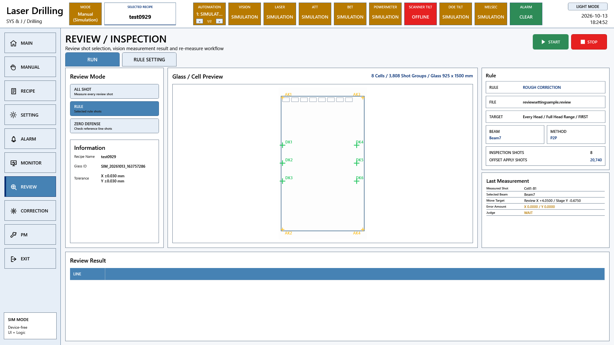

# A3 LD 제어권과 레시피 매칭 요구기능 코드 대조

원본 Commit: [0c501c104dec1cebab87bd909de29b1b1395a8b4](https://github.com/kjuws10-rgb/A3_LD_Process_SW_IPS/commit/0c501c104dec1cebab87bd909de29b1b1395a8b4)

코드 구현 확인은 현장 검수 완료를 뜻하지 않습니다. 원본 진행 현황은 그대로 보존했고, 아래 판정은 현재 C# 구현을 기준으로 별도 작성했습니다. 화면은 최신 소스의 WPF 화면을 장치 전체 Simulation 모드로 화면 밖에서 렌더링한 것입니다. 실제 장비 측정값 또는 실제 동작 완료 증거가 아닙니다.

[전체 요약](README.md) · [편집본 엑셀](A3_LD_요구기능검증_코드분석작성본.xlsx) · [검색 가능한 상세 자료](항목별_상세근거.html)

## 관련 프로그램 화면



이 화면은 해당 기능군의 UI 연결을 보여줍니다. 개별 검수 조건의 통과 증거는 아래 소스·판정·후속 확인을 함께 보아야 합니다.

## 항목 212

모니터링

- 원본 검수 항목: UVW 축 위치값 이상여부에 따라 Align 상태가 표시되는지 확인
- 원본 진행 현황: 미완료
- 현재 코드 판정: 부분 구현 또는 사양 차이

MELSEC Map의 축 위치·상태 자료는 표시할 수 있다. UVW Align 결과에 따른 전용 색상·실제 Align 판정 흐름은 현재 일반 표시와 구분된다.

### 코드 위치와 짧은 내용

[Drilling.UI/Menu/Menus/CMotorStatusPollingService.cs L10–L74](https://github.com/kjuws10-rgb/A3_LD_Process_SW_IPS/blob/0c501c104dec1cebab87bd909de29b1b1395a8b4/Drilling.UI/Menu/Menus/CMotorStatusPollingService.cs#L10-L74)

```csharp
    private static readonly (string Name, string Key)[] Axes =
        [("Stage Y", "STAGE_Y"), ("Review X", "CAMERA_X"), ("Window Y", "WINDOW_Y")];
    private readonly object _snapshotLock = new();
    private IReadOnlyList<ST_MOTOR_STATUS_ITEM> _snapshot = CreateEmptySnapshot();

    public void Start() => base.Start(1000, "MotorStatusPolling");

    public IReadOnlyList<ST_MOTOR_STATUS_ITEM> GetSnapshot()
    {
        lock (_snapshotLock)
        {
            return _snapshot;
        }
    }
```

[Drilling.Common/Station/CStationProcess.cs L682–L734](https://github.com/kjuws10-rgb/A3_LD_Process_SW_IPS/blob/0c501c104dec1cebab87bd909de29b1b1395a8b4/Drilling.Common/Station/CStationProcess.cs#L682-L734)

```csharp
    private void RunAlignStep(ST_PROCESS_MODEL processModel, CancellationToken cancellationToken)
    {
        cancellationToken.ThrowIfCancellationRequested();
        var parameters = processModel.Parameters;
        var reviewCameraAlignKeyPosX = ReadDoubleAny(parameters, 0.0, "REVIEW_CAMERA_ALIGN_KEY_POS_X");
        var reviewCameraAlignKeyPosY = ReadDoubleAny(parameters, 0.0, "REVIEW_CAMERA_ALIGN_KEY_POS_Y");
        var stageYSpeed = ReadDoubleAny(parameters, 100.0, "STAGE_SPEED");
        try
        {
            UpdateProductAlignment(processModel, EN_PRODUCT_PROCESS_STATE.Running, "RUNNING", cancellationToken);
            SendProcessControlCommand("ALIGN_REVIEW_CAMERA_MOVE", [("CAMERA_X", FormatDouble(reviewCameraAlignKeyPosX)), ("STAGE_Y", FormatDouble(reviewCameraAlignKeyPosY)), ("SPEED_Y", FormatDouble(stageYSpeed))], cancellationToken);
            UpdateProductAlignment(processModel, EN_PRODUCT_PROCESS_STATE.Completed, "OK", cancellationToken);
        }
        catch (OperationCanceledException)
```

### 남은 검증

제어권 불일치·잘못된 Recipe·미완료 이동·동작 중 모드 변경에서 실행 차단을 확인한다. 원본 검수 조건의 전 항목과 대조하고, 실제 장비 결과를 확보한 뒤 개발/검증 완료 여부를 갱신한다.

[관련 화면](screens/Review_simulation.png) · [전체 요약으로](README.md)

## 항목 213

모니터링

- 원본 검수 항목: 이동완료 코드 여부에 따라 이동상태 색상이 표시되는지 확인
- 원본 진행 현황: 미완료
- 현재 코드 판정: 부분 구현 또는 사양 차이

Scanner/일반 축 상태에는 완료·Home·Fault 등의 표시가 있다. Review의 물리 이동 함수가 TODO이므로 해당 이동 완료 색상만으로 도착을 증명할 수 없다.

### 코드 위치와 짧은 내용

[Drilling.UI/Menu/Menus/CScannerStatusPollingService.cs L9–L56](https://github.com/kjuws10-rgb/A3_LD_Process_SW_IPS/blob/0c501c104dec1cebab87bd909de29b1b1395a8b4/Drilling.UI/Menu/Menus/CScannerStatusPollingService.cs#L9-L56)

```csharp
    private static readonly TimeSpan PollInterval = TimeSpan.FromSeconds(1);
    private readonly object _snapshotLock = new();
    private IReadOnlyList<ST_SCANNER_AXIS_STATUS_ITEM> _snapshot = [];
    private IReadOnlyList<ST_SCANNER_AXIS_SETTING> _axisDefinitions = [];
    private int _selectedHeadNo = 1;
    public void SelectHead(int headNo)
    {
        var normalizedHeadNo = NormalizeHeadNo(headNo);
        lock (_snapshotLock)
        {
            if (_selectedHeadNo == normalizedHeadNo)
            {
                return;
            }
```

[Drilling.Common/Review/CReviewManager.cs L1940–L1988](https://github.com/kjuws10-rgb/A3_LD_Process_SW_IPS/blob/0c501c104dec1cebab87bd909de29b1b1395a8b4/Drilling.Common/Review/CReviewManager.cs#L1940-L1988)

```csharp
    private Task MoveStageY(
        ST_REVIEW_PLAN_POINT point,
        CancellationToken cancellationToken)
    {
        cancellationToken.ThrowIfCancellationRequested();
        var command = FormatCommand(
            "REVIEW_STAGE_Y_MOVE",
            ("SHOT_KEY", point.ShotKey),
            ("POINT", point.PointNo.ToString(CultureInfo.InvariantCulture)),
            ("HEAD", point.HeadNo.ToString(CultureInfo.InvariantCulture)),
            ("CELL", point.CellNo.ToString(CultureInfo.InvariantCulture)),
            ("SHOT", point.ShotNo.ToString(CultureInfo.InvariantCulture)),
            ("BEAM", point.BeamNo.ToString(CultureInfo.InvariantCulture)),
            ("Y", FormatDouble(point.ReviewTargetY)));
```

### 남은 검증

제어권 불일치·잘못된 Recipe·미완료 이동·동작 중 모드 변경에서 실행 차단을 확인한다. 원본 검수 조건의 전 항목과 대조하고, 실제 장비 결과를 확보한 뒤 개발/검증 완료 여부를 갱신한다.

[관련 화면](screens/Review_simulation.png) · [전체 요약으로](README.md)

## 항목 214

모니터링

- 원본 검수 항목: 구동축 제어권한 여부가 라벨로 표시되는지 확인
- 원본 진행 현황: 미완료
- 현재 코드 판정: 부분 구현 또는 사양 차이

Root는 Auto 운전 중 메뉴와 명령 접근을 제한한다. Stage 제어권을 PLC와 주고받는 ControlMode 핸드셰이크는 별도 검증해야 한다.

### 코드 위치와 짧은 내용

[Drilling.UI/CRootView.cs L41–L54](https://github.com/kjuws10-rgb/A3_LD_Process_SW_IPS/blob/0c501c104dec1cebab87bd909de29b1b1395a8b4/Drilling.UI/CRootView.cs#L41-L54)

```csharp
    private static readonly IReadOnlySet<EN_MENU> AutoModeMenus = new HashSet<EN_MENU>
    {
        EN_MENU.Main,
        EN_MENU.Alarm,
        EN_MENU.Monitor,
        EN_MENU.Pm,
        EN_MENU.Exit
    };
    private static readonly IReadOnlyList<EN_EQP_MODULE> HeaderModules = [EN_EQP_MODULE.Automation1, EN_EQP_MODULE.Vision, EN_EQP_MODULE.TalonLaser, EN_EQP_MODULE.Attenuator, EN_EQP_MODULE.Bet, EN_EQP_MODULE.PowerMeter, EN_EQP_MODULE.Motion, EN_EQP_MODULE.PicoMotor, EN_EQP_MODULE.Melsec];
    private readonly CStationManager _stationManager;
    private readonly CManager _manager;
    private readonly CInterfaceManager _interfaceManager;
    private readonly CMotionManager _motionManager;
    private readonly CAlarmManager _alarmManager;
```

[Drilling.UI/Menu/Menus/CMenuManual.cs L1248–L1335](https://github.com/kjuws10-rgb/A3_LD_Process_SW_IPS/blob/0c501c104dec1cebab87bd909de29b1b1395a8b4/Drilling.UI/Menu/Menus/CMenuManual.cs#L1248-L1335)

```csharp
    private async Task ExecuteMotionMove(string moveMode, string confirmationTitle)
    {
        var axis = SelectedStageAxis;
        if (!double.TryParse(axis.TargetPosition, NumberStyles.Float, CultureInfo.InvariantCulture, out var targetPosition))
        {
            var message = $"{axis.DisplayName} position is not a valid number: {axis.TargetPosition}";
            _setStatusMessage(message);
            ShowManualWarning(message);
            return;
        }

        if (!double.TryParse(axis.TargetSpeed, NumberStyles.Float, CultureInfo.InvariantCulture, out var targetSpeed) || targetSpeed < 0.0)
        {
            var message = $"{axis.DisplayName} speed is not a valid positive number: {axis.TargetSpeed}";
```

### 남은 검증

제어권 불일치·잘못된 Recipe·미완료 이동·동작 중 모드 변경에서 실행 차단을 확인한다. 원본 검수 조건의 전 항목과 대조하고, 실제 장비 결과를 확보한 뒤 개발/검증 완료 여부를 갱신한다.

[관련 화면](screens/Review_simulation.png) · [전체 요약으로](README.md)

## 항목 215

모니터링

- 원본 검수 항목: 현재 Y위치가 가공 시작위치 허용오차 내인지 검사해 버튼 활성화가 결정되는지 확인
- 원본 진행 현황: 미완료
- 현재 코드 판정: 부분 구현 또는 사양 차이

DOE Z 공차와 축 준비 조건은 검사한다. Stage가 시작 위치 허용 범위에 있을 때에만 수동 버튼을 활성화하는 별도 조건은 확인되지 않았다.

### 코드 위치와 짧은 내용

[Drilling.Common/Station/CStationProcess.cs L368–L482](https://github.com/kjuws10-rgb/A3_LD_Process_SW_IPS/blob/0c501c104dec1cebab87bd909de29b1b1395a8b4/Drilling.Common/Station/CStationProcess.cs#L368-L482)

```csharp
    private ST_INTERLOCK_SUMMARY AddStartAxisInterLock(ST_INTERLOCK_SUMMARY interLock, ST_PROCESS_MODEL processModel, CancellationToken cancellationToken, bool writeLog)
    {
        static bool IsError(global::Drilling.Common.InterLock.ST_INTERLOCK_ITEM item)
        {
            return item.Level == EN_INTERLOCK_LEVEL.Error;
        }

        static bool IsOk(global::Drilling.Common.InterLock.ST_INTERLOCK_ITEM item)
        {
            return item.Level == EN_INTERLOCK_LEVEL.Ok;
        }

        var targets = CreateStartAxisStatusTargets(processModel);
        var items = new List<ST_INTERLOCK_ITEM>(interLock.Items);
```

[Drilling.UI/Menu/Menus/CMenuManual.cs L1248–L1335](https://github.com/kjuws10-rgb/A3_LD_Process_SW_IPS/blob/0c501c104dec1cebab87bd909de29b1b1395a8b4/Drilling.UI/Menu/Menus/CMenuManual.cs#L1248-L1335)

```csharp
    private async Task ExecuteMotionMove(string moveMode, string confirmationTitle)
    {
        var axis = SelectedStageAxis;
        if (!double.TryParse(axis.TargetPosition, NumberStyles.Float, CultureInfo.InvariantCulture, out var targetPosition))
        {
            var message = $"{axis.DisplayName} position is not a valid number: {axis.TargetPosition}";
            _setStatusMessage(message);
            ShowManualWarning(message);
            return;
        }

        if (!double.TryParse(axis.TargetSpeed, NumberStyles.Float, CultureInfo.InvariantCulture, out var targetSpeed) || targetSpeed < 0.0)
        {
            var message = $"{axis.DisplayName} speed is not a valid positive number: {axis.TargetSpeed}";
```

### 남은 검증

제어권 불일치·잘못된 Recipe·미완료 이동·동작 중 모드 변경에서 실행 차단을 확인한다. 원본 검수 조건의 전 항목과 대조하고, 실제 장비 결과를 확보한 뒤 개발/검증 완료 여부를 갱신한다.

[관련 화면](screens/Review_simulation.png) · [전체 요약으로](README.md)

## 항목 216

모션 제어

- 원본 검수 항목: 제어권한 확인 후 좌측(-X) Jog 이동이 수행되는지 확인
- 원본 진행 현황: 미완료
- 현재 코드 판정: 부분 구현 또는 사양 차이

Scanner 상대 이동 API는 있다. Stage +X Jog의 PLC 제어권·요청 비트·연속 이동·Release Stop은 현행 위치 값 쓰기 기능과 다르다.

### 코드 위치와 짧은 내용

[Drilling.Common/Automation/CAutomationManager.cs L173–L257](https://github.com/kjuws10-rgb/A3_LD_Process_SW_IPS/blob/0c501c104dec1cebab87bd909de29b1b1395a8b4/Drilling.Common/Automation/CAutomationManager.cs#L173-L257)

```csharp
    public Task<string> Move(string axisName, double targetPosition, double velocity = 100.0, int number = 0, CancellationToken cancellationToken = default)
    {
        return ExecuteAxis(axisName, $"MOVE_ABS:{Format(targetPosition)}:{Format(velocity)}", number, cancellationToken);
    }

    public Task<string> MoveRel(string axisName, double distance, double velocity = 100.0, int number = 0, CancellationToken cancellationToken = default)
    {
        return ExecuteAxis(axisName, $"MOVE_REL:{Format(distance)}:{Format(velocity)}", number, cancellationToken);
    }

    public Task<string> Stop(string axisName, int number = 0, CancellationToken cancellationToken = default)
    {
        return ExecuteAxis(axisName, "STOP", number, cancellationToken);
    }
```

[Drilling.UI/Menu/Menus/CMenuManual.cs L1248–L1335](https://github.com/kjuws10-rgb/A3_LD_Process_SW_IPS/blob/0c501c104dec1cebab87bd909de29b1b1395a8b4/Drilling.UI/Menu/Menus/CMenuManual.cs#L1248-L1335)

```csharp
    private async Task ExecuteMotionMove(string moveMode, string confirmationTitle)
    {
        var axis = SelectedStageAxis;
        if (!double.TryParse(axis.TargetPosition, NumberStyles.Float, CultureInfo.InvariantCulture, out var targetPosition))
        {
            var message = $"{axis.DisplayName} position is not a valid number: {axis.TargetPosition}";
            _setStatusMessage(message);
            ShowManualWarning(message);
            return;
        }

        if (!double.TryParse(axis.TargetSpeed, NumberStyles.Float, CultureInfo.InvariantCulture, out var targetSpeed) || targetSpeed < 0.0)
        {
            var message = $"{axis.DisplayName} speed is not a valid positive number: {axis.TargetSpeed}";
```

### 남은 검증

제어권 불일치·잘못된 Recipe·미완료 이동·동작 중 모드 변경에서 실행 차단을 확인한다. 원본 검수 조건의 전 항목과 대조하고, 실제 장비 결과를 확보한 뒤 개발/검증 완료 여부를 갱신한다.

[관련 화면](screens/Review_simulation.png) · [전체 요약으로](README.md)

## 항목 217

모션 제어

- 원본 검수 항목: 제어권한 확인 후 우측(+X) Jog 이동이 수행되는지 확인
- 원본 진행 현황: 미완료
- 현재 코드 판정: 부분 구현 또는 사양 차이

Scanner MoveRel은 음수 거리도 전달할 수 있다. Stage -X Jog에 대한 PLC 권한과 유지형 핸드셰이크는 별도다.

### 코드 위치와 짧은 내용

[Drilling.Common/Automation/CAutomationManager.cs L173–L257](https://github.com/kjuws10-rgb/A3_LD_Process_SW_IPS/blob/0c501c104dec1cebab87bd909de29b1b1395a8b4/Drilling.Common/Automation/CAutomationManager.cs#L173-L257)

```csharp
    public Task<string> Move(string axisName, double targetPosition, double velocity = 100.0, int number = 0, CancellationToken cancellationToken = default)
    {
        return ExecuteAxis(axisName, $"MOVE_ABS:{Format(targetPosition)}:{Format(velocity)}", number, cancellationToken);
    }

    public Task<string> MoveRel(string axisName, double distance, double velocity = 100.0, int number = 0, CancellationToken cancellationToken = default)
    {
        return ExecuteAxis(axisName, $"MOVE_REL:{Format(distance)}:{Format(velocity)}", number, cancellationToken);
    }

    public Task<string> Stop(string axisName, int number = 0, CancellationToken cancellationToken = default)
    {
        return ExecuteAxis(axisName, "STOP", number, cancellationToken);
    }
```

[Drilling.UI/Menu/Menus/CMenuManual.cs L1248–L1335](https://github.com/kjuws10-rgb/A3_LD_Process_SW_IPS/blob/0c501c104dec1cebab87bd909de29b1b1395a8b4/Drilling.UI/Menu/Menus/CMenuManual.cs#L1248-L1335)

```csharp
    private async Task ExecuteMotionMove(string moveMode, string confirmationTitle)
    {
        var axis = SelectedStageAxis;
        if (!double.TryParse(axis.TargetPosition, NumberStyles.Float, CultureInfo.InvariantCulture, out var targetPosition))
        {
            var message = $"{axis.DisplayName} position is not a valid number: {axis.TargetPosition}";
            _setStatusMessage(message);
            ShowManualWarning(message);
            return;
        }

        if (!double.TryParse(axis.TargetSpeed, NumberStyles.Float, CultureInfo.InvariantCulture, out var targetSpeed) || targetSpeed < 0.0)
        {
            var message = $"{axis.DisplayName} speed is not a valid positive number: {axis.TargetSpeed}";
```

### 남은 검증

제어권 불일치·잘못된 Recipe·미완료 이동·동작 중 모드 변경에서 실행 차단을 확인한다. 원본 검수 조건의 전 항목과 대조하고, 실제 장비 결과를 확보한 뒤 개발/검증 완료 여부를 갱신한다.

[관련 화면](screens/Review_simulation.png) · [전체 요약으로](README.md)

## 항목 218

모션 제어

- 원본 검수 항목: 제어권한 확인 후 상측(+Y) Jog 이동이 수행되는지 확인
- 원본 진행 현황: 미완료
- 현재 코드 판정: 부분 구현 또는 사양 차이

StageY 목표 쓰기와 상대 목표 계산은 있다. +Y Jog를 누른 동안 움직이고 놓으면 정지하는 PLC 시퀀스는 이 기능으로 완료 판정할 수 없다.

### 코드 위치와 짧은 내용

[Drilling.UI/Menu/Menus/CMenuManual.cs L1248–L1335](https://github.com/kjuws10-rgb/A3_LD_Process_SW_IPS/blob/0c501c104dec1cebab87bd909de29b1b1395a8b4/Drilling.UI/Menu/Menus/CMenuManual.cs#L1248-L1335)

```csharp
    private async Task ExecuteMotionMove(string moveMode, string confirmationTitle)
    {
        var axis = SelectedStageAxis;
        if (!double.TryParse(axis.TargetPosition, NumberStyles.Float, CultureInfo.InvariantCulture, out var targetPosition))
        {
            var message = $"{axis.DisplayName} position is not a valid number: {axis.TargetPosition}";
            _setStatusMessage(message);
            ShowManualWarning(message);
            return;
        }

        if (!double.TryParse(axis.TargetSpeed, NumberStyles.Float, CultureInfo.InvariantCulture, out var targetSpeed) || targetSpeed < 0.0)
        {
            var message = $"{axis.DisplayName} speed is not a valid positive number: {axis.TargetSpeed}";
```

### 남은 검증

제어권 불일치·잘못된 Recipe·미완료 이동·동작 중 모드 변경에서 실행 차단을 확인한다. 원본 검수 조건의 전 항목과 대조하고, 실제 장비 결과를 확보한 뒤 개발/검증 완료 여부를 갱신한다.

[관련 화면](screens/Review_simulation.png) · [전체 요약으로](README.md)

## 항목 219

모션 제어

- 원본 검수 항목: 제어권한 확인 후 하측(-Y) Jog 이동이 수행되는지 확인
- 원본 진행 현황: 미완료
- 현재 코드 판정: 부분 구현 또는 사양 차이

Stage 상대 목표는 캐시 위치+입력 거리로 계산한다. -Y Jog의 제어권·Stop 비트·완료 처리 사양은 별도 구현 확인이 필요하다.

### 코드 위치와 짧은 내용

[Drilling.UI/Menu/Menus/CMenuManual.cs L1248–L1335](https://github.com/kjuws10-rgb/A3_LD_Process_SW_IPS/blob/0c501c104dec1cebab87bd909de29b1b1395a8b4/Drilling.UI/Menu/Menus/CMenuManual.cs#L1248-L1335)

```csharp
    private async Task ExecuteMotionMove(string moveMode, string confirmationTitle)
    {
        var axis = SelectedStageAxis;
        if (!double.TryParse(axis.TargetPosition, NumberStyles.Float, CultureInfo.InvariantCulture, out var targetPosition))
        {
            var message = $"{axis.DisplayName} position is not a valid number: {axis.TargetPosition}";
            _setStatusMessage(message);
            ShowManualWarning(message);
            return;
        }

        if (!double.TryParse(axis.TargetSpeed, NumberStyles.Float, CultureInfo.InvariantCulture, out var targetSpeed) || targetSpeed < 0.0)
        {
            var message = $"{axis.DisplayName} speed is not a valid positive number: {axis.TargetSpeed}";
```

### 남은 검증

제어권 불일치·잘못된 Recipe·미완료 이동·동작 중 모드 변경에서 실행 차단을 확인한다. 원본 검수 조건의 전 항목과 대조하고, 실제 장비 결과를 확보한 뒤 개발/검증 완료 여부를 갱신한다.

[관련 화면](screens/Review_simulation.png) · [전체 요약으로](README.md)

## 항목 220

가공 실행

- 원본 검수 항목: Recipe 적용시간과 현재시간 차이 3분 초과시 가공이 중단되는지 확인
- 원본 진행 현황: 미완료
- 현재 코드 판정: 현재 코드에서 미확인

실행 시 선택 Recipe 및 상태를 확인하고 파일·Device Timeout을 관리한다. Recipe 적용 후 3분이 지나면 실행을 막는 전용 시간 조건은 확인되지 않았다.

### 코드 위치와 짧은 내용

[Drilling.UI/Menu/Menus/CMenuReview.cs L2123–L2275](https://github.com/kjuws10-rgb/A3_LD_Process_SW_IPS/blob/0c501c104dec1cebab87bd909de29b1b1395a8b4/Drilling.UI/Menu/Menus/CMenuReview.cs#L2123-L2275)

```csharp
    private async Task StartReviewSequence()
    {
        if (IsSampleSelectTab)
        {
            _statusReporter("Rule Setting is for configuring review shots. Start Review from the Run tab.");
            return;
        }

        if (IsReviewExecutionActive)
        {
            _statusReporter("Review sequence is already running. Stop it before starting another review.");
            return;
        }

```

[Drilling.UI/Menu/Menus/CMenuManual.cs L3216–L3315](https://github.com/kjuws10-rgb/A3_LD_Process_SW_IPS/blob/0c501c104dec1cebab87bd909de29b1b1395a8b4/Drilling.UI/Menu/Menus/CMenuManual.cs#L3216-L3315)

```csharp
    private async Task RunManualScript(string commandName, Action<CAutomation1ScriptBase, ST_MANUAL_SCAN_PARAM> buildScript, Action<CAutomation1ScriptBase, ST_MANUAL_SCAN_PARAM>? setupScript = null, string? scriptFileName = null, CancellationToken cancellationToken = default)
    {
        if (TryBlockManualAutomationCommand(commandName))
        {
            return;
        }

        CancelStatusPolling();
        _lastCommand = commandName;
        _lastResult = "Building";

        if (!_manager.automation.IsSimul() && !_manager.automation.IsConnect())
        {
            _lastResult = "ERROR: OFFLINE";
```

미확인은 해당 이름·동작·호출 관계를 현행 자료와 대조해 확정하지 못했다는 뜻입니다. 링크는 가장 가까운 현재 기능이며, 존재하지 않는 함수를 있다고 추정한 근거가 아닙니다.

### 남은 검증

제어권 불일치·잘못된 Recipe·미완료 이동·동작 중 모드 변경에서 실행 차단을 확인한다. 원본 검수 조건의 전 항목과 대조하고, 실제 장비 결과를 확보한 뒤 개발/검증 완료 여부를 갱신한다.

[관련 화면](screens/Review_simulation.png) · [전체 요약으로](README.md)

## 항목 221

가공 실행

- 원본 검수 항목: 인터락 발생시 가공이 중단되는지 확인
- 원본 진행 현황: 미완료
- 현재 코드 판정: 부분 구현 또는 사양 차이

Station은 AutoRun 인터록을 검사하고 Stop은 Laser Safe 복귀를 수행한다. Manual 가공의 모든 Door/MaintZ 조건은 AutoRunning 차단과 동일하지 않아 별도 추적이 필요하다.

### 코드 위치와 짧은 내용

[Drilling.Common/InterLock/CInterLockManager.cs L34–L85](https://github.com/kjuws10-rgb/A3_LD_Process_SW_IPS/blob/0c501c104dec1cebab87bd909de29b1b1395a8b4/Drilling.Common/InterLock/CInterLockManager.cs#L34-L85)

```csharp
    private static readonly IReadOnlyList<ST_INTERLOCK_RULE> Rules = [Rule("Door", "DOOR_LOCK_SENSOR", true, "Closed", "Door is open", EN_INTERLOCK_LEVEL.Error, EN_INTERLOCK_TARGET.AutoRun | EN_INTERLOCK_TARGET.ManualMove | EN_INTERLOCK_TARGET.LaserOn), Rule("EMS", "EMS", true, "Normal", "Emergency stop is active", EN_INTERLOCK_LEVEL.Error, EN_INTERLOCK_TARGET.AutoRun | EN_INTERLOCK_TARGET.ManualMove | EN_INTERLOCK_TARGET.LaserOn), Rule("Key Switch", "KEY_SWITCH_AUTO", true, "AUTO", "Key switch is not AUTO", EN_INTERLOCK_LEVEL.Warn, EN_INTERLOCK_TARGET.AutoRun), Rule("Laser Shutter", "LASER_SHUTTER_CLOSED", true, "SAFE", "Laser shutter is not closed", EN_INTERLOCK_LEVEL.Warn, EN_INTERLOCK_TARGET.LaserOn), Rule("Leak Sensor", "LEAK_SENSOR", true, "OK", "Leak sensor is active", EN_INTERLOCK_LEVEL.Error, EN_INTERLOCK_TARGET.AutoRun | EN_INTERLOCK_TARGET.LaserOn), Rule("Smoke Temp", "SMOKE_TEMP", true, "OK", "Smoke or over temperature input is active", EN_INTERLOCK_LEVEL.Error, EN_INTERLOCK_TARGET.AutoRun | EN_INTERLOCK_TARGET.LaserOn), Rule("PM Lock", "PM_LOCK", true, "READY", "PM lock is active", EN_INTERLOCK_LEVEL.Error, EN_INTERLOCK_TARGET.AutoRun | EN_INTERLOCK_TARGET.ManualMove | EN_INTERLOCK_TARGET.LaserOn), Rule("Scanner Ready", "SCANNER_READY", true, "READY", "Scanner ready signal is off", EN_INTERLOCK_LEVEL.Warn, EN_INTERLOCK_TARGET.AutoRun), Rule("Vision Ready", "VISION_READY", true, "READY", "Vision ready signal is off", EN_INTERLOCK_LEVEL.Warn, EN_INTERLOCK_TARGET.AutoRun), Rule("Panel In Position", "PANEL_IN_POSITION", true, "OK", "Panel is not in position", EN_INTERLOCK_LEVEL.Warn, EN_INTERLOCK_TARGET.AutoRun), Rule("Vacuum Check", "VACUUM_CHECK", true, "OK", "Vacuum check is off", EN_INTERLOCK_LEVEL.Warn, EN_INTERLOCK_TARGET.AutoRun)];
    public ST_INTERLOCK_SUMMARY Evaluate(ST_DEVICE_STATUS status)
    {
        global::Drilling.Common.InterLock.CInterLockManager.ST_INTERLOCK_CHECK EvaluateInterlockRule(global::Drilling.Common.InterLock.ST_INTERLOCK_RULE rule)
        {
            return EvaluateRule(rule, status);
        }

        ST_INTERLOCK_CHECK[] checks = status.Io.Count == 0 ? [] : Rules.Select(EvaluateInterlockRule).ToArray();
        global::Drilling.Common.InterLock.ST_INTERLOCK_ITEM SelectInterlockItem(global::Drilling.Common.InterLock.CInterLockManager.ST_INTERLOCK_CHECK check)
        {
            return check.Item with
            {
                BlocksAutoRun = !check.IsOk && check.Rule.Targets.HasFlag(EN_INTERLOCK_TARGET.AutoRun)
```

[Drilling.Common/Station/CStationProcess.cs L368–L482](https://github.com/kjuws10-rgb/A3_LD_Process_SW_IPS/blob/0c501c104dec1cebab87bd909de29b1b1395a8b4/Drilling.Common/Station/CStationProcess.cs#L368-L482)

```csharp
    private ST_INTERLOCK_SUMMARY AddStartAxisInterLock(ST_INTERLOCK_SUMMARY interLock, ST_PROCESS_MODEL processModel, CancellationToken cancellationToken, bool writeLog)
    {
        static bool IsError(global::Drilling.Common.InterLock.ST_INTERLOCK_ITEM item)
        {
            return item.Level == EN_INTERLOCK_LEVEL.Error;
        }

        static bool IsOk(global::Drilling.Common.InterLock.ST_INTERLOCK_ITEM item)
        {
            return item.Level == EN_INTERLOCK_LEVEL.Ok;
        }

        var targets = CreateStartAxisStatusTargets(processModel);
        var items = new List<ST_INTERLOCK_ITEM>(interLock.Items);
```

[Drilling.UI/Menu/Menus/CMenuManual.cs L3433–L3460](https://github.com/kjuws10-rgb/A3_LD_Process_SW_IPS/blob/0c501c104dec1cebab87bd909de29b1b1395a8b4/Drilling.UI/Menu/Menus/CMenuManual.cs#L3433-L3460)

```csharp
    private bool TryBlockManualAutomationCommand(string commandName)
    {
        if (!IsAutoProcessRunning())
        {
            return false;
        }

        var message = "Auto process is running. Manual Automation1 command is blocked.";
        _lastCommand = commandName;
        _lastResult = message;
        RefreshCommandStateRows();
        _setStatusMessage(message);
        _refreshShellStatus();
        return true;
```

### 남은 검증

제어권 불일치·잘못된 Recipe·미완료 이동·동작 중 모드 변경에서 실행 차단을 확인한다. 원본 검수 조건의 전 항목과 대조하고, 실제 장비 결과를 확보한 뒤 개발/검증 완료 여부를 갱신한다.

[관련 화면](screens/Review_simulation.png) · [전체 요약으로](README.md)

## 항목 222

가공 실행

- 원본 검수 항목: Stage 위치가 가공 시작위치가 아니면 경고 후 중단되는지 확인
- 원본 진행 현황: 미완료
- 현재 코드 판정: 현재 코드에서 미확인

Stage 시작 이동 함수는 있지만 RunProcessStep에서 호출이 주석 처리돼 있다. 시작점 오류를 확인하고 수동 가공을 차단하는 완전한 흐름은 확인되지 않았다.

### 코드 위치와 짧은 내용

[Drilling.Common/Station/CStationProcess.cs L1068–L1091](https://github.com/kjuws10-rgb/A3_LD_Process_SW_IPS/blob/0c501c104dec1cebab87bd909de29b1b1395a8b4/Drilling.Common/Station/CStationProcess.cs#L1068-L1091)

```csharp
    private void MoveStageToScanStart(ST_PROCESS_MODEL processModel, CancellationToken cancellationToken)
    {
        cancellationToken.ThrowIfCancellationRequested();
        var parameters = processModel.Parameters;
        var startX = ReadDoubleAny(parameters, 0.0, "STAGE_START_POS_X");
        var startY = ReadDoubleAny(parameters, 0.0, "STAGE_START_POS_Y");
        var reviewCameraAlignKeyPosX = ReadDoubleAny(parameters, 0.0, "REVIEW_CAMERA_ALIGN_KEY_POS_X");
        var reviewCameraAlignKeyPosY = ReadDoubleAny(parameters, startY, "REVIEW_CAMERA_ALIGN_KEY_POS_Y");
        var reviewToHead1GapY = ReadDoubleAny(parameters, 0.0, "REVIEW_TO_HEAD1_GAP_Y");
        var headGapY = ReadDoubleAny(parameters, 0.0, "HeadGapY");
        var head1AlignKeyY = reviewCameraAlignKeyPosY + reviewToHead1GapY;
        var head2AlignKeyY = head1AlignKeyY + headGapY;
        var delayLengthY = Math.Abs(ReadDoubleAny(parameters, 0.0, "SCAN_START_DELAY_LENGTH_Y"));
        var stageScanDirectionY = ReadDirectionAny(parameters, -1.0, "STAGE_SCAN_DIRECTION_Y");
```

[Drilling.Common/Station/CStationProcess.cs L1059–L1070](https://github.com/kjuws10-rgb/A3_LD_Process_SW_IPS/blob/0c501c104dec1cebab87bd909de29b1b1395a8b4/Drilling.Common/Station/CStationProcess.cs#L1059-L1070)

```csharp
    private void RunProcessStep(ST_PROCESS_MODEL processModel, CancellationToken cancellationToken)
    {
        BuildAutomationScript(processModel, cancellationToken);
        UploadAutomationScript(processModel, cancellationToken);
        //test [원본 손상 문자]Ⱓ[원본 손상 문자][원본 손상 문자][원본 손상 문자][원본 손상 문자] [원본 손상 문자]ӽ[원본 손상 문자] [원본 손상 문자]ּ[원본 손상 문자]
        //MoveStageToScanStart(processModel, cancellationToken);
        RunScannerProcess(processModel, cancellationToken);
    }

    private void MoveStageToScanStart(ST_PROCESS_MODEL processModel, CancellationToken cancellationToken)
    {
        cancellationToken.ThrowIfCancellationRequested();
```

[Drilling.UI/Menu/Menus/CMenuManual.cs L3216–L3315](https://github.com/kjuws10-rgb/A3_LD_Process_SW_IPS/blob/0c501c104dec1cebab87bd909de29b1b1395a8b4/Drilling.UI/Menu/Menus/CMenuManual.cs#L3216-L3315)

```csharp
    private async Task RunManualScript(string commandName, Action<CAutomation1ScriptBase, ST_MANUAL_SCAN_PARAM> buildScript, Action<CAutomation1ScriptBase, ST_MANUAL_SCAN_PARAM>? setupScript = null, string? scriptFileName = null, CancellationToken cancellationToken = default)
    {
        if (TryBlockManualAutomationCommand(commandName))
        {
            return;
        }

        CancelStatusPolling();
        _lastCommand = commandName;
        _lastResult = "Building";

        if (!_manager.automation.IsSimul() && !_manager.automation.IsConnect())
        {
            _lastResult = "ERROR: OFFLINE";
```

미확인은 해당 이름·동작·호출 관계를 현행 자료와 대조해 확정하지 못했다는 뜻입니다. 링크는 가장 가까운 현재 기능이며, 존재하지 않는 함수를 있다고 추정한 근거가 아닙니다.

### 남은 검증

제어권 불일치·잘못된 Recipe·미완료 이동·동작 중 모드 변경에서 실행 차단을 확인한다. 원본 검수 조건의 전 항목과 대조하고, 실제 장비 결과를 확보한 뒤 개발/검증 완료 여부를 갱신한다.

[관련 화면](screens/Review_simulation.png) · [전체 요약으로](README.md)

## 항목 223

가공 실행

- 원본 검수 항목: 선택 Head에 대해 PGM 생성/이동/가공이 순차 수행되는지 확인
- 원본 진행 현황: 완료
- 현재 코드 판정: 부분 구현 또는 사양 차이

사용 Head별 .ascript를 생성하고 업로드·Task 실행·완료 확인을 한다. Stage 시작·동기 이동 호출이 비활성화되어 전체 MOF 가공 시퀀스 검증이 남는다.

### 코드 위치와 짧은 내용

[Drilling.Common/Station/CStationProcess.cs L1059–L1070](https://github.com/kjuws10-rgb/A3_LD_Process_SW_IPS/blob/0c501c104dec1cebab87bd909de29b1b1395a8b4/Drilling.Common/Station/CStationProcess.cs#L1059-L1070)

```csharp
    private void RunProcessStep(ST_PROCESS_MODEL processModel, CancellationToken cancellationToken)
    {
        BuildAutomationScript(processModel, cancellationToken);
        UploadAutomationScript(processModel, cancellationToken);
        //test [원본 손상 문자]Ⱓ[원본 손상 문자][원본 손상 문자][원본 손상 문자][원본 손상 문자] [원본 손상 문자]ӽ[원본 손상 문자] [원본 손상 문자]ּ[원본 손상 문자]
        //MoveStageToScanStart(processModel, cancellationToken);
        RunScannerProcess(processModel, cancellationToken);
    }

    private void MoveStageToScanStart(ST_PROCESS_MODEL processModel, CancellationToken cancellationToken)
    {
        cancellationToken.ThrowIfCancellationRequested();
```

[Drilling.Common/Station/CStationProcess.cs L1169–L1253](https://github.com/kjuws10-rgb/A3_LD_Process_SW_IPS/blob/0c501c104dec1cebab87bd909de29b1b1395a8b4/Drilling.Common/Station/CStationProcess.cs#L1169-L1253)

```csharp
    private void RunScannerProcess(ST_PROCESS_MODEL processModel, CancellationToken cancellationToken)
    {
        SetStationState(EN_STATION_STATE.Process, EN_PROCESS_STEP.Process, EN_SCRIPT_STATUS.Running, $"Scanner run started. Process: {processModel.ProcessId}");
        _scriptStartedAt = DateTimeOffset.Now;
        var runningPreview = SetHeadStatus(_snapshot.HeadPreviews, EN_PROCESS_STEP.Process);
        _statistics = BuildStatistics(processModel, 56.3, TimeSpan.FromSeconds(45));
        if (_lastScript is null)
        {
            throw new InvalidOperationException("Automation script is not built.");
        }

        bool ShouldIncludeItem(global::Drilling.Common.Station.ST_HEAD_SCRIPT_RESULT script)
        {
            return script.TotalShots > 0;
```

[Drilling.File/Script/CAutomation1ScriptFile.cs L252–L421](https://github.com/kjuws10-rgb/A3_LD_Process_SW_IPS/blob/0c501c104dec1cebab87bd909de29b1b1395a8b4/Drilling.File/Script/CAutomation1ScriptFile.cs#L252-L421)

```csharp
    private static IReadOnlyList<string> BuildHeadLines(ST_PROCESS_MODEL processModel, ST_HEAD_PROCESS_PLAN head, DateTimeOffset createdAt, bool bufferedRun)
    {
        var lines = new List<string>();
        var common = new Dictionary<string, string>(processModel.Parameters, StringComparer.OrdinalIgnoreCase);
        var simulatorMode = ReadBool(common, false, Automation1SimulatorUseKey);
        var xAxis = ReadText(common, "GX", CreateHeadKeys(head.HeadNo, "X_AXIS"));
        xAxis = ValidateAeroScriptAxisName("X_AXIS", xAxis);
        var yAxis = ReadText(common, "GY", CreateHeadKeys(head.HeadNo, "Y_AXIS"));
        yAxis = ValidateAeroScriptAxisName("Y_AXIS", yAxis);
        var laserAxis = ReadText(common, xAxis, CreateHeadKeys(head.HeadNo, "LASER_AXIS"));
        if (!simulatorMode)
        {
            laserAxis = ValidateAeroScriptAxisName("LASER_AXIS", laserAxis);
        }
```

### 남은 검증

제어권 불일치·잘못된 Recipe·미완료 이동·동작 중 모드 변경에서 실행 차단을 확인한다. 원본 검수 조건의 전 항목과 대조하고, 실제 장비 결과를 확보한 뒤 개발/검증 완료 여부를 갱신한다.

[관련 화면](screens/Review_simulation.png) · [전체 요약으로](README.md)

## 항목 224

Head 선택

- 원본 검수 항목: 가공 시작 전 최신 Head 선택상태가 가공 대상에 반영되는지 확인
- 원본 진행 현황: 완료
- 현재 코드 판정: 코드 구현 확인

수동 명령과 가공 자료 준비는 사용 Head·축 설정을 다시 읽는다. 화면의 과거 선택값만으로 비활성 Head를 실행하지 않도록 검사한다.

### 코드 위치와 짧은 내용

[Drilling.UI/Menu/Menus/CMenuManual.cs L3944–L3978](https://github.com/kjuws10-rgb/A3_LD_Process_SW_IPS/blob/0c501c104dec1cebab87bd909de29b1b1395a8b4/Drilling.UI/Menu/Menus/CMenuManual.cs#L3944-L3978)

```csharp
    private int ReadEnabledManualScannerHeadNo(CancellationToken cancellationToken)
    {
        var optionSettings = _manager.Setting().LoadSection(EN_SETTING_TAB.Option, cancellationToken);
        var enabledHeadNos = CScannerStatusPollingService.BuildEnabledHeadNumbers(optionSettings);
        if (enabledHeadNos.Count == 0)
        {
            throw new InvalidOperationException("No manual scanner head is enabled. Check Hxx_USE option settings.");
        }

        var selectedHeadNo = Math.Clamp(_selectedHeadNoProvider(), 1, 8);
        return enabledHeadNos.Contains(selectedHeadNo) ? selectedHeadNo : enabledHeadNos[0];
    }

    private static int ReadManualHeadAutomationNo(IReadOnlyList<ST_SYSTEM_PARAMETER> settings, int headNo)
```

[Drilling.Common/Station/CStationProcess.cs L2051–L2115](https://github.com/kjuws10-rgb/A3_LD_Process_SW_IPS/blob/0c501c104dec1cebab87bd909de29b1b1395a8b4/Drilling.Common/Station/CStationProcess.cs#L2051-L2115)

```csharp
    private static ST_PROCESS_MODEL BuildProcessModel(string processId, string recipeId, string glassId, string lotId, IReadOnlyDictionary<string, string> sourceParameters)
    {
        var parameters = new Dictionary<string, string>(sourceParameters, StringComparer.OrdinalIgnoreCase);
        var coordinatePlan = CShotCoordinatePlanBuilder.Build(parameters);
        var shotMaskingPlan = CRecipeShotMaskingPlan.Build(parameters);
        var processShots = coordinatePlan.Shots
            .Where(shot => !shotMaskingPlan.EvaluateShot(shot).IsChessSkipped)
            .Select((shot, index) => shot with { SequenceNo = index + 1 })
            .ToArray();
        var defaultMarkSpeed = ReadDoubleAny(parameters, 900.0, "SCANNER_MARK_SPEED");
        var defaultJumpSpeed = ReadDoubleAny(parameters, 1500.0, "SCANNER_JUMP_SPEED");
        int SelectHeadNo(global::Drilling.Common.Recipe.ST_HEAD_SHOT_POINT shot)
        {
            return shot.HeadNo;
```

### 남은 검증

제어권 불일치·잘못된 Recipe·미완료 이동·동작 중 모드 변경에서 실행 차단을 확인한다. 원본 검수 조건의 전 항목과 대조하고, 실제 장비 결과를 확보한 뒤 개발/검증 완료 여부를 갱신한다.

[관련 화면](screens/Review_simulation.png) · [전체 요약으로](README.md)

## 항목 225

Head 선택

- 원본 검수 항목: 전달된 Head 선택 배열에 따라 선택 Head만 가공 대상으로 처리되는지 확인
- 원본 진행 현황: 완료
- 현재 코드 판정: 코드 구현 확인

가공 Plan은 활성 Head 집합을 적용해 해당 Head에 배정된 Shot을 남긴다. Head별 Script Task 번호·컨트롤러 번호는 추가 검증 대상이다.

### 코드 위치와 짧은 내용

[Drilling.Common/Recipe/CShotCoordinatePlanBuilder.cs L12–L146](https://github.com/kjuws10-rgb/A3_LD_Process_SW_IPS/blob/0c501c104dec1cebab87bd909de29b1b1395a8b4/Drilling.Common/Recipe/CShotCoordinatePlanBuilder.cs#L12-L146)

```csharp
    public static ST_SHOT_COORDINATE_PLAN Build(IReadOnlyDictionary<string, string> parameters)
    {
        ArgumentNullException.ThrowIfNull(parameters);
        var headCount = Math.Clamp(ReadInt(parameters, 8, "HEAD_COUNT"), 1, 8);
        var cellCount = ReadInt(parameters, 0, "MAX_CELL_NUMBER");
        if (cellCount < CCellPatternCalculator.MinCellCount)
        {
            throw new InvalidOperationException($"MAX_CELL_NUMBER must be greater than or equal to {CCellPatternCalculator.MinCellCount}. Current value: {cellCount}");
        }

        var activeHeadNos = BuildActiveHeadNumbers(parameters, headCount);
        var activeHeadSet = activeHeadNos.ToHashSet();
        var assignmentHeadNos = Enumerable.Range(1, headCount).ToArray();
        var glassSizeX = ReadDouble(parameters, 0.0, "GLASS_SIZE_X");
```

[Drilling.Common/Station/CStationProcess.cs L2051–L2115](https://github.com/kjuws10-rgb/A3_LD_Process_SW_IPS/blob/0c501c104dec1cebab87bd909de29b1b1395a8b4/Drilling.Common/Station/CStationProcess.cs#L2051-L2115)

```csharp
    private static ST_PROCESS_MODEL BuildProcessModel(string processId, string recipeId, string glassId, string lotId, IReadOnlyDictionary<string, string> sourceParameters)
    {
        var parameters = new Dictionary<string, string>(sourceParameters, StringComparer.OrdinalIgnoreCase);
        var coordinatePlan = CShotCoordinatePlanBuilder.Build(parameters);
        var shotMaskingPlan = CRecipeShotMaskingPlan.Build(parameters);
        var processShots = coordinatePlan.Shots
            .Where(shot => !shotMaskingPlan.EvaluateShot(shot).IsChessSkipped)
            .Select((shot, index) => shot with { SequenceNo = index + 1 })
            .ToArray();
        var defaultMarkSpeed = ReadDoubleAny(parameters, 900.0, "SCANNER_MARK_SPEED");
        var defaultJumpSpeed = ReadDoubleAny(parameters, 1500.0, "SCANNER_JUMP_SPEED");
        int SelectHeadNo(global::Drilling.Common.Recipe.ST_HEAD_SHOT_POINT shot)
        {
            return shot.HeadNo;
```

[Drilling.File/Script/CAutomation1ScriptFile.cs L626–L687](https://github.com/kjuws10-rgb/A3_LD_Process_SW_IPS/blob/0c501c104dec1cebab87bd909de29b1b1395a8b4/Drilling.File/Script/CAutomation1ScriptFile.cs#L626-L687)

```csharp
    private static void ValidateActiveHeads(IReadOnlyList<ST_HEAD_PROCESS_PLAN> activeHeads)
    {
        int SelectHeadNo(global::Drilling.Common.Station.ST_HEAD_PROCESS_PLAN head)
        {
            return head.HeadNo;
        }

        bool ShouldIncludeItem(global::System.Linq.IGrouping<int, global::Drilling.Common.Station.ST_HEAD_PROCESS_PLAN> group)
        {
            return group.Count() > 1;
        }

        int SelectKey(global::System.Linq.IGrouping<int, global::Drilling.Common.Station.ST_HEAD_PROCESS_PLAN> group)
        {
```

### 남은 검증

제어권 불일치·잘못된 Recipe·미완료 이동·동작 중 모드 변경에서 실행 차단을 확인한다. 원본 검수 조건의 전 항목과 대조하고, 실제 장비 결과를 확보한 뒤 개발/검증 완료 여부를 갱신한다.

[관련 화면](screens/Review_simulation.png) · [전체 요약으로](README.md)

## 항목 226

Head 선택

- 원본 검수 항목: 전체 선택 버튼 클릭시 시퀀스 로그가 기록되는지 확인
- 원본 진행 현황: 완료
- 현재 코드 판정: 부분 구현 또는 사양 차이

Root는 Head별 Preview 선택 집합을 토글한다. SelectAll 행위별 전용 기록 형식은 현재 일반 UI 로그와 별도 검증해야 한다.

### 코드 위치와 짧은 내용

[Drilling.UI/CRootView.cs L1826–L1875](https://github.com/kjuws10-rgb/A3_LD_Process_SW_IPS/blob/0c501c104dec1cebab87bd909de29b1b1395a8b4/Drilling.UI/CRootView.cs#L1826-L1875)

```csharp
    private async Task TogglePreviewHead(object? parameter)
    {
        if (parameter is string action)
        {
            if (action.Equals("ALL", StringComparison.OrdinalIgnoreCase))
            {
                _selectedPreviewHeadNos.Clear();
                foreach (var head in CurrentScreen.MainOperating?.HeadPreviews ?? [])
                {
                    if (head.IsEnabled)
                    {
                        _selectedPreviewHeadNos.Add(head.HeadNo);
                    }
                }
```

[Drilling.Common/Log/CLogManager.cs L13–L60](https://github.com/kjuws10-rgb/A3_LD_Process_SW_IPS/blob/0c501c104dec1cebab87bd909de29b1b1395a8b4/Drilling.Common/Log/CLogManager.cs#L13-L60)

```csharp
    private const int DefaultReadDays = 14;
    private const int DefaultRecipeReadRows = 10;
    private const int DefaultSettingReadRows = 20;
    private const int DefaultInterfaceReadRows = 100;
    private static readonly object FileLock = new();
    private readonly string _recipeLogRoot;
    private readonly string _settingLogRoot;
    private readonly string _interfaceLogRoot;
    private readonly string _stationLogRoot;
    private readonly string _productLogRoot;
    private readonly string _uiLogRoot;
    public CLogManager(string configRoot)
    {
        var root = Directory.GetParent(configRoot)?.FullName ?? configRoot;
```

### 남은 검증

제어권 불일치·잘못된 Recipe·미완료 이동·동작 중 모드 변경에서 실행 차단을 확인한다. 원본 검수 조건의 전 항목과 대조하고, 실제 장비 결과를 확보한 뒤 개발/검증 완료 여부를 갱신한다.

[관련 화면](screens/Review_simulation.png) · [전체 요약으로](README.md)

## 항목 227

Head 선택

- 원본 검수 항목: 선택된 Head의 실시간 Task상태로 라벨 색상이 자동 갱신되는지 확인
- 원본 진행 현황: 완료 (TASK 상태 모니터링 완료 / 라벨 색상 변경 작업 필요)
- 현재 코드 판정: 부분 구현 또는 사양 차이

ReadTaskStatus/ReadTaskLineStatus로 Task 진행을 읽는다. 구형 특정 색상 분기와 실제 Busy·Done·Error 상태 매핑은 화면을 대조해야 한다.

### 코드 위치와 짧은 내용

[Drilling.Common/Automation/CAutomationManager.cs L307–L328](https://github.com/kjuws10-rgb/A3_LD_Process_SW_IPS/blob/0c501c104dec1cebab87bd909de29b1b1395a8b4/Drilling.Common/Automation/CAutomationManager.cs#L307-L328)

```csharp
    public async Task<string> RunScriptIfIdle(string scriptFileName, int taskIndex = 1, int number = 0, CancellationToken cancellationToken = default)
    {
        ArgumentException.ThrowIfNullOrWhiteSpace(scriptFileName);
        ValidateTaskIndex(taskIndex);
        var controllerFileName = CreateControllerFileName(scriptFileName, cancellationToken);
        if (IsSimul(number)) return CreateSimulationTaskStatus(taskIndex, "Idle", controllerFileName);
        return await ExecuteRaw($"AUTOMATION1:SCRIPT|RUN_IF_IDLE|{taskIndex}|{controllerFileName}", number, cancellationToken);
    }

    public async Task<string> RunBufferedScript(string localScriptPath, string scriptFileName = "", int taskIndex = 1, int number = 0, int queueSize = 100, int linesPerCommand = 1000, int timeoutMs = 600000, CancellationToken cancellationToken = default)
    {
        return await RunBufferedScripts([new ST_BUFFERED_SCRIPT_RUN_ITEM(localScriptPath, scriptFileName, taskIndex)], number, queueSize, linesPerCommand, timeoutMs, cancellationToken);
    }

```

[Drilling.UI/Menu/Menus/CMenuManual.cs L1101–L1165](https://github.com/kjuws10-rgb/A3_LD_Process_SW_IPS/blob/0c501c104dec1cebab87bd909de29b1b1395a8b4/Drilling.UI/Menu/Menus/CMenuManual.cs#L1101-L1165)

```csharp
    public override async Task<CScreenViewModel> Build(CancellationToken cancellationToken = default)
    {
        var settingNames = await _scanFile.List(cancellationToken);
        var orderedSettingNames = OrderSettingNames(settingNames);
        var formItems = await _scanFile.LoadForm(cancellationToken);
        var selectedSettingName = ResolveSelectedSettingName(orderedSettingNames, _selectedSettingNameProvider());
        var settings = await _scanFile.Load(selectedSettingName, cancellationToken);
        SyncSettingFilesPage(orderedSettingNames, selectedSettingName);
        var selectedHeadNoRaw = _selectedHeadNoProvider();
        var optionSettings = _manager.Setting().LoadSection(EN_SETTING_TAB.Option, cancellationToken);
        _manualScannerOptionSettings = optionSettings;
        var selectedHeadNo = NormalizeManualScannerHeadNo(optionSettings, Math.Clamp(selectedHeadNoRaw, 1, 8));
        var scannerAxes = ReadManualScannerAxesSnapshot(optionSettings, selectedHeadNo);
        var headCards = BuildHeadCards(selectedHeadNo, optionSettings, scannerAxes);
```

### 남은 검증

제어권 불일치·잘못된 Recipe·미완료 이동·동작 중 모드 변경에서 실행 차단을 확인한다. 원본 검수 조건의 전 항목과 대조하고, 실제 장비 결과를 확보한 뒤 개발/검증 완료 여부를 갱신한다.

[관련 화면](screens/Review_simulation.png) · [전체 요약으로](README.md)

## 항목 228

매칭 관리

- 원본 검수 항목: 매칭 리스트의 RECIPE 셀 클릭 시 콤보박스 편집모드가 시작되고 드롭다운이 자동으로 펼쳐지는지 확인
- 원본 진행 현황: 완료
- 현재 코드 판정: 현재 코드에서 미확인

Recipe 파일 선택 콤보·목록은 있지만 상위 PPID 매핑 테이블의 LocalRecipe 셀 드롭다운은 확인되지 않았다.

### 코드 위치와 짧은 내용

[Drilling.UI/Menu/Menus/CMenuRecipe.cs L535–L626](https://github.com/kjuws10-rgb/A3_LD_Process_SW_IPS/blob/0c501c104dec1cebab87bd909de29b1b1395a8b4/Drilling.UI/Menu/Menus/CMenuRecipe.cs#L535-L626)

```csharp
    public override async Task<CScreenViewModel> Build(CancellationToken cancellationToken = default)
    {
        var recipes = await _recipeManager.LoadRecipes(cancellationToken);
        var optionSettings = _settingManager.LoadSection(EN_SETTING_TAB.Option, cancellationToken);
        var selectRecipe = GetSelectedRecipe(recipes, _selectRecipeIdProvider());
        var selectRecipeId = selectRecipe?.Id ?? NormalizeRecipeIdInput(_selectRecipeIdProvider());
        var viewRecipeId = NormalizeRecipeIdInput(_viewRecipeIdProvider());
        if (string.IsNullOrWhiteSpace(viewRecipeId))
        {
            viewRecipeId = selectRecipeId;
            _viewRecipeIdSetter(viewRecipeId);
        }

        var recipe = GetSelectedRecipe(recipes, viewRecipeId);
```

[Drilling.File/JHMI/CJhmiRecipeFile.cs L95–L189](https://github.com/kjuws10-rgb/A3_LD_Process_SW_IPS/blob/0c501c104dec1cebab87bd909de29b1b1395a8b4/Drilling.File/JHMI/CJhmiRecipeFile.cs#L95-L189)

```csharp
    private void SaveCore(ST_RECIPE_DEFINITION recipe, CancellationToken cancellationToken)
    {
        cancellationToken.ThrowIfCancellationRequested();
        Directory.CreateDirectory(_recipeDirectory);
        var formItems = LoadFormItems();
        var recipePath = GetRecipePath(recipe.Id);
        var recipeExists = System.IO.File.Exists(recipePath);
        string SelectGroupKey(global::Drilling.Common.Managers.ST_RECIPE_VALUE item)
        {
            return CreateKey(item.Tab, item.Name);
        }

        string SelectKey(global::System.Linq.IGrouping<string, global::Drilling.Common.Managers.ST_RECIPE_VALUE> group)
        {
```

미확인은 해당 이름·동작·호출 관계를 현행 자료와 대조해 확정하지 못했다는 뜻입니다. 링크는 가장 가까운 현재 기능이며, 존재하지 않는 함수를 있다고 추정한 근거가 아닙니다.

### 남은 검증

제어권 불일치·잘못된 Recipe·미완료 이동·동작 중 모드 변경에서 실행 차단을 확인한다. 원본 검수 조건의 전 항목과 대조하고, 실제 장비 결과를 확보한 뒤 개발/검증 완료 여부를 갱신한다.

[관련 화면](screens/Review_simulation.png) · [전체 요약으로](README.md)

## 항목 229

매칭 관리

- 원본 검수 항목: 동일한 행을 여러 번 수정해도 modifyRowNumber 목록에 중복 추가되지 않는지 확인
- 원본 진행 현황: 내용 확인 필요
- 현재 코드 판정: 현재 코드에서 미확인

Recipe 파일 ID 중복 검사와 Match Table 행의 중복 키 검사는 다른 기능이다. 후자의 전용 수정 흐름은 확인되지 않았다.

### 코드 위치와 짧은 내용

[Drilling.UI/Menu/Menus/CMenuRecipe.cs L2929–L2986](https://github.com/kjuws10-rgb/A3_LD_Process_SW_IPS/blob/0c501c104dec1cebab87bd909de29b1b1395a8b4/Drilling.UI/Menu/Menus/CMenuRecipe.cs#L2929-L2986)

```csharp
    private static string ValidateRecipeId(string recipeId, IReadOnlyList<ST_RECIPE_DEFINITION> recipes, string currentRecipeId = "")
    {
        if (string.IsNullOrWhiteSpace(recipeId))
        {
            return "레시피 이름을 입력하세요.";
        }

        foreach (var character in recipeId)
        {
            if (Path.GetInvalidFileNameChars().Contains(character))
            {
                return $"레시피 이름에는 '{character}' 문자를 사용할 수 없습니다.";
            }
        }
```

미확인은 해당 이름·동작·호출 관계를 현행 자료와 대조해 확정하지 못했다는 뜻입니다. 링크는 가장 가까운 현재 기능이며, 존재하지 않는 함수를 있다고 추정한 근거가 아닙니다.

### 남은 검증

제어권 불일치·잘못된 Recipe·미완료 이동·동작 중 모드 변경에서 실행 차단을 확인한다. 원본 검수 조건의 전 항목과 대조하고, 실제 장비 결과를 확보한 뒤 개발/검증 완료 여부를 갱신한다.

[관련 화면](screens/Review_simulation.png) · [전체 요약으로](README.md)

## 항목 230

매칭 관리

- 원본 검수 항목: 레시피 폴더명과 동일한 이름의 ini 파일이 존재하는 폴더만 LocalRecipeList에 추가되는지 확인
- 원본 진행 현황: 내용 확인 필요
- 현재 코드 판정: 부분 구현 또는 사양 차이

로컬 목록은 Config/RECIPE의 CSV 기준이다. 폴더·INI를 수집해 상위 Match Table을 만드는 구형 방법은 확인되지 않았다.

### 코드 위치와 짧은 내용

[Drilling.File/JHMI/CJhmiRecipeFile.cs L95–L189](https://github.com/kjuws10-rgb/A3_LD_Process_SW_IPS/blob/0c501c104dec1cebab87bd909de29b1b1395a8b4/Drilling.File/JHMI/CJhmiRecipeFile.cs#L95-L189)

```csharp
    private void SaveCore(ST_RECIPE_DEFINITION recipe, CancellationToken cancellationToken)
    {
        cancellationToken.ThrowIfCancellationRequested();
        Directory.CreateDirectory(_recipeDirectory);
        var formItems = LoadFormItems();
        var recipePath = GetRecipePath(recipe.Id);
        var recipeExists = System.IO.File.Exists(recipePath);
        string SelectGroupKey(global::Drilling.Common.Managers.ST_RECIPE_VALUE item)
        {
            return CreateKey(item.Tab, item.Name);
        }

        string SelectKey(global::System.Linq.IGrouping<string, global::Drilling.Common.Managers.ST_RECIPE_VALUE> group)
        {
```

### 남은 검증

제어권 불일치·잘못된 Recipe·미완료 이동·동작 중 모드 변경에서 실행 차단을 확인한다. 원본 검수 조건의 전 항목과 대조하고, 실제 장비 결과를 확보한 뒤 개발/검증 완료 여부를 갱신한다.

[관련 화면](screens/Review_simulation.png) · [전체 요약으로](README.md)

## 항목 231

매칭 관리

- 원본 검수 항목: 매칭 정보가 없는 subPPID 조회 시 RECIPE_NOT_FOUND가 반환되고 매칭 실패 로그가 기록되는지 확인
- 원본 진행 현황: 내용 확인 필요
- 현재 코드 판정: 현재 코드에서 미확인

일반 파일·Recipe 오류와 로그는 제공한다. SubPPID 매칭 실패를 전용 메시지로 기록하는 상위 매칭 흐름은 확인되지 않았다.

### 코드 위치와 짧은 내용

[Drilling.Common/Log/CLogManager.cs L13–L60](https://github.com/kjuws10-rgb/A3_LD_Process_SW_IPS/blob/0c501c104dec1cebab87bd909de29b1b1395a8b4/Drilling.Common/Log/CLogManager.cs#L13-L60)

```csharp
    private const int DefaultReadDays = 14;
    private const int DefaultRecipeReadRows = 10;
    private const int DefaultSettingReadRows = 20;
    private const int DefaultInterfaceReadRows = 100;
    private static readonly object FileLock = new();
    private readonly string _recipeLogRoot;
    private readonly string _settingLogRoot;
    private readonly string _interfaceLogRoot;
    private readonly string _stationLogRoot;
    private readonly string _productLogRoot;
    private readonly string _uiLogRoot;
    public CLogManager(string configRoot)
    {
        var root = Directory.GetParent(configRoot)?.FullName ?? configRoot;
```

[Drilling.UI/Menu/Menus/CMenuRecipe.cs L535–L626](https://github.com/kjuws10-rgb/A3_LD_Process_SW_IPS/blob/0c501c104dec1cebab87bd909de29b1b1395a8b4/Drilling.UI/Menu/Menus/CMenuRecipe.cs#L535-L626)

```csharp
    public override async Task<CScreenViewModel> Build(CancellationToken cancellationToken = default)
    {
        var recipes = await _recipeManager.LoadRecipes(cancellationToken);
        var optionSettings = _settingManager.LoadSection(EN_SETTING_TAB.Option, cancellationToken);
        var selectRecipe = GetSelectedRecipe(recipes, _selectRecipeIdProvider());
        var selectRecipeId = selectRecipe?.Id ?? NormalizeRecipeIdInput(_selectRecipeIdProvider());
        var viewRecipeId = NormalizeRecipeIdInput(_viewRecipeIdProvider());
        if (string.IsNullOrWhiteSpace(viewRecipeId))
        {
            viewRecipeId = selectRecipeId;
            _viewRecipeIdSetter(viewRecipeId);
        }

        var recipe = GetSelectedRecipe(recipes, viewRecipeId);
```

미확인은 해당 이름·동작·호출 관계를 현행 자료와 대조해 확정하지 못했다는 뜻입니다. 링크는 가장 가까운 현재 기능이며, 존재하지 않는 함수를 있다고 추정한 근거가 아닙니다.

### 남은 검증

제어권 불일치·잘못된 Recipe·미완료 이동·동작 중 모드 변경에서 실행 차단을 확인한다. 원본 검수 조건의 전 항목과 대조하고, 실제 장비 결과를 확보한 뒤 개발/검증 완료 여부를 갱신한다.

[관련 화면](screens/Review_simulation.png) · [전체 요약으로](README.md)

## 항목 232

리스트 관리

- 원본 검수 항목: 추가 버튼 클릭 시 그리드에 PPID/RECIPE가 비어있는 새 행이 정확히 추가되는지 확인
- 원본 진행 현황: 내용 확인 필요
- 현재 코드 판정: 현재 코드에서 미확인

현재 Recipe Create는 새 파일을 생성하는 동작이다. 매핑 테이블에 빈 행을 추가하고 편집하는 기능과는 다르다.

### 코드 위치와 짧은 내용

[Drilling.UI/Menu/Menus/CMenuRecipe.cs L1106–L1161](https://github.com/kjuws10-rgb/A3_LD_Process_SW_IPS/blob/0c501c104dec1cebab87bd909de29b1b1395a8b4/Drilling.UI/Menu/Menus/CMenuRecipe.cs#L1106-L1161)

```csharp
    private async Task Create()
    {
        if (AllManagedItems.Count == 0)
        {
            _setStatusMessage("Recipe create skipped. No source recipe is loaded.");
            return;
        }

        var recipes = await _recipeManager.LoadRecipes();
        string SelectValue(string value)
        {
            return ValidateRecipeId(NormalizeRecipeIdInput(value), recipes);
        }

```

미확인은 해당 이름·동작·호출 관계를 현행 자료와 대조해 확정하지 못했다는 뜻입니다. 링크는 가장 가까운 현재 기능이며, 존재하지 않는 함수를 있다고 추정한 근거가 아닙니다.

### 남은 검증

제어권 불일치·잘못된 Recipe·미완료 이동·동작 중 모드 변경에서 실행 차단을 확인한다. 원본 검수 조건의 전 항목과 대조하고, 실제 장비 결과를 확보한 뒤 개발/검증 완료 여부를 갱신한다.

[관련 화면](screens/Review_simulation.png) · [전체 요약으로](README.md)

## 항목 233

리스트 관리

- 원본 검수 항목: 신규 행의 RECIPE 열이 로컬 레시피 목록 콤보박스로 정확히 설정되는지 확인
- 원본 진행 현황: 내용 확인 필요
- 현재 코드 판정: 현재 코드에서 미확인

Recipe 목록 선택은 가능하지만 매핑 행 생성 후 각 행에서 로컬 Recipe를 선택하는 전용 UI는 확인되지 않았다.

### 코드 위치와 짧은 내용

[Drilling.UI/Menu/Menus/CMenuRecipe.cs L535–L626](https://github.com/kjuws10-rgb/A3_LD_Process_SW_IPS/blob/0c501c104dec1cebab87bd909de29b1b1395a8b4/Drilling.UI/Menu/Menus/CMenuRecipe.cs#L535-L626)

```csharp
    public override async Task<CScreenViewModel> Build(CancellationToken cancellationToken = default)
    {
        var recipes = await _recipeManager.LoadRecipes(cancellationToken);
        var optionSettings = _settingManager.LoadSection(EN_SETTING_TAB.Option, cancellationToken);
        var selectRecipe = GetSelectedRecipe(recipes, _selectRecipeIdProvider());
        var selectRecipeId = selectRecipe?.Id ?? NormalizeRecipeIdInput(_selectRecipeIdProvider());
        var viewRecipeId = NormalizeRecipeIdInput(_viewRecipeIdProvider());
        if (string.IsNullOrWhiteSpace(viewRecipeId))
        {
            viewRecipeId = selectRecipeId;
            _viewRecipeIdSetter(viewRecipeId);
        }

        var recipe = GetSelectedRecipe(recipes, viewRecipeId);
```

미확인은 해당 이름·동작·호출 관계를 현행 자료와 대조해 확정하지 못했다는 뜻입니다. 링크는 가장 가까운 현재 기능이며, 존재하지 않는 함수를 있다고 추정한 근거가 아닙니다.

### 남은 검증

제어권 불일치·잘못된 Recipe·미완료 이동·동작 중 모드 변경에서 실행 차단을 확인한다. 원본 검수 조건의 전 항목과 대조하고, 실제 장비 결과를 확보한 뒤 개발/검증 완료 여부를 갱신한다.

[관련 화면](screens/Review_simulation.png) · [전체 요약으로](README.md)

## 항목 234

리스트 관리

- 원본 검수 항목: recipeName이 List에 없는 경우 경고 알람이 발생하고 해당 행 추가가 스킵되는지 확인
- 원본 진행 현황: 내용 확인 필요
- 현재 코드 판정: 부분 구현 또는 사양 차이

새 Recipe 생성 시 빈 이름·중복·금지문자를 검사한다. 잘못된 매핑 행을 건너뛰고 추가하는 동작은 현재 파일 생성 검증과 별개다.

### 코드 위치와 짧은 내용

[Drilling.UI/Menu/Menus/CMenuRecipe.cs L1106–L1161](https://github.com/kjuws10-rgb/A3_LD_Process_SW_IPS/blob/0c501c104dec1cebab87bd909de29b1b1395a8b4/Drilling.UI/Menu/Menus/CMenuRecipe.cs#L1106-L1161)

```csharp
    private async Task Create()
    {
        if (AllManagedItems.Count == 0)
        {
            _setStatusMessage("Recipe create skipped. No source recipe is loaded.");
            return;
        }

        var recipes = await _recipeManager.LoadRecipes();
        string SelectValue(string value)
        {
            return ValidateRecipeId(NormalizeRecipeIdInput(value), recipes);
        }

```

[Drilling.UI/Menu/Menus/CMenuRecipe.cs L2929–L2986](https://github.com/kjuws10-rgb/A3_LD_Process_SW_IPS/blob/0c501c104dec1cebab87bd909de29b1b1395a8b4/Drilling.UI/Menu/Menus/CMenuRecipe.cs#L2929-L2986)

```csharp
    private static string ValidateRecipeId(string recipeId, IReadOnlyList<ST_RECIPE_DEFINITION> recipes, string currentRecipeId = "")
    {
        if (string.IsNullOrWhiteSpace(recipeId))
        {
            return "레시피 이름을 입력하세요.";
        }

        foreach (var character in recipeId)
        {
            if (Path.GetInvalidFileNameChars().Contains(character))
            {
                return $"레시피 이름에는 '{character}' 문자를 사용할 수 없습니다.";
            }
        }
```

### 남은 검증

제어권 불일치·잘못된 Recipe·미완료 이동·동작 중 모드 변경에서 실행 차단을 확인한다. 원본 검수 조건의 전 항목과 대조하고, 실제 장비 결과를 확보한 뒤 개발/검증 완료 여부를 갱신한다.

[관련 화면](screens/Review_simulation.png) · [전체 요약으로](README.md)

## 항목 235

리스트 관리

- 원본 검수 항목: 선택된 행 없이 삭제 버튼을 클릭하면 아무 동작 없이 종료되고 선택 시 확인 팝업 후 정상 삭제되는지 확인
- 원본 진행 현황: 완료
- 현재 코드 판정: 부분 구현 또는 사양 차이

Recipe Delete에는 확인 창과 파일 삭제 경로가 있다. 상위 Match Table에서 선택 행을 삭제하는 구형 사양은 직접 대응하지 않는다.

### 코드 위치와 짧은 내용

[Drilling.UI/Menu/Menus/CMenuRecipe.cs L1163–L1196](https://github.com/kjuws10-rgb/A3_LD_Process_SW_IPS/blob/0c501c104dec1cebab87bd909de29b1b1395a8b4/Drilling.UI/Menu/Menus/CMenuRecipe.cs#L1163-L1196)

```csharp
    private async Task Delete()
    {
        var recipeId = GetRecipeIdFromParameter(SelectedRecipeFile);
        if (string.IsNullOrWhiteSpace(recipeId))
        {
            _setStatusMessage("Recipe delete skipped. No recipe is selected.");
            return;
        }

        if (!CanDeleteViewRecipe())
        {
            _setStatusMessage("사용 중인 레시피는 삭제할 수 없습니다.");
            return;
        }
```

[Drilling.File/JHMI/CJhmiRecipeFile.cs L95–L189](https://github.com/kjuws10-rgb/A3_LD_Process_SW_IPS/blob/0c501c104dec1cebab87bd909de29b1b1395a8b4/Drilling.File/JHMI/CJhmiRecipeFile.cs#L95-L189)

```csharp
    private void SaveCore(ST_RECIPE_DEFINITION recipe, CancellationToken cancellationToken)
    {
        cancellationToken.ThrowIfCancellationRequested();
        Directory.CreateDirectory(_recipeDirectory);
        var formItems = LoadFormItems();
        var recipePath = GetRecipePath(recipe.Id);
        var recipeExists = System.IO.File.Exists(recipePath);
        string SelectGroupKey(global::Drilling.Common.Managers.ST_RECIPE_VALUE item)
        {
            return CreateKey(item.Tab, item.Name);
        }

        string SelectKey(global::System.Linq.IGrouping<string, global::Drilling.Common.Managers.ST_RECIPE_VALUE> group)
        {
```

### 남은 검증

제어권 불일치·잘못된 Recipe·미완료 이동·동작 중 모드 변경에서 실행 차단을 확인한다. 원본 검수 조건의 전 항목과 대조하고, 실제 장비 결과를 확보한 뒤 개발/검증 완료 여부를 갱신한다.

[관련 화면](screens/Review_simulation.png) · [전체 요약으로](README.md)
