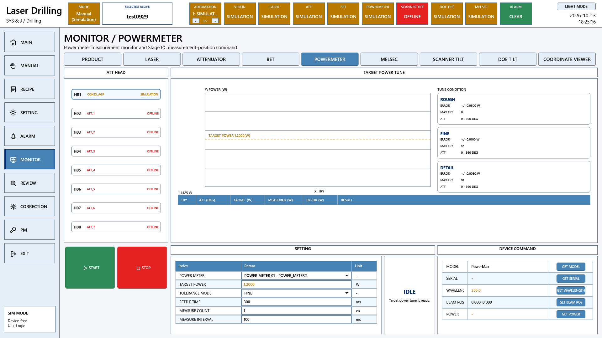

# A3 LD 설정과 모니터 요구기능 코드 대조

원본 Commit: [0c501c104dec1cebab87bd909de29b1b1395a8b4](https://github.com/kjuws10-rgb/A3_LD_Process_SW_IPS/commit/0c501c104dec1cebab87bd909de29b1b1395a8b4)

코드 구현 확인은 현장 검수 완료를 뜻하지 않습니다. 원본 진행 현황은 그대로 보존했고, 아래 판정은 현재 C# 구현을 기준으로 별도 작성했습니다. 화면은 최신 소스의 WPF 화면을 장치 전체 Simulation 모드로 화면 밖에서 렌더링한 것입니다. 실제 장비 측정값 또는 실제 동작 완료 증거가 아닙니다.

[전체 요약](README.md) · [편집본 엑셀](A3_LD_요구기능검증_코드분석작성본.xlsx) · [검색 가능한 상세 자료](항목별_상세근거.html)

## 관련 프로그램 화면



이 화면은 해당 기능군의 UI 연결을 보여줍니다. 개별 검수 조건의 통과 증거는 아래 소스·판정·후속 확인을 함께 보아야 합니다.

## 항목 236

레이저 세팅

- 원본 검수 항목: Head 별 Diode On/Off, Mode, Gate, Shutter 제어
- 원본 진행 현황: 완료
- 현재 코드 판정: 코드 구현 확인

Monitor에서 Laser ON/OFF, Gate, ExternalGate, Shutter 및 QSW/EPRF 등 명령을 선택 장치에 전달한다. Diode On이라는 구형 이름과 실제 Talon 명령 의미를 구분한다.

### 코드 위치와 짧은 내용

[Drilling.UI/Menu/Menus/CMenuMonitor.cs L2139–L2171](https://github.com/kjuws10-rgb/A3_LD_Process_SW_IPS/blob/0c501c104dec1cebab87bd909de29b1b1395a8b4/Drilling.UI/Menu/Menus/CMenuMonitor.cs#L2139-L2171)

```csharp
    private async Task<ST_DEVICE_COMMAND_RESULT> ExecuteLaserOperation(string label)
    {
        var key = NormalizeMonitorOperation(label);
        if (key == "REFRESH")
        {
            var status = _interfaceManager.RefreshTalonLaserStatus(_selectedLaserNumber);
            return new ST_DEVICE_COMMAND_RESULT(true, $"{SelectedLaserName} Talon laser refreshed. Power {status.OutputPower.ToString("F3", CultureInfo.InvariantCulture)} W.");
        }

        var command = key switch
        {
            "LASERON" => (Command: EN_TALON_COMMAND.SetLaserOnOff, Parameter: 1.0, Name: "LASER ON"),
            "LASEROFF" => (Command: EN_TALON_COMMAND.SetLaserOnOff, Parameter: 0.0, Name: "LASER OFF"),
            "GATEON" => (Command: EN_TALON_COMMAND.SetGateOpenClose, Parameter: 1.0, Name: "GATE ON"),
```

[Drilling.UI/Menu/Menus/CMenuMonitor.cs L4869–L4903](https://github.com/kjuws10-rgb/A3_LD_Process_SW_IPS/blob/0c501c104dec1cebab87bd909de29b1b1395a8b4/Drilling.UI/Menu/Menus/CMenuMonitor.cs#L4869-L4903)

```csharp
    private int ReadLaserThgHourLimit()
    {
        var value = _settingManager.GetValue(EN_SETTING_TAB.Option, "LASER_THG_HOUR_LIMIT", "0");
        return int.TryParse(value, NumberStyles.Integer, CultureInfo.InvariantCulture, out var parsed) ? parsed : 0;
    }

    private static IReadOnlyList<ST_MONITOR_BET_TABLE_ROW> CreateBetTableRows(string tab, IReadOnlyList<ST_BET_TABLE_DATA> table, ST_DEVICE_STATUS snapshot)
    {
        if (tab != "BET")
        {
            return[];
        }

        int SelectIndex(global::Drilling.Common.Interface.ST_BET_TABLE_DATA row)
```

### 남은 검증

장치 연결/미연결·유효하지 않은 캐시·범위 경계·Timeout 및 명령 차단을 확인한다. 원본 검수 조건의 전 항목과 대조하고, 실제 장비 결과를 확보한 뒤 개발/검증 완료 여부를 갱신한다.

[관련 화면](screens/Monitor_POWER_METER_simulation.png) · [전체 요약으로](README.md)

## 항목 237

레이저 모니터링

- 원본 검수 항목: Head 별 Diode, Current, Freq, Mode, Gate, Shutter, Interlock 모니터링
- 원본 진행 현황: 완료
- 현재 코드 판정: 코드 구현 확인

Talon 상태값 및 통신 상태를 폴링 캐시로 읽어 DiodeCurrent·Temperature·Power·THG·주파수 등을 표시한다. 미등록·미응답 값은 정상 실측으로 간주하면 안 된다.

### 코드 위치와 짧은 내용

[Drilling.UI/Menu/Menus/CMenuMonitor.cs L4869–L4903](https://github.com/kjuws10-rgb/A3_LD_Process_SW_IPS/blob/0c501c104dec1cebab87bd909de29b1b1395a8b4/Drilling.UI/Menu/Menus/CMenuMonitor.cs#L4869-L4903)

```csharp
    private int ReadLaserThgHourLimit()
    {
        var value = _settingManager.GetValue(EN_SETTING_TAB.Option, "LASER_THG_HOUR_LIMIT", "0");
        return int.TryParse(value, NumberStyles.Integer, CultureInfo.InvariantCulture, out var parsed) ? parsed : 0;
    }

    private static IReadOnlyList<ST_MONITOR_BET_TABLE_ROW> CreateBetTableRows(string tab, IReadOnlyList<ST_BET_TABLE_DATA> table, ST_DEVICE_STATUS snapshot)
    {
        if (tab != "BET")
        {
            return[];
        }

        int SelectIndex(global::Drilling.Common.Interface.ST_BET_TABLE_DATA row)
```

[Drilling.UI/Menu/Menus/CMonitorStatusPollingService.cs L12–L61](https://github.com/kjuws10-rgb/A3_LD_Process_SW_IPS/blob/0c501c104dec1cebab87bd909de29b1b1395a8b4/Drilling.UI/Menu/Menus/CMonitorStatusPollingService.cs#L12-L61)

```csharp
    private static readonly TimeSpan LoopInterval = TimeSpan.FromMilliseconds(250);
    private static readonly TimeSpan ActiveInterval = TimeSpan.FromSeconds(0.5);
    private static readonly TimeSpan ActivePowerMeterMeasureInterval = TimeSpan.FromMilliseconds(500);
    private static readonly TimeSpan SlowSafetyInterval = TimeSpan.FromSeconds(5);
    private static readonly TimeSpan CommunicationInterval = TimeSpan.FromSeconds(1);
    private readonly object _contextLock = new();
    private readonly object _snapshotLock = new();
    private bool _isActive;
    private readonly SemaphoreSlim _motorPollLock = new(1, 1);
    private ST_MONITOR_POLLING_CONTEXT _context = ST_MONITOR_POLLING_CONTEXT.Default;
    private ST_MONITOR_STATUS_SNAPSHOT _snapshot = ST_MONITOR_STATUS_SNAPSHOT.Empty;
    private DateTimeOffset _lastCommunicationPoll = DateTimeOffset.MinValue;
    private long? _lastSuccessfulMotorPollTimestamp;
    private DateTimeOffset _lastLaserPoll = DateTimeOffset.MinValue;
```

### 남은 검증

장치 연결/미연결·유효하지 않은 캐시·범위 경계·Timeout 및 명령 차단을 확인한다. 원본 검수 조건의 전 항목과 대조하고, 실제 장비 결과를 확보한 뒤 개발/검증 완료 여부를 갱신한다.

[관련 화면](screens/Monitor_POWER_METER_simulation.png) · [전체 요약으로](README.md)

## 항목 238

Optic 세팅

- 원본 검수 항목: Head 별 Bex L1/L2, Scan Tilt 축 Position 세팅
- 원본 진행 현황: 완료
- 현재 코드 판정: 부분 구현 또는 사양 차이

현재 BET는 TableIndex 또는 Magnification/Divergence 명령을 사용한다. 기존 BEX L1/L2와 ScanTilt 물리 축 위치를 모두 직접 제어하는 사양과는 다르다.

### 코드 위치와 짧은 내용

[Drilling.UI/Menu/Menus/CMenuMonitor.cs L2292–L2338](https://github.com/kjuws10-rgb/A3_LD_Process_SW_IPS/blob/0c501c104dec1cebab87bd909de29b1b1395a8b4/Drilling.UI/Menu/Menus/CMenuMonitor.cs#L2292-L2338)

```csharp
    private async Task<ST_DEVICE_COMMAND_RESULT> ExecuteBETOperation(string label)
    {
        var key = NormalizeMonitorOperation(label);
        if (key == "REFRESH")
        {
            var status = await Task.Run(() => _interfaceManager.RefreshBETStatus(_selectedBetNumber));
            return new ST_DEVICE_COMMAND_RESULT(true, $"H{_selectedBetNumber + 1:00} BET refreshed. MAG {status.CurrentMagnification.ToString("F3", CultureInfo.InvariantCulture)}, DIV {status.CurrentDivergence.ToString("F3", CultureInfo.InvariantCulture)}.");
        }

        if (key == "SAVETABLE")
        {
            await _interfaceManager.SaveBETData(CreateBETTableData(BetTableRows));
            return new ST_DEVICE_COMMAND_RESULT(true, "BET TABLE saved to JHMI_BET.csv.");
        }
```

[Drilling.Common/Station/CStationProcess.cs L876–L937](https://github.com/kjuws10-rgb/A3_LD_Process_SW_IPS/blob/0c501c104dec1cebab87bd909de29b1b1395a8b4/Drilling.Common/Station/CStationProcess.cs#L876-L937)

```csharp
    private void PrepareBET(ST_PROCESS_MODEL processModel, CancellationToken cancellationToken)
    {
        var devices = GetOpticDevices(EN_EQP_MODULE.Bet);
        if (devices.Count == 0)
        {
            AddSequenceLog("WARN", "BET", "BET interface is not registered. BET ready check skipped.");
            return;
        }

        var target = ReadBETTarget(processModel, cancellationToken);
        foreach (var device in devices)
        {
            global::Drilling.Common.Interface.ST_DEVICE_COMMAND_RESULT SelectValue(global::System.Threading.CancellationToken token)
            {
```

### 남은 검증

장치 연결/미연결·유효하지 않은 캐시·범위 경계·Timeout 및 명령 차단을 확인한다. 원본 검수 조건의 전 항목과 대조하고, 실제 장비 결과를 확보한 뒤 개발/검증 완료 여부를 갱신한다.

[관련 화면](screens/Monitor_POWER_METER_simulation.png) · [전체 요약으로](README.md)

## 항목 239

Optic 모니터링

- 원본 검수 항목: Attenuator 상태 폴링 및 통신 오류 복구 스레드
- 원본 진행 현황: 완료
- 현재 코드 판정: 부분 구현 또는 사양 차이

ATT 현재 위치·이동 상태·SoftwareLimit을 읽는 폴링 서비스가 있다. 에러 횟수별 자동 회복 정책과 실제 재연결 성공 여부는 추가 시험해야 한다.

### 코드 위치와 짧은 내용

[Drilling.UI/Menu/Menus/CMonitorStatusPollingService.cs L12–L61](https://github.com/kjuws10-rgb/A3_LD_Process_SW_IPS/blob/0c501c104dec1cebab87bd909de29b1b1395a8b4/Drilling.UI/Menu/Menus/CMonitorStatusPollingService.cs#L12-L61)

```csharp
    private static readonly TimeSpan LoopInterval = TimeSpan.FromMilliseconds(250);
    private static readonly TimeSpan ActiveInterval = TimeSpan.FromSeconds(0.5);
    private static readonly TimeSpan ActivePowerMeterMeasureInterval = TimeSpan.FromMilliseconds(500);
    private static readonly TimeSpan SlowSafetyInterval = TimeSpan.FromSeconds(5);
    private static readonly TimeSpan CommunicationInterval = TimeSpan.FromSeconds(1);
    private readonly object _contextLock = new();
    private readonly object _snapshotLock = new();
    private bool _isActive;
    private readonly SemaphoreSlim _motorPollLock = new(1, 1);
    private ST_MONITOR_POLLING_CONTEXT _context = ST_MONITOR_POLLING_CONTEXT.Default;
    private ST_MONITOR_STATUS_SNAPSHOT _snapshot = ST_MONITOR_STATUS_SNAPSHOT.Empty;
    private DateTimeOffset _lastCommunicationPoll = DateTimeOffset.MinValue;
    private long? _lastSuccessfulMotorPollTimestamp;
    private DateTimeOffset _lastLaserPoll = DateTimeOffset.MinValue;
```

[Drilling.UI/Menu/Menus/CMenuMonitor.cs L2174–L2215](https://github.com/kjuws10-rgb/A3_LD_Process_SW_IPS/blob/0c501c104dec1cebab87bd909de29b1b1395a8b4/Drilling.UI/Menu/Menus/CMenuMonitor.cs#L2174-L2215)

```csharp
    private async Task<ST_DEVICE_COMMAND_RESULT> ExecuteAttenuatorOperation(string label)
    {
        var key = NormalizeMonitorOperation(label);
        if (key == "REFRESH")
        {
            var status = await Task.Run(() => _interfaceManager.RefreshAttenuatorStatus(_selectedAttenuatorNumber));
            return new ST_DEVICE_COMMAND_RESULT(true, $"H{_selectedAttenuatorNumber + 1:00} CONEX_AGP refreshed. Position {status.CurrentPosition.ToString("F3", CultureInfo.InvariantCulture)} DEG.");
        }

        if (key is "READSETTINGS" or "READCONFIG")
        {
            return await ReadAttenuatorSettings();
        }

```

### 남은 검증

장치 연결/미연결·유효하지 않은 캐시·범위 경계·Timeout 및 명령 차단을 확인한다. 원본 검수 조건의 전 항목과 대조하고, 실제 장비 결과를 확보한 뒤 개발/검증 완료 여부를 갱신한다.

[관련 화면](screens/Monitor_POWER_METER_simulation.png) · [전체 요약으로](README.md)

## 항목 240

Optic 모니터링

- 원본 검수 항목: Attenuator 위치/에러코드 조회 프로토콜 처리
- 원본 진행 현황: 완료
- 현재 코드 판정: 코드 구현 확인

ATT 위치·상태를 가져와 Current/Target/State/Limit 항목을 표시한다. 통신 명령 실패 사유 및 한계값 오류 메시지를 제공한다.

### 코드 위치와 짧은 내용

[Drilling.UI/Menu/Menus/CMenuMonitor.cs L2174–L2215](https://github.com/kjuws10-rgb/A3_LD_Process_SW_IPS/blob/0c501c104dec1cebab87bd909de29b1b1395a8b4/Drilling.UI/Menu/Menus/CMenuMonitor.cs#L2174-L2215)

```csharp
    private async Task<ST_DEVICE_COMMAND_RESULT> ExecuteAttenuatorOperation(string label)
    {
        var key = NormalizeMonitorOperation(label);
        if (key == "REFRESH")
        {
            var status = await Task.Run(() => _interfaceManager.RefreshAttenuatorStatus(_selectedAttenuatorNumber));
            return new ST_DEVICE_COMMAND_RESULT(true, $"H{_selectedAttenuatorNumber + 1:00} CONEX_AGP refreshed. Position {status.CurrentPosition.ToString("F3", CultureInfo.InvariantCulture)} DEG.");
        }

        if (key is "READSETTINGS" or "READCONFIG")
        {
            return await ReadAttenuatorSettings();
        }

```

[Drilling.UI/Menu/Menus/CMenuMonitor.cs L2213–L2220](https://github.com/kjuws10-rgb/A3_LD_Process_SW_IPS/blob/0c501c104dec1cebab87bd909de29b1b1395a8b4/Drilling.UI/Menu/Menus/CMenuMonitor.cs#L2213-L2220)

```csharp
    private static void ShowAttenuatorLimitMessage(ST_DEVICE_COMMAND_RESULT result)
    {
        if (!result.IsSuccess && result.Message.StartsWith(CInterfaceManager.AttenuatorSoftwareLimitMessagePrefix, StringComparison.Ordinal))
        {
            CRecipeConfirmDialog.ShowWarning("Attenuator SW Limit", result.Message);
        }
    }

```

[Drilling.UI/Menu/Menus/CMenuMonitor.cs L699–L788](https://github.com/kjuws10-rgb/A3_LD_Process_SW_IPS/blob/0c501c104dec1cebab87bd909de29b1b1395a8b4/Drilling.UI/Menu/Menus/CMenuMonitor.cs#L699-L788)

```csharp
    public override async Task<CScreenViewModel> Build(CancellationToken cancellationToken = default)
    {
        var selectedTab = NormalizeMonitorTab(_selectedTabAccessor());
        _selectedLaserNumber = Math.Clamp(_selectedLaserNumber, 0, LaserHeadCount - 1);
        _selectedAttenuatorNumber = Math.Clamp(_selectedAttenuatorNumber, 0, LaserHeadCount - 1);
        _selectedBetNumber = Math.Clamp(_selectedBetNumber, 0, LaserHeadCount - 1);
        _enabledHeadDeviceNumbers = LoadEnabledHeadDeviceNumbers(cancellationToken);
        NormalizeHeadDeviceSelections();
        if (selectedTab == "POWER METER")
        {
            NormalizePowerMeterSelection();
        }

        if (selectedTab == "COORDINATE VIEWER")
```

### 남은 검증

장치 연결/미연결·유효하지 않은 캐시·범위 경계·Timeout 및 명령 차단을 확인한다. 원본 검수 조건의 전 항목과 대조하고, 실제 장비 결과를 확보한 뒤 개발/검증 완료 여부를 갱신한다.

[관련 화면](screens/Monitor_POWER_METER_simulation.png) · [전체 요약으로](README.md)

## 항목 241

Optic 모니터링

- 원본 검수 항목: 레시피 변경시 DOE Z축 목표위치로 자동 이동
- 원본 진행 현황: 변경시 X / Run 진행시 이동 완료
- 현재 코드 판정: 코드 구현 확인

Recipe에서 DOE_Z_POSITION을 읽고 실행용 Head Script에 MoveAbsolute를 생성한다. Recipe 선택·조회·저장만으로 DOE Z가 물리 이동하지 않는다.

### 코드 위치와 짧은 내용

[Drilling.File/Script/CAutomation1ScriptFile.cs L252–L421](https://github.com/kjuws10-rgb/A3_LD_Process_SW_IPS/blob/0c501c104dec1cebab87bd909de29b1b1395a8b4/Drilling.File/Script/CAutomation1ScriptFile.cs#L252-L421)

```csharp
    private static IReadOnlyList<string> BuildHeadLines(ST_PROCESS_MODEL processModel, ST_HEAD_PROCESS_PLAN head, DateTimeOffset createdAt, bool bufferedRun)
    {
        var lines = new List<string>();
        var common = new Dictionary<string, string>(processModel.Parameters, StringComparer.OrdinalIgnoreCase);
        var simulatorMode = ReadBool(common, false, Automation1SimulatorUseKey);
        var xAxis = ReadText(common, "GX", CreateHeadKeys(head.HeadNo, "X_AXIS"));
        xAxis = ValidateAeroScriptAxisName("X_AXIS", xAxis);
        var yAxis = ReadText(common, "GY", CreateHeadKeys(head.HeadNo, "Y_AXIS"));
        yAxis = ValidateAeroScriptAxisName("Y_AXIS", yAxis);
        var laserAxis = ReadText(common, xAxis, CreateHeadKeys(head.HeadNo, "LASER_AXIS"));
        if (!simulatorMode)
        {
            laserAxis = ValidateAeroScriptAxisName("LASER_AXIS", laserAxis);
        }
```

[Drilling.UI/Menu/Menus/CMenuRecipe.cs L2270–L2369](https://github.com/kjuws10-rgb/A3_LD_Process_SW_IPS/blob/0c501c104dec1cebab87bd909de29b1b1395a8b4/Drilling.UI/Menu/Menus/CMenuRecipe.cs#L2270-L2369)

```csharp
    private static ST_RECIPE_HEAD_PREVIEW BuildHeadPreview(IReadOnlyList<ST_RECIPE_PARAMETER_EDITOR_ITEM> managedItems, IReadOnlyList<ST_SYSTEM_PARAMETER> settings, string selectedGroup)
    {
        const double maxWidth = 772.0;
        const double maxHeight = 340.0;
        const double paddingX = 44.0;
        const double paddingTop = 42.0;
        const double paddingBottom = 28.0;
        var glassWidth = ReadManagedDouble(managedItems, "GLASS_SIZE_X", 500.0);
        var glassHeight = ReadManagedDouble(managedItems, "GLASS_SIZE_Y", 300.0);
        var akMarginX = ReadManagedDouble(managedItems, "AK_MARGIN_X", 55.0);
        var akMarginY = ReadManagedDouble(managedItems, "AK_MARGIN_Y", 45.0);
        var headCount = Math.Clamp(ReadManagedInt(managedItems, "HEAD_COUNT", 8), 1, 8);
        var head1AkPositionX = ReadSettingDouble(settings, "H01_AK_POSITION_X", -5.0);
        var headGapX = ReadSettingDouble(settings, "HeadGapX", 200.0);
```

### 남은 검증

장치 연결/미연결·유효하지 않은 캐시·범위 경계·Timeout 및 명령 차단을 확인한다. 원본 검수 조건의 전 항목과 대조하고, 실제 장비 결과를 확보한 뒤 개발/검증 완료 여부를 갱신한다.

[관련 화면](screens/Monitor_POWER_METER_simulation.png) · [전체 요약으로](README.md)

## 항목 242

통신 상태

- 원본 검수 항목: Component별 통신상태 실시간 갱신
- 원본 진행 현황: 완료
- 현재 코드 판정: 코드 구현 확인

InterfaceCommunicationList가 연결 상태·Endpoint·LastError를 제공하고 Root·Monitor 헤더에 표시한다. Simulation과 Online/Offline은 서로 다른 상태다.

### 코드 위치와 짧은 내용

[Drilling.Common/Interface/CInterfaceManager.cs L51–L140](https://github.com/kjuws10-rgb/A3_LD_Process_SW_IPS/blob/0c501c104dec1cebab87bd909de29b1b1395a8b4/Drilling.Common/Interface/CInterfaceManager.cs#L51-L140)

```csharp
public sealed record ST_INTERFACE_HISTORY(DateTimeOffset OccurredAt, EN_EQP_MODULE Module, string NickName, string Action, string BeforeState, string AfterState, string Detail);
public sealed record ST_DEVICE_COMM_STATUS(EN_EQP_MODULE Module, EN_COMM_STATE ConnectionState);
public sealed record ST_INTERFACE_CONNECT_OPTION(string Endpoint, string LocalAddress, string RemoteAddress, int Port, int TimeoutMs, int RetryCount, string SerialPort, int BaudRate, string Parity, int DataBits, string StopBits, string Handshake, int MaxClientCount = 8);
public sealed record ST_INTERFACE_COMM_STATUS(EN_EQP_MODULE Module, string NickName, EN_INTERFACE_TYPE InterfaceType, int Number, bool AutoConnection, EN_COMM_STATE ConnectionState, bool IsSimulation, string Endpoint, string LastSent, string LastReceived, string LastError, DateTimeOffset? LastChangedAt)
{
    public string InstanceKey
    {
        get
        {
            return $"{Module}[{Number}]";
        }
    }
}

```

[Drilling.UI/CRootView.cs L103–L197](https://github.com/kjuws10-rgb/A3_LD_Process_SW_IPS/blob/0c501c104dec1cebab87bd909de29b1b1395a8b4/Drilling.UI/CRootView.cs#L103-L197)

```csharp
    public CRootView(CManager manager, CStationManager stationManager, CInterfaceManager interfaceManager, CMotionManager motionManager, CAlarmManager alarmManager, CInterLockManager interLockManager, CManualScanFileBase manualScanFile, CRecipeManager recipeManager, CSettingManager settingManager, CProductManager productManager, CReviewManager reviewManager, CReviewSettingFileBase reviewSettingFile, CAutomationScriptFileBase automationScriptFile)
    {
        _manager = manager;
        _stationManager = stationManager;
        _interfaceManager = interfaceManager;
        _motionManager = motionManager;
        _alarmManager = alarmManager;
        _interLockManager = interLockManager;
        _recipeManager = recipeManager;
        _productManager = productManager;
        _reviewManager = reviewManager;
        _selectedRecipeId = NormalizeRecipeId(settingManager.GetValue(EN_SETTING_TAB.Option, SelectRecipeSettingKey, DefaultRecipeId));
        if (string.IsNullOrWhiteSpace(_selectedRecipeId))
        {
```

[Drilling.UI/Menu/Menus/CMenuMonitor.cs L699–L788](https://github.com/kjuws10-rgb/A3_LD_Process_SW_IPS/blob/0c501c104dec1cebab87bd909de29b1b1395a8b4/Drilling.UI/Menu/Menus/CMenuMonitor.cs#L699-L788)

```csharp
    public override async Task<CScreenViewModel> Build(CancellationToken cancellationToken = default)
    {
        var selectedTab = NormalizeMonitorTab(_selectedTabAccessor());
        _selectedLaserNumber = Math.Clamp(_selectedLaserNumber, 0, LaserHeadCount - 1);
        _selectedAttenuatorNumber = Math.Clamp(_selectedAttenuatorNumber, 0, LaserHeadCount - 1);
        _selectedBetNumber = Math.Clamp(_selectedBetNumber, 0, LaserHeadCount - 1);
        _enabledHeadDeviceNumbers = LoadEnabledHeadDeviceNumbers(cancellationToken);
        NormalizeHeadDeviceSelections();
        if (selectedTab == "POWER METER")
        {
            NormalizePowerMeterSelection();
        }

        if (selectedTab == "COORDINATE VIEWER")
```

### 남은 검증

장치 연결/미연결·유효하지 않은 캐시·범위 경계·Timeout 및 명령 차단을 확인한다. 원본 검수 조건의 전 항목과 대조하고, 실제 장비 결과를 확보한 뒤 개발/검증 완료 여부를 갱신한다.

[관련 화면](screens/Monitor_POWER_METER_simulation.png) · [전체 요약으로](README.md)

## 항목 243

통신 상태

- 원본 검수 항목: Component별 시리얼 포트 연결 및 실패 경고
- 원본 진행 현황: 내용 확인 필요
- 현재 코드 판정: 부분 구현 또는 사양 차이

Serial 장치 연결 및 명령 오류·Timeout을 기록하고 상태 화면에 반영한다. 체크시트의 모든 장치별 Warning 코드·재시도 횟수는 추가 확인해야 한다.

### 코드 위치와 짧은 내용

[Drilling.Common/Interface/CInterfaceManager.cs L51–L140](https://github.com/kjuws10-rgb/A3_LD_Process_SW_IPS/blob/0c501c104dec1cebab87bd909de29b1b1395a8b4/Drilling.Common/Interface/CInterfaceManager.cs#L51-L140)

```csharp
public sealed record ST_INTERFACE_HISTORY(DateTimeOffset OccurredAt, EN_EQP_MODULE Module, string NickName, string Action, string BeforeState, string AfterState, string Detail);
public sealed record ST_DEVICE_COMM_STATUS(EN_EQP_MODULE Module, EN_COMM_STATE ConnectionState);
public sealed record ST_INTERFACE_CONNECT_OPTION(string Endpoint, string LocalAddress, string RemoteAddress, int Port, int TimeoutMs, int RetryCount, string SerialPort, int BaudRate, string Parity, int DataBits, string StopBits, string Handshake, int MaxClientCount = 8);
public sealed record ST_INTERFACE_COMM_STATUS(EN_EQP_MODULE Module, string NickName, EN_INTERFACE_TYPE InterfaceType, int Number, bool AutoConnection, EN_COMM_STATE ConnectionState, bool IsSimulation, string Endpoint, string LastSent, string LastReceived, string LastError, DateTimeOffset? LastChangedAt)
{
    public string InstanceKey
    {
        get
        {
            return $"{Module}[{Number}]";
        }
    }
}

```

[Drilling.Common/Interface/Serial/CTalonLaser.cs L373–L377](https://github.com/kjuws10-rgb/A3_LD_Process_SW_IPS/blob/0c501c104dec1cebab87bd909de29b1b1395a8b4/Drilling.Common/Interface/Serial/CTalonLaser.cs#L373-L377)

```csharp
public sealed record ST_LASER_STATUS(bool PowerOn, bool ShutterOpen, bool GateOn, double OutputPower);
public sealed record ST_TALON_STATUS(double DiodeCurrent, int Qsw, int Eprf, double DiodeTemp, double TowerTemp, double OutputPower, bool LaserOn, bool ShutterOpen, bool GateOpen, bool ExtGateEnable, bool ShgAutoTuneActive, int ThgSpot, double ThgHour, int QMode, uint ShgReadBackCount, string StatusMessage, int StatusCode, EN_TALON_ERROR LastError)
{
    public static ST_TALON_STATUS Empty { get; } = new(0.0, 0, 0, 0.0, 0.0, 0.0, false, false, false, false, false, 0, 0.0, 0, 0, "", 0, EN_TALON_ERROR.Ok);
}
```

### 남은 검증

장치 연결/미연결·유효하지 않은 캐시·범위 경계·Timeout 및 명령 차단을 확인한다. 원본 검수 조건의 전 항목과 대조하고, 실제 장비 결과를 확보한 뒤 개발/검증 완료 여부를 갱신한다.

[관련 화면](screens/Monitor_POWER_METER_simulation.png) · [전체 요약으로](README.md)

## 항목 244

통신 상태

- 원본 검수 항목: TCP 연결 및 실패 경고
- 원본 진행 현황: 내용 확인 필요
- 현재 코드 판정: 부분 구현 또는 사양 차이

Vision 등 TCP 장치는 연결 실패·응답 Timeout을 관리한다. 각 장치별 Warning 코드·재연결 주기·운전 중 정지 범위는 실물 통신 시험이 필요하다.

### 코드 위치와 짧은 내용

[Drilling.Common/Interface/Vision/CVisionComm.cs L28–L125](https://github.com/kjuws10-rgb/A3_LD_Process_SW_IPS/blob/0c501c104dec1cebab87bd909de29b1b1395a8b4/Drilling.Common/Interface/Vision/CVisionComm.cs#L28-L125)

```csharp
    public override async Task Connect(CancellationToken cancellationToken = default)
    {
        await _lifecycleLock.WaitAsync(cancellationToken);
        try
        {
            if (_listener is not null &&
                _serverCancellation is not null &&
                !_serverCancellation.IsCancellationRequested)
            {
                LastError = "";
                SetState(EN_COMM_STATE.Online);
                return;
            }

```

[Drilling.Common/Interface/CInterfaceManager.cs L51–L140](https://github.com/kjuws10-rgb/A3_LD_Process_SW_IPS/blob/0c501c104dec1cebab87bd909de29b1b1395a8b4/Drilling.Common/Interface/CInterfaceManager.cs#L51-L140)

```csharp
public sealed record ST_INTERFACE_HISTORY(DateTimeOffset OccurredAt, EN_EQP_MODULE Module, string NickName, string Action, string BeforeState, string AfterState, string Detail);
public sealed record ST_DEVICE_COMM_STATUS(EN_EQP_MODULE Module, EN_COMM_STATE ConnectionState);
public sealed record ST_INTERFACE_CONNECT_OPTION(string Endpoint, string LocalAddress, string RemoteAddress, int Port, int TimeoutMs, int RetryCount, string SerialPort, int BaudRate, string Parity, int DataBits, string StopBits, string Handshake, int MaxClientCount = 8);
public sealed record ST_INTERFACE_COMM_STATUS(EN_EQP_MODULE Module, string NickName, EN_INTERFACE_TYPE InterfaceType, int Number, bool AutoConnection, EN_COMM_STATE ConnectionState, bool IsSimulation, string Endpoint, string LastSent, string LastReceived, string LastError, DateTimeOffset? LastChangedAt)
{
    public string InstanceKey
    {
        get
        {
            return $"{Module}[{Number}]";
        }
    }
}

```

### 남은 검증

장치 연결/미연결·유효하지 않은 캐시·범위 경계·Timeout 및 명령 차단을 확인한다. 원본 검수 조건의 전 항목과 대조하고, 실제 장비 결과를 확보한 뒤 개발/검증 완료 여부를 갱신한다.

[관련 화면](screens/Monitor_POWER_METER_simulation.png) · [전체 요약으로](README.md)

## 항목 245

Offset 세팅

- 원본 검수 항목: Offset 그리드 입력 시 숫자, '.', '-', Backspace 이외 문자 입력이 차단되는지 확인
- 원본 진행 현황: 완료
- 현재 코드 판정: 코드 구현 확인

Head DefaultOffset은 Double 항목으로 읽히고 Recipe/Setting 저장 시 데이터 형식·허용 범위 검사를 거친다. 모든 키 입력 시 필터가 동일한지는 별도다.

### 코드 위치와 짧은 내용

[Drilling.UI/Menu/Menus/CMenuRecipe.cs L2988–L3033](https://github.com/kjuws10-rgb/A3_LD_Process_SW_IPS/blob/0c501c104dec1cebab87bd909de29b1b1395a8b4/Drilling.UI/Menu/Menus/CMenuRecipe.cs#L2988-L3033)

```csharp
    private static string ValidateRecipeParameters(IReadOnlyList<ST_RECIPE_PARAMETER> parameters)
    {
        foreach (var parameter in parameters)
        {
            var value = parameter.Value.Trim();
            if (parameter.Key.Equals("RECIPE_NAME", StringComparison.OrdinalIgnoreCase) && string.IsNullOrWhiteSpace(value))
            {
                return "Recipe save blocked. Recipe Name cannot be empty.";
            }

            var validationMessage = parameter.DataType switch
            {
                EN_RECIPE_DATA_TYPE.Int => ValidateIntParameter(parameter, value),
                EN_RECIPE_DATA_TYPE.Double => ValidateDoubleParameter(parameter, value),
```

[Drilling.UI/Menu/Menus/CMenuSetting.cs L369–L443](https://github.com/kjuws10-rgb/A3_LD_Process_SW_IPS/blob/0c501c104dec1cebab87bd909de29b1b1395a8b4/Drilling.UI/Menu/Menus/CMenuSetting.cs#L369-L443)

```csharp
    private async Task Save()
    {
        var target = SelectedTab == "INTERFACE" ? "인터페이스 설정" : $"{SelectedTab} / {SelectedGroup} 설정";
        if (!CRecipeConfirmDialog.ShowConfirmation("설정 저장", $"{target}을 저장하시겠습니까?"))
        {
            return;
        }

        if (SelectedTab == "INTERFACE")
        {
            try
            {
                await _settingManager.SaveInterfaceList(ToInterfaceData(AllInterfaceRows));
            }
```

### 남은 검증

장치 연결/미연결·유효하지 않은 캐시·범위 경계·Timeout 및 명령 차단을 확인한다. 원본 검수 조건의 전 항목과 대조하고, 실제 장비 결과를 확보한 뒤 개발/검증 완료 여부를 갱신한다.

[관련 화면](screens/Monitor_POWER_METER_simulation.png) · [전체 요약으로](README.md)

## 항목 246

Offset 세팅

- 원본 검수 항목: 설정된 DefaultOffsetX/Y 값이 실제 가공 좌표 계산(GetHeadXpos/Y + DefaultOffsetX/Y)에 반영되어 최종 마킹 위치에 적용되는지 확인
- 원본 진행 현황: 완료
- 현재 코드 판정: 코드 구현 확인

HeadDefaultOffset은 축 Flip 변환 후 최종 ScannerOffset에 합산된다. Cell Recipe Offset과 Review Offset은 다른 필드이므로 중복 입력 여부를 확인해야 한다.

### 코드 위치와 짧은 내용

[Drilling.Common/Recipe/CShotCoordinatePlanBuilder.cs L12–L146](https://github.com/kjuws10-rgb/A3_LD_Process_SW_IPS/blob/0c501c104dec1cebab87bd909de29b1b1395a8b4/Drilling.Common/Recipe/CShotCoordinatePlanBuilder.cs#L12-L146)

```csharp
    public static ST_SHOT_COORDINATE_PLAN Build(IReadOnlyDictionary<string, string> parameters)
    {
        ArgumentNullException.ThrowIfNull(parameters);
        var headCount = Math.Clamp(ReadInt(parameters, 8, "HEAD_COUNT"), 1, 8);
        var cellCount = ReadInt(parameters, 0, "MAX_CELL_NUMBER");
        if (cellCount < CCellPatternCalculator.MinCellCount)
        {
            throw new InvalidOperationException($"MAX_CELL_NUMBER must be greater than or equal to {CCellPatternCalculator.MinCellCount}. Current value: {cellCount}");
        }

        var activeHeadNos = BuildActiveHeadNumbers(parameters, headCount);
        var activeHeadSet = activeHeadNos.ToHashSet();
        var assignmentHeadNos = Enumerable.Range(1, headCount).ToArray();
        var glassSizeX = ReadDouble(parameters, 0.0, "GLASS_SIZE_X");
```

[Drilling.Common/Recipe/CScannerAxisTransform.cs L5–L99](https://github.com/kjuws10-rgb/A3_LD_Process_SW_IPS/blob/0c501c104dec1cebab87bd909de29b1b1395a8b4/Drilling.Common/Recipe/CScannerAxisTransform.cs#L5-L99)

```csharp
public readonly record struct ST_SCANNER_AXIS_TRANSFORM(bool XyFlip, bool XFlip, bool YFlip)
{
    public (double X, double Y) Apply(double x, double y)
    {
        if (XyFlip)
        {
            (x, y) = (y, x);
        }

        if (XFlip)
        {
            x = -x;
        }

```

### 남은 검증

장치 연결/미연결·유효하지 않은 캐시·범위 경계·Timeout 및 명령 차단을 확인한다. 원본 검수 조건의 전 항목과 대조하고, 실제 장비 결과를 확보한 뒤 개발/검증 완료 여부를 갱신한다.

[관련 화면](screens/Monitor_POWER_METER_simulation.png) · [전체 요약으로](README.md)

## 항목 247

파라미터

- 원본 검수 항목: 저장 시 파라미터/Offset 값이 비어있으면 "00"으로 대체되고 공백/개행이 제거된 후 저장되는지 확인
- 원본 진행 현황: 완료
- 현재 코드 판정: 부분 구현 또는 사양 차이

파라미터 값은 Trim 후 숫자 형식·범위를 검사한다. 빈 값 전부를 0으로 바꾸고 저장하는 구형 규칙은 파일·타입별로 다르다.

### 코드 위치와 짧은 내용

[Drilling.UI/Menu/Menus/CMenuRecipe.cs L2988–L3033](https://github.com/kjuws10-rgb/A3_LD_Process_SW_IPS/blob/0c501c104dec1cebab87bd909de29b1b1395a8b4/Drilling.UI/Menu/Menus/CMenuRecipe.cs#L2988-L3033)

```csharp
    private static string ValidateRecipeParameters(IReadOnlyList<ST_RECIPE_PARAMETER> parameters)
    {
        foreach (var parameter in parameters)
        {
            var value = parameter.Value.Trim();
            if (parameter.Key.Equals("RECIPE_NAME", StringComparison.OrdinalIgnoreCase) && string.IsNullOrWhiteSpace(value))
            {
                return "Recipe save blocked. Recipe Name cannot be empty.";
            }

            var validationMessage = parameter.DataType switch
            {
                EN_RECIPE_DATA_TYPE.Int => ValidateIntParameter(parameter, value),
                EN_RECIPE_DATA_TYPE.Double => ValidateDoubleParameter(parameter, value),
```

[Drilling.UI/Menu/Menus/CMenuSetting.cs L369–L443](https://github.com/kjuws10-rgb/A3_LD_Process_SW_IPS/blob/0c501c104dec1cebab87bd909de29b1b1395a8b4/Drilling.UI/Menu/Menus/CMenuSetting.cs#L369-L443)

```csharp
    private async Task Save()
    {
        var target = SelectedTab == "INTERFACE" ? "인터페이스 설정" : $"{SelectedTab} / {SelectedGroup} 설정";
        if (!CRecipeConfirmDialog.ShowConfirmation("설정 저장", $"{target}을 저장하시겠습니까?"))
        {
            return;
        }

        if (SelectedTab == "INTERFACE")
        {
            try
            {
                await _settingManager.SaveInterfaceList(ToInterfaceData(AllInterfaceRows));
            }
```

### 남은 검증

장치 연결/미연결·유효하지 않은 캐시·범위 경계·Timeout 및 명령 차단을 확인한다. 원본 검수 조건의 전 항목과 대조하고, 실제 장비 결과를 확보한 뒤 개발/검증 완료 여부를 갱신한다.

[관련 화면](screens/Monitor_POWER_METER_simulation.png) · [전체 요약으로](README.md)

## 항목 248

파라미터

- 원본 검수 항목: 파라미터 로드 시 값이 미설정 상태이면 0.0으로 대체되고 인터락 발생하는지 확인
- 원본 진행 현황: 완료
- 현재 코드 판정: 부분 구현 또는 사양 차이

JHMI 정의의 기본값과 Config 검사 기능이 있다. 특정 HeadOffset 누락을 0으로 만든 후 전용 인터록 Alarm을 발생시키는 동일한 규칙은 확인되지 않았다.

### 코드 위치와 짧은 내용

[Drilling.File/JHMI/CConfigStructureFile.cs L5–L64](https://github.com/kjuws10-rgb/A3_LD_Process_SW_IPS/blob/0c501c104dec1cebab87bd909de29b1b1395a8b4/Drilling.File/JHMI/CConfigStructureFile.cs#L5-L64)

```csharp
public sealed class CConfigStructureFile(string configRoot) : CConfigStructureFileBase
{
    private static readonly IReadOnlyList<ST_REQUIRED_CSV> RequiredCsvFiles =
    [
        Csv("JHMI_RCP", "JHMI_RCP.csv", [["TAB"], ["GROUP"], ["NAME"], ["DISPLAY NAME"], ["CIM NAME"], ["DATA TYPE"], ["UNIT"], ["SHOW"], ["USE"], ["VALUE"], ["SCALE"], ["CHANGE LIMIT"], ["MIN"], ["MAX"], ["DESCRIPTION"], ["ORDER"]], ValidateTabNameKey),
        Csv("JHMI_SETTING", "JHMI_SETTING.csv", [["TAB"], ["GROUP"], ["NAME"], ["DISPLAY NAME"], ["DATA TYPE"], ["UNIT"], ["SHOW"], ["USE"], ["VALUE"], ["MIN"], ["MAX"], ["DESCRIPTION"]], ValidateTabNameKey),
        Csv("JHMI_INTERFACE", "JHMI_INTERFACE.csv", [["TYPE"], ["DEVICE"], ["NUMBER", "NO"], ["NICKNAME"], ["SYSTEM_SECTION", "SYSTEM SECTION", "SECTION"], ["AUTOCONNECTION", "AUTO_CONNECTION", "AUTO CONNECTION"], ["SIMUL", "SIMULATION", "SIM_MODE", "SIM MODE"], ["ARG1"], ["ARG2"], ["ARG3"], ["ARG4"], ["ARG5"]], ValidateDeviceNumberKey),
        Csv("JHMI_MOTOR", "JHMI_MOTOR.csv", [["NAME", "MOTOR NAME", "AXIS NAME"], ["USE"], ["AXIS"], ["DEV TYPE", "DEVICE TYPE"], ["DEV NO", "DEVICE NO"], ["SCALE"], ["MAXVEL"], ["MAXACC"], ["MIN"], ["MAX"]], ValidateNameKey),
        Csv("JHMI_MELSEC_MAP", "JHMI_MELSEC_MAP.csv", [["ID"], ["USE"], ["GROUP"], ["NAME"], ["DEVICE NO", "DEV NO", "NUMBER"], ["ADDRESS"], ["DATA TYPE", "DATATYPE", "TYPE"], ["DIRECTION", "DIR"], ["ACCESS"], ["SCALE"], ["LENGTH", "SIZE"], ["POLL_MS", "POLL MS", "POLL"]], ValidateIdKey),
        Csv("JHMI_BET", "JHMI_BET.csv", [["INDEX"], ["DESCRIPTION"], ["DIV"], ["MAG"], ["SPOTSIZE"]], ValidateIndexKey),
        Csv("JHMI_MANUAL_SCAN", "JHMI_MANUAL_SCAN.csv", [["NAME"], ["DISPLAY NAME"], ["DATA TYPE"], ["UNIT"], ["SHOW"], ["USE"], ["VALUE"], ["MIN"], ["MAX"], ["DESCRIPTION"], ["ORDER"]], ValidateNameKey)
    ];
    private static readonly IReadOnlyList<ST_VALUE_CSV> OptionalValueFiles = [ValueCsv("Setting Value", "Setting\\Setting.csv", [["TAB"], ["NAME"], ["VALUE"]], ValidateTabNameKey)];
    public override Task<IReadOnlyList<ST_CONFIG_FILE_STATUS>> Validate(CancellationToken cancellationToken = default)
```

[Drilling.Common/Recipe/CShotCoordinatePlanBuilder.cs L12–L146](https://github.com/kjuws10-rgb/A3_LD_Process_SW_IPS/blob/0c501c104dec1cebab87bd909de29b1b1395a8b4/Drilling.Common/Recipe/CShotCoordinatePlanBuilder.cs#L12-L146)

```csharp
    public static ST_SHOT_COORDINATE_PLAN Build(IReadOnlyDictionary<string, string> parameters)
    {
        ArgumentNullException.ThrowIfNull(parameters);
        var headCount = Math.Clamp(ReadInt(parameters, 8, "HEAD_COUNT"), 1, 8);
        var cellCount = ReadInt(parameters, 0, "MAX_CELL_NUMBER");
        if (cellCount < CCellPatternCalculator.MinCellCount)
        {
            throw new InvalidOperationException($"MAX_CELL_NUMBER must be greater than or equal to {CCellPatternCalculator.MinCellCount}. Current value: {cellCount}");
        }

        var activeHeadNos = BuildActiveHeadNumbers(parameters, headCount);
        var activeHeadSet = activeHeadNos.ToHashSet();
        var assignmentHeadNos = Enumerable.Range(1, headCount).ToArray();
        var glassSizeX = ReadDouble(parameters, 0.0, "GLASS_SIZE_X");
```

[Drilling.Common/InterLock/CInterLockManager.cs L34–L85](https://github.com/kjuws10-rgb/A3_LD_Process_SW_IPS/blob/0c501c104dec1cebab87bd909de29b1b1395a8b4/Drilling.Common/InterLock/CInterLockManager.cs#L34-L85)

```csharp
    private static readonly IReadOnlyList<ST_INTERLOCK_RULE> Rules = [Rule("Door", "DOOR_LOCK_SENSOR", true, "Closed", "Door is open", EN_INTERLOCK_LEVEL.Error, EN_INTERLOCK_TARGET.AutoRun | EN_INTERLOCK_TARGET.ManualMove | EN_INTERLOCK_TARGET.LaserOn), Rule("EMS", "EMS", true, "Normal", "Emergency stop is active", EN_INTERLOCK_LEVEL.Error, EN_INTERLOCK_TARGET.AutoRun | EN_INTERLOCK_TARGET.ManualMove | EN_INTERLOCK_TARGET.LaserOn), Rule("Key Switch", "KEY_SWITCH_AUTO", true, "AUTO", "Key switch is not AUTO", EN_INTERLOCK_LEVEL.Warn, EN_INTERLOCK_TARGET.AutoRun), Rule("Laser Shutter", "LASER_SHUTTER_CLOSED", true, "SAFE", "Laser shutter is not closed", EN_INTERLOCK_LEVEL.Warn, EN_INTERLOCK_TARGET.LaserOn), Rule("Leak Sensor", "LEAK_SENSOR", true, "OK", "Leak sensor is active", EN_INTERLOCK_LEVEL.Error, EN_INTERLOCK_TARGET.AutoRun | EN_INTERLOCK_TARGET.LaserOn), Rule("Smoke Temp", "SMOKE_TEMP", true, "OK", "Smoke or over temperature input is active", EN_INTERLOCK_LEVEL.Error, EN_INTERLOCK_TARGET.AutoRun | EN_INTERLOCK_TARGET.LaserOn), Rule("PM Lock", "PM_LOCK", true, "READY", "PM lock is active", EN_INTERLOCK_LEVEL.Error, EN_INTERLOCK_TARGET.AutoRun | EN_INTERLOCK_TARGET.ManualMove | EN_INTERLOCK_TARGET.LaserOn), Rule("Scanner Ready", "SCANNER_READY", true, "READY", "Scanner ready signal is off", EN_INTERLOCK_LEVEL.Warn, EN_INTERLOCK_TARGET.AutoRun), Rule("Vision Ready", "VISION_READY", true, "READY", "Vision ready signal is off", EN_INTERLOCK_LEVEL.Warn, EN_INTERLOCK_TARGET.AutoRun), Rule("Panel In Position", "PANEL_IN_POSITION", true, "OK", "Panel is not in position", EN_INTERLOCK_LEVEL.Warn, EN_INTERLOCK_TARGET.AutoRun), Rule("Vacuum Check", "VACUUM_CHECK", true, "OK", "Vacuum check is off", EN_INTERLOCK_LEVEL.Warn, EN_INTERLOCK_TARGET.AutoRun)];
    public ST_INTERLOCK_SUMMARY Evaluate(ST_DEVICE_STATUS status)
    {
        global::Drilling.Common.InterLock.CInterLockManager.ST_INTERLOCK_CHECK EvaluateInterlockRule(global::Drilling.Common.InterLock.ST_INTERLOCK_RULE rule)
        {
            return EvaluateRule(rule, status);
        }

        ST_INTERLOCK_CHECK[] checks = status.Io.Count == 0 ? [] : Rules.Select(EvaluateInterlockRule).ToArray();
        global::Drilling.Common.InterLock.ST_INTERLOCK_ITEM SelectInterlockItem(global::Drilling.Common.InterLock.CInterLockManager.ST_INTERLOCK_CHECK check)
        {
            return check.Item with
            {
                BlocksAutoRun = !check.IsOk && check.Rule.Targets.HasFlag(EN_INTERLOCK_TARGET.AutoRun)
```

### 남은 검증

장치 연결/미연결·유효하지 않은 캐시·범위 경계·Timeout 및 명령 차단을 확인한다. 원본 검수 조건의 전 항목과 대조하고, 실제 장비 결과를 확보한 뒤 개발/검증 완료 여부를 갱신한다.

[관련 화면](screens/Monitor_POWER_METER_simulation.png) · [전체 요약으로](README.md)

## 항목 249

파라미터

- 원본 검수 항목: CPU(CountsPerUnitY1), EQD(EmulatedQuadratureDividerY1) 값이 Device 계층 PGM 생성 시작 시점에 전달되어 스캐너 PGM 생성에 사용되는지 확인
- 원본 진행 현황: 미완료
- 현재 코드 판정: 부분 구현 또는 사양 차이

Head별 Encoder Scale과 CountsPerUnit을 이용해 GalvoEncoderScaleFactorSet 및 대기 목표를 생성한다. 기존 EQD/A3200 명령 형식은 현행 AeroScript와 다르다.

### 코드 위치와 짧은 내용

[Drilling.File/Script/CAutomation1ScriptFile.cs L694–L803](https://github.com/kjuws10-rgb/A3_LD_Process_SW_IPS/blob/0c501c104dec1cebab87bd909de29b1b1395a8b4/Drilling.File/Script/CAutomation1ScriptFile.cs#L694-L803)

```csharp
    private static void AppendStartFollowMoves(List<string> lines, IReadOnlyDictionary<string, string> common, ST_HEAD_PROCESS_PLAN head, string xAxis, string yAxis, string encoderAxis, double encoderScale, bool encoderFeedbackFlip)
    {
        if (head.Shots.Count == 0)
        {
            return;
        }

        var firstPoint = head.Shots[0];
        var targetWaitPosition = firstPoint.EncoderWaitPosition;
        if (Math.Abs(encoderScale) <= 0.000001 || Math.Abs(targetWaitPosition) <= 0.000001)
        {
            return;
        }

```

[Drilling.Common/Recipe/CShotCoordinatePlanBuilder.cs L12–L146](https://github.com/kjuws10-rgb/A3_LD_Process_SW_IPS/blob/0c501c104dec1cebab87bd909de29b1b1395a8b4/Drilling.Common/Recipe/CShotCoordinatePlanBuilder.cs#L12-L146)

```csharp
    public static ST_SHOT_COORDINATE_PLAN Build(IReadOnlyDictionary<string, string> parameters)
    {
        ArgumentNullException.ThrowIfNull(parameters);
        var headCount = Math.Clamp(ReadInt(parameters, 8, "HEAD_COUNT"), 1, 8);
        var cellCount = ReadInt(parameters, 0, "MAX_CELL_NUMBER");
        if (cellCount < CCellPatternCalculator.MinCellCount)
        {
            throw new InvalidOperationException($"MAX_CELL_NUMBER must be greater than or equal to {CCellPatternCalculator.MinCellCount}. Current value: {cellCount}");
        }

        var activeHeadNos = BuildActiveHeadNumbers(parameters, headCount);
        var activeHeadSet = activeHeadNos.ToHashSet();
        var assignmentHeadNos = Enumerable.Range(1, headCount).ToArray();
        var glassSizeX = ReadDouble(parameters, 0.0, "GLASS_SIZE_X");
```

### 남은 검증

장치 연결/미연결·유효하지 않은 캐시·범위 경계·Timeout 및 명령 차단을 확인한다. 원본 검수 조건의 전 항목과 대조하고, 실제 장비 결과를 확보한 뒤 개발/검증 완료 여부를 갱신한다.

[관련 화면](screens/Monitor_POWER_METER_simulation.png) · [전체 요약으로](README.md)

## 항목 250

파라미터

- 원본 검수 항목: Angle(ScannerAngle) 값이 0이 아닌 경우 좌표계 축 반전(ReverseMotionDirectionGY/GX)과 Encoder Scale Factor 설정이 분기 처리되는지 확인
- 원본 진행 현황: 미완료
- 현재 코드 판정: 코드 구현 확인

Hxx_SCANNER_XY_FLIP/X_FLIP/Y_FLIP을 읽어 변환하고 FollowAxis·EncoderWait 방향 분기에 사용한다. Vision Flip과 Scanner Flip은 별개이므로 각각 시험해야 한다.

### 코드 위치와 짧은 내용

[Drilling.Common/Recipe/CScannerAxisTransform.cs L5–L99](https://github.com/kjuws10-rgb/A3_LD_Process_SW_IPS/blob/0c501c104dec1cebab87bd909de29b1b1395a8b4/Drilling.Common/Recipe/CScannerAxisTransform.cs#L5-L99)

```csharp
public readonly record struct ST_SCANNER_AXIS_TRANSFORM(bool XyFlip, bool XFlip, bool YFlip)
{
    public (double X, double Y) Apply(double x, double y)
    {
        if (XyFlip)
        {
            (x, y) = (y, x);
        }

        if (XFlip)
        {
            x = -x;
        }

```

[Drilling.File/Script/CAutomation1ScriptFile.cs L694–L803](https://github.com/kjuws10-rgb/A3_LD_Process_SW_IPS/blob/0c501c104dec1cebab87bd909de29b1b1395a8b4/Drilling.File/Script/CAutomation1ScriptFile.cs#L694-L803)

```csharp
    private static void AppendStartFollowMoves(List<string> lines, IReadOnlyDictionary<string, string> common, ST_HEAD_PROCESS_PLAN head, string xAxis, string yAxis, string encoderAxis, double encoderScale, bool encoderFeedbackFlip)
    {
        if (head.Shots.Count == 0)
        {
            return;
        }

        var firstPoint = head.Shots[0];
        var targetWaitPosition = firstPoint.EncoderWaitPosition;
        if (Math.Abs(encoderScale) <= 0.000001 || Math.Abs(targetWaitPosition) <= 0.000001)
        {
            return;
        }

```

[Drilling.Common/Review/CReviewCoordinateTransformer.cs L17–L74](https://github.com/kjuws10-rgb/A3_LD_Process_SW_IPS/blob/0c501c104dec1cebab87bd909de29b1b1395a8b4/Drilling.Common/Review/CReviewCoordinateTransformer.cs#L17-L74)

```csharp
    public static ST_REVIEW_COORDINATE_OFFSET VisionErrorToStageOffset(
        double visionErrorX,
        double visionErrorY,
        EN_VISION_FLIP_TYPE flipType)
    {
        var transformedX = visionErrorX;
        var transformedY = visionErrorY;
        if (flipType.HasFlag(EN_VISION_FLIP_TYPE.XyFlip))
        {
            (transformedX, transformedY) = (transformedY, transformedX);
        }

        if (flipType.HasFlag(EN_VISION_FLIP_TYPE.XFlip))
        {
```

### 남은 검증

장치 연결/미연결·유효하지 않은 캐시·범위 경계·Timeout 및 명령 차단을 확인한다. 원본 검수 조건의 전 항목과 대조하고, 실제 장비 결과를 확보한 뒤 개발/검증 완료 여부를 갱신한다.

[관련 화면](screens/Monitor_POWER_METER_simulation.png) · [전체 요약으로](README.md)

## 항목 251

기본 제어

- 원본 검수 항목: Size 또는 횟수 입력값이 비어있을 때 경고 메시지를 표시하고 가공 진행을 차단하는지 확인
- 원본 진행 현황: 완료
- 현재 코드 판정: 부분 구현 또는 사양 차이

Manual은 실행 전에 파라미터를 읽고 형상 Size 0 경고를 제공한다. 모든 Size/Count 공백에 체크시트와 같은 경고창이 뜨는지는 입력별로 확인해야 한다.

### 코드 위치와 짧은 내용

[Drilling.UI/Menu/Menus/CMenuManual.cs L2747–L2777](https://github.com/kjuws10-rgb/A3_LD_Process_SW_IPS/blob/0c501c104dec1cebab87bd909de29b1b1395a8b4/Drilling.UI/Menu/Menus/CMenuManual.cs#L2747-L2777)

```csharp
    private async Task ShapeStart()
    {
        if (double.TryParse(ShapeSize, NumberStyles.Float, CultureInfo.InvariantCulture, out var shapeSize) && shapeSize == 0.0)
        {
            CRecipeConfirmDialog.ShowWarning(
                "형상 스캔 경고",
                "Shape Size가 0이면 형상 스캔을 시작할 수 없습니다.\nShape Size를 변경한 후 다시 시도해 주세요.");
            return;
        }

        if (!CRecipeConfirmDialog.ShowConfirmation("형상 레이저 가공", $"{ShapeName} 형상으로 레이저 가공을 시작하시겠습니까?"))
        {
            return;
        }
```

[Drilling.UI/Menu/Menus/CMenuManual.cs L3868–L3874](https://github.com/kjuws10-rgb/A3_LD_Process_SW_IPS/blob/0c501c104dec1cebab87bd909de29b1b1395a8b4/Drilling.UI/Menu/Menus/CMenuManual.cs#L3868-L3874)

```csharp
    private ST_MANUAL_SCAN_PARAM ReadManualParamFromScreen()
    {
        return new ST_MANUAL_SCAN_PARAM(ReadRequiredDouble(ShapeSize, "Shape Size"), ReadRequiredDouble(ShapeOffsetX, "Offset X"), ReadRequiredDouble(ShapeOffsetY, "Offset Y"), string.IsNullOrWhiteSpace(ShapeDirection) ? "CW" : ShapeDirection.Trim(), ShapeName, ReadManualDouble("LaserPower"), ReadManualDouble("JumpSpeed"), ReadManualDouble("MarkSpeed"), 0.0, ReadManualDouble("LaserFrequency"), ReadManualDouble("LaserOnDelay"), ReadManualDouble("LaserOffDelay"), 10.0, 48000, ReadGridLineCount(GridRowLines, "Grid Row Lines"), ReadGridLineCount(GridColLines, "Grid Col Lines"));
    }

    private void Apply(IReadOnlyList<ST_DISPLAY_ITEM> manualSettings, IReadOnlyList<ST_DISPLAY_ITEM> selectedHeadItems, IReadOnlyList<ST_DISPLAY_ITEM> positionMoveItems, IReadOnlyList<ST_DISPLAY_ITEM> shapeScanItems, IReadOnlyList<ST_DISPLAY_ITEM> commandStateItems, string selectedHead, string loadedSettingName, string loadedSettingPath, IReadOnlyList<ST_MANUAL_HEAD_CARD> headCards, IReadOnlyList<ST_MANUAL_SETTING_FILE> settingFiles, IReadOnlyList<ST_MANUAL_PARAMETER> settingParameters, IReadOnlyList<ST_MANUAL_COMMAND_STATE> commandStateRows, IReadOnlyList<ST_MANUAL_SCANNER_AXIS> scannerAxes)
    {
```

### 남은 검증

장치 연결/미연결·유효하지 않은 캐시·범위 경계·Timeout 및 명령 차단을 확인한다. 원본 검수 조건의 전 항목과 대조하고, 실제 장비 결과를 확보한 뒤 개발/검증 완료 여부를 갱신한다.

[관련 화면](screens/Monitor_POWER_METER_simulation.png) · [전체 요약으로](README.md)

## 항목 252

기본 제어

- 원본 검수 항목: Grid가 아닌 형상에서 Size가 0 이하로 입력된 경우 오류 메시지를 표시하고 진행을 차단하는지 확인
- 원본 진행 현황: 완료
- 현재 코드 판정: 부분 구현 또는 사양 차이

ShapeStart의 직접 검사는 Size == 0이다. Size <= 0 전체 차단 사양과 정확히 같지 않으므로 음수·NaN·문자 입력 경로를 검증해야 한다.

### 코드 위치와 짧은 내용

[Drilling.UI/Menu/Menus/CMenuManual.cs L2747–L2777](https://github.com/kjuws10-rgb/A3_LD_Process_SW_IPS/blob/0c501c104dec1cebab87bd909de29b1b1395a8b4/Drilling.UI/Menu/Menus/CMenuManual.cs#L2747-L2777)

```csharp
    private async Task ShapeStart()
    {
        if (double.TryParse(ShapeSize, NumberStyles.Float, CultureInfo.InvariantCulture, out var shapeSize) && shapeSize == 0.0)
        {
            CRecipeConfirmDialog.ShowWarning(
                "형상 스캔 경고",
                "Shape Size가 0이면 형상 스캔을 시작할 수 없습니다.\nShape Size를 변경한 후 다시 시도해 주세요.");
            return;
        }

        if (!CRecipeConfirmDialog.ShowConfirmation("형상 레이저 가공", $"{ShapeName} 형상으로 레이저 가공을 시작하시겠습니까?"))
        {
            return;
        }
```

[Drilling.UI/Menu/Menus/CMenuManual.cs L3868–L3874](https://github.com/kjuws10-rgb/A3_LD_Process_SW_IPS/blob/0c501c104dec1cebab87bd909de29b1b1395a8b4/Drilling.UI/Menu/Menus/CMenuManual.cs#L3868-L3874)

```csharp
    private ST_MANUAL_SCAN_PARAM ReadManualParamFromScreen()
    {
        return new ST_MANUAL_SCAN_PARAM(ReadRequiredDouble(ShapeSize, "Shape Size"), ReadRequiredDouble(ShapeOffsetX, "Offset X"), ReadRequiredDouble(ShapeOffsetY, "Offset Y"), string.IsNullOrWhiteSpace(ShapeDirection) ? "CW" : ShapeDirection.Trim(), ShapeName, ReadManualDouble("LaserPower"), ReadManualDouble("JumpSpeed"), ReadManualDouble("MarkSpeed"), 0.0, ReadManualDouble("LaserFrequency"), ReadManualDouble("LaserOnDelay"), ReadManualDouble("LaserOffDelay"), 10.0, 48000, ReadGridLineCount(GridRowLines, "Grid Row Lines"), ReadGridLineCount(GridColLines, "Grid Col Lines"));
    }

    private void Apply(IReadOnlyList<ST_DISPLAY_ITEM> manualSettings, IReadOnlyList<ST_DISPLAY_ITEM> selectedHeadItems, IReadOnlyList<ST_DISPLAY_ITEM> positionMoveItems, IReadOnlyList<ST_DISPLAY_ITEM> shapeScanItems, IReadOnlyList<ST_DISPLAY_ITEM> commandStateItems, string selectedHead, string loadedSettingName, string loadedSettingPath, IReadOnlyList<ST_MANUAL_HEAD_CARD> headCards, IReadOnlyList<ST_MANUAL_SETTING_FILE> settingFiles, IReadOnlyList<ST_MANUAL_PARAMETER> settingParameters, IReadOnlyList<ST_MANUAL_COMMAND_STATE> commandStateRows, IReadOnlyList<ST_MANUAL_SCANNER_AXIS> scannerAxes)
    {
```

### 남은 검증

장치 연결/미연결·유효하지 않은 캐시·범위 경계·Timeout 및 명령 차단을 확인한다. 원본 검수 조건의 전 항목과 대조하고, 실제 장비 결과를 확보한 뒤 개발/검증 완료 여부를 갱신한다.

[관련 화면](screens/Monitor_POWER_METER_simulation.png) · [전체 요약으로](README.md)

## 항목 253

기본 제어

- 원본 검수 항목: Door 및 MaintZ 인터락 발생 상태에서 매뉴얼 가공 시작 시 경고 메시지 표시 후 동작이 차단되는지 확인
- 원본 진행 현황: 미완료
- 현재 코드 판정: 부분 구현 또는 사양 차이

InterLockManager는 Door·EMS·PM 등을 검사하지만 Manual RunManualScript는 AutoRunning 차단을 주로 확인한다. Maint Z와 Door의 모든 수동 출사 경로 연결을 검증해야 한다.

### 코드 위치와 짧은 내용

[Drilling.Common/InterLock/CInterLockManager.cs L34–L85](https://github.com/kjuws10-rgb/A3_LD_Process_SW_IPS/blob/0c501c104dec1cebab87bd909de29b1b1395a8b4/Drilling.Common/InterLock/CInterLockManager.cs#L34-L85)

```csharp
    private static readonly IReadOnlyList<ST_INTERLOCK_RULE> Rules = [Rule("Door", "DOOR_LOCK_SENSOR", true, "Closed", "Door is open", EN_INTERLOCK_LEVEL.Error, EN_INTERLOCK_TARGET.AutoRun | EN_INTERLOCK_TARGET.ManualMove | EN_INTERLOCK_TARGET.LaserOn), Rule("EMS", "EMS", true, "Normal", "Emergency stop is active", EN_INTERLOCK_LEVEL.Error, EN_INTERLOCK_TARGET.AutoRun | EN_INTERLOCK_TARGET.ManualMove | EN_INTERLOCK_TARGET.LaserOn), Rule("Key Switch", "KEY_SWITCH_AUTO", true, "AUTO", "Key switch is not AUTO", EN_INTERLOCK_LEVEL.Warn, EN_INTERLOCK_TARGET.AutoRun), Rule("Laser Shutter", "LASER_SHUTTER_CLOSED", true, "SAFE", "Laser shutter is not closed", EN_INTERLOCK_LEVEL.Warn, EN_INTERLOCK_TARGET.LaserOn), Rule("Leak Sensor", "LEAK_SENSOR", true, "OK", "Leak sensor is active", EN_INTERLOCK_LEVEL.Error, EN_INTERLOCK_TARGET.AutoRun | EN_INTERLOCK_TARGET.LaserOn), Rule("Smoke Temp", "SMOKE_TEMP", true, "OK", "Smoke or over temperature input is active", EN_INTERLOCK_LEVEL.Error, EN_INTERLOCK_TARGET.AutoRun | EN_INTERLOCK_TARGET.LaserOn), Rule("PM Lock", "PM_LOCK", true, "READY", "PM lock is active", EN_INTERLOCK_LEVEL.Error, EN_INTERLOCK_TARGET.AutoRun | EN_INTERLOCK_TARGET.ManualMove | EN_INTERLOCK_TARGET.LaserOn), Rule("Scanner Ready", "SCANNER_READY", true, "READY", "Scanner ready signal is off", EN_INTERLOCK_LEVEL.Warn, EN_INTERLOCK_TARGET.AutoRun), Rule("Vision Ready", "VISION_READY", true, "READY", "Vision ready signal is off", EN_INTERLOCK_LEVEL.Warn, EN_INTERLOCK_TARGET.AutoRun), Rule("Panel In Position", "PANEL_IN_POSITION", true, "OK", "Panel is not in position", EN_INTERLOCK_LEVEL.Warn, EN_INTERLOCK_TARGET.AutoRun), Rule("Vacuum Check", "VACUUM_CHECK", true, "OK", "Vacuum check is off", EN_INTERLOCK_LEVEL.Warn, EN_INTERLOCK_TARGET.AutoRun)];
    public ST_INTERLOCK_SUMMARY Evaluate(ST_DEVICE_STATUS status)
    {
        global::Drilling.Common.InterLock.CInterLockManager.ST_INTERLOCK_CHECK EvaluateInterlockRule(global::Drilling.Common.InterLock.ST_INTERLOCK_RULE rule)
        {
            return EvaluateRule(rule, status);
        }

        ST_INTERLOCK_CHECK[] checks = status.Io.Count == 0 ? [] : Rules.Select(EvaluateInterlockRule).ToArray();
        global::Drilling.Common.InterLock.ST_INTERLOCK_ITEM SelectInterlockItem(global::Drilling.Common.InterLock.CInterLockManager.ST_INTERLOCK_CHECK check)
        {
            return check.Item with
            {
                BlocksAutoRun = !check.IsOk && check.Rule.Targets.HasFlag(EN_INTERLOCK_TARGET.AutoRun)
```

[Drilling.UI/Menu/Menus/CMenuManual.cs L3433–L3460](https://github.com/kjuws10-rgb/A3_LD_Process_SW_IPS/blob/0c501c104dec1cebab87bd909de29b1b1395a8b4/Drilling.UI/Menu/Menus/CMenuManual.cs#L3433-L3460)

```csharp
    private bool TryBlockManualAutomationCommand(string commandName)
    {
        if (!IsAutoProcessRunning())
        {
            return false;
        }

        var message = "Auto process is running. Manual Automation1 command is blocked.";
        _lastCommand = commandName;
        _lastResult = message;
        RefreshCommandStateRows();
        _setStatusMessage(message);
        _refreshShellStatus();
        return true;
```

[Drilling.UI/Menu/Menus/CMenuManual.cs L3216–L3315](https://github.com/kjuws10-rgb/A3_LD_Process_SW_IPS/blob/0c501c104dec1cebab87bd909de29b1b1395a8b4/Drilling.UI/Menu/Menus/CMenuManual.cs#L3216-L3315)

```csharp
    private async Task RunManualScript(string commandName, Action<CAutomation1ScriptBase, ST_MANUAL_SCAN_PARAM> buildScript, Action<CAutomation1ScriptBase, ST_MANUAL_SCAN_PARAM>? setupScript = null, string? scriptFileName = null, CancellationToken cancellationToken = default)
    {
        if (TryBlockManualAutomationCommand(commandName))
        {
            return;
        }

        CancelStatusPolling();
        _lastCommand = commandName;
        _lastResult = "Building";

        if (!_manager.automation.IsSimul() && !_manager.automation.IsConnect())
        {
            _lastResult = "ERROR: OFFLINE";
```

### 남은 검증

장치 연결/미연결·유효하지 않은 캐시·범위 경계·Timeout 및 명령 차단을 확인한다. 원본 검수 조건의 전 항목과 대조하고, 실제 장비 결과를 확보한 뒤 개발/검증 완료 여부를 갱신한다.

[관련 화면](screens/Monitor_POWER_METER_simulation.png) · [전체 요약으로](README.md)

## 항목 254

기본 제어

- 원본 검수 항목: LaserOn 형상 가공 시 입력된 LaserOnTime, RepeatCnt, RepeatDelayTime 값이 MakeLaserOnPGM에 전달되어 지정 횟수만큼 레이저 On/Off가 반복되는 PGM이 생성되는지 확인
- 원본 진행 현황: 완료 (반복 기능 미완료)
- 현재 코드 판정: 코드 구현 확인

최신 AppendLaserOnScript에는 repeat Count-1 블록과 마지막 조사 블록이 구현되어 있다. 기존 진행현황의 반복 미완료 메모와 현재 코드가 다르므로 상세 근거로 구분한다.

### 코드 위치와 짧은 내용

[Drilling.UI/Menu/Menus/CMenuManual.cs L2793–L2830](https://github.com/kjuws10-rgb/A3_LD_Process_SW_IPS/blob/0c501c104dec1cebab87bd909de29b1b1395a8b4/Drilling.UI/Menu/Menus/CMenuManual.cs#L2793-L2830)

```csharp
    private void AppendLaserOnScript(CAutomation1ScriptBase script, ST_MANUAL_SCAN_PARAM settings)
    {
        if (!int.TryParse(LaserRepeatCount?.Trim(), NumberStyles.Integer, CultureInfo.InvariantCulture, out var repeatCount) || repeatCount < 1)
        {
            throw new InvalidDataException("Repeat Count는 1 이상의 정수로 입력해 주세요.");
        }

        var repeatDelayMsec = ReadRequiredDouble(LaserRepeatDelayTimeMsec, "Repeat Delay Time");
        if (!double.IsFinite(repeatDelayMsec) || repeatDelayMsec < 0.0)
        {
            throw new InvalidDataException("Repeat Delay Time은 0 이상의 유한한 숫자로 입력해 주세요. (msec)");
        }

        var laserActionSettings = ReadLaserActionSettings(settings);
```

### 남은 검증

장치 연결/미연결·유효하지 않은 캐시·범위 경계·Timeout 및 명령 차단을 확인한다. 원본 검수 조건의 전 항목과 대조하고, 실제 장비 결과를 확보한 뒤 개발/검증 완료 여부를 갱신한다.

[관련 화면](screens/Monitor_POWER_METER_simulation.png) · [전체 요약으로](README.md)

## 항목 255

모션 제어

- 원본 검수 항목: Stage 축 제어 권한 상태 표시
- 원본 진행 현황: 완료
- 현재 코드 판정: 부분 구현 또는 사양 차이

수동 Stage 상태는 MELSEC 캐시를 사용하며 Manual/Auto 접근 제어가 있다. PLC에서 실제 축 제어권을 획득했다는 승인 신호는 별도다.

### 코드 위치와 짧은 내용

[Drilling.UI/Menu/Menus/CMenuManual.cs L1248–L1335](https://github.com/kjuws10-rgb/A3_LD_Process_SW_IPS/blob/0c501c104dec1cebab87bd909de29b1b1395a8b4/Drilling.UI/Menu/Menus/CMenuManual.cs#L1248-L1335)

```csharp
    private async Task ExecuteMotionMove(string moveMode, string confirmationTitle)
    {
        var axis = SelectedStageAxis;
        if (!double.TryParse(axis.TargetPosition, NumberStyles.Float, CultureInfo.InvariantCulture, out var targetPosition))
        {
            var message = $"{axis.DisplayName} position is not a valid number: {axis.TargetPosition}";
            _setStatusMessage(message);
            ShowManualWarning(message);
            return;
        }

        if (!double.TryParse(axis.TargetSpeed, NumberStyles.Float, CultureInfo.InvariantCulture, out var targetSpeed) || targetSpeed < 0.0)
        {
            var message = $"{axis.DisplayName} speed is not a valid positive number: {axis.TargetSpeed}";
```

[Drilling.UI/Menu/Menus/CMotorStatusPollingService.cs L10–L74](https://github.com/kjuws10-rgb/A3_LD_Process_SW_IPS/blob/0c501c104dec1cebab87bd909de29b1b1395a8b4/Drilling.UI/Menu/Menus/CMotorStatusPollingService.cs#L10-L74)

```csharp
    private static readonly (string Name, string Key)[] Axes =
        [("Stage Y", "STAGE_Y"), ("Review X", "CAMERA_X"), ("Window Y", "WINDOW_Y")];
    private readonly object _snapshotLock = new();
    private IReadOnlyList<ST_MOTOR_STATUS_ITEM> _snapshot = CreateEmptySnapshot();

    public void Start() => base.Start(1000, "MotorStatusPolling");

    public IReadOnlyList<ST_MOTOR_STATUS_ITEM> GetSnapshot()
    {
        lock (_snapshotLock)
        {
            return _snapshot;
        }
    }
```

[Drilling.UI/CRootView.cs L41–L54](https://github.com/kjuws10-rgb/A3_LD_Process_SW_IPS/blob/0c501c104dec1cebab87bd909de29b1b1395a8b4/Drilling.UI/CRootView.cs#L41-L54)

```csharp
    private static readonly IReadOnlySet<EN_MENU> AutoModeMenus = new HashSet<EN_MENU>
    {
        EN_MENU.Main,
        EN_MENU.Alarm,
        EN_MENU.Monitor,
        EN_MENU.Pm,
        EN_MENU.Exit
    };
    private static readonly IReadOnlyList<EN_EQP_MODULE> HeaderModules = [EN_EQP_MODULE.Automation1, EN_EQP_MODULE.Vision, EN_EQP_MODULE.TalonLaser, EN_EQP_MODULE.Attenuator, EN_EQP_MODULE.Bet, EN_EQP_MODULE.PowerMeter, EN_EQP_MODULE.Motion, EN_EQP_MODULE.PicoMotor, EN_EQP_MODULE.Melsec];
    private readonly CStationManager _stationManager;
    private readonly CManager _manager;
    private readonly CInterfaceManager _interfaceManager;
    private readonly CMotionManager _motionManager;
    private readonly CAlarmManager _alarmManager;
```

### 남은 검증

장치 연결/미연결·유효하지 않은 캐시·범위 경계·Timeout 및 명령 차단을 확인한다. 원본 검수 조건의 전 항목과 대조하고, 실제 장비 결과를 확보한 뒤 개발/검증 완료 여부를 갱신한다.

[관련 화면](screens/Monitor_POWER_METER_simulation.png) · [전체 요약으로](README.md)

## 항목 256

모션 제어

- 원본 검수 항목: Stage Y축 절대위치 이동
- 원본 진행 현황: 완료
- 현재 코드 판정: 부분 구현 또는 사양 차이

ExecuteMotionMove의 ABS는 입력 위치를 WritePositionId에 WriteDouble 한다. 속도 입력은 현재 맵 미적용으로 안내되며 이동 Trigger·도착 대기는 확인되지 않았다.

### 코드 위치와 짧은 내용

[Drilling.UI/Menu/Menus/CMenuManual.cs L1248–L1335](https://github.com/kjuws10-rgb/A3_LD_Process_SW_IPS/blob/0c501c104dec1cebab87bd909de29b1b1395a8b4/Drilling.UI/Menu/Menus/CMenuManual.cs#L1248-L1335)

```csharp
    private async Task ExecuteMotionMove(string moveMode, string confirmationTitle)
    {
        var axis = SelectedStageAxis;
        if (!double.TryParse(axis.TargetPosition, NumberStyles.Float, CultureInfo.InvariantCulture, out var targetPosition))
        {
            var message = $"{axis.DisplayName} position is not a valid number: {axis.TargetPosition}";
            _setStatusMessage(message);
            ShowManualWarning(message);
            return;
        }

        if (!double.TryParse(axis.TargetSpeed, NumberStyles.Float, CultureInfo.InvariantCulture, out var targetSpeed) || targetSpeed < 0.0)
        {
            var message = $"{axis.DisplayName} speed is not a valid positive number: {axis.TargetSpeed}";
```

### 남은 검증

장치 연결/미연결·유효하지 않은 캐시·범위 경계·Timeout 및 명령 차단을 확인한다. 원본 검수 조건의 전 항목과 대조하고, 실제 장비 결과를 확보한 뒤 개발/검증 완료 여부를 갱신한다.

[관련 화면](screens/Monitor_POWER_METER_simulation.png) · [전체 요약으로](README.md)

## 항목 257

모션 제어

- 원본 검수 항목: Review X축 절대위치 이동
- 원본 진행 현황: 완료
- 현재 코드 판정: 부분 구현 또는 사양 차이

Stage 수동 축 선택에 따라 ReviewX 위치 값을 쓰는 공통 경로를 사용할 수 있다. PLC 이동 시작 및 MotionDone 완료 확인까지 보장하지 않는다.

### 코드 위치와 짧은 내용

[Drilling.UI/Menu/Menus/CMenuManual.cs L1248–L1335](https://github.com/kjuws10-rgb/A3_LD_Process_SW_IPS/blob/0c501c104dec1cebab87bd909de29b1b1395a8b4/Drilling.UI/Menu/Menus/CMenuManual.cs#L1248-L1335)

```csharp
    private async Task ExecuteMotionMove(string moveMode, string confirmationTitle)
    {
        var axis = SelectedStageAxis;
        if (!double.TryParse(axis.TargetPosition, NumberStyles.Float, CultureInfo.InvariantCulture, out var targetPosition))
        {
            var message = $"{axis.DisplayName} position is not a valid number: {axis.TargetPosition}";
            _setStatusMessage(message);
            ShowManualWarning(message);
            return;
        }

        if (!double.TryParse(axis.TargetSpeed, NumberStyles.Float, CultureInfo.InvariantCulture, out var targetSpeed) || targetSpeed < 0.0)
        {
            var message = $"{axis.DisplayName} speed is not a valid positive number: {axis.TargetSpeed}";
```

[Drilling.UI/Menu/Menus/CMotorStatusPollingService.cs L10–L74](https://github.com/kjuws10-rgb/A3_LD_Process_SW_IPS/blob/0c501c104dec1cebab87bd909de29b1b1395a8b4/Drilling.UI/Menu/Menus/CMotorStatusPollingService.cs#L10-L74)

```csharp
    private static readonly (string Name, string Key)[] Axes =
        [("Stage Y", "STAGE_Y"), ("Review X", "CAMERA_X"), ("Window Y", "WINDOW_Y")];
    private readonly object _snapshotLock = new();
    private IReadOnlyList<ST_MOTOR_STATUS_ITEM> _snapshot = CreateEmptySnapshot();

    public void Start() => base.Start(1000, "MotorStatusPolling");

    public IReadOnlyList<ST_MOTOR_STATUS_ITEM> GetSnapshot()
    {
        lock (_snapshotLock)
        {
            return _snapshot;
        }
    }
```

### 남은 검증

장치 연결/미연결·유효하지 않은 캐시·범위 경계·Timeout 및 명령 차단을 확인한다. 원본 검수 조건의 전 항목과 대조하고, 실제 장비 결과를 확보한 뒤 개발/검증 완료 여부를 갱신한다.

[관련 화면](screens/Monitor_POWER_METER_simulation.png) · [전체 요약으로](README.md)

## 항목 258

모션 제어

- 원본 검수 항목: 이동 목표좌표 범위 검증 및 PLC 이동 명령 처리
- 원본 진행 현황: 미완료
- 현재 코드 판정: 부분 구현 또는 사양 차이

목표와 현재 위치가 유한한 숫자인지 검사한다. 기계 이동 범위·MoveReq 핸드셰이크·위치 공차 도착 판정은 현재 값 쓰기와 구분된다.

### 코드 위치와 짧은 내용

[Drilling.UI/Menu/Menus/CMenuManual.cs L1248–L1335](https://github.com/kjuws10-rgb/A3_LD_Process_SW_IPS/blob/0c501c104dec1cebab87bd909de29b1b1395a8b4/Drilling.UI/Menu/Menus/CMenuManual.cs#L1248-L1335)

```csharp
    private async Task ExecuteMotionMove(string moveMode, string confirmationTitle)
    {
        var axis = SelectedStageAxis;
        if (!double.TryParse(axis.TargetPosition, NumberStyles.Float, CultureInfo.InvariantCulture, out var targetPosition))
        {
            var message = $"{axis.DisplayName} position is not a valid number: {axis.TargetPosition}";
            _setStatusMessage(message);
            ShowManualWarning(message);
            return;
        }

        if (!double.TryParse(axis.TargetSpeed, NumberStyles.Float, CultureInfo.InvariantCulture, out var targetSpeed) || targetSpeed < 0.0)
        {
            var message = $"{axis.DisplayName} speed is not a valid positive number: {axis.TargetSpeed}";
```

### 남은 검증

장치 연결/미연결·유효하지 않은 캐시·범위 경계·Timeout 및 명령 차단을 확인한다. 원본 검수 조건의 전 항목과 대조하고, 실제 장비 결과를 확보한 뒤 개발/검증 완료 여부를 갱신한다.

[관련 화면](screens/Monitor_POWER_METER_simulation.png) · [전체 요약으로](README.md)

## 항목 259

수동 측정

- 원본 검수 항목: 보호윈도우 위치 이상 시 측정 시작을 차단
- 원본 진행 현황: 미완료
- 현재 코드 판정: 현재 코드에서 미확인

Power Tune은 사용 Head·등록 장치·목표 파워를 확인한다. 보호 윈도우 위치가 허용되지 않을 때 Tune을 막는 전용 분기는 확인되지 않았다.

### 코드 위치와 짧은 내용

[Drilling.UI/Menu/Menus/CMenuMonitor.cs L3497–L3646](https://github.com/kjuws10-rgb/A3_LD_Process_SW_IPS/blob/0c501c104dec1cebab87bd909de29b1b1395a8b4/Drilling.UI/Menu/Menus/CMenuMonitor.cs#L3497-L3646)

```csharp
    private async Task<ST_DEVICE_COMMAND_RESULT> RunPowerMeterTuneSequence()
    {
        if (_powerMeterTuneCts is not null)
        {
            return new ST_DEVICE_COMMAND_RESULT(false, "PowerMeter target tune is already running.");
        }

        SavePowerMeterSettingValues();
        NormalizePowerMeterSelection();
        if (!_enabledHeadDeviceNumbers.Contains(_selectedAttenuatorNumber))
        {
            return new ST_DEVICE_COMMAND_RESULT(false, $"PowerMeter tune skipped. H{_selectedAttenuatorNumber + 1:00} is disabled by H{_selectedAttenuatorNumber + 1:00}_USE.");
        }

```

[Drilling.UI/Menu/Menus/CMotorStatusPollingService.cs L10–L74](https://github.com/kjuws10-rgb/A3_LD_Process_SW_IPS/blob/0c501c104dec1cebab87bd909de29b1b1395a8b4/Drilling.UI/Menu/Menus/CMotorStatusPollingService.cs#L10-L74)

```csharp
    private static readonly (string Name, string Key)[] Axes =
        [("Stage Y", "STAGE_Y"), ("Review X", "CAMERA_X"), ("Window Y", "WINDOW_Y")];
    private readonly object _snapshotLock = new();
    private IReadOnlyList<ST_MOTOR_STATUS_ITEM> _snapshot = CreateEmptySnapshot();

    public void Start() => base.Start(1000, "MotorStatusPolling");

    public IReadOnlyList<ST_MOTOR_STATUS_ITEM> GetSnapshot()
    {
        lock (_snapshotLock)
        {
            return _snapshot;
        }
    }
```

미확인은 해당 이름·동작·호출 관계를 현행 자료와 대조해 확정하지 못했다는 뜻입니다. 링크는 가장 가까운 현재 기능이며, 존재하지 않는 함수를 있다고 추정한 근거가 아닙니다.

### 남은 검증

장치 연결/미연결·유효하지 않은 캐시·범위 경계·Timeout 및 명령 차단을 확인한다. 원본 검수 조건의 전 항목과 대조하고, 실제 장비 결과를 확보한 뒤 개발/검증 완료 여부를 갱신한다.

[관련 화면](screens/Monitor_POWER_METER_simulation.png) · [전체 요약으로](README.md)

## 항목 260

수동 측정

- 원본 검수 항목: Stage 미회피 상태에서 측정 진입 차단
- 원본 진행 현황: 미완료
- 현재 코드 판정: 현재 코드에서 미확인

Target Tune 루프는 ATT 이동·안정화 지연·파워 평균 측정이다. Stage 회피 위치를 검사하거나 이동시키는 단계는 이 루프에 연결되어 있지 않다.

### 코드 위치와 짧은 내용

[Drilling.UI/Menu/Menus/CMenuMonitor.cs L3497–L3646](https://github.com/kjuws10-rgb/A3_LD_Process_SW_IPS/blob/0c501c104dec1cebab87bd909de29b1b1395a8b4/Drilling.UI/Menu/Menus/CMenuMonitor.cs#L3497-L3646)

```csharp
    private async Task<ST_DEVICE_COMMAND_RESULT> RunPowerMeterTuneSequence()
    {
        if (_powerMeterTuneCts is not null)
        {
            return new ST_DEVICE_COMMAND_RESULT(false, "PowerMeter target tune is already running.");
        }

        SavePowerMeterSettingValues();
        NormalizePowerMeterSelection();
        if (!_enabledHeadDeviceNumbers.Contains(_selectedAttenuatorNumber))
        {
            return new ST_DEVICE_COMMAND_RESULT(false, $"PowerMeter tune skipped. H{_selectedAttenuatorNumber + 1:00} is disabled by H{_selectedAttenuatorNumber + 1:00}_USE.");
        }

```

[Drilling.UI/Menu/Menus/CMenuManual.cs L1248–L1335](https://github.com/kjuws10-rgb/A3_LD_Process_SW_IPS/blob/0c501c104dec1cebab87bd909de29b1b1395a8b4/Drilling.UI/Menu/Menus/CMenuManual.cs#L1248-L1335)

```csharp
    private async Task ExecuteMotionMove(string moveMode, string confirmationTitle)
    {
        var axis = SelectedStageAxis;
        if (!double.TryParse(axis.TargetPosition, NumberStyles.Float, CultureInfo.InvariantCulture, out var targetPosition))
        {
            var message = $"{axis.DisplayName} position is not a valid number: {axis.TargetPosition}";
            _setStatusMessage(message);
            ShowManualWarning(message);
            return;
        }

        if (!double.TryParse(axis.TargetSpeed, NumberStyles.Float, CultureInfo.InvariantCulture, out var targetSpeed) || targetSpeed < 0.0)
        {
            var message = $"{axis.DisplayName} speed is not a valid positive number: {axis.TargetSpeed}";
```

미확인은 해당 이름·동작·호출 관계를 현행 자료와 대조해 확정하지 못했다는 뜻입니다. 링크는 가장 가까운 현재 기능이며, 존재하지 않는 함수를 있다고 추정한 근거가 아닙니다.

### 남은 검증

장치 연결/미연결·유효하지 않은 캐시·범위 경계·Timeout 및 명령 차단을 확인한다. 원본 검수 조건의 전 항목과 대조하고, 실제 장비 결과를 확보한 뒤 개발/검증 완료 여부를 갱신한다.

[관련 화면](screens/Monitor_POWER_METER_simulation.png) · [전체 요약으로](README.md)

## 항목 261

수동 측정

- 원본 검수 항목: 갤보 원점이동→인터락확인→램핑대기→측정→레이저Off 순서로 정상 수행되는지 확인
- 원본 진행 현황: 미완료
- 현재 코드 판정: 부분 구현 또는 사양 차이

Tune은 ATT MoveAbs 결과를 확인하고 SettleTime 후 평균 파워를 읽는다. Galvo Home·측정 위치 이동·Ramp·레이저 측정 종료까지 자동 연결한 절차는 확인되지 않았다.

### 코드 위치와 짧은 내용

[Drilling.UI/Menu/Menus/CMenuMonitor.cs L3497–L3646](https://github.com/kjuws10-rgb/A3_LD_Process_SW_IPS/blob/0c501c104dec1cebab87bd909de29b1b1395a8b4/Drilling.UI/Menu/Menus/CMenuMonitor.cs#L3497-L3646)

```csharp
    private async Task<ST_DEVICE_COMMAND_RESULT> RunPowerMeterTuneSequence()
    {
        if (_powerMeterTuneCts is not null)
        {
            return new ST_DEVICE_COMMAND_RESULT(false, "PowerMeter target tune is already running.");
        }

        SavePowerMeterSettingValues();
        NormalizePowerMeterSelection();
        if (!_enabledHeadDeviceNumbers.Contains(_selectedAttenuatorNumber))
        {
            return new ST_DEVICE_COMMAND_RESULT(false, $"PowerMeter tune skipped. H{_selectedAttenuatorNumber + 1:00} is disabled by H{_selectedAttenuatorNumber + 1:00}_USE.");
        }

```

[Drilling.UI/Menu/Menus/CMenuMonitor.cs L3663–L3685](https://github.com/kjuws10-rgb/A3_LD_Process_SW_IPS/blob/0c501c104dec1cebab87bd909de29b1b1395a8b4/Drilling.UI/Menu/Menus/CMenuMonitor.cs#L3663-L3685)

```csharp
    private async Task<ST_POWER_METER_READ_RESULT> ReadPowerMeterAverage(int powerMeterNumber, int measureCount, int measureIntervalMs, CancellationToken cancellationToken)
    {
        var samples = new List<double>(measureCount);
        for (var sampleIndex = 0; sampleIndex < measureCount; sampleIndex++)
        {
            cancellationToken.ThrowIfCancellationRequested();
            var readResult = await _interfaceManager.ExecutePowerMeterCommand(powerMeterNumber, EN_POWER_METER_COMMAND.ReadPower, cancellationToken: cancellationToken);
            if (!readResult.IsSuccess)
            {
                return new ST_POWER_METER_READ_RESULT(false, 0.0, $"PowerMeter read failed. {readResult.Message}");
            }

            samples.Add(_interfaceManager.GetPowerMeterStatus(powerMeterNumber, cancellationToken).MeasuredPower);
            if (sampleIndex + 1 < measureCount)
```

[Drilling.UI/Menu/Menus/CMenuManual.cs L1832–L1916](https://github.com/kjuws10-rgb/A3_LD_Process_SW_IPS/blob/0c501c104dec1cebab87bd909de29b1b1395a8b4/Drilling.UI/Menu/Menus/CMenuManual.cs#L1832-L1916)

```csharp
    private async Task HomeAutomationControllerAxes(object? parameter, CancellationToken cancellationToken = default)
    {
        if (parameter is not ST_MANUAL_HEAD_GROUP group)
        {
            return;
        }

        var commandName = $"CONTROLLER_{group.AutomationNo + 1}_ALL_HOME";
        if (TryBlockManualAutomationCommand(commandName))
        {
            return;
        }

        if (!_manager.automation.IsSimul(group.AutomationNo) &&
```

### 남은 검증

장치 연결/미연결·유효하지 않은 캐시·범위 경계·Timeout 및 명령 차단을 확인한다. 원본 검수 조건의 전 항목과 대조하고, 실제 장비 결과를 확보한 뒤 개발/검증 완료 여부를 갱신한다.

[관련 화면](screens/Monitor_POWER_METER_simulation.png) · [전체 요약으로](README.md)

## 항목 262

수동 측정

- 원본 검수 항목: 측정 종료 후 인터락 재판정 결과가 OK 값으로 저장되는지 확인
- 원본 진행 현황: 미완료
- 현재 코드 판정: 부분 구현 또는 사양 차이

허용 오차 안이면 TuneState를 OK로 바꾼다. PowerMeterOK 비트·PLC 인터록 복귀·Stage 원위치까지 완료하는 동작과 같지는 않다.

### 코드 위치와 짧은 내용

[Drilling.UI/Menu/Menus/CMenuMonitor.cs L3497–L3646](https://github.com/kjuws10-rgb/A3_LD_Process_SW_IPS/blob/0c501c104dec1cebab87bd909de29b1b1395a8b4/Drilling.UI/Menu/Menus/CMenuMonitor.cs#L3497-L3646)

```csharp
    private async Task<ST_DEVICE_COMMAND_RESULT> RunPowerMeterTuneSequence()
    {
        if (_powerMeterTuneCts is not null)
        {
            return new ST_DEVICE_COMMAND_RESULT(false, "PowerMeter target tune is already running.");
        }

        SavePowerMeterSettingValues();
        NormalizePowerMeterSelection();
        if (!_enabledHeadDeviceNumbers.Contains(_selectedAttenuatorNumber))
        {
            return new ST_DEVICE_COMMAND_RESULT(false, $"PowerMeter tune skipped. H{_selectedAttenuatorNumber + 1:00} is disabled by H{_selectedAttenuatorNumber + 1:00}_USE.");
        }

```

[Drilling.Common/InterLock/CInterLockManager.cs L34–L85](https://github.com/kjuws10-rgb/A3_LD_Process_SW_IPS/blob/0c501c104dec1cebab87bd909de29b1b1395a8b4/Drilling.Common/InterLock/CInterLockManager.cs#L34-L85)

```csharp
    private static readonly IReadOnlyList<ST_INTERLOCK_RULE> Rules = [Rule("Door", "DOOR_LOCK_SENSOR", true, "Closed", "Door is open", EN_INTERLOCK_LEVEL.Error, EN_INTERLOCK_TARGET.AutoRun | EN_INTERLOCK_TARGET.ManualMove | EN_INTERLOCK_TARGET.LaserOn), Rule("EMS", "EMS", true, "Normal", "Emergency stop is active", EN_INTERLOCK_LEVEL.Error, EN_INTERLOCK_TARGET.AutoRun | EN_INTERLOCK_TARGET.ManualMove | EN_INTERLOCK_TARGET.LaserOn), Rule("Key Switch", "KEY_SWITCH_AUTO", true, "AUTO", "Key switch is not AUTO", EN_INTERLOCK_LEVEL.Warn, EN_INTERLOCK_TARGET.AutoRun), Rule("Laser Shutter", "LASER_SHUTTER_CLOSED", true, "SAFE", "Laser shutter is not closed", EN_INTERLOCK_LEVEL.Warn, EN_INTERLOCK_TARGET.LaserOn), Rule("Leak Sensor", "LEAK_SENSOR", true, "OK", "Leak sensor is active", EN_INTERLOCK_LEVEL.Error, EN_INTERLOCK_TARGET.AutoRun | EN_INTERLOCK_TARGET.LaserOn), Rule("Smoke Temp", "SMOKE_TEMP", true, "OK", "Smoke or over temperature input is active", EN_INTERLOCK_LEVEL.Error, EN_INTERLOCK_TARGET.AutoRun | EN_INTERLOCK_TARGET.LaserOn), Rule("PM Lock", "PM_LOCK", true, "READY", "PM lock is active", EN_INTERLOCK_LEVEL.Error, EN_INTERLOCK_TARGET.AutoRun | EN_INTERLOCK_TARGET.ManualMove | EN_INTERLOCK_TARGET.LaserOn), Rule("Scanner Ready", "SCANNER_READY", true, "READY", "Scanner ready signal is off", EN_INTERLOCK_LEVEL.Warn, EN_INTERLOCK_TARGET.AutoRun), Rule("Vision Ready", "VISION_READY", true, "READY", "Vision ready signal is off", EN_INTERLOCK_LEVEL.Warn, EN_INTERLOCK_TARGET.AutoRun), Rule("Panel In Position", "PANEL_IN_POSITION", true, "OK", "Panel is not in position", EN_INTERLOCK_LEVEL.Warn, EN_INTERLOCK_TARGET.AutoRun), Rule("Vacuum Check", "VACUUM_CHECK", true, "OK", "Vacuum check is off", EN_INTERLOCK_LEVEL.Warn, EN_INTERLOCK_TARGET.AutoRun)];
    public ST_INTERLOCK_SUMMARY Evaluate(ST_DEVICE_STATUS status)
    {
        global::Drilling.Common.InterLock.CInterLockManager.ST_INTERLOCK_CHECK EvaluateInterlockRule(global::Drilling.Common.InterLock.ST_INTERLOCK_RULE rule)
        {
            return EvaluateRule(rule, status);
        }

        ST_INTERLOCK_CHECK[] checks = status.Io.Count == 0 ? [] : Rules.Select(EvaluateInterlockRule).ToArray();
        global::Drilling.Common.InterLock.ST_INTERLOCK_ITEM SelectInterlockItem(global::Drilling.Common.InterLock.CInterLockManager.ST_INTERLOCK_CHECK check)
        {
            return check.Item with
            {
                BlocksAutoRun = !check.IsOk && check.Rule.Targets.HasFlag(EN_INTERLOCK_TARGET.AutoRun)
```

### 남은 검증

장치 연결/미연결·유효하지 않은 캐시·범위 경계·Timeout 및 명령 차단을 확인한다. 원본 검수 조건의 전 항목과 대조하고, 실제 장비 결과를 확보한 뒤 개발/검증 완료 여부를 갱신한다.

[관련 화면](screens/Monitor_POWER_METER_simulation.png) · [전체 요약으로](README.md)

## 항목 263

자동 보정

- 원본 검수 항목: 목표값이 0으로 입력된 경우 시작이 차단되는지 확인
- 원본 진행 현황: 완료
- 현재 코드 판정: 코드 구현 확인

TryCreatePowerMeterTuneSettings가 TargetPower <= 0 또는 비유한 값이면 시작을 거부한다. 화면의 TargetPower와 실제 단위를 함께 확인해야 한다.

### 코드 위치와 짧은 내용

[Drilling.UI/Menu/Menus/CMenuMonitor.cs L3642–L3664](https://github.com/kjuws10-rgb/A3_LD_Process_SW_IPS/blob/0c501c104dec1cebab87bd909de29b1b1395a8b4/Drilling.UI/Menu/Menus/CMenuMonitor.cs#L3642-L3664)

```csharp
    private bool TryCreatePowerMeterTuneSettings(out ST_POWER_METER_TUNE_SETTINGS settings, out string error)
    {
        var targetPower = ReadPwmSetting("TARGET POWER", 1.2);
        var mode = NormalizePowerMeterMode(ReadPwmText("TOLERANCE MODE", "FINE"));
        var profile = GetPowerMeterTuneProfile(mode);
        var attMin = 0.0;
        var attMax = 360.0;
        var settleTimeMs = ReadPwmInt("SETTLE TIME", GetPowerMeterDefaultSettleTime(mode));
        var measureCount = ReadPwmInt("MEASURE COUNT", ReadPwmInt("SAMPLE COUNT", 1));
        var measureIntervalMs = ReadPwmInt("MEASURE INTERVAL", 100);
        settings = new ST_POWER_METER_TUNE_SETTINGS(targetPower, mode, profile.ToleranceW, profile.MaxIterations, attMin, attMax, Math.Max(0, settleTimeMs), Math.Max(1, measureCount), Math.Max(0, measureIntervalMs));
        error = "";
        if (!double.IsFinite(targetPower) || targetPower <= 0.0)
        {
```

### 남은 검증

장치 연결/미연결·유효하지 않은 캐시·범위 경계·Timeout 및 명령 차단을 확인한다. 원본 검수 조건의 전 항목과 대조하고, 실제 장비 결과를 확보한 뒤 개발/검증 완료 여부를 갱신한다.

[관련 화면](screens/Monitor_POWER_METER_simulation.png) · [전체 요약으로](README.md)

## 항목 264

자동 보정

- 원본 검수 항목: 보호윈도우 위치 확인, Door/MaintZ 인터락 확인이 자동보정 시작 전 수행되는지 확인
- 원본 진행 현황: 미완료
- 현재 코드 판정: 현재 코드에서 미확인

Auto PowerCheck는 현재 예약 단계이다. Door/MaintZ/Window 조건을 확인하고 파워보정을 시작하는 전용 Auto 절차는 확인되지 않았다.

### 코드 위치와 짧은 내용

[Drilling.Common/Station/CStationProcess.cs L1622–L1636](https://github.com/kjuws10-rgb/A3_LD_Process_SW_IPS/blob/0c501c104dec1cebab87bd909de29b1b1395a8b4/Drilling.Common/Station/CStationProcess.cs#L1622-L1636)

```csharp
    private void RunReviewStep(ST_PROCESS_MODEL processModel, CancellationToken cancellationToken)
    {
        cancellationToken.ThrowIfCancellationRequested();
        AddProcessLog("INFO", "REVIEW", "Review step reserved. Stage PC Y move, Vision X move, and Vision measure will be connected later.");
    }

    private void RunPowerCheckStep(ST_PROCESS_MODEL processModel, CancellationToken cancellationToken)
    {
        var powerMeterStatus = _interfaceManager.GetPowerMeterStatus(cancellationToken);
        AddProcessLog("INFO", "POWER", $"Power check step reserved. Current power={powerMeterStatus.MeasuredPower.ToString("F4", CultureInfo.InvariantCulture)} {powerMeterStatus.Unit}");
    }

    private void CompleteProcess(CancellationToken cancellationToken)
    {
```

[Drilling.Common/InterLock/CInterLockManager.cs L34–L85](https://github.com/kjuws10-rgb/A3_LD_Process_SW_IPS/blob/0c501c104dec1cebab87bd909de29b1b1395a8b4/Drilling.Common/InterLock/CInterLockManager.cs#L34-L85)

```csharp
    private static readonly IReadOnlyList<ST_INTERLOCK_RULE> Rules = [Rule("Door", "DOOR_LOCK_SENSOR", true, "Closed", "Door is open", EN_INTERLOCK_LEVEL.Error, EN_INTERLOCK_TARGET.AutoRun | EN_INTERLOCK_TARGET.ManualMove | EN_INTERLOCK_TARGET.LaserOn), Rule("EMS", "EMS", true, "Normal", "Emergency stop is active", EN_INTERLOCK_LEVEL.Error, EN_INTERLOCK_TARGET.AutoRun | EN_INTERLOCK_TARGET.ManualMove | EN_INTERLOCK_TARGET.LaserOn), Rule("Key Switch", "KEY_SWITCH_AUTO", true, "AUTO", "Key switch is not AUTO", EN_INTERLOCK_LEVEL.Warn, EN_INTERLOCK_TARGET.AutoRun), Rule("Laser Shutter", "LASER_SHUTTER_CLOSED", true, "SAFE", "Laser shutter is not closed", EN_INTERLOCK_LEVEL.Warn, EN_INTERLOCK_TARGET.LaserOn), Rule("Leak Sensor", "LEAK_SENSOR", true, "OK", "Leak sensor is active", EN_INTERLOCK_LEVEL.Error, EN_INTERLOCK_TARGET.AutoRun | EN_INTERLOCK_TARGET.LaserOn), Rule("Smoke Temp", "SMOKE_TEMP", true, "OK", "Smoke or over temperature input is active", EN_INTERLOCK_LEVEL.Error, EN_INTERLOCK_TARGET.AutoRun | EN_INTERLOCK_TARGET.LaserOn), Rule("PM Lock", "PM_LOCK", true, "READY", "PM lock is active", EN_INTERLOCK_LEVEL.Error, EN_INTERLOCK_TARGET.AutoRun | EN_INTERLOCK_TARGET.ManualMove | EN_INTERLOCK_TARGET.LaserOn), Rule("Scanner Ready", "SCANNER_READY", true, "READY", "Scanner ready signal is off", EN_INTERLOCK_LEVEL.Warn, EN_INTERLOCK_TARGET.AutoRun), Rule("Vision Ready", "VISION_READY", true, "READY", "Vision ready signal is off", EN_INTERLOCK_LEVEL.Warn, EN_INTERLOCK_TARGET.AutoRun), Rule("Panel In Position", "PANEL_IN_POSITION", true, "OK", "Panel is not in position", EN_INTERLOCK_LEVEL.Warn, EN_INTERLOCK_TARGET.AutoRun), Rule("Vacuum Check", "VACUUM_CHECK", true, "OK", "Vacuum check is off", EN_INTERLOCK_LEVEL.Warn, EN_INTERLOCK_TARGET.AutoRun)];
    public ST_INTERLOCK_SUMMARY Evaluate(ST_DEVICE_STATUS status)
    {
        global::Drilling.Common.InterLock.CInterLockManager.ST_INTERLOCK_CHECK EvaluateInterlockRule(global::Drilling.Common.InterLock.ST_INTERLOCK_RULE rule)
        {
            return EvaluateRule(rule, status);
        }

        ST_INTERLOCK_CHECK[] checks = status.Io.Count == 0 ? [] : Rules.Select(EvaluateInterlockRule).ToArray();
        global::Drilling.Common.InterLock.ST_INTERLOCK_ITEM SelectInterlockItem(global::Drilling.Common.InterLock.CInterLockManager.ST_INTERLOCK_CHECK check)
        {
            return check.Item with
            {
                BlocksAutoRun = !check.IsOk && check.Rule.Targets.HasFlag(EN_INTERLOCK_TARGET.AutoRun)
```

[Drilling.UI/Menu/Menus/CMenuMonitor.cs L3497–L3646](https://github.com/kjuws10-rgb/A3_LD_Process_SW_IPS/blob/0c501c104dec1cebab87bd909de29b1b1395a8b4/Drilling.UI/Menu/Menus/CMenuMonitor.cs#L3497-L3646)

```csharp
    private async Task<ST_DEVICE_COMMAND_RESULT> RunPowerMeterTuneSequence()
    {
        if (_powerMeterTuneCts is not null)
        {
            return new ST_DEVICE_COMMAND_RESULT(false, "PowerMeter target tune is already running.");
        }

        SavePowerMeterSettingValues();
        NormalizePowerMeterSelection();
        if (!_enabledHeadDeviceNumbers.Contains(_selectedAttenuatorNumber))
        {
            return new ST_DEVICE_COMMAND_RESULT(false, $"PowerMeter tune skipped. H{_selectedAttenuatorNumber + 1:00} is disabled by H{_selectedAttenuatorNumber + 1:00}_USE.");
        }

```

미확인은 해당 이름·동작·호출 관계를 현행 자료와 대조해 확정하지 못했다는 뜻입니다. 링크는 가장 가까운 현재 기능이며, 존재하지 않는 함수를 있다고 추정한 근거가 아닙니다.

### 남은 검증

장치 연결/미연결·유효하지 않은 캐시·범위 경계·Timeout 및 명령 차단을 확인한다. 원본 검수 조건의 전 항목과 대조하고, 실제 장비 결과를 확보한 뒤 개발/검증 완료 여부를 갱신한다.

[관련 화면](screens/Monitor_POWER_METER_simulation.png) · [전체 요약으로](README.md)

## 항목 265

자동 보정

- 원본 검수 항목: Stage 회피 미완료 시 진입 차단
- 원본 진행 현황: 미완료
- 현재 코드 판정: 현재 코드에서 미확인

자동 PowerCheck에서 Stage를 회피 위치로 보내거나 도착을 확인하는 코드가 없다. 수동 Tune 기능이 자동 Stage 회피 시퀀스를 대신하지 않는다.

### 코드 위치와 짧은 내용

[Drilling.Common/Station/CStationProcess.cs L1622–L1636](https://github.com/kjuws10-rgb/A3_LD_Process_SW_IPS/blob/0c501c104dec1cebab87bd909de29b1b1395a8b4/Drilling.Common/Station/CStationProcess.cs#L1622-L1636)

```csharp
    private void RunReviewStep(ST_PROCESS_MODEL processModel, CancellationToken cancellationToken)
    {
        cancellationToken.ThrowIfCancellationRequested();
        AddProcessLog("INFO", "REVIEW", "Review step reserved. Stage PC Y move, Vision X move, and Vision measure will be connected later.");
    }

    private void RunPowerCheckStep(ST_PROCESS_MODEL processModel, CancellationToken cancellationToken)
    {
        var powerMeterStatus = _interfaceManager.GetPowerMeterStatus(cancellationToken);
        AddProcessLog("INFO", "POWER", $"Power check step reserved. Current power={powerMeterStatus.MeasuredPower.ToString("F4", CultureInfo.InvariantCulture)} {powerMeterStatus.Unit}");
    }

    private void CompleteProcess(CancellationToken cancellationToken)
    {
```

[Drilling.UI/Menu/Menus/CMenuMonitor.cs L3497–L3646](https://github.com/kjuws10-rgb/A3_LD_Process_SW_IPS/blob/0c501c104dec1cebab87bd909de29b1b1395a8b4/Drilling.UI/Menu/Menus/CMenuMonitor.cs#L3497-L3646)

```csharp
    private async Task<ST_DEVICE_COMMAND_RESULT> RunPowerMeterTuneSequence()
    {
        if (_powerMeterTuneCts is not null)
        {
            return new ST_DEVICE_COMMAND_RESULT(false, "PowerMeter target tune is already running.");
        }

        SavePowerMeterSettingValues();
        NormalizePowerMeterSelection();
        if (!_enabledHeadDeviceNumbers.Contains(_selectedAttenuatorNumber))
        {
            return new ST_DEVICE_COMMAND_RESULT(false, $"PowerMeter tune skipped. H{_selectedAttenuatorNumber + 1:00} is disabled by H{_selectedAttenuatorNumber + 1:00}_USE.");
        }

```

미확인은 해당 이름·동작·호출 관계를 현행 자료와 대조해 확정하지 못했다는 뜻입니다. 링크는 가장 가까운 현재 기능이며, 존재하지 않는 함수를 있다고 추정한 근거가 아닙니다.

### 남은 검증

장치 연결/미연결·유효하지 않은 캐시·범위 경계·Timeout 및 명령 차단을 확인한다. 원본 검수 조건의 전 항목과 대조하고, 실제 장비 결과를 확보한 뒤 개발/검증 완료 여부를 갱신한다.

[관련 화면](screens/Monitor_POWER_METER_simulation.png) · [전체 요약으로](README.md)

## 항목 266

자동 보정

- 원본 검수 항목: 보정량 계산식 검증
- 원본 진행 현황: 미완료
- 현재 코드 판정: 코드 구현 확인

Tune은 목표 대비 오차가 작은 샘플과 부호가 다른 구간을 이용해 다음 ATT 후보를 계산한다. 구간 보간·기울기 예측·한계 Clamp가 포함되어 있다.

### 코드 위치와 짧은 내용

[Drilling.UI/Menu/Menus/CMenuMonitor.cs L3828–L3858](https://github.com/kjuws10-rgb/A3_LD_Process_SW_IPS/blob/0c501c104dec1cebab87bd909de29b1b1395a8b4/Drilling.UI/Menu/Menus/CMenuMonitor.cs#L3828-L3858)

```csharp
    private static double CalculatePowerMeterBracketCandidate(ST_POWER_METER_TUNE_SAMPLE firstSample, ST_POWER_METER_TUNE_SAMPLE secondSample)
    {
        var minimum = Math.Min(firstSample.AttPosition, secondSample.AttPosition);
        var maximum = Math.Max(firstSample.AttPosition, secondSample.AttPosition);
        var errorDelta = secondSample.Error - firstSample.Error;
        if (Math.Abs(errorDelta) < 0.000000001)
        {
            return (minimum + maximum) / 2.0;
        }

        var candidate = firstSample.AttPosition - firstSample.Error * (secondSample.AttPosition - firstSample.AttPosition) / errorDelta;
        if (!double.IsFinite(candidate))
        {
            return (minimum + maximum) / 2.0;
```

[Drilling.UI/Menu/Menus/CMenuMonitor.cs L3497–L3646](https://github.com/kjuws10-rgb/A3_LD_Process_SW_IPS/blob/0c501c104dec1cebab87bd909de29b1b1395a8b4/Drilling.UI/Menu/Menus/CMenuMonitor.cs#L3497-L3646)

```csharp
    private async Task<ST_DEVICE_COMMAND_RESULT> RunPowerMeterTuneSequence()
    {
        if (_powerMeterTuneCts is not null)
        {
            return new ST_DEVICE_COMMAND_RESULT(false, "PowerMeter target tune is already running.");
        }

        SavePowerMeterSettingValues();
        NormalizePowerMeterSelection();
        if (!_enabledHeadDeviceNumbers.Contains(_selectedAttenuatorNumber))
        {
            return new ST_DEVICE_COMMAND_RESULT(false, $"PowerMeter tune skipped. H{_selectedAttenuatorNumber + 1:00} is disabled by H{_selectedAttenuatorNumber + 1:00}_USE.");
        }

```

### 남은 검증

장치 연결/미연결·유효하지 않은 캐시·범위 경계·Timeout 및 명령 차단을 확인한다. 원본 검수 조건의 전 항목과 대조하고, 실제 장비 결과를 확보한 뒤 개발/검증 완료 여부를 갱신한다.

[관련 화면](screens/Monitor_POWER_METER_simulation.png) · [전체 요약으로](README.md)

## 항목 267

안전 로직

- 원본 검수 항목: Stage 회피 완료 판정 기준
- 원본 진행 현황: 미완료
- 현재 코드 판정: 현재 코드에서 미확인

현재 Power Tune 설정은 목표 파워·허용 오차·측정 횟수·간격·안정화 시간이다. Stage 회피 위치 판정 기준은 전용 설정 및 실행 연결이 확인되지 않았다.

### 코드 위치와 짧은 내용

[Drilling.UI/Menu/Menus/CMenuMonitor.cs L3642–L3664](https://github.com/kjuws10-rgb/A3_LD_Process_SW_IPS/blob/0c501c104dec1cebab87bd909de29b1b1395a8b4/Drilling.UI/Menu/Menus/CMenuMonitor.cs#L3642-L3664)

```csharp
    private bool TryCreatePowerMeterTuneSettings(out ST_POWER_METER_TUNE_SETTINGS settings, out string error)
    {
        var targetPower = ReadPwmSetting("TARGET POWER", 1.2);
        var mode = NormalizePowerMeterMode(ReadPwmText("TOLERANCE MODE", "FINE"));
        var profile = GetPowerMeterTuneProfile(mode);
        var attMin = 0.0;
        var attMax = 360.0;
        var settleTimeMs = ReadPwmInt("SETTLE TIME", GetPowerMeterDefaultSettleTime(mode));
        var measureCount = ReadPwmInt("MEASURE COUNT", ReadPwmInt("SAMPLE COUNT", 1));
        var measureIntervalMs = ReadPwmInt("MEASURE INTERVAL", 100);
        settings = new ST_POWER_METER_TUNE_SETTINGS(targetPower, mode, profile.ToleranceW, profile.MaxIterations, attMin, attMax, Math.Max(0, settleTimeMs), Math.Max(1, measureCount), Math.Max(0, measureIntervalMs));
        error = "";
        if (!double.IsFinite(targetPower) || targetPower <= 0.0)
        {
```

[Drilling.UI/Menu/Menus/CMenuMonitor.cs L3497–L3646](https://github.com/kjuws10-rgb/A3_LD_Process_SW_IPS/blob/0c501c104dec1cebab87bd909de29b1b1395a8b4/Drilling.UI/Menu/Menus/CMenuMonitor.cs#L3497-L3646)

```csharp
    private async Task<ST_DEVICE_COMMAND_RESULT> RunPowerMeterTuneSequence()
    {
        if (_powerMeterTuneCts is not null)
        {
            return new ST_DEVICE_COMMAND_RESULT(false, "PowerMeter target tune is already running.");
        }

        SavePowerMeterSettingValues();
        NormalizePowerMeterSelection();
        if (!_enabledHeadDeviceNumbers.Contains(_selectedAttenuatorNumber))
        {
            return new ST_DEVICE_COMMAND_RESULT(false, $"PowerMeter tune skipped. H{_selectedAttenuatorNumber + 1:00} is disabled by H{_selectedAttenuatorNumber + 1:00}_USE.");
        }

```

미확인은 해당 이름·동작·호출 관계를 현행 자료와 대조해 확정하지 못했다는 뜻입니다. 링크는 가장 가까운 현재 기능이며, 존재하지 않는 함수를 있다고 추정한 근거가 아닙니다.

### 남은 검증

장치 연결/미연결·유효하지 않은 캐시·범위 경계·Timeout 및 명령 차단을 확인한다. 원본 검수 조건의 전 항목과 대조하고, 실제 장비 결과를 확보한 뒤 개발/검증 완료 여부를 갱신한다.

[관련 화면](screens/Monitor_POWER_METER_simulation.png) · [전체 요약으로](README.md)

## 항목 268

안전 로직

- 원본 검수 항목: Stage 위치 실시간 감시
- 원본 진행 현황: 미완료
- 현재 코드 판정: 코드 구현 확인

CMotorStatusPollingService가 StageY/ReviewX/WindowY를 Map ID로 읽고 유효성·오류를 표시 자료에 넣는다. Invalid 캐시는 실제 0위치로 해석하지 않아야 한다.

### 코드 위치와 짧은 내용

[Drilling.UI/Menu/Menus/CMotorStatusPollingService.cs L10–L74](https://github.com/kjuws10-rgb/A3_LD_Process_SW_IPS/blob/0c501c104dec1cebab87bd909de29b1b1395a8b4/Drilling.UI/Menu/Menus/CMotorStatusPollingService.cs#L10-L74)

```csharp
    private static readonly (string Name, string Key)[] Axes =
        [("Stage Y", "STAGE_Y"), ("Review X", "CAMERA_X"), ("Window Y", "WINDOW_Y")];
    private readonly object _snapshotLock = new();
    private IReadOnlyList<ST_MOTOR_STATUS_ITEM> _snapshot = CreateEmptySnapshot();

    public void Start() => base.Start(1000, "MotorStatusPolling");

    public IReadOnlyList<ST_MOTOR_STATUS_ITEM> GetSnapshot()
    {
        lock (_snapshotLock)
        {
            return _snapshot;
        }
    }
```

[Drilling.UI/Menu/Menus/CMenuManual.cs L1248–L1335](https://github.com/kjuws10-rgb/A3_LD_Process_SW_IPS/blob/0c501c104dec1cebab87bd909de29b1b1395a8b4/Drilling.UI/Menu/Menus/CMenuManual.cs#L1248-L1335)

```csharp
    private async Task ExecuteMotionMove(string moveMode, string confirmationTitle)
    {
        var axis = SelectedStageAxis;
        if (!double.TryParse(axis.TargetPosition, NumberStyles.Float, CultureInfo.InvariantCulture, out var targetPosition))
        {
            var message = $"{axis.DisplayName} position is not a valid number: {axis.TargetPosition}";
            _setStatusMessage(message);
            ShowManualWarning(message);
            return;
        }

        if (!double.TryParse(axis.TargetSpeed, NumberStyles.Float, CultureInfo.InvariantCulture, out var targetSpeed) || targetSpeed < 0.0)
        {
            var message = $"{axis.DisplayName} speed is not a valid positive number: {axis.TargetSpeed}";
```

### 남은 검증

장치 연결/미연결·유효하지 않은 캐시·범위 경계·Timeout 및 명령 차단을 확인한다. 원본 검수 조건의 전 항목과 대조하고, 실제 장비 결과를 확보한 뒤 개발/검증 완료 여부를 갱신한다.

[관련 화면](screens/Monitor_POWER_METER_simulation.png) · [전체 요약으로](README.md)

## 항목 269

안전 로직

- 원본 검수 항목: MeasurePowerMeter 진행 중 Door/MaintZ/StageY 인터락이 모두 만족되어야 레이저가 켜지는지 확인
- 원본 진행 현황: 미완료
- 현재 코드 판정: 부분 구현 또는 사양 차이

공통 InterLock 규칙 및 Auto 시작 차단은 있다. Manual LaserOn의 RunManualScript와 Monitor Laser/Tune까지 Door·MaintZ·StageY 조건이 모두 적용되는지 별도 안전 시험이 필요하다.

### 코드 위치와 짧은 내용

[Drilling.Common/InterLock/CInterLockManager.cs L34–L85](https://github.com/kjuws10-rgb/A3_LD_Process_SW_IPS/blob/0c501c104dec1cebab87bd909de29b1b1395a8b4/Drilling.Common/InterLock/CInterLockManager.cs#L34-L85)

```csharp
    private static readonly IReadOnlyList<ST_INTERLOCK_RULE> Rules = [Rule("Door", "DOOR_LOCK_SENSOR", true, "Closed", "Door is open", EN_INTERLOCK_LEVEL.Error, EN_INTERLOCK_TARGET.AutoRun | EN_INTERLOCK_TARGET.ManualMove | EN_INTERLOCK_TARGET.LaserOn), Rule("EMS", "EMS", true, "Normal", "Emergency stop is active", EN_INTERLOCK_LEVEL.Error, EN_INTERLOCK_TARGET.AutoRun | EN_INTERLOCK_TARGET.ManualMove | EN_INTERLOCK_TARGET.LaserOn), Rule("Key Switch", "KEY_SWITCH_AUTO", true, "AUTO", "Key switch is not AUTO", EN_INTERLOCK_LEVEL.Warn, EN_INTERLOCK_TARGET.AutoRun), Rule("Laser Shutter", "LASER_SHUTTER_CLOSED", true, "SAFE", "Laser shutter is not closed", EN_INTERLOCK_LEVEL.Warn, EN_INTERLOCK_TARGET.LaserOn), Rule("Leak Sensor", "LEAK_SENSOR", true, "OK", "Leak sensor is active", EN_INTERLOCK_LEVEL.Error, EN_INTERLOCK_TARGET.AutoRun | EN_INTERLOCK_TARGET.LaserOn), Rule("Smoke Temp", "SMOKE_TEMP", true, "OK", "Smoke or over temperature input is active", EN_INTERLOCK_LEVEL.Error, EN_INTERLOCK_TARGET.AutoRun | EN_INTERLOCK_TARGET.LaserOn), Rule("PM Lock", "PM_LOCK", true, "READY", "PM lock is active", EN_INTERLOCK_LEVEL.Error, EN_INTERLOCK_TARGET.AutoRun | EN_INTERLOCK_TARGET.ManualMove | EN_INTERLOCK_TARGET.LaserOn), Rule("Scanner Ready", "SCANNER_READY", true, "READY", "Scanner ready signal is off", EN_INTERLOCK_LEVEL.Warn, EN_INTERLOCK_TARGET.AutoRun), Rule("Vision Ready", "VISION_READY", true, "READY", "Vision ready signal is off", EN_INTERLOCK_LEVEL.Warn, EN_INTERLOCK_TARGET.AutoRun), Rule("Panel In Position", "PANEL_IN_POSITION", true, "OK", "Panel is not in position", EN_INTERLOCK_LEVEL.Warn, EN_INTERLOCK_TARGET.AutoRun), Rule("Vacuum Check", "VACUUM_CHECK", true, "OK", "Vacuum check is off", EN_INTERLOCK_LEVEL.Warn, EN_INTERLOCK_TARGET.AutoRun)];
    public ST_INTERLOCK_SUMMARY Evaluate(ST_DEVICE_STATUS status)
    {
        global::Drilling.Common.InterLock.CInterLockManager.ST_INTERLOCK_CHECK EvaluateInterlockRule(global::Drilling.Common.InterLock.ST_INTERLOCK_RULE rule)
        {
            return EvaluateRule(rule, status);
        }

        ST_INTERLOCK_CHECK[] checks = status.Io.Count == 0 ? [] : Rules.Select(EvaluateInterlockRule).ToArray();
        global::Drilling.Common.InterLock.ST_INTERLOCK_ITEM SelectInterlockItem(global::Drilling.Common.InterLock.CInterLockManager.ST_INTERLOCK_CHECK check)
        {
            return check.Item with
            {
                BlocksAutoRun = !check.IsOk && check.Rule.Targets.HasFlag(EN_INTERLOCK_TARGET.AutoRun)
```

[Drilling.UI/Menu/Menus/CMenuManual.cs L3216–L3315](https://github.com/kjuws10-rgb/A3_LD_Process_SW_IPS/blob/0c501c104dec1cebab87bd909de29b1b1395a8b4/Drilling.UI/Menu/Menus/CMenuManual.cs#L3216-L3315)

```csharp
    private async Task RunManualScript(string commandName, Action<CAutomation1ScriptBase, ST_MANUAL_SCAN_PARAM> buildScript, Action<CAutomation1ScriptBase, ST_MANUAL_SCAN_PARAM>? setupScript = null, string? scriptFileName = null, CancellationToken cancellationToken = default)
    {
        if (TryBlockManualAutomationCommand(commandName))
        {
            return;
        }

        CancelStatusPolling();
        _lastCommand = commandName;
        _lastResult = "Building";

        if (!_manager.automation.IsSimul() && !_manager.automation.IsConnect())
        {
            _lastResult = "ERROR: OFFLINE";
```

[Drilling.UI/Menu/Menus/CMenuMonitor.cs L2139–L2171](https://github.com/kjuws10-rgb/A3_LD_Process_SW_IPS/blob/0c501c104dec1cebab87bd909de29b1b1395a8b4/Drilling.UI/Menu/Menus/CMenuMonitor.cs#L2139-L2171)

```csharp
    private async Task<ST_DEVICE_COMMAND_RESULT> ExecuteLaserOperation(string label)
    {
        var key = NormalizeMonitorOperation(label);
        if (key == "REFRESH")
        {
            var status = _interfaceManager.RefreshTalonLaserStatus(_selectedLaserNumber);
            return new ST_DEVICE_COMMAND_RESULT(true, $"{SelectedLaserName} Talon laser refreshed. Power {status.OutputPower.ToString("F3", CultureInfo.InvariantCulture)} W.");
        }

        var command = key switch
        {
            "LASERON" => (Command: EN_TALON_COMMAND.SetLaserOnOff, Parameter: 1.0, Name: "LASER ON"),
            "LASEROFF" => (Command: EN_TALON_COMMAND.SetLaserOnOff, Parameter: 0.0, Name: "LASER OFF"),
            "GATEON" => (Command: EN_TALON_COMMAND.SetGateOpenClose, Parameter: 1.0, Name: "GATE ON"),
```

[Drilling.UI/Menu/Menus/CMenuMonitor.cs L3497–L3646](https://github.com/kjuws10-rgb/A3_LD_Process_SW_IPS/blob/0c501c104dec1cebab87bd909de29b1b1395a8b4/Drilling.UI/Menu/Menus/CMenuMonitor.cs#L3497-L3646)

```csharp
    private async Task<ST_DEVICE_COMMAND_RESULT> RunPowerMeterTuneSequence()
    {
        if (_powerMeterTuneCts is not null)
        {
            return new ST_DEVICE_COMMAND_RESULT(false, "PowerMeter target tune is already running.");
        }

        SavePowerMeterSettingValues();
        NormalizePowerMeterSelection();
        if (!_enabledHeadDeviceNumbers.Contains(_selectedAttenuatorNumber))
        {
            return new ST_DEVICE_COMMAND_RESULT(false, $"PowerMeter tune skipped. H{_selectedAttenuatorNumber + 1:00} is disabled by H{_selectedAttenuatorNumber + 1:00}_USE.");
        }

```

### 남은 검증

장치 연결/미연결·유효하지 않은 캐시·범위 경계·Timeout 및 명령 차단을 확인한다. 원본 검수 조건의 전 항목과 대조하고, 실제 장비 결과를 확보한 뒤 개발/검증 완료 여부를 갱신한다.

[관련 화면](screens/Monitor_POWER_METER_simulation.png) · [전체 요약으로](README.md)

## 항목 270

안전 로직

- 원본 검수 항목: 인터락 불만족 시 Alarm(80004)이 발생하고 레이저 출력이 차단되는지 확인
- 원본 진행 현황: 미완료
- 현재 코드 판정: 현재 코드에서 미확인

일반 Alarm 관리와 Laser Safe 복귀가 있다. 구형 80004 코드에 의해 모든 수동 출사를 차단하는 특정 경로는 확인되지 않았다.

### 코드 위치와 짧은 내용

[Drilling.Common/Alarm/CAlarmManager.cs L23–L97](https://github.com/kjuws10-rgb/A3_LD_Process_SW_IPS/blob/0c501c104dec1cebab87bd909de29b1b1395a8b4/Drilling.Common/Alarm/CAlarmManager.cs#L23-L97)

```csharp
public sealed class CAlarmManager
{
    private static readonly IReadOnlyDictionary<string, ST_ALARM_RULE> InterLockAlarmRules = new Dictionary<string, ST_ALARM_RULE>(StringComparer.OrdinalIgnoreCase)
    {
        ["EMS"] = new(21001, EN_ALARM_LEVEL.Critical, "INTERLOCK", "COMMON", "Release EMS and check emergency circuit"),
        ["Door"] = new(21002, EN_ALARM_LEVEL.Warning, "INTERLOCK", "COMMON", "Close door and check door lock sensor"),
        ["Leak Sensor"] = new(26001, EN_ALARM_LEVEL.Critical, "INTERLOCK", "COMMON", "Check leak sensor and fluid line"),
        ["Smoke Temp"] = new(26002, EN_ALARM_LEVEL.Critical, "INTERLOCK", "COMMON", "Check smoke and temperature sensor"),
        ["PM Lock"] = new(27001, EN_ALARM_LEVEL.Critical, "INTERLOCK", "COMMON", "Release PM lock before operation")
    };
    private readonly Dictionary<int, DateTimeOffset> _activeSince = [];
    public void Reset()
    {
        _activeSince.Clear();
```

[Drilling.UI/Menu/Menus/CMenuManual.cs L3433–L3460](https://github.com/kjuws10-rgb/A3_LD_Process_SW_IPS/blob/0c501c104dec1cebab87bd909de29b1b1395a8b4/Drilling.UI/Menu/Menus/CMenuManual.cs#L3433-L3460)

```csharp
    private bool TryBlockManualAutomationCommand(string commandName)
    {
        if (!IsAutoProcessRunning())
        {
            return false;
        }

        var message = "Auto process is running. Manual Automation1 command is blocked.";
        _lastCommand = commandName;
        _lastResult = message;
        RefreshCommandStateRows();
        _setStatusMessage(message);
        _refreshShellStatus();
        return true;
```

[Drilling.Common/Station/CStationProcess.cs L1665–L1732](https://github.com/kjuws10-rgb/A3_LD_Process_SW_IPS/blob/0c501c104dec1cebab87bd909de29b1b1395a8b4/Drilling.Common/Station/CStationProcess.cs#L1665-L1732)

```csharp
    public ST_STATION_PROCESS_STATUS Stop(CancellationToken cancellationToken = default)
    {
        cancellationToken.ThrowIfCancellationRequested();
        lock (_sequenceLock)
        {
            _sequenceCancellation?.Cancel();
            _sequenceState = EN_STATION_SEQUENCE.Stop;
            _stationStatus = (_stationStatus with
            {
                ChangedAt = DateTimeOffset.Now
            }).WithSequenceState(EN_STATION_SEQUENCE.Stop);
        }

        base.Start(10, "StationProcess");
```

미확인은 해당 이름·동작·호출 관계를 현행 자료와 대조해 확정하지 못했다는 뜻입니다. 링크는 가장 가까운 현재 기능이며, 존재하지 않는 함수를 있다고 추정한 근거가 아닙니다.

### 남은 검증

장치 연결/미연결·유효하지 않은 캐시·범위 경계·Timeout 및 명령 차단을 확인한다. 원본 검수 조건의 전 항목과 대조하고, 실제 장비 결과를 확보한 뒤 개발/검증 완료 여부를 갱신한다.

[관련 화면](screens/Monitor_POWER_METER_simulation.png) · [전체 요약으로](README.md)

## 항목 271

데이터 모니터링

- 원본 검수 항목: 측정 실시간값/Atten모니터/인터락체크가 순차 갱신되는지 확인
- 원본 진행 현황: 실시간값/att모니터 완료
- 현재 코드 판정: 부분 구현 또는 사양 차이

Monitor Snapshot은 Power·ATT 상태를 갱신하며 Tune 중 장치 선택 변경을 잠근다. Door·Stage·Window 조건의 Tune 시작 허용 검사는 별도다.

### 코드 위치와 짧은 내용

[Drilling.UI/Menu/Menus/CMonitorStatusPollingService.cs L12–L61](https://github.com/kjuws10-rgb/A3_LD_Process_SW_IPS/blob/0c501c104dec1cebab87bd909de29b1b1395a8b4/Drilling.UI/Menu/Menus/CMonitorStatusPollingService.cs#L12-L61)

```csharp
    private static readonly TimeSpan LoopInterval = TimeSpan.FromMilliseconds(250);
    private static readonly TimeSpan ActiveInterval = TimeSpan.FromSeconds(0.5);
    private static readonly TimeSpan ActivePowerMeterMeasureInterval = TimeSpan.FromMilliseconds(500);
    private static readonly TimeSpan SlowSafetyInterval = TimeSpan.FromSeconds(5);
    private static readonly TimeSpan CommunicationInterval = TimeSpan.FromSeconds(1);
    private readonly object _contextLock = new();
    private readonly object _snapshotLock = new();
    private bool _isActive;
    private readonly SemaphoreSlim _motorPollLock = new(1, 1);
    private ST_MONITOR_POLLING_CONTEXT _context = ST_MONITOR_POLLING_CONTEXT.Default;
    private ST_MONITOR_STATUS_SNAPSHOT _snapshot = ST_MONITOR_STATUS_SNAPSHOT.Empty;
    private DateTimeOffset _lastCommunicationPoll = DateTimeOffset.MinValue;
    private long? _lastSuccessfulMotorPollTimestamp;
    private DateTimeOffset _lastLaserPoll = DateTimeOffset.MinValue;
```

[Drilling.UI/Menu/Menus/CMenuMonitor.cs L3497–L3646](https://github.com/kjuws10-rgb/A3_LD_Process_SW_IPS/blob/0c501c104dec1cebab87bd909de29b1b1395a8b4/Drilling.UI/Menu/Menus/CMenuMonitor.cs#L3497-L3646)

```csharp
    private async Task<ST_DEVICE_COMMAND_RESULT> RunPowerMeterTuneSequence()
    {
        if (_powerMeterTuneCts is not null)
        {
            return new ST_DEVICE_COMMAND_RESULT(false, "PowerMeter target tune is already running.");
        }

        SavePowerMeterSettingValues();
        NormalizePowerMeterSelection();
        if (!_enabledHeadDeviceNumbers.Contains(_selectedAttenuatorNumber))
        {
            return new ST_DEVICE_COMMAND_RESULT(false, $"PowerMeter tune skipped. H{_selectedAttenuatorNumber + 1:00} is disabled by H{_selectedAttenuatorNumber + 1:00}_USE.");
        }

```

[Drilling.UI/Menu/Menus/CMenuMonitor.cs L1304–L1337](https://github.com/kjuws10-rgb/A3_LD_Process_SW_IPS/blob/0c501c104dec1cebab87bd909de29b1b1395a8b4/Drilling.UI/Menu/Menus/CMenuMonitor.cs#L1304-L1337)

```csharp
    private bool EnsureMonitorWriteCommandAllowed(string actionName)
    {
        if (_canExecuteMonitorWriteCommand())
        {
            return true;
        }

        var message = $"{actionName}은 Manual Mode에서만 사용할 수 있습니다.\nAuto Mode에서는 Monitor 화면의 조회와 Polling만 가능합니다.";
        _setStatusMessage(message.Replace(Environment.NewLine, " "));
        CRecipeConfirmDialog.ShowWarning("Monitor 제어 불가", message);
        return false;
    }

    private bool CanSelectHeadDevice(object? parameter)
```

### 남은 검증

장치 연결/미연결·유효하지 않은 캐시·범위 경계·Timeout 및 명령 차단을 확인한다. 원본 검수 조건의 전 항목과 대조하고, 실제 장비 결과를 확보한 뒤 개발/검증 완료 여부를 갱신한다.

[관련 화면](screens/Monitor_POWER_METER_simulation.png) · [전체 요약으로](README.md)

## 항목 272

데이터 모니터링

- 원본 검수 항목: 실시간 표시값 단위 변환
- 원본 진행 현황: 완료
- 현재 코드 판정: 코드 구현 확인

PowerMeter 값의 Unit은 W로 관리되고 Monitor에서 소수 표시와 단위를 함께 보여준다. 장치 자체 레이저 출력값과 외부 파워 미터를 혼동하지 않도록 한다.

### 코드 위치와 짧은 내용

[Drilling.Common/Interface/Serial/CPowerMeter.cs L281–L299](https://github.com/kjuws10-rgb/A3_LD_Process_SW_IPS/blob/0c501c104dec1cebab87bd909de29b1b1395a8b4/Drilling.Common/Interface/Serial/CPowerMeter.cs#L281-L299)

```csharp
    private static ST_POWER_METER_STATUS ApplyPowerValue(ST_POWER_METER_STATUS current, double power)
    {
        var sampleCount = current.SampleCount + 1;
        var average = current.SampleCount <= 0 ? power : ((current.AveragePower * current.SampleCount) + power) / sampleCount;
        var min = current.SampleCount <= 0 ? power : Math.Min(current.MinPower, power);
        var max = current.SampleCount <= 0 ? power : Math.Max(current.MaxPower, power);
        return current with
        {
            MeasuredPower = power,
            AveragePower = average,
            MinPower = min,
            MaxPower = max,
            SampleCount = sampleCount,
            Unit = "W"
```

[Drilling.UI/Menu/Menus/CMenuMonitor.cs L699–L788](https://github.com/kjuws10-rgb/A3_LD_Process_SW_IPS/blob/0c501c104dec1cebab87bd909de29b1b1395a8b4/Drilling.UI/Menu/Menus/CMenuMonitor.cs#L699-L788)

```csharp
    public override async Task<CScreenViewModel> Build(CancellationToken cancellationToken = default)
    {
        var selectedTab = NormalizeMonitorTab(_selectedTabAccessor());
        _selectedLaserNumber = Math.Clamp(_selectedLaserNumber, 0, LaserHeadCount - 1);
        _selectedAttenuatorNumber = Math.Clamp(_selectedAttenuatorNumber, 0, LaserHeadCount - 1);
        _selectedBetNumber = Math.Clamp(_selectedBetNumber, 0, LaserHeadCount - 1);
        _enabledHeadDeviceNumbers = LoadEnabledHeadDeviceNumbers(cancellationToken);
        NormalizeHeadDeviceSelections();
        if (selectedTab == "POWER METER")
        {
            NormalizePowerMeterSelection();
        }

        if (selectedTab == "COORDINATE VIEWER")
```

### 남은 검증

장치 연결/미연결·유효하지 않은 캐시·범위 경계·Timeout 및 명령 차단을 확인한다. 원본 검수 조건의 전 항목과 대조하고, 실제 장비 결과를 확보한 뒤 개발/검증 완료 여부를 갱신한다.

[관련 화면](screens/Monitor_POWER_METER_simulation.png) · [전체 요약으로](README.md)

## 항목 273

데이터 모니터링

- 원본 검수 항목: 측정시간 동안 순시전력 합/횟수로 평균을 산출하여 최종 결과값에 반영하는지 확인
- 원본 진행 현황: 내용 확인 필요
- 현재 코드 판정: 코드 구현 확인

PowerMeter 상태는 SampleCount·누적 평균·Min/Max를 갱신한다. Tune은 설정한 MeasureCount만큼 별도 읽어 평균을 계산하고 간격 지연을 넣는다.

### 코드 위치와 짧은 내용

[Drilling.Common/Interface/Serial/CPowerMeter.cs L281–L299](https://github.com/kjuws10-rgb/A3_LD_Process_SW_IPS/blob/0c501c104dec1cebab87bd909de29b1b1395a8b4/Drilling.Common/Interface/Serial/CPowerMeter.cs#L281-L299)

```csharp
    private static ST_POWER_METER_STATUS ApplyPowerValue(ST_POWER_METER_STATUS current, double power)
    {
        var sampleCount = current.SampleCount + 1;
        var average = current.SampleCount <= 0 ? power : ((current.AveragePower * current.SampleCount) + power) / sampleCount;
        var min = current.SampleCount <= 0 ? power : Math.Min(current.MinPower, power);
        var max = current.SampleCount <= 0 ? power : Math.Max(current.MaxPower, power);
        return current with
        {
            MeasuredPower = power,
            AveragePower = average,
            MinPower = min,
            MaxPower = max,
            SampleCount = sampleCount,
            Unit = "W"
```

[Drilling.UI/Menu/Menus/CMenuMonitor.cs L3663–L3685](https://github.com/kjuws10-rgb/A3_LD_Process_SW_IPS/blob/0c501c104dec1cebab87bd909de29b1b1395a8b4/Drilling.UI/Menu/Menus/CMenuMonitor.cs#L3663-L3685)

```csharp
    private async Task<ST_POWER_METER_READ_RESULT> ReadPowerMeterAverage(int powerMeterNumber, int measureCount, int measureIntervalMs, CancellationToken cancellationToken)
    {
        var samples = new List<double>(measureCount);
        for (var sampleIndex = 0; sampleIndex < measureCount; sampleIndex++)
        {
            cancellationToken.ThrowIfCancellationRequested();
            var readResult = await _interfaceManager.ExecutePowerMeterCommand(powerMeterNumber, EN_POWER_METER_COMMAND.ReadPower, cancellationToken: cancellationToken);
            if (!readResult.IsSuccess)
            {
                return new ST_POWER_METER_READ_RESULT(false, 0.0, $"PowerMeter read failed. {readResult.Message}");
            }

            samples.Add(_interfaceManager.GetPowerMeterStatus(powerMeterNumber, cancellationToken).MeasuredPower);
            if (sampleIndex + 1 < measureCount)
```

### 남은 검증

장치 연결/미연결·유효하지 않은 캐시·범위 경계·Timeout 및 명령 차단을 확인한다. 원본 검수 조건의 전 항목과 대조하고, 실제 장비 결과를 확보한 뒤 개발/검증 완료 여부를 갱신한다.

[관련 화면](screens/Monitor_POWER_METER_simulation.png) · [전체 요약으로](README.md)

## 항목 274

데이터 모니터링

- 원본 검수 항목: Attenuator 최소/최대 제한각도, 현재위치, ErrorCode가 실시간으로 그리드에 표기되는지 확인
- 원본 진행 현황: 완료
- 현재 코드 판정: 코드 구현 확인

Monitor는 현재·목표 위치·이동 상태·음/양 SoftwareLimit·HomeType 등을 표시한다. 제한값 미확인 상태는 '-' 등으로 표시되므로 실제 허용 범위로 간주하면 안 된다.

### 코드 위치와 짧은 내용

[Drilling.UI/Menu/Menus/CMenuMonitor.cs L2174–L2215](https://github.com/kjuws10-rgb/A3_LD_Process_SW_IPS/blob/0c501c104dec1cebab87bd909de29b1b1395a8b4/Drilling.UI/Menu/Menus/CMenuMonitor.cs#L2174-L2215)

```csharp
    private async Task<ST_DEVICE_COMMAND_RESULT> ExecuteAttenuatorOperation(string label)
    {
        var key = NormalizeMonitorOperation(label);
        if (key == "REFRESH")
        {
            var status = await Task.Run(() => _interfaceManager.RefreshAttenuatorStatus(_selectedAttenuatorNumber));
            return new ST_DEVICE_COMMAND_RESULT(true, $"H{_selectedAttenuatorNumber + 1:00} CONEX_AGP refreshed. Position {status.CurrentPosition.ToString("F3", CultureInfo.InvariantCulture)} DEG.");
        }

        if (key is "READSETTINGS" or "READCONFIG")
        {
            return await ReadAttenuatorSettings();
        }

```

[Drilling.Common/Interface/CAttenuatorSoftwareLimit.cs L18–L87](https://github.com/kjuws10-rgb/A3_LD_Process_SW_IPS/blob/0c501c104dec1cebab87bd909de29b1b1395a8b4/Drilling.Common/Interface/CAttenuatorSoftwareLimit.cs#L18-L87)

```csharp
    private async Task<ST_DEVICE_COMMAND_RESULT> ExecuteAttenuatorMoveWithinLimits(
        int number, EN_ATTENUATOR_COMMAND command, double parameter, CancellationToken cancellationToken, bool suppressCommandLog)
    {
        var gate = _attenuatorMoveLocks.GetOrAdd(number, _ => new SemaphoreSlim(1, 1));
        await gate.WaitAsync(cancellationToken);
        try
        {
            var settings = _attenuatorLimitSettings?.Invoke();
            double ReadLimit(string key)
            {
                var text = settings?.FirstOrDefault(item => item.Key.Equals(key, StringComparison.OrdinalIgnoreCase))?.Value;
                return double.TryParse(text, NumberStyles.Float, CultureInfo.InvariantCulture, out var value) ? value : double.NaN;
            }

```

[Drilling.UI/Menu/Menus/CMenuMonitor.cs L699–L788](https://github.com/kjuws10-rgb/A3_LD_Process_SW_IPS/blob/0c501c104dec1cebab87bd909de29b1b1395a8b4/Drilling.UI/Menu/Menus/CMenuMonitor.cs#L699-L788)

```csharp
    public override async Task<CScreenViewModel> Build(CancellationToken cancellationToken = default)
    {
        var selectedTab = NormalizeMonitorTab(_selectedTabAccessor());
        _selectedLaserNumber = Math.Clamp(_selectedLaserNumber, 0, LaserHeadCount - 1);
        _selectedAttenuatorNumber = Math.Clamp(_selectedAttenuatorNumber, 0, LaserHeadCount - 1);
        _selectedBetNumber = Math.Clamp(_selectedBetNumber, 0, LaserHeadCount - 1);
        _enabledHeadDeviceNumbers = LoadEnabledHeadDeviceNumbers(cancellationToken);
        NormalizeHeadDeviceSelections();
        if (selectedTab == "POWER METER")
        {
            NormalizePowerMeterSelection();
        }

        if (selectedTab == "COORDINATE VIEWER")
```

### 남은 검증

장치 연결/미연결·유효하지 않은 캐시·범위 경계·Timeout 및 명령 차단을 확인한다. 원본 검수 조건의 전 항목과 대조하고, 실제 장비 결과를 확보한 뒤 개발/검증 완료 여부를 갱신한다.

[관련 화면](screens/Monitor_POWER_METER_simulation.png) · [전체 요약으로](README.md)

## 항목 275

상태 모니터링

- 원본 검수 항목: Head별 Attenuator 최소/최대 제한각도 산출
- 원본 진행 현황: 내용 확인 필요
- 현재 코드 판정: 부분 구현 또는 사양 차이

이동 거부 검사는 공통 Setting의 SW Limit을 사용한다. Tune 후보 범위는 0~360이므로 Head별 실제 기계 한계 및 별도 장치 Limit과 일치하는지 검증해야 한다.

### 코드 위치와 짧은 내용

[Drilling.UI/Menu/Menus/CMenuMonitor.cs L3642–L3664](https://github.com/kjuws10-rgb/A3_LD_Process_SW_IPS/blob/0c501c104dec1cebab87bd909de29b1b1395a8b4/Drilling.UI/Menu/Menus/CMenuMonitor.cs#L3642-L3664)

```csharp
    private bool TryCreatePowerMeterTuneSettings(out ST_POWER_METER_TUNE_SETTINGS settings, out string error)
    {
        var targetPower = ReadPwmSetting("TARGET POWER", 1.2);
        var mode = NormalizePowerMeterMode(ReadPwmText("TOLERANCE MODE", "FINE"));
        var profile = GetPowerMeterTuneProfile(mode);
        var attMin = 0.0;
        var attMax = 360.0;
        var settleTimeMs = ReadPwmInt("SETTLE TIME", GetPowerMeterDefaultSettleTime(mode));
        var measureCount = ReadPwmInt("MEASURE COUNT", ReadPwmInt("SAMPLE COUNT", 1));
        var measureIntervalMs = ReadPwmInt("MEASURE INTERVAL", 100);
        settings = new ST_POWER_METER_TUNE_SETTINGS(targetPower, mode, profile.ToleranceW, profile.MaxIterations, attMin, attMax, Math.Max(0, settleTimeMs), Math.Max(1, measureCount), Math.Max(0, measureIntervalMs));
        error = "";
        if (!double.IsFinite(targetPower) || targetPower <= 0.0)
        {
```

[Drilling.Common/Interface/CAttenuatorSoftwareLimit.cs L18–L87](https://github.com/kjuws10-rgb/A3_LD_Process_SW_IPS/blob/0c501c104dec1cebab87bd909de29b1b1395a8b4/Drilling.Common/Interface/CAttenuatorSoftwareLimit.cs#L18-L87)

```csharp
    private async Task<ST_DEVICE_COMMAND_RESULT> ExecuteAttenuatorMoveWithinLimits(
        int number, EN_ATTENUATOR_COMMAND command, double parameter, CancellationToken cancellationToken, bool suppressCommandLog)
    {
        var gate = _attenuatorMoveLocks.GetOrAdd(number, _ => new SemaphoreSlim(1, 1));
        await gate.WaitAsync(cancellationToken);
        try
        {
            var settings = _attenuatorLimitSettings?.Invoke();
            double ReadLimit(string key)
            {
                var text = settings?.FirstOrDefault(item => item.Key.Equals(key, StringComparison.OrdinalIgnoreCase))?.Value;
                return double.TryParse(text, NumberStyles.Float, CultureInfo.InvariantCulture, out var value) ? value : double.NaN;
            }

```

### 남은 검증

장치 연결/미연결·유효하지 않은 캐시·범위 경계·Timeout 및 명령 차단을 확인한다. 원본 검수 조건의 전 항목과 대조하고, 실제 장비 결과를 확보한 뒤 개발/검증 완료 여부를 갱신한다.

[관련 화면](screens/Monitor_POWER_METER_simulation.png) · [전체 요약으로](README.md)

## 항목 276

상태 모니터링

- 원본 검수 항목: Attenuator 위치/에러코드 통신 폴링 및 전역데이터 반영
- 원본 진행 현황: 완료
- 현재 코드 판정: 코드 구현 확인

인터페이스 장치 상태를 Monitor 폴링 Snapshot으로 읽어 UI에 전달한다. 오래된 캐시와 실제 장치 응답 완료 상태는 구분해야 한다.

### 코드 위치와 짧은 내용

[Drilling.UI/Menu/Menus/CMonitorStatusPollingService.cs L12–L61](https://github.com/kjuws10-rgb/A3_LD_Process_SW_IPS/blob/0c501c104dec1cebab87bd909de29b1b1395a8b4/Drilling.UI/Menu/Menus/CMonitorStatusPollingService.cs#L12-L61)

```csharp
    private static readonly TimeSpan LoopInterval = TimeSpan.FromMilliseconds(250);
    private static readonly TimeSpan ActiveInterval = TimeSpan.FromSeconds(0.5);
    private static readonly TimeSpan ActivePowerMeterMeasureInterval = TimeSpan.FromMilliseconds(500);
    private static readonly TimeSpan SlowSafetyInterval = TimeSpan.FromSeconds(5);
    private static readonly TimeSpan CommunicationInterval = TimeSpan.FromSeconds(1);
    private readonly object _contextLock = new();
    private readonly object _snapshotLock = new();
    private bool _isActive;
    private readonly SemaphoreSlim _motorPollLock = new(1, 1);
    private ST_MONITOR_POLLING_CONTEXT _context = ST_MONITOR_POLLING_CONTEXT.Default;
    private ST_MONITOR_STATUS_SNAPSHOT _snapshot = ST_MONITOR_STATUS_SNAPSHOT.Empty;
    private DateTimeOffset _lastCommunicationPoll = DateTimeOffset.MinValue;
    private long? _lastSuccessfulMotorPollTimestamp;
    private DateTimeOffset _lastLaserPoll = DateTimeOffset.MinValue;
```

[Drilling.UI/Menu/Menus/CMenuMonitor.cs L2174–L2215](https://github.com/kjuws10-rgb/A3_LD_Process_SW_IPS/blob/0c501c104dec1cebab87bd909de29b1b1395a8b4/Drilling.UI/Menu/Menus/CMenuMonitor.cs#L2174-L2215)

```csharp
    private async Task<ST_DEVICE_COMMAND_RESULT> ExecuteAttenuatorOperation(string label)
    {
        var key = NormalizeMonitorOperation(label);
        if (key == "REFRESH")
        {
            var status = await Task.Run(() => _interfaceManager.RefreshAttenuatorStatus(_selectedAttenuatorNumber));
            return new ST_DEVICE_COMMAND_RESULT(true, $"H{_selectedAttenuatorNumber + 1:00} CONEX_AGP refreshed. Position {status.CurrentPosition.ToString("F3", CultureInfo.InvariantCulture)} DEG.");
        }

        if (key is "READSETTINGS" or "READCONFIG")
        {
            return await ReadAttenuatorSettings();
        }

```

### 남은 검증

장치 연결/미연결·유효하지 않은 캐시·범위 경계·Timeout 및 명령 차단을 확인한다. 원본 검수 조건의 전 항목과 대조하고, 실제 장비 결과를 확보한 뒤 개발/검증 완료 여부를 갱신한다.

[관련 화면](screens/Monitor_POWER_METER_simulation.png) · [전체 요약으로](README.md)

## 항목 277

상태 모니터링

- 원본 검수 항목: Attenuator 위치 리밋 인터락 판정
- 원본 진행 현황: 내용 확인 필요
- 현재 코드 판정: 코드 구현 확인

CInterfaceManager는 설정 SW Limit으로 ABS/REL 목표를 검사한다. 실물 REL에서는 현재 위치 TP가 아니라 장치 목표 TH를 읽고, 읽기 실패 시 이동을 차단한다.

### 코드 위치와 짧은 내용

[Drilling.Common/Interface/CAttenuatorSoftwareLimit.cs L18–L87](https://github.com/kjuws10-rgb/A3_LD_Process_SW_IPS/blob/0c501c104dec1cebab87bd909de29b1b1395a8b4/Drilling.Common/Interface/CAttenuatorSoftwareLimit.cs#L18-L87)

```csharp
    private async Task<ST_DEVICE_COMMAND_RESULT> ExecuteAttenuatorMoveWithinLimits(
        int number, EN_ATTENUATOR_COMMAND command, double parameter, CancellationToken cancellationToken, bool suppressCommandLog)
    {
        var gate = _attenuatorMoveLocks.GetOrAdd(number, _ => new SemaphoreSlim(1, 1));
        await gate.WaitAsync(cancellationToken);
        try
        {
            var settings = _attenuatorLimitSettings?.Invoke();
            double ReadLimit(string key)
            {
                var text = settings?.FirstOrDefault(item => item.Key.Equals(key, StringComparison.OrdinalIgnoreCase))?.Value;
                return double.TryParse(text, NumberStyles.Float, CultureInfo.InvariantCulture, out var value) ? value : double.NaN;
            }

```

[Drilling.UI/Menu/Menus/CMenuMonitor.cs L2174–L2215](https://github.com/kjuws10-rgb/A3_LD_Process_SW_IPS/blob/0c501c104dec1cebab87bd909de29b1b1395a8b4/Drilling.UI/Menu/Menus/CMenuMonitor.cs#L2174-L2215)

```csharp
    private async Task<ST_DEVICE_COMMAND_RESULT> ExecuteAttenuatorOperation(string label)
    {
        var key = NormalizeMonitorOperation(label);
        if (key == "REFRESH")
        {
            var status = await Task.Run(() => _interfaceManager.RefreshAttenuatorStatus(_selectedAttenuatorNumber));
            return new ST_DEVICE_COMMAND_RESULT(true, $"H{_selectedAttenuatorNumber + 1:00} CONEX_AGP refreshed. Position {status.CurrentPosition.ToString("F3", CultureInfo.InvariantCulture)} DEG.");
        }

        if (key is "READSETTINGS" or "READCONFIG")
        {
            return await ReadAttenuatorSettings();
        }

```

### 남은 검증

장치 연결/미연결·유효하지 않은 캐시·범위 경계·Timeout 및 명령 차단을 확인한다. 원본 검수 조건의 전 항목과 대조하고, 실제 장비 결과를 확보한 뒤 개발/검증 완료 여부를 갱신한다.

[관련 화면](screens/Monitor_POWER_METER_simulation.png) · [전체 요약으로](README.md)

## 항목 278

상태 모니터링

- 원본 검수 항목: Attenuator 사용 비율(Ratio) 계산
- 원본 진행 현황: 내용 확인 필요
- 현재 코드 판정: 부분 구현 또는 사양 차이

현행 Tune은 샘플 구간 보간 또는 기울기로 ATT 후보를 정한다. 체크시트의 특정 ATT Ratio 공식이나 Head 전역 계수와 동일한 식은 아니다.

### 코드 위치와 짧은 내용

[Drilling.UI/Menu/Menus/CMenuMonitor.cs L3828–L3858](https://github.com/kjuws10-rgb/A3_LD_Process_SW_IPS/blob/0c501c104dec1cebab87bd909de29b1b1395a8b4/Drilling.UI/Menu/Menus/CMenuMonitor.cs#L3828-L3858)

```csharp
    private static double CalculatePowerMeterBracketCandidate(ST_POWER_METER_TUNE_SAMPLE firstSample, ST_POWER_METER_TUNE_SAMPLE secondSample)
    {
        var minimum = Math.Min(firstSample.AttPosition, secondSample.AttPosition);
        var maximum = Math.Max(firstSample.AttPosition, secondSample.AttPosition);
        var errorDelta = secondSample.Error - firstSample.Error;
        if (Math.Abs(errorDelta) < 0.000000001)
        {
            return (minimum + maximum) / 2.0;
        }

        var candidate = firstSample.AttPosition - firstSample.Error * (secondSample.AttPosition - firstSample.AttPosition) / errorDelta;
        if (!double.IsFinite(candidate))
        {
            return (minimum + maximum) / 2.0;
```

### 남은 검증

장치 연결/미연결·유효하지 않은 캐시·범위 경계·Timeout 및 명령 차단을 확인한다. 원본 검수 조건의 전 항목과 대조하고, 실제 장비 결과를 확보한 뒤 개발/검증 완료 여부를 갱신한다.

[관련 화면](screens/Monitor_POWER_METER_simulation.png) · [전체 요약으로](README.md)

## 항목 279

메뉴얼 동작

- 원본 검수 항목: 목표위치가 Min/Limit 범위를 벗어나면 경고 후 이동이 취소되는지 확인
- 원본 진행 현황: 완료
- 현재 코드 판정: 코드 구현 확인

장치 한계를 넘는 목표는 명령 실패로 반환되며 UI가 제한 경고를 보여준다. 경계값·상대 이동·현재 위치 무효 조건을 각각 검증해야 한다.

### 코드 위치와 짧은 내용

[Drilling.Common/Interface/CAttenuatorSoftwareLimit.cs L18–L87](https://github.com/kjuws10-rgb/A3_LD_Process_SW_IPS/blob/0c501c104dec1cebab87bd909de29b1b1395a8b4/Drilling.Common/Interface/CAttenuatorSoftwareLimit.cs#L18-L87)

```csharp
    private async Task<ST_DEVICE_COMMAND_RESULT> ExecuteAttenuatorMoveWithinLimits(
        int number, EN_ATTENUATOR_COMMAND command, double parameter, CancellationToken cancellationToken, bool suppressCommandLog)
    {
        var gate = _attenuatorMoveLocks.GetOrAdd(number, _ => new SemaphoreSlim(1, 1));
        await gate.WaitAsync(cancellationToken);
        try
        {
            var settings = _attenuatorLimitSettings?.Invoke();
            double ReadLimit(string key)
            {
                var text = settings?.FirstOrDefault(item => item.Key.Equals(key, StringComparison.OrdinalIgnoreCase))?.Value;
                return double.TryParse(text, NumberStyles.Float, CultureInfo.InvariantCulture, out var value) ? value : double.NaN;
            }

```

[Drilling.UI/Menu/Menus/CMenuMonitor.cs L2213–L2220](https://github.com/kjuws10-rgb/A3_LD_Process_SW_IPS/blob/0c501c104dec1cebab87bd909de29b1b1395a8b4/Drilling.UI/Menu/Menus/CMenuMonitor.cs#L2213-L2220)

```csharp
    private static void ShowAttenuatorLimitMessage(ST_DEVICE_COMMAND_RESULT result)
    {
        if (!result.IsSuccess && result.Message.StartsWith(CInterfaceManager.AttenuatorSoftwareLimitMessagePrefix, StringComparison.Ordinal))
        {
            CRecipeConfirmDialog.ShowWarning("Attenuator SW Limit", result.Message);
        }
    }

```

### 남은 검증

장치 연결/미연결·유효하지 않은 캐시·범위 경계·Timeout 및 명령 차단을 확인한다. 원본 검수 조건의 전 항목과 대조하고, 실제 장비 결과를 확보한 뒤 개발/검증 완료 여부를 갱신한다.

[관련 화면](screens/Monitor_POWER_METER_simulation.png) · [전체 요약으로](README.md)

## 항목 280

메뉴얼 동작

- 원본 검수 항목: "초기위치 구동" 버튼 클릭 시 전체 Head가 Min+2도 위치로 이동하고 PowerMeterOK 플래그가 false로 설정되는지 확인
- 원본 진행 현황: 내용 확인 필요
- 현재 코드 판정: 현재 코드에서 미확인

현재 Tune은 선택 ATT와 PowerMeter 한 쌍에 대해 실행한다. 모든 Head ATT를 Min+2로 옮기고 PowerMeterOK를 false로 만드는 일괄 절차는 확인되지 않았다.

### 코드 위치와 짧은 내용

[Drilling.UI/Menu/Menus/CMenuMonitor.cs L3497–L3646](https://github.com/kjuws10-rgb/A3_LD_Process_SW_IPS/blob/0c501c104dec1cebab87bd909de29b1b1395a8b4/Drilling.UI/Menu/Menus/CMenuMonitor.cs#L3497-L3646)

```csharp
    private async Task<ST_DEVICE_COMMAND_RESULT> RunPowerMeterTuneSequence()
    {
        if (_powerMeterTuneCts is not null)
        {
            return new ST_DEVICE_COMMAND_RESULT(false, "PowerMeter target tune is already running.");
        }

        SavePowerMeterSettingValues();
        NormalizePowerMeterSelection();
        if (!_enabledHeadDeviceNumbers.Contains(_selectedAttenuatorNumber))
        {
            return new ST_DEVICE_COMMAND_RESULT(false, $"PowerMeter tune skipped. H{_selectedAttenuatorNumber + 1:00} is disabled by H{_selectedAttenuatorNumber + 1:00}_USE.");
        }

```

[Drilling.UI/Menu/Menus/CMenuMonitor.cs L3642–L3664](https://github.com/kjuws10-rgb/A3_LD_Process_SW_IPS/blob/0c501c104dec1cebab87bd909de29b1b1395a8b4/Drilling.UI/Menu/Menus/CMenuMonitor.cs#L3642-L3664)

```csharp
    private bool TryCreatePowerMeterTuneSettings(out ST_POWER_METER_TUNE_SETTINGS settings, out string error)
    {
        var targetPower = ReadPwmSetting("TARGET POWER", 1.2);
        var mode = NormalizePowerMeterMode(ReadPwmText("TOLERANCE MODE", "FINE"));
        var profile = GetPowerMeterTuneProfile(mode);
        var attMin = 0.0;
        var attMax = 360.0;
        var settleTimeMs = ReadPwmInt("SETTLE TIME", GetPowerMeterDefaultSettleTime(mode));
        var measureCount = ReadPwmInt("MEASURE COUNT", ReadPwmInt("SAMPLE COUNT", 1));
        var measureIntervalMs = ReadPwmInt("MEASURE INTERVAL", 100);
        settings = new ST_POWER_METER_TUNE_SETTINGS(targetPower, mode, profile.ToleranceW, profile.MaxIterations, attMin, attMax, Math.Max(0, settleTimeMs), Math.Max(1, measureCount), Math.Max(0, measureIntervalMs));
        error = "";
        if (!double.IsFinite(targetPower) || targetPower <= 0.0)
        {
```

미확인은 해당 이름·동작·호출 관계를 현행 자료와 대조해 확정하지 못했다는 뜻입니다. 링크는 가장 가까운 현재 기능이며, 존재하지 않는 함수를 있다고 추정한 근거가 아닙니다.

### 남은 검증

장치 연결/미연결·유효하지 않은 캐시·범위 경계·Timeout 및 명령 차단을 확인한다. 원본 검수 조건의 전 항목과 대조하고, 실제 장비 결과를 확보한 뒤 개발/검증 완료 여부를 갱신한다.

[관련 화면](screens/Monitor_POWER_METER_simulation.png) · [전체 요약으로](README.md)

## 항목 281

메뉴얼 동작

- 원본 검수 항목: "+"/"-" 오프셋 버튼 클릭 시 전체 Head 목표위치란 값에 입력한 오프셋이 가/감산되는지 확인
- 원본 진행 현황: 미완료
- 현재 코드 판정: 현재 코드에서 미확인

선택 장치별 절대·상대 이동과 Tune은 존재한다. 전체 Head의 목표 위치에 Offset을 더하거나 빼는 전용 일괄 기능은 확인되지 않았다.

### 코드 위치와 짧은 내용

[Drilling.UI/Menu/Menus/CMenuMonitor.cs L2174–L2215](https://github.com/kjuws10-rgb/A3_LD_Process_SW_IPS/blob/0c501c104dec1cebab87bd909de29b1b1395a8b4/Drilling.UI/Menu/Menus/CMenuMonitor.cs#L2174-L2215)

```csharp
    private async Task<ST_DEVICE_COMMAND_RESULT> ExecuteAttenuatorOperation(string label)
    {
        var key = NormalizeMonitorOperation(label);
        if (key == "REFRESH")
        {
            var status = await Task.Run(() => _interfaceManager.RefreshAttenuatorStatus(_selectedAttenuatorNumber));
            return new ST_DEVICE_COMMAND_RESULT(true, $"H{_selectedAttenuatorNumber + 1:00} CONEX_AGP refreshed. Position {status.CurrentPosition.ToString("F3", CultureInfo.InvariantCulture)} DEG.");
        }

        if (key is "READSETTINGS" or "READCONFIG")
        {
            return await ReadAttenuatorSettings();
        }

```

[Drilling.UI/Menu/Menus/CMenuMonitor.cs L3497–L3646](https://github.com/kjuws10-rgb/A3_LD_Process_SW_IPS/blob/0c501c104dec1cebab87bd909de29b1b1395a8b4/Drilling.UI/Menu/Menus/CMenuMonitor.cs#L3497-L3646)

```csharp
    private async Task<ST_DEVICE_COMMAND_RESULT> RunPowerMeterTuneSequence()
    {
        if (_powerMeterTuneCts is not null)
        {
            return new ST_DEVICE_COMMAND_RESULT(false, "PowerMeter target tune is already running.");
        }

        SavePowerMeterSettingValues();
        NormalizePowerMeterSelection();
        if (!_enabledHeadDeviceNumbers.Contains(_selectedAttenuatorNumber))
        {
            return new ST_DEVICE_COMMAND_RESULT(false, $"PowerMeter tune skipped. H{_selectedAttenuatorNumber + 1:00} is disabled by H{_selectedAttenuatorNumber + 1:00}_USE.");
        }

```

미확인은 해당 이름·동작·호출 관계를 현행 자료와 대조해 확정하지 못했다는 뜻입니다. 링크는 가장 가까운 현재 기능이며, 존재하지 않는 함수를 있다고 추정한 근거가 아닙니다.

### 남은 검증

장치 연결/미연결·유효하지 않은 캐시·범위 경계·Timeout 및 명령 차단을 확인한다. 원본 검수 조건의 전 항목과 대조하고, 실제 장비 결과를 확보한 뒤 개발/검증 완료 여부를 갱신한다.

[관련 화면](screens/Monitor_POWER_METER_simulation.png) · [전체 요약으로](README.md)

## 항목 282

시리얼

- 원본 검수 항목: 주기적으로 시리얼 연결 상태 모니터링 타이머
- 원본 진행 현황: 완료
- 현재 코드 판정: 부분 구현 또는 사양 차이

현재 통신 및 Snapshot 갱신은 서비스별 비동기 폴링 구조다. 기존 전역 Serial Timer 콜백과 주기·대상 수가 같다고 볼 수 없다.

### 코드 위치와 짧은 내용

[Drilling.UI/Menu/Menus/CMonitorStatusPollingService.cs L12–L61](https://github.com/kjuws10-rgb/A3_LD_Process_SW_IPS/blob/0c501c104dec1cebab87bd909de29b1b1395a8b4/Drilling.UI/Menu/Menus/CMonitorStatusPollingService.cs#L12-L61)

```csharp
    private static readonly TimeSpan LoopInterval = TimeSpan.FromMilliseconds(250);
    private static readonly TimeSpan ActiveInterval = TimeSpan.FromSeconds(0.5);
    private static readonly TimeSpan ActivePowerMeterMeasureInterval = TimeSpan.FromMilliseconds(500);
    private static readonly TimeSpan SlowSafetyInterval = TimeSpan.FromSeconds(5);
    private static readonly TimeSpan CommunicationInterval = TimeSpan.FromSeconds(1);
    private readonly object _contextLock = new();
    private readonly object _snapshotLock = new();
    private bool _isActive;
    private readonly SemaphoreSlim _motorPollLock = new(1, 1);
    private ST_MONITOR_POLLING_CONTEXT _context = ST_MONITOR_POLLING_CONTEXT.Default;
    private ST_MONITOR_STATUS_SNAPSHOT _snapshot = ST_MONITOR_STATUS_SNAPSHOT.Empty;
    private DateTimeOffset _lastCommunicationPoll = DateTimeOffset.MinValue;
    private long? _lastSuccessfulMotorPollTimestamp;
    private DateTimeOffset _lastLaserPoll = DateTimeOffset.MinValue;
```

[Drilling.Common/Interface/CInterfaceManager.cs L51–L140](https://github.com/kjuws10-rgb/A3_LD_Process_SW_IPS/blob/0c501c104dec1cebab87bd909de29b1b1395a8b4/Drilling.Common/Interface/CInterfaceManager.cs#L51-L140)

```csharp
public sealed record ST_INTERFACE_HISTORY(DateTimeOffset OccurredAt, EN_EQP_MODULE Module, string NickName, string Action, string BeforeState, string AfterState, string Detail);
public sealed record ST_DEVICE_COMM_STATUS(EN_EQP_MODULE Module, EN_COMM_STATE ConnectionState);
public sealed record ST_INTERFACE_CONNECT_OPTION(string Endpoint, string LocalAddress, string RemoteAddress, int Port, int TimeoutMs, int RetryCount, string SerialPort, int BaudRate, string Parity, int DataBits, string StopBits, string Handshake, int MaxClientCount = 8);
public sealed record ST_INTERFACE_COMM_STATUS(EN_EQP_MODULE Module, string NickName, EN_INTERFACE_TYPE InterfaceType, int Number, bool AutoConnection, EN_COMM_STATE ConnectionState, bool IsSimulation, string Endpoint, string LastSent, string LastReceived, string LastError, DateTimeOffset? LastChangedAt)
{
    public string InstanceKey
    {
        get
        {
            return $"{Module}[{Number}]";
        }
    }
}

```

### 남은 검증

장치 연결/미연결·유효하지 않은 캐시·범위 경계·Timeout 및 명령 차단을 확인한다. 원본 검수 조건의 전 항목과 대조하고, 실제 장비 결과를 확보한 뒤 개발/검증 완료 여부를 갱신한다.

[관련 화면](screens/Monitor_POWER_METER_simulation.png) · [전체 요약으로](README.md)

## 항목 283

시리얼

- 원본 검수 항목: Dvc_Laser.GetConnectionState()가 시리얼포트.IsOpen 값을 그대로 반환하여 상태 모니터링의 기준이 되는지 확인
- 원본 진행 현황: 완료 (레이저 연결상태 모니터링)
- 현재 코드 판정: 부분 구현 또는 사양 차이

현재 IsConnect/CommunicationState는 장치 인터페이스 기준으로 관리한다. 구형 DvcLaser.IsOpen 변수 그대로가 아니며 Simulation을 실물 포트 Open으로 해석하면 안 된다.

### 코드 위치와 짧은 내용

[Drilling.Common/Interface/CInterfaceManager.cs L51–L140](https://github.com/kjuws10-rgb/A3_LD_Process_SW_IPS/blob/0c501c104dec1cebab87bd909de29b1b1395a8b4/Drilling.Common/Interface/CInterfaceManager.cs#L51-L140)

```csharp
public sealed record ST_INTERFACE_HISTORY(DateTimeOffset OccurredAt, EN_EQP_MODULE Module, string NickName, string Action, string BeforeState, string AfterState, string Detail);
public sealed record ST_DEVICE_COMM_STATUS(EN_EQP_MODULE Module, EN_COMM_STATE ConnectionState);
public sealed record ST_INTERFACE_CONNECT_OPTION(string Endpoint, string LocalAddress, string RemoteAddress, int Port, int TimeoutMs, int RetryCount, string SerialPort, int BaudRate, string Parity, int DataBits, string StopBits, string Handshake, int MaxClientCount = 8);
public sealed record ST_INTERFACE_COMM_STATUS(EN_EQP_MODULE Module, string NickName, EN_INTERFACE_TYPE InterfaceType, int Number, bool AutoConnection, EN_COMM_STATE ConnectionState, bool IsSimulation, string Endpoint, string LastSent, string LastReceived, string LastError, DateTimeOffset? LastChangedAt)
{
    public string InstanceKey
    {
        get
        {
            return $"{Module}[{Number}]";
        }
    }
}

```

[Drilling.Common/Interface/Serial/CTalonLaser.cs L373–L377](https://github.com/kjuws10-rgb/A3_LD_Process_SW_IPS/blob/0c501c104dec1cebab87bd909de29b1b1395a8b4/Drilling.Common/Interface/Serial/CTalonLaser.cs#L373-L377)

```csharp
public sealed record ST_LASER_STATUS(bool PowerOn, bool ShutterOpen, bool GateOn, double OutputPower);
public sealed record ST_TALON_STATUS(double DiodeCurrent, int Qsw, int Eprf, double DiodeTemp, double TowerTemp, double OutputPower, bool LaserOn, bool ShutterOpen, bool GateOpen, bool ExtGateEnable, bool ShgAutoTuneActive, int ThgSpot, double ThgHour, int QMode, uint ShgReadBackCount, string StatusMessage, int StatusCode, EN_TALON_ERROR LastError)
{
    public static ST_TALON_STATUS Empty { get; } = new(0.0, 0, 0, 0.0, 0.0, 0.0, false, false, false, false, false, 0, 0.0, 0, 0, "", 0, EN_TALON_ERROR.Ok);
}
```

### 남은 검증

장치 연결/미연결·유효하지 않은 캐시·범위 경계·Timeout 및 명령 차단을 확인한다. 원본 검수 조건의 전 항목과 대조하고, 실제 장비 결과를 확보한 뒤 개발/검증 완료 여부를 갱신한다.

[관련 화면](screens/Monitor_POWER_METER_simulation.png) · [전체 요약으로](README.md)

## 항목 284

TCP/IP

- 원본 검수 항목: 연결 실패 경보 및 연결 성공 후 태스크 초기화
- 원본 진행 현황: 미완료
- 현재 코드 판정: 부분 구현 또는 사양 차이

통신 오류·Disconnect 및 Automation Task Stop/Reset은 존재한다. 모든 TCP 실패가 Task Reset으로 자동 연결되는 구형 규칙은 별도다.

### 코드 위치와 짧은 내용

[Drilling.Common/Interface/Vision/CVisionComm.cs L28–L125](https://github.com/kjuws10-rgb/A3_LD_Process_SW_IPS/blob/0c501c104dec1cebab87bd909de29b1b1395a8b4/Drilling.Common/Interface/Vision/CVisionComm.cs#L28-L125)

```csharp
    public override async Task Connect(CancellationToken cancellationToken = default)
    {
        await _lifecycleLock.WaitAsync(cancellationToken);
        try
        {
            if (_listener is not null &&
                _serverCancellation is not null &&
                !_serverCancellation.IsCancellationRequested)
            {
                LastError = "";
                SetState(EN_COMM_STATE.Online);
                return;
            }

```

[Drilling.Common/Automation/CAutomationManager.cs L307–L328](https://github.com/kjuws10-rgb/A3_LD_Process_SW_IPS/blob/0c501c104dec1cebab87bd909de29b1b1395a8b4/Drilling.Common/Automation/CAutomationManager.cs#L307-L328)

```csharp
    public async Task<string> RunScriptIfIdle(string scriptFileName, int taskIndex = 1, int number = 0, CancellationToken cancellationToken = default)
    {
        ArgumentException.ThrowIfNullOrWhiteSpace(scriptFileName);
        ValidateTaskIndex(taskIndex);
        var controllerFileName = CreateControllerFileName(scriptFileName, cancellationToken);
        if (IsSimul(number)) return CreateSimulationTaskStatus(taskIndex, "Idle", controllerFileName);
        return await ExecuteRaw($"AUTOMATION1:SCRIPT|RUN_IF_IDLE|{taskIndex}|{controllerFileName}", number, cancellationToken);
    }

    public async Task<string> RunBufferedScript(string localScriptPath, string scriptFileName = "", int taskIndex = 1, int number = 0, int queueSize = 100, int linesPerCommand = 1000, int timeoutMs = 600000, CancellationToken cancellationToken = default)
    {
        return await RunBufferedScripts([new ST_BUFFERED_SCRIPT_RUN_ITEM(localScriptPath, scriptFileName, taskIndex)], number, queueSize, linesPerCommand, timeoutMs, cancellationToken);
    }

```

[Drilling.UI/Menu/Menus/CMenuManual.cs L1373–L1462](https://github.com/kjuws10-rgb/A3_LD_Process_SW_IPS/blob/0c501c104dec1cebab87bd909de29b1b1395a8b4/Drilling.UI/Menu/Menus/CMenuManual.cs#L1373-L1462)

```csharp
    private async Task ResetAutomationController(object? parameter, CancellationToken cancellationToken = default)
    {
        if (parameter is not ST_MANUAL_HEAD_GROUP group)
        {
            return;
        }

        var commandName = $"CONTROLLER_{group.AutomationNo + 1}_RESET";
        if (TryBlockManualAutomationCommand(commandName))
        {
            return;
        }

        if (!_manager.automation.IsSimul(group.AutomationNo) &&
```

### 남은 검증

장치 연결/미연결·유효하지 않은 캐시·범위 경계·Timeout 및 명령 차단을 확인한다. 원본 검수 조건의 전 항목과 대조하고, 실제 장비 결과를 확보한 뒤 개발/검증 완료 여부를 갱신한다.

[관련 화면](screens/Monitor_POWER_METER_simulation.png) · [전체 요약으로](README.md)

## 항목 285

TCP/IP

- 원본 검수 항목: TCP 수신 오류코드를 사용자 표시용 문자열로 변환
- 원본 진행 현황: 미완료
- 현재 코드 판정: 부분 구현 또는 사양 차이

연결 상태·Endpoint·LastError 및 송수신 Trace가 제공된다. 체크시트에서 지정한 TCP 오류 문자열 형식은 실제 실패 케이스로 대조해야 한다.

### 코드 위치와 짧은 내용

[Drilling.UI/Menu/Menus/CMenuManual.cs L2200–L2246](https://github.com/kjuws10-rgb/A3_LD_Process_SW_IPS/blob/0c501c104dec1cebab87bd909de29b1b1395a8b4/Drilling.UI/Menu/Menus/CMenuManual.cs#L2200-L2246)

```csharp
    private string BuildVisionProtocolFunction(bool validate)
    {
        var command = SelectedVisionProtocolCommand.CommandText;
        if (!VisionProtocolUsesMarkRows)
        {
            return command;
        }

        if (command == "MARK_FIND_SINGLE")
        {
            if (VisionProtocolMarkRows.Count != 1)
            {
                return validate
                    ? throw new FormatException("Mark Find Single은 Mark 입력 행이 1개여야 합니다.")
```

[Drilling.Common/Interface/Vision/CVisionComm.cs L28–L125](https://github.com/kjuws10-rgb/A3_LD_Process_SW_IPS/blob/0c501c104dec1cebab87bd909de29b1b1395a8b4/Drilling.Common/Interface/Vision/CVisionComm.cs#L28-L125)

```csharp
    public override async Task Connect(CancellationToken cancellationToken = default)
    {
        await _lifecycleLock.WaitAsync(cancellationToken);
        try
        {
            if (_listener is not null &&
                _serverCancellation is not null &&
                !_serverCancellation.IsCancellationRequested)
            {
                LastError = "";
                SetState(EN_COMM_STATE.Online);
                return;
            }

```

[Drilling.Common/Interface/CInterfaceManager.cs L51–L140](https://github.com/kjuws10-rgb/A3_LD_Process_SW_IPS/blob/0c501c104dec1cebab87bd909de29b1b1395a8b4/Drilling.Common/Interface/CInterfaceManager.cs#L51-L140)

```csharp
public sealed record ST_INTERFACE_HISTORY(DateTimeOffset OccurredAt, EN_EQP_MODULE Module, string NickName, string Action, string BeforeState, string AfterState, string Detail);
public sealed record ST_DEVICE_COMM_STATUS(EN_EQP_MODULE Module, EN_COMM_STATE ConnectionState);
public sealed record ST_INTERFACE_CONNECT_OPTION(string Endpoint, string LocalAddress, string RemoteAddress, int Port, int TimeoutMs, int RetryCount, string SerialPort, int BaudRate, string Parity, int DataBits, string StopBits, string Handshake, int MaxClientCount = 8);
public sealed record ST_INTERFACE_COMM_STATUS(EN_EQP_MODULE Module, string NickName, EN_INTERFACE_TYPE InterfaceType, int Number, bool AutoConnection, EN_COMM_STATE ConnectionState, bool IsSimulation, string Endpoint, string LastSent, string LastReceived, string LastError, DateTimeOffset? LastChangedAt)
{
    public string InstanceKey
    {
        get
        {
            return $"{Module}[{Number}]";
        }
    }
}

```

### 남은 검증

장치 연결/미연결·유효하지 않은 캐시·범위 경계·Timeout 및 명령 차단을 확인한다. 원본 검수 조건의 전 항목과 대조하고, 실제 장비 결과를 확보한 뒤 개발/검증 완료 여부를 갱신한다.

[관련 화면](screens/Monitor_POWER_METER_simulation.png) · [전체 요약으로](README.md)

## 항목 286

기본 설정

- 원본 검수 항목: 레이저/스캐너 온도 인터락 한계값 저장
- 원본 진행 현황: 완료
- 현재 코드 판정: 부분 구현 또는 사양 차이

ScannerTempLimit으로 시작 조건을 검사하고 Talon의 Diode/Tower 온도는 표시한다. 레이저 온도 상한이 동일하게 자동 시작 차단으로 연결되는지는 별도 확인이 필요하다.

### 코드 위치와 짧은 내용

[Drilling.Common/Station/CStationProcess.cs L489–L513](https://github.com/kjuws10-rgb/A3_LD_Process_SW_IPS/blob/0c501c104dec1cebab87bd909de29b1b1395a8b4/Drilling.Common/Station/CStationProcess.cs#L489-L513)

```csharp
    private static ST_INTERLOCK_ITEM CreateStartAxisTemperatureInterLockItem(string signal, string axisName, double galvoTemperature, double scannerTempLimit, bool isSimulation)
    {
        if (isSimulation)
        {
            galvoTemperature = 20.0;
        }

        if (!double.IsFinite(scannerTempLimit) || scannerTempLimit <= 0.0)
        {
            return new ST_INTERLOCK_ITEM(signal, EN_INTERLOCK_LEVEL.Error, "LIMIT NG", $"Scanner Temp Limit 설정값이 유효하지 않거나 0 °C 이하입니다. Limit={FormatDouble(scannerTempLimit)} °C");
        }

        if (!double.IsFinite(galvoTemperature))
        {
```

[Drilling.UI/Menu/Menus/CMenuMonitor.cs L4869–L4903](https://github.com/kjuws10-rgb/A3_LD_Process_SW_IPS/blob/0c501c104dec1cebab87bd909de29b1b1395a8b4/Drilling.UI/Menu/Menus/CMenuMonitor.cs#L4869-L4903)

```csharp
    private int ReadLaserThgHourLimit()
    {
        var value = _settingManager.GetValue(EN_SETTING_TAB.Option, "LASER_THG_HOUR_LIMIT", "0");
        return int.TryParse(value, NumberStyles.Integer, CultureInfo.InvariantCulture, out var parsed) ? parsed : 0;
    }

    private static IReadOnlyList<ST_MONITOR_BET_TABLE_ROW> CreateBetTableRows(string tab, IReadOnlyList<ST_BET_TABLE_DATA> table, ST_DEVICE_STATUS snapshot)
    {
        if (tab != "BET")
        {
            return[];
        }

        int SelectIndex(global::Drilling.Common.Interface.ST_BET_TABLE_DATA row)
```

[Drilling.UI/Menu/Menus/CMenuSetting.cs L369–L443](https://github.com/kjuws10-rgb/A3_LD_Process_SW_IPS/blob/0c501c104dec1cebab87bd909de29b1b1395a8b4/Drilling.UI/Menu/Menus/CMenuSetting.cs#L369-L443)

```csharp
    private async Task Save()
    {
        var target = SelectedTab == "INTERFACE" ? "인터페이스 설정" : $"{SelectedTab} / {SelectedGroup} 설정";
        if (!CRecipeConfirmDialog.ShowConfirmation("설정 저장", $"{target}을 저장하시겠습니까?"))
        {
            return;
        }

        if (SelectedTab == "INTERFACE")
        {
            try
            {
                await _settingManager.SaveInterfaceList(ToInterfaceData(AllInterfaceRows));
            }
```

### 남은 검증

장치 연결/미연결·유효하지 않은 캐시·범위 경계·Timeout 및 명령 차단을 확인한다. 원본 검수 조건의 전 항목과 대조하고, 실제 장비 결과를 확보한 뒤 개발/검증 완료 여부를 갱신한다.

[관련 화면](screens/Monitor_POWER_METER_simulation.png) · [전체 요약으로](README.md)

## 항목 287

기본 설정

- 원본 검수 항목: 정밀도 보정 관련 옵션 설정 기능(자동 보정, 4,6점 보정 등)
- 원본 진행 현황: 내용 확인 필요
- 현재 코드 판정: 부분 구현 또는 사양 차이

Review Setting에 Rule·Scope·Beam·FineLineCount 등을 저장한다. 4점/6점 정밀 보정 선택 및 각 계산식은 현행 Sampling Rule과 구분해서 검증해야 한다.

### 코드 위치와 짧은 내용

[Drilling.Common/Review/CReviewRulePlanBuilder.cs L3–L64](https://github.com/kjuws10-rgb/A3_LD_Process_SW_IPS/blob/0c501c104dec1cebab87bd909de29b1b1395a8b4/Drilling.Common/Review/CReviewRulePlanBuilder.cs#L3-L64)

```csharp
public enum EN_REVIEW_CORRECTION_RULE { Simple, Rough, Fine, Edge }
public enum EN_REVIEW_CORRECTION_SCOPE { Head, HeadCell }
public enum EN_REVIEW_REFERENCE_LINE { First, Center, Last }

public sealed record ST_REVIEW_RULE_CONFIGURATION(
    EN_REVIEW_CORRECTION_RULE Rule,
    EN_REVIEW_CORRECTION_SCOPE Scope,
    int BeamNo,
    string ReferenceShotKey,
    EN_REVIEW_REFERENCE_LINE RoughReference,
    int FineLineCount);

public sealed record ST_REVIEW_RULE_TARGET(
    string ShotKey,
```

[Drilling.File/Review/CReviewSettingFile.cs L7–L91](https://github.com/kjuws10-rgb/A3_LD_Process_SW_IPS/blob/0c501c104dec1cebab87bd909de29b1b1395a8b4/Drilling.File/Review/CReviewSettingFile.cs#L7-L91)

```csharp
public sealed class CReviewSettingFile(string configRoot) : CReviewSettingFileBase
{
    private const string Extension = ".review";
    private static readonly IReadOnlyList<string> Headers = ["NAME", "VALUE"];
    private readonly string _rootDirectory = Path.Combine(configRoot, "ReviewSetting");

    public override Task<IReadOnlyList<string>> List(
        string recipeId,
        CancellationToken cancellationToken = default)
    {
        cancellationToken.ThrowIfCancellationRequested();
        var directory = GetRecipeDirectory(recipeId);
        if (!Directory.Exists(directory))
        {
```

[Drilling.UI/Menu/Menus/CMenuReview.cs L786–L837](https://github.com/kjuws10-rgb/A3_LD_Process_SW_IPS/blob/0c501c104dec1cebab87bd909de29b1b1395a8b4/Drilling.UI/Menu/Menus/CMenuReview.cs#L786-L837)

```csharp
    private void SelectSampleRuleUi(object? parameter)
    {
        var rule = parameter?.ToString()?.Trim().ToUpperInvariant();
        if (rule is not ("SIMPLE" or "ROUGH" or "FINE") || rule == _selectedSampleRuleUi) return;
        _selectedSampleRuleUi = rule;
        _lastCorrectionRulePlan = null;
        if (rule != "SIMPLE")
        {
            _isSampleCellDetailVisible = false;
            _selectedSampleShotKeys.Clear();
        }
        else
        {
            _selectedSampleShotKeys.Clear();
```

### 남은 검증

장치 연결/미연결·유효하지 않은 캐시·범위 경계·Timeout 및 명령 차단을 확인한다. 원본 검수 조건의 전 항목과 대조하고, 실제 장비 결과를 확보한 뒤 개발/검증 완료 여부를 갱신한다.

[관련 화면](screens/Monitor_POWER_METER_simulation.png) · [전체 요약으로](README.md)

## 항목 288

기본 설정

- 원본 검수 항목: DryRun, 분할측정, 옵션 설정 기능
- 원본 진행 현황: 미완료
- 현재 코드 판정: 부분 구현 또는 사양 차이

Automation Simulation과 SPLITED_BEAM_COUNT 및 검사 BeamNo 설정은 있다. 레이저만 OFF인 DryRun과 장치 전체 Simulation은 의미가 다르며 분기 측정 옵션 사양 확인이 필요하다.

### 코드 위치와 짧은 내용

[Drilling.File/Script/CAutomation1ScriptFile.cs L252–L421](https://github.com/kjuws10-rgb/A3_LD_Process_SW_IPS/blob/0c501c104dec1cebab87bd909de29b1b1395a8b4/Drilling.File/Script/CAutomation1ScriptFile.cs#L252-L421)

```csharp
    private static IReadOnlyList<string> BuildHeadLines(ST_PROCESS_MODEL processModel, ST_HEAD_PROCESS_PLAN head, DateTimeOffset createdAt, bool bufferedRun)
    {
        var lines = new List<string>();
        var common = new Dictionary<string, string>(processModel.Parameters, StringComparer.OrdinalIgnoreCase);
        var simulatorMode = ReadBool(common, false, Automation1SimulatorUseKey);
        var xAxis = ReadText(common, "GX", CreateHeadKeys(head.HeadNo, "X_AXIS"));
        xAxis = ValidateAeroScriptAxisName("X_AXIS", xAxis);
        var yAxis = ReadText(common, "GY", CreateHeadKeys(head.HeadNo, "Y_AXIS"));
        yAxis = ValidateAeroScriptAxisName("Y_AXIS", yAxis);
        var laserAxis = ReadText(common, xAxis, CreateHeadKeys(head.HeadNo, "LASER_AXIS"));
        if (!simulatorMode)
        {
            laserAxis = ValidateAeroScriptAxisName("LASER_AXIS", laserAxis);
        }
```

[Drilling.Common/Review/CReviewManager.cs L1862–L1904](https://github.com/kjuws10-rgb/A3_LD_Process_SW_IPS/blob/0c501c104dec1cebab87bd909de29b1b1395a8b4/Drilling.Common/Review/CReviewManager.cs#L1862-L1904)

```csharp
    private static ST_REVIEW_COORDINATE_OFFSET CalculateBeamOffset(
        int beamNo,
        int splitBeamCount,
        double doePitch)
    {
        ValidateBeamNo(beamNo, splitBeamCount);
        if (!double.IsFinite(doePitch) || doePitch <= 0.0)
        {
            throw new InvalidOperationException(
                $"DOE pitch must be a finite value greater than 0. Current value: {doePitch}");
        }

        var normalizedBeamNo = beamNo - 1;
        var column = normalizedBeamNo % splitBeamCount;
```

[Drilling.Common/Interface/CInterfaceManager.cs L51–L140](https://github.com/kjuws10-rgb/A3_LD_Process_SW_IPS/blob/0c501c104dec1cebab87bd909de29b1b1395a8b4/Drilling.Common/Interface/CInterfaceManager.cs#L51-L140)

```csharp
public sealed record ST_INTERFACE_HISTORY(DateTimeOffset OccurredAt, EN_EQP_MODULE Module, string NickName, string Action, string BeforeState, string AfterState, string Detail);
public sealed record ST_DEVICE_COMM_STATUS(EN_EQP_MODULE Module, EN_COMM_STATE ConnectionState);
public sealed record ST_INTERFACE_CONNECT_OPTION(string Endpoint, string LocalAddress, string RemoteAddress, int Port, int TimeoutMs, int RetryCount, string SerialPort, int BaudRate, string Parity, int DataBits, string StopBits, string Handshake, int MaxClientCount = 8);
public sealed record ST_INTERFACE_COMM_STATUS(EN_EQP_MODULE Module, string NickName, EN_INTERFACE_TYPE InterfaceType, int Number, bool AutoConnection, EN_COMM_STATE ConnectionState, bool IsSimulation, string Endpoint, string LastSent, string LastReceived, string LastError, DateTimeOffset? LastChangedAt)
{
    public string InstanceKey
    {
        get
        {
            return $"{Module}[{Number}]";
        }
    }
}

```

### 남은 검증

장치 연결/미연결·유효하지 않은 캐시·범위 경계·Timeout 및 명령 차단을 확인한다. 원본 검수 조건의 전 항목과 대조하고, 실제 장비 결과를 확보한 뒤 개발/검증 완료 여부를 갱신한다.

[관련 화면](screens/Monitor_POWER_METER_simulation.png) · [전체 요약으로](README.md)

## 항목 289

시간/위치

- 원본 검수 항목: 타임아웃 설정, 보호윈도우 교체 기준, 리뷰 기준 위치 (MasterFront) 세팅
- 원본 진행 현황: 미완료
- 현재 코드 판정: 부분 구현 또는 사양 차이

MoveTimeout·통신 Timeout·Script Buffered Timeout 등이 존재한다. 보호 Window 교체 기준 및 Master Front 관련 자동 동작 조건은 현재 설정 화면과 별도다.

### 코드 위치와 짧은 내용

[Drilling.UI/Menu/Menus/CMenuSetting.cs L369–L443](https://github.com/kjuws10-rgb/A3_LD_Process_SW_IPS/blob/0c501c104dec1cebab87bd909de29b1b1395a8b4/Drilling.UI/Menu/Menus/CMenuSetting.cs#L369-L443)

```csharp
    private async Task Save()
    {
        var target = SelectedTab == "INTERFACE" ? "인터페이스 설정" : $"{SelectedTab} / {SelectedGroup} 설정";
        if (!CRecipeConfirmDialog.ShowConfirmation("설정 저장", $"{target}을 저장하시겠습니까?"))
        {
            return;
        }

        if (SelectedTab == "INTERFACE")
        {
            try
            {
                await _settingManager.SaveInterfaceList(ToInterfaceData(AllInterfaceRows));
            }
```

[Drilling.Common/Station/CStationProcess.cs L996–L1025](https://github.com/kjuws10-rgb/A3_LD_Process_SW_IPS/blob/0c501c104dec1cebab87bd909de29b1b1395a8b4/Drilling.Common/Station/CStationProcess.cs#L996-L1025)

```csharp
    private TStatus WaitForOpticReady<TStatus>(string source, string targetName, Func<CancellationToken, TStatus> readStatus, Func<TStatus, bool> isReady, Func<TStatus, string> describe, CancellationToken cancellationToken)
    {
        var timeoutMs = ReadOpticReadyTimeout(cancellationToken);
        var deadline = DateTimeOffset.Now.AddMilliseconds(timeoutMs);
        TStatus lastStatus;
        while (true)
        {
            cancellationToken.ThrowIfCancellationRequested();
            lastStatus = readStatus(cancellationToken);
            if (isReady(lastStatus))
            {
                AddSequenceLog("INFO", source, $"{targetName} ready. {describe(lastStatus)}");
                return lastStatus;
            }
```

[Drilling.Common/Station/CStationProcess.cs L1622–L1636](https://github.com/kjuws10-rgb/A3_LD_Process_SW_IPS/blob/0c501c104dec1cebab87bd909de29b1b1395a8b4/Drilling.Common/Station/CStationProcess.cs#L1622-L1636)

```csharp
    private void RunReviewStep(ST_PROCESS_MODEL processModel, CancellationToken cancellationToken)
    {
        cancellationToken.ThrowIfCancellationRequested();
        AddProcessLog("INFO", "REVIEW", "Review step reserved. Stage PC Y move, Vision X move, and Vision measure will be connected later.");
    }

    private void RunPowerCheckStep(ST_PROCESS_MODEL processModel, CancellationToken cancellationToken)
    {
        var powerMeterStatus = _interfaceManager.GetPowerMeterStatus(cancellationToken);
        AddProcessLog("INFO", "POWER", $"Power check step reserved. Current power={powerMeterStatus.MeasuredPower.ToString("F4", CultureInfo.InvariantCulture)} {powerMeterStatus.Unit}");
    }

    private void CompleteProcess(CancellationToken cancellationToken)
    {
```

### 남은 검증

장치 연결/미연결·유효하지 않은 캐시·범위 경계·Timeout 및 명령 차단을 확인한다. 원본 검수 조건의 전 항목과 대조하고, 실제 장비 결과를 확보한 뒤 개발/검증 완료 여부를 갱신한다.

[관련 화면](screens/Monitor_POWER_METER_simulation.png) · [전체 요약으로](README.md)

## 항목 290

모니터링

- 원본 검수 항목: 기간 선택 및 Log Type 선택 모니터링
- 원본 진행 현황: 미완료
- 현재 코드 판정: 부분 구현 또는 사양 차이

CLogManager는 Recipe/Setting/Interface/Station/Product/UI 폴더에 날짜별 기록을 남기고 최근 기간을 읽는다. 모든 로그 종류를 기간 필터로 통합 조회하는 UI는 별도 검증해야 한다.

### 코드 위치와 짧은 내용

[Drilling.Common/Log/CLogManager.cs L13–L60](https://github.com/kjuws10-rgb/A3_LD_Process_SW_IPS/blob/0c501c104dec1cebab87bd909de29b1b1395a8b4/Drilling.Common/Log/CLogManager.cs#L13-L60)

```csharp
    private const int DefaultReadDays = 14;
    private const int DefaultRecipeReadRows = 10;
    private const int DefaultSettingReadRows = 20;
    private const int DefaultInterfaceReadRows = 100;
    private static readonly object FileLock = new();
    private readonly string _recipeLogRoot;
    private readonly string _settingLogRoot;
    private readonly string _interfaceLogRoot;
    private readonly string _stationLogRoot;
    private readonly string _productLogRoot;
    private readonly string _uiLogRoot;
    public CLogManager(string configRoot)
    {
        var root = Directory.GetParent(configRoot)?.FullName ?? configRoot;
```

[Drilling.Common/Alarm/CAlarmManager.cs L23–L97](https://github.com/kjuws10-rgb/A3_LD_Process_SW_IPS/blob/0c501c104dec1cebab87bd909de29b1b1395a8b4/Drilling.Common/Alarm/CAlarmManager.cs#L23-L97)

```csharp
public sealed class CAlarmManager
{
    private static readonly IReadOnlyDictionary<string, ST_ALARM_RULE> InterLockAlarmRules = new Dictionary<string, ST_ALARM_RULE>(StringComparer.OrdinalIgnoreCase)
    {
        ["EMS"] = new(21001, EN_ALARM_LEVEL.Critical, "INTERLOCK", "COMMON", "Release EMS and check emergency circuit"),
        ["Door"] = new(21002, EN_ALARM_LEVEL.Warning, "INTERLOCK", "COMMON", "Close door and check door lock sensor"),
        ["Leak Sensor"] = new(26001, EN_ALARM_LEVEL.Critical, "INTERLOCK", "COMMON", "Check leak sensor and fluid line"),
        ["Smoke Temp"] = new(26002, EN_ALARM_LEVEL.Critical, "INTERLOCK", "COMMON", "Check smoke and temperature sensor"),
        ["PM Lock"] = new(27001, EN_ALARM_LEVEL.Critical, "INTERLOCK", "COMMON", "Release PM lock before operation")
    };
    private readonly Dictionary<int, DateTimeOffset> _activeSince = [];
    public void Reset()
    {
        _activeSince.Clear();
```

### 남은 검증

장치 연결/미연결·유효하지 않은 캐시·범위 경계·Timeout 및 명령 차단을 확인한다. 원본 검수 조건의 전 항목과 대조하고, 실제 장비 결과를 확보한 뒤 개발/검증 완료 여부를 갱신한다.

[관련 화면](screens/Monitor_POWER_METER_simulation.png) · [전체 요약으로](README.md)

## 항목 291

모니터링

- 원본 검수 항목: 메모리 전 영역 모니터링
- 원본 진행 현황: 완료
- 현재 코드 판정: 부분 구현 또는 사양 차이

Monitor MELSEC 탭은 등록된 Map의 주소·자료형·캐시값·오류 및 쓰기 값을 표시한다. PLC 전체 주소 공간을 무조건 읽는 메모리 덤프 기능은 아니다.

### 코드 위치와 짧은 내용

[Drilling.Common/Interface/Melsec/CMelsec.cs L67–L131](https://github.com/kjuws10-rgb/A3_LD_Process_SW_IPS/blob/0c501c104dec1cebab87bd909de29b1b1395a8b4/Drilling.Common/Interface/Melsec/CMelsec.cs#L67-L131)

```csharp
public sealed record ST_MELSEC_WRITE_STATUS(
    int RequestNo,
    string WriteId,
    string ReadbackId,
    string ExpectedValue,
    string ActualValue,
    EN_MELSEC_WRITE_RESULT Result,
    int CurrentRetryCount,
    int RetryCount,
    int TimeoutMs,
    long WriteBeforeReadCycle,
    long MinimumReadCycle,
    long ConfirmReadCycle,
    string ErrorMessage);
```

[Drilling.UI/Menu/Menus/CMenuMonitor.cs L1304–L1337](https://github.com/kjuws10-rgb/A3_LD_Process_SW_IPS/blob/0c501c104dec1cebab87bd909de29b1b1395a8b4/Drilling.UI/Menu/Menus/CMenuMonitor.cs#L1304-L1337)

```csharp
    private bool EnsureMonitorWriteCommandAllowed(string actionName)
    {
        if (_canExecuteMonitorWriteCommand())
        {
            return true;
        }

        var message = $"{actionName}은 Manual Mode에서만 사용할 수 있습니다.\nAuto Mode에서는 Monitor 화면의 조회와 Polling만 가능합니다.";
        _setStatusMessage(message.Replace(Environment.NewLine, " "));
        CRecipeConfirmDialog.ShowWarning("Monitor 제어 불가", message);
        return false;
    }

    private bool CanSelectHeadDevice(object? parameter)
```

[Drilling.UI/Menu/Menus/CMenuMonitor.cs L699–L788](https://github.com/kjuws10-rgb/A3_LD_Process_SW_IPS/blob/0c501c104dec1cebab87bd909de29b1b1395a8b4/Drilling.UI/Menu/Menus/CMenuMonitor.cs#L699-L788)

```csharp
    public override async Task<CScreenViewModel> Build(CancellationToken cancellationToken = default)
    {
        var selectedTab = NormalizeMonitorTab(_selectedTabAccessor());
        _selectedLaserNumber = Math.Clamp(_selectedLaserNumber, 0, LaserHeadCount - 1);
        _selectedAttenuatorNumber = Math.Clamp(_selectedAttenuatorNumber, 0, LaserHeadCount - 1);
        _selectedBetNumber = Math.Clamp(_selectedBetNumber, 0, LaserHeadCount - 1);
        _enabledHeadDeviceNumbers = LoadEnabledHeadDeviceNumbers(cancellationToken);
        NormalizeHeadDeviceSelections();
        if (selectedTab == "POWER METER")
        {
            NormalizePowerMeterSelection();
        }

        if (selectedTab == "COORDINATE VIEWER")
```

### 남은 검증

장치 연결/미연결·유효하지 않은 캐시·범위 경계·Timeout 및 명령 차단을 확인한다. 원본 검수 조건의 전 항목과 대조하고, 실제 장비 결과를 확보한 뒤 개발/검증 완료 여부를 갱신한다.

[관련 화면](screens/Monitor_POWER_METER_simulation.png) · [전체 요약으로](README.md)

## 항목 292

모니터링

- 원본 검수 항목: ICR 임계매수 도달 시 Flag 자동 On 처리
- 원본 진행 현황: 내용 확인 필요
- 현재 코드 판정: 현재 코드에서 미확인

APC/ICR 탭은 고정 OFF/WAIT 자료를 만든다. ICR 최대 카운트 비교 후 PLC Flag를 설정하는 전용 로직은 확인되지 않았다.

### 코드 위치와 짧은 내용

[Drilling.UI/Menu/Menus/CMenuCorrection.cs L1958–L1972](https://github.com/kjuws10-rgb/A3_LD_Process_SW_IPS/blob/0c501c104dec1cebab87bd909de29b1b1395a8b4/Drilling.UI/Menu/Menus/CMenuCorrection.cs#L1958-L1972)

```csharp
    private static (IReadOnlyList<ST_DISPLAY_ITEM> Summary, IReadOnlyList<ST_CORRECTION_SOURCE_ROW> Source, IReadOnlyList<ST_CORRECTION_VALUE_ROW> Candidate, IReadOnlyList<ST_CORRECTION_VALUE_ROW> Apply, IReadOnlyList<ST_DISPLAY_ITEM> Detail, IReadOnlyList<ST_CORRECTION_HISTORY_ROW> History) CreateApcIcrData()
    {
        return ([new("APC", "OFF", "WAIT"), new("ICR", "OFF", "WAIT"), new("Precision", "+/-13 um"), new("Source", "CIM Share")], [new("APC", "APC File", "Not Loaded", "WAIT", "CIM PC Share"), new("ICR", "ICR File", "Not Loaded", "WAIT", "CIM PC Share"), new("Setting", "OFFSET_PRECISION", "+/-13", "Ready", "EC_LD")], [new("APC_USE", "External", "0", "-", "WAIT"), new("ICR_USE", "External", "0", "-", "WAIT"), new("OFFSET_PRECISION", "Limit", "13", "um", "Ready")], [new("APC Apply", "Correction Table", "Standby", "-", "WAIT"), new("ICR Apply", "Correction Table", "Standby", "-", "WAIT"), new("Source Backup", "History", "Required", "-", "Ready")], [new("Target", "External precision compensation"), new("Input", "CIM/shared folder file"), new("Apply To", "Correction table / process model")], CreateCommonHistory());
    }

    private static (IReadOnlyList<ST_DISPLAY_ITEM> Summary, IReadOnlyList<ST_CORRECTION_SOURCE_ROW> Source, IReadOnlyList<ST_CORRECTION_VALUE_ROW> Candidate, IReadOnlyList<ST_CORRECTION_VALUE_ROW> Apply, IReadOnlyList<ST_DISPLAY_ITEM> Detail, IReadOnlyList<ST_CORRECTION_HISTORY_ROW> History) CreateZeroDefenseData()
    {
        return ([new("0-Line Point", "5"), new("Mode", "Review"), new("Judge", "Ready"), new("Apply", "Standby")], [new("Recipe", "ZERO_DEFENCE_REVIEW_POINT", "5", "Loaded", "JHMI_RCP"), new("Review", "0-Line Result", "5 point", "Ready", "Review Result"), new("Stage", "Line Move", "Stage PC", "Ready", "Melsec / Stage PC")], [new("Line Error X", "Average", "+0.008", "mm", "OK"), new("Line Error Y", "Average", "-0.006", "mm", "OK"), new("Max Deviation", "0-Line", "0.018", "mm", "OK")], [new("0-Line Offset X", "Recipe", "+0.008", "mm", "Ready"), new("0-Line Offset Y", "Recipe", "-0.006", "mm", "Ready"), new("Defense Result", "Interlock", "OK", "-", "Ready")], [new("Target", "0-line defense review"), new("Review Point", "Recipe ZERO_DEFENCE_REVIEW_POINT"), new("Apply To", "Recipe offset / process model")], CreateCommonHistory());
    }

    private static (IReadOnlyList<ST_DISPLAY_ITEM> Summary, IReadOnlyList<ST_CORRECTION_SOURCE_ROW> Source, IReadOnlyList<ST_CORRECTION_VALUE_ROW> Candidate, IReadOnlyList<ST_CORRECTION_VALUE_ROW> Apply, IReadOnlyList<ST_DISPLAY_ITEM> Detail, IReadOnlyList<ST_CORRECTION_HISTORY_ROW> History) CreateOutputHistoryData()
    {
        return ([new("Output", "Correction Table"), new("Recipe", "DRILL_A01"), new("Last Apply", "10:24:36"), new("State", "Modified", "WARN")], [new("Output", "Recipe", "DRILL_A01.csv", "Modified", "Config\\RECIPE"), new("Output", "Correction Table", "Current", "Ready", "Config\\Correction"), new("Log", "Correction History", "Today", "Ready", "Data\\Log")], [new("Review Offset", "Recipe", "+0.006 / -0.004", "mm", "Ready"), new("Align Offset", "Transform", "+0.010 / -0.005", "mm", "Ready"), new("Zero Defense", "Recipe", "+0.008 / -0.006", "mm", "Ready")], [new("Recipe Save", "DRILL_A01.csv", "Required", "-", "Pending"), new("Script Build", "Process Model", "Correction applied", "-", "Ready"), new("History Write", "Correction Log", "Required", "-", "Ready")], [new("Target", "Final correction output"), new("Apply Order", "Review / Align / Offset / APC-ICR / Zero"), new("History", "Before / After / User / Time")], [new("10:24:36", "ENG1", "ZERO DEFENSE", "Line Offset", "0.000 / 0.000", "+0.008 / -0.006", "Pending"), new("10:18:11", "ENG1", "OFFSET COMP", "CELL1_A1_RECIPE_OFFSET_X", "0.000", "+0.003", "Saved"), new("10:12:40", "ENG1", "ALIGN COMP", "Theta", "0.000", "+0.002", "Saved"), new("10:04:29", "ENG1", "REVIEW DATA", "Review Result", "-", "Loaded", "OK")]);
    }
```

[Drilling.Common/Product/CProductManager.cs L41–L125](https://github.com/kjuws10-rgb/A3_LD_Process_SW_IPS/blob/0c501c104dec1cebab87bd909de29b1b1395a8b4/Drilling.Common/Product/CProductManager.cs#L41-L125)

```csharp
public sealed record ST_PRODUCT_ALIGN_DATA(EN_PRODUCT_PROCESS_STATE State, string Result, double? OffsetX, double? OffsetY, double? Rotation);
public sealed record ST_PRODUCT_DISTORTION_DATA(EN_PRODUCT_PROCESS_STATE State, string Result, double? MaxDa);
public sealed record ST_PRODUCT_REVIEW_RESULT(string ShotKey, int HeadNo, int CellNo, int BeamNo, double ErrorX, double ErrorY, string Judge);
public sealed record ST_PRODUCT_REVIEW_DATA(
    EN_PRODUCT_PROCESS_STATE State,
    DateTimeOffset? SavedAt,
    IReadOnlyList<ST_PRODUCT_REVIEW_RESULT> Results)
{
    public string InspectionMethod { get; init; } = "";

    public string RecipeId { get; init; } = "";

    public string Rule { get; init; } = "";

```

미확인은 해당 이름·동작·호출 관계를 현행 자료와 대조해 확정하지 못했다는 뜻입니다. 링크는 가장 가까운 현재 기능이며, 존재하지 않는 함수를 있다고 추정한 근거가 아닙니다.

### 남은 검증

장치 연결/미연결·유효하지 않은 캐시·범위 경계·Timeout 및 명령 차단을 확인한다. 원본 검수 조건의 전 항목과 대조하고, 실제 장비 결과를 확보한 뒤 개발/검증 완료 여부를 갱신한다.

[관련 화면](screens/Monitor_POWER_METER_simulation.png) · [전체 요약으로](README.md)

## 항목 293

모니터링

- 원본 검수 항목: 글라스 투입 이벤트에 따른 ICR 카운트 자동 증가 트리거
- 원본 진행 현황: 내용 확인 필요
- 현재 코드 판정: 현재 코드에서 미확인

Product 생성·진행·완료 및 이력을 관리한다. Glass 카운트 증가가 ICR 검사 시퀀스를 시작하는 연결은 확인되지 않았다.

### 코드 위치와 짧은 내용

[Drilling.Common/Product/CProductManager.cs L41–L125](https://github.com/kjuws10-rgb/A3_LD_Process_SW_IPS/blob/0c501c104dec1cebab87bd909de29b1b1395a8b4/Drilling.Common/Product/CProductManager.cs#L41-L125)

```csharp
public sealed record ST_PRODUCT_ALIGN_DATA(EN_PRODUCT_PROCESS_STATE State, string Result, double? OffsetX, double? OffsetY, double? Rotation);
public sealed record ST_PRODUCT_DISTORTION_DATA(EN_PRODUCT_PROCESS_STATE State, string Result, double? MaxDa);
public sealed record ST_PRODUCT_REVIEW_RESULT(string ShotKey, int HeadNo, int CellNo, int BeamNo, double ErrorX, double ErrorY, string Judge);
public sealed record ST_PRODUCT_REVIEW_DATA(
    EN_PRODUCT_PROCESS_STATE State,
    DateTimeOffset? SavedAt,
    IReadOnlyList<ST_PRODUCT_REVIEW_RESULT> Results)
{
    public string InspectionMethod { get; init; } = "";

    public string RecipeId { get; init; } = "";

    public string Rule { get; init; } = "";

```

[Drilling.UI/Menu/Menus/CMenuCorrection.cs L1958–L1972](https://github.com/kjuws10-rgb/A3_LD_Process_SW_IPS/blob/0c501c104dec1cebab87bd909de29b1b1395a8b4/Drilling.UI/Menu/Menus/CMenuCorrection.cs#L1958-L1972)

```csharp
    private static (IReadOnlyList<ST_DISPLAY_ITEM> Summary, IReadOnlyList<ST_CORRECTION_SOURCE_ROW> Source, IReadOnlyList<ST_CORRECTION_VALUE_ROW> Candidate, IReadOnlyList<ST_CORRECTION_VALUE_ROW> Apply, IReadOnlyList<ST_DISPLAY_ITEM> Detail, IReadOnlyList<ST_CORRECTION_HISTORY_ROW> History) CreateApcIcrData()
    {
        return ([new("APC", "OFF", "WAIT"), new("ICR", "OFF", "WAIT"), new("Precision", "+/-13 um"), new("Source", "CIM Share")], [new("APC", "APC File", "Not Loaded", "WAIT", "CIM PC Share"), new("ICR", "ICR File", "Not Loaded", "WAIT", "CIM PC Share"), new("Setting", "OFFSET_PRECISION", "+/-13", "Ready", "EC_LD")], [new("APC_USE", "External", "0", "-", "WAIT"), new("ICR_USE", "External", "0", "-", "WAIT"), new("OFFSET_PRECISION", "Limit", "13", "um", "Ready")], [new("APC Apply", "Correction Table", "Standby", "-", "WAIT"), new("ICR Apply", "Correction Table", "Standby", "-", "WAIT"), new("Source Backup", "History", "Required", "-", "Ready")], [new("Target", "External precision compensation"), new("Input", "CIM/shared folder file"), new("Apply To", "Correction table / process model")], CreateCommonHistory());
    }

    private static (IReadOnlyList<ST_DISPLAY_ITEM> Summary, IReadOnlyList<ST_CORRECTION_SOURCE_ROW> Source, IReadOnlyList<ST_CORRECTION_VALUE_ROW> Candidate, IReadOnlyList<ST_CORRECTION_VALUE_ROW> Apply, IReadOnlyList<ST_DISPLAY_ITEM> Detail, IReadOnlyList<ST_CORRECTION_HISTORY_ROW> History) CreateZeroDefenseData()
    {
        return ([new("0-Line Point", "5"), new("Mode", "Review"), new("Judge", "Ready"), new("Apply", "Standby")], [new("Recipe", "ZERO_DEFENCE_REVIEW_POINT", "5", "Loaded", "JHMI_RCP"), new("Review", "0-Line Result", "5 point", "Ready", "Review Result"), new("Stage", "Line Move", "Stage PC", "Ready", "Melsec / Stage PC")], [new("Line Error X", "Average", "+0.008", "mm", "OK"), new("Line Error Y", "Average", "-0.006", "mm", "OK"), new("Max Deviation", "0-Line", "0.018", "mm", "OK")], [new("0-Line Offset X", "Recipe", "+0.008", "mm", "Ready"), new("0-Line Offset Y", "Recipe", "-0.006", "mm", "Ready"), new("Defense Result", "Interlock", "OK", "-", "Ready")], [new("Target", "0-line defense review"), new("Review Point", "Recipe ZERO_DEFENCE_REVIEW_POINT"), new("Apply To", "Recipe offset / process model")], CreateCommonHistory());
    }

    private static (IReadOnlyList<ST_DISPLAY_ITEM> Summary, IReadOnlyList<ST_CORRECTION_SOURCE_ROW> Source, IReadOnlyList<ST_CORRECTION_VALUE_ROW> Candidate, IReadOnlyList<ST_CORRECTION_VALUE_ROW> Apply, IReadOnlyList<ST_DISPLAY_ITEM> Detail, IReadOnlyList<ST_CORRECTION_HISTORY_ROW> History) CreateOutputHistoryData()
    {
        return ([new("Output", "Correction Table"), new("Recipe", "DRILL_A01"), new("Last Apply", "10:24:36"), new("State", "Modified", "WARN")], [new("Output", "Recipe", "DRILL_A01.csv", "Modified", "Config\\RECIPE"), new("Output", "Correction Table", "Current", "Ready", "Config\\Correction"), new("Log", "Correction History", "Today", "Ready", "Data\\Log")], [new("Review Offset", "Recipe", "+0.006 / -0.004", "mm", "Ready"), new("Align Offset", "Transform", "+0.010 / -0.005", "mm", "Ready"), new("Zero Defense", "Recipe", "+0.008 / -0.006", "mm", "Ready")], [new("Recipe Save", "DRILL_A01.csv", "Required", "-", "Pending"), new("Script Build", "Process Model", "Correction applied", "-", "Ready"), new("History Write", "Correction Log", "Required", "-", "Ready")], [new("Target", "Final correction output"), new("Apply Order", "Review / Align / Offset / APC-ICR / Zero"), new("History", "Before / After / User / Time")], [new("10:24:36", "ENG1", "ZERO DEFENSE", "Line Offset", "0.000 / 0.000", "+0.008 / -0.006", "Pending"), new("10:18:11", "ENG1", "OFFSET COMP", "CELL1_A1_RECIPE_OFFSET_X", "0.000", "+0.003", "Saved"), new("10:12:40", "ENG1", "ALIGN COMP", "Theta", "0.000", "+0.002", "Saved"), new("10:04:29", "ENG1", "REVIEW DATA", "Review Result", "-", "Loaded", "OK")]);
    }
```

미확인은 해당 이름·동작·호출 관계를 현행 자료와 대조해 확정하지 못했다는 뜻입니다. 링크는 가장 가까운 현재 기능이며, 존재하지 않는 함수를 있다고 추정한 근거가 아닙니다.

### 남은 검증

장치 연결/미연결·유효하지 않은 캐시·범위 경계·Timeout 및 명령 차단을 확인한다. 원본 검수 조건의 전 항목과 대조하고, 실제 장비 결과를 확보한 뒤 개발/검증 완료 여부를 갱신한다.

[관련 화면](screens/Monitor_POWER_METER_simulation.png) · [전체 요약으로](README.md)

## 항목 294

모니터링

- 원본 검수 항목: 가공 진행매수/잔여매수 임계 경고 표시
- 원본 진행 현황: 미완료
- 현재 코드 판정: 현재 코드에서 미확인

Product 및 가공 통계가 있지만 사용 수명·최대 가공수에서 잔여 수를 계산해 경고하는 전용 분기는 확인되지 않았다.

### 코드 위치와 짧은 내용

[Drilling.Common/Station/CStationProcess.cs L1634–L1664](https://github.com/kjuws10-rgb/A3_LD_Process_SW_IPS/blob/0c501c104dec1cebab87bd909de29b1b1395a8b4/Drilling.Common/Station/CStationProcess.cs#L1634-L1664)

```csharp
    private void CompleteProcess(CancellationToken cancellationToken)
    {
        var scriptStatus = GetCurrentScriptStatusForComplete();
        if (scriptStatus == EN_SCRIPT_STATUS.Completed)
        {
            _scriptCompletedAt = DateTimeOffset.Now;
            AddProcessLog("INFO", "A1_TASK", "Automation1 task completed.");
        }
        else
        {
            AddProcessLog("INFO", "A1_TASK", "Automation1 script was not executed. PROCESS step was skipped.");
        }

        var processExecuted = scriptStatus == EN_SCRIPT_STATUS.Completed;
```

[Drilling.Common/Product/CProductManager.cs L41–L125](https://github.com/kjuws10-rgb/A3_LD_Process_SW_IPS/blob/0c501c104dec1cebab87bd909de29b1b1395a8b4/Drilling.Common/Product/CProductManager.cs#L41-L125)

```csharp
public sealed record ST_PRODUCT_ALIGN_DATA(EN_PRODUCT_PROCESS_STATE State, string Result, double? OffsetX, double? OffsetY, double? Rotation);
public sealed record ST_PRODUCT_DISTORTION_DATA(EN_PRODUCT_PROCESS_STATE State, string Result, double? MaxDa);
public sealed record ST_PRODUCT_REVIEW_RESULT(string ShotKey, int HeadNo, int CellNo, int BeamNo, double ErrorX, double ErrorY, string Judge);
public sealed record ST_PRODUCT_REVIEW_DATA(
    EN_PRODUCT_PROCESS_STATE State,
    DateTimeOffset? SavedAt,
    IReadOnlyList<ST_PRODUCT_REVIEW_RESULT> Results)
{
    public string InspectionMethod { get; init; } = "";

    public string RecipeId { get; init; } = "";

    public string Rule { get; init; } = "";

```

미확인은 해당 이름·동작·호출 관계를 현행 자료와 대조해 확정하지 못했다는 뜻입니다. 링크는 가장 가까운 현재 기능이며, 존재하지 않는 함수를 있다고 추정한 근거가 아닙니다.

### 남은 검증

장치 연결/미연결·유효하지 않은 캐시·범위 경계·Timeout 및 명령 차단을 확인한다. 원본 검수 조건의 전 항목과 대조하고, 실제 장비 결과를 확보한 뒤 개발/검증 완료 여부를 갱신한다.

[관련 화면](screens/Monitor_POWER_METER_simulation.png) · [전체 요약으로](README.md)

## 항목 295

모니터링

- 원본 검수 항목: 가공매수 CIM인터페이스(SVID) 실시간 송신
- 원본 진행 현황: 미완료
- 현재 코드 판정: 현재 코드에서 미확인

로컬 Product·Script 통계는 존재한다. 이 값을 CIM SVID에 실시간 보고하는 통신 사양·메시지·송신 호출 관계는 확인되지 않았다.

### 코드 위치와 짧은 내용

[Drilling.Common/Station/CStationProcess.cs L1634–L1664](https://github.com/kjuws10-rgb/A3_LD_Process_SW_IPS/blob/0c501c104dec1cebab87bd909de29b1b1395a8b4/Drilling.Common/Station/CStationProcess.cs#L1634-L1664)

```csharp
    private void CompleteProcess(CancellationToken cancellationToken)
    {
        var scriptStatus = GetCurrentScriptStatusForComplete();
        if (scriptStatus == EN_SCRIPT_STATUS.Completed)
        {
            _scriptCompletedAt = DateTimeOffset.Now;
            AddProcessLog("INFO", "A1_TASK", "Automation1 task completed.");
        }
        else
        {
            AddProcessLog("INFO", "A1_TASK", "Automation1 script was not executed. PROCESS step was skipped.");
        }

        var processExecuted = scriptStatus == EN_SCRIPT_STATUS.Completed;
```

[Drilling.Common/Product/CProductManager.cs L41–L125](https://github.com/kjuws10-rgb/A3_LD_Process_SW_IPS/blob/0c501c104dec1cebab87bd909de29b1b1395a8b4/Drilling.Common/Product/CProductManager.cs#L41-L125)

```csharp
public sealed record ST_PRODUCT_ALIGN_DATA(EN_PRODUCT_PROCESS_STATE State, string Result, double? OffsetX, double? OffsetY, double? Rotation);
public sealed record ST_PRODUCT_DISTORTION_DATA(EN_PRODUCT_PROCESS_STATE State, string Result, double? MaxDa);
public sealed record ST_PRODUCT_REVIEW_RESULT(string ShotKey, int HeadNo, int CellNo, int BeamNo, double ErrorX, double ErrorY, string Judge);
public sealed record ST_PRODUCT_REVIEW_DATA(
    EN_PRODUCT_PROCESS_STATE State,
    DateTimeOffset? SavedAt,
    IReadOnlyList<ST_PRODUCT_REVIEW_RESULT> Results)
{
    public string InspectionMethod { get; init; } = "";

    public string RecipeId { get; init; } = "";

    public string Rule { get; init; } = "";

```

[Drilling.Common/Station/CStationProcess.cs L220–L259](https://github.com/kjuws10-rgb/A3_LD_Process_SW_IPS/blob/0c501c104dec1cebab87bd909de29b1b1395a8b4/Drilling.Common/Station/CStationProcess.cs#L220-L259)

```csharp
                case EN_STATION_SEQUENCE.PreCheck:
                    RunPreCheckSequence();
                    break;
                case EN_STATION_SEQUENCE.OpticReady:
                    RunSequenceStep(EN_STATION_SEQUENCE.OpticReady, AutoStepOpticReady, RunOpticReadyStep, EN_STATION_SEQUENCE.PowerCheck);
                    break;
                case EN_STATION_SEQUENCE.PowerCheck:
                    RunOptionalSequenceStep(EN_STATION_SEQUENCE.PowerCheck, AutoStepPowerCheck, SettingAutoPowerCheckUse, RunPowerCheckStep, EN_STATION_SEQUENCE.Align);
                    break;
                case EN_STATION_SEQUENCE.Align:
                    RunOptionalSequenceStep(EN_STATION_SEQUENCE.Align, AutoStepAlign, SettingAutoAlignUse, RunAlignStep, EN_STATION_SEQUENCE.Process);
                    break;
                case EN_STATION_SEQUENCE.Process:
                    RunOptionalSequenceStep(EN_STATION_SEQUENCE.Process, AutoStepProcess, SettingAutoProcessUse, RunProcessStep, EN_STATION_SEQUENCE.Inspection);
```

미확인은 해당 이름·동작·호출 관계를 현행 자료와 대조해 확정하지 못했다는 뜻입니다. 링크는 가장 가까운 현재 기능이며, 존재하지 않는 함수를 있다고 추정한 근거가 아닙니다.

### 남은 검증

장치 연결/미연결·유효하지 않은 캐시·범위 경계·Timeout 및 명령 차단을 확인한다. 원본 검수 조건의 전 항목과 대조하고, 실제 장비 결과를 확보한 뒤 개발/검증 완료 여부를 갱신한다.

[관련 화면](screens/Monitor_POWER_METER_simulation.png) · [전체 요약으로](README.md)
