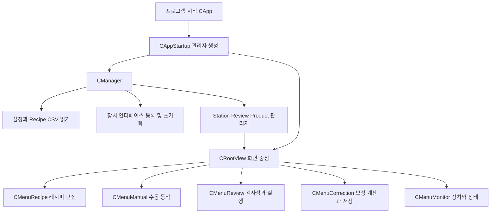
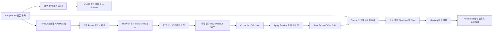
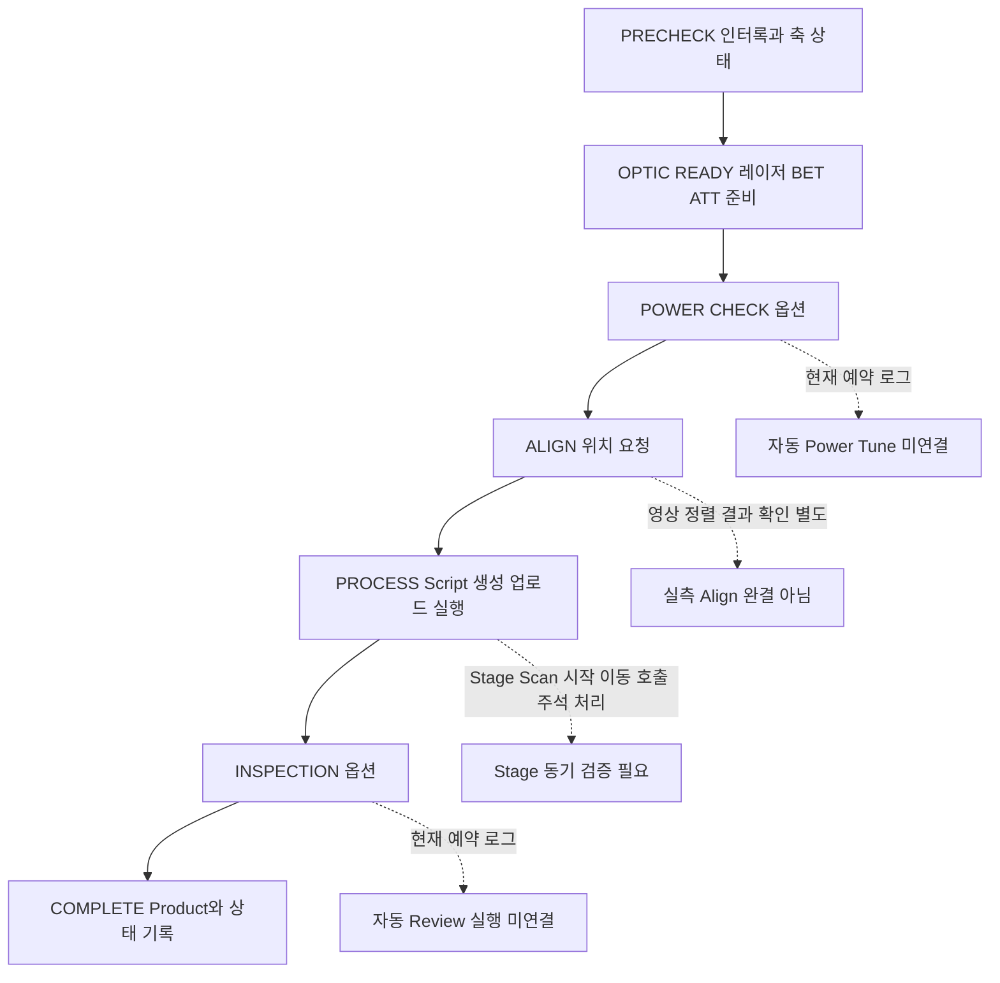

# A3 LD 프로그램 구조와 파일 연결

원본 Commit: [0c501c104dec1cebab87bd909de29b1b1395a8b4](https://github.com/kjuws10-rgb/A3_LD_Process_SW_IPS/commit/0c501c104dec1cebab87bd909de29b1b1395a8b4)

코드 구현 확인은 현장 검수 완료를 뜻하지 않습니다. 원본 진행 현황은 그대로 보존했고, 아래 판정은 현재 C# 구현을 기준으로 별도 작성했습니다. 화면은 최신 소스의 WPF 화면을 장치 전체 Simulation 모드로 화면 밖에서 렌더링한 것입니다. 실제 장비 측정값 또는 실제 동작 완료 증거가 아닙니다.

## 세 프로젝트의 역할

| 프로젝트 | 초보자 표현 | 주요 책임 |
|---|---|---|
| Drilling.UI | 작업자가 누르는 화면 | Recipe 편집, Manual, Review, Correction, Monitor, 모드 접근 제한 |
| Drilling.Common | 계산과 작업 순서를 맡는 중심 | 좌표·Masking·Head 배정·자동 순서·장치 인터페이스·Product 상태 |
| Drilling.File | 자료를 보관하는 창고 | CSV 설정·Recipe·ReviewResult·ReviewOffset·AeroScript·로그 저장 |

## 프로그램 시작과 화면 연결

일반 CAppStartup은 설정에 맞춰 장치를 초기화합니다. 이번 화면 검증은 해당 시작 함수를 실행하지 않았고 CManager에 simulationMode true를 직접 지정했습니다.

## 좌표 자료가 만들어지고 사용되는 시점

레시피 선택 순간에 모든 장비용 값을 영구적으로 한 번만 계산하는 구조는 아닙니다. 화면 Preview는 화면 Build에서, 가공 Plan은 준비/재준비에서, Review Plan은 화면 및 실행 준비에서 계산합니다. ALL Plan의 전체 Review 점은 Lazy 목록으로 필요할 때 계산합니다. Points는 해당 Plan에 포함된 점 목록으로 SAMPLE Plan에서는 선택점으로 줄어들 수 있습니다. ReviewPoints는 Points 중 Use가 켜진 점을 골라 캐시한 목록이며, 전부 Use라면 Points 자체를 반환합니다. 따라서 두 변수는 서로 독립된 같은 데이터의 무조건 복사본이 아닙니다. 보정할 전체 범위는 CorrectionPlan.SourcePoints로 별도 연결되기도 합니다. 가공 실행에서는 Head별 Shot 좌표 목록을 가지고 Script를 만듭니다. 같은 자료형을 쓴다고 설계 좌표·Scanner 좌표·Review 좌표가 같은 값이라는 뜻은 아닙니다.

## 주요 자료와 저장 형식

| 자료 | 무엇을 담는가 | 저장·사용 |
|---|---|---|
| ST_RECIPE_DEFINITION / ST_RECIPE_PARAMETER | Recipe ID와 Key별 값·단위·타입·범위 | JHMI_RCP.csv 정의 + Config/RECIPE CSV |
| ST_HEAD_SHOT_POINT | Cell/Shot/Head, 설계/Scanner/Stage 좌표, 각 Offset, Encoder 목표 | 가공 Plan 및 좌표 CSV/Script |
| ST_REVIEW_PLAN_POINT | Cell/Shot/Beam/Head, 기준 좌표, ErrorX/Y, 상태·판정 | Review 화면·측정·재개 키 |
| ST_REVIEW_PLAN | 현재 Plan의 Points와 Use 필터 캐시 ReviewPoints, Tolerance, Rule | 화면과 검사 시퀀스에서 사용 |
| ReviewResult | Glass·Recipe·Head·Cell·Shot·Error·Judge·Rule | Data/ReviewResult CSV |
| ReviewOffset | CellID·ShotID·ReviewOffsetX/Y | Recipe별 reviewoffset 폴더의 시각별 CSV |
| Product | Glass별 가공/검사 상태와 결과·진행 | CProductManager와 Product 파일 |

## 현재 자동 순서의 연결 상태

검사 화면의 수동 Review 흐름은 별도로 존재하지만 하부 MoveStageY/MoveVisionX는 TODO입니다. Monitor의 파워 Tune은 별도로 구현되어 있어 자동 PowerCheck와 같은 기능이 아닙니다.

## 파일별 역할 목록

총 추적 파일 7398개 중 bin/obj/.vs 및 실행 생성물은 구현 근거에서 제외했습니다. 아래는 실질 코드·화면·설정·프로젝트 파일 목록이며 C# 파일 117개의 클래스·자료형도 함께 정리했습니다. 목록의 역할은 경로와 선언을 기준으로 분류한 요약입니다.

| 파일 | 역할 | 대표 선언 |
|---|---|---|
| [Config/JHMI_BET.csv](https://github.com/kjuws10-rgb/A3_LD_Process_SW_IPS/blob/0c501c104dec1cebab87bd909de29b1b1395a8b4/Config/JHMI_BET.csv) | 장치 주소·옵션·Recipe·Review 설정 데이터 |  |
| [Config/JHMI_INTERFACE.csv](https://github.com/kjuws10-rgb/A3_LD_Process_SW_IPS/blob/0c501c104dec1cebab87bd909de29b1b1395a8b4/Config/JHMI_INTERFACE.csv) | 장치 주소·옵션·Recipe·Review 설정 데이터 |  |
| [Config/JHMI_IO.csv](https://github.com/kjuws10-rgb/A3_LD_Process_SW_IPS/blob/0c501c104dec1cebab87bd909de29b1b1395a8b4/Config/JHMI_IO.csv) | 장치 주소·옵션·Recipe·Review 설정 데이터 |  |
| [Config/JHMI_MANUAL_SCAN.csv](https://github.com/kjuws10-rgb/A3_LD_Process_SW_IPS/blob/0c501c104dec1cebab87bd909de29b1b1395a8b4/Config/JHMI_MANUAL_SCAN.csv) | 장치 주소·옵션·Recipe·Review 설정 데이터 |  |
| [Config/JHMI_MELSEC_MAP.csv](https://github.com/kjuws10-rgb/A3_LD_Process_SW_IPS/blob/0c501c104dec1cebab87bd909de29b1b1395a8b4/Config/JHMI_MELSEC_MAP.csv) | 장치 주소·옵션·Recipe·Review 설정 데이터 |  |
| [Config/JHMI_MOTOR.csv](https://github.com/kjuws10-rgb/A3_LD_Process_SW_IPS/blob/0c501c104dec1cebab87bd909de29b1b1395a8b4/Config/JHMI_MOTOR.csv) | 장치 주소·옵션·Recipe·Review 설정 데이터 |  |
| [Config/JHMI_RCP.csv](https://github.com/kjuws10-rgb/A3_LD_Process_SW_IPS/blob/0c501c104dec1cebab87bd909de29b1b1395a8b4/Config/JHMI_RCP.csv) | 장치 주소·옵션·Recipe·Review 설정 데이터 |  |
| [Config/JHMI_REVIEW_RULE.csv](https://github.com/kjuws10-rgb/A3_LD_Process_SW_IPS/blob/0c501c104dec1cebab87bd909de29b1b1395a8b4/Config/JHMI_REVIEW_RULE.csv) | 장치 주소·옵션·Recipe·Review 설정 데이터 |  |
| [Config/JHMI_SETTING.csv](https://github.com/kjuws10-rgb/A3_LD_Process_SW_IPS/blob/0c501c104dec1cebab87bd909de29b1b1395a8b4/Config/JHMI_SETTING.csv) | 장치 주소·옵션·Recipe·Review 설정 데이터 |  |
| [Config/RECIPE/DRILL_A01.csv](https://github.com/kjuws10-rgb/A3_LD_Process_SW_IPS/blob/0c501c104dec1cebab87bd909de29b1b1395a8b4/Config/RECIPE/DRILL_A01.csv) | 장치 주소·옵션·Recipe·Review 설정 데이터 |  |
| [Config/RECIPE/animotion.csv](https://github.com/kjuws10-rgb/A3_LD_Process_SW_IPS/blob/0c501c104dec1cebab87bd909de29b1b1395a8b4/Config/RECIPE/animotion.csv) | 장치 주소·옵션·Recipe·Review 설정 데이터 |  |
| [Config/RECIPE/sample3.csv](https://github.com/kjuws10-rgb/A3_LD_Process_SW_IPS/blob/0c501c104dec1cebab87bd909de29b1b1395a8b4/Config/RECIPE/sample3.csv) | 장치 주소·옵션·Recipe·Review 설정 데이터 |  |
| [Config/RECIPE/simple2.csv](https://github.com/kjuws10-rgb/A3_LD_Process_SW_IPS/blob/0c501c104dec1cebab87bd909de29b1b1395a8b4/Config/RECIPE/simple2.csv) | 장치 주소·옵션·Recipe·Review 설정 데이터 |  |
| [Config/RECIPE/test0929.csv](https://github.com/kjuws10-rgb/A3_LD_Process_SW_IPS/blob/0c501c104dec1cebab87bd909de29b1b1395a8b4/Config/RECIPE/test0929.csv) | 장치 주소·옵션·Recipe·Review 설정 데이터 |  |
| [Config/RECIPE/test0929_reviewoffset/20261006_111250_575_reviewoffset.csv](https://github.com/kjuws10-rgb/A3_LD_Process_SW_IPS/blob/0c501c104dec1cebab87bd909de29b1b1395a8b4/Config/RECIPE/test0929_reviewoffset/20261006_111250_575_reviewoffset.csv) | 장치 주소·옵션·Recipe·Review 설정 데이터 |  |
| [Config/RECIPE/wizardtest.csv](https://github.com/kjuws10-rgb/A3_LD_Process_SW_IPS/blob/0c501c104dec1cebab87bd909de29b1b1395a8b4/Config/RECIPE/wizardtest.csv) | 장치 주소·옵션·Recipe·Review 설정 데이터 |  |
| [Config/Setting/Setting.csv](https://github.com/kjuws10-rgb/A3_LD_Process_SW_IPS/blob/0c501c104dec1cebab87bd909de29b1b1395a8b4/Config/Setting/Setting.csv) | 장치 주소·옵션·Recipe·Review 설정 데이터 |  |
| [Drilling.Common/Alarm/CAlarmManager.cs](https://github.com/kjuws10-rgb/A3_LD_Process_SW_IPS/blob/0c501c104dec1cebab87bd909de29b1b1395a8b4/Drilling.Common/Alarm/CAlarmManager.cs) | 설정·예제·지원 자료 | enum EN_ALARM_LEVEL, enum EN_ALARM_STATE, record ST_ALARM_DATA, class CAlarmManager, record ST_ALARM_RULE, record ST_ALARM_CANDIDATE |
| [Drilling.Common/Automation/CAutomationManager.cs](https://github.com/kjuws10-rgb/A3_LD_Process_SW_IPS/blob/0c501c104dec1cebab87bd909de29b1b1395a8b4/Drilling.Common/Automation/CAutomationManager.cs) | 설정·예제·지원 자료 | record ST_BUFFERED_SCRIPT_RUN_ITEM, record ST_AUTOMATION_AXIS_STATUS, class CAutomationManager |
| [Drilling.Common/Automation/CGalvoTemperature.cs](https://github.com/kjuws10-rgb/A3_LD_Process_SW_IPS/blob/0c501c104dec1cebab87bd909de29b1b1395a8b4/Drilling.Common/Automation/CGalvoTemperature.cs) | 설정·예제·지원 자료 | class CGalvoTemperature |
| [Drilling.Common/Automation/CScannerStatusLiveSnapshotStore.cs](https://github.com/kjuws10-rgb/A3_LD_Process_SW_IPS/blob/0c501c104dec1cebab87bd909de29b1b1395a8b4/Drilling.Common/Automation/CScannerStatusLiveSnapshotStore.cs) | 설정·예제·지원 자료 | record ST_SCANNER_AXIS_LIVE_STATUS, class CScannerStatusLiveSnapshotStore |
| [Drilling.Common/Drilling.Common.csproj](https://github.com/kjuws10-rgb/A3_LD_Process_SW_IPS/blob/0c501c104dec1cebab87bd909de29b1b1395a8b4/Drilling.Common/Drilling.Common.csproj) | 빌드 구성과 프로젝트 참조 |  |
| [Drilling.Common/InterLock/CInterLockManager.cs](https://github.com/kjuws10-rgb/A3_LD_Process_SW_IPS/blob/0c501c104dec1cebab87bd909de29b1b1395a8b4/Drilling.Common/InterLock/CInterLockManager.cs) | 설정·예제·지원 자료 | enum EN_INTERLOCK_TARGET, enum EN_INTERLOCK_LEVEL, record ST_INTERLOCK_ITEM, record ST_INTERLOCK_RULE, record ST_INTERLOCK_SUMMARY, class CInterLockManager, record ST_INTERLOCK_CHECK |
| [Drilling.Common/Interface/Automation1/CAutomation1Comm.cs](https://github.com/kjuws10-rgb/A3_LD_Process_SW_IPS/blob/0c501c104dec1cebab87bd909de29b1b1395a8b4/Drilling.Common/Interface/Automation1/CAutomation1Comm.cs) | 장치 통신·명령·응답 파싱 또는 시뮬레이션 | class CAutomation1Comm, record CAutoAxis, record CBufferedRunRequest, record CBufferedRunQueue, record CBufferedRunTaskState |
| [Drilling.Common/Interface/CAttenuatorSoftwareLimit.cs](https://github.com/kjuws10-rgb/A3_LD_Process_SW_IPS/blob/0c501c104dec1cebab87bd909de29b1b1395a8b4/Drilling.Common/Interface/CAttenuatorSoftwareLimit.cs) | 장치 통신·명령·응답 파싱 또는 시뮬레이션 | class CInterfaceManager |
| [Drilling.Common/Interface/CComm.cs](https://github.com/kjuws10-rgb/A3_LD_Process_SW_IPS/blob/0c501c104dec1cebab87bd909de29b1b1395a8b4/Drilling.Common/Interface/CComm.cs) | 장치 통신·명령·응답 파싱 또는 시뮬레이션 | class CCommTypeAttribute, record ST_COMM_RECEIVED_MESSAGE, class CComm, record CCommRegistration, class CCommBase, class CReadyOnlyComm |
| [Drilling.Common/Interface/CInterfaceManager.cs](https://github.com/kjuws10-rgb/A3_LD_Process_SW_IPS/blob/0c501c104dec1cebab87bd909de29b1b1395a8b4/Drilling.Common/Interface/CInterfaceManager.cs) | 장치 통신·명령·응답 파싱 또는 시뮬레이션 | enum EN_COMM_STATE, enum EN_EQP_MODULE, enum EN_INTERFACE_TYPE, record ST_INTERFACE_HISTORY, record ST_DEVICE_COMM_STATUS, record ST_INTERFACE_CONNECT_OPTION, record ST_INTERFACE_COMM_STATUS |
| [Drilling.Common/Interface/Melsec/CMelsec.Polling.cs](https://github.com/kjuws10-rgb/A3_LD_Process_SW_IPS/blob/0c501c104dec1cebab87bd909de29b1b1395a8b4/Drilling.Common/Interface/Melsec/CMelsec.Polling.cs) | 장치 통신·명령·응답 파싱 또는 시뮬레이션 | enum EN_MELSEC_CACHE_STATE, record ST_MELSEC_CACHED_VALUE, class CMelsec, record PollItem, class PollBlock |
| [Drilling.Common/Interface/Melsec/CMelsec.cs](https://github.com/kjuws10-rgb/A3_LD_Process_SW_IPS/blob/0c501c104dec1cebab87bd909de29b1b1395a8b4/Drilling.Common/Interface/Melsec/CMelsec.cs) | 장치 통신·명령·응답 파싱 또는 시뮬레이션 | enum EN_MELSEC_DATA_TYPE, enum EN_MELSEC_DIRECTION, enum EN_MELSEC_ACCESS, enum EN_MELSEC_PROCESS, enum EN_MELSEC_WRITE_RESULT, enum EN_MELSEC_SIMULATION_READBACK, record ST_MELSEC_WRITE_STATUS |
| [Drilling.Common/Interface/Melsec/CMelsecNetApi.cs](https://github.com/kjuws10-rgb/A3_LD_Process_SW_IPS/blob/0c501c104dec1cebab87bd909de29b1b1395a8b4/Drilling.Common/Interface/Melsec/CMelsecNetApi.cs) | 장치 통신·명령·응답 파싱 또는 시뮬레이션 | class CMelsecNetApi, class CMelsecNetNativeMethods |
| [Drilling.Common/Interface/PicoMotor/CPicoMotor.cs](https://github.com/kjuws10-rgb/A3_LD_Process_SW_IPS/blob/0c501c104dec1cebab87bd909de29b1b1395a8b4/Drilling.Common/Interface/PicoMotor/CPicoMotor.cs) | 장치 통신·명령·응답 파싱 또는 시뮬레이션 | enum EN_PICO_MOTOR_COMMAND, enum EN_PICO_MOTOR_ERROR, record ST_PICO_MOTOR_STATUS, class CPicoMotor, class CPicoMotorCommandSession |
| [Drilling.Common/Interface/PicoMotor/CPicoMotorService.cs](https://github.com/kjuws10-rgb/A3_LD_Process_SW_IPS/blob/0c501c104dec1cebab87bd909de29b1b1395a8b4/Drilling.Common/Interface/PicoMotor/CPicoMotorService.cs) | 장치 통신·명령·응답 파싱 또는 시뮬레이션 | class CPicoMotorService |
| [Drilling.Common/Interface/Serial/CBeamExpander.cs](https://github.com/kjuws10-rgb/A3_LD_Process_SW_IPS/blob/0c501c104dec1cebab87bd909de29b1b1395a8b4/Drilling.Common/Interface/Serial/CBeamExpander.cs) | 장치 통신·명령·응답 파싱 또는 시뮬레이션 | enum EN_BET_COMMAND, enum EN_BET_ERROR, class CBeamExpander, record ST_BET_STATUS, record ST_BET_TABLE_DATA |
| [Drilling.Common/Interface/Serial/CConex_AGP.cs](https://github.com/kjuws10-rgb/A3_LD_Process_SW_IPS/blob/0c501c104dec1cebab87bd909de29b1b1395a8b4/Drilling.Common/Interface/Serial/CConex_AGP.cs) | 장치 통신·명령·응답 파싱 또는 시뮬레이션 | enum EN_ATTENUATOR_COMMAND, enum EN_CONEX_AGP_ERROR, class CConex_AGP, record ST_ATTENUATOR_STATUS |
| [Drilling.Common/Interface/Serial/CPowerMeter.cs](https://github.com/kjuws10-rgb/A3_LD_Process_SW_IPS/blob/0c501c104dec1cebab87bd909de29b1b1395a8b4/Drilling.Common/Interface/Serial/CPowerMeter.cs) | 장치 통신·명령·응답 파싱 또는 시뮬레이션 | enum EN_POWER_METER_COMMAND, enum EN_POWER_METER_ERROR, class CPowerMeter |
| [Drilling.Common/Interface/Serial/CSerialComm.cs](https://github.com/kjuws10-rgb/A3_LD_Process_SW_IPS/blob/0c501c104dec1cebab87bd909de29b1b1395a8b4/Drilling.Common/Interface/Serial/CSerialComm.cs) | 장치 통신·명령·응답 파싱 또는 시뮬레이션 | class CSerialComm |
| [Drilling.Common/Interface/Serial/CTalonLaser.cs](https://github.com/kjuws10-rgb/A3_LD_Process_SW_IPS/blob/0c501c104dec1cebab87bd909de29b1b1395a8b4/Drilling.Common/Interface/Serial/CTalonLaser.cs) | 장치 통신·명령·응답 파싱 또는 시뮬레이션 | enum EN_TALON_COMMAND, enum EN_TALON_ERROR, class CTalonLaser, record ST_LASER_STATUS, record ST_TALON_STATUS |
| [Drilling.Common/Interface/Socket/CSocketComm.cs](https://github.com/kjuws10-rgb/A3_LD_Process_SW_IPS/blob/0c501c104dec1cebab87bd909de29b1b1395a8b4/Drilling.Common/Interface/Socket/CSocketComm.cs) | 장치 통신·명령·응답 파싱 또는 시뮬레이션 | class CSocketComm |
| [Drilling.Common/Interface/Socket/CSocketServerComm.cs](https://github.com/kjuws10-rgb/A3_LD_Process_SW_IPS/blob/0c501c104dec1cebab87bd909de29b1b1395a8b4/Drilling.Common/Interface/Socket/CSocketServerComm.cs) | 장치 통신·명령·응답 파싱 또는 시뮬레이션 | class CSocketServerComm |
| [Drilling.Common/Interface/Vision/CVisionComm.cs](https://github.com/kjuws10-rgb/A3_LD_Process_SW_IPS/blob/0c501c104dec1cebab87bd909de29b1b1395a8b4/Drilling.Common/Interface/Vision/CVisionComm.cs) | 장치 통신·명령·응답 파싱 또는 시뮬레이션 | class CVisionComm |
| [Drilling.Common/Interface/Vision/CVisionProtocol.cs](https://github.com/kjuws10-rgb/A3_LD_Process_SW_IPS/blob/0c501c104dec1cebab87bd909de29b1b1395a8b4/Drilling.Common/Interface/Vision/CVisionProtocol.cs) | 장치 통신·명령·응답 파싱 또는 시뮬레이션 | enum EN_VISION_COMMAND, record struct ST_VISION_PACKET_HEADER, record struct ST_VISION_MARK_SEARCH, record struct ST_VISION_MARK_FIND, record ST_VISION_PACKET, record ST_VISION_SINGLE_RESULT, record ST_VISION_LINE_RESULT |
| [Drilling.Common/Managers/CManager.cs](https://github.com/kjuws10-rgb/A3_LD_Process_SW_IPS/blob/0c501c104dec1cebab87bd909de29b1b1395a8b4/Drilling.Common/Managers/CManager.cs) | 설정·예제·지원 자료 | enum EN_SYSTEM_MODE, enum EN_PM_LOCK_STATE, enum EN_MANAGER_STARTUP_RESULT, record ST_MANUAL_SCAN_PARAM, record ST_MANUAL_SCAN_FORM, record ST_POWER_METER_STATUS, record ST_DEVICE_STATUS |
| [Drilling.Common/Managers/CRecipeManager.cs](https://github.com/kjuws10-rgb/A3_LD_Process_SW_IPS/blob/0c501c104dec1cebab87bd909de29b1b1395a8b4/Drilling.Common/Managers/CRecipeManager.cs) | 설정·예제·지원 자료 | enum EN_RECIPE_DATA_TYPE, record ST_RECIPE_PARAMETER, record ST_RECIPE_HISTORY, record ST_RECIPE_DEFINITION, record ST_RECIPE_FORM_ITEM, record ST_RECIPE_VALUE, class CRecipeFileBase |
| [Drilling.Common/Managers/CSettingManager.cs](https://github.com/kjuws10-rgb/A3_LD_Process_SW_IPS/blob/0c501c104dec1cebab87bd909de29b1b1395a8b4/Drilling.Common/Managers/CSettingManager.cs) | 설정·예제·지원 자료 | enum EN_SETTING_TAB, record ST_SYSTEM_PARAMETER, record ST_SETTING_HISTORY, class CSettingFileBase, class CInterfaceFileBase, class CSettingManager |
| [Drilling.Common/Motion/A3200/CA3200Motion.cs](https://github.com/kjuws10-rgb/A3_LD_Process_SW_IPS/blob/0c501c104dec1cebab87bd909de29b1b1395a8b4/Drilling.Common/Motion/A3200/CA3200Motion.cs) | 설정·예제·지원 자료 | class CA3200Motion |
| [Drilling.Common/Motion/ACS/CACSComm.cs](https://github.com/kjuws10-rgb/A3_LD_Process_SW_IPS/blob/0c501c104dec1cebab87bd909de29b1b1395a8b4/Drilling.Common/Motion/ACS/CACSComm.cs) | 설정·예제·지원 자료 | class CACSComm |
| [Drilling.Common/Motion/ACS/CACSMotion.cs](https://github.com/kjuws10-rgb/A3_LD_Process_SW_IPS/blob/0c501c104dec1cebab87bd909de29b1b1395a8b4/Drilling.Common/Motion/ACS/CACSMotion.cs) | 설정·예제·지원 자료 | class CACSMotion |
| [Drilling.Common/Motion/AJIN/CAjinMotion.cs](https://github.com/kjuws10-rgb/A3_LD_Process_SW_IPS/blob/0c501c104dec1cebab87bd909de29b1b1395a8b4/Drilling.Common/Motion/AJIN/CAjinMotion.cs) | 설정·예제·지원 자료 | class CAjinMotion |
| [Drilling.Common/Motion/CMotionController.cs](https://github.com/kjuws10-rgb/A3_LD_Process_SW_IPS/blob/0c501c104dec1cebab87bd909de29b1b1395a8b4/Drilling.Common/Motion/CMotionController.cs) | 설정·예제·지원 자료 | class CMotionControllerTypeAttribute, class CMotionController, interface is |
| [Drilling.Common/Motion/CMotionManager.cs](https://github.com/kjuws10-rgb/A3_LD_Process_SW_IPS/blob/0c501c104dec1cebab87bd909de29b1b1395a8b4/Drilling.Common/Motion/CMotionManager.cs) | 설정·예제·지원 자료 | enum EN_MOTION_COMMAND, record ST_IO_STATUS, record ST_IO_DATA, record ST_MOTOR_AXIS_STATUS, record ST_MOTOR_DATA, record ST_MOTION_STATION_STATUS, record ST_MOTION_CONTROLLER_STATUS |
| [Drilling.Common/Motion/PMAC/CPmacMotion.cs](https://github.com/kjuws10-rgb/A3_LD_Process_SW_IPS/blob/0c501c104dec1cebab87bd909de29b1b1395a8b4/Drilling.Common/Motion/PMAC/CPmacMotion.cs) | 설정·예제·지원 자료 | class CPmacMotion |
| [Drilling.Common/Motion/UMAC/CUmacMotion.cs](https://github.com/kjuws10-rgb/A3_LD_Process_SW_IPS/blob/0c501c104dec1cebab87bd909de29b1b1395a8b4/Drilling.Common/Motion/UMAC/CUmacMotion.cs) | 설정·예제·지원 자료 | class CUmacMotion |
| [Drilling.Common/Motion/XPS/CXpsComm.cs](https://github.com/kjuws10-rgb/A3_LD_Process_SW_IPS/blob/0c501c104dec1cebab87bd909de29b1b1395a8b4/Drilling.Common/Motion/XPS/CXpsComm.cs) | 설정·예제·지원 자료 | class CXpsComm |
| [Drilling.Common/Motion/XPS/CXpsMotion.cs](https://github.com/kjuws10-rgb/A3_LD_Process_SW_IPS/blob/0c501c104dec1cebab87bd909de29b1b1395a8b4/Drilling.Common/Motion/XPS/CXpsMotion.cs) | 설정·예제·지원 자료 | class CXpsMotion |
| [Drilling.Common/Product/CProductManager.cs](https://github.com/kjuws10-rgb/A3_LD_Process_SW_IPS/blob/0c501c104dec1cebab87bd909de29b1b1395a8b4/Drilling.Common/Product/CProductManager.cs) | Glass별 작업 상태·진행·결과 | enum EN_PRODUCT_STATE, enum EN_PRODUCT_RESULT, enum EN_PRODUCT_HEAD_STATE, enum EN_PRODUCT_PROCESS_STATE, record ST_PRODUCT_ALIGN_DATA, record ST_PRODUCT_DISTORTION_DATA, record ST_PRODUCT_REVIEW_RESULT |
| [Drilling.Common/Recipe/CCellPatternCalculator.cs](https://github.com/kjuws10-rgb/A3_LD_Process_SW_IPS/blob/0c501c104dec1cebab87bd909de29b1b1395a8b4/Drilling.Common/Recipe/CCellPatternCalculator.cs) | 설계 좌표·Head 배정·Masking·축 변환 | record ST_CELL_PATTERN_DEFINITION, record ST_SHOT_GROUP_CENTER, record ST_CELL_PATTERN_LAYOUT, class CCellPatternCalculator |
| [Drilling.Common/Recipe/CRecipeCellPatternCatalog.cs](https://github.com/kjuws10-rgb/A3_LD_Process_SW_IPS/blob/0c501c104dec1cebab87bd909de29b1b1395a8b4/Drilling.Common/Recipe/CRecipeCellPatternCatalog.cs) | 설계 좌표·Head 배정·Masking·축 변환 | record ST_RECIPE_CELL_PATTERN_ENTRY, class CRecipeCellPatternCatalog |
| [Drilling.Common/Recipe/CRecipeModelPixelCountReader.cs](https://github.com/kjuws10-rgb/A3_LD_Process_SW_IPS/blob/0c501c104dec1cebab87bd909de29b1b1395a8b4/Drilling.Common/Recipe/CRecipeModelPixelCountReader.cs) | 설계 좌표·Head 배정·Masking·축 변환 | record struct ST_RECIPE_MODEL_PIXEL_COUNT, record struct ST_RECIPE_MODEL_PATTERN, class CRecipeModelPixelCountReader |
| [Drilling.Common/Recipe/CRecipeShotMaskingPlan.cs](https://github.com/kjuws10-rgb/A3_LD_Process_SW_IPS/blob/0c501c104dec1cebab87bd909de29b1b1395a8b4/Drilling.Common/Recipe/CRecipeShotMaskingPlan.cs) | 설계 좌표·Head 배정·Masking·축 변환 | record ST_RECIPE_SHOT_MASKING_RESULT, class CRecipeShotMaskingPlan, record struct ST_MASKING_POINT, record ST_EDGE_CORNER_MASKING_AREA, record ST_MODEL_PATTERN_AREA, record ST_MODEL_MASKING_AREA, record struct ST_MASKING_RECT |
| [Drilling.Common/Recipe/CScannerAxisTransform.cs](https://github.com/kjuws10-rgb/A3_LD_Process_SW_IPS/blob/0c501c104dec1cebab87bd909de29b1b1395a8b4/Drilling.Common/Recipe/CScannerAxisTransform.cs) | 설계 좌표·Head 배정·Masking·축 변환 | record struct ST_SCANNER_AXIS_TRANSFORM, class CScannerAxisTransform |
| [Drilling.Common/Recipe/CShotCoordinatePlanBuilder.cs](https://github.com/kjuws10-rgb/A3_LD_Process_SW_IPS/blob/0c501c104dec1cebab87bd909de29b1b1395a8b4/Drilling.Common/Recipe/CShotCoordinatePlanBuilder.cs) | 설계 좌표·Head 배정·Masking·축 변환 | record ST_HEAD_SHOT_POINT, record ST_SHOT_COORDINATE_PLAN, record ST_DESIGN_SHOT_POINT, record struct ST_HEAD_ASSIGNMENT_CANDIDATE, record ST_PREPARED_SHOT_POINT, class CShotCoordinatePlanBuilder |
| [Drilling.Common/Review/CReviewCoordinateTransformer.cs](https://github.com/kjuws10-rgb/A3_LD_Process_SW_IPS/blob/0c501c104dec1cebab87bd909de29b1b1395a8b4/Drilling.Common/Review/CReviewCoordinateTransformer.cs) | 검사점 선택·측정 순서·보정 규칙 | enum EN_VISION_FLIP_TYPE, record struct ST_REVIEW_COORDINATE_OFFSET, record struct ST_REVIEW_COORDINATE_FORMULA, class CReviewCoordinateTransformer |
| [Drilling.Common/Review/CReviewFailureMessageBuilder.cs](https://github.com/kjuws10-rgb/A3_LD_Process_SW_IPS/blob/0c501c104dec1cebab87bd909de29b1b1395a8b4/Drilling.Common/Review/CReviewFailureMessageBuilder.cs) | 검사점 선택·측정 순서·보정 규칙 | record ST_REVIEW_FAILURE_MESSAGE, class CReviewFailureMessageBuilder, record ST_REVIEW_FAILURE_PART |
| [Drilling.Common/Review/CReviewManager.cs](https://github.com/kjuws10-rgb/A3_LD_Process_SW_IPS/blob/0c501c104dec1cebab87bd909de29b1b1395a8b4/Drilling.Common/Review/CReviewManager.cs) | 검사점 선택·측정 순서·보정 규칙 | interface IReviewPointListInfo, record struct ST_REVIEW_CELL_POINT_RANGE, interface IReviewCellPointSource, enum EN_REVIEW_POINT_STATE, enum EN_REVIEW_SEQUENCE_STATE, enum EN_REVIEW_RULE_TYPE, record ST_REVIEW_SEQUENCE_STATUS |
| [Drilling.Common/Review/CReviewRulePlanBuilder.cs](https://github.com/kjuws10-rgb/A3_LD_Process_SW_IPS/blob/0c501c104dec1cebab87bd909de29b1b1395a8b4/Drilling.Common/Review/CReviewRulePlanBuilder.cs) | 검사점 선택·측정 순서·보정 규칙 | enum EN_REVIEW_CORRECTION_RULE, enum EN_REVIEW_CORRECTION_SCOPE, enum EN_REVIEW_REFERENCE_LINE, record ST_REVIEW_RULE_CONFIGURATION, record ST_REVIEW_RULE_TARGET, record ST_REVIEW_RULE_PLAN, class CReviewRulePlanBuilder |
| [Drilling.Common/Review/CReviewSampleRuleSelector.cs](https://github.com/kjuws10-rgb/A3_LD_Process_SW_IPS/blob/0c501c104dec1cebab87bd909de29b1b1395a8b4/Drilling.Common/Review/CReviewSampleRuleSelector.cs) | 검사점 선택·측정 순서·보정 규칙 | class CReviewSampleRuleSelector |
| [Drilling.Common/Review/CReviewSettingFileBase.cs](https://github.com/kjuws10-rgb/A3_LD_Process_SW_IPS/blob/0c501c104dec1cebab87bd909de29b1b1395a8b4/Drilling.Common/Review/CReviewSettingFileBase.cs) | 검사점 선택·측정 순서·보정 규칙 | record ST_REVIEW_SETTING_PROFILE, class CReviewSettingFileBase |
| [Drilling.Common/Station/CStationManager.cs](https://github.com/kjuws10-rgb/A3_LD_Process_SW_IPS/blob/0c501c104dec1cebab87bd909de29b1b1395a8b4/Drilling.Common/Station/CStationManager.cs) | 가공 자료 준비와 자동 순서·Script 실행 | enum EN_SCRIPT_STATUS, enum EN_PROCESS_STEP, enum EN_STATION_SEQUENCE, enum EN_HEAD_PROCESS_STATUS, enum EN_STATION_ID, enum EN_STATION_STATE, record ST_HEAD_PROCESS_PLAN |
| [Drilling.Common/Station/CStationProcess.cs](https://github.com/kjuws10-rgb/A3_LD_Process_SW_IPS/blob/0c501c104dec1cebab87bd909de29b1b1395a8b4/Drilling.Common/Station/CStationProcess.cs) | 가공 자료 준비와 자동 순서·Script 실행 | class CStationProcess, interface is, interface communication, record ST_OPTIC_READY_BET_TARGET, record ST_BUFFERED_RUN_GROUP_RESULT, record ST_BUFFERED_RUN_STOP_RESULT, record struct ST_AUTOMATION_TASK_KEY |
| [Drilling.Common/Threading/CtrlThread.cs](https://github.com/kjuws10-rgb/A3_LD_Process_SW_IPS/blob/0c501c104dec1cebab87bd909de29b1b1395a8b4/Drilling.Common/Threading/CtrlThread.cs) | 설정·예제·지원 자료 | enum EN_CTRL_THREAD_STATE, class CtrlThread |
| [Drilling.File/Drilling.File.csproj](https://github.com/kjuws10-rgb/A3_LD_Process_SW_IPS/blob/0c501c104dec1cebab87bd909de29b1b1395a8b4/Drilling.File/Drilling.File.csproj) | 빌드 구성과 프로젝트 참조 |  |
| [Drilling.File/JHMI/CBETFile.cs](https://github.com/kjuws10-rgb/A3_LD_Process_SW_IPS/blob/0c501c104dec1cebab87bd909de29b1b1395a8b4/Drilling.File/JHMI/CBETFile.cs) | CSV 설정·Recipe의 읽기·검사·쓰기 | class CBETFile |
| [Drilling.File/JHMI/CConfigStructureFile.cs](https://github.com/kjuws10-rgb/A3_LD_Process_SW_IPS/blob/0c501c104dec1cebab87bd909de29b1b1395a8b4/Drilling.File/JHMI/CConfigStructureFile.cs) | CSV 설정·Recipe의 읽기·검사·쓰기 | class CConfigStructureFile, record ST_REQUIRED_CSV, record ST_VALUE_CSV |
| [Drilling.File/JHMI/CInterfaceFile.cs](https://github.com/kjuws10-rgb/A3_LD_Process_SW_IPS/blob/0c501c104dec1cebab87bd909de29b1b1395a8b4/Drilling.File/JHMI/CInterfaceFile.cs) | CSV 설정·Recipe의 읽기·검사·쓰기 | class CInterfaceFile, interface device |
| [Drilling.File/JHMI/CJhmiRecipeFile.cs](https://github.com/kjuws10-rgb/A3_LD_Process_SW_IPS/blob/0c501c104dec1cebab87bd909de29b1b1395a8b4/Drilling.File/JHMI/CJhmiRecipeFile.cs) | CSV 설정·Recipe의 읽기·검사·쓰기 | class CJhmiRecipeFile, record struct ST_SHOT_GROUP_PATTERN_BOUNDS |
| [Drilling.File/JHMI/CManualScanFile.cs](https://github.com/kjuws10-rgb/A3_LD_Process_SW_IPS/blob/0c501c104dec1cebab87bd909de29b1b1395a8b4/Drilling.File/JHMI/CManualScanFile.cs) | CSV 설정·Recipe의 읽기·검사·쓰기 | class CManualScanFile |
| [Drilling.File/JHMI/CMelsecMapFile.cs](https://github.com/kjuws10-rgb/A3_LD_Process_SW_IPS/blob/0c501c104dec1cebab87bd909de29b1b1395a8b4/Drilling.File/JHMI/CMelsecMapFile.cs) | CSV 설정·Recipe의 읽기·검사·쓰기 | class CMelsecMapFile |
| [Drilling.File/JHMI/CMotorFile.cs](https://github.com/kjuws10-rgb/A3_LD_Process_SW_IPS/blob/0c501c104dec1cebab87bd909de29b1b1395a8b4/Drilling.File/JHMI/CMotorFile.cs) | CSV 설정·Recipe의 읽기·검사·쓰기 | class CMotorFile |
| [Drilling.File/JHMI/CSettingFile.cs](https://github.com/kjuws10-rgb/A3_LD_Process_SW_IPS/blob/0c501c104dec1cebab87bd909de29b1b1395a8b4/Drilling.File/JHMI/CSettingFile.cs) | CSV 설정·Recipe의 읽기·검사·쓰기 | class CSettingFile, record ST_SETTING_FORM_ITEM |
| [Drilling.File/Parser/CCsvParser.cs](https://github.com/kjuws10-rgb/A3_LD_Process_SW_IPS/blob/0c501c104dec1cebab87bd909de29b1b1395a8b4/Drilling.File/Parser/CCsvParser.cs) | 설정·예제·지원 자료 | class CCsvParser |
| [Drilling.File/Product/CProductFile.cs](https://github.com/kjuws10-rgb/A3_LD_Process_SW_IPS/blob/0c501c104dec1cebab87bd909de29b1b1395a8b4/Drilling.File/Product/CProductFile.cs) | Glass별 작업 상태·진행·결과 | class CProductFile |
| [Drilling.File/Review/CReviewSettingFile.cs](https://github.com/kjuws10-rgb/A3_LD_Process_SW_IPS/blob/0c501c104dec1cebab87bd909de29b1b1395a8b4/Drilling.File/Review/CReviewSettingFile.cs) | 검사점 선택·측정 순서·보정 규칙 | class CReviewSettingFile |
| [Drilling.File/ReviewOffset/CReviewOffsetFile.cs](https://github.com/kjuws10-rgb/A3_LD_Process_SW_IPS/blob/0c501c104dec1cebab87bd909de29b1b1395a8b4/Drilling.File/ReviewOffset/CReviewOffsetFile.cs) | 측정 결과 또는 보정 Offset CSV 저장 | class CReviewOffsetFile |
| [Drilling.File/ReviewResult/CReviewResultFile.cs](https://github.com/kjuws10-rgb/A3_LD_Process_SW_IPS/blob/0c501c104dec1cebab87bd909de29b1b1395a8b4/Drilling.File/ReviewResult/CReviewResultFile.cs) | 측정 결과 또는 보정 Offset CSV 저장 | class CReviewResultFile, record ST_REVIEW_RESULT_METADATA |
| [Drilling.File/Script/CAutomation1ScriptFile.cs](https://github.com/kjuws10-rgb/A3_LD_Process_SW_IPS/blob/0c501c104dec1cebab87bd909de29b1b1395a8b4/Drilling.File/Script/CAutomation1ScriptFile.cs) | 실행용 AeroScript와 좌표 목록 저장 | class CAutomation1ScriptFile, enum EN_SCRIPT_FOLLOW_AXIS, class CAutomation1Script |
| [Drilling.UI/App.xaml](https://github.com/kjuws10-rgb/A3_LD_Process_SW_IPS/blob/0c501c104dec1cebab87bd909de29b1b1395a8b4/Drilling.UI/App.xaml) | 화면 색상·폰트·스타일 정의 |  |
| [Drilling.UI/AssemblyInfo.cs](https://github.com/kjuws10-rgb/A3_LD_Process_SW_IPS/blob/0c501c104dec1cebab87bd909de29b1b1395a8b4/Drilling.UI/AssemblyInfo.cs) | 설정·예제·지원 자료 |  |
| [Drilling.UI/CApp.xaml.cs](https://github.com/kjuws10-rgb/A3_LD_Process_SW_IPS/blob/0c501c104dec1cebab87bd909de29b1b1395a8b4/Drilling.UI/CApp.xaml.cs) | 설정·예제·지원 자료 | class CApp |
| [Drilling.UI/CAppStartup.cs](https://github.com/kjuws10-rgb/A3_LD_Process_SW_IPS/blob/0c501c104dec1cebab87bd909de29b1b1395a8b4/Drilling.UI/CAppStartup.cs) | 설정·예제·지원 자료 | class CAppStartup |
| [Drilling.UI/CPreviewCoordinateBehavior.cs](https://github.com/kjuws10-rgb/A3_LD_Process_SW_IPS/blob/0c501c104dec1cebab87bd909de29b1b1395a8b4/Drilling.UI/CPreviewCoordinateBehavior.cs) | 설정·예제·지원 자료 | class CPreviewCoordinateBehavior |
| [Drilling.UI/CRootView.cs](https://github.com/kjuws10-rgb/A3_LD_Process_SW_IPS/blob/0c501c104dec1cebab87bd909de29b1b1395a8b4/Drilling.UI/CRootView.cs) | 설정·예제·지원 자료 | class CRootView, enum EN_AUTO_CYCLE_STATE, record ST_SYSTEM_STATUS_SOURCE, record ST_SYSTEM_STATUS_SNAPSHOT |
| [Drilling.UI/CRootView.xaml](https://github.com/kjuws10-rgb/A3_LD_Process_SW_IPS/blob/0c501c104dec1cebab87bd909de29b1b1395a8b4/Drilling.UI/CRootView.xaml) | 설정·예제·지원 자료 |  |
| [Drilling.UI/CThemeManager.cs](https://github.com/kjuws10-rgb/A3_LD_Process_SW_IPS/blob/0c501c104dec1cebab87bd909de29b1b1395a8b4/Drilling.UI/CThemeManager.cs) | 설정·예제·지원 자료 | enum EN_UI_THEME, class CThemeManager |
| [Drilling.UI/CUiLogService.cs](https://github.com/kjuws10-rgb/A3_LD_Process_SW_IPS/blob/0c501c104dec1cebab87bd909de29b1b1395a8b4/Drilling.UI/CUiLogService.cs) | 설정·예제·지원 자료 | class CUiLogService |
| [Drilling.UI/Drilling.UI.csproj](https://github.com/kjuws10-rgb/A3_LD_Process_SW_IPS/blob/0c501c104dec1cebab87bd909de29b1b1395a8b4/Drilling.UI/Drilling.UI.csproj) | 빌드 구성과 프로젝트 참조 |  |
| [Drilling.UI/Menu/CBindingBase.cs](https://github.com/kjuws10-rgb/A3_LD_Process_SW_IPS/blob/0c501c104dec1cebab87bd909de29b1b1395a8b4/Drilling.UI/Menu/CBindingBase.cs) | 설정·예제·지원 자료 | class CBindingBase |
| [Drilling.UI/Menu/CButtonCommand.cs](https://github.com/kjuws10-rgb/A3_LD_Process_SW_IPS/blob/0c501c104dec1cebab87bd909de29b1b1395a8b4/Drilling.UI/Menu/CButtonCommand.cs) | 설정·예제·지원 자료 | class CButtonCommand |
| [Drilling.UI/Menu/CButtonCommandBehavior.cs](https://github.com/kjuws10-rgb/A3_LD_Process_SW_IPS/blob/0c501c104dec1cebab87bd909de29b1b1395a8b4/Drilling.UI/Menu/CButtonCommandBehavior.cs) | 설정·예제·지원 자료 | class CButtonCommandBehavior |
| [Drilling.UI/Menu/Menus/CCellPreviewDrawing.cs](https://github.com/kjuws10-rgb/A3_LD_Process_SW_IPS/blob/0c501c104dec1cebab87bd909de29b1b1395a8b4/Drilling.UI/Menu/Menus/CCellPreviewDrawing.cs) | 화면 동작과 표시 자료 구성 | class CCellPreviewDrawing, record ST_CELL_PREVIEW_LABEL, record ST_DISTORTION_KEY_PREVIEW |
| [Drilling.UI/Menu/Menus/CManualScannerStatusPollingService.cs](https://github.com/kjuws10-rgb/A3_LD_Process_SW_IPS/blob/0c501c104dec1cebab87bd909de29b1b1395a8b4/Drilling.UI/Menu/Menus/CManualScannerStatusPollingService.cs) | 장치 상태 읽기와 캐시 갱신 | class CManualScannerStatusPollingService |
| [Drilling.UI/Menu/Menus/CManualStageMotionPollingService.cs](https://github.com/kjuws10-rgb/A3_LD_Process_SW_IPS/blob/0c501c104dec1cebab87bd909de29b1b1395a8b4/Drilling.UI/Menu/Menus/CManualStageMotionPollingService.cs) | 장치 상태 읽기와 캐시 갱신 | class CManualStageMotionPollingService, record ST_MANUAL_STAGE_MOTION_VALUE |
| [Drilling.UI/Menu/Menus/CMelsecCachePresentation.cs](https://github.com/kjuws10-rgb/A3_LD_Process_SW_IPS/blob/0c501c104dec1cebab87bd909de29b1b1395a8b4/Drilling.UI/Menu/Menus/CMelsecCachePresentation.cs) | 화면 동작과 표시 자료 구성 | class CMelsecCachePresentation |
| [Drilling.UI/Menu/Menus/CMenuAlarm.cs](https://github.com/kjuws10-rgb/A3_LD_Process_SW_IPS/blob/0c501c104dec1cebab87bd909de29b1b1395a8b4/Drilling.UI/Menu/Menus/CMenuAlarm.cs) | 화면 동작과 표시 자료 구성 | class CMenuAlarm, record ST_ALARM_CURRENT_ROW, record ST_ALARM_DETAIL_ROW, record ST_ALARM_HISTORY_ROW, record ST_ALARM_TREND_BAR, record ST_ALARM_SUMMARY_ITEM |
| [Drilling.UI/Menu/Menus/CMenuBase.cs](https://github.com/kjuws10-rgb/A3_LD_Process_SW_IPS/blob/0c501c104dec1cebab87bd909de29b1b1395a8b4/Drilling.UI/Menu/Menus/CMenuBase.cs) | 화면 동작과 표시 자료 구성 | enum EN_MENU, class CMenuBase, record ST_DISPLAY_ITEM, class CStatusBrush, record ST_HEADER_STATUS_ITEM, record ST_SCREEN_SECTION, class CScreenViewModel |
| [Drilling.UI/Menu/Menus/CMenuCorrection.cs](https://github.com/kjuws10-rgb/A3_LD_Process_SW_IPS/blob/0c501c104dec1cebab87bd909de29b1b1395a8b4/Drilling.UI/Menu/Menus/CMenuCorrection.cs) | 화면 동작과 표시 자료 구성 | class CMenuCorrection, record ST_CORRECTION_TAB, record ST_CORRECTION_SOURCE_ROW, record ST_CORRECTION_VALUE_ROW, record ST_CORRECTION_HISTORY_ROW, record ST_CORRECTION_OFFSET_SHOT_MATRIX_ROW, record ST_CORRECTION_OFFSET_SHOT_ITEM |
| [Drilling.UI/Menu/Menus/CMenuExit.cs](https://github.com/kjuws10-rgb/A3_LD_Process_SW_IPS/blob/0c501c104dec1cebab87bd909de29b1b1395a8b4/Drilling.UI/Menu/Menus/CMenuExit.cs) | 화면 동작과 표시 자료 구성 | class CMenuExit |
| [Drilling.UI/Menu/Menus/CMenuMain.cs](https://github.com/kjuws10-rgb/A3_LD_Process_SW_IPS/blob/0c501c104dec1cebab87bd909de29b1b1395a8b4/Drilling.UI/Menu/Menus/CMenuMain.cs) | 화면 동작과 표시 자료 구성 | class CMenuMain, record ST_HEAD_ASSIGNMENT_MAP, record ST_MAIN_RECIPE_PREVIEW, record ST_PREVIEW_HEAD_LAYOUT, record ST_PREVIEW_HEAD_FIELD, record ST_GLASS_PREVIEW_FRAME, record ST_HEAD_PREVIEW |
| [Drilling.UI/Menu/Menus/CMenuManual.Mof.cs](https://github.com/kjuws10-rgb/A3_LD_Process_SW_IPS/blob/0c501c104dec1cebab87bd909de29b1b1395a8b4/Drilling.UI/Menu/Menus/CMenuManual.Mof.cs) | 화면 동작과 표시 자료 구성 | class CMenuManual |
| [Drilling.UI/Menu/Menus/CMenuManual.cs](https://github.com/kjuws10-rgb/A3_LD_Process_SW_IPS/blob/0c501c104dec1cebab87bd909de29b1b1395a8b4/Drilling.UI/Menu/Menus/CMenuManual.cs) | 화면 동작과 표시 자료 구성 | class CMenuManual, interface is, record struct ST_ACTIVE_DIO_TARGET, record struct ST_MANUAL_SCRIPT_AXES, record struct ST_MANUAL_SCRIPT_Z_AXIS, record ST_CONTROLLER_HOME_TASK, record ST_CONTROLLER_HOME_RUN |
| [Drilling.UI/Menu/Menus/CMenuMonitor.cs](https://github.com/kjuws10-rgb/A3_LD_Process_SW_IPS/blob/0c501c104dec1cebab87bd909de29b1b1395a8b4/Drilling.UI/Menu/Menus/CMenuMonitor.cs) | 화면 동작과 표시 자료 구성 | class CMenuMonitor, interface is, record ST_POWER_METER_OPTION, record ST_POWER_METER_TUNE_PROFILE, record ST_POWER_METER_TUNE_SETTINGS, record ST_POWER_METER_READ_RESULT, record ST_POWER_METER_GRAPH_DATA |
| [Drilling.UI/Menu/Menus/CMenuPm.cs](https://github.com/kjuws10-rgb/A3_LD_Process_SW_IPS/blob/0c501c104dec1cebab87bd909de29b1b1395a8b4/Drilling.UI/Menu/Menus/CMenuPm.cs) | 화면 동작과 표시 자료 구성 | class CMenuPm |
| [Drilling.UI/Menu/Menus/CMenuRecipe.cs](https://github.com/kjuws10-rgb/A3_LD_Process_SW_IPS/blob/0c501c104dec1cebab87bd909de29b1b1395a8b4/Drilling.UI/Menu/Menus/CMenuRecipe.cs) | 화면 동작과 표시 자료 구성 | class CMenuRecipe, record ST_RECIPE_CATEGORY_TAB, record ST_RECIPE_GROUP_TAB, record ST_RECIPE_CELL_VIEW_MODEL, record ST_RECIPE_MASKING_AREA, record ST_RECIPE_EDGE_MASKING_AREA, record ST_RECIPE_SHOT_MASKING_STATE |
| [Drilling.UI/Menu/Menus/CMenuReview.cs](https://github.com/kjuws10-rgb/A3_LD_Process_SW_IPS/blob/0c501c104dec1cebab87bd909de29b1b1395a8b4/Drilling.UI/Menu/Menus/CMenuReview.cs) | 화면 동작과 표시 자료 구성 | class CMenuReview, record ST_REVIEW_TAB_ITEM, record ST_REVIEW_MODE_ITEM, record ST_REVIEW_INSPECTION_METHOD_ITEM, class ST_REVIEW_RUN_SHOT_ROW, record ST_REVIEW_RUN_SHOT_MATRIX_ROW, record ST_REVIEW_BEAM_ROW |
| [Drilling.UI/Menu/Menus/CMenuSetting.cs](https://github.com/kjuws10-rgb/A3_LD_Process_SW_IPS/blob/0c501c104dec1cebab87bd909de29b1b1395a8b4/Drilling.UI/Menu/Menus/CMenuSetting.cs) | 화면 동작과 표시 자료 구성 | class CMenuSetting, interface row, record ST_SETTING_TAB, record ST_SETTING_GROUP, record ST_SETTING_HEAD_FILTER, class ST_SYSTEM_PARAMETER_ROW, record ST_SETTING_HISTORY_ROW |
| [Drilling.UI/Menu/Menus/CMonitorStatusPollingService.cs](https://github.com/kjuws10-rgb/A3_LD_Process_SW_IPS/blob/0c501c104dec1cebab87bd909de29b1b1395a8b4/Drilling.UI/Menu/Menus/CMonitorStatusPollingService.cs) | 장치 상태 읽기와 캐시 갱신 | class CMonitorStatusPollingService, record ST_MONITOR_POLLING_CONTEXT, record ST_MONITOR_STATUS_SNAPSHOT, record ST_MONITOR_MELSEC_VALUE |
| [Drilling.UI/Menu/Menus/CMotorStatusPollingService.cs](https://github.com/kjuws10-rgb/A3_LD_Process_SW_IPS/blob/0c501c104dec1cebab87bd909de29b1b1395a8b4/Drilling.UI/Menu/Menus/CMotorStatusPollingService.cs) | 장치 상태 읽기와 캐시 갱신 | class CMotorStatusPollingService, record ST_MOTOR_STATUS_ITEM |
| [Drilling.UI/Menu/Menus/CRecipeCellPatternPreviewDrawing.cs](https://github.com/kjuws10-rgb/A3_LD_Process_SW_IPS/blob/0c501c104dec1cebab87bd909de29b1b1395a8b4/Drilling.UI/Menu/Menus/CRecipeCellPatternPreviewDrawing.cs) | 화면 동작과 표시 자료 구성 | class CRecipeCellPatternPreviewDrawing |
| [Drilling.UI/Menu/Menus/CReviewGlassPreviewBuilder.cs](https://github.com/kjuws10-rgb/A3_LD_Process_SW_IPS/blob/0c501c104dec1cebab87bd909de29b1b1395a8b4/Drilling.UI/Menu/Menus/CReviewGlassPreviewBuilder.cs) | 화면 동작과 표시 자료 구성 | class CReviewGlassPreviewBuilder, record ST_REVIEW_CELL_DISPLAY, record ST_REVIEW_GLASS_PREVIEW, record ST_REVIEW_SCOPE_TARGET, record ST_REVIEW_GLASS_AXIS_INDICATOR |
| [Drilling.UI/Menu/Menus/CScannerStatusPollingService.cs](https://github.com/kjuws10-rgb/A3_LD_Process_SW_IPS/blob/0c501c104dec1cebab87bd909de29b1b1395a8b4/Drilling.UI/Menu/Menus/CScannerStatusPollingService.cs) | 장치 상태 읽기와 캐시 갱신 | class CScannerStatusPollingService, record struct ST_SCANNER_STATUS_POLLING_CONTEXT |
| [Drilling.UI/Popup/CCellPlacementWizardDialog.xaml](https://github.com/kjuws10-rgb/A3_LD_Process_SW_IPS/blob/0c501c104dec1cebab87bd909de29b1b1395a8b4/Drilling.UI/Popup/CCellPlacementWizardDialog.xaml) | 입력·확인·경고 대화상자 |  |
| [Drilling.UI/Popup/CCellPlacementWizardDialog.xaml.cs](https://github.com/kjuws10-rgb/A3_LD_Process_SW_IPS/blob/0c501c104dec1cebab87bd909de29b1b1395a8b4/Drilling.UI/Popup/CCellPlacementWizardDialog.xaml.cs) | 입력·확인·경고 대화상자 | class CCellPlacementWizardDialog, record ST_CELL_PLACEMENT_WIZARD_CONTEXT, record ST_CELL_PLACEMENT_WIZARD_RESULT, record ST_CELL_PLACEMENT_MODEL_OVERRIDE, record ST_CELL_PLACEMENT_WIZARD_DIRECTION, class ST_CELL_PLACEMENT_MODEL_SELECTOR_ROW |
| [Drilling.UI/Popup/CControllerResetSequenceDialog.xaml](https://github.com/kjuws10-rgb/A3_LD_Process_SW_IPS/blob/0c501c104dec1cebab87bd909de29b1b1395a8b4/Drilling.UI/Popup/CControllerResetSequenceDialog.xaml) | 입력·확인·경고 대화상자 |  |
| [Drilling.UI/Popup/CControllerResetSequenceDialog.xaml.cs](https://github.com/kjuws10-rgb/A3_LD_Process_SW_IPS/blob/0c501c104dec1cebab87bd909de29b1b1395a8b4/Drilling.UI/Popup/CControllerResetSequenceDialog.xaml.cs) | 입력·확인·경고 대화상자 | record ST_CONTROLLER_RESET_SEQUENCE_TARGET_OPTION, class ST_CONTROLLER_RESET_SEQUENCE_BLOCK, class ST_CONTROLLER_RESET_SEQUENCE_STEP, class CControllerResetSequenceDialog |
| [Drilling.UI/Popup/CInterfaceStatusDialog.xaml](https://github.com/kjuws10-rgb/A3_LD_Process_SW_IPS/blob/0c501c104dec1cebab87bd909de29b1b1395a8b4/Drilling.UI/Popup/CInterfaceStatusDialog.xaml) | 입력·확인·경고 대화상자 |  |
| [Drilling.UI/Popup/CInterfaceStatusDialog.xaml.cs](https://github.com/kjuws10-rgb/A3_LD_Process_SW_IPS/blob/0c501c104dec1cebab87bd909de29b1b1395a8b4/Drilling.UI/Popup/CInterfaceStatusDialog.xaml.cs) | 입력·확인·경고 대화상자 | class CInterfaceStatusDialog, interface item, class CInterfaceStatusRow |
| [Drilling.UI/Popup/CMofDisableDialog.xaml](https://github.com/kjuws10-rgb/A3_LD_Process_SW_IPS/blob/0c501c104dec1cebab87bd909de29b1b1395a8b4/Drilling.UI/Popup/CMofDisableDialog.xaml) | 입력·확인·경고 대화상자 |  |
| [Drilling.UI/Popup/CMofDisableDialog.xaml.cs](https://github.com/kjuws10-rgb/A3_LD_Process_SW_IPS/blob/0c501c104dec1cebab87bd909de29b1b1395a8b4/Drilling.UI/Popup/CMofDisableDialog.xaml.cs) | 입력·확인·경고 대화상자 | class CMofDisableDialog, class CMofAxisSelection |
| [Drilling.UI/Popup/CPasswordInputDialog.xaml](https://github.com/kjuws10-rgb/A3_LD_Process_SW_IPS/blob/0c501c104dec1cebab87bd909de29b1b1395a8b4/Drilling.UI/Popup/CPasswordInputDialog.xaml) | 입력·확인·경고 대화상자 |  |
| [Drilling.UI/Popup/CPasswordInputDialog.xaml.cs](https://github.com/kjuws10-rgb/A3_LD_Process_SW_IPS/blob/0c501c104dec1cebab87bd909de29b1b1395a8b4/Drilling.UI/Popup/CPasswordInputDialog.xaml.cs) | 입력·확인·경고 대화상자 | class CPasswordInputDialog |
| [Drilling.UI/Popup/CRecipeConfirmDialog.xaml](https://github.com/kjuws10-rgb/A3_LD_Process_SW_IPS/blob/0c501c104dec1cebab87bd909de29b1b1395a8b4/Drilling.UI/Popup/CRecipeConfirmDialog.xaml) | 입력·확인·경고 대화상자 |  |
| [Drilling.UI/Popup/CRecipeConfirmDialog.xaml.cs](https://github.com/kjuws10-rgb/A3_LD_Process_SW_IPS/blob/0c501c104dec1cebab87bd909de29b1b1395a8b4/Drilling.UI/Popup/CRecipeConfirmDialog.xaml.cs) | 입력·확인·경고 대화상자 | enum EN_REVIEW_RESUME_CHOICE, class CRecipeConfirmDialog |
| [Drilling.UI/Popup/CRecipeNameDialog.xaml](https://github.com/kjuws10-rgb/A3_LD_Process_SW_IPS/blob/0c501c104dec1cebab87bd909de29b1b1395a8b4/Drilling.UI/Popup/CRecipeNameDialog.xaml) | 입력·확인·경고 대화상자 |  |
| [Drilling.UI/Popup/CRecipeNameDialog.xaml.cs](https://github.com/kjuws10-rgb/A3_LD_Process_SW_IPS/blob/0c501c104dec1cebab87bd909de29b1b1395a8b4/Drilling.UI/Popup/CRecipeNameDialog.xaml.cs) | 입력·확인·경고 대화상자 | class CRecipeNameDialog |
| [Drilling.UI/Popup/CShiftOffsetDialog.xaml](https://github.com/kjuws10-rgb/A3_LD_Process_SW_IPS/blob/0c501c104dec1cebab87bd909de29b1b1395a8b4/Drilling.UI/Popup/CShiftOffsetDialog.xaml) | 입력·확인·경고 대화상자 |  |
| [Drilling.UI/Popup/CShiftOffsetDialog.xaml.cs](https://github.com/kjuws10-rgb/A3_LD_Process_SW_IPS/blob/0c501c104dec1cebab87bd909de29b1b1395a8b4/Drilling.UI/Popup/CShiftOffsetDialog.xaml.cs) | 입력·확인·경고 대화상자 | record ST_SHIFT_OFFSET_HEAD_ROW, class CShiftOffsetDialog |
| [Drilling.UI/Popup/CValueInputDialog.xaml](https://github.com/kjuws10-rgb/A3_LD_Process_SW_IPS/blob/0c501c104dec1cebab87bd909de29b1b1395a8b4/Drilling.UI/Popup/CValueInputDialog.xaml) | 입력·확인·경고 대화상자 |  |
| [Drilling.UI/Popup/CValueInputDialog.xaml.cs](https://github.com/kjuws10-rgb/A3_LD_Process_SW_IPS/blob/0c501c104dec1cebab87bd909de29b1b1395a8b4/Drilling.UI/Popup/CValueInputDialog.xaml.cs) | 입력·확인·경고 대화상자 | class CValueInputDialog |
| [Drilling.UI/Themes/ThemeDark.xaml](https://github.com/kjuws10-rgb/A3_LD_Process_SW_IPS/blob/0c501c104dec1cebab87bd909de29b1b1395a8b4/Drilling.UI/Themes/ThemeDark.xaml) | 화면 색상·폰트·스타일 정의 |  |
| [Drilling.UI/Themes/ThemeLight.xaml](https://github.com/kjuws10-rgb/A3_LD_Process_SW_IPS/blob/0c501c104dec1cebab87bd909de29b1b1395a8b4/Drilling.UI/Themes/ThemeLight.xaml) | 화면 색상·폰트·스타일 정의 |  |
| [Drilling.UI/Views/CAlarmView.xaml](https://github.com/kjuws10-rgb/A3_LD_Process_SW_IPS/blob/0c501c104dec1cebab87bd909de29b1b1395a8b4/Drilling.UI/Views/CAlarmView.xaml) | 운영 화면의 배치와 UI 연결 |  |
| [Drilling.UI/Views/CAlarmView.xaml.cs](https://github.com/kjuws10-rgb/A3_LD_Process_SW_IPS/blob/0c501c104dec1cebab87bd909de29b1b1395a8b4/Drilling.UI/Views/CAlarmView.xaml.cs) | 운영 화면의 배치와 UI 연결 | class CAlarmView |
| [Drilling.UI/Views/CCorrectionView.xaml](https://github.com/kjuws10-rgb/A3_LD_Process_SW_IPS/blob/0c501c104dec1cebab87bd909de29b1b1395a8b4/Drilling.UI/Views/CCorrectionView.xaml) | 운영 화면의 배치와 UI 연결 |  |
| [Drilling.UI/Views/CCorrectionView.xaml.cs](https://github.com/kjuws10-rgb/A3_LD_Process_SW_IPS/blob/0c501c104dec1cebab87bd909de29b1b1395a8b4/Drilling.UI/Views/CCorrectionView.xaml.cs) | 운영 화면의 배치와 UI 연결 | class CCorrectionView |
| [Drilling.UI/Views/CExitView.xaml](https://github.com/kjuws10-rgb/A3_LD_Process_SW_IPS/blob/0c501c104dec1cebab87bd909de29b1b1395a8b4/Drilling.UI/Views/CExitView.xaml) | 운영 화면의 배치와 UI 연결 |  |
| [Drilling.UI/Views/CExitView.xaml.cs](https://github.com/kjuws10-rgb/A3_LD_Process_SW_IPS/blob/0c501c104dec1cebab87bd909de29b1b1395a8b4/Drilling.UI/Views/CExitView.xaml.cs) | 운영 화면의 배치와 UI 연결 | class CExitView |
| [Drilling.UI/Views/CMainView.xaml](https://github.com/kjuws10-rgb/A3_LD_Process_SW_IPS/blob/0c501c104dec1cebab87bd909de29b1b1395a8b4/Drilling.UI/Views/CMainView.xaml) | 운영 화면의 배치와 UI 연결 |  |
| [Drilling.UI/Views/CMainView.xaml.cs](https://github.com/kjuws10-rgb/A3_LD_Process_SW_IPS/blob/0c501c104dec1cebab87bd909de29b1b1395a8b4/Drilling.UI/Views/CMainView.xaml.cs) | 운영 화면의 배치와 UI 연결 | class CMainView |
| [Drilling.UI/Views/CManualView.xaml](https://github.com/kjuws10-rgb/A3_LD_Process_SW_IPS/blob/0c501c104dec1cebab87bd909de29b1b1395a8b4/Drilling.UI/Views/CManualView.xaml) | 운영 화면의 배치와 UI 연결 |  |
| [Drilling.UI/Views/CManualView.xaml.cs](https://github.com/kjuws10-rgb/A3_LD_Process_SW_IPS/blob/0c501c104dec1cebab87bd909de29b1b1395a8b4/Drilling.UI/Views/CManualView.xaml.cs) | 운영 화면의 배치와 UI 연결 | class CManualView |
| [Drilling.UI/Views/CMonitorView.xaml](https://github.com/kjuws10-rgb/A3_LD_Process_SW_IPS/blob/0c501c104dec1cebab87bd909de29b1b1395a8b4/Drilling.UI/Views/CMonitorView.xaml) | 운영 화면의 배치와 UI 연결 |  |
| [Drilling.UI/Views/CMonitorView.xaml.cs](https://github.com/kjuws10-rgb/A3_LD_Process_SW_IPS/blob/0c501c104dec1cebab87bd909de29b1b1395a8b4/Drilling.UI/Views/CMonitorView.xaml.cs) | 운영 화면의 배치와 UI 연결 | class CMonitorView |
| [Drilling.UI/Views/CPicoMotorMonitorView.xaml](https://github.com/kjuws10-rgb/A3_LD_Process_SW_IPS/blob/0c501c104dec1cebab87bd909de29b1b1395a8b4/Drilling.UI/Views/CPicoMotorMonitorView.xaml) | 운영 화면의 배치와 UI 연결 |  |
| [Drilling.UI/Views/CPicoMotorMonitorView.xaml.cs](https://github.com/kjuws10-rgb/A3_LD_Process_SW_IPS/blob/0c501c104dec1cebab87bd909de29b1b1395a8b4/Drilling.UI/Views/CPicoMotorMonitorView.xaml.cs) | 운영 화면의 배치와 UI 연결 | class CPicoMotorMonitorView |
| [Drilling.UI/Views/CPmView.xaml](https://github.com/kjuws10-rgb/A3_LD_Process_SW_IPS/blob/0c501c104dec1cebab87bd909de29b1b1395a8b4/Drilling.UI/Views/CPmView.xaml) | 운영 화면의 배치와 UI 연결 |  |
| [Drilling.UI/Views/CPmView.xaml.cs](https://github.com/kjuws10-rgb/A3_LD_Process_SW_IPS/blob/0c501c104dec1cebab87bd909de29b1b1395a8b4/Drilling.UI/Views/CPmView.xaml.cs) | 운영 화면의 배치와 UI 연결 | class CPmView |
| [Drilling.UI/Views/CRecipeView.xaml](https://github.com/kjuws10-rgb/A3_LD_Process_SW_IPS/blob/0c501c104dec1cebab87bd909de29b1b1395a8b4/Drilling.UI/Views/CRecipeView.xaml) | 운영 화면의 배치와 UI 연결 |  |
| [Drilling.UI/Views/CRecipeView.xaml.cs](https://github.com/kjuws10-rgb/A3_LD_Process_SW_IPS/blob/0c501c104dec1cebab87bd909de29b1b1395a8b4/Drilling.UI/Views/CRecipeView.xaml.cs) | 운영 화면의 배치와 UI 연결 | class CRecipeView |
| [Drilling.UI/Views/CReviewView.xaml](https://github.com/kjuws10-rgb/A3_LD_Process_SW_IPS/blob/0c501c104dec1cebab87bd909de29b1b1395a8b4/Drilling.UI/Views/CReviewView.xaml) | 운영 화면의 배치와 UI 연결 |  |
| [Drilling.UI/Views/CReviewView.xaml.cs](https://github.com/kjuws10-rgb/A3_LD_Process_SW_IPS/blob/0c501c104dec1cebab87bd909de29b1b1395a8b4/Drilling.UI/Views/CReviewView.xaml.cs) | 운영 화면의 배치와 UI 연결 | class CReviewView |
| [Drilling.UI/Views/CSettingView.xaml](https://github.com/kjuws10-rgb/A3_LD_Process_SW_IPS/blob/0c501c104dec1cebab87bd909de29b1b1395a8b4/Drilling.UI/Views/CSettingView.xaml) | 운영 화면의 배치와 UI 연결 |  |
| [Drilling.UI/Views/CSettingView.xaml.cs](https://github.com/kjuws10-rgb/A3_LD_Process_SW_IPS/blob/0c501c104dec1cebab87bd909de29b1b1395a8b4/Drilling.UI/Views/CSettingView.xaml.cs) | 운영 화면의 배치와 UI 연결 | class CSettingView |
| [Drilling.sln](https://github.com/kjuws10-rgb/A3_LD_Process_SW_IPS/blob/0c501c104dec1cebab87bd909de29b1b1395a8b4/Drilling.sln) | 빌드 구성과 프로젝트 참조 |  |
