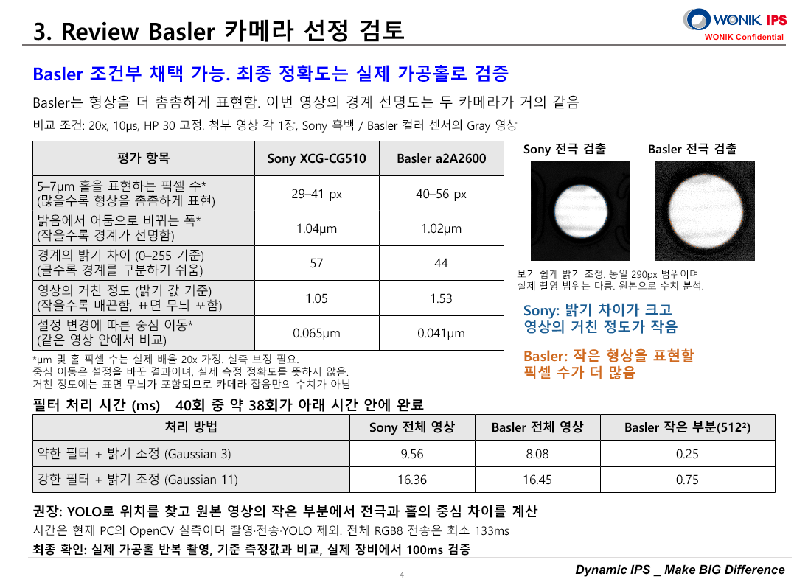

# A3 LD 카메라 비교: Basler / Sony

공유 시각: 2026-10-14 20:14:30 Asia/Seoul

- [4페이지 PowerPoint 복사본](A3_LD_Review_Camera_Comparison_Final.pptx)
- [상세 분석 보고서 HTML](Camera_Comparison_Report.html) — 다운로드한 뒤 브라우저에서 열면 됩니다. 분석 이미지가 파일 안에 포함되어 있습니다.

기존 PPT의 1~3페이지를 보존하고 4페이지에 카메라 선정 결론, 수치 비교, 전극 검출 이미지와 필터 처리시간을 추가했습니다. 쉽게 읽히는 표현을 사용하고 필요한 전문 용어는 상세 보고서에서 설명했습니다.

## 검토 결과

Basler의 조건부 채택은 가능합니다. 실제 광학배율 20배를 가정하면 5~7µm 홀은 Sony 약 29~41픽셀, Basler 약 40~56픽셀로 표현됩니다. 첨부 영상의 경계 폭은 Sony 약 1.04µm, Basler 약 1.02µm로 대체로 비슷했습니다. Sony는 밝기 차이가 크고 영상의 거친 정도가 작았습니다.

설정을 바꿨을 때 중심이 움직인 수치는 Sony 0.065µm, Basler 0.041µm입니다. 한 영상에서 처리 설정을 바꾼 결과이며 실제 정확도나 반복 정밀도를 뜻하지 않습니다.

비교 조건은 첨부 BMP 각 1장, 20x, 10µs, HP 30입니다. µm 환산은 실측 보정 전의 가정값입니다. 기존 PPT 1페이지의 30µs 표기는 이번 BMP의 10µs 조건과 구분해야 합니다.

## 처리시간과 최종 확인

현재 PC에서 Basler 영상 전체에 Gaussian 11과 밝기 정규화를 적용한 시간은 P95 약 16.45ms, 512×512 영역에서는 약 0.75ms였습니다. OpenCV CPU 실측이며 HALCON 실행시간, YOLO, 촬영과 전송은 제외했습니다. 실제 5~7µm 홀의 반복 촬영, 기준 측정값과 비교, 실제 장비에서 전체 100ms 검증이 필요합니다.

YOLO로 대상 위치를 찾고 원본 영상의 필요한 부분에서 전극과 홀의 중심 차이를 계산하는 구성을 권장합니다. 전체 RGB8 영상을 1Gb/s로 전송하면 데이터만으로 최소 약 133ms가 필요하므로 전송 형식과 카메라 촬영 영역도 함께 확인해야 합니다.

## 4페이지 미리보기

1~3페이지의 미리보기는 slide-1.png, slide-2.png, slide-3.png에 있습니다. PPT 구조 및 4페이지 표, 최종 렌더링을 확인했고 기존 1~3페이지와 원본 이미지·테마는 보존했습니다. 가공홀의 실제 중심 정확도나 YOLO 포함 100ms 달성을 검증한 자료는 아닙니다.

