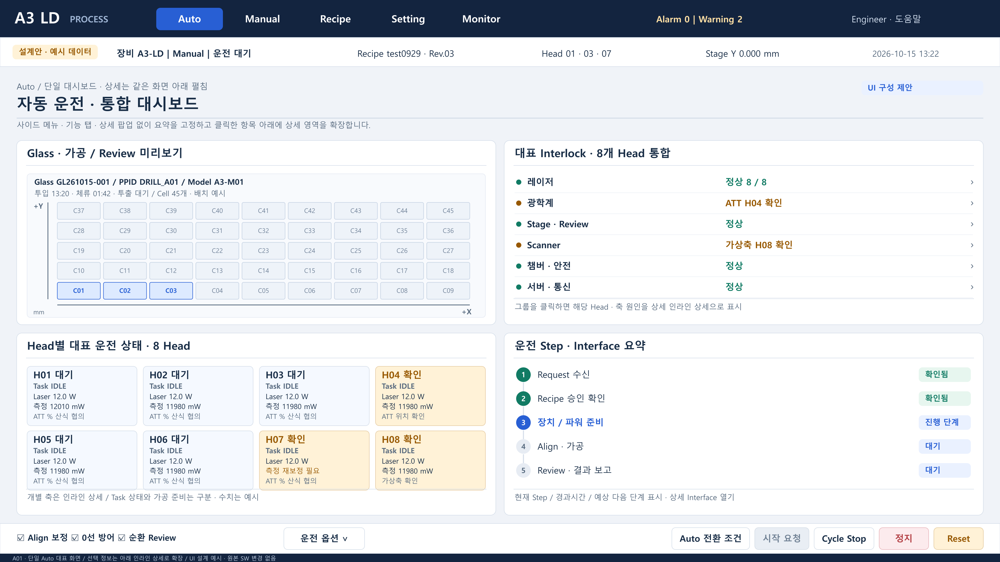

# A3 LD 전체 UI 화면 설계

고객 검수 체크리스트와 리뷰 내용을 반영한 UI 구성안입니다. PNG 74개에 메뉴, 표시 항목, 입력란, 버튼과 상세 표시 상태를 정리했습니다. 실제 프로그램 캡처나 구현 완료 증거가 아닌 설계 예시이며, 원본 SW는 변경하지 않았습니다.

## 다운로드와 사용 방법

1. [전체 자료 ZIP](A3LD_UI_전체화면설계_20261015.zip)을 다운로드하고 압축을 모두 풉니다.
2. 폴더의 `화면목록.html`을 브라우저로 열어 화면을 찾습니다. 이미지를 누르면 원본 PNG가 열립니다.
3. GitHub에서 바로 볼 때는 아래 대표 이미지와 폴더별 PNG를 확인합니다. HTML 안내는 다운로드 후 여는 방식입니다.

## 화면 구성

Auto는 사이드메뉴 없는 단일 대시보드입니다. A01에는 대표 상태만 배치하고, A02부터 A08 및 D02와 D03에는 같은 페이지 안에서 상세를 펼친 상태를 표현했습니다. Auto 상세에는 탭이나 팝업을 사용하지 않습니다.

다른 메뉴는 연계 작업을 하나의 작업공간으로 묶었습니다. TEG, 분기빔 검사, 검사 결과와 보정, Default Offset, 파워 보정은 대상 Head와 Recipe, 입력값과 결과를 유지한 채 다음 작업 영역을 펼쳐 이어갑니다. PNG 74개가 독립 메뉴 74개를 뜻하지는 않습니다.

| 구분 | 수량 | 위치 |
| --- | ---: | --- |
| 공통 안내 | 2 | [전체 작업공간](00_안내/00_전체메뉴_화면찾기.png), [공통 UI 표준](00_안내/00B_공통_UI_표준_협의항목.png) |
| Auto 표시 상태 | 8 | [Auto 화면](Auto_화면/) |
| Manual 작업 상태 | 12 | [Manual 화면](Manual_화면/) |
| Recipe 작업 상태 | 17 | [Recipe 화면](Recipe_화면/) |
| Setting 작업 상태 | 13 | [Setting 화면](Setting_화면/) |
| Monitor 작업 상태 | 8 | [Monitor 화면](Monitor_화면/) |
| 상세 표현 | 14 | [상세 표현](상세표현_화면/), 비 Auto 확인 팝업 12개와 Auto 인라인 상세 2개 |

### Auto 대표 화면

## 항목 대응과 검증 기록

- `295항목_화면대응표.html`: 활성 요구사항 294개와 화면 연결. No.180은 고객 요청에 따라 삭제 반영했습니다.
- `고객리뷰_28개_반영위치.html`: 고객 리뷰 요약 28개와 반영 위치.
- `설계_상세안내.html`: 각 영역의 항목, 표시값과 버튼 설명.
- `10회_교차검증_개선기록.html`: 10회 점검 관점, 발견 사항과 수정 내용. 전페이지 지표 검사, 요구사항 대조, 전체 축소판과 주요 원본 시각 검토를 조합했습니다.
- `검증기록.json`: 이미지 해시, 래스터 디코딩, 내부 링크와 ZIP 무결성 확인 결과.

A01은 3840×2160, 상세 작업영역은 3840×2560 PNG입니다. ATT 사용률 산식, DOE Z 허용오차의 관리 분류와 일부 현장 사양은 화면에 협의 필요로 표시했습니다.

## 코드 기준과 파일 확인값

기준 소스는 [A3 LD 원본 Commit 0c501c104dec](https://github.com/kjuws10-rgb/A3_LD_Process_SW_IPS/tree/0c501c104dec1cebab87bd909de29b1b1395a8b4)입니다. 프로그램 로직 수정과 장비 실행은 범위에 포함하지 않았습니다.

ZIP SHA256: `63ccd18fcf86755fef80bbb3af26f4827ce73a172f2986d9af7da12ae183ffd6`
