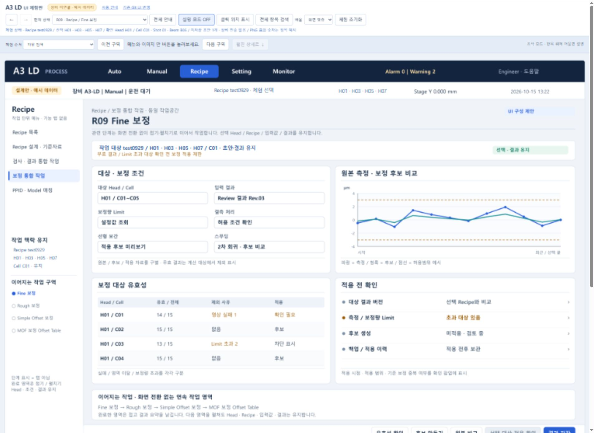

# A3 LD UI HTML 체험판 공유

Git 프로젝트에 구현된 실제 화면의 장점을 반영한 UI 체험판입니다. 기존 화면 코드에서 확인한 구성 15가지를 살리고, Auto 상세와 MOF의 검사·보정 작업을 같은 공간에서 이어가도록 구성했습니다.

## 다운로드와 실행

1. [전체 ZIP 다운로드](A3LD_UI_HTML_체험판_20261015.zip?raw=true)를 선택합니다.
2. ZIP 전체를 압축 해제합니다. `assets` 폴더와 HTML·JS·CSS 파일을 함께 유지하세요.
3. 압축을 푼 폴더의 `index.html`을 Edge 또는 Chrome으로 엽니다.

GitHub에서 HTML 파일을 바로 클릭하면 화면 대신 소스가 보일 수 있습니다. 체험할 때는 ZIP을 내려받아 사용하세요. 모든 실행 리소스는 로컬 상대경로이며 외부 서버·라이브러리 다운로드 없이 사용하도록 구성했습니다.

## 포함된 화면과 기능

- 74개 이미지 상태를 메뉴·버튼·행 선택으로 연결했습니다.
- 필드·표·상태·단계·도식·버튼의 5,733개 위치에 설명을 연결했습니다. 항목의 의미, 읽는 방법, 조작, 연계 항목, 단위와 주의사항을 확인할 수 있습니다.
- Auto는 사이드메뉴나 기능 탭 없이 대표 상태를 보여주고 상세를 인라인으로 펼칩니다.
- 복수 Head 선택과 입력 초안을 유지합니다. MOF 안에서 PtoP·검사 결과·보정 비교를 이어갈 수 있습니다.
- Glass에서 Cell과 Shot으로 확대하고, 보정 원본·현재·후보·적용 예상 및 Stage·Process 신호를 나란히 확인합니다.
- 체크리스트 번호 검색과 추천 체험 순서 8개를 제공합니다.

## 파일 안내

| 파일 또는 폴더 | 용도 |
| --- | --- |
| `index.html` | UI 체험판 시작 |
| `사용안내.html` | 실행 방법과 조작 안내 |
| `PNG_전체목록.html` | 74개 시안과 HTML 검증 화면 찾아보기 |
| `체크리스트_화면연결.html` | 고객 삭제 No.180을 제외한 294개 요구항목의 표현 위치 |
| `Git_UI_반영내역.html` | 기존 Git 화면에서 살린 구성과 반영 위치 |
| `검증기록.html` | 10개 범주별 전수 검사 |
| `브라우저_검증상세.html` | 대표 동선 확인과 발견 후 개선한 부분 |
| `assets` | 기본 시안 PNG 74개 |
| `검증화면` | HTML 체험 중 확인한 대표 화면 PNG 4개와 JPEG 4개 |
| `source-manifest.json` | 기준 Commit과 검증한 소스 위치 |
| `qa-10-rounds.json`, `browser-qa.json` | 검사 결과와 검증 범위 |

## 기준 소스와 검증 범위

기준 소스는 [A3 LD 가공 SW Commit 0c501c104dec](https://github.com/kjuws10-rgb/A3_LD_Process_SW_IPS/commit/0c501c104dec1cebab87bd909de29b1b1395a8b4)입니다. 기존 UI 구성 15가지의 소스 링크는 이 Commit에 고정되어 있습니다.

74개 상태의 이미지·클릭 경로·설명·좌표·DOM 렌더·입력 유지·원본 무변경 등을 10개 범주로 전수 검사했습니다. 실제 브라우저에서는 Head 선택, MOF 입력 유지, MOF 내 Review, Auto 인라인, 신호 상세, 쓰기 잠금, 검색, 설명 모드를 확인했습니다. 모든 화면을 10회씩 육안으로 검증한 것은 아닙니다.

직접 파일 열기는 브라우저 검증 도구의 프로토콜 제한으로 실행 확인하지 못했으며, 브라우저 검증은 로컬 HTTP 미리보기에서 수행했습니다. 오프라인 배포를 위한 상대경로·외부 의존성·내부 링크와 ZIP 무결성을 별도로 검사했습니다.

이 화면은 UI 설계 예시이며 원본 프로그램을 실행해 캡처한 자료가 아닙니다. 실제 장비 통신, 레이저 출사, 축 이동, 공정 좌표 계산과 보정 적용은 하지 않습니다. 원본 SW 파일·Commit·Push에는 변경이 없습니다.

ZIP SHA256: `3dd147465f4a1dec474303ed6cb52dfdaade6b3093ba3744b1fc9143595544a2`

## HTML 동작 확인 예시

