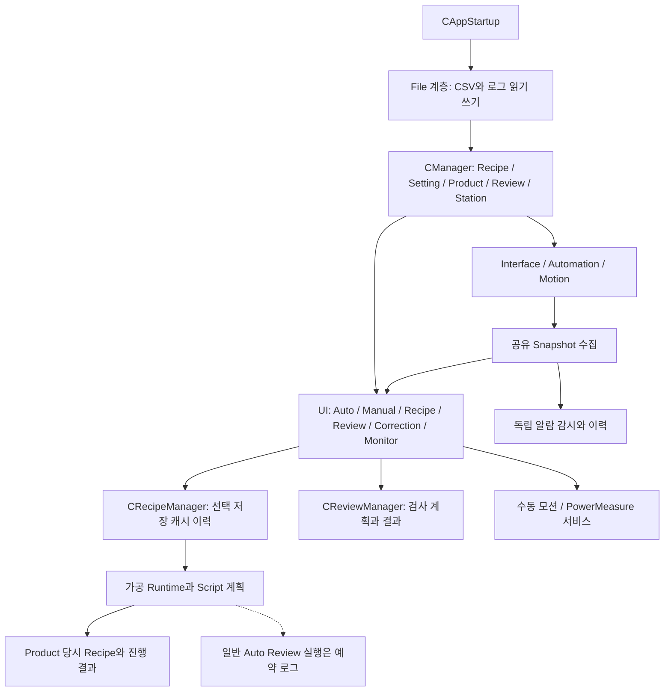
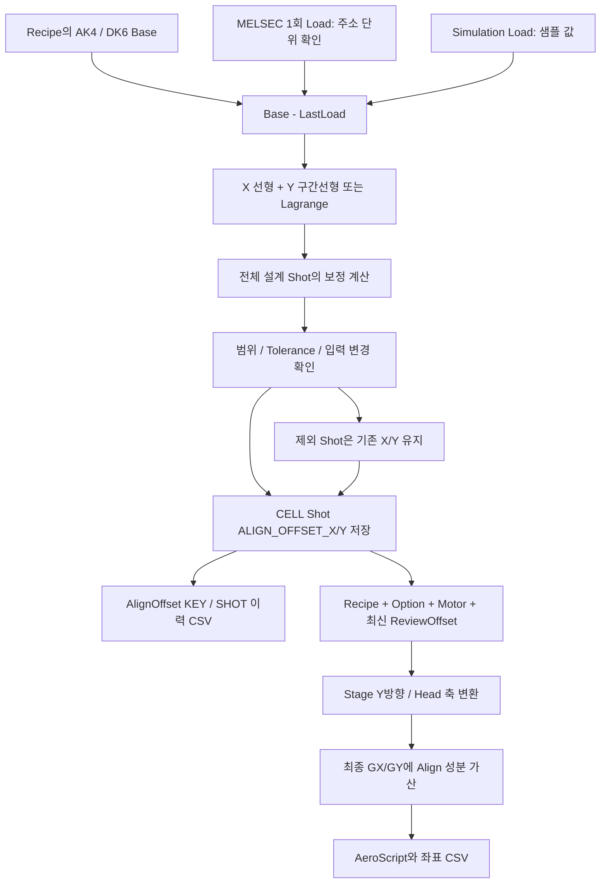
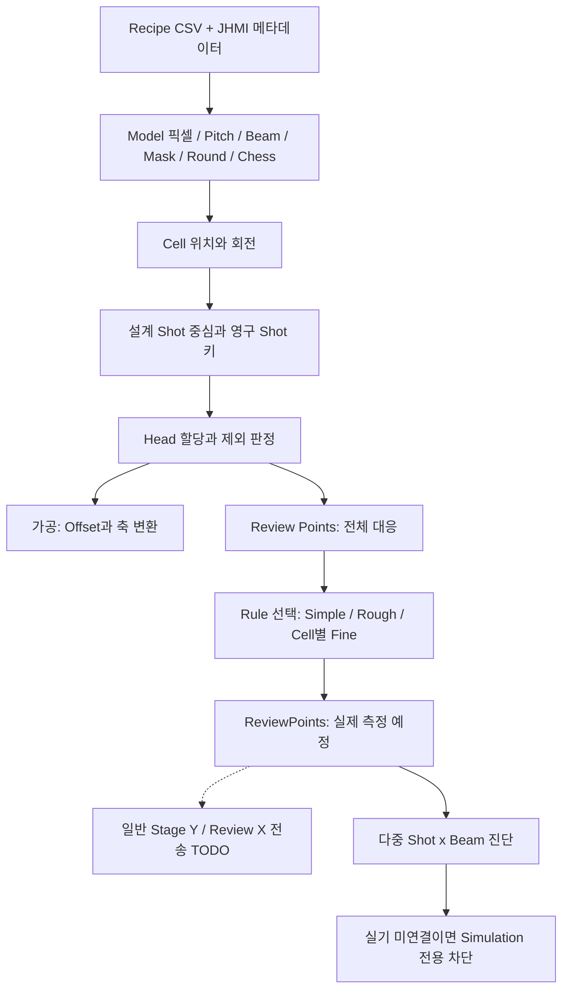
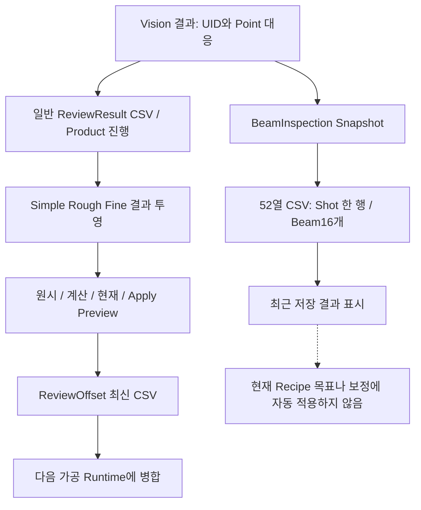
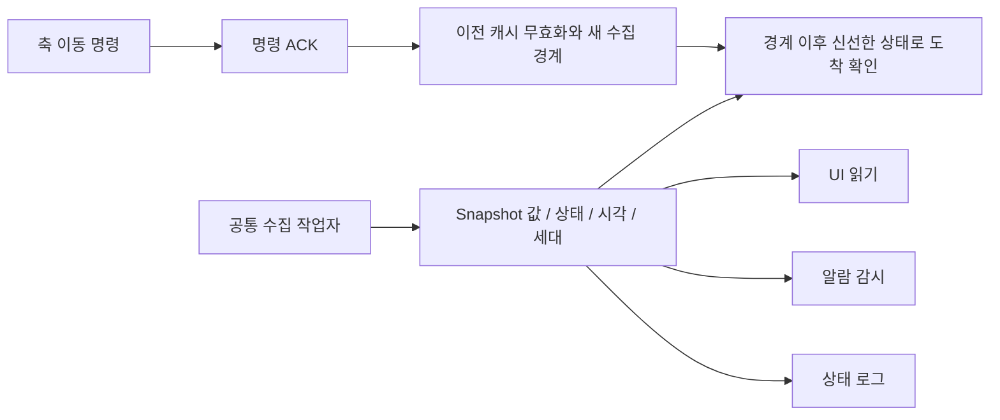

# 갱신된 통합 흐름도

실선은 코드의 데이터/호출 연결이며 점선의 미연결 노드는 실제 장비 동작이 아직 완성되지 않았음을 뜻합니다. 사각형이 존재한다고 동작 검증이 끝난 것은 아닙니다.

## 프로그램 전체 계층

## 새 Align 보정 데이터의 전체 경로

Simulation 표시와 로그 출처는 있지만 이 경로에서 Simulation 보정을 Recipe 저장에서 강제 거부하는 gate는 확인되지 않습니다. 보정 성분의 출처/적용 조건을 분리해야 합니다.

## Model Cell Shot Beam과 Review

## 일반 결과와 새 Beam 결과는 따로 보관

Fine 계획의 Cell별 선정과 결과 투영의 Head+X 그룹은 서로 다른 단계입니다. 현재 뒤 단계의 Cell 누락은 위험도 문서의 R02/N09를 참고하세요.

## 장치 조회와 명령 완료

관련 소스: [CAppStartup.cs:18–44](https://github.com/kjuws10-rgb/A3_LD_Process_SW_IPS/blob/e6ff3c6fd8fb706adbff3ded070cca2502000b4d/Drilling.UI/CAppStartup.cs#L18-L44) · [CMenuCorrection.AlignOffset.cs:11–116](https://github.com/kjuws10-rgb/A3_LD_Process_SW_IPS/blob/e6ff3c6fd8fb706adbff3ded070cca2502000b4d/Drilling.UI/Menu/Menus/CMenuCorrection.AlignOffset.cs#L11-L116) · [CShotCoordinatePlanBuilder.cs:127–149](https://github.com/kjuws10-rgb/A3_LD_Process_SW_IPS/blob/e6ff3c6fd8fb706adbff3ded070cca2502000b4d/Drilling.Common/Recipe/CShotCoordinatePlanBuilder.cs#L127-L149) · [CReviewRulePlanBuilder.cs:375–408](https://github.com/kjuws10-rgb/A3_LD_Process_SW_IPS/blob/e6ff3c6fd8fb706adbff3ded070cca2502000b4d/Drilling.Common/Review/CReviewRulePlanBuilder.cs#L375-L408) · [CReviewResultFile.BeamInspection.cs:9–75](https://github.com/kjuws10-rgb/A3_LD_Process_SW_IPS/blob/e6ff3c6fd8fb706adbff3ded070cca2502000b4d/Drilling.File/ReviewResult/CReviewResultFile.BeamInspection.cs#L9-L75) · [CAutomationStatusSnapshotService.cs:21–84](https://github.com/kjuws10-rgb/A3_LD_Process_SW_IPS/blob/e6ff3c6fd8fb706adbff3ded070cca2502000b4d/Drilling.Common/Automation/CAutomationStatusSnapshotService.cs#L21-L84) · [CAutomationPositioningService.cs:34–67](https://github.com/kjuws10-rgb/A3_LD_Process_SW_IPS/blob/e6ff3c6fd8fb706adbff3ded070cca2502000b4d/Drilling.Common/Automation/CAutomationPositioningService.cs#L34-L67).
