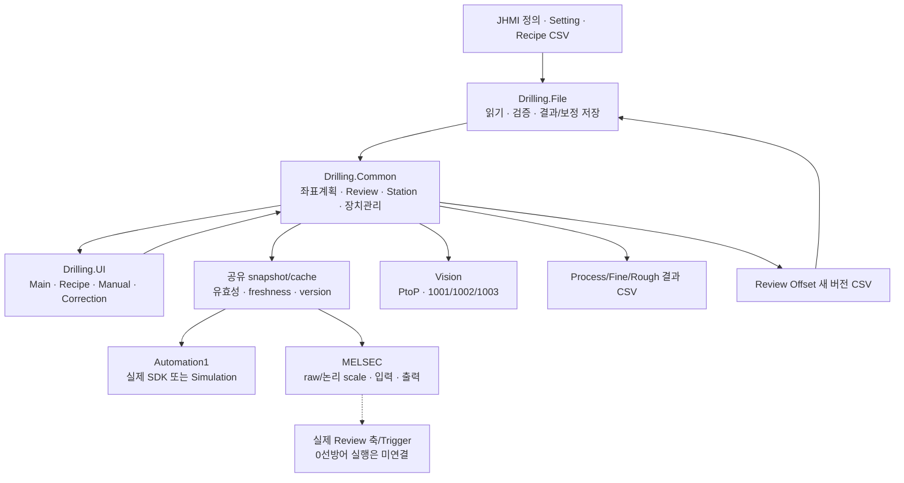
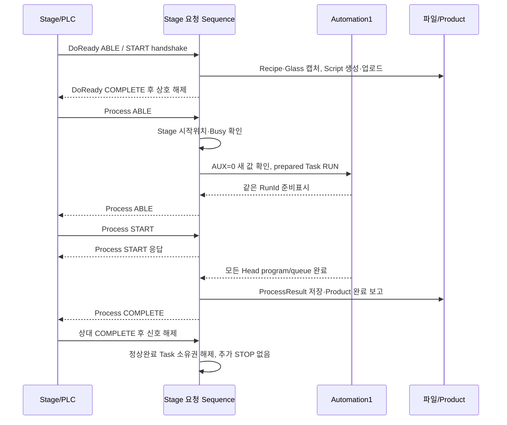
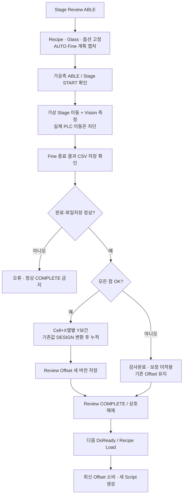
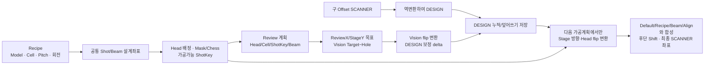
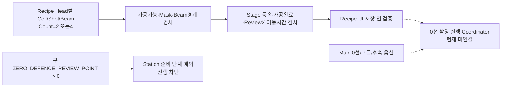
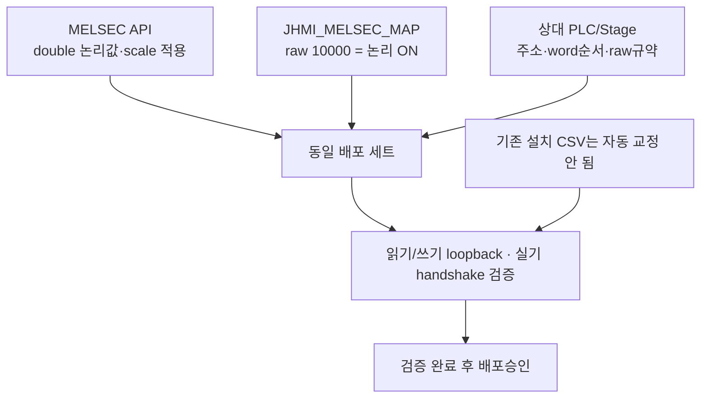

# 4. 갱신된 통합 흐름도

[처음으로](README.md) · [데이터 설명](02_데이터구조와흐름.md)

그림의 실선은 현재 코드의 데이터/호출 연결입니다. `미연결` 상자는 실제 장비 실행까지 이어지지 않는 경계입니다. 저장·표시 기능과 실행 완료를 구분해서 읽습니다.

## 4-1. 프로그램 전체 책임

## 4-2. Stage 요청과 가공측 응답

Task RUN은 초기화 선준비이고 Process START는 가공 진행 handshake입니다. 두 시점을 같게 그리지 않았습니다. 오류/취소는 별도로 소유한 Task 정지·출력해제·정리확인을 거칩니다.

## 4-3. Review 결과가 다음 기판 보정으로 가는 과정

NG 검사완료와 보정 적용완료는 서로 다른 상태입니다. 현재 Offset 파일에는 Simulation/Run/승인 출처가 없어 별도 보완이 필요합니다.

## 4-4. 좌표계와 식별자의 연결

## 4-5. 0선방어의 현재 경계

## 4-6. 배포 단위는 소스만이 아님

