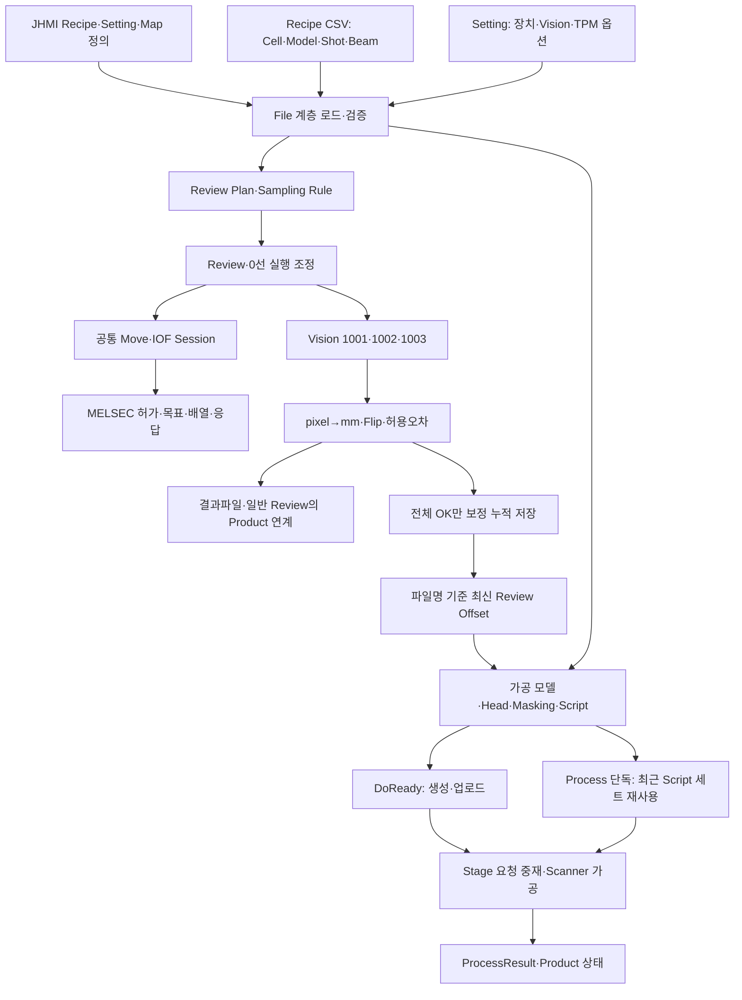
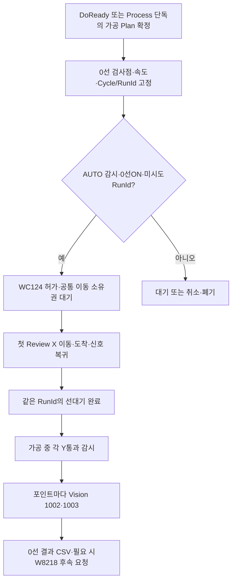
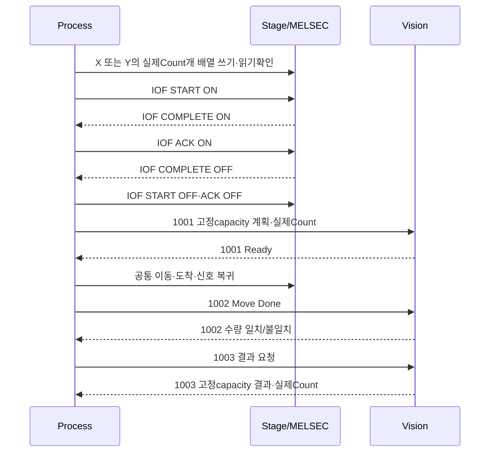
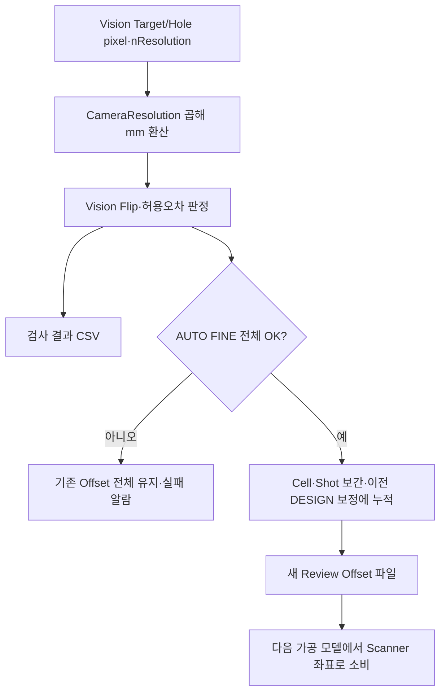
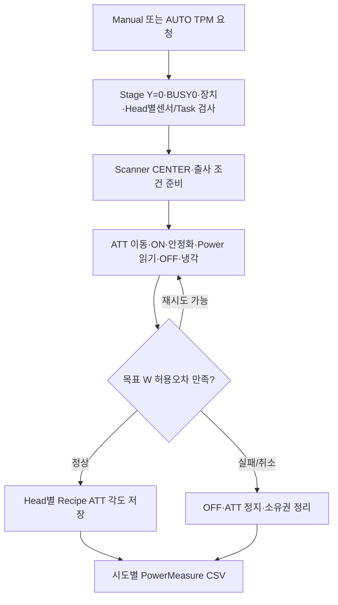

# 갱신된 통합 흐름도

아래 그림은 코드의 호출/저장 관계입니다. 실행파일의 기동 또는 실제 장비 동작 성공을 뜻하지 않습니다.

## 전체 프로그램과 데이터

## 현재 기판의0선 선대기

FAB3/FAB4 Align 비트는 이 기동 경로의 조건이 아닙니다. 물리 허가와 정상 Plan 검사를 제거한 변경은 아닙니다.

## IOF와 Vision의 서로 다른 통로

그림은 현재 코드의 IOF 순서입니다. 상대가 START OFF 후 COMPLETE OFF를 보내는 계약이라면 호환되지 않을 수 있습니다. MELSEC와 Vision은 통로가 다르며 한쪽 송신 성공만으로 다른 쪽 처리 성공을 보장하지 않습니다.

## 측정값에서 가공 보정으로

## 공통 Manual/AUTO TPM

