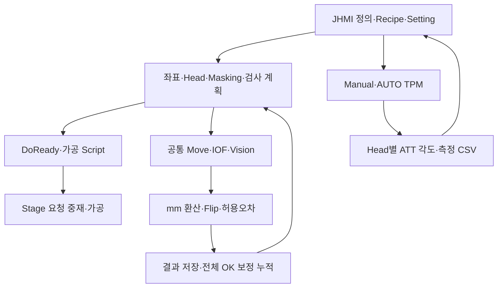

# A3 LD SW 아키텍처 변경 분석 · 2026-11-05

이번 변경은 **실제 Stage 이동·IOF·TPM 경로를 넓히고, Vision의 고정 배열 길이와 pixel→mm 환산을 명확히 한 버전**입니다. 다만 정식 소스 빌드는 이전과 동일하게 로그 클래스 누락으로 실패합니다. 최신 Review 보정 파일 삭제로 **이전 보정값이 다시 선택되는 변화**도 확인했습니다.

## 분석 기준

| 구분 | 확인값 |
| --- | --- |
| 분석 원본 Commit | a966ebf527f9ff0f52b1d84a891fda6fc6fc3e6f |
| 이전 기준 Commit | 8872e4ed5176b5d8a39f1711af9501f6fac94deb |
| 비교 범위 | [새 Commit 2개](https://github.com/kjuws10-rgb/A3_LD_Process_SW_IPS/compare/8872e4ed5176b5d8a39f1711af9501f6fac94deb...a966ebf527f9ff0f52b1d84a891fda6fc6fc3e6f) |
| 기준 README | [20261102_143906_SW아키텍쳐분석](../20261102_143906_SW아키텍쳐분석/README.md) |
| 기준 탐색 시 Shared main | fc8599b9a891e5fd14418da6dde2d05ff04433c4 |
| 실행 시각 | 2026-11-05 21:30:21 Asia/Seoul |
| 이번 폴더 | 20261105_213021_SW아키텍쳐분석 |
| 최신 소스 Commit 시각 | 2026-11-04 14:36:52 +09:00 |

Shared 전체 재귀 트리에서 `YYYYMMDD_HHMMSS`와 `YYYYMMDD_HHMMSS_SW아키텍쳐분석`을 함께 검색했습니다. 적격 폴더 4개 중 날짜·시간이 가장 최근인 11월 2일 README의 원본 Commit을 기준으로 선택했습니다. 11월 5일 일반 HTML 설명자료는 아키텍처 분석 기준이 아닙니다.

**대상은 A3_LD_Process_SW_IPS입니다. Drilling·Drilling2/A3Drilling의 별도 수정 완료 이력을 이 소스의 구현으로 간주하지 않았습니다.**

## 먼저 볼 내용

| 영역 | 현재 확인한 상태 |
| --- | --- |
| 정식 Release 빌드 | 기준·최신 모두 오류19 / 경고0. Common.Log·CLogManager 누락이 계속 차단 |
| 가공 좌표·Masking·Sampling | 주요 생성기·자료형·serializer 변경 없음. 실행 연결과 저장 데이터 영향은 별도 |
| Review Offset | 최신 파일 삭제 후 이전 파일이 선택돼 20,740행 중 2,380행 값이 달라짐 |
| Stage / IOF | Manual·Review·ROUGH의 실이동 확대, 실제 Count만 IOF 배열 전송·읽기 확인 |
| Vision | 기본 capacity300: 1001 본문7,208bytes / 1003 본문10,808bytes. 오차는 pixel을 mm로 환산 |
| 0선 선대기 | FAB Align 비트 대신 현재 기판의 확정 Plan·RunId로 첫 Review X 선이동 |
| AUTO FINE | 잔여 NG가 있으면 HEAVY 실패 경로, 기존 보정 전체 유지 |
| TPM | Head별 전용 센서·공통 Manual/AUTO 실행·Stage Y 0 정지 확인·ATT 각도 및 결과 저장 |

Review Offset 선택과 가공 병합: [최신 파일 선택 49–58](https://github.com/kjuws10-rgb/A3_LD_Process_SW_IPS/blob/a966ebf527f9ff0f52b1d84a891fda6fc6fc3e6f/Drilling.File/ReviewOffset/CReviewOffsetFile.cs#L49-L58) · [가공 파라미터 병합 1473–1503](https://github.com/kjuws10-rgb/A3_LD_Process_SW_IPS/blob/a966ebf527f9ff0f52b1d84a891fda6fc6fc3e6f/Drilling.Common/Station/CStationProcess.cs#L1473-L1503). 실제 IOF의 신호 복귀 순서와 공통 DoReady 입력 의존은 [위험도 문서](05_위험도별발견사항.md)를 먼저 확인해야 합니다.

## 통합 흐름

이는 소스의 호출 관계입니다. 실제 앱·PLC·Vision·축·레이저는 기동하지 않았습니다.

## 읽는 순서

1. [Commit 변경 요약](01_Commit변경요약.md)
2. [데이터 구조와 저장 흐름](02_데이터구조와흐름.md)
3. [가공·Review 영향 분석](03_가공_Review영향분석.md)
4. [갱신된 통합 흐름도](04_통합흐름도.md)
5. [위험도별 발견사항](05_위험도별발견사항.md)
6. [근거와 검증 기록](06_분석근거_검증기록.md)

기계 대조 자료: [427개 변경 경로](changed-files.csv) · [구조 비교](schema-diff.json) · [빌드 결과](build-validation.json) · [맵 검사](map-checks.json) · [보정 파일 선택 대조](offset-selection-audit.json) · [고정 소스 링크](source-links.json) · [검증 결과](validation.json).

원본 저장소에 수정·추가·삭제·Commit·Push를 하지 않았습니다. Push가 비활성화된 별도 분석 Clone과 별도 빌드 Clone을 사용했습니다. Shared에는 이번 분석 폴더만 게시합니다. 분석 완료는 제품 수정·빌드 복구·설비 배포 완료를 뜻하지 않습니다.
