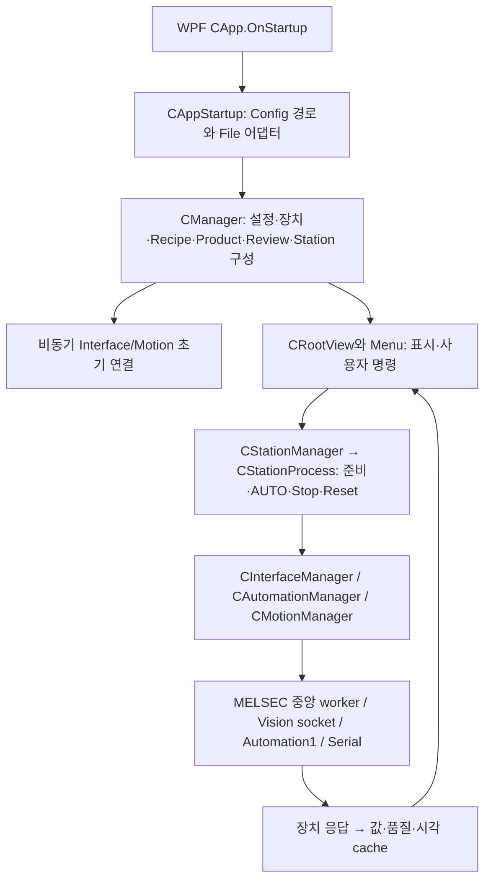

# Commit과 전체 프로그램 구조 · 최초 기준

## 비교할 이전 Commit이 없는 이유

원본 저장소는 **kjuws10-rgb/A3Drilling**, 브랜치는 **master**, 원본 최신 Commit은 **3a6b021af7dad60578e7fb85e3191b43b3b3c183**다. Commit 제목은 `11.5.5버전으로 커밋`, Commit 시각은 2026-11-06 09:03:40 Asia/Seoul이다.

Shared의 두 날짜형 폴더를 모두 확인했으나 A3Drilling을 원본으로 명시한 README는 없었다. 확인한 후보5개는 IPS 보고서이므로 그 SHA를 이 저장소의 이전 버전으로 사용하지 않았다. 따라서 이번 보고서는 **현재 전체 구조·자료 형식을 고정하는 최초 기준**이다. 신규 Commit 수·추가/삭제 줄수·자료형 변경률을 계산하지 않았다. Commit의 Git 부모가 존재한다는 사실만으로 자동 분석의 이전 기준으로 임의 선정하지도 않았다.

[기준점 탐색 기록](baseline-selection.json) · [현재 파일 목록](source-inventory.csv) · [현재 구조 집계](structure-snapshot.json).

## 소스 전체 구성

| 구분 | 추적 파일 수 | 쉽게 설명한 역할 |
| --- | ---: | --- |
| Drilling.UI | 132 | WPF 화면, 메뉴 명령, 화면과 업무 기능 연결 |
| Drilling.Common | 60 | Recipe/좌표/보정/Review/Station과 장치 통신 구현 |
| Drilling.File | 17 | JHMI·Recipe·결과·보정·Product·Script의 실제 파일 입출력 |
| Config | 78 | JHMI 양식, 실제 Recipe/Setting, 파워 테이블과 수동 패턴 |
| Data | 24 | 포함된 과거 결과/보정/Script 예시. 현재 실행 결과와 구분 |
| 루트 | 4 | 솔루션·NuGet·Git 설정 |
| 합계 | 315 | C#140개, XAML53개, csproj3개, CSV64개 포함 |

세 프로젝트는 같은 역할이 아니다. File→Common, UI→File·Common 방향의 참조이며 Common이 파일 구현을 직접 선택하는 대신 UI 시작 코드가 File 어댑터를 주입한다. [File 프로젝트 참조](https://github.com/kjuws10-rgb/A3Drilling/blob/3a6b021af7dad60578e7fb85e3191b43b3b3c183/Drilling.File/Drilling.File.csproj#L1-L8) · [UI 프로젝트 참조와 WPF 대상](https://github.com/kjuws10-rgb/A3Drilling/blob/3a6b021af7dad60578e7fb85e3191b43b3b3c183/Drilling.UI/Drilling.UI.csproj#L1-L26).

# A3Drilling 최초 기준: 앱 구조·장치 통신·정식 빌드

분석 원본은 `kjuws10-rgb/A3Drilling`, `master`, Commit `3a6b021af7dad60578e7fb85e3191b43b3b3c183`다. IPS 보고서의 SHA를 비교 기준으로 사용하지 않았다. 이 문서는 변경량 분석이 아니라 해당 저장소의 최초 상태 기준이며, 정적 소스 확인과 아래 실제 빌드 결과를 구분한다.

## 실제 빌드 결과

- 원본 분석 clone은 그대로 두고 `validation-build`를 별도로 만들었다. 동일 SHA detached checkout이며 Push URL은 `DISABLED`다.
- Windows .NET SDK `10.0.400`으로 `dotnet build Drilling.sln -c Release --nologo -v:minimal -p:UseSharedCompilation=false --disable-build-servers`를 1회 실행했다.
- 2026-11-08 09:07:54~09:08:04 +09:00, 종료 코드 **1**, 실제 MSBuild 요약 **오류 19·경고 0**, MSBuild 경과 **9.96초**다. 벽시계 소요는 10.456792초다. 3개 프로젝트의 restore 후 Common 컴파일에서 실패했다.
- 19개 고유 진단은 `CS0234`와 `CS0246`이며 모두 `Drilling.Common.Log`/`CLogManager` 참조를 해결하지 못한 내용이다. 예: `CManager.cs:1,28,64,380`, `CInterfaceManager.cs:8,25,45`, `CMelsec.cs:7,21,65` 등. 상세 전체 19건은 [빌드 검증 요약](build-validation.json)에 있다. 원로그는 로컬 검증 자료로 보존했다. 출력이 요약에서 반복되므로 원로그의 `error` 문자열을 단순 합산하지 않았다.
- tracked snapshot에 `Drilling.Common/Log` 구현이 없다. `git check-ignore -v Drilling.Common/Log/CLogManager.cs`는 `.gitignore:33:[Ll]og/`를 실제 반환했다. 이는 현재 패턴이 해당 소스 경로를 제외한다는 증거이며, 과거 누락 원인을 확정한 것은 아니다. [.gitignore#L29-L34](https://github.com/kjuws10-rgb/A3Drilling/blob/3a6b021af7dad60578e7fb85e3191b43b3b3c183/.gitignore#L29-L34), [Common의 CLogManager 의존#L55-L83](https://github.com/kjuws10-rgb/A3Drilling/blob/3a6b021af7dad60578e7fb85e3191b43b3b3c183/Drilling.Common/Managers/CManager.cs#L55-L83).

stub·소스 수정·Config 수정·SDK 복사는 하지 않았다. 실패를 우회하지 않아 File/UI 이후 컴파일의 성공이나 장치 실행은 검증하지 못했다. 빌드 후 원본 분석 clone과 검증 clone의 `git status --porcelain`은 모두 빈 출력이었다. 검증 clone에는 빌드가 생성한 ignored `obj/bin`이 있을 수 있으며 원본 소스 변경과 구분한다.

## 시작부터 실행 계층까지

이 그림은 소스 호출 관계다. 프로그램·PLC·Vision·축·레이저를 기동한 결과가 아니다.

| 계층 | 해당 SHA에서 확인한 역할 | 고정 근거 |
| --- | --- | --- |
| WPF 진입 | `OnStartup`이 Root XAML과 ViewModel을 만들고 DataContext 지정 후 창을 연다. 시작 예외는 로그·MessageBox·Shutdown으로 처리한다. | [CApp.xaml.cs#L23-L44](https://github.com/kjuws10-rgb/A3Drilling/blob/3a6b021af7dad60578e7fb85e3191b43b3b3c183/Drilling.UI/CApp.xaml.cs#L23-L44) |
| 의존성 조립 | ConfigRoot로 Recipe/Setting/Interface/Motor/MELSEC/Product/ReviewResult/ReviewOffset/Log의 구체 File 어댑터를 CManager에 주입한다. `manager.Initialize()`는 Task.Run으로 시작하고 Root 생성 및 background monitoring을 이어간다. 창이 보이는 시각과 실장치 연결 완료는 별개다. | [CAppStartup.cs#L14-L68](https://github.com/kjuws10-rgb/A3Drilling/blob/3a6b021af7dad60578e7fb85e3191b43b3b3c183/Drilling.UI/CAppStartup.cs#L14-L68) |
| 경로 결정 | 실행 위치 상위에서 `Drilling.sln`을 찾으면 그 아래 Config를 사용한다. 못 찾으면 현재 디렉터리/Config다. Script는 LocalScriptPath 설정 또는 프로젝트 아래 Data/Script다. | [CAppStartup.cs#L121-L151](https://github.com/kjuws10-rgb/A3Drilling/blob/3a6b021af7dad60578e7fb85e3191b43b3b3c183/Drilling.UI/CAppStartup.cs#L121-L151) |
| Common Manager | Config 검사→Interface 등록→Setting cache→Vision capacity/ATT limit→Automation→MELSEC Map→Motion→Product→Review→Recipe→Station 순으로 조립한다. Station/Review 실패 이벤트를 Alarm으로 연결한다. Interface와 Motion의 실제 초기화는 별도 async 단계다. | [CManager.cs#L86-L142](https://github.com/kjuws10-rgb/A3Drilling/blob/3a6b021af7dad60578e7fb85e3191b43b3b3c183/Drilling.Common/Managers/CManager.cs#L86-L142), [#L204-L217](https://github.com/kjuws10-rgb/A3Drilling/blob/3a6b021af7dad60578e7fb85e3191b43b3b3c183/Drilling.Common/Managers/CManager.cs#L204-L217) |
| File 어댑터 | Interface CSV를 읽어 검증·정렬해 Common 자료형으로 반환한다. SaveAll은 CSV·변경 로그를 쓴다. Map File은 ID/주소/자료형/입출력/Access/Scale/Length/Poll 스키마를 검증해 Common Map 자료형으로 반환한다. File 프로젝트는 Common에 의존하고 UI가 두 프로젝트를 참조한다. | [CInterfaceFile.cs#L12-L35](https://github.com/kjuws10-rgb/A3Drilling/blob/3a6b021af7dad60578e7fb85e3191b43b3b3c183/Drilling.File/JHMI/CInterfaceFile.cs#L12-L35), [#L54-L78](https://github.com/kjuws10-rgb/A3Drilling/blob/3a6b021af7dad60578e7fb85e3191b43b3b3c183/Drilling.File/JHMI/CInterfaceFile.cs#L54-L78), [CMelsecMapFile.cs#L7-L34](https://github.com/kjuws10-rgb/A3Drilling/blob/3a6b021af7dad60578e7fb85e3191b43b3b3c183/Drilling.File/JHMI/CMelsecMapFile.cs#L7-L34) |
| Station | CStationManager는 CStationProcess를 구성해 준비·Start·Stop·Reset을 위임한다. AUTO Stage 감시 실행 중 수동 Prepare/Start/Reset을 거부한다. Stage 요청은 cache와 연결가능 ID, WriteWord, 업무 실행 callback, 요청별 새 수신 callback을 받는다. | [CStationManager.cs#L15-L59](https://github.com/kjuws10-rgb/A3Drilling/blob/3a6b021af7dad60578e7fb85e3191b43b3b3c183/Drilling.Common/Station/CStationManager.cs#L15-L59), [#L87-L110](https://github.com/kjuws10-rgb/A3Drilling/blob/3a6b021af7dad60578e7fb85e3191b43b3b3c183/Drilling.Common/Station/CStationManager.cs#L87-L110), [CStationProcess.cs#L3769-L3793](https://github.com/kjuws10-rgb/A3Drilling/blob/3a6b021af7dad60578e7fb85e3191b43b3b3c183/Drilling.Common/Station/CStationProcess.cs#L3769-L3793) |
| 장치 선택 | CSV InterfaceType/Device로 CInterfaceDevice와 통신 option을 만든다. CComm은 Attribute 등록을 reflection으로 찾아 구현을 생성한다. 미지원 live 채널은 CReadyOnlyComm이 Error로 처리한다. MELSEC은 외부 통신 상태를 CMelsec가 관리한다. | [CInterfaceManager.cs#L157-L180](https://github.com/kjuws10-rgb/A3Drilling/blob/3a6b021af7dad60578e7fb85e3191b43b3b3c183/Drilling.Common/Interface/CInterfaceManager.cs#L157-L180), [CComm.cs#L10-L53](https://github.com/kjuws10-rgb/A3Drilling/blob/3a6b021af7dad60578e7fb85e3191b43b3b3c183/Drilling.Common/Interface/CComm.cs#L10-L53), [#L138-L153](https://github.com/kjuws10-rgb/A3Drilling/blob/3a6b021af7dad60578e7fb85e3191b43b3b3c183/Drilling.Common/Interface/CComm.cs#L138-L153) |

장치별 Driver 구현은 Common 내부에 들어 있다. 예를 들어 Vision은 SocketServer 전용·요청 UID별 pending과 송신 semaphore를 갖고, Automation1은 별도 통신/status lock을 갖고, Talon은 Serial/ModbusSerial 구현으로 등록된다. [CVisionComm.cs#L10-L29](https://github.com/kjuws10-rgb/A3Drilling/blob/3a6b021af7dad60578e7fb85e3191b43b3b3c183/Drilling.Common/Interface/Vision/CVisionComm.cs#L10-L29), [CAutomation1Comm.cs#L9-L19](https://github.com/kjuws10-rgb/A3Drilling/blob/3a6b021af7dad60578e7fb85e3191b43b3b3c183/Drilling.Common/Interface/Automation1/CAutomation1Comm.cs#L9-L19), [CTalonLaser.cs#L10-L13](https://github.com/kjuws10-rgb/A3Drilling/blob/3a6b021af7dad60578e7fb85e3191b43b3b3c183/Drilling.Common/Interface/Serial/CTalonLaser.cs#L10-L13).

## MELSEC: 주기·새 수신·표시를 구분

| 항목 | 코드에서 확인한 동작 | 해석의 한계 |
| --- | --- | --- |
| 중앙 worker | CMelsec는 CtrlThread이며 지연 설정 2ms로 시작한다. 한 Run에서 active write→일반 요청→queued write 순으로 처리하고 cache poll을 수행한다. CtrlThread는 Run이 끝난 뒤 다시 지연한다. | 2ms는 실제 PLC 읽기 주기나 응답 상한이 아니다. `Run 수행시간 + OS 대기` 영향을 받는다. |
| 읽기 묶음 | Word 단위 주소의 인접/겹침 범위를 묶고 최대1920bytes 전송 제한을 적용한다. 같은 블록 값과 Map 메타데이터를 lock 안에서 게시한다. | 한 블록의 원자적 게시는 모든 블록이 PLC의 같은 scan/측정 세대라는 뜻이 아니다. |
| 요청/주기 공정성 | 명시 새 수신과 주기 poll을 번갈아 선택한다. 주기에서는 오래된 control deadline 우선·control 3회 뒤 일반 monitoring 기회를 둔다. HANDSHAKE, MOTOR_STAGE, MOTOR_CAMERA, AlignBusy, PTW완료를 control로 분류한다. | 요청과 control 우선순위는 보장 주기 또는 hard realtime 보장이 아니다. |
| 추가 poll budget | 한 wake에서 최대4블록. 두 번째부터 누적8ms, 대기 request/write가 있으면 추가 읽기를 멈춘다. | 이미 시작한 동기 native 호출을8ms에 끊는 구조가 아니다. |
| 일반 cache 최신성 | `GetCachedSnapshot`은 통신을 발생시키지 않는다. 유효 sample이 `max(1000ms, blockInterval×3)`보다 오래되면 Value=null·Stale로 반환한다. | POLL_MS100인 값도 일반 cache 규칙상 최대 약1초 이내 값이 Valid일 수 있다. 이것을 “100ms 이내”로 해석하면 안 된다. |
| 강제 새 수신 | RefreshCachedValueAsync는 이전 AttemptNo 이후 실제 블록 읽기와 유효 cache를 기다린다. generation 변경/통신 중지/오류를 거부하고 기본3초 deadline 안에서 공유 요청을 사용한다. | 다른 블록의 위치·Busy를 병렬 요청해도 동일 PLC scan을 확정하지 않는다. 개별 거래의 추가 age/시각 조건은 별도다. |
| 실패/backoff | 읽기 실패는 같은 장치 블록들을 Error/Offline로 바꾸고2초 backoff를 건다. 우선순위도 기존 backoff를 우회하지 않는다. 단, 명시 Refresh는 해당 장치 backoff를 제거해 재요청한다. | Offline과 Stale의 원인, 명시 재시도와 주기 backoff를 구분해야 한다. |
| Write 확인 | 실제 쓰기 후 최소 새로운 ReadCycle을 요구하고, 기대값 일치로 Confirmed 처리한다. 단순 mdSend 성공은 최종 Confirmed와 다르다. | 실제 PLC 프로그램이 해당 명령을 소비했는지까지 이 readback만으로 확정하지 않는다. |

근거: [CMelsec.cs#L15-L60](https://github.com/kjuws10-rgb/A3Drilling/blob/3a6b021af7dad60578e7fb85e3191b43b3b3c183/Drilling.Common/Interface/Melsec/CMelsec.cs#L15-L60), [#L145-L153](https://github.com/kjuws10-rgb/A3Drilling/blob/3a6b021af7dad60578e7fb85e3191b43b3b3c183/Drilling.Common/Interface/Melsec/CMelsec.cs#L145-L153), [#L197-L229](https://github.com/kjuws10-rgb/A3Drilling/blob/3a6b021af7dad60578e7fb85e3191b43b3b3c183/Drilling.Common/Interface/Melsec/CMelsec.cs#L197-L229), [CtrlThread.cs#L232-L267](https://github.com/kjuws10-rgb/A3Drilling/blob/3a6b021af7dad60578e7fb85e3191b43b3b3c183/Drilling.Common/Threading/CtrlThread.cs#L232-L267), [CMelsec.cs#L2660-L2715](https://github.com/kjuws10-rgb/A3Drilling/blob/3a6b021af7dad60578e7fb85e3191b43b3b3c183/Drilling.Common/Interface/Melsec/CMelsec.cs#L2660-L2715), [#L2532-L2565](https://github.com/kjuws10-rgb/A3Drilling/blob/3a6b021af7dad60578e7fb85e3191b43b3b3c183/Drilling.Common/Interface/Melsec/CMelsec.cs#L2532-L2565), [#L2577-L2651](https://github.com/kjuws10-rgb/A3Drilling/blob/3a6b021af7dad60578e7fb85e3191b43b3b3c183/Drilling.Common/Interface/Melsec/CMelsec.cs#L2577-L2651), [#L2825-L2906](https://github.com/kjuws10-rgb/A3Drilling/blob/3a6b021af7dad60578e7fb85e3191b43b3b3c183/Drilling.Common/Interface/Melsec/CMelsec.cs#L2825-L2906), [#L2928-L2975](https://github.com/kjuws10-rgb/A3Drilling/blob/3a6b021af7dad60578e7fb85e3191b43b3b3c183/Drilling.Common/Interface/Melsec/CMelsec.cs#L2928-L2975), [#L3010-L3014](https://github.com/kjuws10-rgb/A3Drilling/blob/3a6b021af7dad60578e7fb85e3191b43b3b3c183/Drilling.Common/Interface/Melsec/CMelsec.cs#L3010-L3014), [#L1182-L1257](https://github.com/kjuws10-rgb/A3Drilling/blob/3a6b021af7dad60578e7fb85e3191b43b3b3c183/Drilling.Common/Interface/Melsec/CMelsec.cs#L1182-L1257).

현재 Map의 주요 HANDSHAKE·Stage Y·Review X는 POLL_MS100이며 DWORD 신호는 raw0/10000→logical0/1(ReadScale0.0001, WriteScale10000)이다. 이는 설정된 목표 주기와 wire 표현이다. 일반 boolean/raw1 프로토콜로 대체하면 안 된다. [JHMI_MELSEC_MAP.csv#L5-L34](https://github.com/kjuws10-rgb/A3Drilling/blob/3a6b021af7dad60578e7fb85e3191b43b3b3c183/Config/JHMI_MELSEC_MAP.csv#L5-L34), [#L578-L591](https://github.com/kjuws10-rgb/A3Drilling/blob/3a6b021af7dad60578e7fb85e3191b43b3b3c183/Config/JHMI_MELSEC_MAP.csv#L578-L591).

Monitor의 별도 상태수집 loop 설정은250ms, 활성 장치 목표500ms다. MELSEC 화면값은 중앙 cache에서 가져온다. Root의 화면 refresh는1초 DispatcherTimer 안에서2초 기준으로 선택된 Monitor를 갱신한다. 따라서 현행 소스에 “MELSEC 화면100ms 갱신”을 적용할 수 없다. 실제 표시·paint 시간은 이번에 실행 측정하지 않았다. [CMonitorStatusPollingService.cs#L9-L34](https://github.com/kjuws10-rgb/A3Drilling/blob/3a6b021af7dad60578e7fb85e3191b43b3b3c183/Drilling.UI/Menu/Menus/CMonitorStatusPollingService.cs#L9-L34), [#L289-L320](https://github.com/kjuws10-rgb/A3Drilling/blob/3a6b021af7dad60578e7fb85e3191b43b3b3c183/Drilling.UI/Menu/Menus/CMonitorStatusPollingService.cs#L289-L320), [CRootView.cs#L39-L42](https://github.com/kjuws10-rgb/A3Drilling/blob/3a6b021af7dad60578e7fb85e3191b43b3b3c183/Drilling.UI/CRootView.cs#L39-L42), [#L1920-L1948](https://github.com/kjuws10-rgb/A3Drilling/blob/3a6b021af7dad60578e7fb85e3191b43b3b3c183/Drilling.UI/CRootView.cs#L1920-L1948).

## 우선 확인할 장치·통신 경계

1. **확인된 빌드 차단:** tracked Log 구현 누락으로 정식 솔루션 빌드가 실패한다. 장치 기능 정적 연결을 실행가능 배포본으로 표현하지 않는다. 누락 소스를 임의 stub으로 대체하지 않았다.
2. **실기 지연 상한 미확인:** native `mdReceiveEx`를 동기 호출하며 취소는 호출 직전에 검사한다. API 시그니처에 취소 토큰은 없다. 따라서 느린 native 호출은 같은 중앙 worker의 제어/쓰기/추가 poll을 지연시킬 수 있다. 이 가능성은 구조에서 도출한 판단이며 이번 실장비 지연을 재현한 것은 아니다. [CMelsec.cs#L1687-L1697](https://github.com/kjuws10-rgb/A3Drilling/blob/3a6b021af7dad60578e7fb85e3191b43b3b3c183/Drilling.Common/Interface/Melsec/CMelsec.cs#L1687-L1697), [#L3279-L3313](https://github.com/kjuws10-rgb/A3Drilling/blob/3a6b021af7dad60578e7fb85e3191b43b3b3c183/Drilling.Common/Interface/Melsec/CMelsec.cs#L3279-L3313).
3. **보호윈도우 완료 주소 계약 미확정:** `PTW_EXCHANGE_SEQ_COMPLETE`는 USE1·주소WF150·POLL1000이지만 CSV 설명 자체에 “Spec0.08 legacy; Spec0.10에서는 해당 주소가 Spare; 대체 완료 주소 미확정”이 적혀 있다. 현장 Stage 주소와 의미 확인이 필요하다. 현재 설정을 자동으로 고치지 않았다. [JHMI_MELSEC_MAP.csv#L566](https://github.com/kjuws10-rgb/A3Drilling/blob/3a6b021af7dad60578e7fb85e3191b43b3b3c183/Config/JHMI_MELSEC_MAP.csv#L566).
4. **Distortion Stage 입력 경계:** Process측 신호W8056/W8058은 활성이나 Stage측 ABLE/COMPLETE는 USE0·UNASSIGNED다. 출력 Map과 실행 코드의 존재를 양측 handshake의 배포완료로 확대하지 않는다. [JHMI_MELSEC_MAP.csv#L687-L690](https://github.com/kjuws10-rgb/A3Drilling/blob/3a6b021af7dad60578e7fb85e3191b43b3b3c183/Config/JHMI_MELSEC_MAP.csv#L687-L690).
5. **로그 공백의 해석:** Poll 로그는 값과 유효 품질이 동일하면 생략한다. 수신 로그가 없는 구간만으로 미수신을 단정할 수 없다. 지연 진단은5초 단위 최대치이며 threshold도 있어 전체 latency 분포가 아니다. Flush는 worker의 finally에서 동기로 호출되므로 실제 Logger 구현/디스크 비용의 영향은 추후 검증 대상이다. Log 소스가 없어 이번에는 비용 측정을 못 했다. [CMelsec.InterfaceLog.cs#L19-L35](https://github.com/kjuws10-rgb/A3Drilling/blob/3a6b021af7dad60578e7fb85e3191b43b3b3c183/Drilling.Common/Interface/Melsec/CMelsec.InterfaceLog.cs#L19-L35), [#L44-L84](https://github.com/kjuws10-rgb/A3Drilling/blob/3a6b021af7dad60578e7fb85e3191b43b3b3c183/Drilling.Common/Interface/Melsec/CMelsec.InterfaceLog.cs#L44-L84), [CMelsec.cs#L225-L229](https://github.com/kjuws10-rgb/A3Drilling/blob/3a6b021af7dad60578e7fb85e3191b43b3b3c183/Drilling.Common/Interface/Melsec/CMelsec.cs#L225-L229).

이 항목들은 새 Commit의 회귀 목록이 아니다. 최초 A3Drilling 기준에서 확인한 빌드 장애·구현 경계·외부 계약·검증 한계다. 이전 IPS의 테스트 수치나 과거 조건부 빌드 통과를 이번 저장소의 현재 정식 빌드 성공 근거로 사용하지 않았다.
