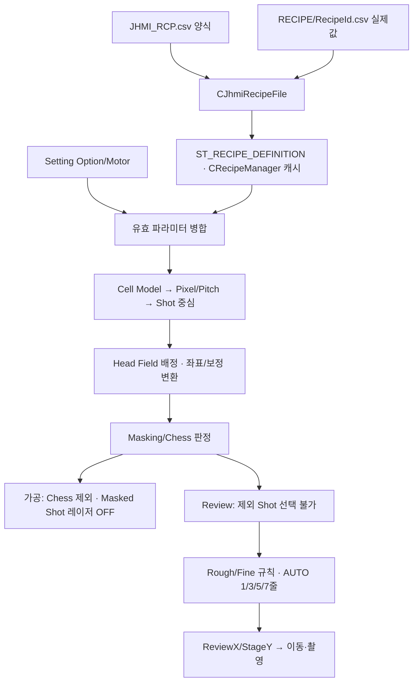

# Recipe·좌표·Head·Masking·Sampling 최초 기준 조사

대상은 A3Drilling/master 고정 Commit `3a6b021af7dad60578e7fb85e3191b43b3b3c183`이다. 이전 IPS 분석을 이 저장소의 이전 버전으로 사용하지 않았다. 아래는 현재 소스의 정적 호출 관계이며 실제 장비 평가 결과가 아니다.

## 처음 이해할 구조

- **JHMI 정의**는 화면에 표시할 항목명·단위·최솟값·기본값 등을 적은 양식이다.
- **Recipe CSV**는 선택한 제품/기판의 실제 값이다. 화면 양식과 저장 데이터는 파일이 다르다.
- **Model**은 Pixel 수·가공 간격·Chess·Masking을 묶은 형상 유형이고, 각 **Cell**은 Model 번호와 첫 Pixel 위치·회전을 선택한다.
- **Shot**은 Scanner가 한 번 처리하는 그룹 중심이다. DOE4는 X/Y축별 4분기, 즉 총16개 Beam이고, DOE 미장착에 해당하는 split1은 상대 분기 오프셋이 없는 단일 Beam이다.
- **가공 Plan**은 Head·Scanner·Stage/Encoder 기준을 붙인다. **Review Plan**은 같은 Shot/Head/제외판정을 사용하되 Camera/Stage 축 목표좌표와 선택 Beam을 별도로 계산한다.

## JHMI와 실제 Recipe 저장

양식은 `Config/JHMI_RCP.csv`의16열이며 현재355행이다. 열은 `TAB,GROUP,NAME,DISPLAY NAME,CIM NAME,DATA TYPE,UNIT,SHOW,USE,VALUE,SCALE,CHANGE LIMIT,MIN,MAX,DESCRIPTION,ORDER`다. [양식 검증·로더](https://github.com/kjuws10-rgb/A3Drilling/blob/3a6b021af7dad60578e7fb85e3191b43b3b3c183/Drilling.File/JHMI/CJhmiRecipeFile.cs#L847-L886)가 헤더를 검증하고 메타데이터를 만든다.

실제 `Config/RECIPE/*.csv`는 헤더 없는 `TAB,NAME,VALUE` 행이다. 첫 줄은 예를 들어 `DEFAULT,RECIPE_NAME,...`, 둘째 줄은 `DEFAULT,RECIPE_ID,...`이며 Cell별 값은 `CELL,CELL1_ALIGN_TO_1ST_PIXEL_X,...`, Shot별 보정은 `CELL,CELL1_A1_ALIGN_OFFSET_X,...`처럼 저장한다. 문자열에 쉼표/따옴표가 있으면 CSV escaping을 한다. [실제값 읽기](https://github.com/kjuws10-rgb/A3Drilling/blob/3a6b021af7dad60578e7fb85e3191b43b3b3c183/Drilling.File/JHMI/CJhmiRecipeFile.cs#L889-L923) · [3필드 직렬화·readback검증](https://github.com/kjuws10-rgb/A3Drilling/blob/3a6b021af7dad60578e7fb85e3191b43b3b3c183/Drilling.File/JHMI/CJhmiRecipeFile.cs#L1065-L1110).

`ST_RECIPE_DEFINITION(Id,Name,Parameters,History)`의 Parameters는 `Key,Value,Unit,DataType,Min,Max` 등이며 값은 문자열이다. [Recipe 자료형](https://github.com/kjuws10-rgb/A3Drilling/blob/3a6b021af7dad60578e7fb85e3191b43b3b3c183/Drilling.Common/Managers/CRecipeManager.cs#L355-L405). 양식의 `SCALE`을 좌표식 전체에 자동으로 곱하는 저장 구조가 아니다. `LoadRecipe`는 CSV Value 또는 기본값을 그대로 `ST_RECIPE_PARAMETER.Value`에 넣고 좌표 계산기는 문자열을 수치로 읽는다. JHMI의 단위·계수와 MELSEC READ_SCALE을 서로 대체해서 해석하면 안 된다. [Value 원문 전달](https://github.com/kjuws10-rgb/A3Drilling/blob/3a6b021af7dad60578e7fb85e3191b43b3b3c183/Drilling.File/JHMI/CJhmiRecipeFile.cs#L480-L500).

파일 Save는 활성 Cell 및 현재 Shot 범위 안의 override를 골라 기록한다. `CURRENT_PROCESS_COUNT`는 화면 편집 초안이 오래돼도 기존 파일 값을 보존한다. [Cell/Shot 범위 및 내부 매수 보존](https://github.com/kjuws10-rgb/A3Drilling/blob/3a6b021af7dad60578e7fb85e3191b43b3b3c183/Drilling.File/JHMI/CJhmiRecipeFile.cs#L143-L206). 저장 후 파일을 다시 읽어 기대 키/값을 검증하고 이력을 쓴다. Manager도 gate로 저장 작업을 직렬화하고 저장본을 다시 캐시에 반영한다. [파일 commit후 확인](https://github.com/kjuws10-rgb/A3Drilling/blob/3a6b021af7dad60578e7fb85e3191b43b3b3c183/Drilling.File/JHMI/CJhmiRecipeFile.cs#L217-L241) · [Manager 저장·보정 보존](https://github.com/kjuws10-rgb/A3Drilling/blob/3a6b021af7dad60578e7fb85e3191b43b3b3c183/Drilling.Common/Managers/CRecipeManager.cs#L145-L170). Distortion 등 측정기준 저장은 편집 당시 값과 최신 Recipe를 비교하여 변경이 있으면 거절한다. [낡은 Recipe 기준 보호](https://github.com/kjuws10-rgb/A3Drilling/blob/3a6b021af7dad60578e7fb85e3191b43b3b3c183/Drilling.Common/Managers/CRecipeManager.cs#L74-L108).

## 계산 기준과 중간 자료

[Model 선택과 형상값](https://github.com/kjuws10-rgb/A3Drilling/blob/3a6b021af7dad60578e7fb85e3191b43b3b3c183/Drilling.Common/Recipe/CCellPatternCalculator.cs#L427-L464)는 Model1~5를 읽고 각 Cell의 Model 번호를1~활성 Model 수 범위로 제한한다. 좌표 생성 입력은 `AK_MARGIN_X/Y`, `CELLn_ALIGN_TO_1ST_PIXEL_X/Y`, `CELLn_ROTATION`, `PIXEL_SIZE`, Model별 `NUM_OF_PIXEL_X/Y,PITCH`와 전역 `SPLITED_BEAM_COUNT`다. [Cell별 입력 구성](https://github.com/kjuws10-rgb/A3Drilling/blob/3a6b021af7dad60578e7fb85e3191b43b3b3c183/Drilling.Common/Recipe/CShotCoordinatePlanBuilder.cs#L207-L267).

0부터 시작하는 Shot 열/행을 c,r, Pixel 간격을 p, Model의 가공 Pixel Pitch를 k, 축별 DOE수를 s라 하면:

- Shot 간격 `P=p×k` [mm]
- Beam 간격 `d=P/s` [mm]
- 첫 Beam에서 그룹 중심까지의 거리 `h=d×(s−1)/2` [mm]
- 그룹 수 `floor(PixelCountX/k) × floor(PixelCountY/k)`
- `DesignXY = AK Margin + Cell 첫 Pixel 위치 + R(회전)×(cP+h,rP+h)`

[개수/간격/DOE 검증](https://github.com/kjuws10-rgb/A3Drilling/blob/3a6b021af7dad60578e7fb85e3191b43b3b3c183/Drilling.Common/Recipe/CCellPatternCalculator.cs#L93-L146) · [Shot 중심 회전·원점 합산](https://github.com/kjuws10-rgb/A3Drilling/blob/3a6b021af7dad60578e7fb85e3191b43b3b3c183/Drilling.Common/Recipe/CCellPatternCalculator.cs#L224-L247). Model 크기가 가공 Pitch로 나누어 떨어지지 않으면 남는 Pixel 부분은 Shot으로 생성하지 않는다. 예를 들어 현재 test0929의 Model1은864×512 Pixel, Pitch30으로28×17 Shot/Cell이며45 Cell이면 설계상21,420 Shot이다. 이 수치는 Head배정/Chess/Masking 후 실제가공 수와 다르다. 포함된 Align offset 행42,840개는 X/Y 쌍21,420개에 해당하며 실제 실가동을 검증한 수치가 아니다.

Design→Head는 `DesignX + ESC_EDGE_TO_GLASS_EDGE + GLASS_CENTER_TO_SCANNER_CENTER`를 Head X Field와 비교한다. Field 기본폭110mm, 중심거리→동률 시 배정수→Head번호 순으로 고른다. 그 뒤 선택된 Head가 OFF이면 Shot을 누락시킨다. OFF Head의 영역을 이웃 Head로 자동 재배정하는 로직으로 해석하면 안 된다. [Head 배정의 전후 필터](https://github.com/kjuws10-rgb/A3Drilling/blob/3a6b021af7dad60578e7fb85e3191b43b3b3c183/Drilling.Common/Recipe/CShotCoordinatePlanBuilder.cs#L21-L67) · [Field 후보와 동률 선택](https://github.com/kjuws10-rgb/A3Drilling/blob/3a6b021af7dad60578e7fb85e3191b43b3b3c183/Drilling.Common/Recipe/CShotCoordinatePlanBuilder.cs#L361-L409) · [Head 기준 위치·원점 차이](https://github.com/kjuws10-rgb/A3Drilling/blob/3a6b021af7dad60578e7fb85e3191b43b3b3c183/Drilling.Common/Recipe/CShotCoordinatePlanBuilder.cs#L435-L487).

최종 Scanner 좌표는 Head별 축 변환 후 기본 위치에 Recipe·Head Default·First Beam·Review·Align 보정을 더하고 Shift를 별도 경로로 더한다. Align은 Design 좌표계, Review는 Design/Scanner 표식에 따라 변환한다. Stage Y·Encoder는 Stage 방향 및 EncoderScale이 별도로 관여한다. [최종 Scanner·Offset 구성](https://github.com/kjuws10-rgb/A3Drilling/blob/3a6b021af7dad60578e7fb85e3191b43b3b3c183/Drilling.Common/Recipe/CShotCoordinatePlanBuilder.cs#L131-L182). `ST_HEAD_SHOT_POINT`는 Cell/Shot/Head 식별자뿐 아니라 DesignXY, ScannerGx/Gy, StageXY, 각 보정 및 Encoder 대기위치를 나눠 보관하므로 최종값만 보면 어떤 보정이 적용됐는지 역추적하기 어렵다. [가공 좌표 자료형](https://github.com/kjuws10-rgb/A3Drilling/blob/3a6b021af7dad60578e7fb85e3191b43b3b3c183/Drilling.Common/Recipe/CShotCoordinatePlanBuilder.cs#L1309-L1370).

## Masking·Chess의 실제 적용 범위

Masking은 Model당 Hole 사각형 최대3개와 Edge 형상을 사용한다. 각 Beam 중심점 하나만 검사하는 것이 아니라 BeamPitch 기반 사각 영역과 Hole/Edge가 닿는지 검사한다. [Model Masking 생성](https://github.com/kjuws10-rgb/A3Drilling/blob/3a6b021af7dad60578e7fb85e3191b43b3b3c183/Drilling.Common/Recipe/CShotCoordinatePlanBuilder.cs#L908-L927) · [Beam별 사각영역 교차·Edge 판정](https://github.com/kjuws10-rgb/A3Drilling/blob/3a6b021af7dad60578e7fb85e3191b43b3b3c183/Drilling.Common/Recipe/CShotCoordinatePlanBuilder.cs#L838-L890).

하나라도 Masked Beam이 있으면 `IsMasked=true`, `ShouldSkipLaser=IsMasked || IsChessSkipped`다. **Masked Beam만 빼고 같은 Shot의 나머지15 Beam을 켜는 방식이 아니라 Shot 전체 레이저를 끈다.** [Shot 전체 제외 조건](https://github.com/kjuws10-rgb/A3Drilling/blob/3a6b021af7dad60578e7fb85e3191b43b3b3c183/Drilling.Common/Recipe/CShotCoordinatePlanBuilder.cs#L752-L769). Chess는 GroupColumn/GroupRow의 나머지 규칙에 따라 Shot을 뺀다. [Chess 패턴](https://github.com/kjuws10-rgb/A3Drilling/blob/3a6b021af7dad60578e7fb85e3191b43b3b3c183/Drilling.Common/Recipe/CShotCoordinatePlanBuilder.cs#L898-L905).

가공 준비는 Chess Shot을 목록에서 제거하지만 Masked Shot의 좌표는 유지할 수 있다. Script는 해당 좌표로 MoveRapid/Encoder 대기를 수행하고 `ShouldSkipLaser`일 때 Laser ON 구간을 생성하지 않는다. 따라서 **Masking=레이저/촬영 제외**이며 물리 이동 경로가 Hole을 우회한다는 뜻은 아니다. [가공 모델의 Chess 제거](https://github.com/kjuws10-rgb/A3Drilling/blob/3a6b021af7dad60578e7fb85e3191b43b3b3c183/Drilling.Common/Station/CStationProcess.cs#L1543-L1548) · [이동 유지·레이저 ON 조건](https://github.com/kjuws10-rgb/A3Drilling/blob/3a6b021af7dad60578e7fb85e3191b43b3b3c183/Drilling.File/Script/CAutomation1ScriptFile.cs#L514-L556).

Review는 가공과 같은 유효 Recipe+Option/Motor 파라미터로 Head를 정하고 같은 Masking Plan을 다시 평가한다. 제외 Shot은 ExclusionReason이 붙고 Use=false·Skip 상태가 된다. [Review Plan과 제외 전달](https://github.com/kjuws10-rgb/A3Drilling/blob/3a6b021af7dad60578e7fb85e3191b43b3b3c183/Drilling.Common/Review/CReviewManager.cs#L390-L440) · [Option/Motor 병합](https://github.com/kjuws10-rgb/A3Drilling/blob/3a6b021af7dad60578e7fb85e3191b43b3b3c183/Drilling.Common/Review/CReviewManager.cs#L443-L466). AUTO FINE도 같은 `ShouldSkipLaser`를 사용한다. [AUTO FINE 선택 전 제외](https://github.com/kjuws10-rgb/A3Drilling/blob/3a6b021af7dad60578e7fb85e3191b43b3b3c183/Drilling.Common/Review/CAutoFineReviewCoordinator.cs#L198-L231). 0선방어에서 저장한 검사점이 현재 Masking/Chess 제외 Shot이면 준비 단계에서 거절한다. [0선 검사점 검증](https://github.com/kjuws10-rgb/A3Drilling/blob/3a6b021af7dad60578e7fb85e3191b43b3b3c183/Drilling.Common/Review/CZeroDefenceRecipePlan.cs#L62-L74).

## Review Plan·Sampling Rule

Review 기본 Plan은 `RecipeId,CellCount,ToleranceX/Y,VisionFlipType,CreatedAt,Points`이고 각 Point가 `ShotKey,HeadNo,CellNo,ShotNo,Use,DesignXY,ReviewTargetXY,상태/판정`을 가진다. [Review 식별자와 상태](https://github.com/kjuws10-rgb/A3Drilling/blob/3a6b021af7dad60578e7fb85e3191b43b3b3c183/Drilling.Common/Review/CReviewManager.cs#L3715-L3805). Plan의 Beam 번호는1~s²이며 선택 Beam 오프셋은 `((col−(s−1)/2)d,(row−(s−1)/2)d)`다. 회전을 적용한 뒤 다음처럼 Review 축 목표를 계산한다:

`ReviewX = CameraAKX + (DesignX−AKMarginX) + RotatedBeamOffsetX`

`StageY = CameraAKY + StageDirection × ((DesignY−AKMarginY)+RotatedBeamOffsetY)`

[Beam 개수·상대좌표·번호검증](https://github.com/kjuws10-rgb/A3Drilling/blob/3a6b021af7dad60578e7fb85e3191b43b3b3c183/Drilling.Common/Review/CReviewManager.cs#L816-L849) · [ReviewX/StageY 수식](https://github.com/kjuws10-rgb/A3Drilling/blob/3a6b021af7dad60578e7fb85e3191b43b3b3c183/Drilling.Common/Review/CReviewManager.cs#L852-L872). test0929의 AK Margin15.5는 이 식에서 AK 상대거리로 되돌리는 값이다. 글로벌좌표를 무조건15.5만큼 기계 이동시키라는 뜻은 아니다.

Rule 구조는 Simple/Rough/Fine/Edge, 범위는 Head/Head+Cell, Reference는 First/Center/Last다. `ST_REVIEW_RULE_CONFIGURATION(Rule,Scope,BeamNo,ReferenceShotKey,RoughReference,FineLineCount)`에서 실제 `Targets(ShotKey,HeadNo,CellNo,RowNo,ColumnNo,Role)`를 얻는다. [규칙 분기](https://github.com/kjuws10-rgb/A3Drilling/blob/3a6b021af7dad60578e7fb85e3191b43b3b3c183/Drilling.Common/Review/CReviewRulePlanBuilder.cs#L5-L22) · [규칙 자료형](https://github.com/kjuws10-rgb/A3Drilling/blob/3a6b021af7dad60578e7fb85e3191b43b3b3c183/Drilling.Common/Review/CReviewRulePlanBuilder.cs#L503-L535). Rough는 Head 또는 Head+Cell별 대표 Shot을 고르고 Fine은 Cell마다 Y 범위에 줄을 배치하고 중복 ShotKey를 없앤다. [Rough 범위 분기](https://github.com/kjuws10-rgb/A3Drilling/blob/3a6b021af7dad60578e7fb85e3191b43b3b3c183/Drilling.Common/Review/CReviewRulePlanBuilder.cs#L25-L66) · [Cell별 Fine 줄 선정](https://github.com/kjuws10-rgb/A3Drilling/blob/3a6b021af7dad60578e7fb85e3191b43b3b3c183/Drilling.Common/Review/CReviewRulePlanBuilder.cs#L361-L400).

현재 수동 화면의 Sample Select 진입은 ROUGH/FINE를 선택하도록 되어 있고3줄이 기본값이다. 구조체에 Simple/Edge가 있다는 사실만으로 모든 화면 메뉴가 동일하게 노출된다고 설명하면 안 된다. [화면 기본값](https://github.com/kjuws10-rgb/A3Drilling/blob/3a6b021af7dad60578e7fb85e3191b43b3b3c183/Drilling.UI/Menu/Menus/CMenuReview.cs#L69-L81) · [수동 Rule 선택·줄수](https://github.com/kjuws10-rgb/A3Drilling/blob/3a6b021af7dad60578e7fb85e3191b43b3b3c183/Drilling.UI/Menu/Menus/CMenuReview.cs#L609-L650). AUTO는 별도 Run Option CSV 값으로 관리한다. `RUNOPTION_REVIEW_LINE=0/1/2/3`이 실제1/3/5/7줄이며, 저장값을 라인 수로 그대로 표시하면 틀린다. [AUTO 옵션 encode/decode](https://github.com/kjuws10-rgb/A3Drilling/blob/3a6b021af7dad60578e7fb85e3191b43b3b3c183/Drilling.Common/Managers/CSettingManager.cs#L183-L243). 개별 결과·Product에는 Rule metadata를 남길 수 있지만 수동 화면의 임시 선택 전체가 독립적인 `.review` Recipe 파일로 저장되는 경로는 이번 전체 소스 검색에서 확인하지 못했다. 결과 metadata와 Recipe의 Sampling 정책 영속화를 구분해야 한다.

## 위험도별 발견사항과 개선 검토

| 수준 | 현재 근거 | 영향과 조치 방향 |
| --- | --- | --- |
| 높음 | AUTO FINE/0선FollowUp Beam11 고정 | 전역 DOE 미장착에 해당하는 split1은 Beam1만 유효하므로 단일빔 Recipe에서도 AUTO FINE이 정상 동작한다고 보장할 수 없다. 광학조건별 Beam/ZeroOrder 식별자를 함께 검토해야 한다. |
| 높음·조건부 | Shift가공의 Masking/Review 추종 | Shift는 Scanner에 별도 반영되지만 Maskingcenter는 FinalScannerOffset만 사용하고 ReviewTarget는 nominal Design/AK/Beam 식이다. Shift가공일 때 어떤 영역을 검사·제외할지 명시하고 실 좌표로 대조해야 한다. |
| 중간 | JHMI DOE 최대64·실행1/4 허용 | 양식의 입력범위와 좌표 생성기 허용범위가 다르다. 잘못 저장된 값은 준비 시 차단될 수 있어 UI/CSV 검증 범위를 일치시켜야 한다. |
| 중간 | Recipe 일반 Save가 본파일 직접 WriteAllLines | 저장 뒤 readback은 있지만 전원/프로세스 종료 시 원본 보존을 보장하는 원자적 치환 경로는 아니다. 임시파일 검증·replace/backup 정책 검토가 필요하다. |
| 운영 확인 | test0929의 공차3, 단위mm | 포함된 다른4 Recipe와 JHMI기본은0.030mm인데 test0929는3mm다. 의도된 평가조건인지 확인해야 하며 3µm로 임의 해석하면 안 된다. |
| 설계 경계 | Head별 DOE 혼재 없음 | 전역 `SPLITED_BEAM_COUNT` 하나로 Shot/Mask/Review가 계산된다. 특정 Head만 DOE 없음을 설정하는 제품 기능이 이미 구현됐다고 해석할 수 없다. |

AUTO FINE은 [Beam11 고정](https://github.com/kjuws10-rgb/A3Drilling/blob/3a6b021af7dad60578e7fb85e3191b43b3b3c183/Drilling.Common/Review/CAutoFineReviewCoordinator.cs#L310-L313)을 [실제 좌표계산 호출](https://github.com/kjuws10-rgb/A3Drilling/blob/3a6b021af7dad60578e7fb85e3191b43b3b3c183/Drilling.Common/Review/CAutoFineReviewCoordinator.cs#L236-L251)에 사용한다. split1이면 최대 Beam1인 검증부와 맞지 않는 정적 실행 경로가 있다. 이는 현재 최초 기준의 충돌이며 이번에 새로 발생한 회귀라고 단정하지 않는다.

Shift 판단 근거는 Scanner 합산([Shift 별도 합산](https://github.com/kjuws10-rgb/A3Drilling/blob/3a6b021af7dad60578e7fb85e3191b43b3b3c183/Drilling.Common/Recipe/CShotCoordinatePlanBuilder.cs#L143-L149)), Maskingcenter([Masking 기준 중심](https://github.com/kjuws10-rgb/A3Drilling/blob/3a6b021af7dad60578e7fb85e3191b43b3b3c183/Drilling.Common/Recipe/CShotCoordinatePlanBuilder.cs#L857-L865)), Review 수식(위864행)이다. 물리 경로/현재 Glass를 움직여 재현하지 않았다.

일반 Recipe 저장은 [직접 WriteAllLines](https://github.com/kjuws10-rgb/A3Drilling/blob/3a6b021af7dad60578e7fb85e3191b43b3b3c183/Drilling.File/Parser/CCsvParser.cs#L106-L115)이고 이후 [readback 확인](https://github.com/kjuws10-rgb/A3Drilling/blob/3a6b021af7dad60578e7fb85e3191b43b3b3c183/Drilling.File/JHMI/CJhmiRecipeFile.cs#L226-L241)이다. 매수 저장/파일 복사 등 다른 특수 경로의 atomic move 존재를 일반 Save의 보장으로 확대하지 않았다.

공차 데이터 근거는 [test0929 포함 공차](https://github.com/kjuws10-rgb/A3Drilling/blob/3a6b021af7dad60578e7fb85e3191b43b3b3c183/Config/RECIPE/test0929.csv#L1-L7) 및 [JHMI 기본 공차와 단위](https://github.com/kjuws10-rgb/A3Drilling/blob/3a6b021af7dad60578e7fb85e3191b43b3b3c183/Config/JHMI_RCP.csv#L1-L6)이다. 공차가 큰 이유나 실제 현장 설정과 같은지는 확인하지 못했다.

## 검토·검증 범위

고정 줄범위 근거46개와 해당파일15개를 확인했고, 포함·추가 Recipe CSV 5개의 지정 필드를 대조했다. static text/CSV 검증은 schema와 현재 저장값의 대조이며 C# 실행시험이나 실기 성능시험이 아니다. 소스 build·WPF·PLC·Vision·Scanner·Laser를 실행하지 않았고 원본 파일을 변경하지 않았다. 담당 산출물은 이 초안과 요약 JSON뿐이다. ReviewResult·보정·Product의 후속 연결은 [가공·Review 분석](03_가공_Review영향분석.md)과 함께 읽는다.

## 결과·보정·Product까지 이어지는 저장 자료

## 4. 저장 형식

| 저장소/자료 | 키·열과 용도 | 현재 한계/해석 |
| --- | --- | --- |
| 일반 ReviewResult | `SAVED_AT,GLASS_ID,RECIPE_ID,INSPECTION_METHOD,RESULT_STATUS,TOTAL_COUNT,RULE,RULE_SCOPE,BEAM_NO,REFERENCE_CELL_NO,REFERENCE_SHOT,ROUGH_REFERENCE,FINE_LINE_COUNT,RESULT_SOURCE,SHOT_NAME,ROW,COLUMN,DESIGN_X,DESIGN_Y,SHOT_KEY,HEAD_NO,CELL_NO,ERROR_X,ERROR_Y,JUDGE` | 일반 파일의 필수 열은 SavedAt/Recipe/ShotKey/Head/Cell/Error/Judge. 전용 FINE/ROUGH CSV와 열 구성이 다름 |
| FINE 전용 CSV | Recipe/Glass/Origin/Method/Retry/CaptureAttempt/ResultStatus/Simulation, Line/Model/Direction, Head/Cell/Shot/Beam, Design/ReviewXTarget/StageYTarget, Flip3종, `RECV_TARGET_MINUS_HOLE_X/Y`, `VISION_FLIP_CONVERT_X/Y`, ResultSource/Judge | 실측·유지·ERROR·미검사를 구분. Completed는 동작 완료이며 전체OK와 구분 |
| ROUGH 전용 CSV | RunType/RuleScope/ResultStatus/Simulation/Count, Point/Head/Cell/Shot/Beam, Design/ReviewTarget, Flip/수신오차/변환오차/ResultSource/Judge | NG나미검사는 누적0으로 기존 보정 유지 |
| Beam Inspection CSV | Glass/Head/Cell/Shot + Beam1~16의 X_MM/Y_MM/JUDGE, 총52열 | 16개 측정열 저장형식. DOE 미장착 단일빔과 Head별 혼재 정책을 자동 제공하는 증거가 아님 |
| Review Offset CSV | `CELLID,SHOTID,REVIEWOFFSETX,REVIEWOFFSETY,COORDINATE_SPACE`; 키는 Cell+정규화Shot | Beam/Glass/Run/Recipe hash/측정결과ID/기준Revision은 열에 없음. Recipe는 저장 디렉터리로 구분 |
| ActiveProduct.csv | `TYPE,NAME,VALUE`; PRODUCT/RECIPE/ALIGN/DISTORTION/REVIEW/REVIEW_RESULT 섹션 | JSON이 아닌 compact CSV. ReviewResult CSV의 전체 원시자료를 복제하지 않음 |
| ProductHistory | `OCCURRED_AT,ROW_TYPE,GLASS_ID,PROCESS_ID,RECIPE_ID,ACTION,STATE,RESULT,DETAIL` | 일자별 `Data/Product/History/yyyyMMdd/ProductHistory_yyyyMMdd.csv` |

근거: [Drilling.File/ReviewResult/CReviewResultFile.cs#L12-L40](https://github.com/kjuws10-rgb/A3Drilling/blob/3a6b021af7dad60578e7fb85e3191b43b3b3c183/Drilling.File/ReviewResult/CReviewResultFile.cs#L12-L40), [#L446-L549](https://github.com/kjuws10-rgb/A3Drilling/blob/3a6b021af7dad60578e7fb85e3191b43b3b3c183/Drilling.File/ReviewResult/CReviewResultFile.cs#L446-L549), [#L580-L667](https://github.com/kjuws10-rgb/A3Drilling/blob/3a6b021af7dad60578e7fb85e3191b43b3b3c183/Drilling.File/ReviewResult/CReviewResultFile.cs#L580-L667); [Drilling.File/ReviewOffset/CReviewOffsetFile.cs#L10-L25](https://github.com/kjuws10-rgb/A3Drilling/blob/3a6b021af7dad60578e7fb85e3191b43b3b3c183/Drilling.File/ReviewOffset/CReviewOffsetFile.cs#L10-L25); [Drilling.File/Product/CProductFile.cs#L8-L11](https://github.com/kjuws10-rgb/A3Drilling/blob/3a6b021af7dad60578e7fb85e3191b43b3b3c183/Drilling.File/Product/CProductFile.cs#L8-L11), [#L109-L192](https://github.com/kjuws10-rgb/A3Drilling/blob/3a6b021af7dad60578e7fb85e3191b43b3b3c183/Drilling.File/Product/CProductFile.cs#L109-L192), [#L258-L265](https://github.com/kjuws10-rgb/A3Drilling/blob/3a6b021af7dad60578e7fb85e3191b43b3b3c183/Drilling.File/Product/CProductFile.cs#L258-L265).

Review Offset는 임시파일에 쓰고 `yyyyMMdd_HHmmss_fff_reviewoffset.csv`로 충돌 없이 이동한다. 로드는 디렉터리의 모든CSV를 파일명 내림차순으로 정렬해 첫 파일을 선택한다. 4열 구형파일의 좌표계 공란은 SCANNER로 처리하고 새 DESIGN 파일은 현재 Head/Stage 방향에서 Scanner로 변환한다. 행 검증은 NaN/무한대/잘못된Cell/빈Shot/정규화후중복을 전체 거부하며 기존 파라미터를 지우기 전에 수행한다.

**전용 결과CSV와 재로드 호환은 분리되어 있다.** Correction의 Load Review Result는 `OpenFileDialog`→`_reviewResultFile.Load(filePath)` 일반 importer로 연결된다([CMenuCorrection.cs#L869-L892](https://github.com/kjuws10-rgb/A3Drilling/blob/3a6b021af7dad60578e7fb85e3191b43b3b3c183/Drilling.UI/Menu/Menus/CMenuCorrection.cs#L869-L892)). 이 importer는 `ERROR_X`,`ERROR_Y`를 필수로 검사한다([CReviewResultFile.cs#L13-L13](https://github.com/kjuws10-rgb/A3Drilling/blob/3a6b021af7dad60578e7fb85e3191b43b3b3c183/Drilling.File/ReviewResult/CReviewResultFile.cs#L13-L13), [#L47-L55](https://github.com/kjuws10-rgb/A3Drilling/blob/3a6b021af7dad60578e7fb85e3191b43b3b3c183/Drilling.File/ReviewResult/CReviewResultFile.cs#L47-L55)). 그러나 전용 FINE/ROUGH 결과는 해당열 대신 `RECV_TARGET_MINUS_HOLE_X/Y`·`VISION_FLIP_CONVERT_X/Y`를 저장한다. 현재 코드에서 이 전용 형식을 읽는 별도 importer/alias 연결을 찾지 못했다. 따라서 저장·실행중Monitor조회와, 저장한파일을 Correction에서다시불러보는기능은같이완성된것이아니다. 추적된39열FINE CSV를genericLoad에넣으면필수헤더누락조건에해당한다. 이 판정은헤더계약의정적대조이며 WPF에서실제클릭한결과라고주장하지않는다.

## 첫 기준의 형식 해석

이번은 이전 형식과의 diff가 아니라 현재 serializer와 포함된 CSV를 함께 기록한 것이다. [현재 CSV 구조 목록](schema-snapshot.json)에서 실제 Recipe는 헤더 없는 TAB/NAME/VALUE 행으로, 일반 결과/FINE 결과/Review Offset는 각자의 헤더로 구분했다. 과거 Data 파일의 헤더가 현재 다른 저장기와 같다고 가정하지 않는다.

JHMI 양식355행과 test0929 실제 파일43,376행은 역할이 다르다. 실제 Recipe의 첫 두 행도 데이터이므로 일반 CSV의 헤더처럼 빼서 세지 않았다. JHMI 단위/기본값과 실제 Recipe 값·MELSEC 읽기배율·Vision pixel 환산을 각각 따로 추적해야 한다.
