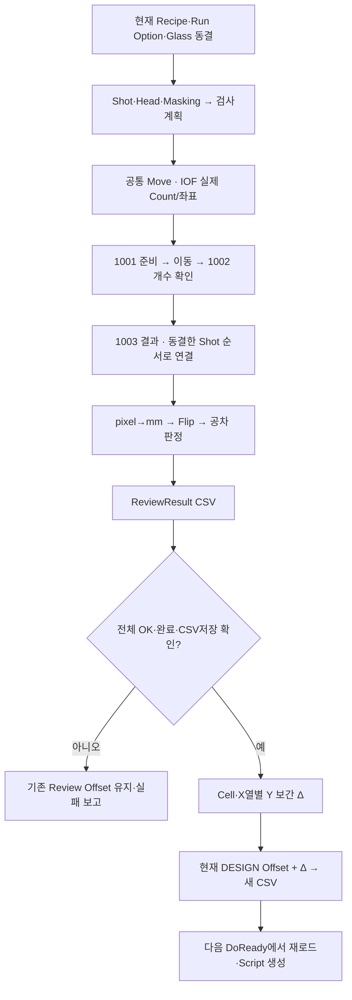

# Review·Vision·보정·Product 최초 기준 분석

분석 원본은 `kjuws10-rgb/A3Drilling`, `master`, `3a6b021af7dad60578e7fb85e3191b43b3b3c183`이다. 과거 IPS 보고서의 변경점·빌드 결과를 이 저장소의 새 변경이나 현행 상태로 가져오지 않았다. 이 문서는 현재 연결의 정적 분석이며 실제 Vision·PLC·축·레이저를 기동하지 않았다.

## 1. 측정과 다음 가공이 연결되는 순서

| 단계 | 현재 동작 | 실제 근거 |
| --- | --- | --- |
| AUTO 요청 접수 | Stage Review ABLE 시 Run Option, Recipe, 현재 ProcessModel의 파라미터, Glass ID를 동결 | [Drilling.UI/CRootView.cs#L2791-L2836](https://github.com/kjuws10-rgb/A3Drilling/blob/3a6b021af7dad60578e7fb85e3191b43b3b3c183/Drilling.UI/CRootView.cs#L2791-L2836) |
| 측정계획 | 실제 Shot·Head·Masking 기준으로 `Use`를 만들고 FINE/HeadCell 규칙으로 검사점 선정. AUTO 대표 Beam은 현재 11번 고정 | [Drilling.Common/Review/CAutoFineReviewCoordinator.cs#L192-L247](https://github.com/kjuws10-rgb/A3Drilling/blob/3a6b021af7dad60578e7fb85e3191b43b3b3c183/Drilling.Common/Review/CAutoFineReviewCoordinator.cs#L192-L247), [#L310-L313](https://github.com/kjuws10-rgb/A3Drilling/blob/3a6b021af7dad60578e7fb85e3191b43b3b3c183/Drilling.Common/Review/CAutoFineReviewCoordinator.cs#L310-L313) |
| 이동·IOF | 시작점으로 공통 Move 완료 → 실제 Count와 좌표 배열 전송·읽기 확인 → IOF 신호 교환·복귀 | [Drilling.Common/Station/CStageReviewSequences.cs#L742-L815](https://github.com/kjuws10-rgb/A3Drilling/blob/3a6b021af7dad60578e7fb85e3191b43b3b3c183/Drilling.Common/Station/CStageReviewSequences.cs#L742-L815) |
| Flying 촬영 | 1001 준비 응답 → X 종료점 Move 완료 → 1002 촬영 개수 일치 확인 → 1003 결과 읽기 | [Drilling.Common/Review/CReviewManager.cs#L1779-L1849](https://github.com/kjuws10-rgb/A3Drilling/blob/3a6b021af7dad60578e7fb85e3191b43b3b3c183/Drilling.Common/Review/CReviewManager.cs#L1779-L1849), [#L2555-L2618](https://github.com/kjuws10-rgb/A3Drilling/blob/3a6b021af7dad60578e7fb85e3191b43b3b3c183/Drilling.Common/Review/CReviewManager.cs#L2555-L2618) |
| 결과 매핑 | 요청 시 동결한 `triggerBuffer`와 수신 순서를 대응. 역방향 재시도는 순서만 뒤집고 Shot 정체성 유지 | [Drilling.Common/Review/CReviewManager.cs#L2550-L2618](https://github.com/kjuws10-rgb/A3Drilling/blob/3a6b021af7dad60578e7fb85e3191b43b3b3c183/Drilling.Common/Review/CReviewManager.cs#L2550-L2618) |
| mm·판정 | `(Target pixel − Hole pixel) × CameraResolution(mm/pixel) × nResolution` → Vision Flip → X/Y 공차 비교 | [Drilling.Common/Review/CReviewManager.cs#L2030-L2086](https://github.com/kjuws10-rgb/A3Drilling/blob/3a6b021af7dad60578e7fb85e3191b43b3b3c183/Drilling.Common/Review/CReviewManager.cs#L2030-L2086), [#L3345-L3364](https://github.com/kjuws10-rgb/A3Drilling/blob/3a6b021af7dad60578e7fb85e3191b43b3b3c183/Drilling.Common/Review/CReviewManager.cs#L3345-L3364) |
| 측정 결과 저장 | 정상·중지·실패 상태와 실측/유지/미검사 구분을 FINE/ROUGH CSV에 기록 | [Drilling.File/ReviewResult/CReviewResultFile.cs#L446-L549](https://github.com/kjuws10-rgb/A3Drilling/blob/3a6b021af7dad60578e7fb85e3191b43b3b3c183/Drilling.File/ReviewResult/CReviewResultFile.cs#L446-L549), [#L580-L667](https://github.com/kjuws10-rgb/A3Drilling/blob/3a6b021af7dad60578e7fb85e3191b43b3b3c183/Drilling.File/ReviewResult/CReviewResultFile.cs#L580-L667) |
| AUTO FINE 보정 | 요청점 정체성/개수/완료/전체 OK/CSV저장 확인 후 같은 Cell·X열의 Y방향 보간값을 이전 보정에 누적 | [Drilling.Common/Review/CAutoFineReviewCoordinator.cs#L93-L174](https://github.com/kjuws10-rgb/A3Drilling/blob/3a6b021af7dad60578e7fb85e3191b43b3b3c183/Drilling.Common/Review/CAutoFineReviewCoordinator.cs#L93-L174), [CReviewManager.cs#L3274-L3340](https://github.com/kjuws10-rgb/A3Drilling/blob/3a6b021af7dad60578e7fb85e3191b43b3b3c183/Drilling.Common/Review/CReviewManager.cs#L3274-L3340) |
| 다음 가공 | 다음 준비 때 최신 Review Offset 파일을 읽어 Runtime Parameters에 병합한 뒤 Head·Stage 방향을 반영하여 Scanner 좌표 생성 | [Drilling.Common/Station/CStationProcess.cs#L1505-L1535](https://github.com/kjuws10-rgb/A3Drilling/blob/3a6b021af7dad60578e7fb85e3191b43b3b3c183/Drilling.Common/Station/CStationProcess.cs#L1505-L1535), [Drilling.Common/Recipe/CShotCoordinatePlanBuilder.cs#L131-L182](https://github.com/kjuws10-rgb/A3Drilling/blob/3a6b021af7dad60578e7fb85e3191b43b3b3c183/Drilling.Common/Recipe/CShotCoordinatePlanBuilder.cs#L131-L182) |

일반 Review와 AUTO 전용 FINE, 0선 FollowUp은 동일한 소비 경로가 아니다. 0선 FollowUp은 검사 전용이므로 정상 측정 CSV를 저장해도 Review Offset 파일을 읽거나 변경하지 않는다([CAutoFineReviewCoordinator.cs#L110-L118](https://github.com/kjuws10-rgb/A3Drilling/blob/3a6b021af7dad60578e7fb85e3191b43b3b3c183/Drilling.Common/Review/CAutoFineReviewCoordinator.cs#L110-L118)).

## 2. 소켓과 MELSEC의 역할

`CVisionComm`의 수신 루프는 16byte 헤더와 헤더가 지정한 본문을 각각 `ReadExactlyAsync`로 끝까지 받는다. 송신은 `_writeLock`으로 직렬화한다. pending 요청은 Unique ID로 연결한 뒤 Command와 ErrorCode를 확인하며 타임아웃 시 pending을 제거한다. 따라서 현재 가공 측 코드가 TCP Read 한 번을 패킷 하나로 가정하는 구조는 아니다. 다만 상대 Vision이 동일한 고정 슬롯 수·길이·패킹을 사용해야 하며, 상대 코드가 제공되지 않아 양측 계약 일치를 실행 검증한 것은 아니다.

| 항목 | 현재 계약 | 근거 |
| --- | --- | --- |
| 헤더 | Command/DataLength/UniqueId/ErrorCode의 Int32 4개, 16byte | [CVisionComm.cs#L558-L567](https://github.com/kjuws10-rgb/A3Drilling/blob/3a6b021af7dad60578e7fb85e3191b43b3b3c183/Drilling.Common/Interface/Vision/CVisionComm.cs#L558-L567), [#L648-L666](https://github.com/kjuws10-rgb/A3Drilling/blob/3a6b021af7dad60578e7fb85e3191b43b3b3c183/Drilling.Common/Interface/Vision/CVisionComm.cs#L648-L666) |
| 1001 본문 | `8 + capacity × 24`byte. Count는 실제 점 수, 남는 슬롯의 모든 Int32는 -1 | [CVisionComm.cs#L576-L594](https://github.com/kjuws10-rgb/A3Drilling/blob/3a6b021af7dad60578e7fb85e3191b43b3b3c183/Drilling.Common/Interface/Vision/CVisionComm.cs#L576-L594) |
| 1002 응답 | Int32 1개, 0=일치 OK / 1=불일치 NG | [CVisionComm.cs#L734-L745](https://github.com/kjuws10-rgb/A3Drilling/blob/3a6b021af7dad60578e7fb85e3191b43b3b3c183/Drilling.Common/Interface/Vision/CVisionComm.cs#L734-L745) |
| 1003 본문 | `8 + capacity × 36`byte. 해상도·유효 Count·고정 배열. Count가 capacity보다 크면 전용 예외 | [CVisionComm.cs#L768-L802](https://github.com/kjuws10-rgb/A3Drilling/blob/3a6b021af7dad60578e7fb85e3191b43b3b3c183/Drilling.Common/Interface/Vision/CVisionComm.cs#L768-L802) |
| 기본 capacity | 300. 기본 1001 본문7208byte / 1003 본문10808byte | [CVisionComm.cs#L558-L567](https://github.com/kjuws10-rgb/A3Drilling/blob/3a6b021af7dad60578e7fb85e3191b43b3b3c183/Drilling.Common/Interface/Vision/CVisionComm.cs#L558-L567), [Config/JHMI_SETTING.csv#L94-L94](https://github.com/kjuws10-rgb/A3Drilling/blob/3a6b021af7dad60578e7fb85e3191b43b3b3c183/Config/JHMI_SETTING.csv#L94-L94) |
| 1002 불일치 재시도 | AUTO의 즉시 재시도 옵션/횟수 조건에 따라 반대 방향. NCK인 시도에서는1003을 읽지 않음 | [CReviewManager.cs#L2574-L2591](https://github.com/kjuws10-rgb/A3Drilling/blob/3a6b021af7dad60578e7fb85e3191b43b3b3c183/Drilling.Common/Review/CReviewManager.cs#L2574-L2591) |

MELSEC은 시작·끝 이동, 현재 위치/BUSY/허가, IOF 좌표와 트리거 준비를 담당한다. 일반 IOF는 X 배열, 0선은 Y 배열을 보내며 실제 Count 길이만 전송하고 ±0.000051mm 이내 읽기 확인을 한다. 신호는 START ON→상대 COMPLETE ON→START OFF→응답 ACK ON→상대 COMPLETE OFF→ACK OFF 순서다. 소켓 오류가 났다고 MELSEC 결함으로 곧바로 판정하거나, 이동 완료 로그만으로 Vision 결과 수신 완료를 주장하면 안 된다.

## 3. 판정 단위와 원측정

수신 좌표는 pixel이고 오차는 mm로 환산한다. 예를 들어 CameraResolution=0.0025mm/pixel, nResolution=2, Target−Hole=1pixel이면 오차는0.005mm(5µm)다. Vision Flip은 이 mm오차에 XY교환/X반전/Y반전을 적용한다. 원시 `ErrorX/Y`는 Flip 전 mm오차로 보존하고, 보정과 공차 판단은 Flip 변환값을 쓴다.

발견된 배포 데이터:

- `Config/JHMI_RCP.csv`5~6행: REVIEW_TOLERANCE_X/Y 단위mm·Scale1·기본0.030mm·허용범위0~10mm.
- `Config/RECIPE/test0929.csv`6~7행: X/Y 값이3이다. 현재 함수는 이를 그대로 공차로 읽으므로 **±3mm**이며3µm가 아니다. 레시피값이 기본값보다100배 크다. 범위 안의 유효 숫자이므로 코드 파싱 오류라고 단정하지 않으며, 의도한 승인 공차와 배포값을 확인해야 한다.
- 추적된 `Data/ReviewResult/FINE/test0929/20261104/20261104_135832_883.csv`: 1220행 전부OK, 기록된 수신 오차의 최대 절댓값X/Y 각각0.491mm, Stage/Vision Simulation열은 모두OFF이다. 이 과거 CSV만으로 실제 현재 설비 운전·측정 진위를 재검증한 것은 아니다.
- 최신 Review Offset 파일은20740행 DESIGN이고 최대 X 절댓값3.413mm, 최대 Y 절댓값2.253mm다. 단일 측정 공차와 누적 최종 보정 크기는 다른 값이므로, 공차만으로 최종 Scanner 범위가 검증된다고 볼 수 없다.

## 4. 저장 형식

| 저장소/자료 | 키·열과 용도 | 현재 한계/해석 |
| --- | --- | --- |
| 일반 ReviewResult | `SAVED_AT,GLASS_ID,RECIPE_ID,INSPECTION_METHOD,RESULT_STATUS,TOTAL_COUNT,RULE,RULE_SCOPE,BEAM_NO,REFERENCE_CELL_NO,REFERENCE_SHOT,ROUGH_REFERENCE,FINE_LINE_COUNT,RESULT_SOURCE,SHOT_NAME,ROW,COLUMN,DESIGN_X,DESIGN_Y,SHOT_KEY,HEAD_NO,CELL_NO,ERROR_X,ERROR_Y,JUDGE` | 일반 파일의 필수 열은 SavedAt/Recipe/ShotKey/Head/Cell/Error/Judge. 전용 FINE/ROUGH CSV와 열 구성이 다름 |
| FINE 전용 CSV | Recipe/Glass/Origin/Method/Retry/CaptureAttempt/ResultStatus/Simulation, Line/Model/Direction, Head/Cell/Shot/Beam, Design/ReviewXTarget/StageYTarget, Flip3종, `RECV_TARGET_MINUS_HOLE_X/Y`, `VISION_FLIP_CONVERT_X/Y`, ResultSource/Judge | 실측·유지·ERROR·미검사를 구분. Completed는 동작 완료이며 전체OK와 구분 |
| ROUGH 전용 CSV | RunType/RuleScope/ResultStatus/Simulation/Count, Point/Head/Cell/Shot/Beam, Design/ReviewTarget, Flip/수신오차/변환오차/ResultSource/Judge | NG나미검사는 누적0으로 기존 보정 유지 |
| Beam Inspection CSV | Glass/Head/Cell/Shot + Beam1~16의 X_MM/Y_MM/JUDGE, 총52열 | 16개 측정열 저장형식. DOE 미장착 단일빔과 Head별 혼재 정책을 자동 제공하는 증거가 아님 |
| Review Offset CSV | `CELLID,SHOTID,REVIEWOFFSETX,REVIEWOFFSETY,COORDINATE_SPACE`; 키는 Cell+정규화Shot | Beam/Glass/Run/Recipe hash/측정결과ID/기준Revision은 열에 없음. Recipe는 저장 디렉터리로 구분 |
| ActiveProduct.csv | `TYPE,NAME,VALUE`; PRODUCT/RECIPE/ALIGN/DISTORTION/REVIEW/REVIEW_RESULT 섹션 | JSON이 아닌 compact CSV. ReviewResult CSV의 전체 원시자료를 복제하지 않음 |
| ProductHistory | `OCCURRED_AT,ROW_TYPE,GLASS_ID,PROCESS_ID,RECIPE_ID,ACTION,STATE,RESULT,DETAIL` | 일자별 `Data/Product/History/yyyyMMdd/ProductHistory_yyyyMMdd.csv` |

근거: [Drilling.File/ReviewResult/CReviewResultFile.cs#L12-L40](https://github.com/kjuws10-rgb/A3Drilling/blob/3a6b021af7dad60578e7fb85e3191b43b3b3c183/Drilling.File/ReviewResult/CReviewResultFile.cs#L12-L40), [#L446-L549](https://github.com/kjuws10-rgb/A3Drilling/blob/3a6b021af7dad60578e7fb85e3191b43b3b3c183/Drilling.File/ReviewResult/CReviewResultFile.cs#L446-L549), [#L580-L667](https://github.com/kjuws10-rgb/A3Drilling/blob/3a6b021af7dad60578e7fb85e3191b43b3b3c183/Drilling.File/ReviewResult/CReviewResultFile.cs#L580-L667); [Drilling.File/ReviewOffset/CReviewOffsetFile.cs#L10-L25](https://github.com/kjuws10-rgb/A3Drilling/blob/3a6b021af7dad60578e7fb85e3191b43b3b3c183/Drilling.File/ReviewOffset/CReviewOffsetFile.cs#L10-L25); [Drilling.File/Product/CProductFile.cs#L8-L11](https://github.com/kjuws10-rgb/A3Drilling/blob/3a6b021af7dad60578e7fb85e3191b43b3b3c183/Drilling.File/Product/CProductFile.cs#L8-L11), [#L109-L192](https://github.com/kjuws10-rgb/A3Drilling/blob/3a6b021af7dad60578e7fb85e3191b43b3b3c183/Drilling.File/Product/CProductFile.cs#L109-L192), [#L258-L265](https://github.com/kjuws10-rgb/A3Drilling/blob/3a6b021af7dad60578e7fb85e3191b43b3b3c183/Drilling.File/Product/CProductFile.cs#L258-L265).

Review Offset는 임시파일에 쓰고 `yyyyMMdd_HHmmss_fff_reviewoffset.csv`로 충돌 없이 이동한다. 로드는 디렉터리의 모든CSV를 파일명 내림차순으로 정렬해 첫 파일을 선택한다. 4열 구형파일의 좌표계 공란은 SCANNER로 처리하고 새 DESIGN 파일은 현재 Head/Stage 방향에서 Scanner로 변환한다. 행 검증은 NaN/무한대/잘못된Cell/빈Shot/정규화후중복을 전체 거부하며 기존 파라미터를 지우기 전에 수행한다.

**전용 결과CSV와 재로드 호환은 분리되어 있다.** Correction의 Load Review Result는 `OpenFileDialog`→`_reviewResultFile.Load(filePath)` 일반 importer로 연결된다([CMenuCorrection.cs#L869-L892](https://github.com/kjuws10-rgb/A3Drilling/blob/3a6b021af7dad60578e7fb85e3191b43b3b3c183/Drilling.UI/Menu/Menus/CMenuCorrection.cs#L869-L892)). 이 importer는 `ERROR_X`,`ERROR_Y`를 필수로 검사한다([CReviewResultFile.cs#L13-L13](https://github.com/kjuws10-rgb/A3Drilling/blob/3a6b021af7dad60578e7fb85e3191b43b3b3c183/Drilling.File/ReviewResult/CReviewResultFile.cs#L13-L13), [#L47-L55](https://github.com/kjuws10-rgb/A3Drilling/blob/3a6b021af7dad60578e7fb85e3191b43b3b3c183/Drilling.File/ReviewResult/CReviewResultFile.cs#L47-L55)). 그러나 전용 FINE/ROUGH 결과는 해당열 대신 `RECV_TARGET_MINUS_HOLE_X/Y`·`VISION_FLIP_CONVERT_X/Y`를 저장한다. 현재 코드에서 이 전용 형식을 읽는 별도 importer/alias 연결을 찾지 못했다. 따라서 저장·실행중Monitor조회와, 저장한파일을 Correction에서다시불러보는기능은같이완성된것이아니다. 추적된39열FINE CSV를genericLoad에넣으면필수헤더누락조건에해당한다. 이 판정은헤더계약의정적대조이며 WPF에서실제클릭한결과라고주장하지않는다.

## 5. Simple·Rough·Fine의 차이

| 기능 | 현재 반영 방식 | 근거 |
| --- | --- | --- |
| Simple | UI 입력 X/Y를 선택Head의 Head 또는 Head+Cell 범위 Shot들에 동일한 DESIGN 값으로 **대체**하고 새파일 저장 | [CMenuCorrection.cs#L3392-L3464](https://github.com/kjuws10-rgb/A3Drilling/blob/3a6b021af7dad60578e7fb85e3191b43b3b3c183/Drilling.UI/Menu/Menus/CMenuCorrection.cs#L3392-L3464), [#L6492-L6507](https://github.com/kjuws10-rgb/A3Drilling/blob/3a6b021af7dad60578e7fb85e3191b43b3b3c183/Drilling.UI/Menu/Menus/CMenuCorrection.cs#L6492-L6507) |
| Rough | 기준Shot 측정의 OK·미적용 결과만 현재 DESIGN 보정에 **누적**. NG·미검사·이미적용은 Δ=0으로 유지 | [CMenuCorrection.cs#L3331-L3364](https://github.com/kjuws10-rgb/A3Drilling/blob/3a6b021af7dad60578e7fb85e3191b43b3b3c183/Drilling.UI/Menu/Menus/CMenuCorrection.cs#L3331-L3364), [#L6126-L6141](https://github.com/kjuws10-rgb/A3Drilling/blob/3a6b021af7dad60578e7fb85e3191b43b3b3c183/Drilling.UI/Menu/Menus/CMenuCorrection.cs#L6126-L6141) |
| Fine | 측정은 모두OK여야함. 같은 Cell+반올림DesignX 열 안에서 Y Lagrange 보간, 앵커1개면상수. 앵커없는 열은기존값 유지. 계산Δ를기존DESIGN에누적 | [CReviewManager.cs#L3274-L3340](https://github.com/kjuws10-rgb/A3Drilling/blob/3a6b021af7dad60578e7fb85e3191b43b3b3c183/Drilling.Common/Review/CReviewManager.cs#L3274-L3340), [CMenuCorrection.cs#L2473-L2514](https://github.com/kjuws10-rgb/A3Drilling/blob/3a6b021af7dad60578e7fb85e3191b43b3b3c183/Drilling.UI/Menu/Menus/CMenuCorrection.cs#L2473-L2514) |
| AUTO Fine | 정상완료·CSV저장·요청점정체성전체대조·전체OK 확인 후 누적, 세션 `_saved`와 `_saveGate`로 동일Coordinator중복저장 방지 | [CAutoFineReviewCoordinator.cs#L77-L174](https://github.com/kjuws10-rgb/A3Drilling/blob/3a6b021af7dad60578e7fb85e3191b43b3b3c183/Drilling.Common/Review/CAutoFineReviewCoordinator.cs#L77-L174) |
| 0선 FollowUp | 1라인검사 결과만 저장, Review Offset파일을읽거나변경하지않음 | [CAutoFineReviewCoordinator.cs#L110-L118](https://github.com/kjuws10-rgb/A3Drilling/blob/3a6b021af7dad60578e7fb85e3191b43b3b3c183/Drilling.Common/Review/CAutoFineReviewCoordinator.cs#L110-L118) |

Manual Fine은 `_offsetApplied`, Rough는 Row.Applied로 같은 화면 세션의 재적용을 막는다. 이 메모리 보호를 파일 차원의 영속적 결과ID/Revision 검증과 같다고 설명하지 않는다([CMenuCorrection.cs#L5444-L5464](https://github.com/kjuws10-rgb/A3Drilling/blob/3a6b021af7dad60578e7fb85e3191b43b3b3c183/Drilling.UI/Menu/Menus/CMenuCorrection.cs#L5444-L5464), [#L6126-L6141](https://github.com/kjuws10-rgb/A3Drilling/blob/3a6b021af7dad60578e7fb85e3191b43b3b3c183/Drilling.UI/Menu/Menus/CMenuCorrection.cs#L6126-L6141)).

## 6. Product 연결은 경로별로 나누어야 함

일반 Review는 진행시 `SetReviewProgress`, 결과파일저장후 `SetReviewCompleted`를 호출하며 Product에 ShotKey/Head/Cell/Beam/ErrorX/Y/Judge와 Rule/Scope/기준점/Count를 연결한다([CReviewManager.cs#L1350-L1415](https://github.com/kjuws10-rgb/A3Drilling/blob/3a6b021af7dad60578e7fb85e3191b43b3b3c183/Drilling.Common/Review/CReviewManager.cs#L1350-L1415)). Product 활성파일은 원자적 CSV교체로 저장한다.

반면 실제 AUTO 전용 FINE 연결은 `CRootView.CreateAutoReviewActions`→Coordinator.Measure/Save→`StartFineCorrection`·전용CSV·Offset이다. 이 경로의 종료부 및 Coordinator에 `SetReview*` 호출은 없다. 따라서 AUTO FINE 전용CSV/Offset 저장을 ActiveProduct.REVIEW의 동일한 갱신 완료로 간주하면 안 된다. 일반 Review의 Product 갱신이 AUTO 전용경로에도 필요하다면 명시 연계를 검토해야 한다. 이 판단은 정적 호출범위 확인이며 Product 상태 전체의 실기시험은 아니다.

## 7. AK4·Distortion과 Review 보정은 별도 층

수동 Align/Distortion의 `Load`는 AK1~4(항상포함)+선택DK의 X/Y를 MELSEC에서 일회 읽고, Recipe/선택/Map/연결이 바뀌면 결과를 거부한다. 현재 AK4는 `DISTORTION_POS0_CAM1X/Y`~`CAM4X/Y`(W10100~W1010E,mm계수0.0001)에 대응한다. 이는 **지금 MELSEC메모리를 읽는 것**이며 Vision이 그때 새측정했다는 측정시각/측정완료요청 계약은 아니다. `LastLoadedAt`는 SW수신시각이다.

AUTO Distortion은 Stage ABLE→조건동결/송신→Process ABLE→Stage COMPLETE→AK/선택DK 읽기→Base−LastLoad Lagrange→허용오차→Recipe AlignOffset대체저장→Process COMPLETE→상대양신호OFF→출력OFF다. `_distortionNeedsDoReady=true`를 세워 다음Script재생성을 요구한다. 현재 배포맵 Stage Distortion ABLE/COMPLETE는 USE0·UNASSIGNED라 실AUTO계약은 미완료다.

AlignOffset는 Recipe에저장하는 이번Glass 기하보정이고, ReviewOffset는 결과후 별도CSV에 누적해 다음준비때로드하는 보정이다. 두 값을 동일 파일이나동일수명으로 설명하지 않는다. 최종Scanner 좌표에서 둘 다Design→Scanner변환후합산된다.

근거: [CMenuCorrection.cs#L2157-L2194](https://github.com/kjuws10-rgb/A3Drilling/blob/3a6b021af7dad60578e7fb85e3191b43b3b3c183/Drilling.UI/Menu/Menus/CMenuCorrection.cs#L2157-L2194), [#L4108-L4109](https://github.com/kjuws10-rgb/A3Drilling/blob/3a6b021af7dad60578e7fb85e3191b43b3b3c183/Drilling.UI/Menu/Menus/CMenuCorrection.cs#L4108-L4109), [#L4672-L4708](https://github.com/kjuws10-rgb/A3Drilling/blob/3a6b021af7dad60578e7fb85e3191b43b3b3c183/Drilling.UI/Menu/Menus/CMenuCorrection.cs#L4672-L4708); [CAlignInterpolation.cs#L237-L251](https://github.com/kjuws10-rgb/A3Drilling/blob/3a6b021af7dad60578e7fb85e3191b43b3b3c183/Drilling.Common/Correction/CAlignInterpolation.cs#L237-L251), [#L306-L346](https://github.com/kjuws10-rgb/A3Drilling/blob/3a6b021af7dad60578e7fb85e3191b43b3b3c183/Drilling.Common/Correction/CAlignInterpolation.cs#L306-L346); [CStationProcess.cs#L5480-L5514](https://github.com/kjuws10-rgb/A3Drilling/blob/3a6b021af7dad60578e7fb85e3191b43b3b3c183/Drilling.Common/Station/CStationProcess.cs#L5480-L5514); [Config/JHMI_MELSEC_MAP.csv#L632-L639](https://github.com/kjuws10-rgb/A3Drilling/blob/3a6b021af7dad60578e7fb85e3191b43b3b3c183/Config/JHMI_MELSEC_MAP.csv#L632-L639), [#L687-L690](https://github.com/kjuws10-rgb/A3Drilling/blob/3a6b021af7dad60578e7fb85e3191b43b3b3c183/Config/JHMI_MELSEC_MAP.csv#L687-L690); [CShotCoordinatePlanBuilder.cs#L139-L149](https://github.com/kjuws10-rgb/A3Drilling/blob/3a6b021af7dad60578e7fb85e3191b43b3b3c183/Drilling.Common/Recipe/CShotCoordinatePlanBuilder.cs#L139-L149).

## 8. 위험도별 발견사항 후보

| 우선도 | 현재 근거 | 영향과 확인항목 |
| --- | --- | --- |
| P1 · 배포 공차/누적값 | test0929 공차±3mm, 기본0.030mm. 최신20740행 DESIGN Offset 최대3.413mm | 의도한공차·단위·승인된누적값·최종Field를독립확인. 실측1회공차로누적범위를보증하지않음 |
| P1 · 원빔AUTO | split1에서허용Beam1인데AUTO/0선후속은Beam11상수 | DOE없는단일빔Recipe는현재AUTO계획좌표계산에서거부된다. Head별혼재/ZeroOrder기준을추가연결해야하며V3교육HTML을생산반영으로취급하지않음 |
| P1 · 전용결과 재로드 | FINE/ROUGH저장열에는ERROR_X/Y없으나Correction일반Load가이를필수검사 | 실행중Monitor·CSV저장과저장결과재조회/재보정로드를구분. 전용schema importer 또는명시alias/단위검증연결필요 |
| P1 · Distortion맵 | Stage입력2개가USE0/UNASSIGNED | 시퀀스함수존재와REAL자동운전가능을구분. 물류측주소계약확정필요 |
| P2 · 소켓배열계약 | 고정capacity·packed36·Count실제수 | Vision상대구현부재로양측규약실행대조미실시. nCode9같은로그원인을현재소스만으로확정할수없음 |
| P2 · 파일선택/추적성 | 파일명내림차순최신1개,5열Offset에결과ID/Revision없음 | 최신파일삭제시이전값선택,외부반입/재적용감사를위한Recipe·Run·기준버전연결검토 |
| P2 · AUTO Product연계 | 일반Review에만SetReviewProgress/Completed도달,전용AUTOFINE엔없음 | 전용CSV와ActiveProduct REVIEW 상태의연결범위를명시하고필요시통합 |
| P2 · AK수동Load최신성 |일회MELSEC읽기·SW수신시각기록 | 새Vision측정요청과기존측정메모리읽기구분. 측정ID/시각/기판동일성계약검토 |

## 검토 범위와 검증

직접읽은파일: `CReviewManager.cs`, `CAutoFineReviewCoordinator.cs`, `CVisionComm.cs`, `CStageReviewSequences.cs`, `CShotCoordinatePlanBuilder.cs`, `CAlignInterpolation.cs`, `CStationProcess.cs`, `CProductManager.cs`, `CReviewResultFile.cs`, `CReviewOffsetFile.cs`, `CProductFile.cs`, `CMenuCorrection.cs`, `CRootView.cs`, `JHMI_RCP.csv`, `JHMI_SETTING.csv`, `JHMI_MELSEC_MAP.csv`, test0929 Recipe, FINE결과CSV3개, 최신ReviewOffsetCSV. 소스파일은읽기만했으며수정/추가/빌드/장치실행을하지않았다.

재현한것은 정적단위/호출대조, 저장CSV헤더·행수/상태/최대값집계다. C#함수실행시험이나현재실기재측정이라고주장하지않는다. 담당출력은이문서와요약JSON뿐이며생산결과행원문을보고서에복제하지않았다.

## 가공 준비 시 보정값을 동결하는 지점

DoReady의 `BuildRuntimeParameters`는 Recipe 문자열 사본에 Option/Motor 값을 병합하고 최신 Review Offset를 넣는다. 그 뒤 `BuildProcessModel`이 좌표/Head/Masking을 계산하며 Head별 Script 생성기로 넘어간다. 이미 만들어진 Script에 CSV 저장만으로 새 보정이 즉시 적용되는 구조로 설명하면 안 된다. [Runtime 병합과 최신 보정](https://github.com/kjuws10-rgb/A3Drilling/blob/3a6b021af7dad60578e7fb85e3191b43b3b3c183/Drilling.Common/Station/CStationProcess.cs#L1505-L1548) · [Head별 실행 모델](https://github.com/kjuws10-rgb/A3Drilling/blob/3a6b021af7dad60578e7fb85e3191b43b3b3c183/Drilling.Common/Station/CStationProcess.cs#L1581-L1615) · [Script 생성 진입](https://github.com/kjuws10-rgb/A3Drilling/blob/3a6b021af7dad60578e7fb85e3191b43b3b3c183/Drilling.File/Script/CAutomation1ScriptFile.cs#L46-L105).

| 확인 대상 | 현재 경로에서 보존할 정체성 | 다른 단계와 혼동하면 생기는 문제 |
| --- | --- | --- |
| Recipe | RecipeId와 현재 Parameters | 양식 기본값을 실제 저장값으로 오해 |
| 좌표 | Cell/Shot/Head와 Design/Scanner/Stage | 같은 XY 이름만으로 좌표계 혼용 |
| 측정 | 요청 순서·ShotKey·Beam·Count·UID | 통신 성공을 올바른 Shot 결과로 오해 |
| 결과 | 원측정/Flip/판정/실측·유지·미검사 출처 | 보정 편집값을 실제 측정으로 오해 |
| 보정 | Cell+정규화 Shot, 좌표계, 파일 버전 | 동일 측정 재누적·다른 Recipe 적용 추적 곤란 |
| 가공 효력 | 준비된 ProcessModel/Script | 파일 저장을 이미 가공된 홀의 변화로 오해 |
| Product | Glass/Process/Recipe와 경로별 업데이트 | 전용 FINE CSV 저장을 Product REVIEW 갱신으로 오해 |

이 표는 후속 통합 검토의 기준이다. 장치 실행과 수정 작업은 수행하지 않았다.
