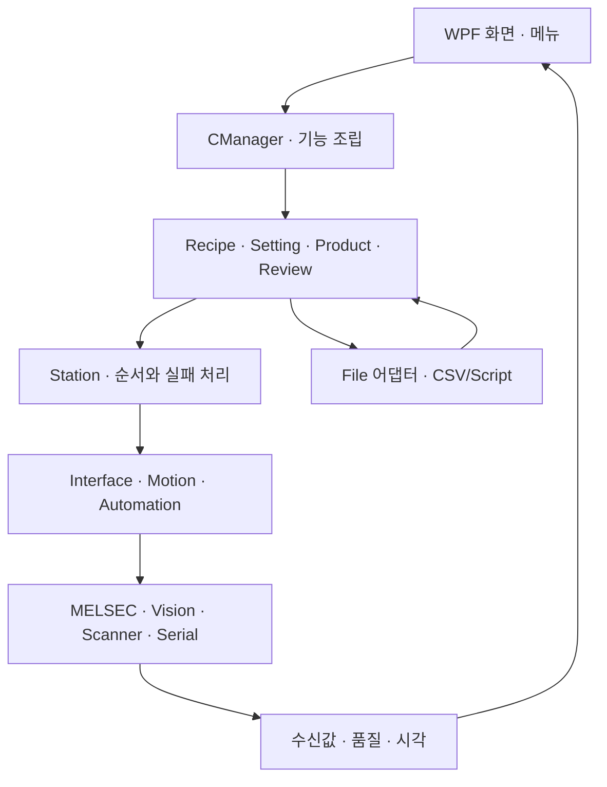
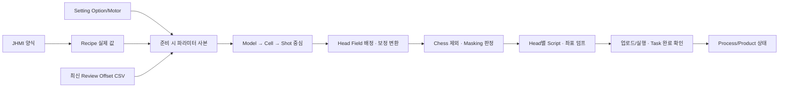
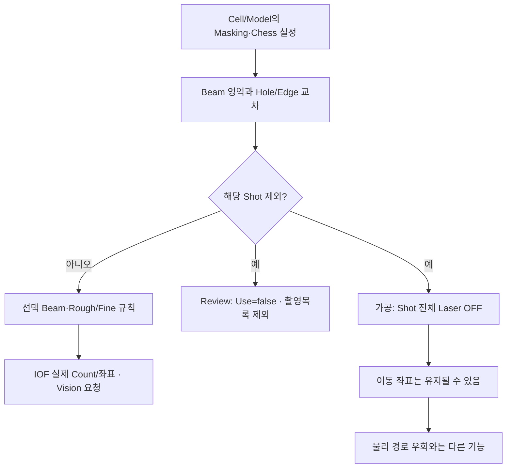
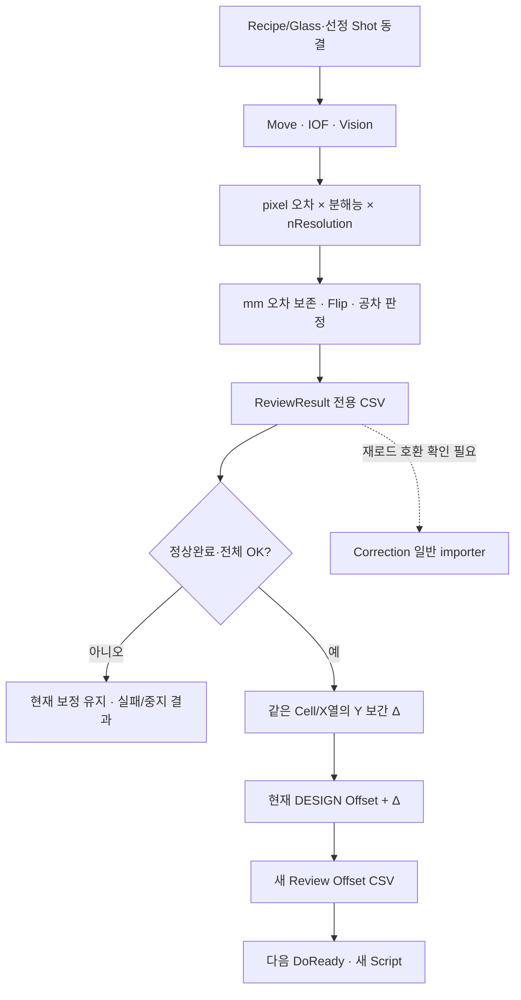
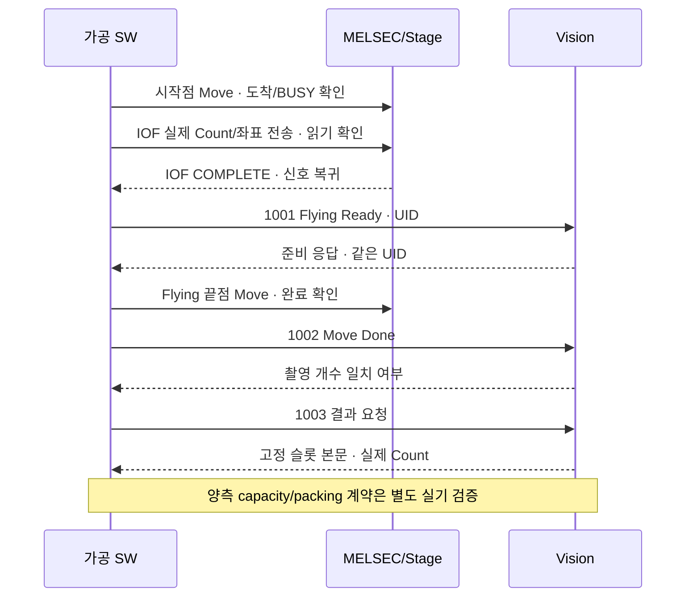
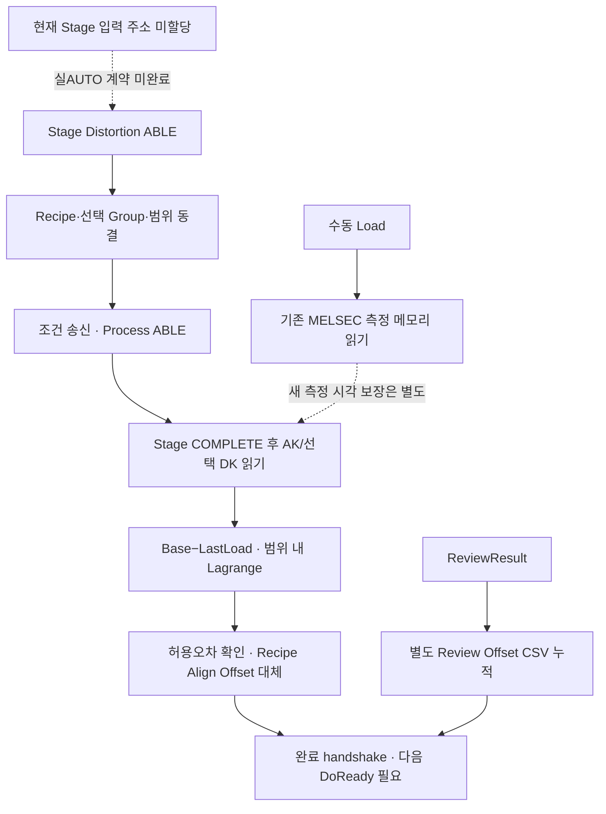

# A3Drilling 통합 흐름도 · 최초 기준

상자는 코드에 있는 역할과 자료, 화살표는 호출/저장 방향이다. 점선은 별도 계약이나 호환성 확인이 필요한 경계다. 실제 PLC/축/레이저를 움직여 확인한 운전 순서도가 아니다. 프로그램은 현재 정식 소스 빌드가 차단되어 있다.

## 1. 프로그램의 계층

[렌더링한 그림](figures/flow-0.svg)

## 2. 가공 레시피에서 실제 실행 자료까지

[렌더링한 그림](figures/flow-1.svg)

## 3. Masking과 리뷰 선정의 범위

[렌더링한 그림](figures/flow-2.svg)

## 4. 측정에서 다음 가공으로 돌아오는 보정

[렌더링한 그림](figures/flow-3.svg)

## 5. MELSEC과 Vision의 역할 분리

[렌더링한 그림](figures/flow-4.svg)

## 6. Distortion과 Review Offset의 수명

[렌더링한 그림](figures/flow-5.svg)

## 그림을 뒷받침하는 주요 소스

[시작과 조립](https://github.com/kjuws10-rgb/A3Drilling/blob/3a6b021af7dad60578e7fb85e3191b43b3b3c183/Drilling.UI/CAppStartup.cs#L14-L68) · [준비·좌표·Head 모델](https://github.com/kjuws10-rgb/A3Drilling/blob/3a6b021af7dad60578e7fb85e3191b43b3b3c183/Drilling.Common/Station/CStationProcess.cs#L1505-L1615) · [Shot 전체 제외 조건](https://github.com/kjuws10-rgb/A3Drilling/blob/3a6b021af7dad60578e7fb85e3191b43b3b3c183/Drilling.Common/Recipe/CShotCoordinatePlanBuilder.cs#L752-L769) · [IOF 좌표 전송과 복귀](https://github.com/kjuws10-rgb/A3Drilling/blob/3a6b021af7dad60578e7fb85e3191b43b3b3c183/Drilling.Common/Station/CStageReviewSequences.cs#L742-L815) · [AUTO 측정·저장과 누적](https://github.com/kjuws10-rgb/A3Drilling/blob/3a6b021af7dad60578e7fb85e3191b43b3b3c183/Drilling.Common/Review/CAutoFineReviewCoordinator.cs#L77-L174) · [Vision 고정 슬롯](https://github.com/kjuws10-rgb/A3Drilling/blob/3a6b021af7dad60578e7fb85e3191b43b3b3c183/Drilling.Common/Interface/Vision/CVisionComm.cs#L558-L594) · [Distortion 상태 순서](https://github.com/kjuws10-rgb/A3Drilling/blob/3a6b021af7dad60578e7fb85e3191b43b3b3c183/Drilling.Common/Station/CStationProcess.cs#L5480-L5514).
