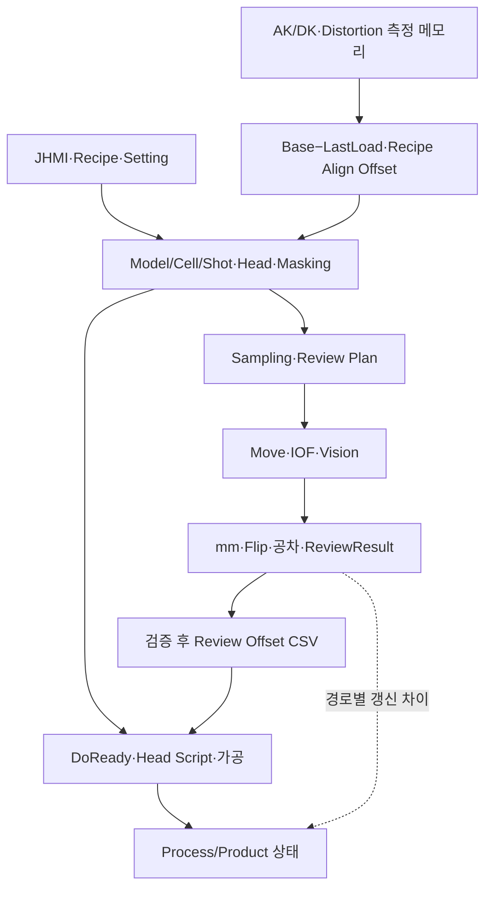

# A3Drilling SW 아키텍처 · 최초 기준 보고서

**A3Drilling의 기존 적격 분석 기준이 없어 이번 Commit을 첫 기준으로 등록했습니다.** Recipe→좌표/Head/Masking→가공·Review→결과/보정→다음 가공까지의 현재 연결을 정리했습니다. 다른 저장소인 IPS의 Commit을 이전 기준으로 재사용하지 않았습니다.

## 분석 기준

| 구분 | 확인값 |
| --- | --- |
| 원본 저장소 URL | https://github.com/kjuws10-rgb/A3Drilling.git |
| 분석 브랜치 | master |
| 원본 최신 Commit | 3a6b021af7dad60578e7fb85e3191b43b3b3c183 |
| 비교 기준 Commit | 없음 · A3Drilling 최초 기준 보고서 |
| 분석 범위 | 위 Commit의 전체 구조와 데이터 흐름. 이전 A3Drilling Commit diff는 수행하지 않음 |
| 원본 Commit 제목/시각 | 11.5.5버전으로 커밋 / 2026-11-06 09:03:40 Asia/Seoul |
| 기준점 탐색 시 Shared main | 01b9ebc97a74daf130dac37ec794d202d9d5e862 |
| 실행 시각/폴더 | 2026-11-08 09:06:46 Asia/Seoul / 20261108_090646_SW아키텍쳐분석 |
| 다음 실행의 비교 기준 | 이 README의 A3Drilling 원본 최신 Commit |

두 날짜형 폴더의 기존 후보5개 README를 모두 확인했으나 A3Drilling을 원본으로 명시한 보고서는 없었습니다. [선택 근거](06_분석근거_검증기록.md)와 [탐색 데이터](baseline-selection.json)를 함께 제공합니다.

## 먼저 알아둘 내용

| 영역 | 이번에 확인한 상태 | 읽을 때 구분할 점 |
| --- | --- | --- |
| 정식 소스 빌드 | 별도 clone Release 오류19/경고0. Common.Log/CLogManager 구현 누락 | 설치된 실행파일의 현재 운전 상태를 뜻하지 않음 |
| 현재 구조 | 3프로젝트·추적315파일. JHMI 양식/실제Recipe/Setting을 조립 | 전체 파일 목록 확인과 모든 코드 실행 검증은 다름 |
| 좌표/Masking | Model→Cell→Shot→Head. Masked Shot 전체 Laser OFF·Review 촬영 제외 | 물리 이동 경로 우회가 아님. Shift 추종 계약은 별도 확인 |
| 리뷰/보정 | UID/Count·pixel→mm/Flip·공차, 전용 결과CSV, Cell/X열별 Fine 누적 | FINE/ROUGH CSV의 일반 Correction 재로드 열 호환 공백 확인 |
| 원빔 | 전역 split1 계산은 있으나 AUTO FINE/0선 후속은 Beam11 고정 | DOE 없는 Zero Order 원빔의 AUTO 연결 완료로 볼 수 없음 |
| 배포 Recipe | test0929 공차±3mm, 기본±0.030mm; 누적Offset 최대 X 절댓값3.413mm | 단위·의도한 공차·최종범위 승인값을 확인할 필요 |
| Distortion/PTW | Stage Distortion 입력 미할당, PTW 완료주소 설명에 Spare/대체미확정 | 함수·Map 존재와 상대장치 계약완료를 구분 |
| Product | 일반 Review와 AUTO 전용 FINE의 갱신 경로가 다름 | 전용CSV/Offset 저장을 Product.REVIEW 갱신과 같게 보지 않음 |

고정 근거: [전용 CSV/일반 Load](https://github.com/kjuws10-rgb/A3Drilling/blob/3a6b021af7dad60578e7fb85e3191b43b3b3c183/Drilling.File/ReviewResult/CReviewResultFile.cs#L12-L55) · [원빔/AUTO Beam](https://github.com/kjuws10-rgb/A3Drilling/blob/3a6b021af7dad60578e7fb85e3191b43b3b3c183/Drilling.Common/Review/CAutoFineReviewCoordinator.cs#L310-L313) · [배포 공차](https://github.com/kjuws10-rgb/A3Drilling/blob/3a6b021af7dad60578e7fb85e3191b43b3b3c183/Config/RECIPE/test0929.csv#L1-L7) · [Distortion Map](https://github.com/kjuws10-rgb/A3Drilling/blob/3a6b021af7dad60578e7fb85e3191b43b3b3c183/Config/JHMI_MELSEC_MAP.csv#L687-L690). 자세한 영향과 우선순위는 [위험도별 발견사항](05_위험도별발견사항.md)에서 설명합니다.

## 통합 흐름

이는 정적 호출·저장 관계입니다. 실제 앱이나 장치를 기동하지 않았습니다. [큰 그림과 순서별 그림](04_통합흐름도.md)을 함께 볼 수 있습니다.

## 읽는 순서

1. [Commit 요약·프로그램/장치 구조](01_Commit변경요약.md)
2. [현재 데이터 구조·좌표·Masking·Sampling·저장 형식](02_데이터구조와흐름.md)
3. [가공·Review·보정·Product 연결](03_가공_Review영향분석.md)
4. [통합 흐름도](04_통합흐름도.md)
5. [위험도별 발견사항과 검토 순서](05_위험도별발견사항.md)
6. [분석 근거·빌드·검증 기록](06_분석근거_검증기록.md)

[빌드 검증](build-validation.json) · [CSV/구조 스냅샷](schema-snapshot.json) · [설정·샘플 대조](configuration-checks.json) · [고정 소스 링크](source-links.json) · [검증 결과](validation.json).

원본 저장소의 파일 수정·추가·삭제·Commit·Push는 하지 않았습니다. Push가 비활성화된 별도 분석 clone과 별도 빌드 clone을 사용했으며 Shared에는 이번 분석 폴더만 게시했습니다. 분석 완료는 생산 수정·빌드 복구·설비 배포 완료를 뜻하지 않습니다.
