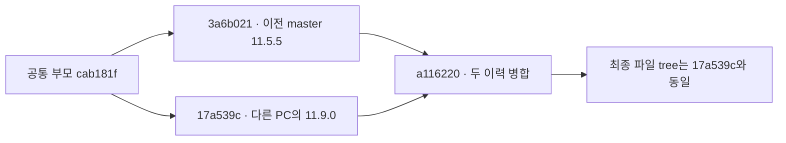

# Commit과 실제 변경 범위

비교는 A3Drilling의 3a6b021af7dad60578e7fb85e3191b43b3b3c183에서 a1162209220fd31caa68cbf82b5a98db9588af39까지입니다. 서로 다른 IPS 저장소의 Commit을 섞지 않았습니다.

## 1. 두 갈래 이력을 보존한 병합

| Commit | 의미 | 이번 분석에서 확인한 사실 |
| --- | --- | --- |
| 17a539cb4c04a3c8675f5a056ab633eefad5624d | 소스코드 11.9.0 버전 | 기준과 같은 부모에서 갈라진 복구 이력 |
| a1162209220fd31caa68cbf82b5a98db9588af39 | Merge 11.9.0 recovery into master preserving both histories | 두 부모는3a6b021·17a539c, 최종 tree는11.9.0과 완전히 동일 |

`기준..최신` 도달 Commit은2개입니다. 이것을11.5.5→11.9.0의 단순 직선 이력으로 표시하지 않습니다. 비교는 최종 파일 내용 기준이며 복구된 개발 이력 자체를 이번 자동 분석에서 다시 수정하지 않았습니다.

## 2. 대량 diff의 정체

115경로·추가107,079/삭제43,501줄 중 실제 코드·XAML·프로젝트는31경로입니다. 나머지84경로는 설정·샘플 결과·보정 이력·Default Script입니다. `test0929.csv` 하나에서42,820행 교체, 즉추가42,820+삭제42,820이 발생했습니다. 레시피43,376키는 그대로이고 변경키 전부 Align X/Y를0으로 만든 것입니다. 줄 수만으로 새 기능 크기나 Recipe 형식 교체라고 판단하면 안 됩니다.

| 변경 묶음 | 바뀐 부분 | 이어지는 호출/영향 |
| --- | --- | --- |
| Common Recipe/Correction | 보정율·설계 Masking·Default FitCross | Process 모델 → Head좌표 → 기존 Script 출력 |
| Common Review/Station | 결과 모델·OneShot 저장·0선 저장시각·최신 Offset 검사 | 파일 Adapter·AUTO Coordinator·다음 가공 시작 |
| File JHMI | 두 보정율 기본 양식 보완 | 오래된 설정 양식도100%로 시작 |
| File ReviewResult/Catalog | 새 폴더·오차 열 alias·결과 검색 | Review Data 트리 → DATA LOAD → 적용 후보 |
| File ReviewOffset | 개별 잠금·Rollback | 이전 보정 활성화·DoReady 재실행 |
| WPF Correction | 새 Review Data3개 partial·맵·읽기 전용 표·적용 팝업·Align viewer | 사용자 조회/저장/초기화/복원 |
| WPF Recipe/Review | 설계 Masking 표시 일치·OneShot 저장 실패 안내 | 화면과 공통 판정의 의미를 맞춤 |
| 포함 Config/Data | Align0·카메라 설정·예시 결과·Rollback 이력·Default 이력 | 개발 데이터의 변경이며 현장 승인 설정 여부는 별도 |

개별 코드 파일의 추가/삭제 줄은 [변경 코드 인벤토리](changed-code.csv)를 참고하십시오. 샘플 원시 측정행은 보고서에 복제하지 않았습니다.

## 3. 유지된 구조와 바뀌지 않은 통신

WPF UI→Common 관리/시퀀스→File 어댑터의3프로젝트 구조는 유지됩니다. Common/File은net8.0, UI는net8.0-windows/WPF입니다. 이번 csproj 변경은 버전 문자열입니다. [UI 빌드 대상과 버전](https://github.com/kjuws10-rgb/A3Drilling/blob/a1162209220fd31caa68cbf82b5a98db9588af39/Drilling.UI/Drilling.UI.csproj#L17-L24)

MELSEC Driver, Vision 소켓 framing/UID/고정 슬롯 codec, CStageReviewSequences, CReviewRulePlanBuilder, CCellPatternCalculator, 일반 MOF Script 생성기와 Product serializer는 이번 diff에서 변경되지 않았습니다. 따라서 이번 리뷰 UI 개선을 통신 장애·IO 지연·가공 속도 개선 완료로 해석하지 않습니다. 상류 좌표가 바뀌므로 변경되지 않은 Script 생성기도 다른 명령좌표를 출력할 수 있습니다. [최종 Scanner 좌표를 쓰는 Script](https://github.com/kjuws10-rgb/A3Drilling/blob/a1162209220fd31caa68cbf82b5a98db9588af39/Drilling.File/Script/CAutomation1ScriptFile.cs#L514-L553)

`JHMI_INTERFACE_test.csv`는 새 시험용 파일입니다. 실제 기본 로더는`JHMI_INTERFACE.csv`를 사용하므로 시험 파일 추가만으로 실제 연결·MELSEC SIM 상태가 전환됐다고 보지 않습니다. [실제 Interface 설정 파일 경로](https://github.com/kjuws10-rgb/A3Drilling/blob/a1162209220fd31caa68cbf82b5a98db9588af39/Drilling.File/JHMI/CInterfaceFile.cs#L99-L110)
