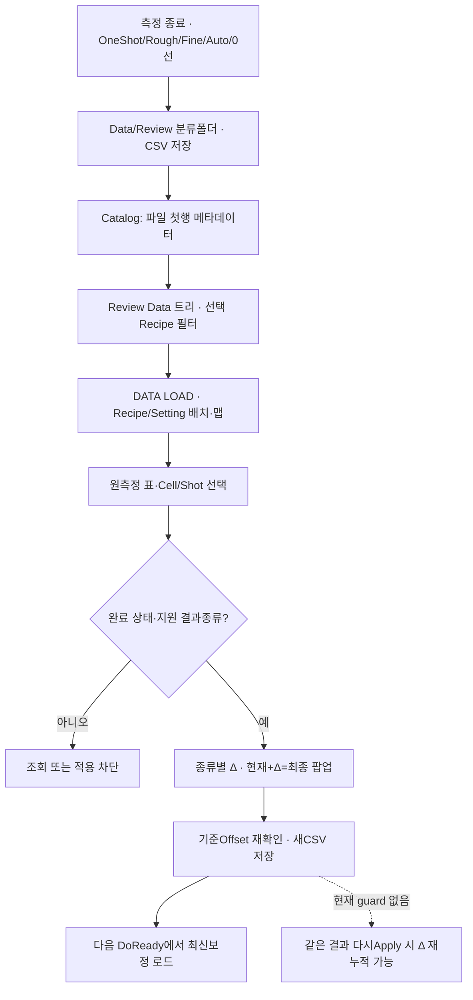
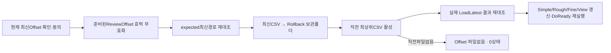

# 변경된 결과 구조·보정 데이터 흐름

비교 기준 `3a6b021af7dad60578e7fb85e3191b43b3b3c183` → 최신 `a1162209220fd31caa68cbf82b5a98db9588af39`, A3Drilling/master. 원본 저장소와 분석 clone은 수정하지 않았으며, 이 두 경로에서는 빌드도 수행하지 않았다. 별도 검증 clone의 빌드 결과는 06 문서에 정리했다. 앱·장치는 실행하지 않았다. 이 문서는 Git diff와 현재 호출·저장 계약을 확인한 정적 분석이다.

## 1. 달라진 점을 먼저 설명하면

이번 버전은 **검사 결과를 파일 트리에서 골라 Cell/Shot 맵과 표로 다시 보고, 적용할 보정을 별도 팝업에서 비교한 뒤 저장하는 경로**를 추가했다. Review Data에서는 검사 결과 파일을 수정하지 않고, 보정값은 새로운 Review Offset CSV로 저장한다. 가장 최근 보정 파일을 보관 폴더로 옮겨 직전 보정으로 돌아가는 Rollback도 추가했다.

다만 새 결과 조회·적용 경로가 기존 자동 누적과 함께 동작하므로 **같은 결과의 재누적**, **구형 ERROR 열의 좌표 의미**, **잘못된 숫자를 0으로 읽는 입력 검증**은 별도 확인이 필요하다. 조회·적용 UI가 추가된 것과 보정의 중복 적용 방지·출처 확인·완전성 검증이 모두 보장되는 것은 구분해야 한다.

| 대상 | 기준 버전 | 최신 버전의 실제 연결 | 구분할 한계 |
| --- | --- | --- | --- |
| 저장 결과 재조회 | 일반 Load는 ERROR_X/Y가 필수였다. 전용 FINE 39열 파일은 같은 importer로 읽지 못했다. | 같은 Load가 ERROR/변환값/수신값의 대체 열 이름(alias)을 읽고, 새 Review Data가 이 Load를 호출한다. | 39열 FINE의 열 호환은 해결됐지만, 구형 ERROR의 raw/converted 의미까지 같아진 것은 아니다. |
| 결과 검색 | Data/ReviewResult와 일부 legacy 경로를 검색했다. | Data/Review 아래 Manual/Auto/ZeroDefence Catalog와 선택 Recipe 필터를 사용한다. | 이전 폴더는 현재 Catalog에 자동으로 포함되지 않는다. |
| 결과 식별 | ResultRow는 Head/Cell/Shot/Error/Judge 중심이었다. | Beam, Row/Column, DesignX/Y, ResultSource와 Origin/LineCount가 추가됐다. | 결과 ID/hash·RecipeRevision·기준 OffsetRevision은 여전히 영속 저장 계약에 없다. |
| 가상·실측 구분 | 전용 CSV에 Simulation 열이 있었다. | 새 writer에도 Simulation 열이 있다. | 새 Load 모델과 Apply guard가 이 열을 가져오지 않아 적용 제한의 근거로 사용하지 않는다. |
| 적용 UI | Simple/Rough/Fine별 적용과 세션 내 중복 보호가 있었다. | 새 ReviewData.Apply가 결과 종류별 Δ 계산 → 현재/추가/최종 비교 → SaveNew로 연결된다. | 새 경로는 결과(result)별 적용 완료를 기록하지 않는다. |
| Rollback | 최신 파일 삭제 등에 대한 전용 UI가 없었다. | expected 최신 경로 대조 → Rollback 하위 폴더에 보관 → 이전 CSV 활성화 → 준비 데이터 무효화로 연결된다. | 임의 시점 revision 복원이나 새 복원 revision 저장 방식은 아니다. |
| 0선 후속 파일 | 부모 0선과의 명시적인 연결 정보가 제한적이었다. | ZeroLineRunId/SavedAt 전달, 부모 시각 기반 파일명, 부모 ID가 없는 경우 저장 거부가 추가됐다. | 0선/후속 결과는 ReviewOffset Apply 대상에서 제외된다. |
| Product | 일반 Review와 AUTO 전용 FINE의 갱신 경로가 분리돼 있었다. | 결과 파일의 GlassId 취득과 저장 경로를 보강했다. | GlassId 열 추가를 Product.REVIEW 상태 갱신의 통합 완료로 보면 안 된다. |

## 2. 현재 호출 흐름

- `CReviewDataView`가 표시되면 목록을 Reload하고 트리 선택을 Panel에 전달한다. Cell 버튼·Shot 맵·표 선택은 서로 연결되며, 선택된 Shot 행으로 스크롤한다. 결과표와 팝업 표는 읽기 전용이다.
- 파일 Load는 취소 토큰과 증가하는 loadVersion을 사용한다. 이전 비동기 작업이 늦게 완료되더라도 새 선택을 덮어쓰지 못하게 한다.
- 실제 UI 연결은 `CCorrectionView.xaml#L267`의 `CReviewDataView`와 `CMenuCorrection.cs#L136-L144`의 서비스 주입에서 확인된다. 새 화면은 데이터 조회/Offset 작업 화면이다. 여기에서 실제 축 Move나 재촬영을 직접 실행하는 Command는 추가되지 않았다.
- 사용자가 편집하는 오차 Level, 기준 Shot을 선택한 뒤 임의의 대상 전체에 같은 보정값을 복사하는 기능, 원측정값을 강제로 OK 처리하거나 수정하는 기능이 이번 새 ReviewData에 완성됐다고 볼 근거는 없다. Shot 선택은 조회와 적용 대상 확인용이다.

근거: `Drilling.UI/Views/CReviewDataView.xaml.cs#L17-L68`, `Drilling.UI/Views/CReviewDataView.xaml#L49-L49`, `#L371-L377`, `Drilling.UI/Menu/Menus/CMenuCorrection.ReviewData.Display.cs#L93-L171`.

## 3. 저장 위치와 스키마

| 종류 | 최신 저장 위치 | 주요 변화 |
| --- | --- | --- |
| Manual ALL_SHOT | `Data/Review/Manual/<Recipe>/ALL_SHOT/<Glass>_<시각>.csv` | 일반 25열에서 30열로 변경됐다. ERROR_X/Y 대신 raw 수신 2열 + Flip 변환 2열 + Flip 3종을 명시한다. |
| Manual ONE_SHOT | `.../Manual/<Recipe>/ONE_SHOT/...csv` | Move만 수행한 경우를 제외하고 OneShot 결과 CSV를 저장한다. 경로와 저장 오류를 결과에 반환한다. |
| Manual BEAM_INSPECTION | `.../Manual/<Recipe>/BEAM_INSPECTION/...csv` | 종전 52열에 SavedAt/Recipe/Status/StageSim/VisionSim 5열을 추가해 57열이 됐다. |
| Manual ROUGH/FINE | `.../Manual/<Recipe>/ROUGH 또는 FINE/...csv` | Rough에 GlassId가 추가됐다. Fine은 39→42열로 변경됐다(ZeroLineRunId/ZeroLineSavedAt/LineCount 추가). |
| AUTO FINE | `Data/Review/Auto/<Recipe>/<Glass>_<시각>.csv` | 일반 AUTO 폴더에서 조회하고 수동 Offset Apply를 할 수 있다. |
| 0선·후속 | `Data/Review/ZeroDefence/<Recipe>/<Glass>/<부모저장시각>_ZERO_DEFENCE/FOLLOWUP.csv` | 부모 RunID/저장 시각을 전달한다. 후속 결과 저장 시 부모 정보가 필수다. |
| Review Offset | `Config/RECIPE/<Recipe>_reviewoffset/*.csv` | 저장 형식은 5열을 유지한다. 클래스 내부의 Load/Save/Rollback 개별 작업용 Semaphore가 추가됐다. |
| Rollback 보관 | 위 ReviewOffset 디렉터리의 `Rollback/` | 최상위 CSV 목록에서만 활성 파일을 선정하므로, 보관 파일은 다음 Load에서 제외된다. |

현재 Load는 구형 39열 FINE의 `VISION_FLIP_CONVERT_X/Y`, 0선의 `CONVERTED_X/Y`, 새 일반 결과의 변환 열을 읽을 수 있다. Beam 형식은 1행을 검사된 Beam별 행으로 펼친다. `SAVED_AT`, Recipe, Head/Cell, Shot 식별 정보가 필요하며, 한 파일에 Recipe가 섞여 있으면 거부한다. 오차 열을 선택하는 순서는 `ERROR_X/Y`가 최우선이고, 그다음은 `VISION_FLIP_CONVERT`, `CONVERTED`, `RECV_TARGET_MINUS_HOLE`다.

Catalog는 파일의 첫 행만 읽어 유형·Recipe·Glass·상태·시각 등을 보여준다. 목록을 만들 때 전체 파일의 행별 정합성이나 측정의 완전성까지 검증하는 것은 아니다. Catalog 오류는 INVALID로 표시한다.

과거 `Data/ReviewResult`와 `Data/Result`는 이번 Catalog/SearchRootPaths에 없다. 저장소에는 새 `Data/Review`의 32개 파일과 이전 샘플이 함께 있지만, 사용자 PC의 모든 과거 파일을 자동으로 이관하는 코드는 확인하지 못했다. 이전 52열 Beam 파일은 새 57열 전용 LoadLast의 정확한 헤더 검사와 맞지 않으므로, 이관과 구버전 호환을 별도로 구분해야 한다.

검토한 저장 샘플은 32개 파일이다. 유형별 파일 수는 Auto 8, Manual ALL_SHOT 3/ONE_SHOT 3/BEAM_INSPECTION 3/ROUGH 8/FINE 3, ZeroDefence·FollowUp 4다. 현재 샘플에는 RESULT_SOURCE=RETAINED 행이 없었다. 이는 재시도/유지 결과 경로가 실행 검증됐다는 뜻은 아니다. 샘플의 원시 측정 행은 복제하지 않았다.

근거: `CReviewResultFile.cs#L13-L50`, `#L53-L94`, `#L130-L203`, `#L394-L450`, `#L471-L552`, `#L655-L708`, `#L713-L840`, `#L843-L957`; `CReviewResultFile.Catalog.cs#L19-L100`, `#L102-L159`.

## 4. 보정 종류별 적용과 보호

| 결과 종류 | 새 ReviewData에서 현재 구현된 적용 방식 |
| --- | --- |
| ALL_SHOT/ONE_SHOT | MEASURED이면서 Judge가 OK인 행만 같은 Shot에 Δ를 직접 누적한다. NG는 제외한다. |
| ROUGH | MEASURED·OK 기준만 Head 또는 Head+Cell 범위로 복제한 뒤 누적한다. 같은 범위의 기준이 중복되면 거부한다. |
| FINE/AUTO | MEASURED 행 중 NG/비정상 Judge가 있으면 전체를 거부한다. 같은 Cell+X열에서 Y 보간 후 누적한다. |
| BEAM_INSPECTION | 상태 조회 대상이며 OffsetApply는 지원하지 않는다. |
| ZERO_DEFENCE/FOLLOWUP | OffsetApply는 지원하지 않는다. 0선 후속 결과의 기존 자동 저장 정책도 Offset을 변경하지 않는 상태로 유지된다. |

Apply에는 현재 Recipe의 Head 배정 Shot 중 Use=true인 Shot(Masking/Chess로 제외되지 않은 Shot)만 들어간다. 결과 Shot 키를 Cell+정규화 Shot에 연결하고 Head 일치를 확인한다. 기존 Offset은 DESIGN으로 변환한 뒤 Δ를 더하고, 새 파일에도 DESIGN으로 저장한다. 같은 저장 대상 Shot의 중복은 거부한다. 이러한 보호는 있으나, CSV의 RecipeRevision/Design 좌표·Beam/측정 Run의 완전성까지 대조하는 계약은 아니다.

팝업은 적용 종류·대상 Cell/Shot·현재 X/Y·추가 X/Y·최종 X/Y를 보여주고 Save/Cancel로 끝난다. 적용 방식을 임의로 바꾸거나 수치를 직접 편집하는 모델은 아니다. 원측정 행도 수정하지 않는다. 새 Offset 저장은 이미 가공된 홀을 변경하지 않으며, 다음 준비에서 가공 좌표에 로드된다.

근거: `CMenuCorrection.ReviewData.Offset.cs#L20-L49`, `#L74-L124`, `#L244-L366`, `#L369-L460`, `#L476-L510`, `CReviewDataOffsetApplyDialog.xaml.cs#L53-L63`.

## 5. Rollback의 의미

Rollback은 마지막 파일을 물리적인 보관 폴더로 옮기는 1단계 되돌림이다. 임의의 과거 Revision을 고르거나 새 복원 Revision을 만드는 기능은 아니다. 옮기기 전에 직전 파일까지 읽어 검증하므로, 직전 CSV가 유효하지 않으면 현재 파일을 보관하지 않는다. 보관 후 활성 경로도 검사한다. UI는 `InvalidatePreparedReviewOffset()`를 호출하고 DoReady 재실행을 안내한다. 원시 측정 CSV는 이동하거나 변경하지 않는다.

같은 앱 안의 단일 `CReviewOffsetFile` 인스턴스에서는 각 Load/Save/Rollback을 Semaphore로 직렬화한다. 다만 `Load→계산→재확인→SaveNew` 전체를 하나의 트랜잭션으로 묶거나, 외부 프로세스의 파일 변경까지 배제하는 잠금은 아니다.

근거: `Drilling.File/ReviewOffset/CReviewOffsetFile.cs#L31-L49`, `#L73-L88`, `#L135-L218`; `Drilling.UI/Menu/Menus/CMenuCorrection.cs#L3823-L3905`.

## 6. 우선 확인할 위험과 남은 범위

### P1. 자동 적용된 AUTO 결과나 같은 CSV가 다시 누적될 수 있음

새 Apply 경로는 Save 성공 후 loadedResult에 적용 완료 표시를 남기거나, 적용 결과 ID/ledger를 기록하지 않는다. `CanApplyOffset`는 자료 로드/완료 상태/지원 종류 조건만으로 다시 true가 된다. 다음 클릭에서는 최신 Offset을 다시 읽어 같은 Δ를 또 더한다. 특히 AUTO Coordinator는 원래 전체 OK 검사 후 자동으로 SaveNew했는데, 그 결과 CSV가 AUTO Catalog에 있고 새 ReviewData는 AUTO 수동 Apply도 허용한다. 따라서 정상 AUTO 완료 → 같은 파일 선택 → OffsetApply를 통한 추가 누적 경로가 코드상 존재한다. 기존 Fine 화면의 `_offsetApplied`나 Coordinator의 `_saved`는 이 새 파일 Load 경로와 공유되지 않는다.

개선 검토: 측정 결과 ID·기준 OffsetRevision·적용 이력을 저장하고, 같은 결과의 재적용을 허용할지 정책을 명시해야 한다. UI에서 버튼만 비활성화하면 재시작이나 다른 파일명으로 반입된 자료의 중복 적용 문제까지 해결되지는 않는다.

근거: `CMenuCorrection.ReviewData.Offset.cs#L20-L24`, `#L89-L124`; `CAutoFineReviewCoordinator.cs#L93-L144`; `CReviewResultFile.Catalog.cs#L49-L58`.

### P1. 새 importer가 누락·잘못된 숫자를 정상값 0.0처럼 전달할 수 있음

`ReadOptionalNullableFiniteDouble`은 빈 값·비숫자·NaN/무한대를 null로 돌려주고, `ReadOptionalFiniteDouble`은 이를 0.0으로 바꾼다. **Catalog와 파일의 상태가 COMPLETED이고** Head/Cell/Recipe/Shot/Judge OK 조건이 맞으면, 오차 열이 없는 외부 CSV도 0값으로 표시하고 적용 계획을 만들 수 있는 조건이다. 정상 실측 0과 유효하지 않은 입력에서 나온 0을 구분하지 못한다. 기존 importer의 ERROR 필수 검사가 제거돼 열 불일치는 완화됐지만, 데이터 검증의 엄격성도 낮아졌다. Load는 상태 공란을 COMPLETED로 보지만, Catalog는 공란을 UNKNOWN으로 두어 새 Apply를 막는다. 따라서 상태 공란 하나만으로 적용이 허용된다고 설명하지는 않는다.

근거: `CReviewResultFile.cs#L160-L203`, `#L347-L364`; `CMenuCorrection.ReviewData.Offset.cs#L369-L378`, `#L427-L450`.

### P1. 구형 ERROR_X/Y의 raw 좌표와 새 Apply의 converted 좌표가 혼동될 수 있음

기준 버전의 일반 Review CSV는 `ERROR_X/Y=point.ErrorX/Y`(Flip 전 mm)였다. 최신 Load는 ERROR 열을 가장 먼저 선택하지만, 새 Apply는 오차가 이미 변환된 DESIGN 값이라고 가정해 Normal로 직접 누적한다. 구형 ERROR 형식에 X/Y/XY Flip이 있다면 같은 부호/축으로 적용하면 안 된다. 예를 들어 구형 rawX=+0.01mm이고 XFlip ON이면 설계 보정은 −0.01mm여야 하지만, 새 Direct는 +0.01mm를 그대로 누적하는 조건이다. 현재 writer가 변환 열을 넣어 저장하는 새 CSV 모두가 잘못됐다는 뜻은 아니다. 구형/외부 ERROR 열의 좌표 기준(basis)을 식별하지 못하는 호환 조건에 한정한 위험이다.

근거: 기준 `CReviewResultFile.cs#L136-L161`, 최신 `CReviewResultFile.cs#L186-L187`, `CMenuCorrection.ReviewData.Offset.cs#L369-L450`. 같은 CSV에 ERROR 열과 변환 열이 모두 있어도 ERROR가 우선한다.

### P2. 파일·레시피 식별 정보와 전체 완료 검사는 제한적

`EnsureLoadedResultUnchanged`는 Panel의 loaded path/recipeID가 같은지만 확인한다. 디스크 파일의 내용/hash/mtime와 현재 선택 Recipe의 새 내용을 다시 읽지는 않는다. `SameOffsetSource`는 path/시각/행 수만 확인한다. 같은 RecipeID에서 Cell 배치·Flip·Masking을 수정한 경우나, 외부 파일이 동일 경로에서 교체된 경우 등을 정확히 구분하는 Revision 계약은 없다.

Load는 Recipe 혼재만 검사하고, Glass/상태/Run의 행간 일치 여부나 요청점 집합/TotalCount의 일치 여부는 검사하지 않는다. FINE은 MEASURED 행만 남긴 뒤 그중 NG를 차단한다. `RESULT_SOURCE=ERROR/UNMEASURED/RETAINED`는 검사 집합에서 빠진다. 정상 writer가 FAILED로 기록한 파일은 UI가 막지만, 첫 행만 COMPLETED인 혼합/부분 자료의 누락 검사는 별도로 필요하다. 특히 NG_RETRY 파일의 RETAINED OK를 제외하면, 이전 OK 앵커까지 사용하는 liveFine 계산과 다른 보간 결과가 나올 조건이 남는다. 현재 포함된 샘플에는 RETAINED가 없어 실측으로 재현했다고 주장하지 않는다.

근거: `CReviewResultFile.cs#L70-L92`; `CMenuCorrection.ReviewData.Offset.cs#L432-L460`, `#L513-L529`.

### P2. 개별 파일 잠금과 read-modify-save 전체의 원자성은 다름

새 UI가 최신 Offset을 확인한 뒤 SaveNew하기 전에 다른 호출자(AUTO 등)가 저장하면, UI는 이전 기준으로 만든 SavedRows를 더 나중 파일로 저장해 다른 변경을 놓칠 수 있는 구조다. SaveNew는 expectedRevision 인자를 받지 않고, 각 메서드 단위의 잠금만 보유한다. 새 ReviewData의 SetOffsetBusy는 Panel 내부 상태이며, 다른 보정·자동 처리와 공통 상태를 확보하는 작업은 아니다. 실제 경합 발생 로그를 확인한 것은 아니며, 호출 사이의 시간 구간에 대한 정적 위험이다.

근거: `CMenuCorrection.ReviewData.Offset.cs#L104-L111`, `#L525-L545`; `CReviewOffsetFile.cs#L31-L49`, `#L73-L127`.

### P2. Simulation 출처와 기존 폴더·옛 Beam 형식의 이관

파일에는 Simulation 열이 있지만, Load/Apply 모델은 이 정보를 보존하거나 적용을 제한하지 않는다. 시뮬레이션 자료를 생산 보정으로 사용하지 않는 정책이 필요하다면 현재 UI guard만으로는 보장되지 않는다. 새 Catalog의 정상 표시는 새 폴더에서 파일을 발견하고 첫 행 메타데이터를 읽었다는 뜻이며, 실측 출처 검증을 통과했다는 뜻은 아니다. 이전 Data/ReviewResult·Data/Result와 52열 Beam 형식은 별도의 이관/호환 검토가 필요하다.

## 7. 이번 변경으로 해결됐다고 보면 안 되는 항목

- Vision 프레이밍·UID·Count·pixel→mm/Flip 기본식, SamplingRule/셀별 Fine 보간 기본식은 이 담당 diff에서 재사용한 주변 경로다. 이번에 원리 자체를 새로 바꾼 것은 아니다.
- AUTO 대표 Beam11 상수는 현재 `CAutoFineReviewCoordinator.cs#L317`에 그대로 남는다. DOE가 없는 split1의 AUTO 연결이 완료됐다고 볼 수 없다.
- Product에 GlassId를 기록하는 보강과 Product.REVIEW 상태 갱신의 통합은 다르다. `CReviewManager` 변경은 OneShot/Fine/Rough 파일의 메타데이터 취득이 주요 내용이며, AUTO 전용 Save에 새 SetReview* 호출은 추가되지 않았다.
- 새 ReviewData UI는 결과 조회·보정 검토·저장·Init·Rollback을 연결한다. 기준 Shot → 임의 선택 Shot의 동일 F 복사, 사용자 편집 오차 Level, 공통 맵에서의 실제 이동/재측정 등 모든 회의 요구를 완성했다고 볼 수 없다.
- Offset Save 후 다음 Glass/DoReady에 반영되는 시점과 현재 이미 준비된 Script의 효력을 구분해야 한다. Rollback에는 명시적인 준비 무효화가 추가됐지만, 새 Data Apply의 SaveNew만으로 과거 가공이나 진행 중 Script를 고치는 것은 아니다.

## 검토 방법·한계

직접 검토한 대상은 변경된 CReviewManager/CAutoFineReviewCoordinator, ReviewResultFile/Catalog, ReviewOffsetFile, ReviewData의 3개 partial 파일, CMenuCorrection의 서비스 주입/기존 보정/Rollback, ReviewDataView/OffsetApplyDialog, CCorrectionView다. 추적된 Data/Review 샘플 32개 파일은 헤더·상태·출처 개수를 확인했다. 기존 버전은 Git show/diff로 대조했다. 위험의 조건 예시는 코드 분기의 수치 해석이며, 실행 테스트 결과로 주장하지 않는다. 원본 및 분석 clone의 소스코드 수정·새 개발·빌드와 장치 실행은 하지 않았다. 별도 검증 clone의 빌드 결과와 통합 보고서의 검증·공개 범위는 06 문서에 정리했다.

## 전체 프로그램·Product와 연결되는 부분

DoReady는 Recipe를 복사한 뒤 Option/Motor Setting과 최신 Review Offset을 결합합니다. 새 Review/Align 보정율도 이때 준비 모델에 들어갑니다. 설정 저장은 Setting 캐시를 갱신하지만 이미 준비된 Process 모델을 자동 재계산하는 흐름은 이 경로에 없습니다. 보정율 변경은 다음 준비에서 적용되는 값으로 안내해야 합니다. [준비 시 Setting·Offset 결합](https://github.com/kjuws10-rgb/A3Drilling/blob/a1162209220fd31caa68cbf82b5a98db9588af39/Drilling.Common/Station/CStationProcess.cs#L1512-L1549) · [Setting 저장 검증·캐시](https://github.com/kjuws10-rgb/A3Drilling/blob/a1162209220fd31caa68cbf82b5a98db9588af39/Drilling.Common/Managers/CSettingManager.cs#L122-L148)

Prepare 이후 Offset파일이 바뀌었으면 StartProcess와 Manual MOF의 최신 파일 대조가 시작을 막습니다. Rollback은 여기에 명시적인 무효화도 추가합니다. 새 Apply가 직접 무효화 호출을 하지 않는다는 이유로 이전 모델이 바로 가공된다고 단정하지 않습니다. 파일경로·저장시각 대조는 파일내용 hash/레시피 전체 Revision 검사는 아닙니다. [최신 Offset 대조와 무효화](https://github.com/kjuws10-rgb/A3Drilling/blob/a1162209220fd31caa68cbf82b5a98db9588af39/Drilling.Common/Station/CStationProcess.cs#L1551-L1585) · [가공 준비와 시작 검사](https://github.com/kjuws10-rgb/A3Drilling/blob/a1162209220fd31caa68cbf82b5a98db9588af39/Drilling.Common/Station/CStationProcess.cs#L234-L291)

일반 Review의 Product.SetReview* 경로는 유지됩니다. AUTO 전용 FINE는 Root의 Coordinator Prepare/Measure/Save로 연결되며 이번 diff에서 Product.REVIEW 갱신을 통합하지 않았습니다. 새 결과의 GlassId·0선 부모ID는 파일 추적성을 보완하지만 Product 상태 완료까지 보장하는 별도 호출을 대신하지 않습니다. 포함된 ActiveProduct/History CSV는 샘플 상태자료이며 모든 Review 경로가 연결됐다는 실행 증거로 쓰지 않았습니다. [일반 Review의 Product 저장](https://github.com/kjuws10-rgb/A3Drilling/blob/a1162209220fd31caa68cbf82b5a98db9588af39/Drilling.Common/Review/CReviewManager.cs#L1341-L1403) · [자동 Review 연결](https://github.com/kjuws10-rgb/A3Drilling/blob/a1162209220fd31caa68cbf82b5a98db9588af39/Drilling.UI/CRootView.cs#L2791-L2816)

기계 판독용 [스키마 비교 요약](schema-comparison.json)은 양쪽 Commit의 모든 CSV 헤더·행 수·열폭을 확인한 후 동일 유형으로 묶은 통계입니다. 현재writer의 형식과 저장소에 남아 있는 구형 샘플의 형식을 구분합니다. 폴더가 바뀌어도 원시 결과와 누적 Offset의 역할은 분리합니다.
