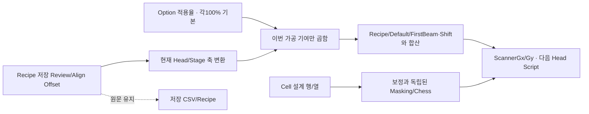
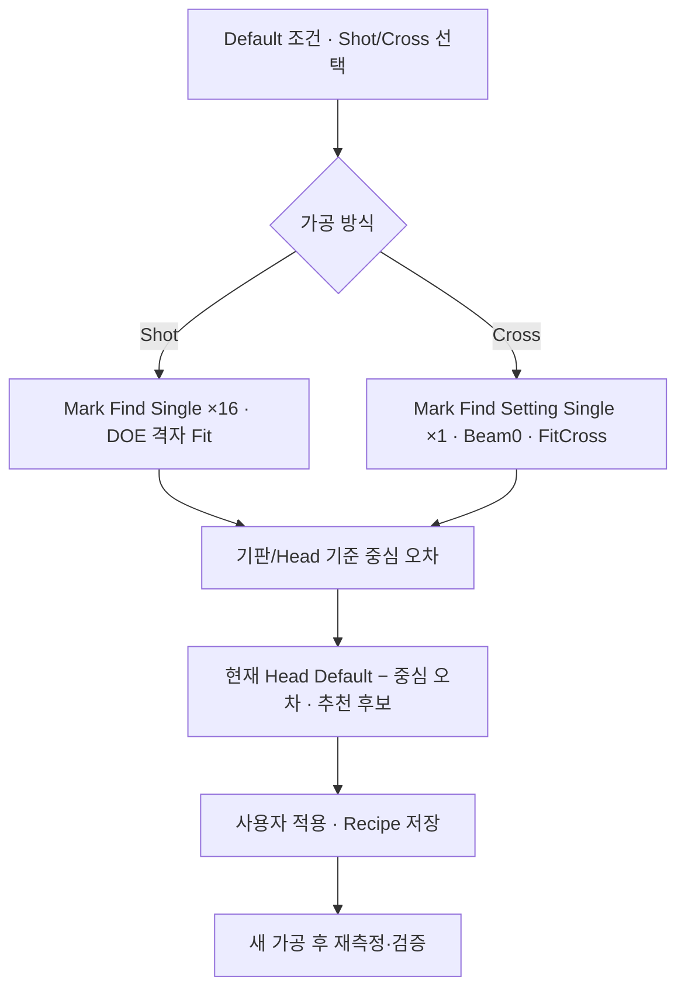

# 가공·Review·좌표 영향 분석

대상은 A3Drilling/master `a1162209220fd31caa68cbf82b5a98db9588af39`, 비교 기준은 2026-11-08 최초 보고서의 `3a6b021af7dad60578e7fb85e3191b43b3b3c183`다. 아래는 두 Commit의 실제 diff와 최신 호출부를 연결한 정적 분석이다. 생산 소스·Config·실장비를 변경하거나 실행하지 않았다.

## 핵심 변경

| 항목 | 이전 기준 | 최신 코드/포함 데이터 | 영향 |
| --- | --- | --- | --- |
| Review/Align 보정 기여율 | 저장 보정의 100%를 좌표에 반영 | 각각 `REVIEW_OFFSET_SCALE`, `ALIGN_OFFSET_SCALE` 정수 % | 다음 좌표/Script 생성에서만 확대·축소. 저장 보정 원문을 다시 곱해 저장하지 않는다. |
| Masking 판정 위치 | Cell 행/열 위치에 FinalScannerOffset을 더함 | 보정 없는 Cell 설계 행/열 위치만 사용 | Head 축 반전·Recipe/Default/FirstBeam/Align/Review/Shift 변경이 제외 Shot 멤버십을 바꾸지 않도록 고정했다. |
| test0929 Align | 42,840개 X/Y 축 중 42,820개 비제로 | 전부 0 | CSV 형식 변경이 아니라 포함된 기판별 Align 보정 초기화다. |
| Default 십자 검사 | 십자도 16 Beam 루프/DOE 피팅으로 연결 | Setting Mark 중심 1회·Beam 0·FitCross | 십자 가공과 16빔 격자 가공의 측정 계약을 분리했다. |
| 0선 결과 연결 | 저장 경로만 상태에 게시 | nullable ResultSavedAt도 게시 | 후속 검사에 원래 0선 검사의 RunId·저장 시각을 함께 전달할 수 있다. 측정 시각 자체는 아니다. |
| 포함 카메라 설정 | 0.0025 mm/pixel·Y Flip ON | 1 mm/pixel·Y Flip OFF | 같은 수신 pixel 오차/nResolution 조건이면 환산 길이는 400배, Y 부호도 달라진다. 현장 의도 확인이 필요하다. |

## 1. 보정 적용률: 저장값과 가공 기여를 분리

최신 [좌표 생성 옵션 읽기](https://github.com/kjuws10-rgb/A3Drilling/blob/a1162209220fd31caa68cbf82b5a98db9588af39/Drilling.Common/Recipe/CShotCoordinatePlanBuilder.cs#L26-L34)는 Option/Motor 등과 병합한 유효 파라미터에서 두 보정 적용률(%)을 읽는다. 설정이 없는 구형 환경은 100%로 취급한다. 0 이상의 Int32 정수만 허용하며 소수·음수·정수 범위 초과는 거절한다. [정수% 검증과 기본100%](https://github.com/kjuws10-rgb/A3Drilling/blob/a1162209220fd31caa68cbf82b5a98db9588af39/Drilling.Common/Recipe/CShotCoordinatePlanBuilder.cs#L203-L211).

저장 Review 보정을 현재 Head/Stage 축으로 변환한 값을 R, Align 변환값을 A라 하면 실제 가공 기여는 다음과 같다.

`FinalScannerOffset = RecipeOffset + HeadDefault(변환) + FirstBeam(변환) + R×Review%/100 + A×Align%/100`

Shift는 기존 별도 경로로 합산한다. [변환 후 기여율과 최종 합산](https://github.com/kjuws10-rgb/A3Drilling/blob/a1162209220fd31caa68cbf82b5a98db9588af39/Drilling.Common/Recipe/CShotCoordinatePlanBuilder.cs#L133-L188). 예를 들어 R=0.010mm이고 Review%=200이면 해당 기여는 0.020mm다. 다음 준비에서 다시 생성하더라도 저장값 0.010을 0.020으로 덮어쓰지 않으므로 중복 빌드로 비율이 거듭제곱되지 않는다. 0%는 **저장 파일 삭제/초기화가 아니라 가공 기여 미적용**이다.

JHMI 양식에 두 행을 추가하고 오래된 JHMI에도 코드가 기본 양식을 보완한다. [양식의% 항목](https://github.com/kjuws10-rgb/A3Drilling/blob/a1162209220fd31caa68cbf82b5a98db9588af39/Config/JHMI_SETTING.csv#L95-L99) · [코드 기본 양식 보완](https://github.com/kjuws10-rgb/A3Drilling/blob/a1162209220fd31caa68cbf82b5a98db9588af39/Drilling.File/JHMI/CSettingFile.cs#L227-L232). 실제 Setting.csv는 기존의 `TAB,NAME,VALUE` 형식을 유지하고 두 적용률 항목을 100%로 추가했다. [현재 포함 Setting](https://github.com/kjuws10-rgb/A3Drilling/blob/a1162209220fd31caa68cbf82b5a98db9588af39/Config/Setting/Setting.csv#L89-L99). 새로운 파일 형식/버전 필드가 생긴 것이 아니다.

Head 배정은 여전히 nominal 설계 X와 Head Field로 정해진다. %는 배정 후 Scanner 보정 기여에 적용하므로 Head를 다시 선정하는 기능이 아니다. Cell/Model/Shot 생성식과 전역 DOE 1/4 규칙도 이 diff에서 바뀌지 않았다. [설계 Shot과 전역 DOE](https://github.com/kjuws10-rgb/A3Drilling/blob/a1162209220fd31caa68cbf82b5a98db9588af39/Drilling.Common/Recipe/CShotCoordinatePlanBuilder.cs#L222-L243) · [Head 후보 선정](https://github.com/kjuws10-rgb/A3Drilling/blob/a1162209220fd31caa68cbf82b5a98db9588af39/Drilling.Common/Recipe/CShotCoordinatePlanBuilder.cs#L376-L389).

### 소비 Script까지의 연결

DoReady의 [Process 모델 구성](https://github.com/kjuws10-rgb/A3Drilling/blob/a1162209220fd31caa68cbf82b5a98db9588af39/Drilling.Common/Station/CStationProcess.cs#L1591-L1614)가 CShotCoordinatePlanBuilder와 MaskingPlan을 만들고 Chess 제외 후 Head별 Shot을 준비한다. 파일의 Script 생성은 같은 `ST_HEAD_SHOT_POINT.ScannerGx/Gy`를 MoveRapid에 넣고 `ShouldSkipLaser`일 때 레이저 ON을 생략한다. [기존 Script의 좌표·Laser 소비](https://github.com/kjuws10-rgb/A3Drilling/blob/a1162209220fd31caa68cbf82b5a98db9588af39/Drilling.File/Script/CAutomation1ScriptFile.cs#L514-L553). Script 생성기 자체를 새로 바꾸지 않아도 상류의 %와 Align 0 초기화가 명령 좌표에 반영되는 이유다. 이미 동결/준비된 Script를 자동으로 실시간 갱신한다는 의미는 아니며 새 준비가 필요하다.

## 2. Masking: 보정 후 위치에서 설계 멤버십으로 의미 변경

이전 중심은 `GroupColumn×GroupPitch + FinalScannerOffsetX` 및 Y였으나 최신은 보정 항을 제거했다. [설계 기준으로 고정한 Masking 중심](https://github.com/kjuws10-rgb/A3Drilling/blob/a1162209220fd31caa68cbf82b5a98db9588af39/Drilling.Common/Recipe/CShotCoordinatePlanBuilder.cs#L868-L907). Chess는 원래 행/열 식별자를 사용했고 이번에는 의도를 주석으로도 명시했다. [Chess 설계 행/열 기준](https://github.com/kjuws10-rgb/A3Drilling/blob/a1162209220fd31caa68cbf82b5a98db9588af39/Drilling.Common/Recipe/CShotCoordinatePlanBuilder.cs#L916-L924).

이는 11월 8일 최초 기준에서 지적한 **Default/Align/Review 보정이 바뀌면 Masking 제외 Shot이 달라질 수 있는 부분을 해소한 코드 변경**이다. 단, Shift 값을 넣어도 Masking이 옮겨진 실제 빔 위치를 따라 움직인다는 뜻은 아니다. 최신 정책은 **Recipe상 제외 대상은 고정, 가공 좌표만 이동**이다. 홀/Edge의 실제 위험 영역을 빔이 물리적으로 우회하는 경로 생성 기능도 아니다.

이 공통 판정은 가공 Script뿐 아니라 Review와 0선 검사의 제외 여부에도 연결된다. 0선은 저장 검사점의 Head 담당과 `CanProcess`를 검사하고 제외 Shot이면 준비를 거절하는 보호를 계속 유지한다. [0선 공통 Plan·Masking 생성](https://github.com/kjuws10-rgb/A3Drilling/blob/a1162209220fd31caa68cbf82b5a98db9588af39/Drilling.Common/Review/CZeroDefenceRecipePlan.cs#L18-L34) · [0선 검사점 제외 보호](https://github.com/kjuws10-rgb/A3Drilling/blob/a1162209220fd31caa68cbf82b5a98db9588af39/Drilling.Common/Review/CZeroDefenceRecipePlan.cs#L62-L74). %를 0/200으로 바꿔도 Masking 멤버십을 다시 분류하지 않는 것이 이번 변경의 핵심이다.

Review의 실제 축 목표는 여전히 nominal Design/AK/선택 Beam 기준 식이다. [현재 Review 목표식](https://github.com/kjuws10-rgb/A3Drilling/blob/a1162209220fd31caa68cbf82b5a98db9588af39/Drilling.Common/Review/CReviewManager.cs#L852-L864). 따라서 Shift 가공한 홀을 따라 검사해야 하는 요구까지 자동 완성됐다고 설명하면 안 된다. 현재 설계 Masking 정책과 실제 Review 촬영 위치 추종은 서로 다른 요구다.

## 3. 포함 test0929의 85,640줄 diff를 해석하는 방법

원본 Recipe 전체 행을 복사하지 않고 키/유형별로 비교했다.

| 대조 | 기준 | 최신 |
| --- | ---: | ---: |
| 실제 데이터 행 / 고유 TAB+NAME 키 | 43,376 / 43,376 | 43,376 / 43,376 |
| Align X/Y 축 행 | 42,840 | 42,840 |
| Align이 0인 축 행 | 20 | 42,840 |
| Align 최대 절댓값 | 1.246mm | 0mm |
| 키 추가 / 삭제 | 없음 | 없음 |

변경된 42,820개 키가 전부 per-Shot `ALIGN_OFFSET_X/Y`의 비제로→0이며 그 외 Recipe 값 변경은 0이다. [최신 Align 행의 예](https://github.com/kjuws10-rgb/A3Drilling/blob/a1162209220fd31caa68cbf82b5a98db9588af39/Config/RECIPE/test0929.csv#L354-L361). 즉 Model 수/Cell 위치/Shot 키 형식을 새로 만든 변경이 아니다. 최신 100% 설정이어도 Align 저장값이 0이므로 해당 기여는 0이다. 다음 DoReady에서는 기준에서 쓰던 최대 1.246mm 수준의 Align 보정 기여가 사라진다. 이 수치는 포함된 샘플 데이터의 통계이고 실기 검증 결과가 아니다.

기존 공차 3mm, DOE 4 등 다른 test0929 값은 그대로다. [포함 Recipe 공차](https://github.com/kjuws10-rgb/A3Drilling/blob/a1162209220fd31caa68cbf82b5a98db9588af39/Config/RECIPE/test0929.csv#L1-L7) · [포함 전역 DOE4](https://github.com/kjuws10-rgb/A3Drilling/blob/a1162209220fd31caa68cbf82b5a98db9588af39/Config/RECIPE/test0929.csv#L64-L68). Review Offset CSV는 별도 저장 경로이므로 이 Recipe Align 0 변경만으로 Review 보정도 초기화됐다고 해석하지 않는다.

## 4. Default 십자: 실제 한 번의 중심 응답으로 피팅

`ST_DEFAULT_OFFSET_OPTIONS`에서 VisionMethod를 독립 편집 항목에서 읽기 전용 파생값으로 바꿨다. Shot은 `MarkFindSingle`/16점, Cross는 `MarkFindSettingSingle`/1점이다. [Default 측정 계약](https://github.com/kjuws10-rgb/A3Drilling/blob/a1162209220fd31caa68cbf82b5a98db9588af39/Drilling.Common/Correction/CDefaultOffsetCalibration.cs#L233-L249). 조건 창도 가공 방식에 따라 Vision 명령을 자동 표시하고 사용자가 임의 조합을 고르지 못하게 한다. [조건 UI의 명령 자동결정](https://github.com/kjuws10-rgb/A3Drilling/blob/a1162209220fd31caa68cbf82b5a98db9588af39/Drilling.UI/Views/CDefaultOffsetView.xaml.cs#L79-L89).

Cross 조건은 DOE 4의 Pitch 검사를 하지 않고 0으로 준비한다. [Cross 조건의 Pitch 분기](https://github.com/kjuws10-rgb/A3Drilling/blob/a1162209220fd31caa68cbf82b5a98db9588af39/Drilling.UI/Menu/Menus/CMenuCorrection.cs#L2983-L2997). 측정에서는 Beam 0 식별자를 사용해 지정 중심에서 Setting Mark를 1회 받고, Shot 모드만 기존 16 Beam을 순회한다. [Cross1회와 Shot16회 분리](https://github.com/kjuws10-rgb/A3Drilling/blob/a1162209220fd31caa68cbf82b5a98db9588af39/Drilling.UI/Menu/Menus/CMenuCorrection.cs#L3583-L3615). 특수 Default Session은 일반 Review의 random Simulation 경로를 호출하지 않고 연결된 Vision의 수신 응답을 사용한다. [Default 전용 수신과 환산](https://github.com/kjuws10-rgb/A3Drilling/blob/a1162209220fd31caa68cbf82b5a98db9588af39/Drilling.Common/Review/CReviewManager.cs#L2851-L2880) · [Default Stage 이동·실수신 기록](https://github.com/kjuws10-rgb/A3Drilling/blob/a1162209220fd31caa68cbf82b5a98db9588af39/Drilling.Common/Review/CReviewManager.cs#L2894-L2922).

FitCross는 Beam 0·OK·모든 좌표의 유한성을 확인하고 그 중심값을 사용한다. Pitch/Residual은 0으로 둔다. [새 FitCross와 Head 기준](https://github.com/kjuws10-rgb/A3Drilling/blob/a1162209220fd31caa68cbf82b5a98db9588af39/Drilling.Common/Correction/CDefaultOffsetCalibration.cs#L162-L200). 여기의 Residual 0은 **16점 격자를 피팅할 대상이 없다는 자료 표현**이지 실제 측정 오차가 0이라는 합격 증거가 아니다. 추천은 기존 Head 기준 중심 오차를 현재 Head Default에서 빼고 ±100mm를 검사한 뒤 후보를 만든다. [Head별 추천값](https://github.com/kjuws10-rgb/A3Drilling/blob/a1162209220fd31caa68cbf82b5a98db9588af39/Drilling.Common/Correction/CDefaultOffsetCalibration.cs#L206-L228). 후보 저장·다음 가공 효력·새 가공 검증은 여전히 구분된다.

Cross 선택은 **DOE를 실제로 제거하거나 특정 Head의 DOE 없는 원빔 유효성을 설정하는 기능 자체가 아니다**. Beam 0도 이 경로의 십자 중심 내부 식별자이며 광학 Zero Order의 전역 좌표(0,0)를 뜻하지 않는다. AUTO FINE의 Beam 11 상수는 여전히 남아 있으므로 Default Cross 개선으로 DOE 1 AUTO 평가까지 해결됐다고 볼 수 없다. [현재 AUTO Beam11](https://github.com/kjuws10-rgb/A3Drilling/blob/a1162209220fd31caa68cbf82b5a98db9588af39/Drilling.Common/Review/CAutoFineReviewCoordinator.cs#L315-L318).

## 5. 0선 결과 저장 시각의 전달

0선 결과 상태에 `DateTimeOffset? ResultSavedAt`을 추가했다. [0선 상태 자료형](https://github.com/kjuws10-rgb/A3Drilling/blob/a1162209220fd31caa68cbf82b5a98db9588af39/Drilling.Common/Review/CZeroDefenceRecipePlan.cs#L251-L260). SaveFile은 파일 저장 성공 후 경로와 같은 savedAt을 게시하고 저장 완료로 표시한다. [성공 후 시각 게시](https://github.com/kjuws10-rgb/A3Drilling/blob/a1162209220fd31caa68cbf82b5a98db9588af39/Drilling.Common/Station/CStationProcess.cs#L6327-L6334). 후속 Review 입력은 같은 Glass/Recipe인지 확인하고 원래 0선 검사의 RunId 및 이 저장 시각을 전달하며, 시각이 없으면 거절한다. [후속 대상 식별자·시각 전달](https://github.com/kjuws10-rgb/A3Drilling/blob/a1162209220fd31caa68cbf82b5a98db9588af39/Drilling.UI/CRootView.cs#L2836-L2854). 저장 시각은 Vision이 영상을 획득한 시각이나 장치 최신 샘플 시각과 동일한 개념은 아니다. 저장 파일/후속 연결의 정체성을 보강한 변화로 해석해야 한다.

## 6. 기존 발견의 해결·잔존과 새 운용 주의

| 분류 | 판정 |
| --- | --- |
| 기존 Offset이 Masking 멤버십을 바꾸는 문제 | **코드 개선 확인**. Cell 설계 기준으로 고정했고 %에도 무관하다. 실기 Hole 교차 검증은 별도다. |
| Shift 가공·Review 촬영점 추종 | **요구/실기 계약 잔존**. Masking 정책 고정과 nominal Review 목표식은 서로 다른 기능이다. |
| DOE 1 / AUTO Beam 11 | **잔존**. Default Cross 1회 측정을 DOE 1 AUTO 완성으로 확대하지 않는다. |
| JHMI DOE 1~64 / 런타임 1·4 | 담당 파일 diff에서 이 입력 범위 계약은 바뀌지 않았다. |
| 공차 test0929=3mm | Recipe의 해당 키는 unchanged. 3µm로 임의 해석하지 않는다. |
| Align 샘플 보정 | **배포 데이터 의미 변경**. 비제로 42,820축을 0으로 바꿨고 다음 준비의 좌표가 달라진다. |
| CameraResolution/Flip | **운용값 확인 우선**. 카메라/상대 Vision의 단위가 같은 전제에서 400배·Y 부호 변화다. JHMI 기본값 0.0025는 유지되지만 실제 Setting은 1이다. |
| 보정 % 상한 | **추가 운용 검토**. 양식/정수 파싱은 Int32 최대 %까지 허용한다. 0 이상 정수라는 조건이 최종 Scanner Field 이내를 보장하지 않으므로 실제 허용 %와 최종 좌표를 독립 검증할 필요가 있다. |

## 검토·접근 한계

Recipe/Setting은 전체 원본 행을 공개 출력하지 않고 TAB+NAME 키와 범주/개수로 대조했다. CCellPatternCalculator·Recipe serializer·CRecipeManager·CReviewRulePlanBuilder·가공 Script 파일은 이 비교에서 변경되지 않았지만 최신 소비부를 확인했다. 전수 빌드/수치 C# 실행/장치 실행은 이 담당 범위가 아니며 [검증 기록](06_분석근거와검증.md)의 별도 Release 빌드 결과를 함께 보아야 한다. 이 문서는 현재 코드의 분석이며 생산 패치는 수행하지 않았다.
