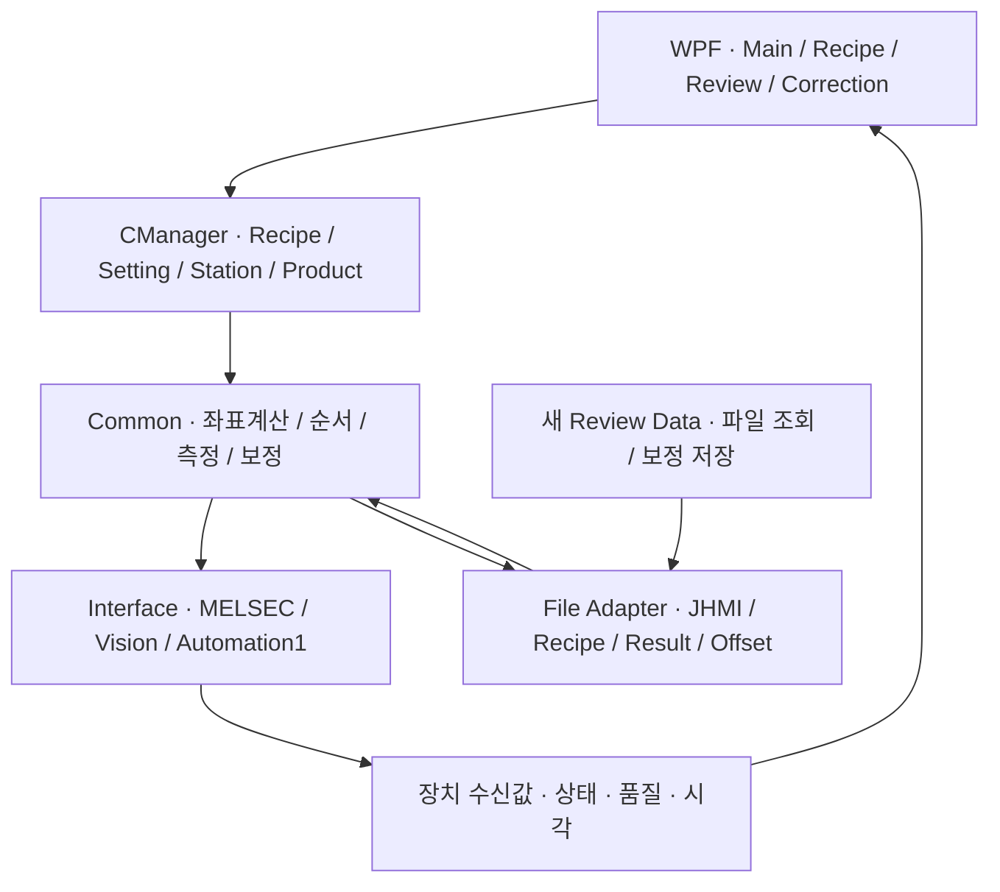
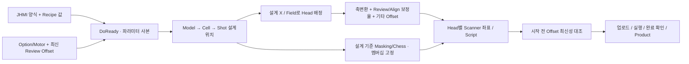
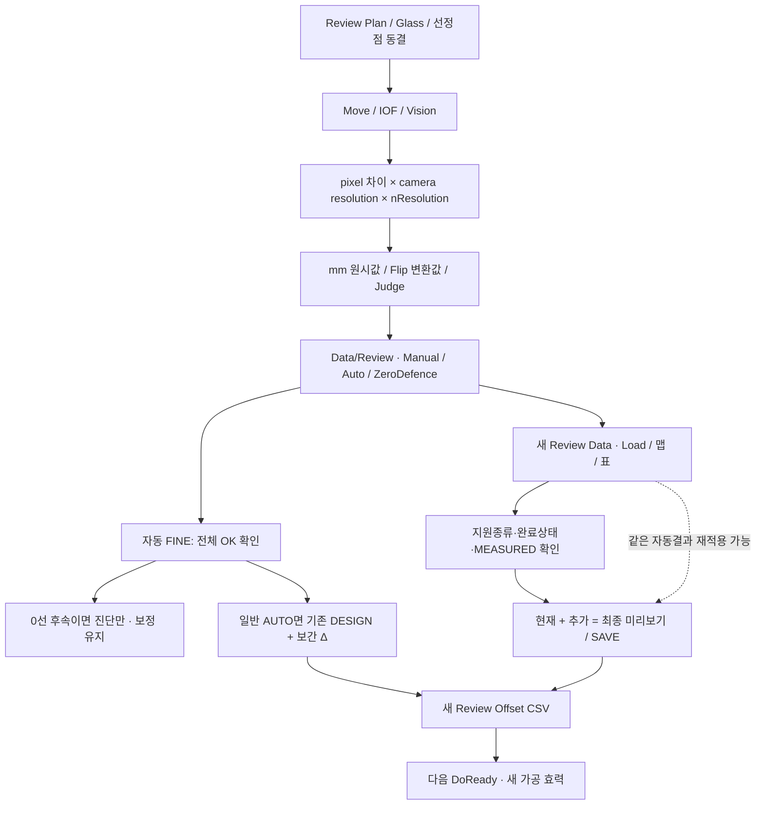
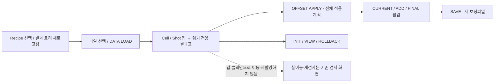
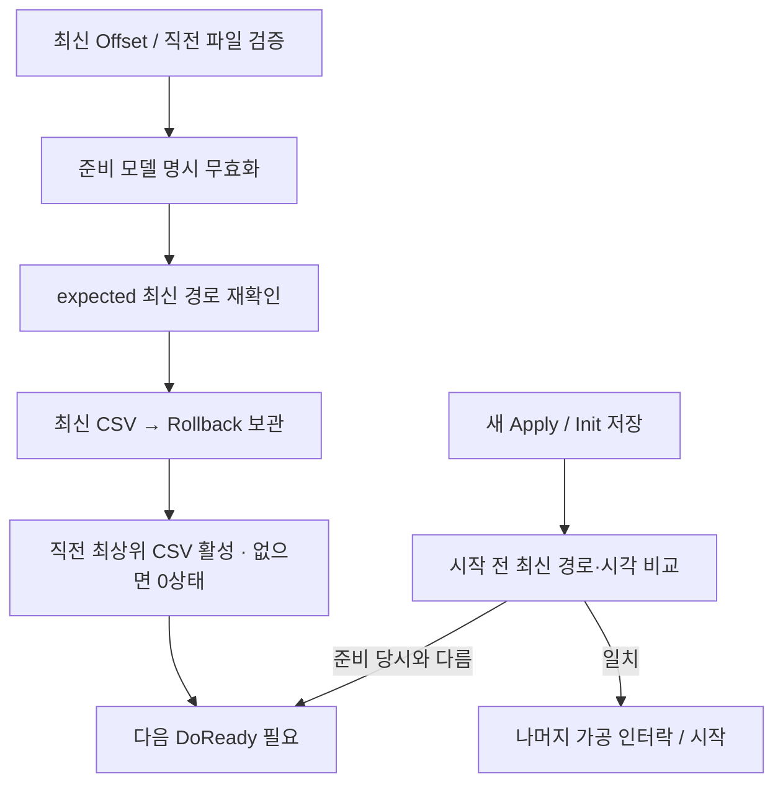
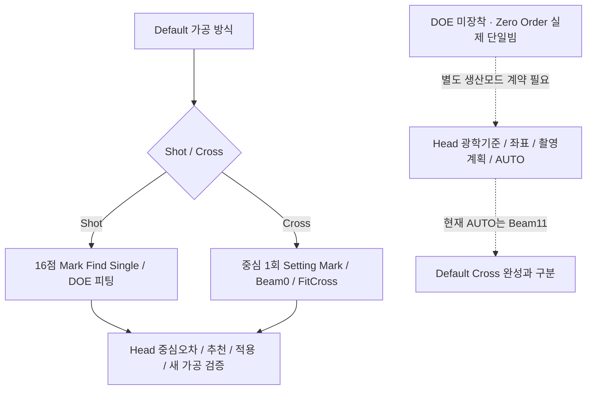

# 갱신된 통합 흐름도

상자는 현재 코드의 역할이고, 점선은 적용 경계·남은 위험입니다. 장비를 실제로 움직여 검증한 운전 순서도는 아닙니다.

## 1. 계층과 저장 역할

[그림으로 보기](figures/flow-0.svg)

## 2. 레시피에서 가공 명령까지

[그림으로 보기](figures/flow-1.svg)

## 3. 측정 결과와 자동·수동 보정

[그림으로 보기](figures/flow-2.svg)

## 4. 새 Review Data 조작의 범위

[그림으로 보기](figures/flow-3.svg)

## 5. Rollback과 준비 데이터 효력

[그림으로 보기](figures/flow-4.svg)

## 6. Default 십자와 원빔 요구의 경계

[그림으로 보기](figures/flow-5.svg)

주요 연결 근거: [준비 시 Setting·Offset 결합](https://github.com/kjuws10-rgb/A3Drilling/blob/a1162209220fd31caa68cbf82b5a98db9588af39/Drilling.Common/Station/CStationProcess.cs#L1512-L1549) · [Process 모델·Head 구성](https://github.com/kjuws10-rgb/A3Drilling/blob/a1162209220fd31caa68cbf82b5a98db9588af39/Drilling.Common/Station/CStationProcess.cs#L1591-L1623) · [설계 기준 Masking](https://github.com/kjuws10-rgb/A3Drilling/blob/a1162209220fd31caa68cbf82b5a98db9588af39/Drilling.Common/Recipe/CShotCoordinatePlanBuilder.cs#L868-L907) · [pixel에서 mm 환산](https://github.com/kjuws10-rgb/A3Drilling/blob/a1162209220fd31caa68cbf82b5a98db9588af39/Drilling.Common/Review/CReviewManager.cs#L2061-L2088) · [파일 기반 Apply와 저장](https://github.com/kjuws10-rgb/A3Drilling/blob/a1162209220fd31caa68cbf82b5a98db9588af39/Drilling.UI/Menu/Menus/CMenuCorrection.ReviewData.Offset.cs#L74-L124) · [Rollback 보관 및 이전 파일 활성화](https://github.com/kjuws10-rgb/A3Drilling/blob/a1162209220fd31caa68cbf82b5a98db9588af39/Drilling.File/ReviewOffset/CReviewOffsetFile.cs#L135-L218) · [자동 누적과 세션 중복 방어](https://github.com/kjuws10-rgb/A3Drilling/blob/a1162209220fd31caa68cbf82b5a98db9588af39/Drilling.Common/Review/CAutoFineReviewCoordinator.cs#L77-L174) · [AUTO 대표 Beam11](https://github.com/kjuws10-rgb/A3Drilling/blob/a1162209220fd31caa68cbf82b5a98db9588af39/Drilling.Common/Review/CAutoFineReviewCoordinator.cs#L315-L324).
