# 갱신된 통합 흐름도

## 1. 전체 프로그램과 데이터

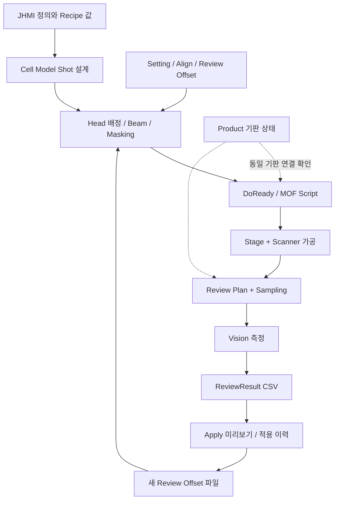


## 2. 수동 MOF Shift와 AUTO의 차이

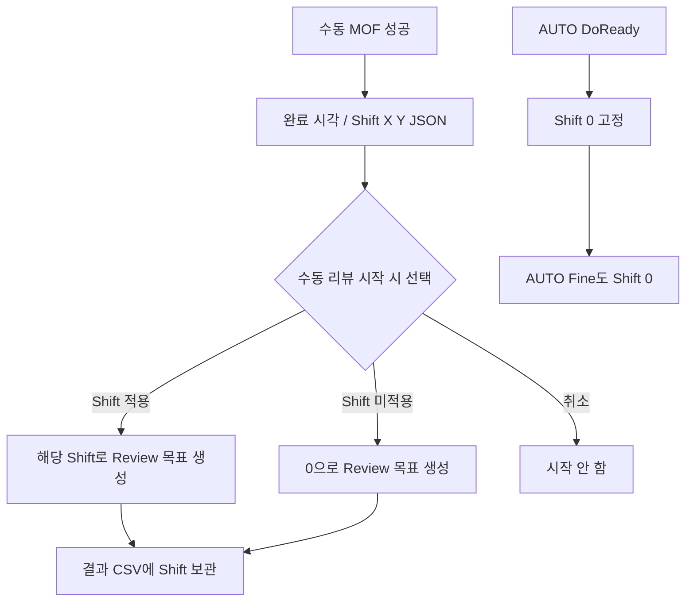


## 3. 결과 재검사와 새 파일

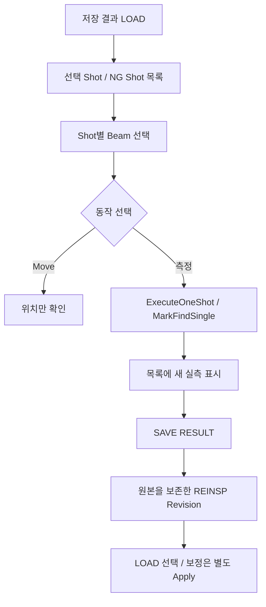


## 4. 당일 경로 기반 중복 방어

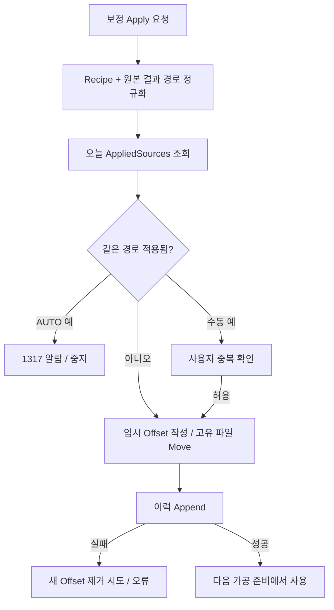


## 5. 복원과 다시 준비하기

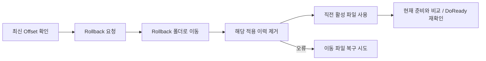


## 6. 현장 배포 전 검증 순서

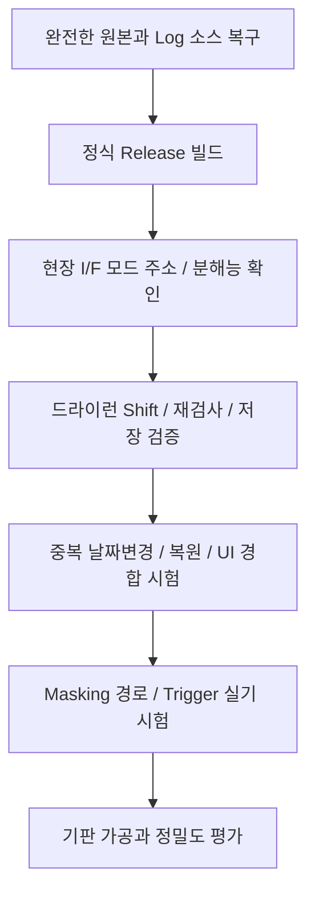


점선은 별도 상태 연결입니다. 그림은 현재 코드의 큰 흐름과 검증 순서를 설명하며 실제 장비에서 실행한 기록은 아닙니다.
