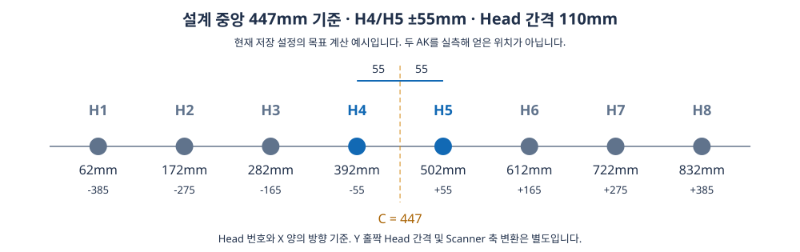

# Default Offset의 중앙 기준·55mm·110mm 설정 방법 검토

**중앙 기준으로4번·5번을±55mm에 두고 바깥쪽을110mm 간격으로 맞추는 목표와 작업 순서는 구현돼 있습니다. 다만 기준 중앙은 두 Align Key를 실측해 평균낸 값이 아니라 Recipe/카메라 기준으로 계산한 설계 중앙입니다.**

확인 대상은 A3Drilling/master `5aee8e58439c9b455cae7c9593c9be986c3e682e`입니다. 아래 X는 Review/기계 기준 목표 좌표의 mm이며 Scanner GX/GY 명령값과 동일한 숫자라고 해석하면 안 됩니다. 좌우 Align Key 한 쌍 사이의 X 중앙을 기준으로 한 요청으로 검토했습니다. 어떤 두 Key를 선택하는지는 실측 기능을 추가할 때 명확히 정의해야 합니다.

## 1. 요구와 현재 구현의 대응

| 사용자 설명 | 현재 코드 | 판단 |
| --- | --- | --- |
| 최초 두 Align Key의 중간 위치 확인 | `ReviewAK_X + GlassSizeX/2 − AK_MarginX`로 계산 | 설계 대칭 배치에는 대응하나 실측 두점 평균/티칭은 연결 안 됨 |
| 4번·5번 Zero Order를 중앙에서55mm씩 양분 | `TargetX = C + (Head−4.5)×HeadGapX` | 현재 HeadGapX110이므로4번 C−55,5번 C+55로 일치 |
| 이후110mm 간격으로 바깥쪽 조정 | 같은 목표식으로 나머지 Head 계산 | 목표 간격은 일치, 앞선 Head 실측값을 기준으로 연쇄 계산하는 방식은 아님 |
| 4/5부터 진행 | 두 Head 방식은4/5→3/6→2/7→1/8 | 순서 구현됨. 별도 일괄 방식도 있음 |
| 가공 Zero Order 실측과 Default 산출 | DOE Shot은16빔 중심 피팅, Cross는십자 중심1회; 목표와 실측 차이로 Default 추천 | DOE/원빔 자동 구분·최초 빔 자동 탐색까지 구현된 뜻은 아님 |
| 적용한 뒤 제대로 맞았는지 확인 | 짝별 적용 후 새 가공·재측정, 허용오차 확인 후 다음 짝 | 검증 흐름 구현, 실장비 합격은 이번에 실행하지 않음 |

## 2. 현재 목표 계산식

```text
C = REVIEW_CAMERA_ALIGN_KEY_POS_X + GLASS_SIZE_X/2 − AK_MARGIN_X
Head별 목표 X = C + (Head번호 − 4.5) × HeadGapX
```

[중앙값 계산](https://github.com/kjuws10-rgb/A3Drilling/blob/5aee8e58439c9b455cae7c9593c9be986c3e682e/Drilling.Common/Correction/CDefaultOffsetCalibration.cs#L29-L38), [Head 목표와 실측 비교](https://github.com/kjuws10-rgb/A3Drilling/blob/5aee8e58439c9b455cae7c9593c9be986c3e682e/Drilling.Common/Correction/CDefaultOffsetCalibration.cs#L172-L200).

현재 저장된 test0929의 입력은 ReviewAK_X0, GlassSizeX925, AK_MarginX15.5이며 Setting의 HeadGapX는110입니다. 따라서 `C=0+925/2−15.5=447mm`입니다. JHMI 정의의 초기 기본값과 현재 Setting/Recipe에 저장된 값을 구분해서 읽었습니다. [현재 Head 간격·H01 티칭 기준](https://github.com/kjuws10-rgb/A3Drilling/blob/5aee8e58439c9b455cae7c9593c9be986c3e682e/Config/Setting/Setting.csv#L125-L145).

| Head | 중앙 대비 | 현재 목표 X(mm) |
| --- | --- | --- |
| 1 | −385 | 62 |
| 2 | −275 | 172 |
| 3 | −165 | 282 |
| 4 | −55 | 392 |
| 5 | +55 | 502 |
| 6 | +165 | 612 |
| 7 | +275 | 722 |
| 8 | +385 | 832 |



이 그림은 현재 설정으로 계산한 목표이며 실제 측정 좌표가 아닙니다. 가로55/110mm는X기준입니다. Y는 Head별 AK 위치/홀짝 열 간격을 별도로 반영하므로4번·5번이 동일 StageY라는 뜻이 아닙니다.

## 3. ‘두 AK의 실측 중앙’과 달라지는 조건

좌우 Key가 Recipe 설계상 대칭이고 카메라의 AK 기준값이 실물과 정확히 맞으면 위 계산은 설계 두 Key의 중앙과 같습니다. 그러나 두 Key의 실측 글로벌 X/Y를 읽어 `(AK좌+AK우)/2`로 다시 계산하는 호출은 Default 설정 경로에서 확인되지 않습니다. 실측 Key 쌍 선택, 새 측정 완료/유효성/동일 기판 확인, 중앙 티칭값 보관도 현재 옵션에는 없습니다.

예를 들어 실측 두 Key의 X 중앙이449mm라면 실측 기준 목표는4번394/5번504mm입니다. 현재 Recipe 중앙447을 유지하면392/502를 목표로 삼아2mm 차이가 생깁니다. 이는 설명을 위한 가상 수치이며 실제 장비가2mm 틀어졌다는 측정 결과가 아닙니다.

옵션 데이터 구조에는 BoardCenterX/TestStageY/Tolerance와 가공방식이 있지만, 중앙은 Conditions에서 계산합니다. 조건창에서 중앙·공차는 읽기 전용이고 Model·StageY·샷/십자·십자길이만 입력합니다. 실측 AK 레코드를 전달받지 않습니다. [조건 생성](https://github.com/kjuws10-rgb/A3Drilling/blob/5aee8e58439c9b455cae7c9593c9be986c3e682e/Drilling.Common/Correction/CDefaultOffsetCalibration.cs#L31-L38), [Default 옵션 구조](https://github.com/kjuws10-rgb/A3Drilling/blob/5aee8e58439c9b455cae7c9593c9be986c3e682e/Drilling.Common/Correction/CDefaultOffsetCalibration.cs#L232-L249).

## 4. 작업 순서와 보정 계산

두 Head 실행은4/5→3/6→2/7→1/8이며 각 짝에서 **가공→측정→추천값 적용→새 가공→재측정**을 수행합니다. 검증 NG면 해당 짝을 복원하고, 검증 완료한 앞선 짝은 유지하는 경로입니다. USE인 Head만 대상으로 합니다. [짝별 실행과 재검증](https://github.com/kjuws10-rgb/A3Drilling/blob/5aee8e58439c9b455cae7c9593c9be986c3e682e/Drilling.UI/Menu/Menus/CMenuCorrection.cs#L3296-L3360), [실패 시 복원](https://github.com/kjuws10-rgb/A3Drilling/blob/5aee8e58439c9b455cae7c9593c9be986c3e682e/Drilling.UI/Menu/Menus/CMenuCorrection.cs#L3361-L3393).

각 Head는 같은 고정 중앙C를 독립적으로 참조합니다.4/5의 실제 측정 평균을 새C로 채택하거나3번을4번 실측위치−110으로,6번을5번 실측위치+110으로 재설정하는 연쇄 티칭이 아닙니다. 설계 격자에 모두 맞추려는 목적에는 현재 방식이 대응합니다. 실측4/5를 기준으로 다음 Head를 잡는 방식이 목적이라면 요구를 추가로 구분해야 합니다.

실측은 Encoder 위치와 Vision의 Target−Hole 보정으로 계산합니다. X는`actualX=평균(EncoderX−CorrectionX)`, 오차는`actualX−targetX`, 추천은`기존 DefaultX−오차`입니다. Head별 축 Flip/XY변환은 Scanner 명령 생성 단계에서 별도로 처리합니다. [실측·오차·추천값 산식](https://github.com/kjuws10-rgb/A3Drilling/blob/5aee8e58439c9b455cae7c9593c9be986c3e682e/Drilling.Common/Correction/CDefaultOffsetCalibration.cs#L184-L225), [실제 Scanner 목표 변환](https://github.com/kjuws10-rgb/A3Drilling/blob/5aee8e58439c9b455cae7c9593c9be986c3e682e/Drilling.Common/Correction/CDefaultOffsetCalibration.cs#L92-L104).

`H01_AK_POSITION_X`와 기존 Default로 계산하는 좌표는 **카메라가 현재 가공흔을 찾아갈 예상 위치**입니다. 정렬해야 할 목표 중앙C와 역할이 다릅니다. 이 티칭값을 바꿨다고 최종 정렬 목표도 같은 양으로 바뀌는 것은 아닙니다. [예상 탐색 위치와 최종 기준 계산](https://github.com/kjuws10-rgb/A3Drilling/blob/5aee8e58439c9b455cae7c9593c9be986c3e682e/Drilling.UI/Menu/Menus/CMenuCorrection.cs#L3727-L3764).

## 5. Zero Order를 어떻게 확인하는지

- Shot 모드:4×4의 서로 다른16빔이 모두 유효해야 하며, 배열의 중심과 Pitch/방향/잔차를 검증합니다. DOE 배열의 가상 중심을 계산하는 것으로, DOE 없는 실제 원빔을 직접 찾는 것과 구분해야 합니다. [16빔 슬롯과 피팅](https://github.com/kjuws10-rgb/A3Drilling/blob/5aee8e58439c9b455cae7c9593c9be986c3e682e/Drilling.Common/Correction/CDefaultOffsetCalibration.cs#L107-L159).
- Cross 모드:Beam0으로 십자 중심을1회 측정해 사용합니다. 이 옵션은 가공 형상/측정 명령을 바꾸는 것이며 Head별 DOE 유무를 자동 감지하지 않습니다. [십자 중심 처리](https://github.com/kjuws10-rgb/A3Drilling/blob/5aee8e58439c9b455cae7c9593c9be986c3e682e/Drilling.Common/Correction/CDefaultOffsetCalibration.cs#L162-L169), [측정 모드 분기](https://github.com/kjuws10-rgb/A3Drilling/blob/5aee8e58439c9b455cae7c9593c9be986c3e682e/Drilling.UI/Menu/Menus/CMenuCorrection.cs#L3740-L3758).
- 최초 가공흔이 예상 카메라 위치에 보이지 않을 때 자동으로 넓은 범위를 탐색하여 티칭하는 완성된 절차는 이번 경로에서 확인하지 못했습니다. 유효한 첫 마크를 확보하는 조작과 중심 정렬은 별개입니다.

## 6. 목적에 완전히 맞추기 위한 최소 보완

1. 두 AK의 글로벌 X/Y(mm)를 같은 기판·같은 측정 세대로 수신하고 좌우 Key쌍을 명시합니다.
2. 두 점의 중앙을 표시하고 **설계 중앙/실측 중앙** 중 사용할 기준을 확정합니다. 미수신0과 유효한0을 구분합니다.
3. 그 중앙을 고정한 뒤 기존`C+(Head−4.5)×110`과짝별 실행·검증을 재사용합니다. 적용 중 새 측정이 도착해도 실행 기준이 바뀌지 않게 snapshot을 유지합니다.
4. DOE Head의16빔 중심과 DOE 없는 Head의실제ZeroOrder1점 측정을 구분합니다. Default 기준은둘다ZeroOrder, First Offset으로11번평가위치에대응시키는요구와분리합니다.

## 7. 검증 방안

| 시험 | 확인할 내용 |
| --- | --- |
| 현재 격자 |8개 target가62/172/282/392/502/612/722/832,4/5중앙447,간격110인지 독립 산술 비교 |
| AK 실측 변경 | Recipe를고정하고두AK측정값만같은방향으로이동. 현행 목표는변하지않음을확인; 개선후에는선택한실측중앙만큼함께이동해야함 |
| 짝별 흐름 |4/5통과후3/6진행,실패시해당짝복원·다음짝미진행 확인 |
| 측정/축 변환 | +X/−X/+Y/−Y편차와Head별Flip에서추천Default방향·재가공후오차감소 확인 |
| 혼합 DOE | DOE16빔가상중심/원빔실제ZeroOrder를분리해동일중앙격자에맞는지확인 |
| 소속/누락 | AK다른Glass/구형측정/한점미수신/미할당주소/NG이면기준확정과실행을차단 |

이번에는 Git 소스·호출·저장 설정과 독립 산술만 확인했습니다. 정식 Release는 기존 Log 누락19오류로 차단돼 실장비·GUI·새 마크 측정 시험은 하지 않았으며, 생산 코드를 수정하지 않았습니다.
