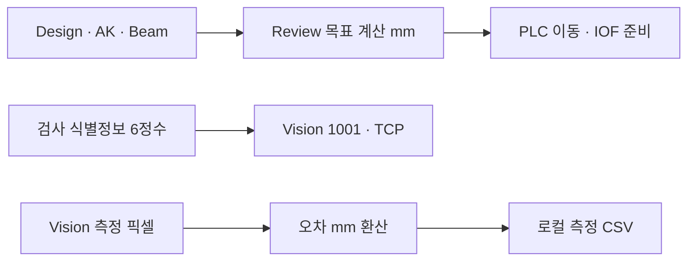

# A3 Pi Studio 0.5.1

[전체 다운로드 / Release](https://github.com/kjuws10-rgb/Shared/releases/tag/a3-pi-studio-v0.5.1-20261113)

|자료|다운로드|
|---|---|
|Windows x64 전체 실행 · 약484MB|[실행 ZIP](https://github.com/kjuws10-rgb/Shared/releases/download/a3-pi-studio-v0.5.1-20261113/A3_Pi_Studio_0_5_1_Windows_x64.zip)|
|설치·사용법|[HTML](https://github.com/kjuws10-rgb/Shared/releases/download/a3-pi-studio-v0.5.1-20261113/Installation_Guide.html)|
|수정된 도구 소스|[Source ZIP](https://github.com/kjuws10-rgb/Shared/releases/download/a3-pi-studio-v0.5.1-20261113/A3_Pi_Studio_0_5_1_Source.zip)|
|검증 범위|[검증 요약](Verification_Summary.md)|

기존 A3 스튜디오를 트레이에서 종료한 뒤 새 폴더에 풀고 `App/Setup-A3.cmd`를 실행하세요. 이후 현장에서는 `App/시작하기.cmd`를 사용합니다. 기존 모델은 재사용하고 없으면 최초 온라인 준비에서 약5GB를 받습니다.

## 개선 내용

최신 A3Drilling/master를 별도 사본으로 준비하고 실제 경로·Commit·Git C# 수/검색 반영 수를 표시합니다. 확인한 버전은 `5aee8e58439c9b455cae7c9593c9be986c3e682e`, 추적571파일·C#148/148·DLL12개·누락0입니다. DLL은 정상 존재하며 일반 텍스트 검색에서 제외합니다.

코드 질문은 소스를 우선 검색하고 실제 원문 행·SHA로 근거를 확인합니다. Review→Vision의 일반 좌표 흐름은 검증된 한국어5단계와 원문19개로 바로 조회합니다. 실제 같은 질문은2.5초에 응답했습니다. 이 결과는 소스 검증 조회이며 LLM 응답 정확도 통과를 뜻하지 않습니다. 진단·편집·다른 모드·상세 요청은 로컬 모델을 사용합니다.

원문 전체 SHA가 확인한 버전과 일치할 때만 역할 메모를 사용하며 변경되면 해당 조회를 제외합니다. 기존 폴더·수정 파일·모델·0.5 배포본은 보존합니다. 이전 앱을 새 버전으로 오인해 재사용하는 경우도 차단했습니다.

## 검증과 제한

실제 동일 질문의소스조회10/10·19원문대조,역할지도19/19,Pi호스트51/51,공식SDK모의10/10,UI60/60,소스감사20/20과기존회귀373/373을확인했습니다. 자세한범위는[검증요약](Verification_Summary.md)을보세요.

8B 자유생성에서 발견한 CSV/TX 혼동은불합격으로보존했으며,모델일반정확도나Codex동급을주장하지않습니다. 실제A3전체빌드의기존Log관련19오류와실장비검수는별도입니다. 가중치재학습은이번수정범위가아닙니다.

앱 소스 Commit `0664cb451100c4ba678a3f4708aef757955cc7a8`은로컬Commit이며SourceZIP에제공합니다. 공개ZIP에는장비원본코드·내부자료·모델가중치·사용자상태·QA원문이없습니다. 원본A3파일/Commit/Push는변경하지않았습니다.
