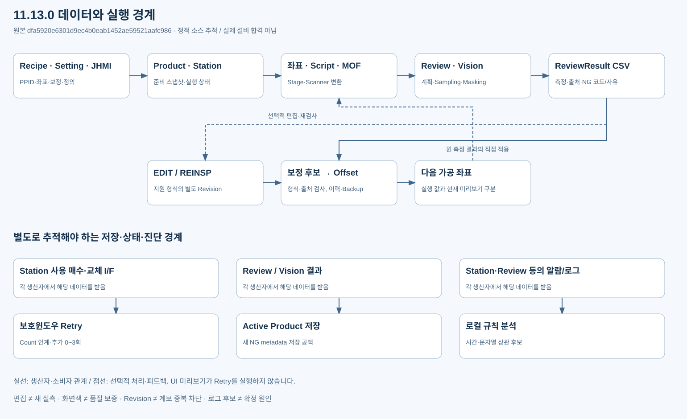
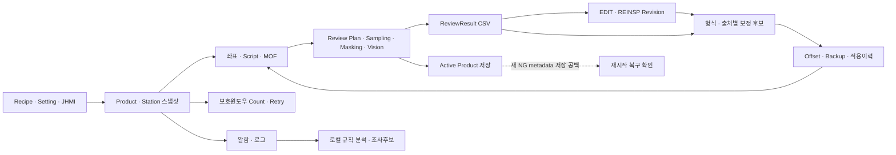

# 통합 흐름도

실선은 정적 생산자·소비자 관계이며 실제 설비 응답·모든 런타임 분기를 재현한 것은 아닙니다. 편집과 측정, 보정 후보와 최종 적용, 로그 후보와 확정 원인을 구분합니다.

[Drilling.Common/Review/CReviewManager.cs:211–246](https://github.com/kjuws10-rgb/A3Drilling/blob/dfa5920e6301d9ec4b0eab1452ae59521aafc986/Drilling.Common/Review/CReviewManager.cs#L211-L246) · [Drilling.File/ReviewResult/CReviewResultFile.cs:157–267](https://github.com/kjuws10-rgb/A3Drilling/blob/dfa5920e6301d9ec4b0eab1452ae59521aafc986/Drilling.File/ReviewResult/CReviewResultFile.cs#L157-L267) · [Drilling.UI/Menu/Menus/CMenuCorrection.ReviewData.Offset.cs:461–517](https://github.com/kjuws10-rgb/A3Drilling/blob/dfa5920e6301d9ec4b0eab1452ae59521aafc986/Drilling.UI/Menu/Menus/CMenuCorrection.ReviewData.Offset.cs#L461-L517)
