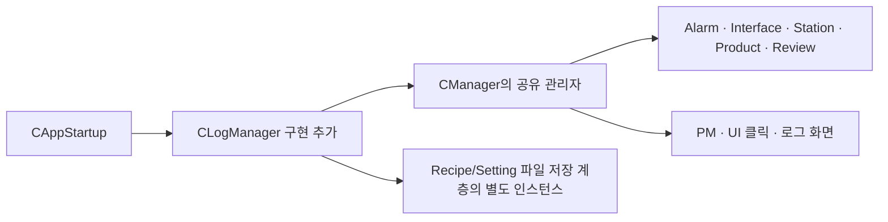

# 01 · Commit 변경 요약

- 원본 저장소: https://github.com/kjuws10-rgb/A3Drilling.git
- 분석 브랜치: master
- 원본 최신 Commit: 334b3599651b2e8e0181fd4459bafaf3cddafff3
- 비교 기준 Commit: 28764c91d521777b8ee068dd7aaf2d3902ce9fe2

## 실제 diff

| 항목 | 확인 내용 |
|---|---|
| 변경 파일 | Drilling.Common/Log/CLogManager.cs |
| 상태 | 추가(A) |
| 행 변화 | +1,562 / -0 |
| Commit 제목 | Add missing CLogManager.cs |
| 기존 코드의 수정 | 이 비교 범위에서는 없음 |

이전 Commit에는 이 경로의 파일이 없고, 현재 파일은 기존 CAppStartup/CManager가 생성·주입하던 CLogManager와 관련 형식을 제공합니다. **누락 참조를 보완하는 성격**이라는 소스 해석이며, 정식 설비 빌드가 통과했다는 뜻은 아닙니다. [애플리케이션 DI 연결](https://github.com/kjuws10-rgb/A3Drilling/blob/334b3599651b2e8e0181fd4459bafaf3cddafff3/Drilling.UI/CAppStartup.cs#L15-L36)와 [Alarm·Review·Product·Station에 로그 연결](https://github.com/kjuws10-rgb/A3Drilling/blob/334b3599651b2e8e0181fd4459bafaf3cddafff3/Drilling.Common/Managers/CManager.cs#L76-L134)를 함께 보면 연결 위치가 확인됩니다.

## 추가된 책임

| 구현 묶음 | 하는 일 | 주요 근거 |
|---|---|---|
| CLogManager / IAlarmHistoryStore | PM·Recipe·Setting·UI·Product·Station·Alarm 기록과 조회 | [PM 세션 저장·완료·조회](https://github.com/kjuws10-rgb/A3Drilling/blob/334b3599651b2e8e0181fd4459bafaf3cddafff3/Drilling.Common/Log/CLogManager.cs#L72-L174), [Alarm JSONL 기록·조회](https://github.com/kjuws10-rgb/A3Drilling/blob/334b3599651b2e8e0181fd4459bafaf3cddafff3/Drilling.Common/Log/CLogManager.cs#L716-L796) |
| InterfaceLogWriter | 파일별 큐와 배치 기록, Flush/종료 대기 | [Interface 큐·Flush·종료](https://github.com/kjuws10-rgb/A3Drilling/blob/334b3599651b2e8e0181fd4459bafaf3cddafff3/Drilling.Common/Log/CLogManager.cs#L422-L537) |
| SequenceEntry / CSequenceLogText | 기존 제어 이벤트를 운영자용 문장과 Glass ID로 표시 | [Sequence 큐·배치·오류 처리](https://github.com/kjuws10-rgb/A3Drilling/blob/334b3599651b2e8e0181fd4459bafaf3cddafff3/Drilling.Common/Log/CLogManager.cs#L801-L940), [시퀀스 문구·기판 식별자 투영](https://github.com/kjuws10-rgb/A3Drilling/blob/334b3599651b2e8e0181fd4459bafaf3cddafff3/Drilling.Common/Log/CLogManager.cs#L997-L1399) |
| CLogFileScope | Log 밖 경로와 연결 폴더를 차단하고 Alarm 전용 메뉴와 분리 | [일반 로그 탐색 범위](https://github.com/kjuws10-rgb/A3Drilling/blob/334b3599651b2e8e0181fd4459bafaf3cddafff3/Drilling.Common/Log/CLogManager.cs#L945-L994) |
| CLogTextReader / ST_LOG_TEXT_PAGE | 원문 전체 비동기 읽기와 기존 페이지 읽기 | [전체/페이지 로그 읽기와 인코딩](https://github.com/kjuws10-rgb/A3Drilling/blob/334b3599651b2e8e0181fd4459bafaf3cddafff3/Drilling.Common/Log/CLogManager.cs#L1401-L1501) |
| ST_PM_HISTORY_ENTRY | 세션 ID, 진입/해제 시각, 사유, 작업자 | [PM 레코드와 시작 실패 기록](https://github.com/kjuws10-rgb/A3Drilling/blob/334b3599651b2e8e0181fd4459bafaf3cddafff3/Drilling.Common/Log/CLogManager.cs#L1503-L1562) |
| CProgramOpenLog | 시작·종료 오류의 보조 파일 기록 | [PM 레코드와 시작 실패 기록](https://github.com/kjuws10-rgb/A3Drilling/blob/334b3599651b2e8e0181fd4459bafaf3cddafff3/Drilling.Common/Log/CLogManager.cs#L1503-L1562) |

## 기존 호출 관계에서 달라지는 점

Recipe/Setting 파일 계층은 자체 CLogManager 인스턴스를 만들지만 동일 경로의 동기 텍스트 파일에는 정적 FileLocks를 공유합니다. Interface/Sequence worker와 PM 캐시는 각 인스턴스에 속합니다. 단일 전역 로그 트랜잭션으로 묶인 구조는 아닙니다. [로그 구성과 저장 위치](https://github.com/kjuws10-rgb/A3Drilling/blob/334b3599651b2e8e0181fd4459bafaf3cddafff3/Drilling.Common/Log/CLogManager.cs#L18-L69), [동기 텍스트 기록과 파일 잠금](https://github.com/kjuws10-rgb/A3Drilling/blob/334b3599651b2e8e0181fd4459bafaf3cddafff3/Drilling.Common/Log/CLogManager.cs#L341-L420).

## 변경하지 않은 항목

JHMI/Recipe CSV 스키마, Cell/Model/Shot/Beam 좌표 생성, Head 배정, Masking/Chess, Sampling Rule, Vision 전송, ReviewResult/Correction Offset 저장소, Product 구조의 파일 diff는 없습니다. 로그 문장에 ‘라그랑주’·‘보정 저장’이 추가로 표현되는 것은 **기존 이벤트 설명**이며 계산 알고리즘의 신규 추가가 아닙니다. [시퀀스 문구·기판 식별자 투영](https://github.com/kjuws10-rgb/A3Drilling/blob/334b3599651b2e8e0181fd4459bafaf3cddafff3/Drilling.Common/Log/CLogManager.cs#L997-L1399), [기존 Review 좌표·Head·Masking 계획](https://github.com/kjuws10-rgb/A3Drilling/blob/334b3599651b2e8e0181fd4459bafaf3cddafff3/Drilling.Common/Review/CReviewManager.cs#L509-L575).
