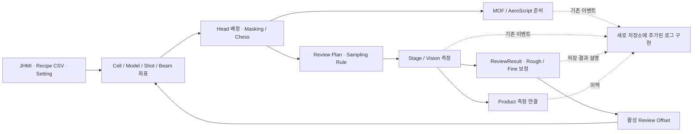

# 03 · 가공·Review 영향 분석

## 가공 및 보정 계산 자체

현재 diff는 로그 파일 추가 한 건입니다. 가공 계획과 Review 계획을 만드는 기존 함수, Vision 측정, Rough/Fine 보정과 Offset 저장 수식은 수정되지 않았습니다. 다만 기존 호출이 이제 이 구현을 사용하므로 기록 실패가 상위 함수에 어떤 결과로 보이는지는 별도로 확인해야 합니다.

좌표·Head·Masking 생성 근거는 [기존 가공 계획의 진입점](https://github.com/kjuws10-rgb/A3Drilling/blob/334b3599651b2e8e0181fd4459bafaf3cddafff3/Drilling.Common/Recipe/CShotCoordinatePlanBuilder.cs#L9-L24)와 [기존 Review 좌표·Head·Masking 계획](https://github.com/kjuws10-rgb/A3Drilling/blob/334b3599651b2e8e0181fd4459bafaf3cddafff3/Drilling.Common/Review/CReviewManager.cs#L509-L575), 측정 결과와 Offset 저장 형식은 [기존 Review 결과 CSV 정의와 저장 루트](https://github.com/kjuws10-rgb/A3Drilling/blob/334b3599651b2e8e0181fd4459bafaf3cddafff3/Drilling.File/ReviewResult/CReviewResultFile.cs#L11-L56)와 [기존 Review Offset 저장소](https://github.com/kjuws10-rgb/A3Drilling/blob/334b3599651b2e8e0181fd4459bafaf3cddafff3/Drilling.File/ReviewOffset/CReviewOffsetFile.cs#L60-L78)입니다. 실측 mm/µm 변환이나 보정 부호가 이번에 변경됐다는 근거는 없습니다.

## 경로별 실질 영향

| 우선 경로 | 이번 변경의 영향 | 확인할 항목 |
|---|---|---|
| 가공 Recipe / JHMI / Recipe CSV | 본문 스키마 변화 없음. 저장 후 변경 이력 기록 구현 연결 | 실제 파일은 저장됐는데 로그만 실패한 경우 UI 재조회/메시지 |
| Cell/Model/Shot/Beam·Head·Masking | 계산 입력/구조 diff 없음 | 로그 설명을 실제 좌표 계산 변경으로 오해하지 않기 |
| Review Plan / Sampling Rule | 계획 생성 diff 없음 | 계획 확정 로그의 Recipe·Glass가 원문과 일치하는지 |
| Vision / Flying / Fine 진행 | 기존 진행 이벤트가 Sequence로 들어감 | 포화 시 유실된 진행 로그와 실제 측정 누락을 구별 |
| ReviewResult / Correction Offset | 실제 CSV/보정 저장 경로 diff 없음 | ‘보정 저장 완료’ 문구와 실제 결과/Offset 파일을 함께 확인 |
| Product 연결 | 제품 원본 저장 뒤 보조 로그 호출 | 로그 실패를 제품 저장 실패로 잘못 처리하지 않기 |
| PM 진입/해제 | 이력 쓰기 성공이 잠금 상태 변경보다 먼저 | 디스크 실패 시 진입 거부/해제 실패와 잠금 유지 |

Recipe는 파일 쓰기와 재검증 뒤 로그를 씁니다. 일반 SaveRecipeCore는 그 호출 뒤 캐시·이력을 갱신하므로, 로그가 예외를 내면 파일은 바뀌었어도 캐시 갱신까지 가지 못할 수 있습니다. Setting도 파일 검증 뒤 이력을 쓰는 순서입니다. 되돌리기보다 **현재 저장값부터 다시 읽어 확인하는 검증**이 필요합니다. [Recipe 저장 검증 후 이력 기록](https://github.com/kjuws10-rgb/A3Drilling/blob/334b3599651b2e8e0181fd4459bafaf3cddafff3/Drilling.File/JHMI/CJhmiRecipeFile.cs#L222-L243), [Recipe 저장·캐시·이력 재로딩](https://github.com/kjuws10-rgb/A3Drilling/blob/334b3599651b2e8e0181fd4459bafaf3cddafff3/Drilling.Common/Managers/CRecipeManager.cs#L146-L159), [Setting 저장 검증 후 변경값 기록](https://github.com/kjuws10-rgb/A3Drilling/blob/334b3599651b2e8e0181fd4459bafaf3cddafff3/Drilling.File/JHMI/CSettingFile.cs#L86-L139).

Review의 WriteReviewLog는 로그 예외를 catch하여 검사 자체와 분리합니다. Fine 진행 기록은 Sequence 큐를 사용합니다. 반면 Station 상태의 일부 직접 WriteStationState 호출은 해당 줄에서 예외를 감싸지 않으므로 모든 로그 경로가 같은 실패 정책을 가진 것은 아닙니다. [Review 로그 분기와 예외 격리](https://github.com/kjuws10-rgb/A3Drilling/blob/334b3599651b2e8e0181fd4459bafaf3cddafff3/Drilling.Common/Review/CReviewManager.cs#L1028-L1050), [Fine 진행 상태의 비동기 로그](https://github.com/kjuws10-rgb/A3Drilling/blob/334b3599651b2e8e0181fd4459bafaf3cddafff3/Drilling.Common/Review/CReviewManager.cs#L2739-L2751), [Station·Sequence 로그 호출과 예외 경계](https://github.com/kjuws10-rgb/A3Drilling/blob/334b3599651b2e8e0181fd4459bafaf3cddafff3/Drilling.Common/Station/CStationProcess.cs#L2360-L2418).

## 현장 전 권장 검증

1. 쓰기 권한 제거/디스크 부족을 임시 폴더에서 재현하여 Recipe·Setting 실제 값, UI 값, 이력의 세 상태를 비교합니다.
2. PM 시작 파일 쓰기 실패는 LOCK 진입을 막고, 완료 파일 쓰기 실패는 LOCK을 유지하는지 확인합니다.
3. 로그 큐 포화·쓰기 실패 뒤 통신/가공 재시도가 자동으로 발생하지 않는지 확인합니다. 로그 누락과 Vision Trigger 누락은 서로 다른 시험입니다.
4. 같은 Glass의 Process/Review가 겹칠 때 Sequence의 Glass ID가 잘못 섞이지 않는지 합성 이벤트로 검사합니다.
5. 실제 장비의 정밀도·좌표 부호·MOF 속도·Trigger 누락은 이번 문서 작업으로 인증하지 않습니다.

PM의 실제 UI 분기는 [이력 저장 성공 후 PM 잠금](https://github.com/kjuws10-rgb/A3Drilling/blob/334b3599651b2e8e0181fd4459bafaf3cddafff3/Drilling.UI/CRootView.cs#L1307-L1322)와 [이력 완료 실패 시 PM 잠금 유지](https://github.com/kjuws10-rgb/A3Drilling/blob/334b3599651b2e8e0181fd4459bafaf3cddafff3/Drilling.UI/CRootView.cs#L1467-L1493), Product 분기는 [Product 원본 저장과 보조 로그](https://github.com/kjuws10-rgb/A3Drilling/blob/334b3599651b2e8e0181fd4459bafaf3cddafff3/Drilling.Common/Product/CProductManager.cs#L789-L816)를 확인했습니다.
