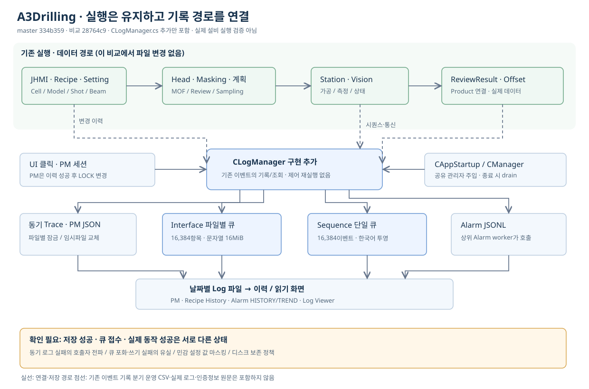
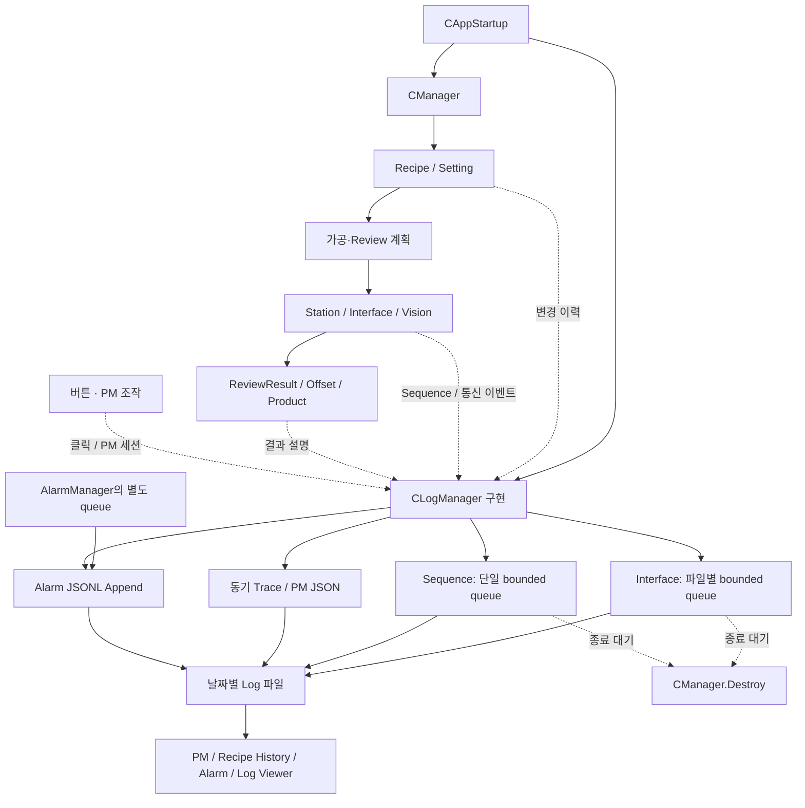
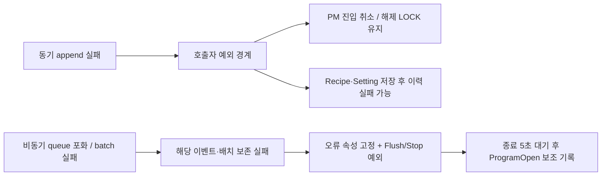

# 04 · 갱신된 통합 흐름도

## 실행 경로와 로그 경로

실선은 기존 실행·저장 경로, 점선은 상태/이력을 남기는 분기입니다. 로그 writer가 Vision이나 Stage 명령을 다시 실행하는 화살표는 없습니다. 다만 동기 기록의 예외가 호출자로 돌아가는 영향은 별도 위험으로 표시합니다.

DI 연결: [애플리케이션 DI 연결](https://github.com/kjuws10-rgb/A3Drilling/blob/334b3599651b2e8e0181fd4459bafaf3cddafff3/Drilling.UI/CAppStartup.cs#L15-L36), [Alarm·Review·Product·Station에 로그 연결](https://github.com/kjuws10-rgb/A3Drilling/blob/334b3599651b2e8e0181fd4459bafaf3cddafff3/Drilling.Common/Managers/CManager.cs#L76-L134). 이벤트 분기: [Station·Sequence 로그 호출과 예외 경계](https://github.com/kjuws10-rgb/A3Drilling/blob/334b3599651b2e8e0181fd4459bafaf3cddafff3/Drilling.Common/Station/CStationProcess.cs#L2360-L2418), [Interface 명령·수신·프로토콜 기록 분기](https://github.com/kjuws10-rgb/A3Drilling/blob/334b3599651b2e8e0181fd4459bafaf3cddafff3/Drilling.Common/Interface/CInterfaceManager.cs#L719-L772), [Review 로그 분기와 예외 격리](https://github.com/kjuws10-rgb/A3Drilling/blob/334b3599651b2e8e0181fd4459bafaf3cddafff3/Drilling.Common/Review/CReviewManager.cs#L1028-L1050). 소비자: [최신 선택 파일만 표시·취소](https://github.com/kjuws10-rgb/A3Drilling/blob/334b3599651b2e8e0181fd4459bafaf3cddafff3/Drilling.UI/Menu/Menus/CMonitorLogViewerPanel.cs#L124-L175), [PM 화면 이력 소비](https://github.com/kjuws10-rgb/A3Drilling/blob/334b3599651b2e8e0181fd4459bafaf3cddafff3/Drilling.UI/Menu/Menus/CMenuPm.cs#L35-L56), [Recipe 저장·캐시·이력 재로딩](https://github.com/kjuws10-rgb/A3Drilling/blob/334b3599651b2e8e0181fd4459bafaf3cddafff3/Drilling.Common/Managers/CRecipeManager.cs#L146-L159).

## 실패·종료 경로

오류 속성은 이후 쓰기 성공으로 자동 해제되지 않습니다. 디스크 복구 뒤 이후 로그 기록은 다시 성공할 수 있어도, 이미 버린 배치를 되살리는 journal/replay는 없습니다. 종료 코드는 큐 drain을 기다리지만 프로세스 강제 종료나 대기 시간 초과의 보존까지 보장하지 않습니다. [Interface 큐·Flush·종료](https://github.com/kjuws10-rgb/A3Drilling/blob/334b3599651b2e8e0181fd4459bafaf3cddafff3/Drilling.Common/Log/CLogManager.cs#L422-L537), [Sequence 큐·배치·오류 처리](https://github.com/kjuws10-rgb/A3Drilling/blob/334b3599651b2e8e0181fd4459bafaf3cddafff3/Drilling.Common/Log/CLogManager.cs#L801-L940), [종료 시 큐 정리와 5초 대기](https://github.com/kjuws10-rgb/A3Drilling/blob/334b3599651b2e8e0181fd4459bafaf3cddafff3/Drilling.Common/Managers/CManager.cs#L227-L265).
