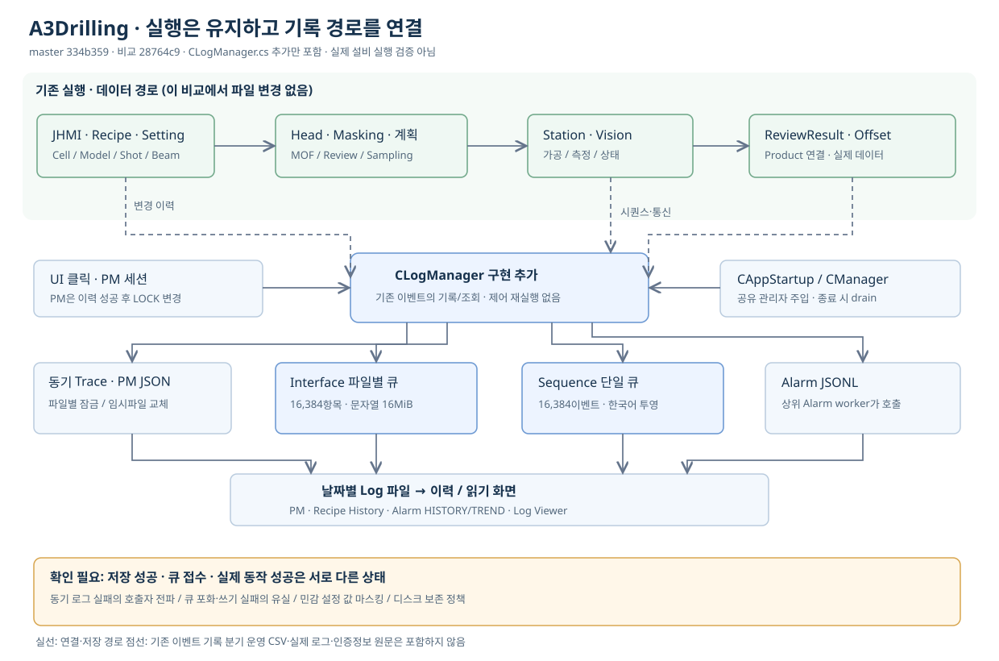

# A3Drilling 아키텍처 변경 분석 · 2026-11-21

실행 기준 시각: **2026-11-21 08:56:57 Asia/Seoul**

- 원본 저장소: https://github.com/kjuws10-rgb/A3Drilling.git
- 분석 브랜치: master
- 원본 최신 Commit: 334b3599651b2e8e0181fd4459bafaf3cddafff3
- 비교 기준 Commit: 28764c91d521777b8ee068dd7aaf2d3902ce9fe2

## 먼저 볼 결론

이번 비교는 **CLogManager.cs 한 파일 추가(+1,562행)**입니다. 기존 코드가 호출하던 로그 관리자와 PM 이력·로그 읽기 보조 형식이 저장소에 들어왔습니다. 가공 좌표, Review 샘플링, 보정 수식이나 Recipe CSV 정의를 바꾸는 diff는 없습니다.

다만 로그가 항상 무해한 부가기능은 아닙니다. PM 잠금은 이력 쓰기 성공을 먼저 요구하고, Recipe/Setting은 실제 파일 저장 후 이력을 쓰므로 디스크 실패 시 사용자에게 보이는 성공/실패와 실제 저장 상태가 달라질 수 있습니다. Interface/Sequence는 큐를 사용하지만 포화·파일 오류 때 해당 로그가 유실될 수 있습니다.

## 문서 안내

- [직전 아키텍처 보고서](../20261120_090030_SW아키텍쳐분석/README.md)
- [A3 LD Code Ref · 전체 코드 레퍼런스](../A3%20LD%20Code%20Ref/README.md)

- [01 · Commit 변경 요약](01_Commit변경요약.md): 새 구현과 기존 호출자 연결
- [02 · 데이터 구조와 흐름](02_데이터구조와흐름.md): 파일 형식·인코딩·생산자/소비자
- [03 · 가공·Review 영향](03_가공Review영향.md): 좌표/레시피/보정과 로그를 구분
- [04 · 통합 흐름도](04_통합흐름도.md): 실행 흐름과 기록 흐름
- [05 · 위험도별 발견사항](05_위험도별발견사항.md): 확인된 코드 특성, 재현 필요 사항
- [06 · 근거와 검증](06_근거와검증.md): 검토 범위·검증 방법·미수행 범위

## 독립 순수 시험 결과

원문 전체를 추출한 .NET 전용 하네스에서 **정상 경로 27/27**, **결함 재현 5/5**를 분리 확인했습니다. 32건 모두 프로그램 정상성을 통과했다는 뜻이 아닙니다. 빈 필드 이력 소실/오염과 단순 Recipe 기록의 개행 분리가 확인됐으며 [검증 상세](06_근거와검증.md)에 구분했습니다.

## 범위와 한계

- master의 위 두 Commit만 비교했습니다. 별도 Manual Inspection 기능 브랜치는 포함하지 않았습니다.
- 원본의 로그 구현 전체와 주요 직접 호출자/소비자를 소스로 추적했습니다. 모든 프로그램 경로를 실행한 검증은 아닙니다.
- 이 문서 작성에서는 설비 프로그램, Script, SDK/DLL, 장비 빌드를 실행하지 않았습니다. 빌드·순수 진단 시험의 최종 결과는 주 에이전트 통합 검증 기록을 기준으로 확인해야 합니다.
- 인증정보, 실제 로그·운영 CSV 레코드는 문서에 복제하지 않았습니다.

핵심 근거: [로그 구성과 저장 위치](https://github.com/kjuws10-rgb/A3Drilling/blob/334b3599651b2e8e0181fd4459bafaf3cddafff3/Drilling.Common/Log/CLogManager.cs#L18-L69), [애플리케이션 DI 연결](https://github.com/kjuws10-rgb/A3Drilling/blob/334b3599651b2e8e0181fd4459bafaf3cddafff3/Drilling.UI/CAppStartup.cs#L15-L36), [기존 Review 좌표·Head·Masking 계획](https://github.com/kjuws10-rgb/A3Drilling/blob/334b3599651b2e8e0181fd4459bafaf3cddafff3/Drilling.Common/Review/CReviewManager.cs#L509-L575).
