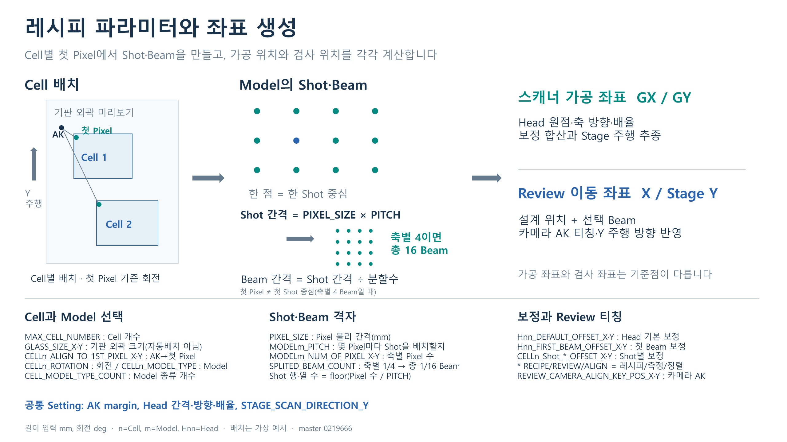
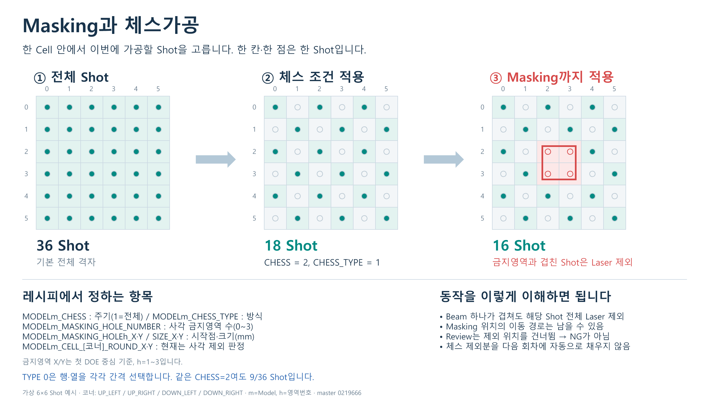

# A3 레시피·좌표 생성과 Masking·체스가공 · 11.25.2

그림 중심 2장 요약 자료입니다. 원본 A3Drilling `master`의 `0219666f9053b907d96d7e0aa7d0c6c1be3a73d4`를 정적으로 추적했습니다. 운영 레시피·측정 레코드를 사용하지 않은 가상 도식이며 프로그램은 변경하지 않았습니다.

[2장 PDF](A3_레시피_좌표_Masking_체스가공_11.25.2.pdf)

1. Cell별 첫 Pixel·회전·Model → Shot·Beam 격자 → 스캐너 GX/GY와 Review X/Stage Y 분기. 실제 레시피 키와 공통 Setting을 구분합니다.
2. 한 Cell의 가상 6×6 Shot에서 CHESS=2/TYPE=1과 사각 Masking으로 가공 위치를 고르는 예시입니다. 36 → 18 → 16 Shot이며 자동 추가 가공 회차를 뜻하지 않습니다.

## 근거

- [Recipe 정의: NAME·UNIT·DESCRIPTION](https://github.com/kjuws10-rgb/A3Drilling/blob/0219666f9053b907d96d7e0aa7d0c6c1be3a73d4/Config/JHMI_RCP.csv#L1-L90)
- [Shot·Beam 격자](https://github.com/kjuws10-rgb/A3Drilling/blob/0219666f9053b907d96d7e0aa7d0c6c1be3a73d4/Drilling.Common/Recipe/CCellPatternCalculator.cs#L94-L207)
- [스캐너·좌표 생성기](https://github.com/kjuws10-rgb/A3Drilling/blob/0219666f9053b907d96d7e0aa7d0c6c1be3a73d4/Drilling.Common/Recipe/CShotCoordinatePlanBuilder.cs#L11-L75)
- [Review 위치](https://github.com/kjuws10-rgb/A3Drilling/blob/0219666f9053b907d96d7e0aa7d0c6c1be3a73d4/Drilling.Common/Review/CReviewManager.cs#L679-L777)
- [Masking·Chess 판정](https://github.com/kjuws10-rgb/A3Drilling/blob/0219666f9053b907d96d7e0aa7d0c6c1be3a73d4/Drilling.Common/Recipe/CShotCoordinatePlanBuilder.cs#L790-L996)

PDF는 검토된 같은 슬라이드를 고해상도 그림으로 담았습니다. 편집 가능한 도식 원본은 대화에 제공한 프레젠테이션입니다. 장비 빌드·동작 검증을 의미하지 않습니다.
