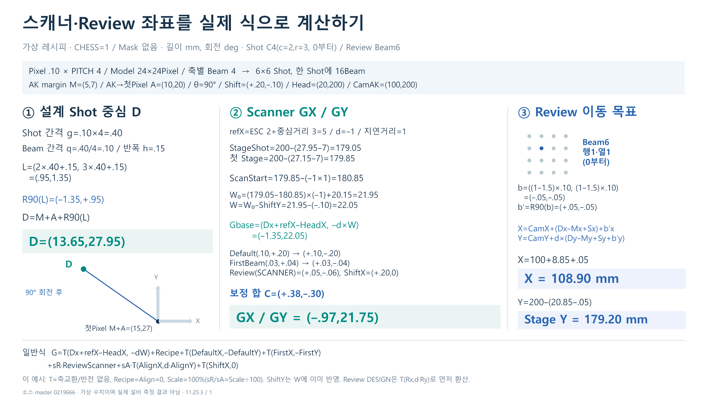
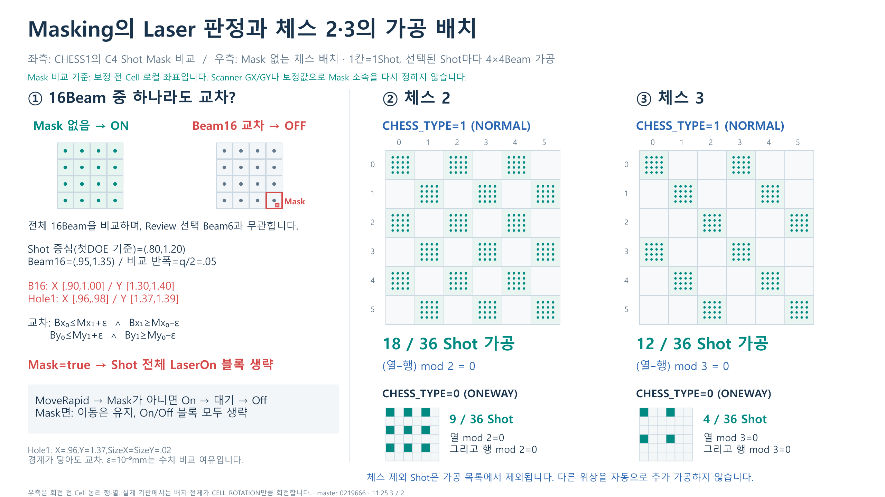

# A3 좌표 계산·Laser 판정·체스 2·3 · 11.25.3

[2페이지 PDF](A3_좌표계산_Laser판정_체스2_3_11.25.3.pdf)

A3Drilling/master `0219666f9053b907d96d7e0aa7d0c6c1be3a73d4`의 계산·판정 코드를 추적한 그림 자료입니다. 이전11.25.2의 개념 소개를 실제 식·가상 수치 예제로 보완했습니다. 원본 프로그램 버전은11.23.0이며 문서 버전과 구분합니다.

- 1쪽: Model24×24Pixel/PITCH4/Pixel.10mm/4×4Beam → 6×6Shot. C4(c2,r3)·Beam6, Cell90°의 설계/Scanner/Review 좌표를 각각 계산합니다. Scanner GX/GY=(−.97,21.75)mm, Review X/StageY=(108.90,179.20)mm입니다. CHESS1·Mask없음의 가상 입력이며 실기 측정값이 아닙니다.
- 2쪽: 보정 전 Cell 로컬에서 Beam 범위와 Hole 사각형을 비교합니다. Beam16 한 개만 교차해도 Shot 전체의 LaserOn/Off 블록이 생략됩니다. Mask 위치 이동은 남을 수 있습니다. 우측은 Mask없는 별도6×6Shot 체스 배치로 TYPE1은 체스2/3에서18/12개, TYPE0은9/4개를 선택합니다. 각 선택Shot의4×4Beam을 점으로 그렸습니다.

## 고정 소스 근거

- [Shot·Beam 격자/회전](https://github.com/kjuws10-rgb/A3Drilling/blob/0219666f9053b907d96d7e0aa7d0c6c1be3a73d4/Drilling.Common/Recipe/CCellPatternCalculator.cs#L177-L207)
- [Stage 시작과 Scanner 좌표 합산](https://github.com/kjuws10-rgb/A3Drilling/blob/0219666f9053b907d96d7e0aa7d0c6c1be3a73d4/Drilling.Common/Recipe/CShotCoordinatePlanBuilder.cs#L50-L159)
- [Head 기준/축 변환/보정](https://github.com/kjuws10-rgb/A3Drilling/blob/0219666f9053b907d96d7e0aa7d0c6c1be3a73d4/Drilling.Common/Recipe/CShotCoordinatePlanBuilder.cs#L376-L507)
- [저장된 Review Offset 좌표공간 변환](https://github.com/kjuws10-rgb/A3Drilling/blob/0219666f9053b907d96d7e0aa7d0c6c1be3a73d4/Drilling.Common/Recipe/CShotCoordinatePlanBuilder.cs#L1232-L1290)
- [Review Beam 위치와 Camera/Stage 목표](https://github.com/kjuws10-rgb/A3Drilling/blob/0219666f9053b907d96d7e0aa7d0c6c1be3a73d4/Drilling.Common/Review/CReviewManager.cs#L958-L1021)
- [Masking·체스 판정](https://github.com/kjuws10-rgb/A3Drilling/blob/0219666f9053b907d96d7e0aa7d0c6c1be3a73d4/Drilling.Common/Recipe/CShotCoordinatePlanBuilder.cs#L876-L948)
- [Beam/Hole 사각 교차와 경계 포함](https://github.com/kjuws10-rgb/A3Drilling/blob/0219666f9053b907d96d7e0aa7d0c6c1be3a73d4/Drilling.Common/Recipe/CShotCoordinatePlanBuilder.cs#L1077-L1099)
- [실가공 스크립트의 MoveRapid·LaserOn/Off 분기](https://github.com/kjuws10-rgb/A3Drilling/blob/0219666f9053b907d96d7e0aa7d0c6c1be3a73d4/Drilling.File/Script/CAutomation1ScriptFile.cs#L534-L555)

PDF는 같은 네이티브 도식 원본의 고해상도 그림을 담은 열람본입니다. 편집 가능한 프레젠테이션은 대화에서 제공합니다. 원본 코드·Recipe 파일·운영 데이터는 수정하거나 복제하지 않았으며 설비·AeroScript·벤더 DLL은 실행하지 않았습니다.
