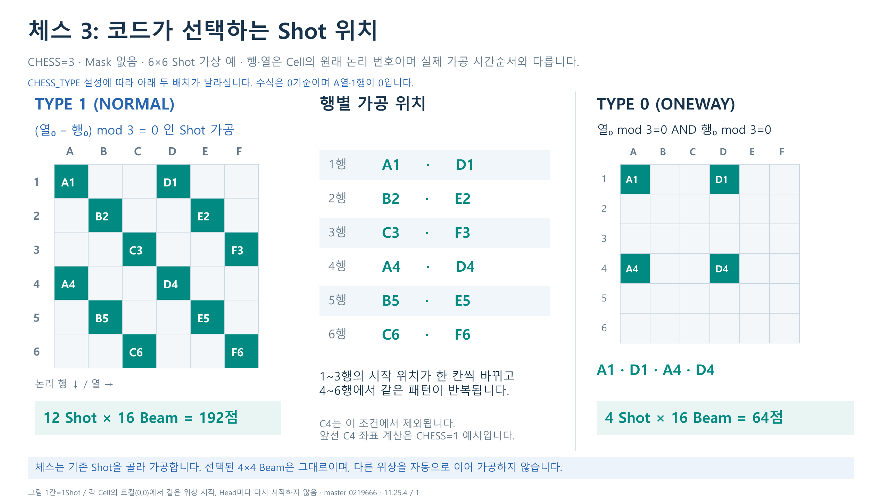
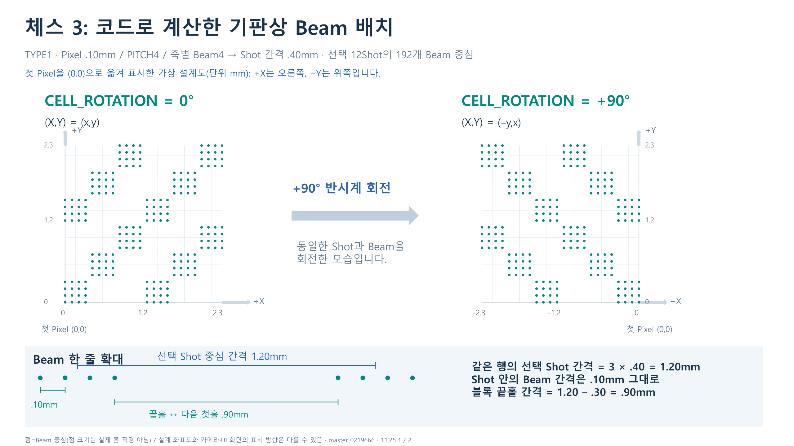

# A3 체스 3 Git 코드 재확인·기판 배치 · 11.25.4

[2페이지 PDF](A3_체스3_Git재확인_가공배치_11.25.4.pdf)

원본 A3Drilling/master는 `0219666f9053b907d96d7e0aa7d0c6c1be3a73d4`로 동일합니다. Git 원문 판정 함수를 독립 순수 C# 검산 콘솔에 발췌해72개 좌표를 비교했고 모두 일치했습니다. 설비 프로그램/벤더/AeroScript를 실행한 결과가 아닙니다.

## 현재 코드의 체스 3

- `CHESS_TYPE=1`: `(열0−행0) mod3=0`. 6×6Shot에서 A1/D1→B2/E2→C3/F3→A4/D4→B5/E5→C6/F6의12Shot입니다. 각Shot이4×4Beam인 예제에서192개 Beam 중심을 가공합니다.
- `CHESS_TYPE=0`: 열0와행0가각각3의배수. A1/D1/A4/D4의4Shot·64개Beam입니다.
- 행·열은0기준 Cell 로컬 위치입니다. Head가 바뀌어도 같은 Cell의 위상을 다시 시작하지 않고, Cell 회전/Head명령축 변환/보정으로 선택 소속을 바꾸지 않습니다. 다른 phase를 자동으로 순차 가공하는 기능이 아닙니다.

기존11.25.3의 논리 격자는 위 조건과 일치했습니다. 이번 자료는 논리 행렬(행이 아래로 증가)과 기판 설계좌표(+Y가 위)의 방향을 분리하고0°/+90°에서 실제 계산한 Beam 중심을 각각 그렸습니다. 카메라 화면이나 스캐너 native축의 표시방향과 같은 것으로 단정하지 않습니다.

가상 Pixel=.10mm/PITCH4/축별Beam4 예제: Shot 간격.40mm, 같은 논리행의 선택Shot 중심 간격1.20mm, Shot 안의 Beam 간격.10mm, 블록 끝홀↔다음 첫홀 간격.90mm입니다. 점 크기는 실제 홀 직경을 의미하지 않습니다. Recipe 기반 AUTO/Manual MOF 경로를 설명하며, 별도 수동 H-Line/V-Line/Grid 도형 스캔에는 이 규칙을 임의로 적용하지 않습니다.

## 고정 소스 근거

- [실제 Chess 판정](https://github.com/kjuws10-rgb/A3Drilling/blob/0219666f9053b907d96d7e0aa7d0c6c1be3a73d4/Drilling.Common/Recipe/CShotCoordinatePlanBuilder.cs#L940-L949)
- [양수 나머지 계산](https://github.com/kjuws10-rgb/A3Drilling/blob/0219666f9053b907d96d7e0aa7d0c6c1be3a73d4/Drilling.Common/Recipe/CShotCoordinatePlanBuilder.cs#L1035-L1038)
- [Shot/Beam 격자·Cell 회전](https://github.com/kjuws10-rgb/A3Drilling/blob/0219666f9053b907d96d7e0aa7d0c6c1be3a73d4/Drilling.Common/Recipe/CCellPatternCalculator.cs#L177-L207)
- [Recipe UI의1기준 행열 변환](https://github.com/kjuws10-rgb/A3Drilling/blob/0219666f9053b907d96d7e0aa7d0c6c1be3a73d4/Drilling.UI/Menu/Menus/CMenuRecipe.cs#L3761-L3771)
- [논리 맵의 행열 기반 그리기](https://github.com/kjuws10-rgb/A3Drilling/blob/0219666f9053b907d96d7e0aa7d0c6c1be3a73d4/Drilling.UI/Menu/Menus/CCoordinateShotMapPreviewDrawing.cs#L52-L56)
- [Station 가공 목록 필터](https://github.com/kjuws10-rgb/A3Drilling/blob/0219666f9053b907d96d7e0aa7d0c6c1be3a73d4/Drilling.Common/Station/CStationProcess.cs#L1608-L1613)
- [A1 Script 가공 목록 필터](https://github.com/kjuws10-rgb/A3Drilling/blob/0219666f9053b907d96d7e0aa7d0c6c1be3a73d4/Drilling.File/Script/CAutomation1ScriptFile.cs#L51-L77)
- [Review 소비자의 제외 처리](https://github.com/kjuws10-rgb/A3Drilling/blob/0219666f9053b907d96d7e0aa7d0c6c1be3a73d4/Drilling.Common/Review/CReviewManager.cs#L501-L570)

모든 수치는 가상 입력의 코드/수학 검산이며 실기 측정값이 아닙니다. PDF는 같은 네이티브 도식을 고해상도 그림으로 담은 열람본이고 편집 원본은 대화에 제공합니다. 원본 코드·고객 운영값·개인지식 작업실은 게시하거나 수정하지 않았습니다.
