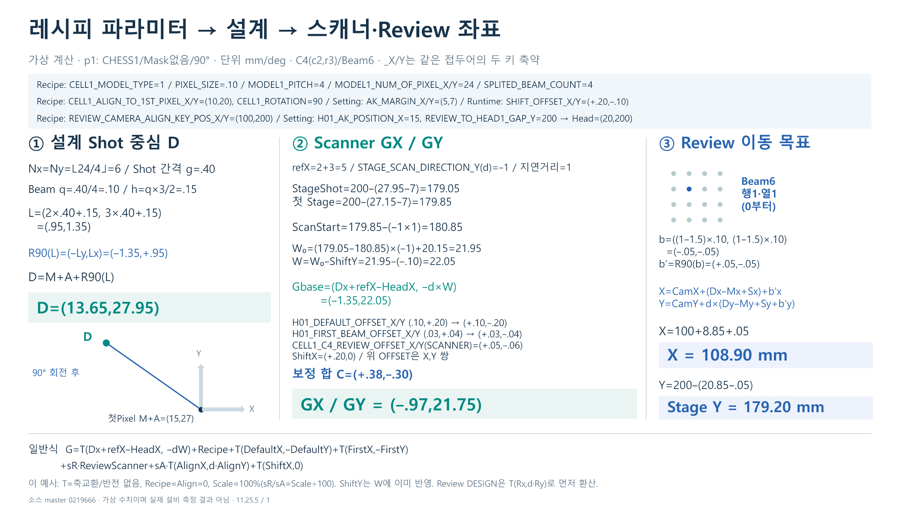
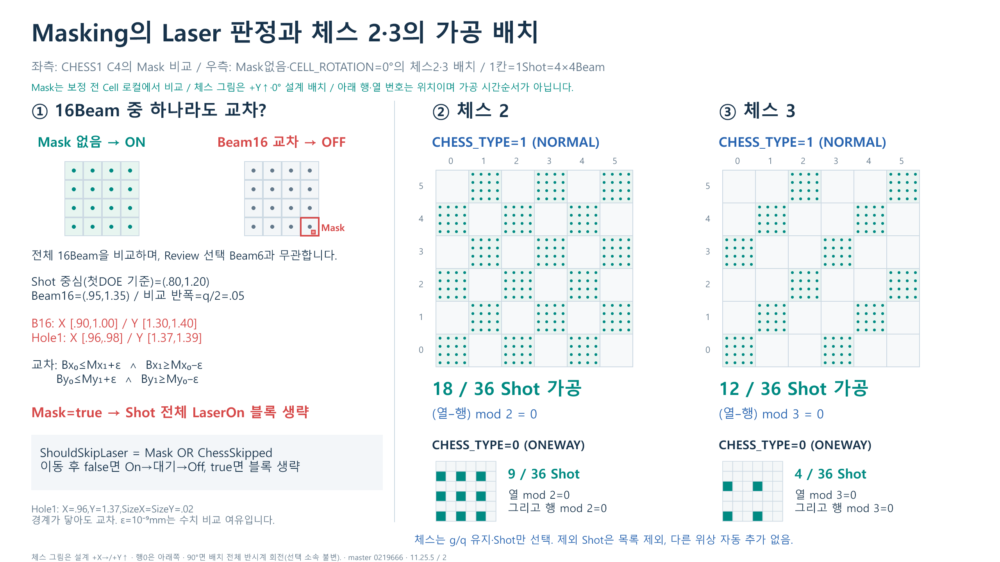

# A3 전체 범위 통합2페이지 · 11.25.5

[전체 내용이 담긴 2페이지 PDF](A3_통합_레시피_좌표_Masking_체스2_3_11.25.5.pdf)

이번 버전은 레시피부터 설계좌표·스캐너·Review 계산, Masking의 LaserOn/Off 판정과 체스2/3 가공배치를 **한 파일의 총2페이지**로 통합한 최종본입니다. 이전11.25.4는체스3만별도작성하여원요청전체범위를충족하지못한전달이었으므로이번통합본으로대체합니다. 원본코드변경이아닌문서범위수정입니다.

## 페이지 구성

1. 실제주요Recipe키·Setting·Runtime값을명시하고 Shot/Beam격자→설계D→ScannerGX/GY→ReviewX/StageY를수식과가상숫자로계산합니다. Pixel.10/PITCH4/Model24×24/4×4Beam,Cell90°/C4/Beam6 예에서 D=(13.65,27.95),GX/GY=(−.97,21.75),ReviewX/StageY=(108.90,179.20)mm입니다. HeadX20은AKmargin5+H01AK15,HeadY200은REVIEW_TO_HEAD1_GAP_Y200입니다. ShiftY는W에한번반영합니다.
2. Cell의보정전local에서Beam범위와Mask사각형의교차를비교합니다. ShouldSkipLaser=Mask OR ChessSkipped이며false일때On→대기→Off블록을생성합니다. Beam16한개가교차해도Shot전체블록을생략합니다. 체스2·3은TYPE1메인과TYPE0축약그림을모두포함합니다. 6×6Shot예에서TYPE1은18/12개,TYPE0은9/4개입니다. 체스는기본Shot/Beam간격을바꾸지않고Shot을선택하며다른위상자동추가가공은없습니다.

1쪽계산예시는CHESS1/Mask없음/Cell90°입니다. 2쪽체스배치는별도설명조건인Mask없음/Cell0°의+X오른쪽/+Y위설계도이며0행이아래입니다. Shot42px/Beam10.5px로.40mm/.10mm간격비율을맞췄습니다. 실제기판에90°를주면전체배치가반시계회전합니다. 점크기는실제홀직경이아닙니다. 핵심파라미터와계산흐름요약이며모든보조Setting키전수목록은아닙니다.

## 코드 근거

원본 A3Drilling/master `0219666f9053b907d96d7e0aa7d0c6c1be3a73d4`,프로그램11.23.0을기준으로합니다. 모든입력은가상예이며장비실측이나실기합격결과가아닙니다. PDF는같은네이티브도식의고해상도그림열람본이고편집원본은대화에제공합니다.

- [Shot·Beam 격자/회전](https://github.com/kjuws10-rgb/A3Drilling/blob/0219666f9053b907d96d7e0aa7d0c6c1be3a73d4/Drilling.Common/Recipe/CCellPatternCalculator.cs#L177-L207)
- [Stage 시작과 Scanner 합산](https://github.com/kjuws10-rgb/A3Drilling/blob/0219666f9053b907d96d7e0aa7d0c6c1be3a73d4/Drilling.Common/Recipe/CShotCoordinatePlanBuilder.cs#L50-L159)
- [Head와 보정축 변환](https://github.com/kjuws10-rgb/A3Drilling/blob/0219666f9053b907d96d7e0aa7d0c6c1be3a73d4/Drilling.Common/Recipe/CShotCoordinatePlanBuilder.cs#L376-L507)
- [저장 Review Offset 좌표공간](https://github.com/kjuws10-rgb/A3Drilling/blob/0219666f9053b907d96d7e0aa7d0c6c1be3a73d4/Drilling.Common/Recipe/CShotCoordinatePlanBuilder.cs#L1232-L1290)
- [Review Beam·카메라·Stage 목표](https://github.com/kjuws10-rgb/A3Drilling/blob/0219666f9053b907d96d7e0aa7d0c6c1be3a73d4/Drilling.Common/Review/CReviewManager.cs#L958-L1021)
- [Masking·Chess 선택](https://github.com/kjuws10-rgb/A3Drilling/blob/0219666f9053b907d96d7e0aa7d0c6c1be3a73d4/Drilling.Common/Recipe/CShotCoordinatePlanBuilder.cs#L876-L948)
- [사각 교차와 경계 포함](https://github.com/kjuws10-rgb/A3Drilling/blob/0219666f9053b907d96d7e0aa7d0c6c1be3a73d4/Drilling.Common/Recipe/CShotCoordinatePlanBuilder.cs#L1077-L1099)
- [실가공 Script Laser 분기](https://github.com/kjuws10-rgb/A3Drilling/blob/0219666f9053b907d96d7e0aa7d0c6c1be3a73d4/Drilling.File/Script/CAutomation1ScriptFile.cs#L534-L555)
