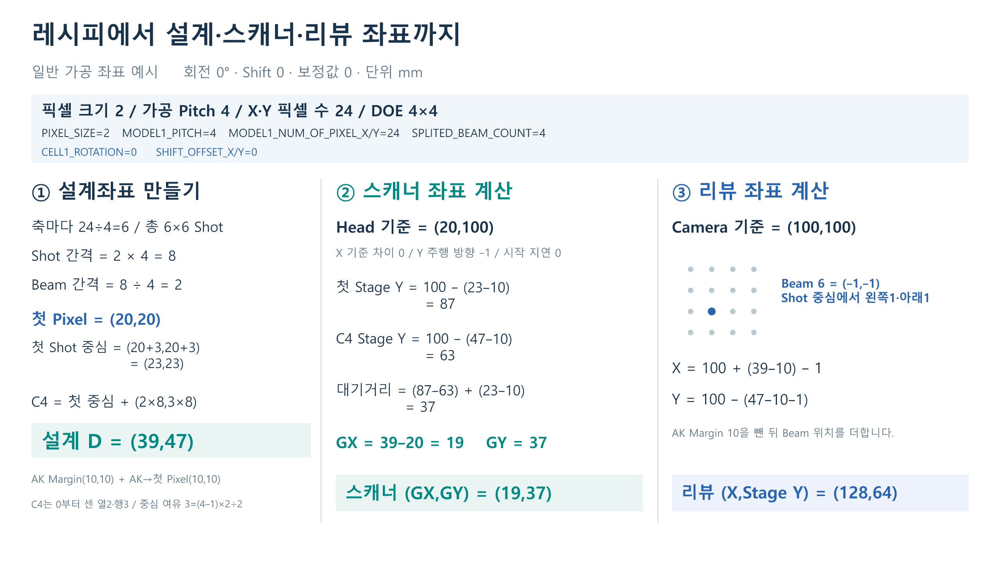
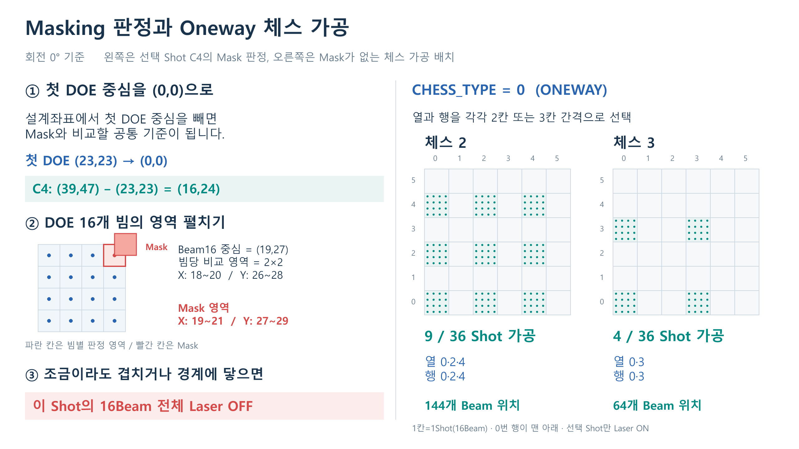

# A3 레시피 좌표와 Masking Oneway 체스 2페이지 11.25.6

[2페이지 PDF](A3_레시피_좌표_Masking_Oneway_2페이지_11.25.6.pdf)

발표자가 숫자를 그대로 따라 설명할 수 있도록 회전·Shift·보정값을0으로 맞추고 정수 예시로 단순화했습니다. 문서 하단의 일반 변환식·Scale·Commit·가상값 주석은 삭제했습니다. 기존 편집 원본을 같은 Page에서 수정했으며 이전11.25.5 PDF/게시 이력은 보존했습니다.

## 1쪽 레시피에서 두 좌표까지

픽셀크기2mm,Pitch4,픽셀수24×24,DOE4×4로 Shot간격8mm/Beam간격2mm/6×6Shot을 만듭니다. 첫Pixel(20,20)에서 첫DOE중심은(23,23),C4(열2/행3)의 설계좌표는(39,47)입니다. Head(20,100),카메라(100,100),Y주행-1/지연0/보정0 조건에서 Scanner=(19,37),Beam6의 Review=(128,64)mm가 됩니다. 정확한 설정키와 생략 조건은 편집 원본의 발표자 노트에 보존했습니다.

## 2쪽 Masking과 Oneway만

회전0 조건에서 첫DOE중심(23,23)을 원점(0,0)으로 잡으면 C4는(16,24)가 됩니다. 실제 코드는 이와 같은 보정 전 Cell-local 좌표를 열×ShotPitch/행×ShotPitch로 직접 계산합니다. 첫Pixel을 원점으로 바꾸는 것과 혼동하지 않아야 합니다.

선택C4의16개분기빔 각각에 대해 2×2mm 판정영역을 펼칩니다. Beam16영역X18~20/Y26~28과 Mask X19~21/Y27~29가 부분 교차하므로 해당Shot전체 Laser 블록을 생략합니다. 경계가 닿아도 제외합니다. 이 판정영역은 실제 광학 Spot직경이 아닙니다. 같은Mask가 인접Shot에도 영향을 줄 수 있으며 그림은 선택C4확대입니다.

체스는 CHESS_TYPE=0 ONEWAY만 표시합니다. 열·행이 각각2배수이면9/36Shot·144Beam,각각3배수이면4/36Shot·64Beam입니다. 행0은 아래이며 기본Shot/Beam간격은 유지합니다. 체스그림은Mask없는조건,좌측Mask설명은체스없는일반가공조건입니다.

## 코드 근거

원본 A3Drilling/master `0219666f9053b907d96d7e0aa7d0c6c1be3a73d4` 기준입니다. 이번 숫자는 설명용이며 현장 측정·설비 정밀도 평가 결과가 아닙니다. 원본 코드와 장비 프로그램은 변경/실행하지 않았습니다. PDF는 검토한 native그림의 고해상도 열람본입니다.

- [Shot·Beam 격자/회전](https://github.com/kjuws10-rgb/A3Drilling/blob/0219666f9053b907d96d7e0aa7d0c6c1be3a73d4/Drilling.Common/Recipe/CCellPatternCalculator.cs#L177-L207)
- [Stage 시작과 Scanner 합산](https://github.com/kjuws10-rgb/A3Drilling/blob/0219666f9053b907d96d7e0aa7d0c6c1be3a73d4/Drilling.Common/Recipe/CShotCoordinatePlanBuilder.cs#L50-L159)
- [Head와 보정축 변환](https://github.com/kjuws10-rgb/A3Drilling/blob/0219666f9053b907d96d7e0aa7d0c6c1be3a73d4/Drilling.Common/Recipe/CShotCoordinatePlanBuilder.cs#L376-L507)
- [저장 Review Offset 좌표공간](https://github.com/kjuws10-rgb/A3Drilling/blob/0219666f9053b907d96d7e0aa7d0c6c1be3a73d4/Drilling.Common/Recipe/CShotCoordinatePlanBuilder.cs#L1232-L1290)
- [Review Beam·카메라·Stage 목표](https://github.com/kjuws10-rgb/A3Drilling/blob/0219666f9053b907d96d7e0aa7d0c6c1be3a73d4/Drilling.Common/Review/CReviewManager.cs#L958-L1021)
- [Masking·Chess 선택](https://github.com/kjuws10-rgb/A3Drilling/blob/0219666f9053b907d96d7e0aa7d0c6c1be3a73d4/Drilling.Common/Recipe/CShotCoordinatePlanBuilder.cs#L876-L948)
- [사각 교차와 경계 포함](https://github.com/kjuws10-rgb/A3Drilling/blob/0219666f9053b907d96d7e0aa7d0c6c1be3a73d4/Drilling.Common/Recipe/CShotCoordinatePlanBuilder.cs#L1077-L1099)
- [실가공 Script Laser 분기](https://github.com/kjuws10-rgb/A3Drilling/blob/0219666f9053b907d96d7e0aa7d0c6c1be3a73d4/Drilling.File/Script/CAutomation1ScriptFile.cs#L534-L555)
