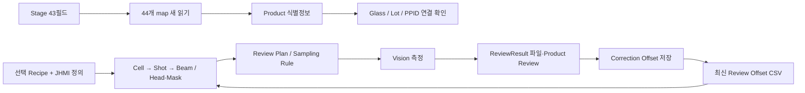

# 02 · 데이터 구조와 흐름

- 원본 저장소: https://github.com/kjuws10-rgb/A3Drilling.git
- 분석 브랜치: master
- 원본 최신 Commit: 0219666f9053b907d96d7e0aa7d0c6c1be3a73d4
- 비교 기준 Commit: 334b3599651b2e8e0181fd4459bafaf3cddafff3

## 1. Stage 입력: PLC WORD에서 기판 필드로

새 공통 정의는 **WF600~WF767, 360 WORD**입니다. 문자열 필드 40개와 WORD 성격 필드 3개로 총 43개 Product 필드를 만들며, GLASS_SIZE의 2WORD만 둘로 나누어 읽으므로 map ID는 44개입니다. 실제 저장된 기본 map도 44개이며 Device 0·IN·R·1000ms입니다. 이는 배포본 정의 확인이며 설치 현장 map이 동일하다는 뜻은 아닙니다. [필드 정의](https://github.com/kjuws10-rgb/A3Drilling/blob/0219666f9053b907d96d7e0aa7d0c6c1be3a73d4/Drilling.Common/Interface/Melsec/CStageGlassDataMap.cs#L25-L83), [기본 map 생성](https://github.com/kjuws10-rgb/A3Drilling/blob/0219666f9053b907d96d7e0aa7d0c6c1be3a73d4/Drilling.File/JHMI/CMelsecMapFile.cs#L322-L341)

| 데이터 | 코드가 다루는 형식 | 해석 시 주의 |
|---|---|---|
| H_GLASSID / LOTID | 각각 STRING 8WORD, ASCII 최대 16자 | H_GLASSID만 비어 있으면 읽기를 거절 |
| PPID / PAIR_PPID | 각각 STRING 10WORD, ASCII 최대 20자 | Recipe 존재·버전·선택 상태를 확인하는 값은 아님 |
| GLASS_SIZE | WORD 2개 → 순서대로 쉼표 연결 문자열 | mm 등 물리 단위로 자동 환산하지 않음 |
| GLASS_THICKNESS / GLASS_STATE | 각각 WORD 1개 → 정수 문자열 | 배율/열거값 의미는 고객 사양 확인 필요 |
| OPTIONNAME/VALUE 1~5, ETC | 정해진 WORD 길이의 문자열 | 데이터 보관이며 공정 파라미터 자동 적용 아님 |

`ReadAsync`는 첫 ID를 새로 읽게 요청한 뒤 전체 ID의 캐시를 복사합니다. 모든 값의 존재·Valid 상태를 확인하고, H_GLASSID가 비면 실패합니다. 기본 map에서는 연속 WORD와 같은 주기가 하나의 poll block으로 묶이고, 한 block 결과는 같은 lock 안에서 캐시에 기록됩니다. 다만 ReadAsync가 각 필드의 동일 ReadCycleNo까지 비교하지는 않습니다. map이 현장에서 분리되거나 PLC가 쓰는 도중의 스냅샷 의미는 별도 확인 대상입니다. [새 읽기와 값 검사](https://github.com/kjuws10-rgb/A3Drilling/blob/0219666f9053b907d96d7e0aa7d0c6c1be3a73d4/Drilling.Common/Interface/Melsec/CStageGlassDataMap.cs#L87-L122), [block 묶기](https://github.com/kjuws10-rgb/A3Drilling/blob/0219666f9053b907d96d7e0aa7d0c6c1be3a73d4/Drilling.Common/Interface/Melsec/CMelsec.cs#L2693-L2717), [캐시 게시](https://github.com/kjuws10-rgb/A3Drilling/blob/0219666f9053b907d96d7e0aa7d0c6c1be3a73d4/Drilling.Common/Interface/Melsec/CMelsec.cs#L2927-L2947)

## 2. Product: 식별정보와 Recipe 계산 입력을 분리

Monitor에서 Stage를 선택하면 다음을 별개 인수로 넘깁니다.

- 식별정보: Glass ID, Lot ID, 수신 PPID와 43개 Stage 값
- Recipe Parameters: 이 수동 생성 시점에는 빈 사본
- Head별 가공 수: 이 수동 생성 시점에는 빈 목록

`CreateProduct(..., productFields: ...)`는 새 인수가 없으면 기존 parameters를 사용하는 호환 API입니다. 제공된 productFields는 허용된 Stage 필드만 복사하고, 공정 상태·결과·시각은 장비 프로그램이 별도로 관리합니다. [Monitor 생산자](https://github.com/kjuws10-rgb/A3Drilling/blob/0219666f9053b907d96d7e0aa7d0c6c1be3a73d4/Drilling.UI/Menu/Menus/CMenuMonitor.cs#L4454-L4488), [Product 생성](https://github.com/kjuws10-rgb/A3Drilling/blob/0219666f9053b907d96d7e0aa7d0c6c1be3a73d4/Drilling.Common/Product/CProductManager.cs#L129-L195), [제품 필드·상태 분리](https://github.com/kjuws10-rgb/A3Drilling/blob/0219666f9053b907d96d7e0aa7d0c6c1be3a73d4/Drilling.Common/Product/CProductManager.cs#L823-L874)

`H_GLASSID → Product.GlassId`, `LOTID → LotId`, `PPID → RecipeId`로 연결됩니다. 수신 PPID가 공정 모델의 Recipe와 같다는 확인을 여기서 자동 수행하지는 않습니다.

## 3. JUDGEMENT와 PRODUCT_RESULT

| 필드 | 새 의미 | 생산자 |
|---|---|---|
| JUDGEMENT | Stage가 보낸 원래 기판 판정 문자열 | Stage map 또는 허용된 Product 정보 API |
| PRODUCT_RESULT | 이 프로그램의 PENDING/OK/NG/Skipped 등 공정 판정 | Product 상태 전환 |
| PRODUCT_STATE | 생성/진행/완료/정지 등 프로그램 상태 | Product 상태 전환 |

새 상태 전환은 JUDGEMENT를 덮어쓰지 않고 PRODUCT_RESULT를 갱신합니다. 이전 파일에 PRODUCT_RESULT가 없으면 Result 접근자가 JUDGEMENT로 fallback합니다. 이는 새 프로그램이 옛 파일을 읽는 호환이며, 옛 프로그램이 새 파일을 올바르게 읽는 역방향 호환을 보장하지 않습니다. [결과 필드 쓰기](https://github.com/kjuws10-rgb/A3Drilling/blob/0219666f9053b907d96d7e0aa7d0c6c1be3a73d4/Drilling.Common/Product/CProductManager.cs#L844-L874), [옛 파일 읽기](https://github.com/kjuws10-rgb/A3Drilling/blob/0219666f9053b907d96d7e0aa7d0c6c1be3a73d4/Drilling.Common/Product/CProductManager.cs#L1050-L1057)

Product CSV의 바깥 열은 계속 `TYPE,NAME,VALUE`입니다. 바뀐 것은 PRODUCT 구역의 이름 목록입니다. 필드 전체를 예약 목록으로 사용해 Stage 식별값이 Recipe Parameters에 섞여 들어가는 일을 줄입니다. [Load 구역 분류](https://github.com/kjuws10-rgb/A3Drilling/blob/0219666f9053b907d96d7e0aa7d0c6c1be3a73d4/Drilling.File/Product/CProductFile.cs#L50-L84), [Save 구역 분류](https://github.com/kjuws10-rgb/A3Drilling/blob/0219666f9053b907d96d7e0aa7d0c6c1be3a73d4/Drilling.File/Product/CProductFile.cs#L98-L120)

## 4. 가공·Review 데이터는 기존 통로

Recipe CSV는 공정 입력이고, ReviewResult는 측정 기록이며, Review Offset은 이후 좌표에 적용할 보정값입니다. 셋의 값·단위·역할은 같지 않습니다. 이번 diff는 이 계산/저장 소스의 새 알고리즘을 추가하지 않았지만 기존 입력·결과 자료를 대량 갱신합니다. [Review 좌표·Head·Mask 연결](https://github.com/kjuws10-rgb/A3Drilling/blob/0219666f9053b907d96d7e0aa7d0c6c1be3a73d4/Drilling.Common/Review/CReviewManager.cs#L509-L575), [최신 Offset 병합](https://github.com/kjuws10-rgb/A3Drilling/blob/0219666f9053b907d96d7e0aa7d0c6c1be3a73d4/Drilling.Common/Station/CStationProcess.cs#L1545-L1564)
