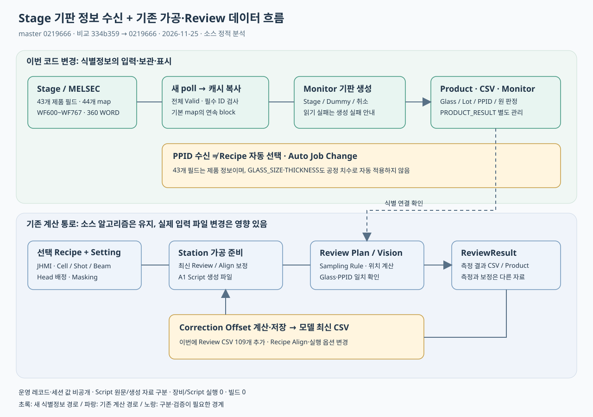
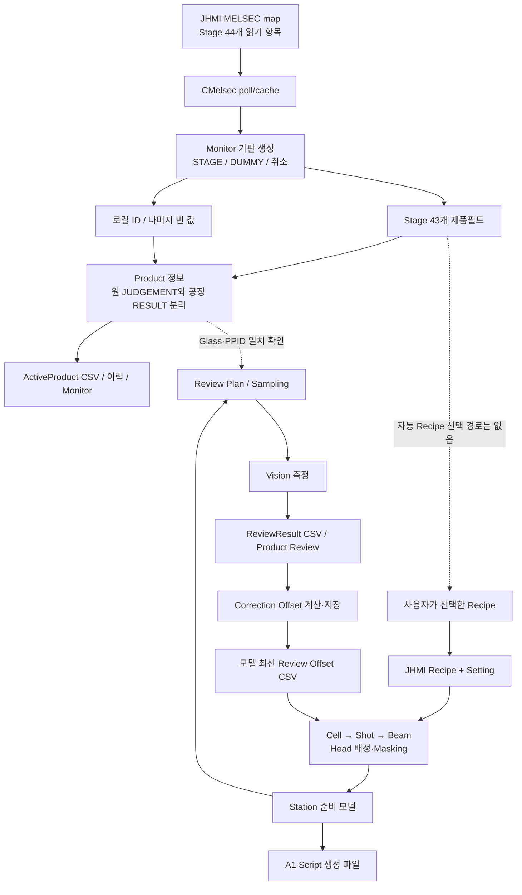

# 04 · 갱신된 통합 흐름도

- 원본 저장소: https://github.com/kjuws10-rgb/A3Drilling.git
- 분석 브랜치: master
- 원본 최신 Commit: 0219666f9053b907d96d7e0aa7d0c6c1be3a73d4
- 비교 기준 Commit: 334b3599651b2e8e0181fd4459bafaf3cddafff3

## 프로그램 시작부터 정보·가공·측정까지

점선은 일반적인 자동 실행을 뜻하지 않습니다. Product와 Review의 식별 연결 확인, 그리고 구현되지 않은 자동 전환 경계를 표시합니다. Stage PPID를 읽었다고 곧바로 Recipe 변경·DoReady·장비 구동을 수행하지 않습니다.

## 단계별 보존 대상

| 단계 | 보존해야 할 기준 | 이번 변경의 의미 |
|---|---|---|
| Stage 읽기 | 필드 ID·주소·길이·문자 인코딩·동일 시점 | 새 정의와 SIM 입력 제공 |
| Product 생성 | 기판 식별과 공정 상태의 분리 | PRODUCT_RESULT 신설 |
| 공정 준비 | 선택 Recipe·Setting·최신 Offset | 관련 알고리즘 그대로, 입력 파일 변화 |
| Review | Recipe/Glass, 측정/실패/재시도 상태 | Product PPID 연결 확인 중요 |
| 보정 저장 | Cell/Shot·좌표계·원측정과 보정 구분 | CSV 109개 추가, 최신 선택 달라짐 |
| 외부 공유 | 실제 측정·세션 값 제외, Script 자료 분류 | Script 원문·annotation 유지와 선택적 검색 입력 구분 |

## 주요 구현 근거

- [Stage 읽기](https://github.com/kjuws10-rgb/A3Drilling/blob/0219666f9053b907d96d7e0aa7d0c6c1be3a73d4/Drilling.Common/Interface/Melsec/CStageGlassDataMap.cs#L87-L122)
- [Product 필드와 공정 상태](https://github.com/kjuws10-rgb/A3Drilling/blob/0219666f9053b907d96d7e0aa7d0c6c1be3a73d4/Drilling.Common/Product/CProductManager.cs#L823-L874)
- [좌표·Head·Masking→Review 계획](https://github.com/kjuws10-rgb/A3Drilling/blob/0219666f9053b907d96d7e0aa7d0c6c1be3a73d4/Drilling.Common/Review/CReviewManager.cs#L509-L575)
- [Product 연결과 결과 저장](https://github.com/kjuws10-rgb/A3Drilling/blob/0219666f9053b907d96d7e0aa7d0c6c1be3a73d4/Drilling.Common/Review/CReviewManager.cs#L1593-L1626)
- [최신 Review 보정 소비](https://github.com/kjuws10-rgb/A3Drilling/blob/0219666f9053b907d96d7e0aa7d0c6c1be3a73d4/Drilling.Common/Station/CStationProcess.cs#L1545-L1564)
