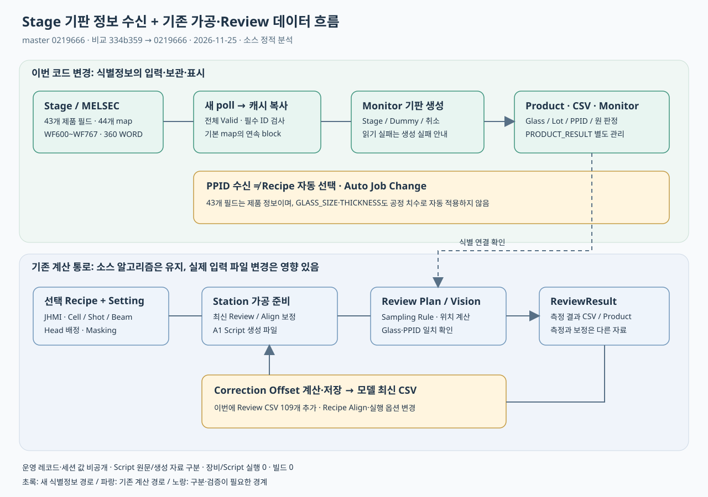

# A3Drilling 아키텍처 변경 분석 · 2026-11-25

실행 기준 시각: **2026-11-25 09:36:10 Asia/Seoul**

- 원본 저장소: https://github.com/kjuws10-rgb/A3Drilling.git
- 분석 브랜치: master
- 원본 최신 Commit: 0219666f9053b907d96d7e0aa7d0c6c1be3a73d4
- 비교 기준 Commit: 334b3599651b2e8e0181fd4459bafaf3cddafff3

## 핵심 결론

이번 범위는 **1 Commit, 1,603파일 변경**입니다. 중심 기능은 **MELSEC Stage의 기판 정보를 읽어 Product로 보관하고 Monitor에서 확인하는 경로**입니다. Stage에서 받은 PPID를 저장하지만 Recipe 자동 선택·Auto Job Change를 실행하는 기능은 아닙니다. [기판 생성 경로](https://github.com/kjuws10-rgb/A3Drilling/blob/0219666f9053b907d96d7e0aa7d0c6c1be3a73d4/Drilling.UI/Menu/Menus/CMenuMonitor.cs#L4429-L4496)

또한 새 Product의 ProcessId는 비어 있고 공정 준비는 별도 ID를 생성합니다. 두 ID를 연결하는 직접 호출이 확인되지 않아 **기판 생성 성공과 실제 공정 상태·결과 추적의 완성을 구분**해야 합니다. 자세한 근거와 미확인 범위는 [가공·Review 영향](03_가공Review영향.md)과 [ARC-09](05_위험도별발견사항.md)에 기록했습니다.

가공·Review 수식 소스는 바뀌지 않았어도 운영 결과는 달라질 수 있습니다. 함께 올라온 Recipe에서 **Align Offset 42,822축 항목**, Review 허용값·Process Count 항목이 달라졌고, 실행 옵션 7개가 변경됐으며 Review Offset CSV 109개가 추가됐습니다. 따라서 “좌표 계산 코드가 그대로이므로 같은 가공 결과”라고 판단하면 안 됩니다. 실제 값·측정 레코드는 이 문서에 복제하지 않았습니다.

| 구분 | 확인한 변경 |
|---|---|
| 프로그램·설정 정의 | 13파일: 코드/XAML/프로젝트 11 + MELSEC map·Setting 2 |
| Recipe·Review Offset | 110파일: Recipe 1 수정 + Offset CSV 109 추가 |
| Data | 1,480파일: Align/Review/생성 Script/Product/세션 자료 |
| 전체 Git 통계 | 추가 1,589 / 수정 14 / 삭제 0, +24,579,869 / −42,972행 |

## 읽는 순서

1. [Commit 변경 요약](01_Commit변경요약.md)
2. [변경된 데이터 구조와 흐름](02_데이터구조와흐름.md)
3. [가공·Review 영향](03_가공Review영향.md)
4. [갱신된 통합 흐름도](04_통합흐름도.md)
5. [위험도별 발견사항](05_위험도별발견사항.md)
6. [분석 근거와 검증 기록](06_근거와검증.md)

[직전 유효 A3Drilling 보고서](../20261121_085657_SW아키텍쳐분석/README.md) · [전체 코드 레퍼런스](../A3%20LD%20Code%20Ref/README.md)

## 범위와 한계

원본 master 두 Commit의 Git diff, 변경 소스, 관련 생산자·소비자를 읽었습니다. **장비 실행·벤더 DLL 로드·역컴파일·AeroScript 실행·빌드는 수행하지 않았습니다.** 정적 분석과 CSV 구조/개수 확인을 정식 장비 검증으로 해석하면 안 됩니다. 별도 Manual Inspection 개발 브랜치의 기능·시험 결과는 이 master 분석에 포함하지 않았습니다.

Stage 정보 읽기의 기본 map은 일관된 연속 block이지만, 실제 PLC 메모리의 동시 갱신·고객사 단위·PPID 명명 규칙까지 검증한 것은 아닙니다. 외부 사양 원문은 이번 작업에 제공되지 않았으므로 코드 주석의 “Spec 0.13”을 독립 사양 검증 완료로 표현하지 않습니다.
