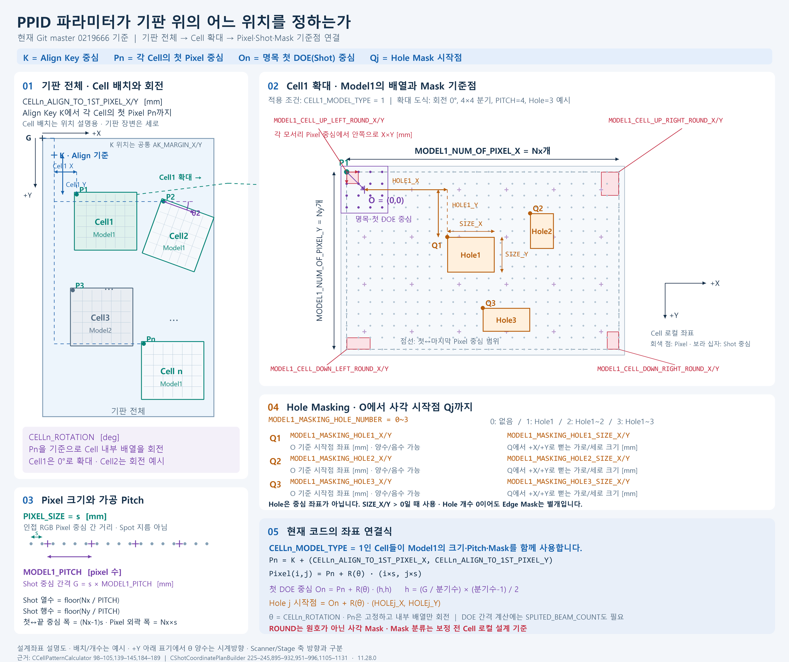

# PPID 파라미터 위치 설명도 · 11.28.0

기판 전체에서 Cell의 위치·회전을 보고, 한 Cell을 확대해 Pixel·Shot·Hole Mask·모서리 Mask의 기준점을 연결한 **그림 한 장**입니다. 현재 A3Drilling/master `0219666f9053b907d96d7e0aa7d0c6c1be3a73d4` 코드 기준입니다.

- [PNG 원본](A3_PPID_Parameter_Location_Map_11.28.0.png): 2800×2350, 바로 보기/다운로드.
- [SVG 벡터 원본](A3_PPID_Parameter_Location_Map_11.28.0.svg): 확대해도 글자·선이 유지됩니다. 한글 글꼴이 있는 브라우저에서 오프라인으로 열 수 있습니다.

## 읽는 기준

1. **K**: Align Key 중심. `CELLn_ALIGN_TO_1ST_PIXEL_X/Y`는 K에서 각 Cell의 **첫 Pixel 중심 Pn**까지의 거리(mm)입니다.
2. **Pn**: `CELLn_ROTATION`의 회전 기준점. 위치 변위 자체를 회전시키지 않고, Pn에 놓인 Cell 내부 배열을 회전합니다.
3. **On**: 명목 첫 DOE/Shot 중심. 첫 Pixel 중심과 다릅니다. `G=PIXEL_SIZE×MODEL1_PITCH`, `b=G/분기수`, `h=b×(분기수-1)/2`일 때 `On=Pn+R(θ)(h,h)`입니다.
4. **Qj**: Hole Mask의 시작 꼭짓점. `MODEL1_MASKING_HOLEj_X/Y`는 On 기준 좌표이며 사각형 중심이 아닙니다. SIZE_X/Y는 시작점에서 +X/+Y로 뻗는 가로·세로 크기입니다.
5. **모서리 Mask**: 첫/마지막 Pixel 중심을 기준으로 Cell 안쪽으로 만든 X×Y 사각형입니다. ROUND라는 이름이지만 원호가 아닙니다.

`MODEL1_*`는 `CELLn_MODEL_TYPE=1`인 Cell들에 공통 적용됩니다. `PIXEL_SIZE`는 인접 설계 RGB Pixel 중심 간 거리이고 `MODEL1_PITCH`는 Pixel 배수입니다. 설계 Pixel 수를 Pitch로 나눈 몫이 Shot 행/열 수입니다. 나머지 수만큼 별도 Shot을 추가하는 계산은 아닙니다.

요청한 28개 파라미터 항목을 모두 포함했습니다. 그림의 X/Y 묶음 표기는 실제 X 키와 Y 키를 각각 의미합니다. 첫~끝 Pixel 중심 폭 `(Nx-1)s`와 반 Pixel 여백을 포함한 표시 외곽 폭 `Nx×s`를 구분했습니다. Hole 개수 0은 Hole Mask만 비활성화하며 Edge Mask는 별도입니다.

그림은 설계 기준의 배치 설명도이며 실제 Recipe의 Cell 배치나 크기를 복제한 화면이 아닙니다. 확대 Cell은 회전0°/4×4분기/PITCH4/Hole3 예시입니다. 그림의 +Y를 아래로 표기했으므로 θ 양수는 화면 시계방향입니다. Scanner·Stage의 물리 축 방향과 구분합니다. 보정 전 Cell 로컬 설계에 따른 Mask 소속 판정과 이후 좌표 보정도 서로 구분합니다.

## 코드 근거

- [Pixel/Pitch/회전 계산](https://github.com/kjuws10-rgb/A3Drilling/blob/0219666f9053b907d96d7e0aa7d0c6c1be3a73d4/Drilling.Common/Recipe/CCellPatternCalculator.cs#L98-L189)
- [Cell별 Model 선택](https://github.com/kjuws10-rgb/A3Drilling/blob/0219666f9053b907d96d7e0aa7d0c6c1be3a73d4/Drilling.Common/Recipe/CCellPatternCalculator.cs#L433-L464)
- [Cell 설계좌표 생성](https://github.com/kjuws10-rgb/A3Drilling/blob/0219666f9053b907d96d7e0aa7d0c6c1be3a73d4/Drilling.Common/Recipe/CShotCoordinatePlanBuilder.cs#L225-L246)
- [Mask 접촉 판정](https://github.com/kjuws10-rgb/A3Drilling/blob/0219666f9053b907d96d7e0aa7d0c6c1be3a73d4/Drilling.Common/Recipe/CShotCoordinatePlanBuilder.cs#L895-L932)
- [Hole 파라미터 읽기](https://github.com/kjuws10-rgb/A3Drilling/blob/0219666f9053b907d96d7e0aa7d0c6c1be3a73d4/Drilling.Common/Recipe/CShotCoordinatePlanBuilder.cs#L951-L970)
- [네 모서리 사각형 생성](https://github.com/kjuws10-rgb/A3Drilling/blob/0219666f9053b907d96d7e0aa7d0c6c1be3a73d4/Drilling.Common/Recipe/CShotCoordinatePlanBuilder.cs#L1105-L1131)
- [Pixel 표시 외곽](https://github.com/kjuws10-rgb/A3Drilling/blob/0219666f9053b907d96d7e0aa7d0c6c1be3a73d4/Drilling.UI/Menu/Menus/CMenuRecipe.cs#L2559-L2578)
- [파라미터 정의](https://github.com/kjuws10-rgb/A3Drilling/blob/0219666f9053b907d96d7e0aa7d0c6c1be3a73d4/Config/JHMI_RCP.csv#L38-L90)

## 검증 범위

두 보조 담당이 좌표 생성과 마스킹을 독립 소스 추적하고 실제 PNG를 직접 검토했습니다. 28개 항목/단위/기준점과 회전·그룹 개수·Hole 1~3·네 모서리를 대조했습니다. 103개 텍스트의 페이지 넘침0, SVG XML 구문 정상, 브라우저에서 SVG의 글자/선/그림을 실제 렌더해 확인했습니다. 0°/90° 좌표 예제를 산술 검산했습니다. 이는 생산 C# 실행이나 설비 동작 시험 결과가 아닙니다.

원본 코드·설정·Recipe·장비를 수정하거나 실행하지 않았습니다. 이번 게시물은 설명용 PNG/SVG와 근거/manifest뿐입니다.
