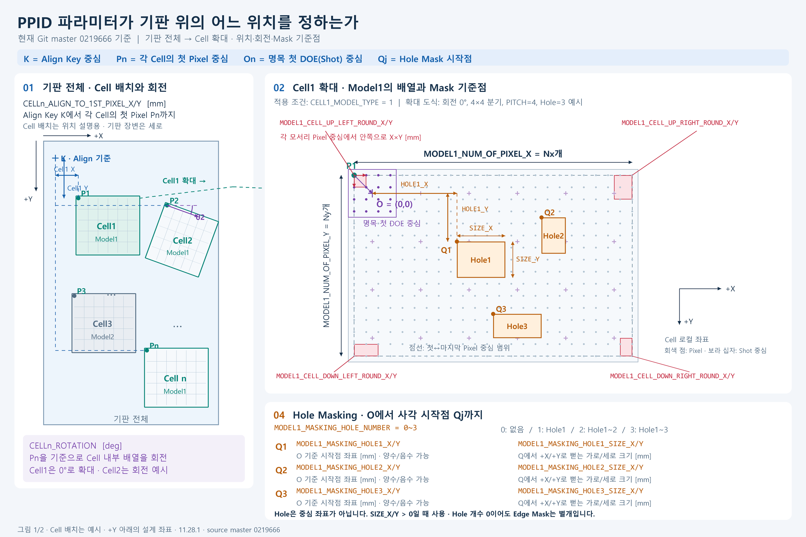
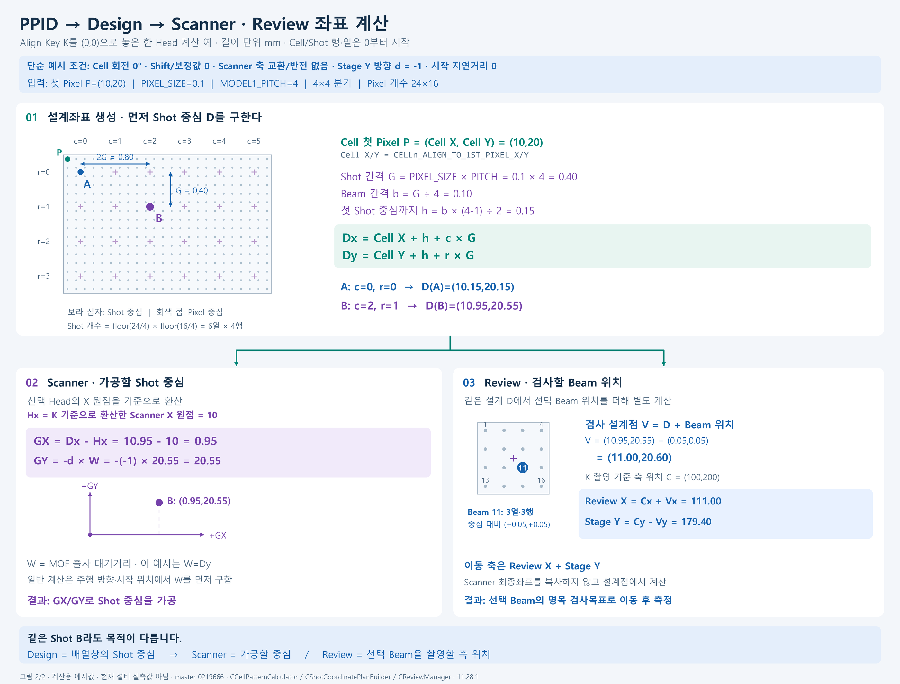

# PPID 위치 + Design·Scanner·Review 계산 · 11.28.1

현재 A3Drilling/master `0219666f9053b907d96d7e0aa7d0c6c1be3a73d4`를 대조한 그림 두 장입니다. 이전 위치 그림의 **3번·5번 영역을 삭제**하고, 별도 두 번째 그림에 좌표 계산을 추가했습니다.

## 1. 기판 전체와 Cell 파라미터 위치

[PNG](A3_PPID_Parameter_Location_Map_11.28.1.png) · [확대용 SVG](A3_PPID_Parameter_Location_Map_11.28.1.svg)

K는 Align Key 중심, Pn은 Cell의 첫 Pixel 중심입니다. `CELLn_ALIGN_TO_1ST_PIXEL_X/Y`는 K→Pn 거리이며, `CELLn_ROTATION`은 Pn을 고정한 내부 배열의 회전입니다. Model1의 크기·Pitch·Mask는 `CELLn_MODEL_TYPE=1`인 Cell들에 공통 적용됩니다.

Hole 위치 X/Y는 첫 DOE 중심 O에서 사각 시작점 Qj까지의 좌표이고, SIZE_X/Y는 Qj부터 +X/+Y로 뻗는 크기입니다. 네 모서리 ROUND_X/Y는 각 모서리 Pixel 중심에서 Cell 안쪽으로 만드는 사각형의 가로·세로입니다. Cell 배치는 설명용이며 실제 Recipe 배치가 아닙니다.

## 2. Design에서 Scanner·Review까지

[PNG](A3_Design_Scanner_Review_Calculation_11.28.1.png) · [확대용 SVG](A3_Design_Scanner_Review_Calculation_11.28.1.svg)

Align Key를 (0,0)으로 놓고, 회전0°·Shift/보정0·Scanner 축 교환/반전 없음·한 Head·Stage Y 방향 -1·시작 지연거리0·양수 설계Y를 사용한 계산 예입니다. 숫자는 설명용이며 현재 설비의 실측값이 아닙니다. 단위는 mm, Shot 열 c/행 r은 0부터 시작합니다.

| 단계 | 단순 계산 | 예시 결과 |
| --- | --- | --- |
| Shot 간격 | G = PIXEL_SIZE × PITCH | 0.1 × 4 = 0.40 |
| Beam 간격/반폭 | b = G/4, h = b×3/2 | b=0.10, h=0.15 |
| 설계 Shot B | D = (Cell X+h+cG, Cell Y+h+rG) | P=(10,20), c=2,r=1 → (10.95,20.55) |
| Scanner X | GX = Dx-Hx | 환산 X원점 Hx=10 → 0.95 |
| Scanner Y | GY = -d×W | 이 조건에서 W=Dy=20.55 → 20.55 |
| Beam 11 검사점 | V = D+(0.05,0.05) | (11.00,20.60) |
| Review 축 목표 | Review X=Cx+Vx, Stage Y=Cy-Vy | 촬영 기준 C=(100,200) → (111.00,179.40) |

Hx는 **K 기준으로 환산한 선택 Head의 Scanner X 원점**입니다. W는 MOF 출사 대기거리로, 일반적인 계산에서는 시작 위치와 주행 방향을 이용해 먼저 구합니다. 그림의 `W=Dy`는 위 예시 조건에 한정됩니다.

Review는 가공 계획의 Head 배정과 제외 Shot 정보를 공유하지만, 최종 Scanner GX/GY를 복사하지 않습니다. 설계 Shot 중심과 선택 Beam으로 **명목 검사목표**를 별도 계산하며, 실제 이동 축은 Review X와 Stage Y입니다.

## 코드 근거

- [Pixel/Pitch·Shot 개수·회전·중심 계산](https://github.com/kjuws10-rgb/A3Drilling/blob/0219666f9053b907d96d7e0aa7d0c6c1be3a73d4/Drilling.Common/Recipe/CCellPatternCalculator.cs#L98-L189)
- [Cell 설계 입력 구성](https://github.com/kjuws10-rgb/A3Drilling/blob/0219666f9053b907d96d7e0aa7d0c6c1be3a73d4/Drilling.Common/Recipe/CShotCoordinatePlanBuilder.cs#L225-L246)
- [Scanner의 Head 기준·주행 시작·대기거리·GX/GY](https://github.com/kjuws10-rgb/A3Drilling/blob/0219666f9053b907d96d7e0aa7d0c6c1be3a73d4/Drilling.Common/Recipe/CShotCoordinatePlanBuilder.cs#L53-L158)
- [Hole 위치·크기·활성 개수 읽기](https://github.com/kjuws10-rgb/A3Drilling/blob/0219666f9053b907d96d7e0aa7d0c6c1be3a73d4/Drilling.Common/Recipe/CShotCoordinatePlanBuilder.cs#L951-L970)
- [모서리 사각형 생성](https://github.com/kjuws10-rgb/A3Drilling/blob/0219666f9053b907d96d7e0aa7d0c6c1be3a73d4/Drilling.Common/Recipe/CShotCoordinatePlanBuilder.cs#L1105-L1131)
- [Review의 가공 계획 연결](https://github.com/kjuws10-rgb/A3Drilling/blob/0219666f9053b907d96d7e0aa7d0c6c1be3a73d4/Drilling.Common/Review/CReviewManager.cs#L501-L533)
- [Review 설계점·Beam에서 목표 생성](https://github.com/kjuws10-rgb/A3Drilling/blob/0219666f9053b907d96d7e0aa7d0c6c1be3a73d4/Drilling.Common/Review/CReviewManager.cs#L697-L742)
- [Beam 번호별 중심 대비 위치](https://github.com/kjuws10-rgb/A3Drilling/blob/0219666f9053b907d96d7e0aa7d0c6c1be3a73d4/Drilling.Common/Review/CReviewManager.cs#L958-L977)
- [Review X/Stage Y 목표식](https://github.com/kjuws10-rgb/A3Drilling/blob/0219666f9053b907d96d7e0aa7d0c6c1be3a73d4/Drilling.Common/Review/CReviewManager.cs#L1001-L1021)
- [목표 좌표를 실제 축 이동에 전달](https://github.com/kjuws10-rgb/A3Drilling/blob/0219666f9053b907d96d7e0aa7d0c6c1be3a73d4/Drilling.Common/Review/CReviewManager.cs#L1916-L1927)

두 담당의 독립 소스 추적·그림 검수와 수치 검산을 거쳤습니다. PNG/SVG 글자·도형·페이지 범위와 브라우저 SVG 렌더, 링크·해시를 확인했습니다. 설명자료 작성이며 생산 프로그램 빌드·장비 동작 시험은 수행하지 않았고, 원본 코드·설정은 변경하지 않았습니다.
