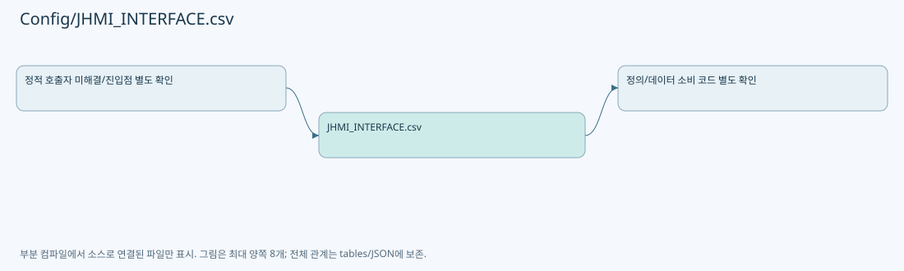

# Config/JHMI_INTERFACE.csv

| 항목 | 내용 |
| --- | --- |
| 원본 저장소 | https://github.com/kjuws10-rgb/A3Drilling.git |
| 원본 Commit | 5aee8e58439c9b455cae7c9593c9be986c3e682e |
| 원본 SHA256 | 53a04aee8ba5c06736addeaf2fac295d935fedf4689d25068b0357e4f4408931 |
| 파일 분류 | data_schema |
| 원본 크기/행 | 2,407 bytes / 31 physical lines |
| 인코딩 | utf-8-sig |
| 검토 범위 | 구문/부분 의미 분석에서 추출한 사실. 동작·물리 단위·실장비 합격을 보증하지 않습니다. |
| 원본 링크 | [고정 Commit 원본](https://github.com/kjuws10-rgb/A3Drilling/blob/5aee8e58439c9b455cae7c9593c9be986c3e682e/Config/JHMI_INTERFACE.csv) |

## 파일의 역할과 읽는 순서

화면/장비의 데이터 항목 정의입니다. 키·형식·표시와 실제 소비 코드의 연결을 확인합니다.

## 저장/설정 스키마 참고

실행 이력·측정 레코드는 문서에 전체 복제하지 않습니다. 행 수와 구조, 소비 코드 연결을 검토하기 위한 참고입니다. 첫 행이 실제 헤더인지는 해당 CSV 파서와 대조해야 합니다.

| 항목 | 값 |
| --- | --- |
| 레코드 수 | 31 |
| 첫 행 필드 개수 | 15 |
| 첫 행 컬럼 후보 | TYPE / DEVICE / NUMBER / NICKNAME / SYSTEM_SECTION / AUTOCONNECTION / SIMUL / ARG1 / ARG2 / ARG3 / ARG4 / ARG5 / MAX_CLIENT_COUNT / FLOW_CONTROL / ADDRESS |

정의 항목 목록(인증 관련 값은 포함하지 않음):

| CSV 행 | 정의 키/형식 |
| --- | --- |
| 2 | SOCKET_S / WONIK_VISION / 0 / VISION |
| 3 | AUTOMATION1_NET / AUTOMATION1 / 0 / AUTOMATION1 |
| 4 | AUTOMATION1_NET / AUTOMATION1 / 1 / AUTOMATION2 |
| 5 | SERIAL / TALON / 0 / TALON_1 |
| 6 | SERIAL / TALON / 1 / TALON_2 |
| 7 | SERIAL / TALON / 2 / TALON_3 |
| 8 | SERIAL / TALON / 3 / TALON_4 |
| 9 | SERIAL / TALON / 4 / TALON_5 |
| 10 | SERIAL / TALON / 5 / TALON_6 |
| 11 | SERIAL / TALON / 6 / TALON_7 |
| 12 | SERIAL / TALON / 7 / TALON_8 |
| 13 | SERIAL / CONEX_AGP / 0 / CONEX_AGP0 |
| 14 | SERIAL / CONEX_AGP / 1 / CONEX_AGP1 |
| 15 | SERIAL / CONEX_AGP / 2 / CONEX_AGP2 |
| 16 | SERIAL / CONEX_AGP / 3 / CONEX_AGP3 |
| 17 | SERIAL / CONEX_AGP / 4 / CONEX_AGP4 |
| 18 | SERIAL / CONEX_AGP / 5 / CONEX_AGP5 |
| 19 | SERIAL / CONEX_AGP / 6 / CONEX_AGP6 |
| 20 | SERIAL / CONEX_AGP / 7 / CONEX_AGP7 |
| 21 | SERIAL / BEAM_EXPANDER / 0 / BEAM_EXPANDER |
| 22 | SERIAL / POWER_METER / 0 / POWER_METER_01 |
| 23 | SERIAL / POWER_METER / 1 / POWER_METER_02 |
| 24 | SERIAL / POWER_METER / 2 / POWER_METER_03 |
| 25 | SERIAL / POWER_METER / 3 / POWER_METER_04 |
| 26 | SERIAL / POWER_METER / 4 / POWER_METER_05 |
| 27 | SERIAL / POWER_METER / 5 / POWER_METER_06 |
| 28 | SERIAL / POWER_METER / 6 / POWER_METER_07 |
| 29 | SERIAL / POWER_METER / 7 / POWER_METER_08 |
| 30 | PICOMOTOR / PICO_MOTOR / 0 / PICO_MOTOR |
| 31 | MELSEC_NET / MELSEC / 0 / MELSEC_0 |

## 수정·재검증 체크

- 원본 Commit과 현재 작업 파일 SHA가 같은지 먼저 확인합니다. 다르면 이 문서를 과거 버전 자료로 취급합니다.
- 선언·직접 호출·이벤트/인터페이스 경계·설정 소비를 함께 확인합니다. 정적 연결의 빈 곳을 정상 경로로 추정하지 않습니다.
- 저장 형식/단위/식별자·재시도·취소·예외·롤백에 영향을 주는 변경은 상세 해설장과 호출자를 다시 검토합니다.
- 도구의 구문 추출과 별도 정적 추적 해설, 실제 빌드·시뮬레이션·실장비 검증 결과를 분리합니다.
