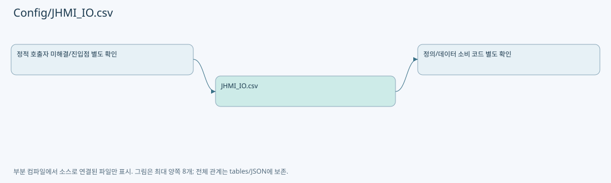

# Config/JHMI_IO.csv

| 항목 | 내용 |
| --- | --- |
| 원본 저장소 | https://github.com/kjuws10-rgb/A3Drilling.git |
| 원본 Commit | 5aee8e58439c9b455cae7c9593c9be986c3e682e |
| 원본 SHA256 | bb69757706f19ec453dcc9867514e57d8be4c9da7af9c1fcf6a59e3b0e7e8600 |
| 파일 분류 | data_schema |
| 원본 크기/행 | 2,243 bytes / 27 physical lines |
| 인코딩 | utf-8-sig |
| 검토 범위 | 구문/부분 의미 분석에서 추출한 사실. 동작·물리 단위·실장비 합격을 보증하지 않습니다. |
| 원본 링크 | [고정 Commit 원본](https://github.com/kjuws10-rgb/A3Drilling/blob/5aee8e58439c9b455cae7c9593c9be986c3e682e/Config/JHMI_IO.csv) |

## 파일의 역할과 읽는 순서

화면/장비의 데이터 항목 정의입니다. 키·형식·표시와 실제 소비 코드의 연결을 확인합니다.

## 저장/설정 스키마 참고

실행 이력·측정 레코드는 문서에 전체 복제하지 않습니다. 행 수와 구조, 소비 코드 연결을 검토하기 위한 참고입니다. 첫 행이 실제 헤더인지는 해당 CSV 파서와 대조해야 합니다.

| 항목 | 값 |
| --- | --- |
| 레코드 수 | 27 |
| 첫 행 필드 개수 | 10 |
| 첫 행 컬럼 후보 | ID / USE / ADDRESS / NAME / DIRECTION / DEV TYPE / DEV NO / INITIAL STATE / DISPLAY ORDER / DESCRIPTION |

정의 항목 목록(인증 관련 값은 포함하지 않음):

| CSV 행 | 정의 키/형식 |
| --- | --- |
| 2 | DOOR_LOCK_SENSOR / 1 / X000 / Door Lock Sensor |
| 3 | EMS / 1 / X001 / EMS |
| 4 | KEY_SWITCH_AUTO / 1 / X002 / Key Switch Auto |
| 5 | LASER_SHUTTER_CLOSED / 1 / X003 / Laser Shutter Closed |
| 6 | LEAK_SENSOR / 1 / X005 / Leak Sensor |
| 7 | SMOKE_TEMP / 1 / X006 / Smoke Temp |
| 8 | PM_LOCK / 1 / X007 / PM Lock |
| 9 | MAIN_KEY_SOL_FEEDBACK / 1 / X008 / Main Key Sol Feedback |
| 10 | BUZZER_KEY / 1 / X009 / Buzzer Key |
| 11 | SCANNER_READY / 1 / X010 / Scanner Ready |
| 12 | VISION_READY / 1 / X011 / Vision Ready |
| 13 | PANEL_IN_POSITION / 1 / X012 / Panel In Position |
| 14 | VACUUM_CHECK / 1 / X013 / Vacuum Check |
| 15 | DOOR_LOCK / 1 / Y000 / Door Lock |
| 16 | BUZZER / 1 / Y001 / Buzzer |
| 17 | TOWER_GREEN / 1 / Y002 / Tower Green |
| 18 | TOWER_YELLOW / 1 / Y003 / Tower Yellow |
| 19 | TOWER_RED / 1 / Y004 / Tower Red |
| 20 | LASER_SHUTTER_COMMAND / 1 / Y005 / Laser Shutter Command |
| 21 | MAIN_KEY_SOL / 1 / Y007 / Main Key Sol |
| 22 | PM_LOCK_RELEASE / 1 / Y008 / PM Lock Release |
| 23 | VACUUM_ON / 1 / Y009 / Vacuum On |
| 24 | SCANNER_ENABLE / 1 / Y010 / Scanner Enable |
| 25 | VISION_TRIGGER / 1 / Y011 / Vision Trigger |
| 26 | LIGHT_ON / 1 / Y012 / Light On |
| 27 | SPARE_OUTPUT / 1 / Y013 / Spare Output |

## 수정·재검증 체크

- 원본 Commit과 현재 작업 파일 SHA가 같은지 먼저 확인합니다. 다르면 이 문서를 과거 버전 자료로 취급합니다.
- 선언·직접 호출·이벤트/인터페이스 경계·설정 소비를 함께 확인합니다. 정적 연결의 빈 곳을 정상 경로로 추정하지 않습니다.
- 저장 형식/단위/식별자·재시도·취소·예외·롤백에 영향을 주는 변경은 상세 해설장과 호출자를 다시 검토합니다.
- 도구의 구문 추출과 별도 정적 추적 해설, 실제 빌드·시뮬레이션·실장비 검증 결과를 분리합니다.
