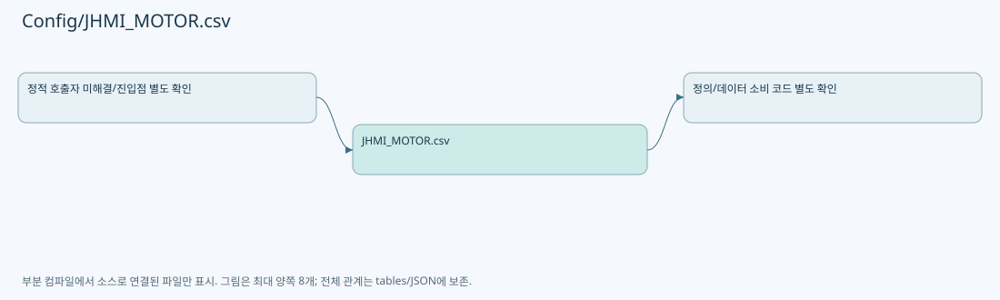

# Config/JHMI_MOTOR.csv

| 항목 | 내용 |
| --- | --- |
| 원본 저장소 | https://github.com/kjuws10-rgb/A3Drilling.git |
| 원본 Commit | 5aee8e58439c9b455cae7c9593c9be986c3e682e |
| 원본 SHA256 | ec1a5a721939383f49a40057d41308155c5af3c8a0808d5bb58c8bc7541d85ca |
| 파일 분류 | data_schema |
| 원본 크기/행 | 1,635 bytes / 9 physical lines |
| 인코딩 | utf-8-sig |
| 검토 범위 | 구문/부분 의미 분석에서 추출한 사실. 동작·물리 단위·실장비 합격을 보증하지 않습니다. |
| 원본 링크 | [고정 Commit 원본](https://github.com/kjuws10-rgb/A3Drilling/blob/5aee8e58439c9b455cae7c9593c9be986c3e682e/Config/JHMI_MOTOR.csv) |

## 파일의 역할과 읽는 순서

화면/장비의 데이터 항목 정의입니다. 키·형식·표시와 실제 소비 코드의 연결을 확인합니다.

## 저장/설정 스키마 참고

실행 이력·측정 레코드는 문서에 전체 복제하지 않습니다. 행 수와 구조, 소비 코드 연결을 검토하기 위한 참고입니다. 첫 행이 실제 헤더인지는 해당 CSV 파서와 대조해야 합니다.

| 항목 | 값 |
| --- | --- |
| 레코드 수 | 9 |
| 첫 행 필드 개수 | 39 |
| 첫 행 컬럼 후보 | NAME / USE / AXIS / VIRTURE AXIS / DEV TYPE / DEV NO / COORDINATE NO / MOTOR TYPE / SCALE / SYSTEM / STATION NAME / SUBORDINATE / DISPLAYNAME / AXIS_DIR / ALIGN_REVERSE / PROCESS_REVERSE / DIR / PRODUCT INDEX / AXIS_COLOR / REVERSE_DIR / COR_ANGLE / OFFSET_X / OFFSET_Y / OFFSET_Z / OFFSET_XT / OFFSET_YT / OFFSET_ZT / UNIT / MAXVEL / INTERLOCK MAXVEL / MAXACC / MIN / MAX / HOMEPLC / HOMETIMEOUT / HOMEPLC FLAG / DES / LOAD_ALARM_VAL / PRE_CHECK_IO |

정의 항목 목록(인증 관련 값은 포함하지 않음):

| CSV 행 | 정의 키/형식 |
| --- | --- |
| 2 | SCANNER_TILT_Z1 / 1 / 0 / -1 |
| 3 | SCANNER_TILT_Z2 / 1 / 1 / -1 |
| 4 | SCANNER_TILT_Z3 / 1 / 2 / -1 |
| 5 | SCANNER_TILT_Z4 / 1 / 3 / -1 |
| 6 | SCANNER_TILT_Z5 / 1 / 4 / -1 |
| 7 | SCANNER_TILT_Z6 / 1 / 5 / -1 |
| 8 | SCANNER_TILT_Z7 / 1 / 6 / -1 |
| 9 | SCANNER_TILT_Z8 / 1 / 7 / -1 |

## 수정·재검증 체크

- 원본 Commit과 현재 작업 파일 SHA가 같은지 먼저 확인합니다. 다르면 이 문서를 과거 버전 자료로 취급합니다.
- 선언·직접 호출·이벤트/인터페이스 경계·설정 소비를 함께 확인합니다. 정적 연결의 빈 곳을 정상 경로로 추정하지 않습니다.
- 저장 형식/단위/식별자·재시도·취소·예외·롤백에 영향을 주는 변경은 상세 해설장과 호출자를 다시 검토합니다.
- 도구의 구문 추출과 별도 정적 추적 해설, 실제 빌드·시뮬레이션·실장비 검증 결과를 분리합니다.
