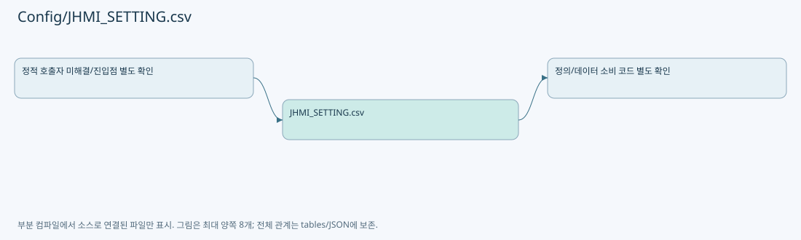

# Config/JHMI_SETTING.csv

| 항목 | 내용 |
| --- | --- |
| 원본 저장소 | https://github.com/kjuws10-rgb/A3Drilling.git |
| 원본 Commit | 96e22cd027c84bf302b23f2949b98985d7f301bb |
| 원본 SHA256 | 00e0fbdf30bfaff043ab12e06339069ab56ac2ebb63ffbabffed58f9d30a4c01 |
| 파일 분류 | data_schema |
| 원본 크기/행 | 38,040 bytes / 274 physical lines |
| 인코딩 | utf-8-sig |
| 검토 범위 | 구문/부분 의미 분석에서 추출한 사실. 동작·물리 단위·실장비 합격을 보증하지 않습니다. |
| 원본 링크 | [고정 Commit 원본](https://github.com/kjuws10-rgb/A3Drilling/blob/96e22cd027c84bf302b23f2949b98985d7f301bb/Config/JHMI_SETTING.csv) |

## 파일의 역할과 읽는 순서

화면/장비의 데이터 항목 정의입니다. 키·형식·표시와 실제 소비 코드의 연결을 확인합니다.

## 저장/설정 스키마 참고

실행 이력·측정 레코드는 문서에 전체 복제하지 않습니다. 행 수와 구조, 소비 코드 연결을 검토하기 위한 참고입니다. 첫 행이 실제 헤더인지는 해당 CSV 파서와 대조해야 합니다.

| 항목 | 값 |
| --- | --- |
| 레코드 수 | 274 |
| 첫 행 필드 개수 | 12 |
| 첫 행 컬럼 후보 | TAB / GROUP / NAME / DISPLAY NAME / DATA TYPE / UNIT / SHOW / USE / VALUE / MIN / MAX / DESCRIPTION |

정의 항목 목록(인증 관련 값과 사설 IP는 포함하지 않음):

| CSV 행 | 정의 키/형식 |
| --- | --- |
| 2 | OPTION / POWERMETER / H01_TPM_SETTLE_TIME_MS / H01 TPM Settle Time |
| 3 | OPTION / POWERMETER / H01_TPM_MEASURE_COUNT / H01 TPM Measure Count |
| 4 | OPTION / POWERMETER / H01_TPM_INTERVAL_MS / H01 TPM Interval |
| 5 | OPTION / POWERMETER / H01_TPM_TARGET_POWER_W / H01 TPM Target Power |
| 6 | OPTION / POWERMETER / H01_TPM_TOLERANCE_W / H01 TPM 허용오차 |
| 7 | OPTION / POWERMETER / H01_TPM_MAX_ATTEMPTS / H01 TPM 최대 검사 횟수 |
| 8 | OPTION / POWERMETER / H02_TPM_SETTLE_TIME_MS / H02 TPM Settle Time |
| 9 | OPTION / POWERMETER / H02_TPM_MEASURE_COUNT / H02 TPM Measure Count |
| 10 | OPTION / POWERMETER / H02_TPM_INTERVAL_MS / H02 TPM Interval |
| 11 | OPTION / POWERMETER / H02_TPM_TARGET_POWER_W / H02 TPM Target Power |
| 12 | OPTION / POWERMETER / H02_TPM_TOLERANCE_W / H02 TPM 허용오차 |
| 13 | OPTION / POWERMETER / H02_TPM_MAX_ATTEMPTS / H02 TPM 최대 검사 횟수 |
| 14 | OPTION / POWERMETER / H03_TPM_SETTLE_TIME_MS / H03 TPM Settle Time |
| 15 | OPTION / POWERMETER / H03_TPM_MEASURE_COUNT / H03 TPM Measure Count |
| 16 | OPTION / POWERMETER / H03_TPM_INTERVAL_MS / H03 TPM Interval |
| 17 | OPTION / POWERMETER / H03_TPM_TARGET_POWER_W / H03 TPM Target Power |
| 18 | OPTION / POWERMETER / H03_TPM_TOLERANCE_W / H03 TPM 허용오차 |
| 19 | OPTION / POWERMETER / H03_TPM_MAX_ATTEMPTS / H03 TPM 최대 검사 횟수 |
| 20 | OPTION / POWERMETER / H04_TPM_SETTLE_TIME_MS / H04 TPM Settle Time |
| 21 | OPTION / POWERMETER / H04_TPM_MEASURE_COUNT / H04 TPM Measure Count |
| 22 | OPTION / POWERMETER / H04_TPM_INTERVAL_MS / H04 TPM Interval |
| 23 | OPTION / POWERMETER / H04_TPM_TARGET_POWER_W / H04 TPM Target Power |
| 24 | OPTION / POWERMETER / H04_TPM_TOLERANCE_W / H04 TPM 허용오차 |
| 25 | OPTION / POWERMETER / H04_TPM_MAX_ATTEMPTS / H04 TPM 최대 검사 횟수 |
| 26 | OPTION / POWERMETER / H05_TPM_SETTLE_TIME_MS / H05 TPM Settle Time |
| 27 | OPTION / POWERMETER / H05_TPM_MEASURE_COUNT / H05 TPM Measure Count |
| 28 | OPTION / POWERMETER / H05_TPM_INTERVAL_MS / H05 TPM Interval |
| 29 | OPTION / POWERMETER / H05_TPM_TARGET_POWER_W / H05 TPM Target Power |
| 30 | OPTION / POWERMETER / H05_TPM_TOLERANCE_W / H05 TPM 허용오차 |
| 31 | OPTION / POWERMETER / H05_TPM_MAX_ATTEMPTS / H05 TPM 최대 검사 횟수 |
| 32 | OPTION / POWERMETER / H06_TPM_SETTLE_TIME_MS / H06 TPM Settle Time |
| 33 | OPTION / POWERMETER / H06_TPM_MEASURE_COUNT / H06 TPM Measure Count |
| 34 | OPTION / POWERMETER / H06_TPM_INTERVAL_MS / H06 TPM Interval |
| 35 | OPTION / POWERMETER / H06_TPM_TARGET_POWER_W / H06 TPM Target Power |
| 36 | OPTION / POWERMETER / H06_TPM_TOLERANCE_W / H06 TPM 허용오차 |
| 37 | OPTION / POWERMETER / H06_TPM_MAX_ATTEMPTS / H06 TPM 최대 검사 횟수 |
| 38 | OPTION / POWERMETER / H07_TPM_SETTLE_TIME_MS / H07 TPM Settle Time |
| 39 | OPTION / POWERMETER / H07_TPM_MEASURE_COUNT / H07 TPM Measure Count |
| 40 | OPTION / POWERMETER / H07_TPM_INTERVAL_MS / H07 TPM Interval |
| 41 | OPTION / POWERMETER / H07_TPM_TARGET_POWER_W / H07 TPM Target Power |
| 42 | OPTION / POWERMETER / H07_TPM_TOLERANCE_W / H07 TPM 허용오차 |
| 43 | OPTION / POWERMETER / H07_TPM_MAX_ATTEMPTS / H07 TPM 최대 검사 횟수 |
| 44 | OPTION / POWERMETER / H08_TPM_SETTLE_TIME_MS / H08 TPM Settle Time |
| 45 | OPTION / POWERMETER / H08_TPM_MEASURE_COUNT / H08 TPM Measure Count |
| 46 | OPTION / POWERMETER / H08_TPM_INTERVAL_MS / H08 TPM Interval |
| 47 | OPTION / POWERMETER / H08_TPM_TARGET_POWER_W / H08 TPM Target Power |
| 48 | OPTION / POWERMETER / H08_TPM_TOLERANCE_W / H08 TPM 허용오차 |
| 49 | OPTION / POWERMETER / H08_TPM_MAX_ATTEMPTS / H08 TPM 최대 검사 횟수 |
| 50 | OPTION / POWERMETER / TPM_COOLING_TIME_MS / TPM Cooling Time |
| 51 | OPTION / POWERMETER / TPM_TOLERANCE_W / TPM Power Tolerance |
| 52 | OPTION / POWERMETER / TPM_MAX_ATTEMPTS / TPM Maximum Attempts |
| 53 | OPTION / POWERMETER / TPM_STAGE_Y_TOLERANCE_MM / PowerMeasure Stage Y Tolerance |
| 54 | OPTION / POWERMETER / TPM_OPERATION_TIMEOUT_MS / PowerMeasure Operation Timeout |
| 55 | OPTION / RUNOPTION / RUNOPTION_ZERO_DEFENCE_USE / 0선방어 |
| 56 | OPTION / RUNOPTION / RUNOPTION_CURRENT_GROUP / 0선방어 Current Group |
| 57 | OPTION / RUNOPTION / RUNOPTION_FOLLOWUP_USE / 후속 1줄검사 |
| 58 | OPTION / RUNOPTION / RUNOPTION_DISTORTION_GROUP0_USE / Distortion Key Group 0 |
| 59 | OPTION / RUNOPTION / RUNOPTION_DISTORTION_GROUP1_USE / Distortion Key Group 1 |
| 60 | OPTION / RUNOPTION / RUNOPTION_DISTORTION_GROUP2_USE / Distortion Key Group 2 |
| 61 | OPTION / RUNOPTION / RUNOPTION_REVIEW_METHOD / Review Method |
| 62 | OPTION / RUNOPTION / RUNOPTION_REVIEW_LINE / Review Line |
| 63 | OPTION / RUNOPTION / RUNOPTION_REVIEW_IMMEDIATE_RETRY / Review Immediate Retry |
| 64 | OPTION / RUNOPTION / RUNOPTION_REVIEW_RETRY_COUNT / Review Retry Count |
| 65 | OPTION / PATH / LocalScriptPath / Local Script Path |
| 66 | OPTION / PATH / AutomationScriptPath / Automation Script Path |
| 67 | OPTION / SCRIPT / SCRIPT_BUFFERED_RUN_USE / Script Buffered Run Use |
| 68 | OPTION / SCRIPT / SCRIPT_BUFFERED_RUN_LINES_PER_COMMAND / Buffered Run Lines Per Command |
| 69 | OPTION / SCRIPT / SCRIPT_BUFFERED_RUN_TIMEOUT_MS / Buffered Run Timeout |
| 70 | OPTION / SCRIPT / SCRIPT_BUFFERED_RUN_QUEUE_SIZE / Buffered Run Queue Size |
| 71 | OPTION / SCRIPT / AUTOMATION1_SIMULATOR_USE / Automation1 Simulator Use |
| 72 | OPTION / RECIPE / SELECT_RECIPE / Select Recipe |
| 73 | OPTION / AUTOMATION / H01_AUTOMATION_NO / H01 Automation No |
| 74 | OPTION / AUTOMATION / H01_AUTOMATION_TASK_NO / H01 Automation Task No |
| 75 | OPTION / AUTOMATION / H02_AUTOMATION_NO / H02 Automation No |
| 76 | OPTION / AUTOMATION / H02_AUTOMATION_TASK_NO / H02 Automation Task No |
| 77 | OPTION / AUTOMATION / H03_AUTOMATION_NO / H03 Automation No |
| 78 | OPTION / AUTOMATION / H03_AUTOMATION_TASK_NO / H03 Automation Task No |
| 79 | OPTION / AUTOMATION / H04_AUTOMATION_NO / H04 Automation No |
| 80 | OPTION / AUTOMATION / H04_AUTOMATION_TASK_NO / H04 Automation Task No |
| 81 | OPTION / AUTOMATION / H05_AUTOMATION_NO / H05 Automation No |
| 82 | OPTION / AUTOMATION / H05_AUTOMATION_TASK_NO / H05 Automation Task No |
| 83 | OPTION / AUTOMATION / H06_AUTOMATION_NO / H06 Automation No |
| 84 | OPTION / AUTOMATION / H06_AUTOMATION_TASK_NO / H06 Automation Task No |
| 85 | OPTION / AUTOMATION / H07_AUTOMATION_NO / H07 Automation No |
| 86 | OPTION / AUTOMATION / H07_AUTOMATION_TASK_NO / H07 Automation Task No |
| 87 | OPTION / AUTOMATION / H08_AUTOMATION_NO / H08 Automation No |
| 88 | OPTION / AUTOMATION / H08_AUTOMATION_TASK_NO / H08 Automation Task No |
| 89 | OPTION / REVIEW / VisionXFlip / X Flip |
| 90 | OPTION / REVIEW / VisionYFlip / Y Flip |
| 91 | OPTION / REVIEW / VisionXyFlip / XY Flip |
| 92 | OPTION / REVIEW / REVIEW_X_ANIMATION_FLIP / Review X Animation Flip |
| 93 | OPTION / REVIEW / VISION_ANIMATION_USE / Vision Animation Use |
| 94 | OPTION / REVIEW / MaxHoleCountPerLine / MaxHoleCountPerLine |
| 95 | OPTION / REVIEW / Review_Camera_Resolution / Review_Camera_Resolution |
| 96 | OPTION / REVIEW / REVIEW_OFFSET_SCALE / Review Offset Scale |
| 97 | OPTION / REVIEW / REVIEW_LEVEL1_MAX / Review Level 1 Max |
| 98 | OPTION / REVIEW / REVIEW_LEVEL2_MAX / Review Level 2 Max |
| 99 | OPTION / REVIEW / REVIEW_LEVEL3_MAX / Review Level 3 Max |
| 100 | OPTION / REVIEW / REVIEW_LEVEL1_COLOR / Review Level 1 Color |
| 101 | OPTION / REVIEW / REVIEW_LEVEL2_COLOR / Review Level 2 Color |
| 102 | OPTION / REVIEW / REVIEW_LEVEL3_COLOR / Review Level 3 Color |
| 103 | OPTION / REVIEW / REVIEW_LEVEL4_COLOR / Review Level 4 Color |
| 104 | OPTION / ALIGN / Align_Camera_Resolution / Align_Camera_Resolution |
| 105 | OPTION / ALIGN / ALIGN_OFFSET_SCALE / Align Offset Scale |
| 106 | OPTION / ALIGN / Wapage_AlignBase_Tolerance / Wapage_AlignBase_Tolerance |
| 107 | OPTION / INTERLOCK / SCANNER_TEMP_LIMIT / Scanner Temp Limit |
| 108 | OPTION / INTERLOCK / DOE_Z_TOLERANCE / DOE Z Tolerance |
| 109 | OPTION / ALIGN / ALIGN_OFFSET_TOLERANCE / Align Offset Tolerance |
| 110 | OPTION / INTERLOCK / LASER_THG_HOUR_LIMIT / LASER THG Hour Limit |
| 111 | OPTION / INTERLOCK / ATTENUATOR_DEGREE_MIN_SW_LIMIT / Attenuator Degree Min SW Limit |
| 112 | OPTION / INTERLOCK / ATTENUATOR_DEGREE_MAX_SW_LIMIT / Attenuator Degree Max SW Limit |
| 113 | INTERFACE / HOST / HostIp / Host IP |
| 114 | INTERFACE / HOST / Port / Host Port |
| 115 | INTERFACE / HOST / Timeout / Message Timeout |
| 116 | INTERFACE / HOST / Retry / Retry Count |
| 117 | IO / OUTPUT / OutputOnDelay / Output ON Delay |
| 118 | IO / OUTPUT / OutputOffDelay / Output OFF Delay |
| 119 | IO / INPUT / InputStableTime / Input Stable Time |
| 120 | MOTOR / REVIEW / REVIEW_X_SPEED / Review X Speed |
| 121 | MOTOR / REVIEW / REVIEW_X_ACC / Review X Acc |
| 122 | MOTOR / STAGE / STAGE_START_POS_Y / Stage Start Pos Y |
| 123 | MOTOR / ALIGN / DK0_STAGE_Y_POSITION / DK0 Stage Y Position |
| 124 | MOTOR / ALIGN / DK1_STAGE_Y_POSITION / DK1 Stage Y Position |
| 125 | MOTOR / ALIGN / DK2_STAGE_Y_POSITION / DK2 Stage Y Position |
| 126 | MOTOR / AXIS / MoveTimeout / Move Timeout |
| 127 | OPTION / SCANNER / SCAN_ENCODER_SCALE / Scan Encoder Scale |
| 128 | OPTION / SCANNER / SCAN_ENCODER_FEEDBACK_FLIP / Scan Encoder Feedback Flip |
| 129 | OPTION / SCANNER / SCAN_START_JUMP_STEP / Scan Start Jump Step |
| 130 | OPTION / SCANNER / SCAN_LINE_PRE_APPROACH_USE / Scan Line Pre Approach Use |
| 131 | OPTION / SCANNER / SCAN_LINE_PRE_APPROACH_DISTANCE / Scan Line Pre Approach Distance |
| 132 | OPTION / SCANNER / STAGE_SCAN_DIRECTION_Y / Stage Scan Direction Y |
| 133 | OPTION / SCANNER / HeadGapX / Head Gap X |
| 134 | OPTION / SCANNER / HeadGapY / Head Gap Y |
| 135 | OPTION / SCANNER / REVIEW_TO_HEAD1_GAP_Y / Review To Head1 Gap Y |
| 136 | OPTION / SCANNER / H01_USE / H01 Use |
| 137 | OPTION / SCANNER / H02_USE / H02 Use |
| 138 | OPTION / SCANNER / H03_USE / H03 Use |
| 139 | OPTION / SCANNER / H04_USE / H04 Use |
| 140 | OPTION / SCANNER / H05_USE / H05 Use |
| 141 | OPTION / SCANNER / H06_USE / H06 Use |
| 142 | OPTION / SCANNER / H07_USE / H07 Use |
| 143 | OPTION / SCANNER / H08_USE / H08 Use |
| 144 | OPTION / SCANNER / H01_AK_POSITION_X / H01 AK Position X |
| 145 | OPTION / SCANNER / H01_SCAN_FIELD_WIDTH_X / H01 Scan Field Width X |
| 146 | OPTION / SCANNER / H02_SCAN_FIELD_WIDTH_X / H02 Scan Field Width X |
| 147 | OPTION / SCANNER / H03_SCAN_FIELD_WIDTH_X / H03 Scan Field Width X |
| 148 | OPTION / SCANNER / H04_SCAN_FIELD_WIDTH_X / H04 Scan Field Width X |
| 149 | OPTION / SCANNER / H05_SCAN_FIELD_WIDTH_X / H05 Scan Field Width X |
| 150 | OPTION / SCANNER / H06_SCAN_FIELD_WIDTH_X / H06 Scan Field Width X |
| 151 | OPTION / SCANNER / H07_SCAN_FIELD_WIDTH_X / H07 Scan Field Width X |
| 152 | OPTION / SCANNER / H08_SCAN_FIELD_WIDTH_X / H08 Scan Field Width X |
| 153 | OPTION / SCANNER / H01_SCANNER_XY_FLIP / H01 Scanner XY Flip |
| 154 | OPTION / SCANNER / H01_SCANNER_X_FLIP / H01 Scanner X Flip |
| 155 | OPTION / SCANNER / H01_SCANNER_Y_FLIP / H01 Scanner Y Flip |
| 156 | OPTION / SCANNER / H02_SCANNER_XY_FLIP / H02 Scanner XY Flip |
| 157 | OPTION / SCANNER / H02_SCANNER_X_FLIP / H02 Scanner X Flip |
| 158 | OPTION / SCANNER / H02_SCANNER_Y_FLIP / H02 Scanner Y Flip |
| 159 | OPTION / SCANNER / H03_SCANNER_XY_FLIP / H03 Scanner XY Flip |
| 160 | OPTION / SCANNER / H03_SCANNER_X_FLIP / H03 Scanner X Flip |
| 161 | OPTION / SCANNER / H03_SCANNER_Y_FLIP / H03 Scanner Y Flip |
| 162 | OPTION / SCANNER / H04_SCANNER_XY_FLIP / H04 Scanner XY Flip |
| 163 | OPTION / SCANNER / H04_SCANNER_X_FLIP / H04 Scanner X Flip |
| 164 | OPTION / SCANNER / H04_SCANNER_Y_FLIP / H04 Scanner Y Flip |
| 165 | OPTION / SCANNER / H05_SCANNER_XY_FLIP / H05 Scanner XY Flip |
| 166 | OPTION / SCANNER / H05_SCANNER_X_FLIP / H05 Scanner X Flip |
| 167 | OPTION / SCANNER / H05_SCANNER_Y_FLIP / H05 Scanner Y Flip |
| 168 | OPTION / SCANNER / H06_SCANNER_XY_FLIP / H06 Scanner XY Flip |
| 169 | OPTION / SCANNER / H06_SCANNER_X_FLIP / H06 Scanner X Flip |
| 170 | OPTION / SCANNER / H06_SCANNER_Y_FLIP / H06 Scanner Y Flip |
| 171 | OPTION / SCANNER / H07_SCANNER_XY_FLIP / H07 Scanner XY Flip |
| 172 | OPTION / SCANNER / H07_SCANNER_X_FLIP / H07 Scanner X Flip |
| 173 | OPTION / SCANNER / H07_SCANNER_Y_FLIP / H07 Scanner Y Flip |
| 174 | OPTION / SCANNER / H08_SCANNER_XY_FLIP / H08 Scanner XY Flip |
| 175 | OPTION / SCANNER / H08_SCANNER_X_FLIP / H08 Scanner X Flip |
| 176 | OPTION / SCANNER / H08_SCANNER_Y_FLIP / H08 Scanner Y Flip |
| 177 | OPTION / SCANNER / H01_X_AXIS / H01 X Axis |
| 178 | OPTION / SCANNER / H01_Y_AXIS / H01 Y Axis |
| 179 | OPTION / SCANNER / H01_SCANNER_Z_USE / H01 Scanner Z Use |
| 180 | OPTION / SCANNER / H01_SCANNER_Z_AXIS / H01 Scanner Z Axis |
| 181 | OPTION / SCANNER / H01_ENCODER_AXIS / H01 Encoder Axis |
| 182 | OPTION / SCANNER / H01_ENCODER_SCALE / H01 Encoder Scale |
| 183 | OPTION / SCANNER / H01_ENCODER_FEEDBACK_FLIP / H01 Encoder Feedback Flip |
| 184 | OPTION / SCANNER / H02_X_AXIS / H02 X Axis |
| 185 | OPTION / SCANNER / H02_Y_AXIS / H02 Y Axis |
| 186 | OPTION / SCANNER / H02_SCANNER_Z_USE / H02 Scanner Z Use |
| 187 | OPTION / SCANNER / H02_SCANNER_Z_AXIS / H02 Scanner Z Axis |
| 188 | OPTION / SCANNER / H02_ENCODER_AXIS / H02 Encoder Axis |
| 189 | OPTION / SCANNER / H02_ENCODER_SCALE / H02 Encoder Scale |
| 190 | OPTION / SCANNER / H02_ENCODER_FEEDBACK_FLIP / H02 Encoder Feedback Flip |
| 191 | OPTION / SCANNER / H03_X_AXIS / H03 X Axis |
| 192 | OPTION / SCANNER / H03_Y_AXIS / H03 Y Axis |
| 193 | OPTION / SCANNER / H03_SCANNER_Z_USE / H03 Scanner Z Use |
| 194 | OPTION / SCANNER / H03_SCANNER_Z_AXIS / H03 Scanner Z Axis |
| 195 | OPTION / SCANNER / H03_ENCODER_AXIS / H03 Encoder Axis |
| 196 | OPTION / SCANNER / H03_ENCODER_SCALE / H03 Encoder Scale |
| 197 | OPTION / SCANNER / H03_ENCODER_FEEDBACK_FLIP / H03 Encoder Feedback Flip |
| 198 | OPTION / SCANNER / H04_X_AXIS / H04 X Axis |
| 199 | OPTION / SCANNER / H04_Y_AXIS / H04 Y Axis |
| 200 | OPTION / SCANNER / H04_SCANNER_Z_USE / H04 Scanner Z Use |
| 201 | OPTION / SCANNER / H04_SCANNER_Z_AXIS / H04 Scanner Z Axis |
| 202 | OPTION / SCANNER / H04_ENCODER_AXIS / H04 Encoder Axis |
| 203 | OPTION / SCANNER / H04_ENCODER_SCALE / H04 Encoder Scale |
| 204 | OPTION / SCANNER / H04_ENCODER_FEEDBACK_FLIP / H04 Encoder Feedback Flip |
| 205 | OPTION / SCANNER / H05_X_AXIS / H05 X Axis |
| 206 | OPTION / SCANNER / H05_Y_AXIS / H05 Y Axis |
| 207 | OPTION / SCANNER / H05_SCANNER_Z_USE / H05 Scanner Z Use |
| 208 | OPTION / SCANNER / H05_SCANNER_Z_AXIS / H05 Scanner Z Axis |
| 209 | OPTION / SCANNER / H05_ENCODER_AXIS / H05 Encoder Axis |
| 210 | OPTION / SCANNER / H05_ENCODER_SCALE / H05 Encoder Scale |
| 211 | OPTION / SCANNER / H05_ENCODER_FEEDBACK_FLIP / H05 Encoder Feedback Flip |
| 212 | OPTION / SCANNER / H06_X_AXIS / H06 X Axis |
| 213 | OPTION / SCANNER / H06_Y_AXIS / H06 Y Axis |
| 214 | OPTION / SCANNER / H06_SCANNER_Z_USE / H06 Scanner Z Use |
| 215 | OPTION / SCANNER / H06_SCANNER_Z_AXIS / H06 Scanner Z Axis |
| 216 | OPTION / SCANNER / H06_ENCODER_AXIS / H06 Encoder Axis |
| 217 | OPTION / SCANNER / H06_ENCODER_SCALE / H06 Encoder Scale |
| 218 | OPTION / SCANNER / H06_ENCODER_FEEDBACK_FLIP / H06 Encoder Feedback Flip |
| 219 | OPTION / SCANNER / H07_X_AXIS / H07 X Axis |
| 220 | OPTION / SCANNER / H07_Y_AXIS / H07 Y Axis |
| 221 | OPTION / SCANNER / H07_SCANNER_Z_USE / H07 Scanner Z Use |
| 222 | OPTION / SCANNER / H07_SCANNER_Z_AXIS / H07 Scanner Z Axis |
| 223 | OPTION / SCANNER / H07_ENCODER_AXIS / H07 Encoder Axis |
| 224 | OPTION / SCANNER / H07_ENCODER_SCALE / H07 Encoder Scale |
| 225 | OPTION / SCANNER / H07_ENCODER_FEEDBACK_FLIP / H07 Encoder Feedback Flip |
| 226 | OPTION / SCANNER / H08_X_AXIS / H08 X Axis |
| 227 | OPTION / SCANNER / H08_Y_AXIS / H08 Y Axis |
| 228 | OPTION / SCANNER / H08_SCANNER_Z_USE / H08 Scanner Z Use |
| 229 | OPTION / SCANNER / H08_SCANNER_Z_AXIS / H08 Scanner Z Axis |
| 230 | OPTION / SCANNER / H08_ENCODER_AXIS / H08 Encoder Axis |
| 231 | OPTION / SCANNER / H08_ENCODER_SCALE / H08 Encoder Scale |
| 232 | OPTION / SCANNER / H08_ENCODER_FEEDBACK_FLIP / H08 Encoder Feedback Flip |
| 233 | OPTION / SCANNER / H01_SCANNER_DIO_NO / H01 Scanner DIO No |
| 234 | OPTION / SCANNER / H02_SCANNER_DIO_NO / H02 Scanner DIO No |
| 235 | OPTION / SCANNER / H03_SCANNER_DIO_NO / H03 Scanner DIO No |
| 236 | OPTION / SCANNER / H04_SCANNER_DIO_NO / H04 Scanner DIO No |
| 237 | OPTION / SCANNER / H05_SCANNER_DIO_NO / H05 Scanner DIO No |
| 238 | OPTION / SCANNER / H06_SCANNER_DIO_NO / H06 Scanner DIO No |
| 239 | OPTION / SCANNER / H07_SCANNER_DIO_NO / H07 Scanner DIO No |
| 240 | OPTION / SCANNER / H08_SCANNER_DIO_NO / H08 Scanner DIO No |
| 241 | OPTION / SCANNER / H01_SCANNER_AIO_NO / H01 Scanner AIO No |
| 242 | OPTION / SCANNER / H02_SCANNER_AIO_NO / H02 Scanner AIO No |
| 243 | OPTION / SCANNER / H03_SCANNER_AIO_NO / H03 Scanner AIO No |
| 244 | OPTION / SCANNER / H04_SCANNER_AIO_NO / H04 Scanner AIO No |
| 245 | OPTION / SCANNER / H05_SCANNER_AIO_NO / H05 Scanner AIO No |
| 246 | OPTION / SCANNER / H06_SCANNER_AIO_NO / H06 Scanner AIO No |
| 247 | OPTION / SCANNER / H07_SCANNER_AIO_NO / H07 Scanner AIO No |
| 248 | OPTION / SCANNER / H08_SCANNER_AIO_NO / H08 Scanner AIO No |
| 249 | ALARM / ALARM / ResetTimeout / Reset Timeout |
| 250 | ALARM / BUZZER / BuzzerAutoOff / Buzzer Auto Off |
| 251 | OPTION / SCANNER / H01_SCAN_FIELD_HEIGHT_Y / H01 Scan Field Height Y |
| 252 | OPTION / SCANNER / H01_DOE_ROTATION_ANGLE / H01 DOE 회전 각도 |
| 253 | OPTION / SCANNER / H01_DOE_EXIST / H01 DOE Exist |
| 254 | OPTION / SCANNER / H02_SCAN_FIELD_HEIGHT_Y / H02 Scan Field Height Y |
| 255 | OPTION / SCANNER / H02_DOE_ROTATION_ANGLE / H02 DOE 회전 각도 |
| 256 | OPTION / SCANNER / H02_DOE_EXIST / H02 DOE Exist |
| 257 | OPTION / SCANNER / H03_SCAN_FIELD_HEIGHT_Y / H03 Scan Field Height Y |
| 258 | OPTION / SCANNER / H03_DOE_ROTATION_ANGLE / H03 DOE 회전 각도 |
| 259 | OPTION / SCANNER / H03_DOE_EXIST / H03 DOE Exist |
| 260 | OPTION / SCANNER / H04_SCAN_FIELD_HEIGHT_Y / H04 Scan Field Height Y |
| 261 | OPTION / SCANNER / H04_DOE_ROTATION_ANGLE / H04 DOE 회전 각도 |
| 262 | OPTION / SCANNER / H04_DOE_EXIST / H04 DOE Exist |
| 263 | OPTION / SCANNER / H05_SCAN_FIELD_HEIGHT_Y / H05 Scan Field Height Y |
| 264 | OPTION / SCANNER / H05_DOE_ROTATION_ANGLE / H05 DOE 회전 각도 |
| 265 | OPTION / SCANNER / H05_DOE_EXIST / H05 DOE Exist |
| 266 | OPTION / SCANNER / H06_SCAN_FIELD_HEIGHT_Y / H06 Scan Field Height Y |
| 267 | OPTION / SCANNER / H06_DOE_ROTATION_ANGLE / H06 DOE 회전 각도 |
| 268 | OPTION / SCANNER / H06_DOE_EXIST / H06 DOE Exist |
| 269 | OPTION / SCANNER / H07_SCAN_FIELD_HEIGHT_Y / H07 Scan Field Height Y |
| 270 | OPTION / SCANNER / H07_DOE_ROTATION_ANGLE / H07 DOE 회전 각도 |
| 271 | OPTION / SCANNER / H07_DOE_EXIST / H07 DOE Exist |
| 272 | OPTION / SCANNER / H08_SCAN_FIELD_HEIGHT_Y / H08 Scan Field Height Y |
| 273 | OPTION / SCANNER / H08_DOE_ROTATION_ANGLE / H08 DOE 회전 각도 |
| 274 | OPTION / SCANNER / H08_DOE_EXIST / H08 DOE Exist |

## 수정·재검증 체크

- 원본 Commit과 현재 작업 파일 SHA가 같은지 먼저 확인합니다. 다르면 이 문서를 과거 버전 자료로 취급합니다.
- 선언·직접 호출·이벤트/인터페이스 경계·설정 소비를 함께 확인합니다. 정적 연결의 빈 곳을 정상 경로로 추정하지 않습니다.
- 저장 형식/단위/식별자·재시도·취소·예외·롤백에 영향을 주는 변경은 상세 해설장과 호출자를 다시 검토합니다.
- 도구의 구문 추출과 별도 정적 추적 해설, 실제 빌드·시뮬레이션·실장비 검증 결과를 분리합니다.
