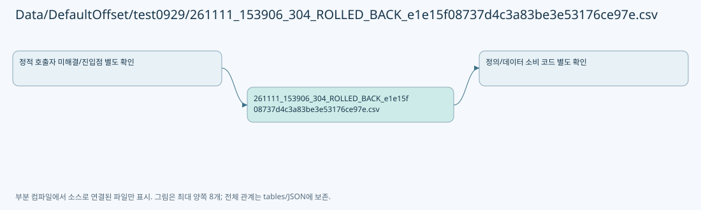

# Data/DefaultOffset/test0929/261111_153906_304_ROLLED_BACK_e1e15f08737d4c3a83be3e53176ce97e.csv

| 항목 | 내용 |
| --- | --- |
| 원본 저장소 | https://github.com/kjuws10-rgb/A3Drilling.git |
| 원본 Commit | 5aee8e58439c9b455cae7c9593c9be986c3e682e |
| 원본 SHA256 | 7bf5e79f49ecb09d6fe3e0fcf7d7d0ab2f3e5728c20838b6cb1ce771a0afb5cd |
| 파일 분류 | data_schema |
| 원본 크기/행 | 74,963 bytes / 129 physical lines |
| 인코딩 | utf-8-sig |
| 검토 범위 | 구문/부분 의미 분석에서 추출한 사실. 동작·물리 단위·실장비 합격을 보증하지 않습니다. |
| 원본 링크 | [고정 Commit 원본](https://github.com/kjuws10-rgb/A3Drilling/blob/5aee8e58439c9b455cae7c9593c9be986c3e682e/Data/DefaultOffset/test0929/261111_153906_304_ROLLED_BACK_e1e15f08737d4c3a83be3e53176ce97e.csv) |

## 파일의 역할과 읽는 순서

실행 중 생성·저장된 참고 산출물입니다. 코드·정의·실측/이력 데이터를 구분합니다.

## 저장/설정 스키마 참고

실행 이력·측정 레코드는 문서에 전체 복제하지 않습니다. 행 수와 구조, 소비 코드 연결을 검토하기 위한 참고입니다. 첫 행이 실제 헤더인지는 해당 CSV 파서와 대조해야 합니다.

| 항목 | 값 |
| --- | --- |
| 레코드 수 | 129 |
| 첫 행 필드 개수 | 49 |
| 첫 행 컬럼 후보 | SESSION / RECIPE / ACTION / TIME / MODE / HEAD / TEST_ID / Q / R / AUTOMATION_SIMULATION / STAGE_SIMULATION / VISION_SIMULATION / BEAM / MARK_X / MARK_Y / RECV_TARGET_HOLE_X / RECV_TARGET_HOLE_Y / VISION_FLIP_X / VISION_FLIP_Y / ENCODER_X / ENCODER_Y / CAPTURE_STARTED_AT / JUDGE / CENTER_ERROR_X / CENTER_ERROR_Y / RESIDUAL / PITCH_X / PITCH_Y / BEFORE_X / BEFORE_Y / AFTER_X / AFTER_Y / BOARD_CENTER_X / TEST_STAGE_Y / TOLERANCE / FIELD_HALF_X / FIELD_HALF_Y / DOE_ANGLE / MODEL / VISION_REFERENCE_CELL / TARGET_REVIEW_X / TARGET_STAGE_Y / CENTER_REVIEW_X / CENTER_STAGE_Y / FIT_CENTER_X / FIT_CENTER_Y / MACHINING_MODE / CROSS_FULL_SIZE_MM / VISION_METHOD |

## 수정·재검증 체크

- 원본 Commit과 현재 작업 파일 SHA가 같은지 먼저 확인합니다. 다르면 이 문서를 과거 버전 자료로 취급합니다.
- 선언·직접 호출·이벤트/인터페이스 경계·설정 소비를 함께 확인합니다. 정적 연결의 빈 곳을 정상 경로로 추정하지 않습니다.
- 저장 형식/단위/식별자·재시도·취소·예외·롤백에 영향을 주는 변경은 상세 해설장과 호출자를 다시 검토합니다.
- 도구의 구문 추출과 별도 정적 추적 해설, 실제 빌드·시뮬레이션·실장비 검증 결과를 분리합니다.
