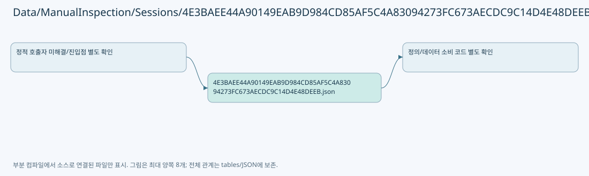

# Data/ManualInspection/Sessions/4E3BAEE44A90149EAB9D984CD85AF5C4A83094273FC673AECDC9C14D4E48DEEB.json

| 항목 | 내용 |
| --- | --- |
| 원본 저장소 | https://github.com/kjuws10-rgb/A3Drilling.git |
| 원본 Commit | 0219666f9053b907d96d7e0aa7d0c6c1be3a73d4 |
| 원본 SHA256 | a23f061caddf8b0ed9a85cf3e16433d45c5403bf9d1565b21cdf7a4d26626221 |
| 파일 분류 | data_schema |
| 원본 크기/행 | 19,153,118 bytes / 728,393 physical lines |
| 인코딩 | utf-8-sig |
| 검토 범위 | 구문/부분 의미 분석에서 추출한 사실. 동작·물리 단위·실장비 합격을 보증하지 않습니다. |
| 원본 링크 | [고정 Commit 원본](https://github.com/kjuws10-rgb/A3Drilling/blob/0219666f9053b907d96d7e0aa7d0c6c1be3a73d4/Data/ManualInspection/Sessions/4E3BAEE44A90149EAB9D984CD85AF5C4A83094273FC673AECDC9C14D4E48DEEB.json) |

## 파일의 역할과 읽는 순서

실행 중 생성·저장된 참고 산출물입니다. 코드·정의·실측/이력 데이터를 구분합니다.

## 운영 JSON 구조 참고

측정·작업 세션은 실행 코드가 아닙니다. 실제 값·동적 키·원문 사본은 복제하지 않으며 속성 경로와 자료형만 제공합니다. 파싱 실패 시에도 본문을 공개하지 않습니다.

| 항목 | 값 |
| --- | --- |
| 파싱 상태 | parsed |
| 원문 행 수 | 728393 |

| 속성 경로 | 자료형 |
| --- | --- |
| $ | object |
| $.AllowManual | boolean |
| $.LevelBounds | array |
| $.LevelBounds[] | number |
| $.LevelMetric | string |
| $.LevelNames | array |
| $.LevelNames[] | string |
| $.Scenario | string |
| $.SchemaVersion | number |
| $.Session | object |
| $.Session.ActiveValuesByPointKey | object |
| $.Session.ActiveValuesByPointKey.[dynamic_or_sensitive_key] | object |
| $.Session.ActiveValuesByPointKey.[dynamic_or_sensitive_key].IsFinite | boolean |
| $.Session.ActiveValuesByPointKey.[dynamic_or_sensitive_key].XUm | number |
| $.Session.ActiveValuesByPointKey.[dynamic_or_sensitive_key].YUm | number |
| $.Session.AppliedCandidates | array |
| $.Session.AppliedMeasurements | object |
| $.Session.Audit | array |
| $.Session.Audit[] | object |
| $.Session.Audit[].At | string |
| $.Session.Audit[].Kind | string |
| $.Session.Audit[].Message | string |
| $.Session.Candidate | null |
| $.Session.CandidateBackups | array |
| $.Session.ConsumedMeasurementHistory | array |
| $.Session.Context | object |
| $.Session.Context.CoordinateSignature | string |
| $.Session.Context.LineageValid | boolean |
| $.Session.Context.RecipeId | string |
| $.Session.Context.RevisionId | string |
| $.Session.Context.RunId | string |
| $.Session.Context.SourceResultPath | string |
| $.Session.History | array |
| $.Session.Limits | object |
| $.Session.Limits.FieldWidthMm | number |
| $.Session.Limits.MaxDeltaUm | number |
| $.Session.Limits.MaxTotalUm | number |
| $.Session.OffsetHistoryCursor | number |
| $.Session.OffsetTimelineRevisionIds | array |
| $.Session.OffsetTimelineRevisionIds[] | string |
| $.Session.Operation | object |
| $.Session.Operation.BaseRevisionId | string |
| $.Session.Operation.CompletedKeys | array |
| $.Session.Operation.CoordinateSignature | string |
| $.Session.Operation.Error | string |
| $.Session.Operation.Id | string |
| $.Session.Operation.IsRetry | boolean |
| $.Session.Operation.Keys | array |
| $.Session.Operation.Keys[] | string |
| $.Session.Operation.Kind | number |
| $.Session.Operation.MeasurementVersionsBefore | object |
| $.Session.Operation.MeasurementVersionsBefore.[dynamic_or_sensitive_key] | number |
| $.Session.Operation.RecipeId | string |
| $.Session.Operation.RemainingKeys | array |
| $.Session.Operation.RemainingKeys[] | string |
| $.Session.Operation.RunId | string |
| $.Session.Operation.State | number |
| $.Session.Points | array |
| $.Session.Points[] | object |
| $.Session.Points[].BeamNo | number |
| $.Session.Points[].CellNo | number |
| $.Session.Points[].Column | number |
| $.Session.Points[].ErrorXUm | null |
| $.Session.Points[].ErrorYUm | null |
| $.Session.Points[].ExternalObservedAt | null |
| $.Session.Points[].HasAppliedOffsetEvidence | boolean |
| $.Session.Points[].HasFiniteError | boolean |
| $.Session.Points[].HeadNo | number |
| $.Session.Points[].IsDirectMeasurement | boolean |
| $.Session.Points[].Judge | string |
| $.Session.Points[].Key | string |
| $.Session.Points[].Masked | boolean |
| $.Session.Points[].MeasurementVersion | number |
| $.Session.Points[].OffsetKey | string |
| $.Session.Points[].OriginalMeasurement | null |
| $.Session.Points[].ProxySource | null |
| $.Session.Points[].Row | number |
| $.Session.Points[].ShotNo | number |
| $.Session.Points[].Source | string |
| $.Session.Points[].XMm | number |
| $.Session.Points[].YMm | number |
| $.Session.Revisions | array |
| $.Session.Revisions[] | object |
| $.Session.Revisions[].CreatedAt | string |
| $.Session.Revisions[].Id | string |
| $.Session.Revisions[].InitializedOffsetKeys | array |
| $.Session.Revisions[].Kind | string |
| $.Session.Revisions[].ParentId | string |
| $.Session.Revisions[].Reason | string |
| $.Session.Revisions[].ValuesByPointKey | object |
| $.Session.Revisions[].ValuesByPointKey.[dynamic_or_sensitive_key] | object |
| $.Session.Revisions[].ValuesByPointKey.[dynamic_or_sensitive_key].IsFinite | boolean |
| $.Session.Revisions[].ValuesByPointKey.[dynamic_or_sensitive_key].XUm | number |
| $.Session.Revisions[].ValuesByPointKey.[dynamic_or_sensitive_key].YUm | number |
| $.Session.SchemaVersion | number |
| $.Simulation | boolean |

## 수정·재검증 체크

- 원본 Commit과 현재 작업 파일 SHA가 같은지 먼저 확인합니다. 다르면 이 문서를 과거 버전 자료로 취급합니다.
- 선언·직접 호출·이벤트/인터페이스 경계·설정 소비를 함께 확인합니다. 정적 연결의 빈 곳을 정상 경로로 추정하지 않습니다.
- 저장 형식/단위/식별자·재시도·취소·예외·롤백에 영향을 주는 변경은 상세 해설장과 호출자를 다시 검토합니다.
- 도구의 구문 추출과 별도 정적 추적 해설, 실제 빌드·시뮬레이션·실장비 검증 결과를 분리합니다.
