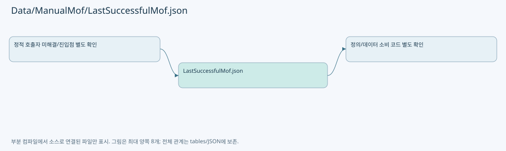

# Data/ManualMof/LastSuccessfulMof.json

| 항목 | 내용 |
| --- | --- |
| 원본 저장소 | https://github.com/kjuws10-rgb/A3Drilling.git |
| 원본 Commit | 0219666f9053b907d96d7e0aa7d0c6c1be3a73d4 |
| 원본 SHA256 | 851123430444eedfd6a430f3cb55784c59af71755e77687a57de6896aa63f3b1 |
| 파일 분류 | data_schema |
| 원본 크기/행 | 85 bytes / 1 physical lines |
| 인코딩 | utf-8-sig |
| 검토 범위 | 구문/부분 의미 분석에서 추출한 사실. 동작·물리 단위·실장비 합격을 보증하지 않습니다. |
| 원본 링크 | [고정 Commit 원본](https://github.com/kjuws10-rgb/A3Drilling/blob/0219666f9053b907d96d7e0aa7d0c6c1be3a73d4/Data/ManualMof/LastSuccessfulMof.json) |

## 파일의 역할과 읽는 순서

실행 중 생성·저장된 참고 산출물입니다. 코드·정의·실측/이력 데이터를 구분합니다.

## 운영 JSON 구조 참고

측정·작업 세션은 실행 코드가 아닙니다. 실제 값·동적 키·원문 사본은 복제하지 않으며 속성 경로와 자료형만 제공합니다. 파싱 실패 시에도 본문을 공개하지 않습니다.

| 항목 | 값 |
| --- | --- |
| 파싱 상태 | parsed |
| 원문 행 수 | 1 |

| 속성 경로 | 자료형 |
| --- | --- |
| $ | object |
| $.CompletedAt | string |
| $.ShiftOffsetX | number |
| $.ShiftOffsetY | number |

## 수정·재검증 체크

- 원본 Commit과 현재 작업 파일 SHA가 같은지 먼저 확인합니다. 다르면 이 문서를 과거 버전 자료로 취급합니다.
- 선언·직접 호출·이벤트/인터페이스 경계·설정 소비를 함께 확인합니다. 정적 연결의 빈 곳을 정상 경로로 추정하지 않습니다.
- 저장 형식/단위/식별자·재시도·취소·예외·롤백에 영향을 주는 변경은 상세 해설장과 호출자를 다시 검토합니다.
- 도구의 구문 추출과 별도 정적 추적 해설, 실제 빌드·시뮬레이션·실장비 검증 결과를 분리합니다.
